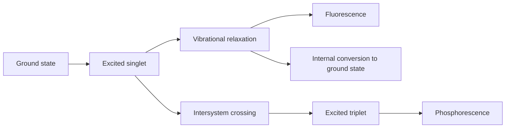
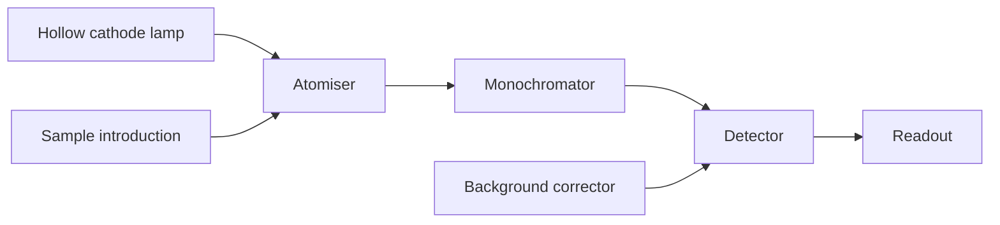
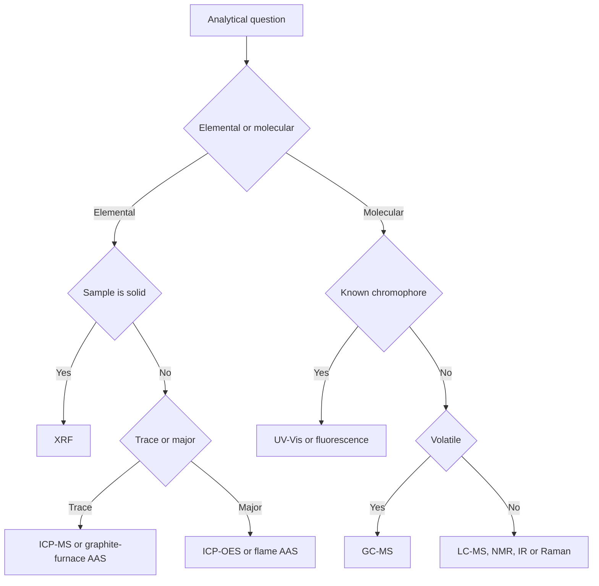

# Chapter 8 — Spectroscopic Analysis

> **Level:** Advanced (Level 7 — Analytical Chemistry)
> **Estimated study time:** 7 hours (reading) + 2 hours (exercises)
> **Prerequisites:** [Electron Shells, Orbitals and Configurations](../02-elementary-chemistry/03-electron-shells-and-electron-configurations.md); [Chemical Bonding](../02-elementary-chemistry/05-chemical-bonding.md); [Coordination Compounds](../06-inorganic-chemistry/03-coordination-compounds.md); Chapters 2–4 of this level
> **Related chapters:** [Gravimetric and Volumetric Analysis](05-gravimetric-and-volumetric-analysis.md), [Titrations](06-titrations.md), [Chromatography](07-chromatography.md), [Electroanalytical Chemistry and Potentiometry](09-electroanalytical-chemistry-and-potentiometry.md)
> **Difficulty:** ★★★★★ (5/5)

---

## 1. Learning Objectives

After working through this chapter you will be able to:

- Explain how absorption, emission, scattering and nuclear resonance spectra are used
  for identification and quantification.
- Distinguish atomic from molecular spectroscopy in terms of the states involved and
  the information obtained.
- Describe the components of an atomic absorption spectrometer and the atomisation
  sources used in flame and graphite-furnace analysis.
- Explain the origins and remedies of physical, chemical, ionisation and spectral
  interferences in atomic absorption.
- Apply Beer's law, calculate molar absorptivity, and recognise chemical and
  instrumental deviations from linearity.
- Determine two components simultaneously from absorbance measurements at two
  wavelengths.
- Explain the advantages of fluorescence over absorption and the mechanisms of
  quenching.
- Interpret infrared spectra, describe FTIR and ATR sampling, and explain quantitative
  infrared analysis.
- Describe the use of NMR as a quantitative tool and the requirements for qNMR.
- Select an ionisation source and mass analyser for a given analyte, and explain
  isotope dilution.
- Choose an appropriate spectroscopic technique from a selection matrix, and state its
  typical limit of detection.

---

## 2. Introduction

Spectroscopy is the art of learning what a substance is and how much is present by
measuring how it interacts with electromagnetic radiation. The interaction may be
absorption of ultraviolet or infrared light, emission from excited atoms, scattering
of laser light, or resonance of nuclei in a magnetic field. Each phenomenon probes a
different part of the molecule, and together they cover the range from elemental
composition to three-dimensional structure.

The analytical power comes from two features. First, spectra are *fingerprints*:
the energies at which a substance absorbs or emits are fixed by its electronic,
vibrational or nuclear structure, so a spectrum identifies it. Second, the intensity
of the interaction is proportional to the number of species present, so the same
measurement quantifies it. The proportionality is not universal — it fails at high
concentration, with stray light, and when the analyte changes chemical form — and
recognising those failures is the difference between a number and a measurement.

This chapter moves from atomic to molecular methods and from the ultraviolet to the
radiofrequency region. It emphasises the assumptions behind each calibration, because
spectroscopic methods are the most widely used in routine analysis and the most
easily misused. The worked examples are deliberately photometric: they are the
calculations a laboratory performs every day.

Prerequisites are electronic structure, bonding, coordination chemistry and the
statistical treatment of calibration from Chapter 4.

---

## 3. Fundamental Concepts

### 3.1 The electromagnetic spectrum and transitions

Electromagnetic radiation is characterised by wavelength $\lambda$, frequency $\nu$
and wavenumber $\tilde{\nu} = 1/\lambda$. The photon energy is

$$
E = h\nu = \frac{hc}{\lambda} = hc\tilde{\nu}.
$$

Different regions excite different transitions. X-rays eject core electrons and are
used for elemental analysis. Ultraviolet and visible photons (200–800 nm) excite
valence electrons. Infrared photons (4000–400 cm⁻¹) excite vibrational and rotational
transitions. Radiofrequency radiation flips nuclear spins in a magnetic field, which is
the basis of NMR.

### 3.2 Absorbance and transmittance

When light of intensity $P_0$ passes through a sample, the transmitted intensity $P$
is smaller. The **transmittance** is $T = P/P_0$ and the **absorbance** is

$$
A = -\log_{10} T = \log_{10}\frac{P_0}{P}.
$$

Absorbance is the quantity proportional to concentration; transmittance is not. A
sample with $T = 0.10$ has $A = 1.00$, and one with $T = 0.01$ has $A = 2.00$. The
logarithmic scale compresses the high-absorbance region, which is why measurements
above about $A = 1.5$ are unreliable.

### 3.3 Atomic versus molecular spectra

**Atomic spectroscopy** deals with free atoms in the gas phase. The transitions are
between electronic levels of a single atom, so the lines are extremely narrow and
element-specific. Atomic absorption, atomic emission and atomic fluorescence are the
main analytical forms; they give elemental composition, not chemical form.

**Molecular spectroscopy** deals with molecules, whose spectra contain electronic,
vibrational and rotational contributions. In solution the rotational structure is
lost, and the electronic bands are broad; in the infrared the vibrational bands
remain structured enough to identify functional groups. Molecular methods give
information about bonding, functional groups and, through NMR and MS, connectivity.

### 3.4 Calibration and figures of merit

A spectroscopic determination is a calibration experiment. The **calibration curve**
relates absorbance or signal to concentration; its slope is the **sensitivity**, its
linear range defines the working range, and its residual scatter defines the
precision. The **limit of detection** is the concentration giving a signal three
standard deviations above the blank, and the **limit of quantification** is ten
standard deviations.

The **molar absorptivity** $\varepsilon$ is the proportionality constant in Beer's law
and is a property of the absorbing species at a given wavelength and solvent. It is
the single most useful number for comparing chromophores: values of
$10^4$–$10^5$ dm³ mol⁻¹ cm⁻¹ indicate a strongly allowed transition, while values
below $10^2$ indicate a weak or forbidden one.

### 3.5 Absorption, emission and luminescence

In **absorption** the sample removes photons from a continuum. In **emission** the
sample is excited and radiates at characteristic wavelengths; flame emission and
ICP-OES use this. In **fluorescence** a molecule absorbs a photon, relaxes
vibrationally, and emits a photon of lower energy; in **phosphorescence** the emission
comes from a triplet state and is slower. Fluorescence and phosphorescence are
collectively called **luminescence**, and they are among the most sensitive
spectroscopic methods because the signal is measured against a dark background.

---

## 4. Detailed Scientific Explanation

### 4.1 Atomic absorption spectroscopy

An **atomic absorption spectrometer** has four essential parts: a **radiation source**,
an **atomiser**, a **monochromator** and a **detector**. The source is a **hollow
cathode lamp** made of the element to be determined. The lamp emits the same narrow
lines that the atoms in the sample will absorb, so the measurement is intrinsically
element-specific and needs only a low-resolution monochromator.

The **atomiser** converts the sample into free atoms. In flame AAS a nebuliser draws
the solution into an air–acetylene flame (about 2300 °C) or a nitrous oxide–acetylene
flame (about 2700 °C). In graphite-furnace AAS a small volume is dried, ashed and
atomised in a graphite tube; the residence time is longer, so the detection limit is
100–1000 times lower, but the analysis is slower and the matrix effects are larger.

Interferences are classified as follows. **Physical** interferences arise from
differences in viscosity, surface tension or nebulisation efficiency between sample
and standards; they are corrected by matrix matching or standard addition.
**Chemical** interferences arise when the analyte forms a refractory compound in the
flame, such as calcium phosphate; they are reduced by a hotter flame or a releasing
agent. **Ionisation** interferences arise when an easily ionised element suppresses
the ionisation of the analyte; an ionisation buffer such as caesium chloride is added.
**Spectral** interferences arise from overlapping lines or from scattering by
particles; background correction with a deuterium lamp or the Zeeman effect is used.

Calibration is linear over about two orders of magnitude, usually up to
$A = 0.5$–$1.0$. The limit of detection is typically 1–100 µg dm⁻³ in flame AAS and
0.01–1 µg dm⁻³ in graphite-furnace AAS.

### 4.2 Flame emission and inductively coupled plasma

**Flame emission** measures the light emitted by thermally excited atoms. It is simple
and cheap, and it is excellent for alkali and alkaline-earth metals, which are easily
excited. Its disadvantages are self-absorption, a strong dependence on flame
conditions, and spectral overlap in complex matrices.

**Inductively coupled plasma optical emission spectrometry** (ICP-OES) uses an argon
plasma at 6000–10 000 K to atomise and excite the sample. The plasma is generated by a
radiofrequency coil around a quartz torch; the sample is nebulised into the central
channel. The advantages are simultaneous multi-element analysis, a wide linear range,
low matrix effects and detection limits of 1–100 µg dm⁻³. **ICP-MS** couples the same
plasma to a mass spectrometer, giving detection limits of ng dm⁻³, isotope ratios and
isotope dilution.

### 4.3 X-ray fluorescence

**X-ray fluorescence** (XRF) irradiates a sample with X-rays, ejecting core electrons;
the atom relaxes by emitting characteristic X-rays. The energies identify the element
and the intensities quantify it. Energy-dispersive XRF uses a semiconductor detector
and is fast and portable; wavelength-dispersive XRF uses analysing crystals and gives
better resolution and precision.

XRF is non-destructive and requires little sample preparation, which makes it ideal
for alloys, minerals, cements, soils and cultural artefacts. Its limitations are poor
sensitivity for light elements, matrix effects that require calibration with similar
standards, and a sampling depth of micrometres to millimetres.

### 4.4 UV–visible spectrophotometry and Beer's law

Beer's law states that absorbance is proportional to concentration:

$$
A = \varepsilon b c,
$$

where $\varepsilon$ is the molar absorptivity (dm³ mol⁻¹ cm⁻¹), $b$ the path length
(cm) and $c$ the concentration (mol dm⁻³). The law is additive for mixtures:

$$
A_{\text{total}} = \sum_i \varepsilon_i b c_i.
$$

Deviations are **chemical**, **instrumental** or **concentration-related**.
*Chemical* deviations occur when the absorbing species participates in an equilibrium
that shifts with concentration — protonation, dimerisation, complexation or
solvolysis. *Instrumental* deviations arise from polychromatic radiation (the
absorptivity varies across the bandpass), stray light (which sets a maximum
absorbance), mismatched cells, and detector non-linearity. *Concentration* deviations
arise at high concentration, where the refractive index of the solution changes and
solute–solute interactions alter the absorptivity.

Practical rules follow: keep $A$ between 0.1 and 1.0, use matched quartz cells, choose
a wavelength at an absorption maximum, control pH and ionic strength, and prepare
standards in the same matrix.

### 4.5 Simultaneous determination of mixtures

If two components absorb at two wavelengths and their absorptivities are known, the
concentrations follow from a pair of simultaneous equations:

$$
A_1 = \varepsilon_{A1}bc_A + \varepsilon_{B1}bc_B, \qquad
A_2 = \varepsilon_{A2}bc_A + \varepsilon_{B2}bc_B.
$$

The determinant must be large enough that small errors in absorbance do not produce
large errors in concentration; the wavelengths should be chosen where the two
absorptivities differ most. Diode-array instruments extend the principle to full
spectra and multivariate calibration.

### 4.6 Fluorescence and phosphorescence

In fluorescence, a molecule absorbs at $\lambda_{\text{ex}}$ and emits at
$\lambda_{\text{em}} > \lambda_{\text{ex}}$; the shift is the **Stokes shift**. The
**quantum yield** is

$$
\Phi = \frac{k_f}{k_f + k_{\text{ic}} + k_{\text{isc}}},
$$

where $k_f$ is the radiative rate and the other terms are non-radiative and
intersystem-crossing rates. A high quantum yield means a bright fluorophore.

Fluorescence is 10–1000 times more sensitive than absorption because the emission is
measured against a dark background. Its weaknesses are **quenching** — collisional
deactivation by oxygen, heavy atoms or high concentration — **inner-filter effects**
(absorbance of excitation or emission by the sample), **photobleaching**, and a strong
dependence on solvent, pH and temperature.

### 4.7 Infrared and near-infrared spectroscopy

Infrared absorption requires a change in dipole moment during a vibration. The
**wavenumber** $\tilde{\nu} = 1/\lambda$ is conventionally reported in cm⁻¹. The
mid-infrared (4000–400 cm⁻¹) contains functional-group bands (O–H, N–H, C=O, C–H)
and a fingerprint region; the near-infrared (12 500–4000 cm⁻¹) contains overtone and
combination bands and is used for rapid quantitative analysis of agricultural and
pharmaceutical products.

**FTIR** uses a Michelson interferometer and a Fourier transform to record the whole
spectrum simultaneously; it is fast and has a high signal-to-noise ratio. **ATR**
(attenuated total reflectance) measures the evanescent wave in a diamond, ZnSe or Ge
crystal, so solid and liquid samples can be measured without transmission cells. The
penetration depth depends on wavelength, refractive index and angle of incidence.

Quantitative IR follows Beer's law but is limited by band overlap and baseline drift;
it is used for gases (NDIR analysers), polymers, and process streams. **Process
analysers** use rugged FTIR or NIR instruments with flow cells and chemometric
calibration.

### 4.8 Raman spectroscopy

Raman scattering arises from a change in polarisability during a vibration. The
incident laser light is scattered at the same frequency (Rayleigh) and at shifted
frequencies (Stokes and anti-Stokes). The Stokes shift equals the vibrational energy,
so a Raman spectrum complements an infrared spectrum: modes that are weak in IR are
often strong in Raman, and vice versa.

Raman uses visible or near-infrared lasers (532, 785 or 1064 nm). It is compatible
with water, requires little sample preparation, and can be used through glass or
plastic packaging. Its weaknesses are weak scattering, fluorescence interference and
laser-induced sample damage. **Surface-enhanced Raman scattering** (SERS) uses
nanostructured metal surfaces to amplify the signal by many orders of magnitude.

### 4.9 Nuclear magnetic resonance as a quantitative tool

In NMR, nuclei with spin (¹H, ¹³C, ¹⁹F, ³¹P) resonate at frequencies determined by
their chemical environment. The **chemical shift** identifies the environment, the
**integration** counts the nuclei, and the **coupling** reveals connectivity.

Quantitative NMR (**qNMR**) uses the integration ratio between an analyte signal and
an internal standard of known purity. The analyte amount is

$$
n_{\text{analyte}} = \frac{I_{\text{analyte}}/N_{\text{analyte}}}{I_{\text{standard}}/N_{\text{standard}}}
\, n_{\text{standard}},
$$

where $N$ is the number of nuclei giving the signal. Accurate qNMR requires a
relaxation delay of at least five times the longest $T_1$, a 90° pulse, sufficient
signal-to-noise ratio, and an internal standard that does not overlap the analyte.
qNMR is a primary ratio method and is used for reference materials and pharmaceutical
purity.

### 4.10 Mass spectrometry

A mass spectrometer ionises molecules, separates the ions by mass-to-charge ratio and
counts them. **Electron ionisation** (EI, 70 eV) is hard and produces extensive
fragmentation, which is useful for library matching. **Chemical ionisation** (CI) is
soft and gives molecular ions. **Electrospray ionisation** (ESI) produces multiply
charged ions from solution and is the standard interface for LC–MS of proteins and
drugs. **Atmospheric-pressure chemical ionisation** (APCI) suits less polar molecules.
**MALDI** uses a matrix and a laser to ionise large biomolecules.

Analysers include the **quadrupole** (fast, robust, unit resolution), **time of
flight** (high resolution, accurate mass), **ion trap** (tandem MS in time), **Orbitrap**
and **Fourier-transform ion cyclotron resonance** (very high resolution), and
**magnetic sector** (high resolution, classical). Tandem MS (MS/MS) selects a precursor
ion and fragments it, which gives exceptional selectivity for trace analysis.

**Isotope dilution** adds a known amount of an isotopically labelled analogue of the
analyte and measures the isotope ratio by MS. Because the labelled and unlabelled
molecules behave almost identically, the method corrects for recovery and matrix
effects and is one of the most accurate trace methods available.

### 4.11 Elemental analysis

**CHN analysis** combusts the sample in oxygen, converts carbon, hydrogen and nitrogen
to $\ce{CO2}$, $\ce{H2O}$ and $\ce{N2}$, and measures them by thermal conductivity
after chromatographic separation. Oxygen is determined by pyrolysis to $\ce{CO}$ and
detection by IR; sulfur by combustion to $\ce{SO2}$ and IR detection. **ICP-MS** gives
multi-element trace analysis and isotope ratios, and is the standard method for
environmental and geological samples.

### 4.12 Selecting a technique

The choice depends on the question. Elemental composition at trace levels: ICP-MS or
graphite-furnace AAS. Elemental composition of a solid without dissolution: XRF.
Molecular identity: NMR, MS, IR or Raman. Quantification of a known chromophore:
UV–Vis or fluorescence. Purity of a drug: qNMR or HPLC. Volatile organics: GC–MS.
Proteins: LC–MS/MS or MALDI-TOF.

| Technique | Information | Typical LOD | Destructive |
|---|---|---|---|
| Flame AAS | Elements | 1–100 µg dm⁻³ | Yes |
| Graphite-furnace AAS | Elements | 0.01–1 µg dm⁻³ | Yes |
| ICP-OES | Elements, multi-element | 1–100 µg dm⁻³ | Yes |
| ICP-MS | Elements, isotopes | 1–100 ng dm⁻³ | Yes |
| XRF | Elements, solid | 1–100 mg kg⁻¹ | No |
| UV–Vis | Chromophores | 0.01–1 mg dm⁻³ | Yes |
| Fluorescence | Fluorophores | 0.0001–0.1 mg dm⁻³ | Yes |
| FTIR | Functional groups | 0.1–1 % | No |
| Raman | Functional groups | 0.1–1 % | No |
| qNMR | Structure and purity | 0.1–1 % (mass fraction) | Yes |
| LC–MS/MS | Trace organics | 1–1000 ng dm⁻³ | Yes |

---

## 5. Visual Diagrams

**Figure 8.1 — Jablonski diagram.** Absorption raises the molecule to a higher
electronic state; vibrational relaxation is fast and non-radiative; fluorescence
returns from the singlet, while intersystem crossing to the triplet precedes the
slower phosphorescence. The diagram explains the Stokes shift and why phosphorescence
lifetimes are much longer than fluorescence lifetimes.

**Figure 8.2 — Atomic absorption spectrometer.** The element-specific lamp emits the
lines the analyte absorbs; the atomiser converts the sample to free atoms; the
monochromator isolates the analytical line and the detector measures the attenuation.
The background corrector removes scattering and molecular absorption.

**Figure 8.3 — Technique selection.** The first branch separates elemental from
molecular information; the second separates solid from dissolved samples; the third
separates trace from major concentrations. The tree is a starting point, not a
substitute for method validation.

---

## 6. Mathematical Formulas

### 6.1 Beer's law and additivity

$$
A = -\log_{10}T = \varepsilon b c, \qquad
A_{\text{total}} = \sum_i \varepsilon_i b c_i.
$$

| Symbol | Meaning | SI unit |
|---|---|---|
| $A$ | Absorbance | dimensionless |
| $T$ | Transmittance | dimensionless |
| $\varepsilon$ | Molar absorptivity | dm³ mol⁻¹ cm⁻¹ |
| $b$ | Path length | cm |
| $c$ | Amount concentration | mol dm⁻³ |

*Assumptions.* Monochromatic radiation; dilute solution; non-interacting absorbers;
constant temperature and solvent; no stray light.

### 6.2 Photon energy and wavenumber

$$
E = h\nu = \frac{hc}{\lambda}, \qquad \tilde{\nu} = \frac{1}{\lambda}.
$$

| Symbol | Meaning | SI unit |
|---|---|---|
| $E$ | Photon energy | J |
| $h$ | Planck constant, $6.626\times10^{-34}$ | J s |
| $\nu$ | Frequency | Hz |
| $\lambda$ | Wavelength | m |
| $\tilde{\nu}$ | Wavenumber | m⁻¹ (reported as cm⁻¹) |

*Assumptions.* The radiation propagates in vacuum or air; the refractive index is
taken as unity.

### 6.3 Fluorescence quantum yield and quenching

$$
\Phi = \frac{k_f}{k_f + k_{\text{ic}} + k_{\text{isc}}}, \qquad
\frac{F_0}{F} = 1 + K_{SV}[Q].
$$

| Symbol | Meaning | SI unit |
|---|---|---|
| $\Phi$ | Quantum yield | dimensionless |
| $k_f$ | Radiative rate constant | s⁻¹ |
| $k_{\text{ic}}$ | Internal conversion rate | s⁻¹ |
| $k_{\text{isc}}$ | Intersystem crossing rate | s⁻¹ |
| $F_0/F$ | Ratio of fluorescence without and with quencher | dimensionless |
| $K_{SV}$ | Stern–Volmer constant | dm³ mol⁻¹ |
| $[Q]$ | Quencher concentration | mol dm⁻³ |

*Assumptions.* Static and dynamic quenching are not distinguished; the fluorophore is
dilute; inner-filter effects are negligible.

### 6.4 Quantitative NMR

$$
n_{\text{analyte}} = \frac{I_{\text{analyte}}/N_{\text{analyte}}}
{I_{\text{standard}}/N_{\text{standard}}}\,n_{\text{standard}}.
$$

| Symbol | Meaning | SI unit |
|---|---|---|
| $I$ | Integrated signal area | dimensionless |
| $N$ | Number of equivalent nuclei | dimensionless |
| $n$ | Amount of substance | mol |

*Assumptions.* Full relaxation between pulses; uniform excitation; no overlap of the
integrated signals; the internal standard is pure and soluble.

### 6.5 Detection limit and standard addition

$$
\mathrm{LOD} = \frac{3\sigma}{S}, \qquad
c_{\text{sample}} = \frac{c_{\text{std}}V_{\text{std}}A_{\text{sample}}}
{A_{\text{spiked}}V_{\text{total}} - A_{\text{sample}}V_{\text{sample}}}.
$$

| Symbol | Meaning | SI unit |
|---|---|---|
| $\sigma$ | Standard deviation of the blank | signal |
| $S$ | Calibration slope | signal per concentration |
| $A$ | Absorbance | dimensionless |
| $V$ | Volume | dm³ |

*Assumptions.* Linear calibration through the origin; the spike volume is small
compared with the sample volume; the spike does not change the matrix significantly.

---

## 7. Chemical Equations

Atomic absorption begins with atomisation of a salt:

$$
\ce{NaCl(s) ->[heat] Na(g) + Cl(g)}
$$

The hollow cathode lamp emits the resonance line of the analyte:

$$
\mathrm{Na}(g) + h\nu \rightarrow \mathrm{Na}^{*}(g)
$$

In the inductively coupled plasma, argon is ionised and the analyte is atomised and
ionised:

$$
\ce{Ar -> Ar+ + e-}
$$

$$
\ce{M -> M+ + e-}
$$

Flame emission and ICP-OES measure the relaxation of excited atoms:

$$
\mathrm{M}^{*}(g) \rightarrow \mathrm{M}(g) + h\nu
$$

CHN combustion converts carbon, hydrogen and nitrogen to their oxides and nitrogen:

$$
\ce{C(s) + O2(g) -> CO2(g)}
$$

$$
\ce{2H2(g) + O2(g) -> 2H2O(g)}
$$

Sulfur is converted to sulfur dioxide:

$$
\ce{S(s) + O2(g) -> SO2(g)}
$$

In fluorescence, absorption and emission are separate photon events:

$$
\ce{F + h\nu_{ex} -> F^* -> F + h\nu_{em}}
$$

Each equation is balanced in atoms and charge. The asterisk denotes an electronically
excited state, not a different element; the phase labels show that atomic methods
require gas-phase atoms.

---

## 8. Worked Examples

### Worked Example 8.1 — Molar absorptivity from absorbance

**Problem.** A solution in a 1.00 cm cell has $A = 0.625$ at 510 nm, and the molar
absorptivity is $1.50\times10^4$ dm³ mol⁻¹ cm⁻¹. Calculate the concentration and the
transmittance.

**Strategy.** Rearrange $A = \varepsilon bc$ and use $T = 10^{-A}$.

**Solution.**
$$
c = \frac{0.625}{1.50\times10^4 \times 1.00} = 4.17\times10^{-5}\ \text{mol dm}^{-3},
\qquad T = 10^{-0.625} = 0.237.
$$

**Check.** A transmittance of 23.7 % is comfortably within the reliable range; the
concentration is typical of a dilute dye solution.

### Worked Example 8.2 — Simultaneous determination of two components

**Problem.** A mixture of A and B in a 1.00 cm cell has $A_{510} = 0.726$ and
$A_{630} = 0.400$. The absorptivities are: A, $1.20\times10^4$ at 510 nm and
$1.50\times10^3$ at 630 nm; B, $2.0\times10^3$ at 510 nm and $9.0\times10^3$ at
630 nm. Calculate both concentrations.

**Strategy.** Solve the two simultaneous Beer's law equations.

**Solution.**
$$
1.20\times10^4c_A + 2.0\times10^3c_B = 0.726
$$
$$
1.50\times10^3c_A + 9.0\times10^3c_B = 0.400
$$
The determinant is $1.05\times10^8$, giving
$c_A = 5.46\times10^{-5}$ and $c_B = 3.53\times10^{-5}$ mol dm⁻³.

**Check.** Substituting back gives $0.726$ and $0.400$, so the solution is consistent;
the wavelengths were chosen where the absorptivities differ most.

### Worked Example 8.3 — Assay of a solid by dilution

**Problem.** 0.1000 g of a solid is dissolved in 250.0 cm³ and diluted tenfold; the
diluted solution has $A = 0.480$ in a 1.00 cm cell. Given
$\varepsilon = 8.50\times10^3$ dm³ mol⁻¹ cm⁻¹ and $M = 180.16$ g mol⁻¹, calculate the
mass fraction of the analyte.

**Strategy.** Find the cuvette concentration, multiply by the dilution factor, then
convert to mass in the flask.

**Solution.**
$$
c_{\text{cuvette}} = \frac{0.480}{8.50\times10^3} = 5.65\times10^{-5}\ \text{mol dm}^{-3}
$$
$$
c_{\text{flask}} = 5.65\times10^{-4}\ \text{mol dm}^{-3}, \qquad
m = 5.65\times10^{-4} \times 0.2500 \times 180.16 = 0.0254\ \text{g}
$$
$$
w = \frac{0.0254}{0.1000} = 25.4\ \%.
$$

**Check.** The result is plausible for a 25 % active ingredient and the absorbance
lies in the reliable range.

### Worked Example 8.4 — Limit of detection and quantification

**Problem.** A photometric method has a blank standard deviation of 0.0021 absorbance
units and a calibration slope of 0.0450 absorbance units per mg dm⁻³. Calculate the
LOD and LOQ.

**Strategy.** Use $\mathrm{LOD} = 3\sigma/S$ and $\mathrm{LOQ} = 10\sigma/S$.

**Solution.**
$$
\mathrm{LOD} = \frac{3(0.0021)}{0.0450} = 0.140\ \text{mg dm}^{-3}, \qquad
\mathrm{LOQ} = \frac{10(0.0021)}{0.0450} = 0.467\ \text{mg dm}^{-3}.
$$

**Check.** The LOQ is 3.3 times the LOD, consistent with the factor of 10/3 between
the definitions.

### Worked Example 8.5 — Standard addition

**Problem.** A 10.00 cm³ sample gives $A = 0.312$. After adding 5.00 cm³ of a
10.0 mg dm⁻³ standard, the absorbance is 0.475. Calculate the original concentration.

**Strategy.** Use the standard-addition equation with the total volume of 15.00 cm³.

**Solution.**
$$
c = \frac{10.0 \times 5.00 \times 0.312}
{0.475 \times 15.00 - 0.312 \times 10.00} = \frac{15.6}{4.005}
= 3.90\ \text{mg dm}^{-3}.
$$

**Check.** The spike approximately doubled the signal, which is the ideal design; a
much larger or smaller spike would amplify the uncertainty.

### Worked Example 8.6 — Purity by quantitative NMR

**Problem.** A 15.0 mg sample is mixed with 5.00 mg of maleic acid
($M = 116.07$ g mol⁻¹, two equivalent protons). The analyte signal (two protons)
integrates to 3.00 and the standard to 2.00. The analyte molar mass is
180.16 g mol⁻¹. Calculate its purity.

**Strategy.** Use the qNMR ratio, correcting each integral for the number of protons.

**Solution.**
$$
n_{\text{analyte}} = \frac{3.00/2}{2.00/2}\times\frac{5.00}{116.07}
= 1.5 \times 0.04308 = 0.06462\ \text{mmol}
$$
$$
m_{\text{analyte}} = 0.06462 \times 180.16 = 11.64\ \text{mg}, \qquad
w = \frac{11.64}{15.0} = 77.6\ \%.
$$

**Check.** The purity is below 100 %, as it must be for a real sample; the result
assumes complete relaxation and no overlapping signals.

---

## 9. Real-World Applications

**Clinical chemistry.** Photometry measures haemoglobin, bilirubin and enzyme
activities; fluorescence immunoassays detect hormones and tumour markers at
picomolar concentrations; ICP-MS measures trace elements in blood and hair.

**Environmental monitoring.** UV–Vis determines nitrate, phosphate and residual
chlorine; AAS and ICP-MS determine lead, cadmium and mercury in water and soil; XRF
screens contaminated soil on site without dissolution.

**Pharmaceuticals.** UV–Vis assays and dissolution testing are pharmacopoeial
standards; FTIR identifies polymorphs; qNMR certifies reference materials; LC–MS/MS
quantifies metabolites at ng dm⁻³ levels.

**Food and materials.** NIR analysers measure moisture, protein and fat in grain and
dairy products; Raman identifies pigments and counterfeit drugs through packaging;
XRF sorts alloys and cements; ICP-OES monitors trace metals in food.

**Safety.** X-ray sources, lasers and mercury-containing lamps are hazardous; use
them only under supervision with the prescribed shielding.

---

## 10. Common Mistakes

| Mistake | Why it happens | Correct approach |
|---|---|---|
| Using transmittance as if it were absorbance | Both are read from the instrument | Convert with $A = -\log_{10}T$ before applying Beer's law |
| Measuring at $A > 1.5$ | A stronger signal seems better | Dilute or use a shorter path; stray light and noise dominate |
| Ignoring sample pH | The chromophore is assumed constant | Buffer the solution so the protonation state is fixed |
| Assuming linearity at high concentration | Beer's law is treated as universal | Check the calibration range and dilute into it |
| Reporting fluorescence without a blank | The signal seems specific | Subtract the reagent blank and check for inner-filter effects |
| Forgetting background correction in AAS | The lamp signal seems stable | Correct for scattering and molecular absorption |

---

## 11. Chapter Summary

- Spectroscopy identifies and quantifies substances from their interaction with
  electromagnetic radiation; the region of the spectrum determines the transition
  probed.
- Atomic methods give elemental composition; molecular methods give bonding,
  functional-group and structural information.
- Beer's law is the basis of photometry; it fails at high concentration, with stray
  light, and when the absorbing species changes chemical form.
- Mixtures are resolved by simultaneous equations at two wavelengths or by
  multivariate calibration.
- Fluorescence is far more sensitive than absorption but is vulnerable to quenching
  and inner-filter effects.
- FTIR and Raman are complementary vibrational techniques; ATR makes infrared
  practical for solids and liquids.
- qNMR is a primary ratio method for purity when relaxation and integration are
  controlled.
- Mass spectrometry provides molecular mass, structure and trace quantification;
  isotope dilution corrects for recovery and matrix effects.
- Elemental analysis by CHN, ICP-OES and ICP-MS covers major, minor and trace
  composition.
- Technique selection depends on the question, the sample state and the required
  detection limit.

---

## 12. Exercises

### 12.1 Conceptual questions

1. Why are atomic spectra line-like while molecular electronic spectra are broad?
2. Why is fluorescence usually more sensitive than absorption?
3. Why is ATR useful for measuring solid samples by infrared spectroscopy?

### 12.2 Basic problems

4. A solution has $A = 0.350$ in a 1.00 cm cell and
   $\varepsilon = 2.50\times10^4$ dm³ mol⁻¹ cm⁻¹. Calculate the concentration.
5. A sample has transmittance 0.45. Calculate its absorbance.
6. A solution of $\varepsilon = 1.80\times10^4$ and $c = 2.50\times10^{-5}$ mol dm⁻³
   is measured in a 1.00 cm cell. Calculate $A$ and $T$.

### 12.3 Intermediate problems

7. A mixture has $A_{400} = 0.540$ and $A_{500} = 0.310$. The absorptivities are
   A: $8.0\times10^3$ and $1.0\times10^3$; B: $1.5\times10^3$ and $6.0\times10^3$.
   Calculate both concentrations.
8. A method has $\sigma = 0.0015$ and $S = 0.030$ absorbance units per mg dm⁻³.
   Calculate the LOD and LOQ.
9. A 20.00 cm³ sample gives $A = 0.280$; after adding 2.00 cm³ of 25.0 mg dm⁻³
   standard, $A = 0.410$. Calculate the original concentration.

### 12.4 Advanced problems

10. A 0.2000 g sample is dissolved in 100.0 cm³ and diluted 5-fold; the diluted
    solution has $A = 0.560$ with $\varepsilon = 1.20\times10^4$ and $M = 250.0$
    g mol⁻¹. Calculate the mass fraction.
11. A 20.0 mg sample and 4.00 mg of internal standard (four protons,
    $M = 100.0$ g mol⁻¹) give integrals 2.50 (three protons) and 1.60. Calculate the
    purity if the analyte molar mass is 200.0 g mol⁻¹.
12. Explain how isotope dilution improves accuracy compared with external
    calibration in ICP-MS.

### Answers

1. Atomic transitions occur between sharp electronic levels of isolated atoms;
   molecular spectra include vibrational and rotational sub-levels that broaden the
   bands.
2. Emission is measured against a dark background, whereas absorption is a small
   difference between two large signals.
3. ATR confines the infrared beam to an evanescent wave at the crystal surface, so
   opaque or thick solids can be measured without transmission.
4. $1.40\times10^{-5}$ mol dm⁻³.
5. $0.347$.
6. $A = 0.450$, $T = 0.355$.
7. $c_A = 5.97\times10^{-5}$ and $c_B = 4.17\times10^{-5}$ mol dm⁻³.
8. LOD $= 0.15$ mg dm⁻³; LOQ $= 0.50$ mg dm⁻³.
9. $4.09$ mg dm⁻³.
10. $5.83\times10^{-3}/0.2000 = 2.92$ %.
11. $n_{\text{std}} = 0.0400$ mmol; ratio $= (2.50/3)/(1.60/4) = 2.083$;
    $m = 0.0400 \times 2.083 \times 200.0 = 16.7$ mg, so purity is 83.3 %.
12. The labelled analogue is chemically identical, so recovery, matrix suppression and drift affect both isotopes equally and cancel.

---

## 13. Further Reading

- Harris, D. C.; Lucy, C. A. *Quantitative Chemical Analysis*, 9th ed., W. H.
  Freeman, 2015. Spectrophotometry and atomic spectroscopy.
- Skoog, D. A.; Holler, F. J.; Crouch, S. R. *Principles of Instrumental Analysis*,
  7th ed., Cengage, 2017. Optical spectrometry, NMR and mass spectrometry.
- IUPAC. *Compendium of Analytical Nomenclature* (the "Orange Book"), 3rd ed.
  <https://publications.iupac.org/orangebook/>
- Eurachem. *The Fitness for Purpose of Analytical Methods: A Laboratory Guide to
  Method Validation*, 2nd ed., 2014. <https://www.eurachem.org/>
- ISO/IEC 17025:2017. *General requirements for the competence of testing and
  calibration laboratories*.
