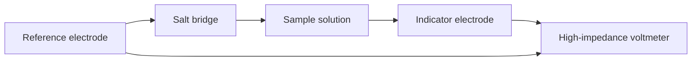
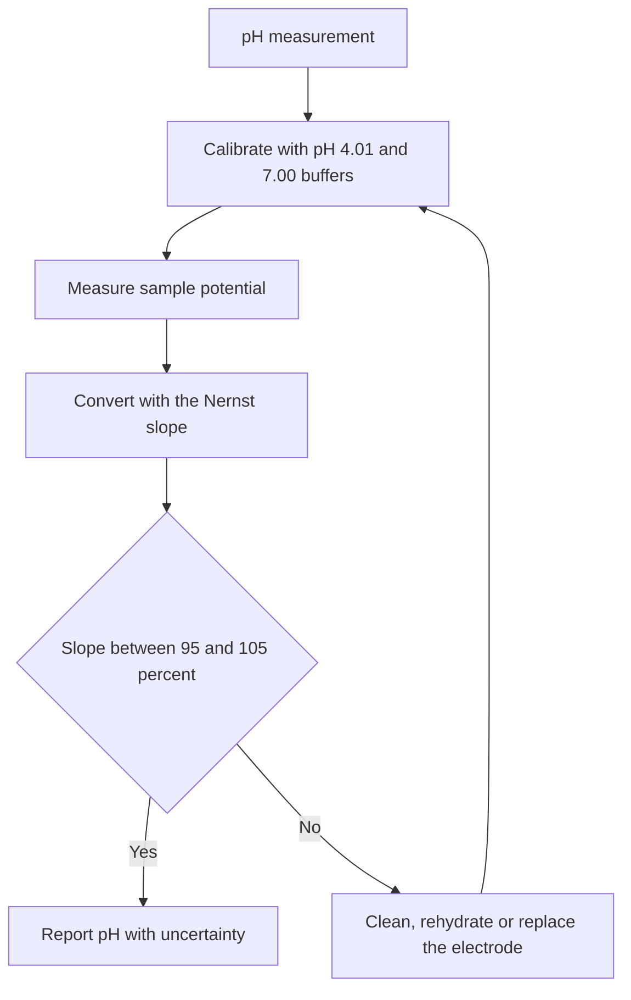
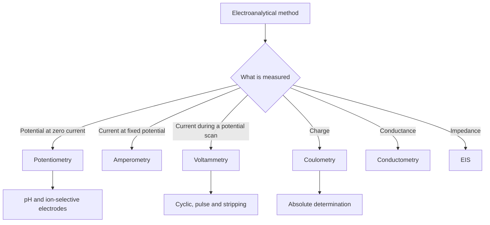

# Chapter 9 — Electroanalytical Chemistry and Potentiometry

> **Level:** Advanced (Level 7 — Analytical Chemistry)
> **Estimated study time:** 6 hours (reading) + 2 hours (exercises)
> **Prerequisites:** [Redox Reactions and Electrochemistry Fundamentals](../03-intermediate-chemistry/12-redox-reactions-and-electrochemistry-fundamentals.md); [Electrochemical Cells, the Nernst Equation and Electrolysis](../04-advanced-chemistry/08-electrochemical-cells-nernst-equation-and-electrolysis.md); Chapters 2–4 of this level
> **Related chapters:** [Gravimetric and Volumetric Analysis](05-gravimetric-and-volumetric-analysis.md), [Titrations](06-titrations.md), [Chromatography](07-chromatography.md), [Spectroscopic Analysis](08-spectroscopic-analysis.md)
> **Difficulty:** ★★★★★ (5/5)

---

## 1. Learning Objectives

After working through this chapter you will be able to:

- Describe an electrochemical cell as a measurement device and write its cell diagram.
- Explain the role of the reference and indicator electrodes, and care for silver/silver
  chloride and calomel references.
- Derive the operational definition of pH and calibrate a pH meter with buffers.
- Identify the sources of pH measurement error and estimate their magnitude.
- Explain the response of fluoride, calcium and nitrate ion-selective electrodes and
  use selectivity coefficients to assess interference.
- Distinguish direct potentiometry from potentiometric titration and choose between
  them.
- Measure conductivity and interpret conductometric titration curves.
- Explain linear-sweep and cyclic voltammetry, and calculate peak currents with the
  Randles–Ševčík equation.
- Apply Faraday's law to coulometry and coulometric titration.
- Outline electrochemical impedance spectroscopy and interpret a Randles circuit.
- Explain the glucose biosensor and the design principles of electrochemical biosensors.
- Compare electroanalytical techniques by detection limit and applicability.

---

## 2. Introduction

Electroanalytical methods measure a property of an electrochemical cell: a potential,
a current, a charge or an impedance. They are attractive because the signal is
electrical, the instrumentation is inexpensive, the response is often fast, and the
measurement can be made in situ without separating the analyte. A pH meter, a glucose
sensor and a battery tester all rest on the same handful of principles.

The central quantity is the **cell potential**, which is related to the activities of
the species in the cell by the Nernst equation. Potentiometry measures this potential
at zero current and converts it into an activity or a concentration; the glass
electrode is its most familiar implementation. Voltammetry, by contrast, measures the
current that flows when the potential is varied, and the shape of the current–potential
curve reveals the concentration and the redox behaviour of the analyte.

The chapter begins with the cell and its electrodes, because a potential is only as
good as its reference; it then treats pH, ion-selective electrodes, titration,
conductivity, voltammetry, coulometry, impedance and biosensors.

Prerequisites are the Nernst equation, electrochemical cells and electrolysis, and the
statistical treatment of calibration.

---

## 3. Fundamental Concepts

### 3.1 The electrochemical cell as a measuring device

An **electrochemical cell** contains two electrodes in contact with an electrolyte.
The electrode at which oxidation occurs is the **anode**; the electrode at which
reduction occurs is the **cathode**. In a galvanic cell the reaction is spontaneous and
the cell delivers work; in an electrolytic cell an external source drives a
non-spontaneous reaction.

The **cell potential** is the difference between the potentials of the two electrodes.
By convention, $E_{\text{cell}} = E_{\text{right}} - E_{\text{left}}$ for a cell drawn
with the right-hand electrode as the cathode. A **reference electrode** provides a
constant potential; an **indicator electrode** responds to the analyte. The measured
potential is the difference between them, plus a **liquid-junction potential** at the
boundary between the two solutions.

### 3.2 Reference and indicator electrodes

A reference electrode must have a stable, known potential that does not depend on the
sample composition. The **standard hydrogen electrode** defines zero volts but is
impractical; the **silver/silver chloride** and **calomel** electrodes are used instead.
Both are secondary references whose potentials are known relative to the hydrogen
electrode.

An indicator electrode responds to the analyte. **Metal electrodes** (silver, platinum,
gold) respond to the activity of their own ion or to a redox couple. **Membrane
electrodes** respond to ions through selective binding or ion exchange; the glass
electrode is the most important example.

### 3.3 The operational definition of pH

pH cannot be measured by a primary method, because it is defined operationally.
A buffer of assigned pH is used to calibrate the cell, and the pH of an unknown is

$$
\mathrm{pH}(X) = \mathrm{pH}(S) + \frac{E_X - E_S}{2.303RT/F},
$$

where $E_S$ and $E_X$ are the cell potentials for the standard and the sample. The
denominator is 59.16 mV at 25 °C, so a 1 mV error corresponds to 0.017 pH units.

### 3.4 Ion-selective electrodes

An **ion-selective electrode** (ISE) contains a membrane that binds one ion
selectively. The potential across the membrane follows the Nernst equation for that
ion, so the measured potential is proportional to the logarithm of its activity.
The **selectivity coefficient** $K_{ij}^{\text{pot}}$ quantifies the response to an
interfering ion $j$; a value below $10^{-3}$ means the interference is negligible at
typical concentrations.

The response is described by the **Nikolsky–Eisenman equation**:

$$
E = K + \frac{2.303RT}{z_iF}\log_{10}\left(a_i + \sum_j K_{ij}^{\text{pot}}a_j^{z_i/z_j}\right).
$$

### 3.5 Conductivity

**Conductivity** is the ability of a solution to carry current. It depends on the
number, charge and mobility of the ions. The measured conductance $G$ is converted to
conductivity $\kappa$ with the **cell constant** $K_{\text{cell}} = l/A$:

$$
\kappa = G\,K_{\text{cell}}.
$$

The **molar conductivity** $\Lambda_m = \kappa/c$ normalises for concentration and is
used to compare electrolytes.

### 3.6 Voltammetry and amperometry

In **voltammetry** the potential of a working electrode is varied and the resulting
current is measured. The current rises as the analyte is oxidised or reduced, reaches
a peak or a plateau, and then falls as the diffusion layer depletes. The peak current
is proportional to concentration, which is the basis of quantitative analysis.

In **amperometry** the potential is fixed at a value where the analyte reacts, and the
current is measured continuously. The Clark oxygen sensor and the glucose biosensor
are amperometric devices.

### 3.7 Coulometry

**Coulometry** measures the charge required to electrolyse the analyte completely.
Faraday's law relates charge to amount:

$$
Q = nFN, \qquad m = \frac{QM}{zF},
$$

where $n$ is the number of electrons per molecule, $F = 96\,485$ C mol⁻¹ and $z$ the
charge number of the deposited species. Coulometry is an absolute method: no
calibration standard is required if the current efficiency is 100 %.

### 3.8 Biosensors

A **biosensor** combines a biological recognition element with a transducer. In the
glucose sensor, glucose oxidase oxidises glucose and the hydrogen peroxide produced is
detected amperometrically, or a mediator shuttles electrons to the electrode. The
current is proportional to glucose concentration over a clinically useful range.

---

## 4. Detailed Scientific Explanation

### 4.1 Cell potentials and sign conventions

For a cell written as
$\ce{Zn(s) | Zn^2+(aq) || Cu^2+(aq) | Cu(s)}$, zinc is oxidised at the anode and
copper is reduced at the cathode. The cell potential is

$$
E_{\text{cell}} = E_{\text{cathode}} - E_{\text{anode}} = E_{\ce{Cu^2+/Cu}} - E_{\ce{Zn^2+/Zn}}.
$$

A positive $E_{\text{cell}}$ means the reaction is spontaneous as written. The Nernst
equation for each half-cell is

$$
E = E^\circ - \frac{2.303RT}{nF}\log_{10}Q,
$$

where $Q$ is the reaction quotient. At 25 °C the factor $2.303RT/F$ is 59.16 mV, so a
tenfold change in the activity ratio shifts the potential by 59.16 mV for a one-electron
couple.

The measured potential also includes the **liquid-junction potential** from different
ion mobilities at the sample–reference boundary; a concentrated potassium chloride
bridge minimises it because potassium and chloride have nearly equal mobilities.

### 4.2 Reference electrodes

The **silver/silver chloride electrode** is

$$
\ce{AgCl(s) + e- <=> Ag(s) + Cl-(aq)}, \qquad
E = E^\circ - 0.05916\log_{10}a(\ce{Cl-}).
$$

With saturated potassium chloride, $E = +0.197$ V versus the hydrogen electrode at
25 °C; with 3 mol dm⁻³ potassium chloride, $+0.210$ V. The electrode is robust, has a
low temperature coefficient and is the usual internal reference of a glass electrode.

The **calomel electrode** is

$$
\ce{Hg2Cl2(s) + 2e- <=> 2Hg(l) + 2Cl-(aq)}, \qquad
E = E^\circ - 0.05916\log_{10}a(\ce{Cl-}).
$$

The saturated calomel electrode has $E = +0.244$ V; the 1 mol dm⁻³ form, $+0.280$ V.
Calomel contains mercury and is being replaced by silver/silver chloride in most
laboratories.

Care matters: the reference must be kept filled, the frit wet and the electrode stored
in its own solution. Drying cracks the frit; contamination shifts the potential.
Renew the filling solution and check the electrode against a fresh one.

### 4.3 The glass electrode and pH measurement

The glass electrode is a thin bulb of pH-sensitive glass containing a buffer and an
internal silver/silver chloride electrode. When the bulb is immersed in water, a
hydrated gel layer forms on both surfaces. Hydrogen ions exchange with the gel, and
the potential across the membrane is

$$
E = K + \frac{2.303RT}{F}\mathrm{pH}.
$$

At 25 °C the slope is 59.16 mV per pH unit. The constant $K$ depends on the internal
buffer and the reference, so the electrode must be calibrated with buffers of known
pH rather than used absolutely.

The electrode is selective over a wide range but not perfect: at high pH, alkali-metal
ions exchange with the gel and the reading is low (**alkaline error**); at very low pH,
acid error appears. Store it in 3 mol dm⁻³ potassium chloride or pH 4 buffer, never in
distilled water, which leaches the gel.

### 4.4 Calibration of a pH meter and its error sources

A pH meter is calibrated with at least two buffers that bracket the sample pH, usually
pH 4.01, 7.00 and 10.00 at 25 °C. The **slope** is calculated from the potential
difference between the buffers and should be 95–105 % of the theoretical value. A
slope outside this range indicates an ageing electrode, a blocked junction or a
temperature error.

Error sources include a dirty or dry junction, a contaminated reference, temperature
mismatch, carbon dioxide uptake by alkaline buffers, low ionic strength and inadequate
equilibration. A 1 mV uncertainty gives 0.017 pH units, so 0.05 pH is routine and
0.01 pH requires careful work.

### 4.5 Ion-selective electrodes: fluoride, calcium and nitrate

The **fluoride electrode** uses a lanthanum fluoride crystal doped with europium(II)
to create fluoride vacancies. It responds to fluoride activity over about
$10^{-6}$–$10^{0}$ mol dm⁻³. The pH must be 5–7: below pH 5, fluoride is protonated to
HF and the response falls; above pH 7, hydroxide competes with fluoride. A total ionic
strength adjustment buffer is added to fix pH and ionic strength.

The **calcium electrode** uses a liquid membrane of a calcium dialkylphosphate in
di-octylphenyl phosphonate. It responds over about $10^{-5}$–$10^{-1}$ mol dm⁻³ at
pH 5.5–11. Sodium and magnesium interfere weakly; the selectivity coefficient for
sodium is of order $10^{-3}$ and for magnesium of order $10^{-2}$.

The **nitrate electrode** uses a quaternary ammonium exchanger. It is used for
soil, water and fertiliser analysis. Perchlorate, iodide and thiocyanate interfere
strongly; chloride interferes weakly at high concentrations.

### 4.6 Selectivity coefficients

The coefficient is measured by the **fixed-interference method**, recording potential
at fixed interferent concentration while the analyte is varied, or by the
**separate-solution method**, comparing pure solutions.

A selectivity coefficient of $10^{-3}$ means that a 1000-fold excess of interferent
produces the same response as the analyte; the interference is negligible only if the
interferent concentration is below that ratio. Selectivity is never absolute, and it
must be checked for every matrix.

### 4.7 Direct potentiometry versus potentiometric titration

**Direct potentiometry** measures the potential in the sample and converts it to
activity with a calibration curve. It is fast and non-destructive, but it is sensitive
to matrix effects, junction potentials and electrode drift, and it measures activity
rather than concentration.

**Potentiometric titration** adds titrant and follows the potential to an inflection.
It is slower, but it is more accurate, less dependent on electrode calibration, and
applicable to turbid or coloured samples. It is the method of choice when the highest
accuracy is required.

### 4.8 Redox and membrane electrodes

A **redox electrode** is an inert metal (platinum or gold) that responds to the ratio
of oxidised and reduced forms of a couple. It is used to follow redox titrations and
to measure the redox potential of water.

A **membrane electrode** may be a glass membrane, a liquid membrane, a solid-state
crystal or a gas-permeable membrane. **Gas-sensing electrodes** trap a gas such as
ammonia or carbon dioxide in a thin film and measure the pH change; **enzyme
electrodes** immobilise an enzyme at the membrane and measure the product.

### 4.9 Conductivity and conductometric titration

Conductivity is measured with a cell of two platinised platinum electrodes and an
alternating current, to avoid polarisation. The cell constant is determined with a
standard potassium chloride solution. Temperature control is important because
conductivity rises by about 2 % per kelvin.

A **conductometric titration** plots conductance against titrant volume. For a strong
acid titrated with a strong base, the conductance falls as hydrogen ions are replaced
by slower sodium ions, reaches a minimum at equivalence, and then rises as excess
hydroxide is added. The result is a V-shaped curve whose intersection gives the
equivalence volume. For a weak acid, the initial conductance rises slightly as the
weak acid is converted to its salt, then falls and rises; the shape depends on the
relative mobilities.

### 4.10 Amperometry and voltammetry

In **linear-sweep voltammetry** the potential is scanned linearly and the current is
recorded. For a reversible couple, the peak current is given by the
**Randles–Ševčík equation**:

$$
i_p = 2.69\times10^5\,n^{3/2}AD^{1/2}Cv^{1/2},
$$

with $i_p$ in amperes, $A$ in cm², $D$ in cm² s⁻¹, $C$ in mol cm⁻³ and $v$ in V s⁻¹.

In **cyclic voltammetry** the scan is reversed, producing a forward and a reverse
peak. A reversible couple has a peak separation of 59/n mV and a peak-current ratio of
one. Irreversible couples show a larger separation and a smaller reverse peak. The
shape of the cyclic voltammogram identifies the mechanism and the reversibility.

### 4.11 Pulse and stripping techniques

**Differential pulse voltammetry** applies a small pulse on a staircase ramp and
samples the current before and after the pulse; the difference discriminates against
charging current. **Square-wave voltammetry** uses a symmetric waveform and is fast and
sensitive.

**Stripping voltammetry** preconcentrates the analyte by electrolysis at a fixed
potential, then scans to redissolve it. Anodic stripping measures metals that deposit
on the electrode; cathodic stripping measures species that form a film. The technique
reaches nanomolar detection limits and is used for trace metals in water.

### 4.12 Coulometry and coulometric titration

In **controlled-potential coulometry** the potential of the working electrode is held
at a value where the analyte reacts completely; the current decays exponentially and
the charge is integrated. In **controlled-current coulometry** a constant current is
passed for a measured time, so $Q = It$ is known exactly. The latter is the basis of
**coulometric titration**, in which the titrant is generated electrochemically.

The method requires 100 % current efficiency: no side reactions, no electrode-reactive
impurities and no product loss. It is absolute and is used for reference materials,
Karl Fischer water determination and chlorine analysis.

### 4.13 Electrochemical impedance spectroscopy

**Electrochemical impedance spectroscopy** applies a small alternating potential and
measures the current response over a range of frequencies. The impedance is a complex
quantity; plotting the imaginary part against the real part gives a **Nyquist plot**,
and plotting the magnitude and phase against frequency gives a **Bode plot**.

The **Randles circuit** models a simple electrode: $R_s$ in series with a parallel
combination of $R_{ct}$ and $C_{dl}$, plus a Warburg impedance. The semicircle diameter
equals $R_{ct}$, and the apex frequency is $\omega_{\max} = 1/(R_{ct}C_{dl})$. EIS is
used for corrosion, batteries, fuel cells
and biosensor characterisation.

### 4.14 Biosensors and the glucose sensor

The **glucose oxidase** biosensor is the most successful electrochemical biosensor.
Glucose oxidase oxidises glucose to gluconolactone and reduces its flavin cofactor;
the cofactor is reoxidised by oxygen, producing hydrogen peroxide, which is oxidised
at a platinum electrode at about +0.6 V. A mediator such as ferrocene can instead
shuttle electrons at lower potential, reducing ascorbate and urate interference.

The current is proportional to glucose concentration over the clinical range
(1–30 mmol dm⁻³). The sensor is calibrated with glucose standards, and the response is
corrected for temperature and haematocrit in whole-blood devices. The same architecture
— enzyme, mediator, electrode — underlies sensors for lactate, cholesterol and
creatinine.

### 4.15 Comparison of electroanalytical techniques

| Technique | Measured quantity | Typical LOD | Applicability |
|---|---|---|---|
| Potentiometry (pH, ISE) | Potential at zero current | 10⁻⁶–10⁻³ mol dm⁻³ | Ions in clear or turbid samples |
| Potentiometric titration | Potential inflection | 10⁻⁵ mol dm⁻³ | Coloured and turbid samples |
| Conductometry | Conductance | 10⁻⁵ mol dm⁻³ | Water purity, titration endpoints |
| Amperometry | Current at fixed potential | 10⁻⁷ mol dm⁻³ | Oxygen, glucose, sensors |
| Voltammetry | Current during a scan | 10⁻⁸–10⁻⁶ mol dm⁻³ | Trace metals and organics |
| Stripping voltammetry | Current after preconcentration | 10⁻¹⁰–10⁻⁸ mol dm⁻³ | Trace metals in water |
| Coulometry | Charge | 10⁻⁶ mol dm⁻³ | Reference materials, moisture |
| Impedance | Impedance | — | Corrosion, batteries, biosensors |

---

## 5. Visual Diagrams

**Figure 9.1 — Potentiometric cell.** The reference electrode supplies a constant
potential; the indicator electrode responds to the analyte; the voltmeter draws almost
no current so that the measured potential is the equilibrium value. The salt bridge
minimises the liquid-junction potential.

**Figure 9.2 — pH measurement chain.** The meter does not measure pH directly; it
measures a potential and converts it using a calibration. The slope check is the
diagnostic that separates a valid measurement from an ageing electrode.

**Figure 9.3 — The electroanalytical family.** Each technique measures a different
electrical quantity, and each has a characteristic detection limit and application.
The diagram reminds us that electrochemical analysis is a family of methods.

---

## 6. Mathematical Formulas

### 6.1 Nernst equation and cell potential

$$
E = E^\circ - \frac{2.303RT}{nF}\log_{10}Q, \qquad
E_{\text{cell}} = E_{\text{cathode}} - E_{\text{anode}}.
$$

| Symbol | Meaning | SI unit |
|---|---|---|
| $E$ | Electrode potential | V |
| $E^\circ$ | Standard potential | V |
| $n$ | Electrons transferred | dimensionless |
| $Q$ | Reaction quotient | dimensionless |
| $R$ | Gas constant, 8.314 | J K⁻¹ mol⁻¹ |
| $T$ | Thermodynamic temperature | K |
| $F$ | Faraday constant, 96 485 | C mol⁻¹ |

*Assumptions.* Reversible equilibrium at the electrode; activities approximated by
concentrations; 25 °C for the 59.16 mV slope; negligible liquid-junction potential.

### 6.2 Operational pH and electrode slope

$$
\mathrm{pH}(X) = \mathrm{pH}(S) + \frac{E_X - E_S}{2.303RT/F}, \qquad
S = \frac{2.303RT}{F}.
$$

| Symbol | Meaning | SI unit |
|---|---|---|
| $\mathrm{pH}(S)$ | Assigned pH of the standard buffer | dimensionless |
| $E_S,\ E_X$ | Cell potentials of standard and sample | V |
| $S$ | Nernst slope, 59.16 mV at 25 °C | V |

*Assumptions.* The electrode responds with the theoretical slope; the junction
potential is the same in sample and buffer; temperature is constant.

### 6.3 Nikolsky–Eisenman equation

$$
E = K + \frac{2.303RT}{z_iF}\log_{10}\left(a_i + \sum_j K_{ij}^{\text{pot}}a_j^{z_i/z_j}\right).
$$

| Symbol | Meaning | SI unit |
|---|---|---|
| $a_i$ | Activity of the primary ion | mol dm⁻³ |
| $a_j$ | Activity of an interfering ion | mol dm⁻³ |
| $z_i,\ z_j$ | Charge numbers | dimensionless |
| $K_{ij}^{\text{pot}}$ | Potentiometric selectivity coefficient | dimensionless |

*Assumptions.* The membrane responds reversibly; the interferent acts only through
the same binding site; activities rather than concentrations are used.

### 6.4 Conductivity

$$
\kappa = G\,K_{\text{cell}}, \qquad \Lambda_m = \frac{\kappa}{c}.
$$

| Symbol | Meaning | SI unit |
|---|---|---|
| $\kappa$ | Conductivity | S cm⁻¹ |
| $G$ | Conductance | S |
| $K_{\text{cell}}$ | Cell constant, $l/A$ | cm⁻¹ |
| $\Lambda_m$ | Molar conductivity | S cm² mol⁻¹ |
| $c$ | Amount concentration | mol cm⁻³ |

*Assumptions.* The field is uniform; electrode polarisation is negligible because an
alternating current is used; the temperature is controlled.

### 6.5 Voltammetric peak current

$$
i_p = 2.69\times10^5\,n^{3/2}AD^{1/2}Cv^{1/2}.
$$

| Symbol | Meaning | SI unit |
|---|---|---|
| $i_p$ | Peak current | A |
| $A$ | Electrode area | cm² |
| $D$ | Diffusion coefficient | cm² s⁻¹ |
| $C$ | Bulk concentration | mol cm⁻³ |
| $v$ | Scan rate | V s⁻¹ |

*Assumptions.* Diffusion-controlled reversible electron transfer; planar electrode;
supporting electrolyte in large excess; no adsorption or coupled chemical reaction.

### 6.6 Faraday's law and impedance

$$
Q = nFN, \qquad m = \frac{QM}{zF}, \qquad
\omega_{\max} = \frac{1}{R_{ct}C_{dl}}.
$$

| Symbol | Meaning | SI unit |
|---|---|---|
| $Q$ | Charge | C |
| $N$ | Amount of substance | mol |
| $m$ | Mass deposited | kg |
| $M$ | Molar mass | kg mol⁻¹ |
| $R_{ct}$ | Charge-transfer resistance | Ω |
| $C_{dl}$ | Double-layer capacitance | F |
| $\omega_{\max}$ | Angular frequency at the semicircle apex | rad s⁻¹ |

*Assumptions.* 100 % current efficiency; the deposited species is the only electrode
reaction; the Randles circuit applies with a single time constant.

---

## 7. Chemical Equations

The silver/silver chloride reference:

$$
\ce{AgCl(s) + e- <=> Ag(s) + Cl-(aq)}
$$

The calomel reference:

$$
\ce{Hg2Cl2(s) + 2e- <=> 2Hg(l) + 2Cl-(aq)}
$$

The glass membrane exchanges hydrogen ions with the hydrated gel:

$$
\ce{Si-OH(s) + H+(aq) <=> Si-OH2+(s)}
$$

The fluoride electrode responds to fluoride activity through the crystal:

$$
\ce{LaF3(s) <=> La^3+(aq) + 3F-(aq)}
$$

The solubility equilibrium at the crystal surface controls the fluoride activity that
the membrane senses.

The hexacyanoferrate couple used to test electrodes:

$$
\ce{[Fe(CN)6]^3-(aq) + e- <=> [Fe(CN)6]^4-(aq)}
$$

The oxygen reduction reaction in the Clark sensor:

$$
\ce{O2(g) + 2H2O(l) + 4e- -> 4OH-(aq)}
$$

Glucose oxidase converts glucose and oxygen to gluconolactone and hydrogen peroxide:

$$
\ce{C6H12O6(aq) + O2(g) -> C6H10O6(aq) + H2O2(aq)}
$$

Hydrogen peroxide is oxidised at the platinum anode:

$$
\ce{H2O2(aq) -> O2(g) + 2H+(aq) + 2e-}
$$

Copper is deposited in controlled-potential coulometry:

$$
\ce{Cu^2+(aq) + 2e- -> Cu(s)}
$$

Each equation is balanced in atoms and charge. The phase labels show whether the
species is in solution, in the gas phase or on the electrode surface.

---

## 8. Worked Examples

### Worked Example 9.1 — pH from a glass electrode potential

**Problem.** A pH meter calibrated at pH 7.00 gives a cell potential of +0.041 V in
the buffer and +0.312 V in a sample. The slope is 59.16 mV per pH unit. Calculate the
sample pH and the uncertainty corresponding to 1 mV.

**Strategy.** Use the operational definition with the measured potentials.

**Solution.**
$$
\mathrm{pH} = 7.00 + \frac{0.312 - 0.041}{0.05916} = 7.00 + 4.58 = 11.58
$$
A 1 mV error gives $0.001/0.05916 = 0.017$ pH units.

**Check.** The sample is strongly alkaline, where alkaline error may be significant.

### Worked Example 9.2 — Fluoride by standard addition

**Problem.** A 25.00 cm³ sample gives $E = -112.4$ mV. After adding 1.00 cm³ of
100.0 mg dm⁻³ fluoride standard, $E = -131.8$ mV. The electrode slope is
59.2 mV per decade. Calculate the fluoride concentration.

**Strategy.** The potential falls as fluoride activity rises; the activity ratio is
$10^{\Delta E/S}$.

**Solution.**
$$
\frac{a_2}{a_1} = 10^{(112.4 - 131.8)/59.2} = 10^{0.3277} = 2.13
$$
$$
c = \frac{100.0 \times 1.00}{26.00 \times 2.13 - 25.00} = \frac{100.0}{30.4}
= 3.30\ \text{mg dm}^{-3}.
$$

**Check.** The spike raised the activity by 2.1, the ideal design for standard addition.

### Worked Example 9.3 — Conductivity and cell constant

**Problem.** A 0.0100 mol dm⁻³ potassium chloride solution has a conductivity of
1.413 mS cm⁻¹ at 25 °C. The measured resistance is 707.7 Ω. Calculate the cell
constant and the molar conductivity.

**Strategy.** Use $G = 1/R$, $K_{\text{cell}} = \kappa/G$ and
$\Lambda_m = \kappa/c$.

**Solution.**
$$
G = \frac{1}{707.7} = 1.413\times10^{-3}\ \text{S}, \qquad
K_{\text{cell}} = \frac{1.413\times10^{-3}}{1.413\times10^{-3}} = 1.00\ \text{cm}^{-1}
$$
$$
\Lambda_m = \frac{1.413\times10^{-3}\ \text{S cm}^{-1}}
{1.00\times10^{-5}\ \text{mol cm}^{-3}} = 141.3\ \text{S cm}^2\ \text{mol}^{-1}.
$$

**Check.** The literature value is 141.3 S cm² mol⁻¹, so the cell constant is correct.

### Worked Example 9.4 — Randles–Ševčík peak current

**Problem.** A reversible one-electron couple is studied at a 0.020 cm² electrode
with $D = 7.0\times10^{-6}$ cm² s⁻¹ and $C = 1.0\times10^{-6}$ mol cm⁻³. Calculate
the peak current at a scan rate of 0.100 V s⁻¹.

**Strategy.** Substitute into the Randles–Ševčík equation with consistent units.

**Solution.**
$$
i_p = 2.69\times10^5(1)^{3/2}(0.020)(7.0\times10^{-6})^{1/2}
(1.0\times10^{-6})(0.100)^{1/2}
$$
$$
i_p = 4.50\times10^{-6}\ \text{A} = 4.50\ \mu\text{A}.
$$

**Check.** Doubling the scan rate raises the peak current by $\sqrt{2}$, to 6.4 µA.

### Worked Example 9.5 — Coulometric determination of copper

**Problem.** A 0.5000 g brass sample is dissolved and the copper is deposited at
constant current. A current of 1.000 A flows for 480.0 s. Calculate the mass fraction
of copper.

**Strategy.** Use $Q = It$ and Faraday's law with $z = 2$.

**Solution.**
$$
Q = 1.000 \times 480.0 = 480.0\ \text{C}, \qquad
n(\ce{Cu}) = \frac{480.0}{2 \times 96\,485} = 2.487\times10^{-3}\ \text{mol}
$$
$$
m = 2.487\times10^{-3} \times 63.546 = 0.1581\ \text{g}, \qquad
w = \frac{0.1581}{0.5000} = 31.6\ \%.
$$

**Check.** The result is typical of brass; 100 % current efficiency must be verified.

### Worked Example 9.6 — Time constant from an impedance spectrum

**Problem.** A Nyquist plot of a biosensor shows a semicircle of diameter 500 Ω with
its apex at 15.9 Hz. Calculate the double-layer capacitance.

**Strategy.** Use $\omega_{\max} = 1/(R_{ct}C_{dl})$ with $\omega = 2\pi f$.

**Solution.**
$$
C_{dl} = \frac{1}{2\pi f R_{ct}}
= \frac{1}{2\pi(15.9)(500)} = 2.0\times10^{-5}\ \text{F} = 20\ \mu\text{F}.
$$

**Check.** A 20 µF double layer is physically reasonable for a small electrode.

---

## 9. Real-World Applications

**Water and environment.** pH, conductivity, fluoride, nitrate and dissolved oxygen
are measured continuously in water plants; ion-selective and amperometric sensors
provide in-line signals without sample preparation.

**Clinical analysis.** Blood-gas analysers measure pH, $p_{\ce{CO2}}$ and
$p_{\ce{O2}}$; electrolyte analysers use sodium, potassium, chloride and calcium
ISEs; glucose meters use screen-printed enzyme electrodes.

**Research and materials.** Cyclic voltammetry characterises catalysts and redox
proteins; stripping voltammetry measures trace metals; EIS evaluates batteries, fuel
cells, corrosion inhibitors and biosensor interfaces.

**Safety.** Calomel references contain mercury and cyanide masking agents are acutely
toxic; handle and dispose of them under supervision.

---

## 10. Common Mistakes

| Mistake | Why it happens | Correct approach |
|---|---|---|
| Calibrating a pH meter with one buffer | One point seems sufficient | Use two buffers bracketing the sample and check the slope |
| Storing a glass electrode in distilled water | Water is the obvious solvent | Store in 3 mol dm⁻³ KCl or pH 4 buffer |
| Using pH 7 as the isopotential point at every temperature | The meter compensates automatically | Check the electrode's isopotential point and calibrate at the sample temperature |
| Ignoring ionic strength in ISE measurements | Concentration is used instead of activity | Add an ionic-strength adjustment buffer |
| Measuring conductivity without temperature control | Conductivity seems stable | Thermostat at 25 °C or apply the 2 % per kelvin correction |

---

## 11. Chapter Summary

- An electrochemical cell measures a potential difference between indicator and
  reference electrodes; the liquid-junction potential is a systematic contribution.
- The glass electrode responds linearly to pH with 59.16 mV per unit at 25 °C; pH is
  defined operationally by calibration with buffers.
- Ion-selective electrodes obey the Nikolsky–Eisenman equation, and selectivity
  coefficients quantify interference.
- Voltammetry relates peak current to concentration, diffusion and scan rate; pulse
  and stripping techniques lower the detection limit.
- Coulometry is absolute at 100 % current efficiency, impedance separates solution,
  charge-transfer and double-layer terms, and biosensors exploit enzyme selectivity.

---

## 12. Exercises

### 12.1 Conceptual questions

1. Why must a reference electrode have a constant potential, and how does the salt
   bridge help?
2. Explain why pH is defined operationally rather than absolutely.
3. Why does a conductometric titration of a strong acid with a strong base give a
   V-shaped curve?

### 12.2 Basic problems

4. Calculate the cell potential of
   $\ce{Zn | Zn^2+(0.0100 mol dm^{-3}) || Cu^2+(0.100 mol dm^{-3}) | Cu}$
   given $E^\circ(\ce{Cu^2+/Cu}) = 0.340$ V and $E^\circ(\ce{Zn^2+/Zn}) = -0.763$ V.
5. A pH meter gives a slope of 57.0 mV per pH unit. Is the electrode acceptable?
6. A 0.0200 mol dm⁻³ KCl solution has a conductivity of 2.77 mS cm⁻¹. Calculate its
   molar conductivity.

### 12.3 Intermediate problems

7. A fluoride ISE gives $-98.0$ mV in a 1.00 mg dm⁻³ standard and $-128.0$ mV in a
   sample. Calculate the sample concentration if the slope is 59.2 mV per decade.
8. A calcium ISE has $K_{\ce{Ca},\ce{Na}}^{\text{pot}} = 2.0\times10^{-3}$. What sodium
   concentration produces the same response as $1.0\times10^{-4}$ mol dm⁻³ calcium?
9. A voltammetric peak current is 3.20 µA at 0.050 V s⁻¹. Calculate the current at
   0.200 V s⁻¹ for a diffusion-controlled process.

### 12.4 Advanced problems

10. A coulometric titration of ascorbic acid uses a current of 50.0 mA for 120.0 s.
    Calculate the mass of ascorbic acid ($M = 176.12$ g mol⁻¹, two electrons per
    molecule).
11. An impedance spectrum has $R_s = 20$ Ω, $R_{ct} = 800$ Ω and $C_{dl} = 10$ µF.
    Calculate the frequency at the semicircle apex and the impedance at that frequency.
12. Explain why a glucose sensor using a mediator can operate at a lower potential than
    one measuring hydrogen peroxide, and why that improves selectivity.

### Answers

1. A reference fixes the zero of the potential scale; the salt bridge minimises the junction potential.
2. pH is defined by a convention based on a standard buffer and a cell potential.
3. Hydrogen ions are replaced by slower sodium ions, so conductance falls to a minimum at equivalence.
4. $E_{\text{cell}} = 0.3104 - (-0.8222) = 1.133$ V.
5. $57.0/59.16 = 96.4$ %, within the 95–105 % acceptance range.
6. $2.77\times10^{-3}/(2.00\times10^{-5}) = 138.5$ S cm² mol⁻¹.
7. $\Delta E = 30.0$ mV, ratio $= 3.21$, so the sample is 3.21 mg dm⁻³.
8. $a_{\ce{Na}} = a_{\ce{Ca}}/K = 1.0\times10^{-4}/2.0\times10^{-3} = 0.050$ mol dm⁻³.
9. $3.20 \times \sqrt{4} = 6.40$ µA.
10. $Q = 6.00$ C, $n = 3.11\times10^{-5}$ mol and $m = 5.48$ mg.
11. $f = 19.9$ Hz; at the apex $Z = R_s + R_{ct}/2 = 420$ Ω.
12. A mediator is reoxidised at a lower potential, so species oxidising at +0.6 V are not detected.

---

## 13. Further Reading

- Harris, D. C.; Lucy, C. A. *Quantitative Chemical Analysis*, 9th ed., W. H.
  Freeman, 2015. Potentiometry, voltammetry and coulometry.
- Skoog, D. A.; Holler, F. J.; Crouch, S. R. *Principles of Instrumental Analysis*,
  7th ed., Cengage, 2017. Electroanalytical methods.
- IUPAC. *Compendium of Analytical Nomenclature* (the "Orange Book"), 3rd ed.
  <https://publications.iupac.org/orangebook/>
- Eurachem. *The Fitness for Purpose of Analytical Methods: A Laboratory Guide to
  Method Validation*, 2nd ed., 2014. <https://www.eurachem.org/>
- ISO/IEC 17025:2017. *General requirements for the competence of testing and calibration laboratories*.
