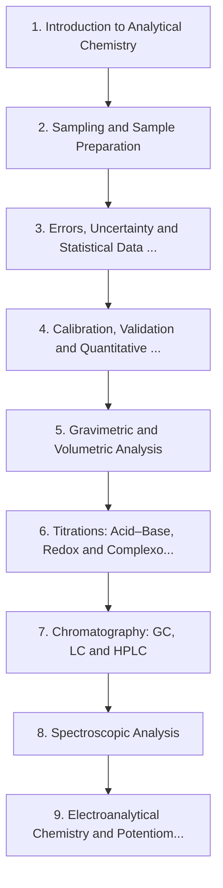

# Level 7 — Analytical Chemistry

> **Audience:** Undergraduate / practising analyst  
> **Chapters:** 9  
> **Estimated study time:** ≈ 69 h  
> **Difficulty:** ★★★☆☆ – ★★★★★

How a number becomes trustworthy: sampling, uncertainty, calibration and validation, classical wet methods, titrations, chromatography, spectroscopic analysis and electroanalytical measurement.

Analytical chemistry answers a deceptively hard question: *how do you know?* A measurement without an uncertainty is not a measurement, and a method without validation is not evidence. This level teaches both.

---

## Chapters

| # | Chapter | Difficulty | Hours | Prerequisites |
|---|---|---|---|---|
| 1 | [Introduction to Analytical Chemistry](01-introduction-to-analytical-chemistry.md) | ★★★☆☆ | 5 | Level 2 in full |
| 2 | [Sampling and Sample Preparation](02-sampling-and-sample-preparation.md) | ★★★★☆ | 6 | Ch. 1 |
| 3 | [Errors, Uncertainty and Statistical Data Treatment](03-errors-uncertainty-and-statistical-data-treatment.md) | ★★★★☆ | 8 | Ch. 1; basic statistics |
| 4 | [Calibration, Validation and Quantitative Analysis](04-calibration-validation-and-quantitative-analysis.md) | ★★★★☆ | 8 | Ch. 3 |
| 5 | [Gravimetric and Volumetric Analysis](05-gravimetric-and-volumetric-analysis.md) | ★★★★☆ | 7 | Ch. 2–4 |
| 6 | [Titrations: Acid–Base, Redox and Complexometric](06-titrations.md) | ★★★★☆ | 8 | Level 2 Ch. 11–13; Ch. 5 |
| 7 | [Chromatography: GC, LC and HPLC](07-chromatography.md) | ★★★★★ | 10 | Ch. 2–4 |
| 8 | [Spectroscopic Analysis](08-spectroscopic-analysis.md) | ★★★★★ | 9 | Level 3 Ch. 10; Ch. 4 |
| 9 | [Electroanalytical Chemistry and Potentiometry](09-electroanalytical-chemistry-and-potentiometry.md) | ★★★★★ | 8 | Level 3 Ch. 8; Ch. 4 |

---

## Knowledge map

The chain is the *recommended* order. Chapters that share prerequisites can be
read out of order; the table above tells you what each one actually needs.

---

## Study routine for this level

1. Read the chapter once without taking notes, to see the shape of the argument.
2. Re-read with the chapter's learning objectives in front of you and answer them in writing.
3. Reproduce every Mermaid diagram from memory, then check it.
4. Do the exercises **before** opening the solutions file.
5. Record every mistake in a log; re-test yourself on those specific items a week later.

---

## Practice

- Exercise set: [`exercises/level-7-exercises.md`](exercises/level-7-exercises.md)
- Worked solutions: [`solutions/level-7-solutions.md`](solutions/level-7-solutions.md)

---

## Navigation

- Level index: [CURRICULUM.md](../CURRICULUM.md)
- Study methods: [00-learning-guide](../00-learning-guide/learning-path.md)
- Terminology: [GLOSSARY.md](../GLOSSARY.md)
- Sources: [REFERENCES.md](../REFERENCES.md)
