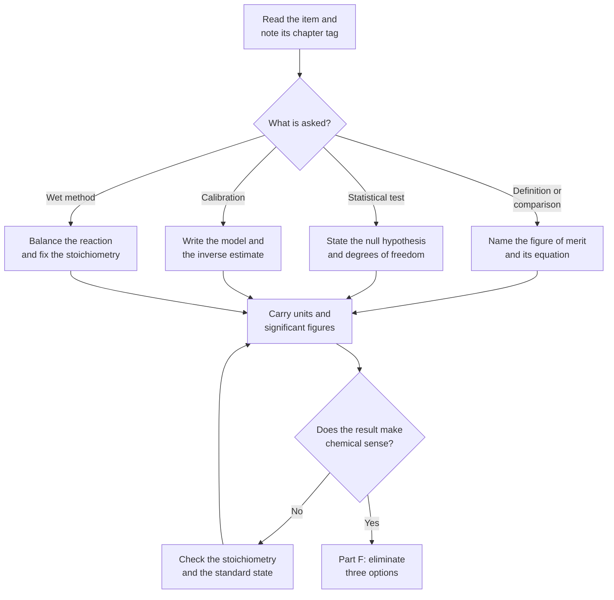

# Level 7 — Exercise Bank: Analytical Chemistry

> **Level:** Undergraduate and practising analyst (Level 7 — Analytical Chemistry)
> **Estimated time:** 300 minutes
> **Items:** 50
> **Covers:** [Ch. 1](../01-introduction-to-analytical-chemistry.md), [Ch. 2](../02-sampling-and-sample-preparation.md), [Ch. 3](../03-errors-uncertainty-and-statistical-data-treatment.md), [Ch. 4](../04-calibration-validation-and-quantitative-analysis.md), [Ch. 5](../05-gravimetric-and-volumetric-analysis.md), [Ch. 6](../06-titrations.md), [Ch. 7](../07-chromatography.md), [Ch. 8](../08-spectroscopic-analysis.md), [Ch. 9](../09-electroanalytical-chemistry-and-potentiometry.md)
> **Solutions:** [`../solutions/level-7-solutions.md`](../solutions/level-7-solutions.md)

Every item names the chapter that supplies the method. Statistical answers must
state the null hypothesis, the degrees of freedom and the critical value before the
decision. Numerical answers are required to three significant figures unless the
data justify fewer, with units attached to every intermediate result.

**Figure 1 — Working order for this bank.** The loop is deliberate: a result that
fails the sense check is almost always a stoichiometry or standard-state error, not an
arithmetic slip.

---

## Data sheet

| Constant or quantity | Value |
|---|---|
| Gas constant, $R$ | $8.314462618\ \text{J mol}^{-1}\ \text{K}^{-1}$ |
| Faraday constant, $F$ | $96\,485.33212\ \text{C mol}^{-1}$ |
| Avogadro constant, $N_{\text{A}}$ | $6.02214076\times10^{23}\ \text{mol}^{-1}$ |
| Boltzmann constant, $k_{\text{B}}$ | $1.380649\times10^{-23}\ \text{J K}^{-1}$ |
| Planck constant, $h$ | $6.62607015\times10^{-34}\ \text{J s}$ |
| Speed of light, $c$ | $2.99792458\times10^{8}\ \text{m s}^{-1}$ |
| Elementary charge, $e$ | $1.602176634\times10^{-19}\ \text{C}$ |
| $2.303RT/F$ at $298.15\ \text{K}$ | $59.16\ \text{mV}$ |
| $K_w$ at $298.15\ \text{K}$ | $1.00\times10^{-14}$ |

Two-tailed Student $t$ at $95\ \%$ confidence:

| $\nu$ | 2 | 3 | 4 | 5 | 6 | 8 | 10 | 12 |
|---|---|---|---|---|---|---|---|---|
| $t_{0.025,\nu}$ | 4.303 | 3.182 | 2.776 | 2.571 | 2.447 | 2.306 | 2.228 | 2.179 |

$F_{0.025}(5,5) = 5.05$ (two-tailed); $F_{0.05}(3,8) = 4.07$ (one-tailed, ANOVA);
Grubbs $G_{\text{crit}} = 1.715$ at $95\ \%$ for $n = 5$.

---

## Part A — Conceptual questions

1. **[Ch. 1]** Define sensitivity, analytical sensitivity, selectivity, limit of
   detection, limit of quantification and dynamic range. Explain why the detection
   limit is usually written $3.3s_{y/x}/b$ rather than as three times the standard
   deviation of a single blank, and what "fit for purpose" adds to these figures of
   merit.

2. **[Ch. 2]** Explain why sampling variance often dominates analytical variance, and
   identify the three variables that control the fundamental error in Gy's theory.
   Distinguish a composite sample from replicate samples, and state what each can and
   cannot estimate.

3. **[Ch. 3]** Distinguish random, systematic and gross error. State which statistical
   procedure addresses each, and explain the difference between accuracy, trueness and
   precision. Give one example in which high precision coexists with unacceptable
   trueness.

4. **[Ch. 4]** Compare external calibration, internal-standard calibration,
   matrix-matched calibration and the method of standard additions. For each, state
   what it corrects and what it does not correct.

5. **[Ch. 5]** Define the gravimetric factor and explain the role of the coefficients
   $a$ and $b$. State the properties required of a weighing form, and explain why a
   large gravimetric factor is preferred when two weighing forms are available.

6. **[Ch. 7]** Compare the detectors used in gas and liquid chromatography. For each of
   a flame ionisation detector, a thermal conductivity detector, an electron-capture
   detector, a UV–visible absorbance detector and a mass spectrometer, state whether it
   is universal or selective, whether it is destructive, and what it measures.

7. **[Ch. 7]** Write the van Deemter equation and explain the physical origin of the
   $A$, $B$ and $C$ terms. Explain why reducing the particle size improves the
   plate height in liquid chromatography, why there is an optimum velocity, and what
   changes in capillary gas chromatography.

8. **[Ch. 9]** Write the Nikolsky–Eisenman equation and explain the meaning of the
   selectivity coefficient $K_{ij}^{\text{pot}}$. State when an interferent can be
   neglected, and explain why an ion-selective electrode reports activity rather than
   concentration.

---

## Part B — Derivations

9. **[Ch. 3]** Derive the propagation-of-uncertainty rules for $y = a \pm b - c$ and
   for $y = ab/c$ from a first-order Taylor expansion. State the conditions under
   which the rules fail.

10. **[Ch. 3]** Explain why a confidence interval for a mean uses the Student $t$
    distribution rather than the normal distribution, and derive the interval
    $\bar{x} \pm t_{\alpha/2,n-1}s/\sqrt{n}$ from the definition of the $t$ statistic.

11. **[Ch. 3]** Derive the least-squares estimates of the slope and intercept for
    $y = a + bx$ by minimising the residual sum of squares. State the assumptions
    required for the estimates to be unbiased and for their standard errors to be
    valid.

12. **[Ch. 4]** Derive the single-point standard-addition equation
    $C_x = C_sV_sA_1/[A_2(V_x+V_s) - A_1V_x]$ from the assumption of a linear response
    with a constant blank.

13. **[Ch. 7]** Derive the resolution equation
    $R_s = (\sqrt{N}/4)(\alpha-1)k/(1+k)$ from the definition
    $R_s = 2(t_{R,2}-t_{R,1})/(w_1+w_2)$, stating the approximations used.

14. **[Ch. 6]** Derive the pH at the half-equivalence point and at the equivalence
    point of the titration of a weak monoprotic acid with a strong base. State the
    approximations and identify the point at which each fails.

15. **[Ch. 6]** Derive the conditional formation constant
    $K' = K_f\alpha_{\ce{Y^4-}}$ for the titration of a metal with EDTA, and give the
    expression for $\alpha_{\ce{Y^4-}}$ in terms of the acid dissociation constants of
    EDTA and $[\ce{H+}]$.

16. **[Ch. 9]** Derive the Nernst slope of $59.16\ \text{mV}$ per decade of activity at
    $298.15\ \text{K}$ for a monovalent ion, and state the slope for a divalent ion.

---

## Part C — Basic calculations

17. **[Ch. 1]** A calibration has slope $b = 0.0450\ \text{L mg}^{-1}$ and residual
    standard deviation $s_{y/x} = 0.00210$. Calculate the limit of detection, the limit
    of quantification and the analytical sensitivity $\gamma = b/s_y$.

18. **[Ch. 2]** The standard deviation between increments is
    $s_b = 2.5\ \text{mg kg}^{-1}$. Calculate the number of increments needed for a
    standard uncertainty of $0.50\ \text{mg kg}^{-1}$ in the mean, and for
    $0.25\ \text{mg kg}^{-1}$.

19. **[Ch. 4]** An internal standard is added to give
    $C_{\text{IS}} = 5.00\ \text{mg L}^{-1}$. The ratio of analyte to internal-standard
    responses is $A_{\text{a}}/A_{\text{IS}} = 1.24$ and the response factor is
    $F = 0.850$. Calculate the analyte concentration.

20. **[Ch. 3]** Six replicate determinations of a mass fraction gave
    $12.45$, $12.52$, $12.38$, $12.49$, $12.55$ and $12.41\ \%$. Calculate the mean,
    the sample standard deviation, the standard error and the $95\ \%$ confidence
    interval.

21. **[Ch. 5]** A stock solution is prepared by dissolving $0.5123 \pm 0.0002\ \text{g}$
    of pure analyte in a $250.0 \pm 0.12\ \text{mL}$ volumetric flask. A
    $5.00 \pm 0.02\ \text{mL}$ aliquot is diluted to $100.0 \pm 0.08\ \text{mL}$.
    Calculate the mass concentration in $\text{mg L}^{-1}$ and its relative standard
    uncertainty. State the dominant contribution.

22. **[Ch. 4]** A $25.00\ \text{mL}$ sample gives an absorbance of $0.326$. After
    adding $2.00\ \text{mL}$ of a $10.0\ \text{mg L}^{-1}$ standard, the absorbance is
    $0.512$. Calculate the analyte concentration in the sample.

23. **[Ch. 5]** A $0.5000\ \text{g}$ sample of iron ore gives $0.3420\ \text{g}$ of
    $\ce{Fe2O3}$ as the weighing form. Calculate the gravimetric factor and the mass
    fraction of iron in the ore. Use $M(\ce{Fe}) = 55.845$ and
    $M(\ce{Fe2O3}) = 159.688\ \text{g mol}^{-1}$.

24. **[Ch. 6]** A $0.5120\ \text{g}$ sample of potassium hydrogen phthalate is titrated
    with $25.06\ \text{mL}$ of $0.1000\ \text{mol L}^{-1}$ sodium hydroxide:

    $$
    \ce{C8H5KO4 + NaOH -> C8H4KNaO4 + H2O}
    $$

    Calculate the mass fraction of pure $\ce{KHP}$; $M(\ce{KHP}) = 204.22\ \text{g mol}^{-1}$.

25. **[Ch. 7]** A chromatogram has $t_{\text{M}} = 1.20\ \text{min}$,
    $t_{R,1} = 5.40\ \text{min}$, $t_{R,2} = 6.30\ \text{min}$,
    $w_1 = 0.42\ \text{min}$ and $w_2 = 0.48\ \text{min}$. Calculate the retention
    factors, the selectivity factor, the resolution and the plate number of each peak.

26. **[Ch. 8]** A solution in a $1.00\ \text{cm}$ cell has absorbance $0.615$ at
    $510\ \text{nm}$, with
    $\varepsilon = 1.25\times10^{4}\ \text{dm}^3\ \text{mol}^{-1}\ \text{cm}^{-1}$.
    Calculate the concentration and the transmittance.

---

## Part D — Intermediate problems

27. **[Ch. 3]** A certified reference material has a mass fraction of
    $12.60\ \%$. Five replicates of a method give a mean of $12.47\ \%$ with
    $s = 0.065\ \%$. Test for significant bias at $95\ \%$ confidence and state the
    conclusion in terms an analyst can act on.

28. **[Ch. 3]** Method 1 gives $45.2 \pm 1.8\ \%$ (mean $\pm s$, $n = 6$); method 2
    gives $43.9 \pm 1.1\ \%$ ($n = 6$). Test the variances for equality, then test the
    means, at $95\ \%$ confidence.

29. **[Ch. 3]** Four laboratories each analyse three portions of the same material and
    report:

    | Laboratory | Results |
    |---|---|
    | A | 10.1, 10.3, 10.2 |
    | B | 10.5, 10.6, 10.4 |
    | C | 10.0, 9.9, 10.1 |
    | D | 10.9, 11.0, 10.8 |

    Carry out a one-way ANOVA and state whether the laboratory means differ at
    $95\ \%$ confidence.

30. **[Ch. 3]** A series of five results is $10.02$, $10.05$, $9.98$, $10.01$ and
    $10.60\ \%$. Apply the Grubbs test at $95\ \%$ confidence, state the conclusion,
    and recalculate the mean and standard deviation after the decision.

31. **[Ch. 3]** A calibration was performed with heteroscedastic errors:

    | $x$ | $y$ | $s_y$ |
    |---|---|---|
    | 1.00 | 2.10 | 0.05 |
    | 2.00 | 4.00 | 0.10 |
    | 3.00 | 6.30 | 1.00 |

    Calculate the unweighted and the weighted least-squares slope and intercept.
    Explain which is appropriate and why.

32. **[Ch. 4]** Five aliquots of $25.00\ \text{mL}$ were spiked with increasing
    amounts of analyte and diluted to $50.00\ \text{mL}$. The added concentrations in
    the final solution were $0$, $2.00$, $4.00$, $6.00$ and $8.00\ \text{mg L}^{-1}$,
    and the absorbances were $0.214$, $0.279$, $0.344$, $0.409$ and $0.474$.
    Construct the standard-addition calibration, calculate the concentration in the
    original sample and state the dilution factor.

33. **[Ch. 8]** A $2.000\ \text{g}$ soil sample is digested and diluted to
    $100.0\ \text{mL}$. Atomic absorption gives an absorbance of $0.276$. The
    calibration is $A = 0.004 + 0.214c$ with $c$ in $\text{mg L}^{-1}$. Calculate the
    analyte content in $\text{mg kg}^{-1}$.

34. **[Ch. 6]** $25.00\ \text{mL}$ of $0.1000\ \text{mol L}^{-1}$ iron(II) is titrated
    with $0.02000\ \text{mol L}^{-1}$ cerium(IV) at $25\ ^\circ\text{C}$:

    $$
    \ce{Fe^2+ + Ce^4+ -> Fe^3+ + Ce^3+}
    $$

    $E^\circ(\ce{Fe^3+/Fe^2+}) = +0.771\ \text{V}$ and
    $E^\circ(\ce{Ce^4+/Ce^3+}) = +1.61\ \text{V}$.
    (a) Calculate the equivalence volume. (b) Calculate $E$ at $50\ \%$ of the
    equivalence volume. (c) Calculate $E$ at the equivalence point. (d) Calculate $E$
    at $100.1\ \%$ of the equivalence volume.

35. **[Ch. 7]** A column of length $250\ \text{mm}$ has van Deemter coefficients
    $A = 0.50\ \text{mm}$, $B = 0.60\ \text{mm cm s}^{-1}$ and
    $C = 0.040\ \text{mm s cm}^{-1}$. Calculate the optimum linear velocity, the
    minimum plate height and the plate number at the optimum.

36. **[Ch. 9]** A glass electrode gives $E = 0.206\ \text{V}$ in a buffer of
    $\text{pH} = 4.00$ and $E = 0.148\ \text{V}$ in a sample. The electrode slope is
    $59.16\ \text{mV}$ per pH unit. Calculate the sample pH and state the assumption
    about the junction potential.

---

## Part E — Advanced problems

37. **[Ch. 2]** A material has Gy constant $K = 0.40$, nominal top particle size
    $d = 20\ \text{mm}$ and a sample mass of $0.500\ \text{kg}$.
    (a) Calculate the relative standard deviation from the fundamental error.
    (b) Calculate the mass required for a fundamental error of $0.10\ \%$.
    (c) If eight increments of $0.500\ \text{kg}$ are composited and the analytical
    standard deviation is $0.150\ \%$, calculate the combined standard uncertainty.

38. **[Ch. 3]** A result is $45.3\ \text{mg kg}^{-1}$. The standard uncertainties are
    $1.2$ (calibration), $0.8$ (recovery), $0.6$ (precision) and $0.3$
    (purity of the standard), all in $\text{mg kg}^{-1}$. Calculate the combined
    standard uncertainty and the expanded uncertainty for $k = 2$. The regulatory limit
    is $50\ \text{mg kg}^{-1}$; decide whether the result can be reported as compliant,
    and state the basis of the decision.

39. **[Ch. 4]** A validation study gives a calibration slope of
    $0.250\ \text{L mg}^{-1}$, an intercept of $0.010$, a residual standard deviation
    of $0.0040$ and a blank standard deviation of $0.0035$. Five spiked samples gave a
    mean recovery of $92.0\ \%$ with a standard deviation of $4.0\ \%$ at a spike level
    of $0.500\ \text{mg kg}^{-1}$ on a native concentration of
    $1.20\ \text{mg kg}^{-1}$.
    (a) Calculate LOD and LOQ from the calibration. (b) Test the recovery against
    $100\ \%$ at $95\ \%$ confidence. (c) State whether the method is fit for purpose
    at a target concentration of $0.100\ \text{mg kg}^{-1}$.

40. **[Ch. 5]** A $0.2500\ \text{g}$ sample containing $\ce{CaCO3}$ is dissolved and
    treated with $50.00\ \text{mL}$ of $0.1000\ \text{mol L}^{-1}$ hydrochloric acid:

    $$
    \ce{CaCO3(s) + 2HCl(aq) -> CaCl2(aq) + CO2(g) + H2O(l)}
    $$

    The excess acid requires $12.50\ \text{mL}$ of $0.0980\ \text{mol L}^{-1}$ sodium
    hydroxide for neutralisation. Calculate the mass fraction of $\ce{CaCO3}$;
    $M(\ce{CaCO3}) = 100.09\ \text{g mol}^{-1}$.

41. **[Ch. 6]** For the magnesium–EDTA complex,

    $$
    \ce{Mg^2+ + Y^4- <=> MgY^2-}
    $$

    the formation constant is $K_f = 4.9\times10^{8}$, and
    $\alpha_{\ce{Y^4-}} = 0.35$ at $\text{pH}\ 10$ and $5.4\times10^{-3}$ at
    $\text{pH}\ 8$. For a titration with $C_{\text{Mg}} = 0.0100\ \text{mol L}^{-1}$,
    calculate the conditional constant at each pH and decide at which pH the titration
    is quantitative, using the criterion $K'C \ge 10^{6}$.

42. **[Ch. 7]** A separation has $\alpha = 1.10$ and $k = 4.0$. Calculate the plate
    number required for $R_s = 1.5$, and the plate height on a $150\ \text{mm}$ column.
    State what happens to the required plate number if $k$ falls to $1.0$ at constant
    $\alpha$.

43. **[Ch. 8]** A two-component mixture is measured in a $1.00\ \text{cm}$ cell.
    At $510\ \text{nm}$, $A = 0.856$; at $656\ \text{nm}$, $A = 0.228$. The molar
    absorptivities are: X, $1.20\times10^{4}$ at $510\ \text{nm}$ and
    $2.00\times10^{3}$ at $656\ \text{nm}$; Y, $1.50\times10^{3}$ at $510\ \text{nm}$
    and $9.00\times10^{3}$ at $656\ \text{nm}$, all in
    $\text{dm}^3\ \text{mol}^{-1}\ \text{cm}^{-1}$. Calculate both concentrations and
    verify the result.

44. **[Ch. 9]** A reversible one-electron reduction of a species at
    $1.0\times10^{-3}\ \text{mol L}^{-1}$ gives a peak current in linear-sweep
    voltammetry. The electrode area is $0.020\ \text{cm}^2$, the diffusion coefficient
    is $6.5\times10^{-6}\ \text{cm}^2\ \text{s}^{-1}$ and the scan rate is
    $0.100\ \text{V s}^{-1}$. Calculate the peak current, and state the factor by which
    it changes if the scan rate is doubled.

---

## Part F — Multiple-choice self-check

45. **[Ch. 1]** Which quantity is **not** a figure of merit of an analytical method?
    - A. selectivity
    - B. limit of detection
    - C. retention index
    - D. dynamic range

46. **[Ch. 3]** For a $t$ test on the mean of six replicates, the number of degrees of
    freedom is:
    - A. 6
    - B. 5
    - C. 4
    - D. 7

47. **[Ch. 7]** The gas-chromatographic detector that is universal and non-destructive
    is the:
    - A. flame ionisation detector
    - B. thermal conductivity detector
    - C. electron-capture detector
    - D. flame photometric detector

48. **[Ch. 8]** Atomic absorption spectroscopy uses a hollow-cathode lamp rather than a
    continuum source because:
    - A. the lamp is cheaper
    - B. atomic absorption lines are narrower than the bandpass of a conventional
      monochromator
    - C. the lamp emits a continuum
    - D. it avoids the need for a flame

49. **[Ch. 8]** A negative deviation from Beer's law at high analyte concentration is
    most commonly caused by:
    - A. stray light at low concentration
    - B. interactions between analyte molecules and a change in refractive index
    - C. a path length that is too short
    - D. monochromatic radiation

50. **[Ch. 6]** Phenolphthalein is a suitable indicator for the titration of a weak acid
    with a strong base because:
    - A. its transition range lies in the acidic region
    - B. the equivalence pH is above 7 and lies within its transition range
    - C. it is colourless in both forms
    - D. it reacts stoichiometrically with the base

---

## Marks

| Part | Type | Items | Marks per item | Total |
|---|---|---|---|---|
| A | Conceptual | 8 | 2 | 16 |
| B | Derivations | 8 | 6 | 48 |
| C | Basic calculations | 10 | 4 | 40 |
| D | Intermediate problems | 10 | 8 | 80 |
| E | Advanced problems | 8 | 12 | 96 |
| F | Multiple-choice | 6 | 2 | 12 |
| **Total** | | **50** | | **292** |

**Total marks: 292**

**Solutions:** [`../solutions/level-7-solutions.md`](../solutions/level-7-solutions.md)
