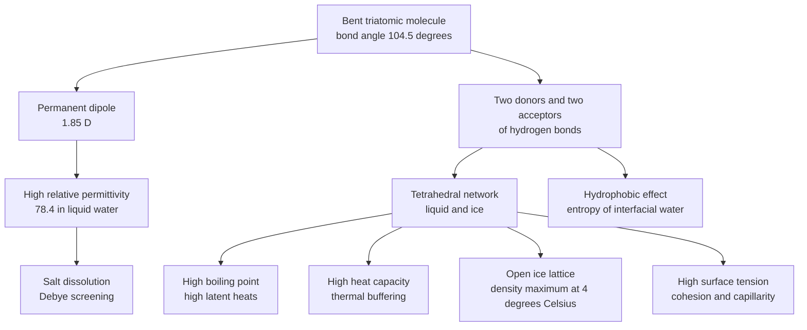
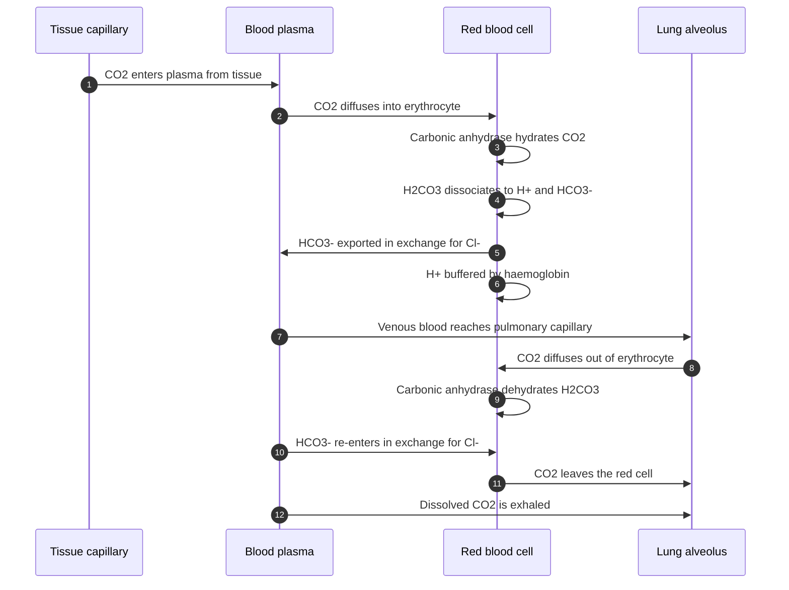
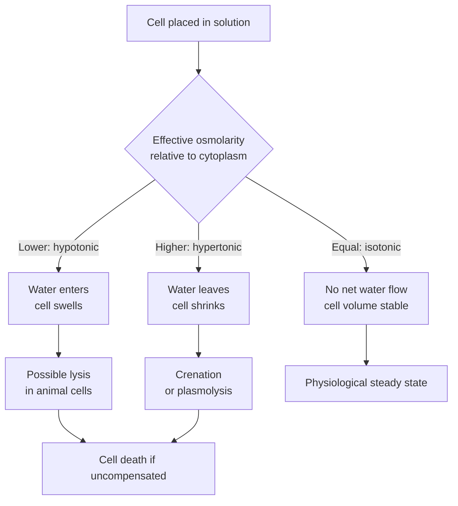

# Chapter 1 — Water and Biological Systems

> **Level:** University (Level 8 — Biochemistry)
> **Estimated study time:** 6 hours (4 h reading + 2 h exercises)
> **Prerequisites:** [Intermolecular Forces](../03-intermediate-chemistry/05-intermolecular-forces.md); [Acid–Base Chemistry and pH](../03-intermediate-chemistry/11-acid-base-chemistry-and-ph.md); [Advanced Equilibrium: Buffers and Solubility Product](../04-advanced-chemistry/07-advanced-equilibrium-buffers-and-solubility-product.md)
> **Related chapters:** [Level 8 index](README.md); [Amino Acids and Proteins](02-amino-acids-and-proteins.md); [Enzymes: Kinetics, Mechanism and Regulation](03-enzymes.md); [Lipids and Membranes](05-lipids.md)
> **Difficulty:** ★★★☆☆ (3/5)

---

## 1. Learning Objectives

After working through this chapter you will be able to:

- Explain how the geometry and polarity of water generate its hydrogen-bond network in
  liquid water and in ice.
- Account for the anomalous properties of water — boiling point, heat capacity, surface
  tension, density maximum, dielectric constant and latent heats — through that network.
- Distinguish the energetic and entropic contributions to the hydrophobic effect and
  explain its role in protein folding and membrane assembly.
- Calculate pH, buffer ratios, buffer capacity and osmotic pressure for biological
  solutions, carrying units through each step.
- Derive the Henderson–Hasselbalch equation and apply it to the bicarbonate system of
  blood, including the classification of acid–base disorders.
- Explain osmosis, tonicity, water activity and membrane transport in terms of chemical
  potential, and describe the roles of water in catalysis and in extremophile survival.

---

## 2. Introduction

Liquid water is the medium of terrestrial biochemistry. It makes up 60–70 % of human
body mass and 75–85 % of a typical cell, and it is the solvent for every metabolite,
every protein and every enzyme assay. Yet it is not a passive background. A small bent
molecule with two hydrogen-bond donors and two acceptors forms a dynamic, nearly
tetrahedral network, and almost every unusual property of water follows from that
network.

The consequences are extreme. Water boils at 100 °C at one atmosphere, whereas hydrogen
sulfide, a molecule of similar mass and shape, boils near −60 °C. Its heat capacity,
$75.3\ \mathrm{J\ K^{-1}\ mol^{-1}}$, is roughly twice that of comparable liquids. Its
surface tension, $72\ \mathrm{mN\ m^{-1}}$ at 25 °C, is the highest of any common
liquid except mercury. Its relative permittivity of 78.4 weakens ionic attractions by
nearly two orders of magnitude and dissolves salts that are insoluble elsewhere. Its
solid is less dense than its liquid, so ice floats and lakes freeze from the top down.
Each fact has a biological consequence, and each is explained by hydrogen bonding.

The chapter moves from the molecule to the network, from the network to the anomalous
properties, and from there to solutions: hydration, the hydrophobic effect,
amphiphiles, acids, bases, buffers, osmosis and water activity. The second half applies
these ideas to cells — pH homeostasis, the bicarbonate buffer of blood, membrane
transport, protein folding, enzyme catalysis and life at the limits of water
availability. A buffer calculation and an osmotic-pressure calculation are worked in
full because they recur in every laboratory and clinical setting.

---

## 3. Fundamental Concepts

### 3.1 The water molecule

Water has an oxygen atom at the centre of two hydrogen atoms, with an H–O–H angle of
$104.5^\circ$ and an O–H bond length of $95.7\ \mathrm{pm}$ in the gas phase. The
permanent dipole moment is $1.85\ \mathrm{D}$, or $6.17\times10^{-30}\ \mathrm{C\ m}$.
Oxygen is more electronegative than hydrogen, so the bonding electrons are displaced
towards it; calculated partial charges are approximately $-0.8e$ on oxygen and $+0.4e$
on each hydrogen, although the values depend on the population analysis.

### 3.2 Hydrogen bonding

A **hydrogen bond** is an attractive interaction between a hydrogen atom covalently
bound to an electronegative donor atom and a lone pair on an acceptor atom. In water the
motif is $\ce{O-H\bond{...}O}$, with a donor–acceptor distance of
$2.8$–$2.9\ \mathrm{\AA}$ and a hydrogen–acceptor distance near $1.8\ \mathrm{\AA}$.
The bond is directional: it is strongest when the three atoms are nearly collinear.

A typical intact hydrogen bond in water has an enthalpy near
$20\ \mathrm{kJ\ mol^{-1}}$, within a range of roughly $10$–$40\ \mathrm{kJ\ mol^{-1}}$
depending on geometry and environment. The interaction is largely electrostatic with a
smaller charge-transfer component, and it is cooperative: a molecule that donates one
hydrogen bond becomes a better acceptor and a better donor for the next. In the liquid
the *net* free-energy cost of breaking a bond is much smaller than the enthalpy, because
neighbouring molecules reorganise and recover much of the interaction. This
enthalpy–entropy compensation is why the network remains dynamic at room temperature.

Each water molecule has two donors and two acceptors, and that $2+2$ functionality allows
a three-dimensional tetrahedral network that can incorporate solutes with fewer donor or
acceptor groups. Hydrogen bonds break and re-form on a $1$–$10\ \mathrm{ps}$ timescale;
proton transfer is faster still, proceeding by the **Grotthuss mechanism** along
hydrogen-bonded chains.

### 3.3 Ice and liquid water

In hexagonal ice Ih, each water molecule is tetrahedrally coordinated to four
neighbours, two through its own O–H donors and two through its lone pairs. The O–O
distance is $2.76\ \mathrm{\AA}$ and the O–O–O angles are close to $109.5^\circ$. The
tetrahedra form rings that enclose open hexagonal channels, so the structure is not
close-packed. The density is $0.9167\ \mathrm{g\ cm^{-3}}$ at 0 °C, about 9 % less than
that of liquid water at the same temperature. At least nineteen crystalline ice phases
exist at other pressures and temperatures, but Ih is the phase stable at ambient
pressure and the one relevant to snow, glaciers and frozen tissue.

Liquid water is not a collection of ice-like clusters floating in a sea of monomers.
Diffraction, spectroscopy and simulation agree that the network is continuous, distorted
and dynamic. At 25 °C each molecule participates in about 3.4 hydrogen bonds rather than
the four of ice, and the O–O distances and angles are broadly distributed. The first
coordination shell contains about 4.5 neighbours. The partition between "low-density"
and "high-density" local environments remains debated; two-state models capture some
thermodynamic anomalies but are not a literal description of two species.

### 3.4 The anomalous properties

The table lists the properties that are anomalous relative to molecules of similar size
and mass. The final column identifies the structural origin; Section 4 explains each in
turn.

| Property | Value for water | Comparison | Structural origin |
|---|---|---|---|
| Boiling point at 1 atm | $100.0\ ^\circ\mathrm{C}$ | $\ce{H2S}$: $-60\ ^\circ\mathrm{C}$ | Extensive hydrogen bonding in the liquid |
| Melting point at 1 atm | $0.0\ ^\circ\mathrm{C}$ | $\ce{H2S}$: $-85\ ^\circ\mathrm{C}$ | Hydrogen-bonded solid lattice |
| $\Delta H_\mathrm{vap}$ at 25 °C | $44.0\ \mathrm{kJ\ mol^{-1}}$ | $\ce{H2S}$: $18.7\ \mathrm{kJ\ mol^{-1}}$ | About two hydrogen bonds broken per molecule |
| Heat capacity | $75.3\ \mathrm{J\ K^{-1}\ mol^{-1}}$ | $\ce{H2S}$: $34\ \mathrm{J\ K^{-1}\ mol^{-1}}$ | Energy absorbed by bending and breaking bonds |
| Surface tension at 25 °C | $72\ \mathrm{mN\ m^{-1}}$ | Organic liquids: $20$–$30\ \mathrm{mN\ m^{-1}}$ | Strong cohesion at the interface |
| Relative permittivity | $78.4$ | $\ce{H2S}$: about $9$ | Reorientation of a dense dipole network |
| Density maximum | $3.98\ ^\circ\mathrm{C}$ | Most liquids contract monotonically | Competition between thermal expansion and network collapse |

### 3.5 Water as a solvent

Coulomb's law in a medium shows that water at $\varepsilon_\mathrm{r} = 78.4$ reduces the force between two ions by a
factor of about 78. Sodium chloride dissolves because the lattice enthalpy of about
$+787\ \mathrm{kJ\ mol^{-1}}$ is more than compensated by the hydration enthalpies of
$\ce{Na+}$ and $\ce{Cl-}$, and because the large dielectric constant prevents the
separated ions from recombining. Dissolution also has an entropy balance: the ordered
hydration shells lower the entropy, while the liberated ions raise it.

### 3.6 The hydrophobic effect and amphiphiles

Non-polar solutes are sparingly soluble in water. The transfer of a non-polar molecule
from a non-polar solvent into water has a positive Gibbs energy, but the enthalpy is
small and can be either sign; the dominant contribution is entropic. Water molecules
adjacent to a non-polar surface lose configurational freedom because they cannot form
hydrogen bonds with the solute and must organise around it. This is the **hydrophobic
effect**. Its magnitude is roughly $0.1\ \mathrm{kJ\ mol^{-1}}$ per square ångström of
non-polar surface exposed to water at 25 °C, and it weakens both at high temperature and
at low temperature.

The effect is not an attraction between non-polar groups. Oil droplets aggregate because
the water–water network is less disrupted when the non-polar surface area is minimised.
The same principle drives micelle formation, lipid bilayer assembly and the burial of
hydrophobic residues in globular proteins. An **amphiphile** has a hydrophilic head and
a hydrophobic tail and self-assembles above a **critical micelle concentration** into
micelles, bilayers or vesicles; the geometry is set by the packing parameter
$P = v/(a_0 l_\mathrm{c})$, which compares tail volume with head-group area and chain
length.

### 3.7 Autoprotolysis, pH and buffers

Water is both a weak acid and a weak base:

$$
\ce{2H2O(l) <=> H3O+(aq) + OH-(aq)}
$$

with $K_\mathrm{w} = a_{\ce{H+}}a_{\ce{OH-}} = 1.0\times10^{-14}$ at 25 °C, so that
$\mathrm{p}K_\mathrm{w} = 14.00$ and pure water has pH 7.00. Autoprotolysis is
endothermic, so $K_\mathrm{w}$ rises with temperature: at 37 °C,
$K_\mathrm{w} \approx 2.4\times10^{-14}$ and neutral pH is about 6.81. The pH scale is
$\mathrm{pH} = -\log_{10}a_{\ce{H+}}$, approximated by $-\log_{10}([\ce{H+}]/c^\circ)$
in dilute solution; at the ionic strength of plasma the activity coefficient of
$\ce{H+}$ is about 0.75, so the approximation is no longer exact.

A **buffer** contains a weak acid and its conjugate base and resists pH change. The
Henderson–Hasselbalch equation,

$$
\mathrm{pH} = \mathrm{p}K_\mathrm{a} + \log_{10}\frac{[\ce{A-}]}{[\ce{HA}]}
$$

shows that pH is set by the ratio of the conjugate forms. A buffer is most effective
within one pH unit of its $\mathrm{p}K_\mathrm{a}$, where its **buffer capacity** is
greatest. Phosphate ($\mathrm{p}K_\mathrm{a2} = 6.86$ at 25 °C) is the main
intracellular buffer at a few millimolar; bicarbonate
($\mathrm{p}K_\mathrm{a1} = 6.35$ at 25 °C, 6.10 at 37 °C) is the main extracellular
buffer at about 24 mM; histidine ($\mathrm{p}K_\mathrm{a} = 6.0$) buffers protein
interiors; and proteins buffer through aspartate, glutamate, cysteine and terminal
groups.

### 3.8 Osmosis, tonicity and water activity

**Osmosis** is the movement of solvent across a semipermeable membrane from higher to
lower solvent chemical potential. For a dilute ideal solution the osmotic pressure is
given by the van 't Hoff equation, $\pi = iCRT$, where $i$ is the number of particles
per formula unit, $C$ the molar concentration, $R$ the gas constant and $T$ the
thermodynamic temperature. **Osmolarity** is osmoles per litre of solution;
**osmolality** is osmoles per kilogram of solvent. Plasma osmolality is about
$285$–$295\ \mathrm{mOsm\ kg^{-1}}$.

**Tonicity** is the effective osmolarity — the concentration of solutes that cannot
cross the membrane. An **isotonic** solution has the same effective osmolarity as the
cell; a **hypotonic** solution causes water to enter and the cell to swell; a
**hypertonic** solution causes water to leave and the cell to shrink. A 0.9 % sodium
chloride solution has an osmolarity of about $308\ \mathrm{mOsm\ L^{-1}}$ and is
described as isotonic, although it is marginally hypertonic relative to plasma. Urea at
the same osmolarity is not isotonic because it crosses membranes freely.

**Water activity** $a_\mathrm{w} = p/p^\circ$ is the ratio of the vapour pressure above a
solution to that above pure water. Pure water has $a_\mathrm{w} = 1.00$; seawater about
0.98; normal cytoplasm about 0.99; saturated sodium chloride about 0.75. Water activity,
not water content, determines microbial growth: most bacteria require
$a_\mathrm{w} > 0.91$ and most moulds $> 0.80$, while xerophiles grow below 0.75. This is
why honey, dried fruit and salted fish resist spoilage.

---
## 4. Detailed Scientific Explanation

### 4.1 Boiling point, latent heats and evaporative cooling

Boiling occurs when vapour pressure equals external pressure. The Clausius–Clapeyron
equation relates vapour pressure to the enthalpy of vaporisation, and water's
$\Delta H_\mathrm{vap} = 44.0\ \mathrm{kJ\ mol^{-1}}$ at 25 °C is the largest of any
common liquid. Hydrogen sulfide, with a similar mass and shape, has
$18.7\ \mathrm{kJ\ mol^{-1}}$. The difference of about
$25\ \mathrm{kJ\ mol^{-1}}$ is the hydrogen-bond contribution.

If one intact hydrogen bond costs about $20\ \mathrm{kJ\ mol^{-1}}$, vaporisation breaks
roughly two bonds per molecule. The structural picture is consistent: a liquid molecule
has about 3.4 hydrogen bonds on average, but when it escapes it takes some favourable
orientations with it and leaves a cavity that neighbours partly refill. The estimate is
bookkeeping, not a measurement of individual bonds, but it predicts correctly that
liquids unable to form three-dimensional networks boil far lower. It also explains why
evaporative cooling is powerful: vaporising 1 g of water removes about
$2.44\ \mathrm{kJ}$ at 25 °C, which is why sweating and transpiration regulate
temperature.

### 4.2 Heat capacity and thermal homeostasis

The molar heat capacity of liquid water is $75.3\ \mathrm{J\ K^{-1}\ mol^{-1}}$
($4.18\ \mathrm{J\ K^{-1}\ g^{-1}}$). Roughly half comes from translational and
rotational degrees of freedom; the rest is absorbed as hydrogen bonds bend, stretch and
break. Because the hydrogen-bond distribution changes with temperature, the heat
capacity is itself temperature-dependent and rises sharply towards 0 °C.

### 4.3 Surface tension, capillarity and cavitation

At the surface, molecules have fewer neighbours and therefore fewer hydrogen bonds. The
excess free energy per unit area is the **surface tension**,
$\gamma = 72\ \mathrm{mN\ m^{-1}}$ at 25 °C. It is the highest of any common liquid
except mercury, and it makes water form nearly spherical droplets, support small insects
and rise in narrow capillaries. The Laplace pressure across a spherical interface is
$\Delta p = 2\gamma/r$: the smaller the radius, the larger the pressure difference. This
is why small bubbles dissolve and foams coarsen.

### 4.4 The density maximum at 3.98 °C

Most liquids contract continuously on cooling. Water contracts until 3.98 °C, reaches
$0.99997\ \mathrm{g\ cm^{-3}}$, then expands to $0.99984\ \mathrm{g\ cm^{-3}}$ at 0 °C.
Ice at 0 °C has a density of $0.9167\ \mathrm{g\ cm^{-3}}$, a further expansion of
about 9 %. Two effects compete: normal thermal contraction reduces volume as temperature
falls, while the increasingly tetrahedral hydrogen-bond network becomes more open and
increases it. Above 4 °C the first dominates; below 4 °C the second does.

The biological importance is difficult to overstate. Because water at 4 °C is denser than
water at 0 °C, a cooling lake sinks its coldest water before freezing and freezes from the
surface; the ice insulates the water beneath and allows aquatic life to survive. If ice
were denser than water, lakes would freeze from the bottom up. The expansion on freezing
also causes frost damage, and it is why cryoprotectants such as glycerol limit
ice-crystal growth.

### 4.5 Dielectric constant, hydration and the Hofmeister series

The relative permittivity arises from reorientation of molecular dipoles in an electric
field. Because the dipoles are dense and mobile, water screens Coulomb interactions
strongly: the force between two charges is reduced by a factor of about 78 compared with
vacuum. The **Born equation** gives the electrostatic part of the solvation free energy
of an ion of charge $ze$ and radius $r$:

$$
\Delta G_\mathrm{solv} = -\frac{z^2 e^2 N_\mathrm{A}}{8\pi\varepsilon_0 r}
\left(1 - \frac{1}{\varepsilon_\mathrm{r}}\right)
$$

For water the bracket is about 0.987; for hexane, with $\varepsilon_\mathrm{r} \approx
2$, it is 0.5. This is the quantitative reason salts dissolve in water and not in
hexane. The same screening weakens protein electrostatics: a salt bridge worth
$5$–$20\ \mathrm{kJ\ mol^{-1}}$ in a folded protein is worth only a few
$\mathrm{kJ\ mol^{-1}}$ in bulk water. Inside a protein, where $\varepsilon_\mathrm{r}$
may be 2–10, buried salt bridges can be much stronger.

Around each ion, water forms a **hydration shell**. First-shell residence times range
from about $10^{-10}\ \mathrm{s}$ for $\ce{Na+}$ to hours for tightly bound
$\ce{Mg^{2+}}$. The **Hofmeister series** ranks ions by their effect on protein
solubility: kosmotropes such as $\ce{SO4^{2-}}$ are strongly hydrated, raise surface
tension and stabilise folded proteins, whereas chaotropes such as $\ce{SCN-}$ weaken the
network and promote denaturation. Ammonium sulfate precipitation exploits the series by
competing with the protein for water; urea at 6–8 M and guanidinium chloride at 4–6 M
are used deliberately to denature proteins.

### 4.6 The hydrophobic effect and protein folding

The folding of a globular protein is driven by the hydrophobic effect, but the statement
needs qualification. Burial of non-polar side chains releases ordered interfacial water
and increases solvent entropy. The folded state is also stabilised by hydrogen bonds, van
der Waals contacts and electrostatics, and destabilised by the loss of chain
conformational entropy. The net folding free energy is only
$20$–$60\ \mathrm{kJ\ mol^{-1}}$ for a typical small protein — a small difference
between large opposing terms.

The process is described as a **folding funnel**: a broad, rough energy landscape with
many local minima and a deep global minimum at the native state. The funnel replaces the
idea of a single defined pathway. A polypeptide can collapse rapidly into a **molten
globule** with native-like secondary structure but fluctuating tertiary contacts, then
pack more slowly into the native state. Some proteins fold co-translationally, and many
require ATP-dependent chaperones to prevent aggregation while they search the landscape.

### 4.7 Water in enzyme catalysis

Water is a reactant, a product and a catalyst. In hydrolytic enzymes — proteases,
lipases, esterases, glycosidases and nucleases — water is the nucleophile that cleaves a
bond. In condensation reactions — peptide, glycosidic and phosphodiester bond formation
— water is the leaving group. In carbonic anhydrase, water is deprotonated to hydroxide
at a zinc centre, and the hydroxide attacks carbon dioxide with a turnover number near
$10^6\ \mathrm{s^{-1}}$. A proton relay of hydrogen-bonded water molecules and histidine
residues moves the proton to the bulk.

### 4.8 Acid–base balance in blood

Arterial pH is held between 7.35 and 7.45 by coupled equilibria involving bicarbonate,
carbon dioxide, haemoglobin, phosphate and plasma proteins. The central buffer is

$$
\ce{CO2(aq) + H2O(l) <=> H2CO3(aq) <=> H+(aq) + HCO3-(aq)}
$$

The apparent $\mathrm{p}K_\mathrm{a}$ of the overall $\ce{CO2}$/$\ce{HCO3-}$ couple is
6.10 at 37 °C, well below blood pH. The system works because it is *open*: carbon dioxide
is exhaled, so its concentration is set by ventilation rather than by reaction
stoichiometry. Hence

$$
\mathrm{pH} = 6.10 + \log_{10}\frac{[\ce{HCO3-}]}{0.03\,P_{\ce{CO2}}}
$$

with $[\ce{HCO3-}]$ in mmol L⁻¹ and $P_{\ce{CO2}}$ in mmHg. Normal values,
$24\ \mathrm{mmol\ L^{-1}}$ and $40\ \mathrm{mmHg}$, give a ratio of 20:1 and pH 7.40.
The 20:1 ratio gives only modest capacity for added acid at constant $P_{\ce{CO2}}$; the
power of the system lies in independent physiological control. The lungs adjust
$P_{\ce{CO2}}$ in seconds to minutes, and the kidneys adjust bicarbonate reabsorption and
proton excretion over hours to days.

| Disorder | Primary change | pH | Compensatory response |
|---|---|---|---|
| Metabolic acidosis | $\downarrow$ $\ce{HCO3-}$ | $\downarrow$ | Hyperventilation lowers $P_{\ce{CO2}}$ |
| Metabolic alkalosis | $\uparrow$ $\ce{HCO3-}$ | $\uparrow$ | Hypoventilation raises $P_{\ce{CO2}}$ |
| Respiratory acidosis | $\uparrow$ $P_{\ce{CO2}}$ | $\downarrow$ | Renal bicarbonate retention |
| Respiratory alkalosis | $\downarrow$ $P_{\ce{CO2}}$ | $\uparrow$ | Renal bicarbonate excretion |

The erythrocyte is central. Carbonic anhydrase hydrates carbon dioxide inside the red
cell; the protons are buffered by haemoglobin and the bicarbonate is exported to plasma
in exchange for chloride — the **chloride shift**. In the lung the process reverses:
bicarbonate re-enters, carbonic anhydrase dehydrates it, and carbon dioxide diffuses into
the alveoli. The **Haldane effect** — deoxygenated haemoglobin binds carbon dioxide and
protons more strongly than oxygenated haemoglobin — increases uptake in tissues and
release in the lungs.

### 4.9 Osmosis, tonicity and membrane transport

Animal cells lack a rigid wall and are vulnerable to osmotic swelling. The
**Na⁺/K⁺-ATPase** pumps three sodium ions out and two potassium ions in per ATP
hydrolysed, maintaining the gradients that make the cell osmotically stable and
electrically excitable. Inhibiting the pump, for example with ouabain or by ATP
depletion, lets sodium enter, water follow, and the cell swell and lyse. The pump
consumes roughly 20–25 % of resting metabolic rate in humans and up to 70 % in nervous
tissue.

Water crosses membranes by simple diffusion and through **aquaporins**, which conduct
about $10^9$ molecules per second per subunit while excluding ions and protons.
Aquaporin-1 is constitutive in the proximal tubule and red cells; aquaporin-2 is inserted
into the collecting duct under vasopressin control, and its loss causes nephrogenic
diabetes insipidus.

The **reflection coefficient** $\sigma$ measures how effectively a solute is excluded by
the membrane: $\sigma = 1$ for an impermeant solute, $\sigma = 0$ for a freely permeant
one. The effective osmotic pressure is $\sigma\pi$. This is why urea, which is permeant,
is a poor osmotic agent despite contributing to measured osmolarity, whereas mannitol is
used clinically to draw water out of tissues.

### 4.10 Water activity and extremophiles

Every organism must keep cytoplasmic water activity above the threshold at which
proteins and membranes function. Halophilic archaea such as *Halobacterium salinarum*
accumulate potassium chloride to near saturation, and their proteins carry an excess of
acidic surface residues that keep them soluble at low water activity and high ionic
strength. Most organisms instead accumulate **compatible solutes** — glycine betaine,
ectoine, trehalose, glycerol, proline or sucrose — which raise internal osmolality
without interfering with protein function. Trehalose also replaces water at membrane and
protein surfaces, preserves the bilayer in a glass-like state and supports
anhydrobiosis in tardigrades, brine shrimp and some plants.

Thermophiles face weakening hydrogen bonds, fluid membranes and unfolding proteins at
80–120 °C. Adaptations include saturated and ether-linked lipids, reverse gyrase that
introduces positive DNA supercoils, chaperones that refold denatured proteins, and
proteins with extra salt bridges and disulfide bonds. *Thermus aquaticus* supplied Taq
polymerase, the enzyme that made the polymerase chain reaction practical. Piezophiles
adapt to pressure, which compresses membranes and favours protein association;
psychrophiles adapt to cold with more flexible proteins and more unsaturated fatty acids.
In every case, the adaptations must work in water.

---

## 5. Visual Diagrams

**Figure 1.1 — From molecular structure to macroscopic properties.** The diagram traces
the causal chain that organises the chapter. One structural feature — a bent molecule
with two hydrogen-bond donors and two acceptors — generates the dipole, the network and,
through them, the properties that make water biologically exceptional. The arrows are not independent: the dielectric constant and the hydrophobic effect
both depend on the same reorientational freedom of the network.

**Figure 1.2 — The bicarbonate shuttle between tissues and lungs.** The sequence
separates transport from chemistry. In the tissue, carbon dioxide is hydrated inside the
erythrocyte, the proton is buffered by haemoglobin and bicarbonate is exported in
exchange for chloride. In the lung, the reactions run in reverse and carbon dioxide is
exhaled. The cycle works because the enzyme is confined to the erythrocyte and because the lung
maintains a low alveolar $P_{\ce{CO2}}$.

**Figure 1.3 — Tonicity and cell volume.** Tonicity depends on solutes that cannot cross
the membrane, not on total osmolarity. A cell in a hypotonic solution gains water and may
lyse; in a hypertonic solution it loses water and shrinks; in an isotonic solution the net
flow is zero. The diagram applies to animal cells; plant and fungal cells generate turgor pressure
instead.

---
## 6. Mathematical Formulas

The quantitative treatment rests on electrostatics, phase equilibrium, acid–base
equilibrium and colligative properties. Each equation is stated with its assumptions;
the symbol table collects the units.

**Coulomb interaction and Debye screening.**

$$
F = \frac{1}{4\pi\varepsilon_0\varepsilon_\mathrm{r}}\frac{q_1q_2}{r^2},
\qquad
\kappa^{-1} = \sqrt{\frac{\varepsilon_0\varepsilon_\mathrm{r}k_\mathrm{B}T}{2N_\mathrm{A}e^2I}}
$$

**Clausius–Clapeyron equation.**

$$
\ln\frac{p_2}{p_1} = -\frac{\Delta H_\mathrm{vap}}{R}
\left(\frac{1}{T_2} - \frac{1}{T_1}\right)
$$

It assumes constant $\Delta H_\mathrm{vap}$ and an ideal vapour.

**Autoprotolysis and pH.**

$$
K_\mathrm{w} = a_{\ce{H+}}a_{\ce{OH-}},
\qquad
\mathrm{pH} = -\log_{10}a_{\ce{H+}}
$$

**Henderson–Hasselbalch and buffer capacity.**

$$
\mathrm{pH} = \mathrm{p}K_\mathrm{a} + \log_{10}\frac{[\ce{A-}]}{[\ce{HA}]},
\qquad
\beta = 2.303\,\frac{[\ce{HA}][\ce{A-}]}{[\ce{HA}]+[\ce{A-}]}
$$

Its maximum is $\beta_\mathrm{max} = 0.576\,C$ at $\mathrm{pH} = \mathrm{p}K_\mathrm{a}$.

**Osmotic pressure and water potential.**

$$
\pi = iCRT,
\qquad
\Psi = \Psi_\mathrm{s} + \Psi_\mathrm{p} = -iCRT + \Psi_\mathrm{p}
$$

The van 't Hoff equation is a dilute-solution limit; at physiological concentration,
osmotic coefficients replace $i$. Water potential $\Psi$ is expressed in pascals and
drives water flow from high to low $\Psi$.

**Water activity and osmotic pressure.**

$$
a_\mathrm{w} = \frac{p}{p^\circ},
\qquad
\pi = -\frac{RT}{V_\mathrm{m}}\ln a_\mathrm{w}
$$

where $V_\mathrm{m}$ is the molar volume of liquid water,
$1.8\times10^{-5}\ \mathrm{m^3\ mol^{-1}}$. The logarithmic relation is exact for an
ideal solution and a good approximation for dilute real solutions.

| Symbol | Meaning | SI unit |
|---|---|---|
| $F$ | Coulomb force | N |
| $q_1, q_2$ | Charges | C |
| $r$ | Separation | m |
| $\varepsilon_0$ | Vacuum permittivity, $8.854\times10^{-12}$ | F m⁻¹ |
| $\varepsilon_\mathrm{r}$ | Relative permittivity | dimensionless |
| $\kappa^{-1}$ | Debye length | m |
| $I$ | Ionic strength, $\tfrac12\sum c_i z_i^2$ | mol m⁻³ |
| $p$ | Vapour pressure | Pa |
| $\Delta H_\mathrm{vap}$ | Enthalpy of vaporisation | J mol⁻¹ |
| $R$ | Gas constant, $8.314$ | J K⁻¹ mol⁻¹ |
| $T$ | Thermodynamic temperature | K |
| $K_\mathrm{w}$ | Autoprotolysis constant | dimensionless |
| $K_\mathrm{a}$ | Acid dissociation constant | dimensionless |
| $\beta$ | Buffer capacity | mol dm⁻³ pH⁻¹ |
| $\pi$ | Osmotic pressure | Pa |
| $i$ | van 't Hoff factor | dimensionless |
| $C$ | Molar concentration | mol m⁻³ |
| $a_\mathrm{w}$ | Water activity | dimensionless |
| $\Psi$ | Water potential | Pa |
| $V_\mathrm{m}$ | Molar volume of liquid water, $1.8\times10^{-5}$ | m³ mol⁻¹ |

---

## 7. Chemical Equations

Autoprotolysis of water sets the pH scale:

$$
\ce{2H2O(l) <=> H3O+(aq) + OH-(aq)}
\qquad K_\mathrm{w} = 1.0\times10^{-14}\ (25\ ^\circ\mathrm{C})
$$

Carbon dioxide dissolves and hydrates; carbonic acid is a minor species, and the overall
equilibrium is written with the apparent $\mathrm{p}K_\mathrm{a}$:

$$
\ce{CO2(g) <=> CO2(aq)}
$$

$$
\ce{CO2(aq) + H2O(l) <=> H2CO3(aq) <=> H+(aq) + HCO3-(aq)}
$$

The hydration step is slow in uncatalysed solution and is accelerated by carbonic
anhydrase by a factor of about $10^7$.

Phosphate buffers through the second dissociation:

$$
\ce{H2PO4-(aq) + H2O(l) <=> HPO4^{2-}(aq) + H3O+(aq)}
\qquad \mathrm{p}K_\mathrm{a} = 6.86
$$

Lactic acid ($\mathrm{p}K_\mathrm{a} = 3.86$) is almost entirely dissociated at blood
pH, and ATP hydrolysis releases a proton that is taken up by buffer rather than
accumulating as free $\ce{H+}$.

---

## 8. Worked Examples

### Worked Example 8.1 — Preparing a phosphate buffer

**Problem.** What masses of $\ce{Na2HPO4}$ ($M = 141.96\ \mathrm{g\ mol^{-1}}$) and
$\ce{NaH2PO4}$ ($M = 119.98\ \mathrm{g\ mol^{-1}}$) are needed to make 1.00 L of a
0.100 M phosphate buffer at pH 7.20? Use $\mathrm{p}K_\mathrm{a2} = 6.86$.

**Strategy.** Use Henderson–Hasselbalch to find the ratio of conjugate base to acid, then
convert the ratio and the total concentration into moles and masses.

**Solution.**

$$
7.20 = 6.86 + \log_{10}\frac{[\ce{HPO4^{2-}}]}{[\ce{H2PO4-}]}
$$

$$
\frac{[\ce{HPO4^{2-}}]}{[\ce{H2PO4-}]} = 10^{0.34} = 2.19
$$

With $[\ce{HPO4^{2-}}] + [\ce{H2PO4-}] = 0.100\ \mathrm{mol\ L^{-1}}$,
$[\ce{HPO4^{2-}}] = 0.0686\ \mathrm{M}$ and $[\ce{H2PO4-}] = 0.0314\ \mathrm{M}$.
Therefore $m(\ce{Na2HPO4}) = 0.0686 \times 141.96 = 9.74\ \mathrm{g}$ and
$m(\ce{NaH2PO4}) = 0.0314 \times 119.98 = 3.77\ \mathrm{g}$.

**Check.** The ratio $0.0686/0.0314 = 2.18$, and
$6.86 + \log_{10}2.18 = 7.20$. The masses sum to 13.5 g, consistent with 0.100 mol of
phosphate plus the mass difference between the sodium salts and the free acid.

### Worked Example 8.2 — Osmotic pressure of saline

**Problem.** Calculate the osmotic pressure at 37 °C of a 0.90 % w/v sodium chloride
solution ($M = 58.44\ \mathrm{g\ mol^{-1}}$), assuming complete dissociation.

**Strategy.** Convert grams per litre to molarity, apply the van 't Hoff equation with
$i = 2$, and compare with plasma.

**Solution.** $9.0\ \mathrm{g\ L^{-1}}/58.44\ \mathrm{g\ mol^{-1}} =
0.154\ \mathrm{mol\ L^{-1}} = 154\ \mathrm{mol\ m^{-3}}$.

$$
\pi = iCRT = 2(154)(8.314)(310) = 7.94\times10^{5}\ \mathrm{Pa}
= 7.94\ \mathrm{bar}
$$

**Check.** Plasma at $290\ \mathrm{mOsm\ L^{-1}}$ gives
$290 \times 8.314 \times 310 = 7.47\times10^{5}\ \mathrm{Pa}$, so 0.9 % saline is about
6 % hypertonic — close enough to be used clinically as "isotonic", but not exactly so.
The assumption of complete dissociation overestimates the osmotic coefficient slightly,
which narrows the difference.

### Worked Example 8.3 — The bicarbonate buffer at pH 7.40

**Problem.** Calculate the pH of blood with $[\ce{HCO3-}] = 24\ \mathrm{mmol\ L^{-1}}$
and $P_{\ce{CO2}} = 40\ \mathrm{mmHg}$, using
$\mathrm{p}K_\mathrm{a} = 6.10$ and a solubility coefficient of
$0.03\ \mathrm{mmol\ L^{-1}\ mmHg^{-1}}$. Then calculate the pH if bicarbonate falls to
$15\ \mathrm{mmol\ L^{-1}}$ at constant $P_{\ce{CO2}}$.

**Strategy.** Apply the Henderson–Hasselbalch equation to the open
$\ce{CO2}$/$\ce{HCO3-}$ system, with dissolved carbon dioxide equal to
$0.03\,P_{\ce{CO2}}$.

**Solution.** $[\ce{CO2}]_\mathrm{dissolved} = 0.03 \times 40 =
1.2\ \mathrm{mmol\ L^{-1}}$.

$$
\mathrm{pH} = 6.10 + \log_{10}\frac{24}{1.2} = 6.10 + \log_{10}20 = 7.40
$$

For $[\ce{HCO3-}] = 15\ \mathrm{mmol\ L^{-1}}$:

$$
\mathrm{pH} = 6.10 + \log_{10}\frac{15}{1.2}
= 6.10 + 1.10 = 7.20
$$

**Check.** A 20:1 ratio gives $6.10 + 1.30 = 7.40$. A fall in bicarbonate from 24 to
15 mmol L⁻¹ is a metabolic acidosis; the body would compensate by hyperventilating.

### Worked Example 8.4 — Why water is not volatile

**Problem.** Using the Clausius–Clapeyron equation, estimate the vapour pressure of
water at 25 °C from its normal boiling point (373 K) and
$\Delta H_\mathrm{vap} = 44.0\ \mathrm{kJ\ mol^{-1}}$. Repeat for a hypothetical liquid
with $\Delta H_\mathrm{vap} = 20\ \mathrm{kJ\ mol^{-1}}$, all else equal.

**Strategy.** Set $p_1 = 1\ \mathrm{atm}$ at $T_1 = 373\ \mathrm{K}$, $T_2 = 298 \mathrm{K}$, and solve for $p_2$.

**Solution.**

$$
\ln\frac{p_2}{1} = -\frac{44000}{8.314}
\left(\frac{1}{298} - \frac{1}{373}\right) = -3.57
$$

so $p_2 = e^{-3.57} = 0.028\ \mathrm{atm} = 2.8\ \mathrm{kPa}$. For
$\Delta H_\mathrm{vap} = 20\ \mathrm{kJ\ mol^{-1}}$, the exponent is $-1.62$ and
$p_2 = 0.20\ \mathrm{atm} = 20\ \mathrm{kPa}$.

**Check.** The measured vapour pressure of water at 25 °C is 3.17 kPa, so the estimate is
within 10 % despite the constant-$\Delta H$ approximation. A liquid with half the
hydrogen-bond enthalpy would be about seven times more volatile at room temperature and
would boil far below 100 °C — which is exactly what hydrogen sulfide does.

---

## 9. Real-World Applications

**Clinical fluids and dialysis.** Isotonic saline, Ringer's lactate and plasma expanders
are designed around the osmotic calculations above. Haemodialysis removes urea and other
solutes by diffusion across a semipermeable membrane while matching the dialysate
osmolality to plasma to avoid osmotic shifts.

**Food preservation.** Water activity, not water content, predicts microbial spoilage.
Honey ($a_\mathrm{w} \approx 0.6$), dried fruit, salted fish and concentrated syrups are
preserved by lowering $a_\mathrm{w}$ below the growth threshold of most organisms.

**Cryopreservation.** Glycerol, dimethyl sulfoxide and trehalose reduce ice-crystal
growth and protect membranes during freezing. The same principles govern the freezing of
cells for biotechnology and the cryopreservation of embryos and organs.

---

## 10. Common Mistakes

| Mistake | Why it happens | Correct approach |
|---|---|---|
| "pH 7 is always neutral." | The value is memorised at 25 °C. | Neutral pH is $\tfrac12\mathrm{p}K_\mathrm{w}$, which is 6.81 at 37 °C. |
| "A buffer holds pH constant." | Resistance is mistaken for invariance. | A buffer slows pH change; capacity is finite and maximal at $\mathrm{p}K_\mathrm{a}$. |
| "The hydrophobic effect is a force between oil molecules." | Aggregation looks like attraction. | It is an entropy-driven solvent effect: water minimises non-polar surface area. |
| "Ice is denser than water because solids are denser." | The general rule is over-applied. | The open tetrahedral lattice of ice Ih makes it about 9 % less dense. |
| "Osmolarity and tonicity are the same." | Both are measured in osmoles. | Tonicity counts only impermeant solutes; urea contributes to osmolarity but not tonicity. |
| "Water structure can be imprinted by solutes." | Hydrogen-bond networks look persistent. | Hydrogen-bond lifetimes are picoseconds; no stable imprint survives dilution. |

---

## 11. Chapter Summary

- Water is a bent, polar molecule with two hydrogen-bond donors and two acceptors; that
  $2+2$ functionality generates a dynamic tetrahedral network.
- The network explains the high boiling point, high heat capacity, high surface tension,
  high dielectric constant, large latent heats and the density maximum at 3.98 °C.
- The hydrophobic effect is entropic: non-polar surfaces are buried to minimise the
  disruption of water's hydrogen-bond network, driving protein folding and membrane
  assembly.
- pH is set by autoprotolysis and by buffer equilibria; Henderson–Hasselbalch describes
  the ratio of conjugate forms, and buffer capacity peaks at the $\mathrm{p}K_\mathrm{a}$.
- Blood pH is controlled by the open bicarbonate system: lungs regulate $P_{\ce{CO2}}$,
  kidneys regulate bicarbonate, and haemoglobin buffers protons in erythrocytes.

---

## 12. Exercises

### 12.1 Conceptual questions

1. Explain why the boiling point of water is much higher than that of hydrogen sulfide,
   although the two molecules have similar masses.
2. Why does ice float, and why is this biologically important?
3. Distinguish osmolarity from tonicity, giving one example of a solution for which the
   two differ.
4. Explain why the hydrophobic effect is described as entropy-driven and why it weakens at
   both high and low temperature.

### 12.2 Basic problems

5. Calculate the pH of a 0.010 M solution of acetic acid
   ($\mathrm{p}K_\mathrm{a} = 4.76$), stating the approximation used.
6. A buffer contains 0.050 M $\ce{HA}$ and 0.050 M $\ce{A-}$. What is its pH if
   $\mathrm{p}K_\mathrm{a} = 7.20$?
7. Calculate the osmotic pressure at 298 K of a 0.10 M glucose solution.

### 12.3 Intermediate problems

8. A 1.00 L buffer is made from 0.100 mol $\ce{NH3}$ and 0.050 mol $\ce{NH4Cl}$
   ($\mathrm{p}K_\mathrm{a} = 9.25$). Calculate the pH and the new pH after adding
   0.010 mol $\ce{HCl}$.
9. Estimate the vapour pressure at 310 K of a liquid with
   $\Delta H_\mathrm{vap} = 30\ \mathrm{kJ\ mol^{-1}}$ and a normal boiling point of
   350 K.
10. Explain why a 0.9 % NaCl solution is described as isotonic even though its calculated
    osmolarity is about 308 mOsm L⁻¹ while plasma is about 290 mOsm L⁻¹.

### 12.4 Advanced problems

11. A protein has a folding free energy of $-40\ \mathrm{kJ\ mol^{-1}}$ at 25 °C and a
    folding heat capacity change of $-5\ \mathrm{kJ\ K^{-1}\ mol^{-1}}$. Explain
    qualitatively why the protein can cold-denature, and sketch the stability curve.

### 12.5 Calculation problems

12. Blood has $[\ce{HCO3-}] = 12\ \mathrm{mmol\ L^{-1}}$ and
    $P_{\ce{CO2}} = 30\ \mathrm{mmHg}$. Calculate the pH and classify the disorder.

### 12.6 Answers

1. Water forms about two more hydrogen bonds per molecule than $\ce{H2S}$; the extra
   $25\ \mathrm{kJ\ mol^{-1}}$ of vaporisation raises the boiling point by about 160 K.
2. Ice Ih has an open tetrahedral lattice with density $0.9167\ \mathrm{g\ cm^{-3}}$
   against $0.9998\ \mathrm{g\ cm^{-3}}$ for water; floating ice insulates lakes and lets
   aquatic life survive.
3. Osmolarity counts all dissolved particles; tonicity counts only impermeant ones. Urea
   solution: high osmolarity, low effective tonicity because urea crosses membranes.
4. Burial of non-polar surface releases ordered water, increasing solvent entropy. The
   effect weakens at high temperature because the entropy gain shrinks, and at low
   temperature because water's own order increases.
5. $[\ce{H+}] = \sqrt{K_\mathrm{a}C} = \sqrt{10^{-4.76}\times0.010} = 4.2\times10^{-4}$,
   pH 3.38.
6. pH $= 7.20 + \log(0.050/0.050) = 7.20$.
7. $\pi = 0.10 \times 8.314 \times 298 = 248\ \mathrm{Pa}$.
8. Initial pH $= 9.25 + \log(0.100/0.050) = 9.55$. Adding 0.010 mol $\ce{HCl}$ converts
   0.010 mol $\ce{NH3}$ to $\ce{NH4+}$: pH $= 9.25 + \log(0.090/0.060) = 9.43$.
9. $\ln p_2 = -(30000/8.314)(1/310 - 1/350) = -1.33$, so $p_2 = 0.26\ \mathrm{atm}$.
10. The osmotic coefficient of NaCl is below 1 and Donnan effects reduce the effective
    difference; clinically it is close enough to isotonic.
11. $\Delta G(T) = \Delta H - T\Delta S$ with a negative $\Delta C_p$ makes the
    stability curve parabolic: destabilisation at both high and low temperature, with a
    maximum near 25 °C.
12. pH $= 6.10 + \log(12/(0.03\times30)) = 6.10 + 1.12 = 7.22$; metabolic acidosis with
    partial respiratory compensation.

---

## 13. Further Reading

- Nelson, D. L.; Cox, M. M. *Lehninger Principles of Biochemistry*, 7th ed. Macmillan,
  2017. Chapters 2 and 3 on water and amino acids.
- Berg, J. M.; Tymoczko, J. L.; Gatto, G. J.; Stryer, L. *Biochemistry*, 9th ed.
  W. H. Freeman, 2019. Chapter 2 on water.
- Atkins, P.; de Paula, J.; Keeler, J. *Atkins' Physical Chemistry*, 11th ed. Oxford
  University Press, 2018. Chapters on liquids, phase equilibria and electrochemistry.
- Eisenberg, D.; Kauzmann, W. *The Structure and Properties of Water*. Oxford University
  Press, 1969. Classic monograph on the physical chemistry.
- Chaplin, M. *Water Structure and Science*. London South Bank University.
  <https://water.lsbu.ac.uk/water/>
- IUPAC. *Compendium of Chemical Terminology* ("Gold Book"), 2nd ed. (the "corrected"
  version), entries "hydrogen bond", "pH" and "buffer capacity".
  <https://goldbook.iupac.org/>

---

**Navigation:** [Level 8 index](README.md) · [Curriculum map](../CURRICULUM.md) · [Amino Acids and Proteins](02-amino-acids-and-proteins.md)
