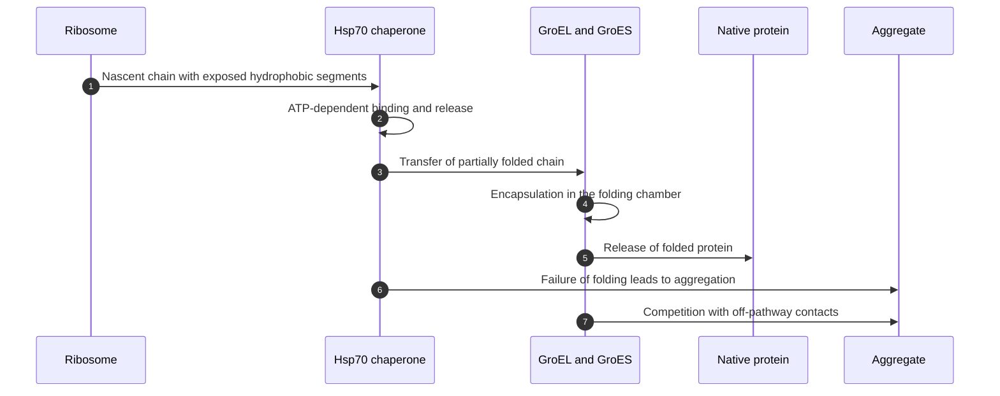
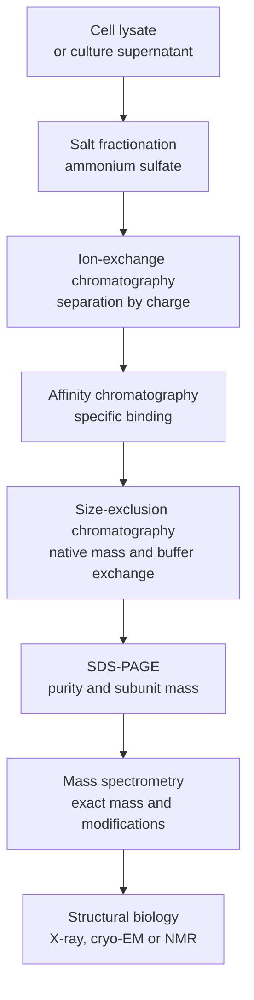

# Chapter 2 — Amino Acids and Proteins

> **Level:** University (Level 8 — Biochemistry)
> **Estimated study time:** 9 hours (6 h reading + 3 h exercises)
> **Prerequisites:** [Water and Biological Systems](01-water-and-biological-systems.md); [Molecular Orbital Theory](../04-advanced-chemistry/03-molecular-orbital-theory.md); [Isomerism and Stereochemistry](../05-organic-chemistry/03-isomerism-and-stereochemistry.md)
> **Related chapters:** [Level 8 index](README.md); [Enzymes: Kinetics, Mechanism and Regulation](03-enzymes.md); [Carbohydrates](04-carbohydrates.md); [Lipids and Membranes](05-lipids.md)
> **Difficulty:** ★★★★☆ (4/5)

---

## 1. Learning Objectives

After working through this chapter you will be able to:

- Draw the general structure of an α-amino acid at pH 1, 7 and 11, and explain why the
  zwitterion dominates near neutrality.
- Name the 20 standard amino acids, give their three-letter and one-letter codes, and
  classify their side chains by polarity and charge.
- Calculate the isoelectric point of an amino acid or peptide from its $\mathrm{p}K_\mathrm{a}$
  values, and calculate the net charge at a given pH.
- Explain the partial double-bond character of the peptide bond and its consequences for
  planarity and for the Ramachandran plot.
- Describe the four levels of protein structure, the forces that stabilise each, and the
  difference between a domain and a motif.
- Outline the evidence for the Anfinsen hypothesis, the Levinthal paradox, the folding
  funnel and the role of chaperones, and explain why intrinsic disorder is functional.
- Match a purification or analysis technique to the property it measures, and state what
  each technique delivers.
- Explain sickle-cell anaemia, amyloid disease and prion disease at the level of
  molecular structure.

---

## 2. Introduction

Proteins carry out most of the work of a cell. They catalyse reactions, transport ions
and metabolites, transmit signals, recognise pathogens, provide mechanical support and
regulate gene expression. The division of labour is reflected in their structures: a
protein is a linear polymer of amino acids that folds into a specific three-dimensional
shape, and the shape determines the function. The central question of protein science is
how a one-dimensional sequence specifies a three-dimensional structure, and how that
structure can be measured, predicted and modified.

The building blocks are 20 standard α-amino acids. Their side chains span a range of
sizes, polarities and charges, and their arrangement along a polypeptide chain is the
primary sequence. Folding brings side chains into proximity, creating local secondary
structure, a compact tertiary fold and, in many proteins, assemblies of several subunits.
The forces involved are the same non-covalent interactions that operate in water —
hydrogen bonds, electrostatic interactions, van der Waals contacts and the hydrophobic
effect — supplemented in some proteins by covalent disulfide bonds.

This chapter builds the subject in the order that protein chemistry developed. It starts
with the amino acids and their acid–base behaviour, then the peptide bond and the
stereochemical constraints that limit backbone conformation. It describes the levels of
structure and the forces that stabilise them, then turns to folding: Levinthal's paradox,
the Anfinsen experiment, chaperones, energy landscapes and intrinsic disorder. The final
sections cover denaturation, purification and analysis, post-translational modification,
and three diseases in which a change in sequence or folding produces a change in
function. The treatment is structural and quantitative; laboratory procedures are not
given, because the chapter is about principles, not protocols.

---

## 3. Fundamental Concepts

### 3.1 The α-amino acid

An **α-amino acid** has a central carbon, the α-carbon, bonded to an amino group, a
carboxyl group, a hydrogen atom and a side chain $R$. The α-carbon is chiral when the
four substituents differ, which is true for every standard amino acid except glycine
($R = \ce{H}$). The two enantiomers are designated L and D by comparison with
glyceraldehyde, and the standard amino acids in proteins are L. In the Cahn–Ingold–Prelog
system most L-amino acids are $(S)$, but cysteine is $(R)$ because sulfur has a higher
priority than oxygen.

In aqueous solution the amino acid exists mainly as a **zwitterion**: the carboxyl group
is deprotonated ($\ce{-CO2-}$) and the amino group is protonated ($\ce{-NH3+}$). The
zwitterion carries no net charge but has two separated charges, which is why amino acids
are crystalline, high-melting and soluble in water but insoluble in non-polar solvents.
The protonation state depends on pH: at low pH the carboxyl group is neutral and the
amino group is positive, giving a net $+1$; at high pH the amino group is neutral and the
carboxyl group is negative, giving a net $-1$.

### 3.2 The 20 standard amino acids

The table lists the standard amino acids with their one-letter codes, side-chain classes
and the $\mathrm{p}K_\mathrm{a}$ values of ionisable side chains. The values are
approximate and depend on the environment; a side chain buried in a protein may shift by
several units.

| Amino acid | 3-letter | 1-letter | Side-chain class | Side-chain $\mathrm{p}K_\mathrm{a}$ |
|---|---|---|---|---|
| Glycine | Gly | G | Non-polar, smallest | — |
| Alanine | Ala | A | Non-polar aliphatic | — |
| Valine | Val | V | Non-polar aliphatic | — |
| Leucine | Leu | L | Non-polar aliphatic | — |
| Isoleucine | Ile | I | Non-polar aliphatic | — |
| Methionine | Met | M | Non-polar, contains sulfur | — |
| Proline | Pro | P | Cyclic imino acid, rigid | — |
| Phenylalanine | Phe | F | Aromatic, non-polar | — |
| Tyrosine | Tyr | Y | Aromatic, weakly polar | 10.07 |
| Tryptophan | Trp | W | Aromatic, largest | — |
| Serine | Ser | S | Polar, hydroxyl | about 13 |
| Threonine | Thr | T | Polar, hydroxyl | about 13 |
| Cysteine | Cys | C | Polar, thiol | 8.18 |
| Asparagine | Asn | N | Polar amide | — |
| Glutamine | Gln | Q | Polar amide | — |
| Aspartate | Asp | D | Acidic | 3.65 |
| Glutamate | Glu | E | Acidic | 4.25 |
| Lysine | Lys | K | Basic | 10.53 |
| Arginine | Arg | R | Basic, guanidinium | 12.48 |
| Histidine | His | H | Basic, imidazole | 6.00 |

The classification is useful but not absolute. Tyrosine is both aromatic and polar;
histidine is only weakly basic and is often neutral at physiological pH; cysteine is
weakly acidic and readily oxidised. The *character* of a side chain — size, shape,
hydrogen-bonding capacity, charge and hydrophobicity — matters more than its category.

Several residues deserve special mention. **Glycine** has no side chain and is the most
flexible residue, with accessible conformations that other residues cannot adopt.
**Proline** has a pyrrolidine ring that constrains the backbone and prevents the
$N$-H needed for a backbone hydrogen bond; it is common in turns and at the start of
helices. **Cysteine** forms disulfide bonds, covalent cross-links that stabilise
extracellular proteins. **Histidine** has an imidazole side chain with a
$\mathrm{p}K_\mathrm{a}$ near 6, which makes it an effective general acid–base catalyst
and a proton buffer near physiological pH. **Tryptophan**, **tyrosine** and
**phenylalanine** absorb ultraviolet light, which is the basis of protein quantification
at 280 nm.

### 3.3 Acid–base behaviour and the isoelectric point

Each ionisable group has an acid dissociation constant $K_\mathrm{a}$ and a
$\mathrm{p}K_\mathrm{a} = -\log_{10}K_\mathrm{a}$. For a monoprotic acid,
Henderson–Hasselbalch gives

$$
\mathrm{pH} = \mathrm{p}K_\mathrm{a} + \log_{10}\frac{[\ce{A-}]}{[\ce{HA}]}
$$

The **isoelectric point** $\mathrm{pI}$ is the pH at which the net charge of the molecule
is zero. For an amino acid with a neutral side chain, the zwitterion lies between the two
backbone $\mathrm{p}K_\mathrm{a}$ values, so

$$
\mathrm{pI} = \frac{\mathrm{p}K_\mathrm{a1} + \mathrm{p}K_\mathrm{a2}}{2}
$$

For an acidic side chain, the neutral species lies between the two lowest
$\mathrm{p}K_\mathrm{a}$ values; for a basic side chain, between the two highest. The
general rule is to average the two $\mathrm{p}K_\mathrm{a}$ values that bracket the
zwitterion.

The net charge at any pH is the sum of the fractional charges of all groups. For an acid
group, the fraction deprotonated is $1/(1 + 10^{\mathrm{p}K_\mathrm{a} - \mathrm{pH}})$;
for a base group, the fraction protonated is $1/(1 + 10^{\mathrm{pH} - \mathrm{p}K_\mathrm{a}})$.
Summing these contributions over the N-terminus, the C-terminus and every ionisable side
chain gives the net charge, and solving for zero charge gives $\mathrm{pI}$.

### 3.4 The peptide bond

Amino acids are joined by a **peptide bond** between the α-carboxyl group of one residue
and the α-amino group of the next, with the loss of water:

$$
\ce{H2N-CH2-CO2H + H2N-CH2-CO2H -> H2N-CH2-CO-NH-CH2-CO2H + H2O}
$$

The bond is written as a single bond, but the lone pair on the amide nitrogen is
delocalised into the carbonyl group. The result is a resonance hybrid with partial
double-bond character: the C–N bond is about $1.32\ \mathrm{\AA}$ long, between the
typical single bond ($1.47\ \mathrm{\AA}$) and double bond ($1.27\ \mathrm{\AA}$), and
rotation about it is restricted by a barrier of $75$–$85\ \mathrm{kJ\ mol^{-1}}$.

The consequence is planarity. The six atoms of the peptide group — the α-carbon of the
first residue, the carbonyl carbon and oxygen, the amide nitrogen and hydrogen, and the
α-carbon of the second residue — lie close to a plane. Rotation is described by the
dihedral angle $\omega$, which is close to $180^\circ$ for the *trans* conformation
preferred by almost all peptide bonds. The exception is the peptide bond preceding
proline, where the *cis* conformation is populated at several per cent because the
energy difference between *trans* and *cis* is unusually small.

### 3.5 The Ramachandran plot

The backbone of a polypeptide has two rotatable bonds per residue: the $\phi$ angle about
the N–Cα bond and the $\psi$ angle about the Cα–C bond. The peptide bond itself is
essentially fixed. In 1963 Ramachandran, Ramakrishnan and Sasisekharan plotted the
allowed combinations of $\phi$ and $\psi$ by testing each pair for steric clashes between
main-chain and side-chain atoms. The resulting **Ramachandran plot** shows discrete
allowed regions separated by forbidden ones.

The most populated regions correspond to the α-helix
($\phi \approx -57^\circ$, $\psi \approx -47^\circ$) and the β-sheet
($\phi \approx -139^\circ$, $\psi \approx +135^\circ$). The left-handed α-helix region
is allowed but rare. Glycine, with no side chain, can access much of the plot; proline,
with its ring, is restricted to a narrow region near $\phi \approx -60^\circ$. The plot
is a steric map, not an energy map, but it agrees well with the conformations observed in
high-resolution crystal structures.

### 3.6 Primary and secondary structure

**Primary structure** is the linear sequence of residues from the N-terminus to the
C-terminus. **Secondary structure** is the local arrangement of the backbone, stabilised
by hydrogen bonds between backbone carbonyl oxygen and amide hydrogen atoms; the principal
types are the α-helix, the β-sheet and the turns that connect them.

The **α-helix** has 3.6 residues per turn, a pitch of $5.4\ \mathrm{\AA}$ and a rise of
$1.5\ \mathrm{\AA}$ per residue. Each residue donates a hydrogen bond to the carbonyl
group four residues ahead ($i \to i+4$), so the hydrogen bonds run almost parallel to the
helix axis. The side chains project outward, and the helix has a dipole moment with a
partial positive charge at the N-terminus. Helices are often amphipathic, with
hydrophobic residues on one face and polar residues on the other.

The **β-sheet** consists of extended strands with $\phi \approx -139^\circ$ and
$\psi \approx +135^\circ$, hydrogen-bonded to adjacent strands. In **antiparallel**
sheets the strands run in opposite directions and the hydrogen bonds are close to linear;
in **parallel** sheets the strands run in the same direction and the hydrogen bonds are
distorted. The sheet is pleated, with a repeat of about $3.2$–$3.5\ \mathrm{\AA}$ per
residue and side chains alternating above and below the plane.

**Turns** reverse the direction of the chain. A **β-turn** spans four residues and is
stabilised by a hydrogen bond between the carbonyl of residue $i$ and the amide of
residue $i+3$; glycine and proline are common in turns. Other elements include the
$3_{10}$-helix and the π-helix, both less common than the α-helix, and the collagen
triple helix, which is built from three left-handed polyproline-like chains.

### 3.7 Tertiary and quaternary structure

**Tertiary structure** is the three-dimensional arrangement of a single polypeptide
chain. It is stabilised by the hydrophobic effect, which buries non-polar side chains in
the interior; by hydrogen bonds between polar side chains and backbone groups; by
electrostatic interactions, including salt bridges; by van der Waals contacts in the
densely packed core; and, in some proteins, by disulfide bonds. The hydrophobic core is
usually the dominant stabilising feature, but the net stability of a folded protein is
only $20$–$60\ \mathrm{kJ\ mol^{-1}}$, a small difference between large opposing terms.

**Quaternary structure** is the arrangement of two or more polypeptide chains, called
subunits, into a functional assembly. Haemoglobin is the canonical example: two α and
two β chains, each with a haem group, assemble into a tetramer that binds oxygen
cooperatively. The interfaces between subunits are usually hydrophobic, with some
hydrogen bonds and salt bridges, and they often undergo conformational changes on
ligand binding.

### 3.8 Domains, motifs and the protein universe

A **domain** is a compact, independently folding unit of a polypeptide, typically
$25$–$300$ residues long. A protein may contain one domain or several; multidomain
proteins often combine domains with different functions, such as a catalytic domain and a
DNA-binding domain. Domains are the units of protein evolution, and related domains are
shared across species and functions.

A **motif** is a short, recurring structural or sequence pattern, smaller than a domain.
Structural motifs include the β-hairpin, the helix-turn-helix and the β-α-β unit.
Sequence motifs include the zinc finger, the EF-hand calcium-binding loop, the leucine
zipper and the RGD cell-adhesion sequence. A motif is not necessarily independently
stable; it is a recognisable pattern within a larger fold.

The **domain** and **motif** concepts organise the protein universe: structural
classification databases group domains into folds, and the number of distinct folds is
much smaller than the number of sequences, so proteins with little sequence similarity can
share a common fold.

---
## 4. Detailed Scientific Explanation

### 4.1 The forces that stabilise structure

The folded state is a balance of large opposing contributions. The **hydrophobic effect**
buries non-polar side chains and releases ordered interfacial water, contributing a
favourable entropy change to the solvent. **Hydrogen bonds** between backbone groups and
polar side chains provide specificity and directionality; an α-helix or β-sheet is
defined by its hydrogen-bond pattern. **Electrostatic interactions** between charged side
chains, and between charged groups and the helix dipole, contribute salt bridges and
surface interactions. **Van der Waals contacts** in the densely packed core contribute
$0.5$–$2\ \mathrm{kJ\ mol^{-1}}$ per atom pair, and their cumulative effect is large.
**Disulfide bonds** between cysteine residues covalently cross-link the chain, mainly in
secreted and extracellular proteins.

### 4.2 Levinthal's paradox and the Anfinsen experiment

If a polypeptide of 100 residues could adopt three conformations per residue, it would
have $3^{100} \approx 5\times10^{47}$ possible conformations. Sampling them at
$10^{13}$ per second would take about $10^{34}\ \mathrm{s}$, far longer than the age of
the universe. Yet many proteins fold in milliseconds to seconds. This is **Levinthal's
paradox**: a random search cannot explain folding, so folding must be guided by the
energy landscape.

The experimental foundation is the **Anfinsen experiment**. Christian Anfinsen and
co-workers denatured ribonuclease A — a 124-residue enzyme with four disulfide bonds — in
8 M urea and β-mercaptoethanol, which unfolds the chain and reduces the disulfides. When
the denaturant and reducing agent were removed, the enzyme spontaneously refolded and
recovered its activity, with the correct disulfide pairing. The conclusion, for which
Anfinsen received the 1972 Nobel Prize in Chemistry, is that the primary sequence
contains the information needed to specify the native structure.

Anfinsen's result does not mean that every protein folds spontaneously *in vivo*. It
means that the native state is the thermodynamically most stable state accessible under
the conditions of the experiment. Inside a cell, folding competes with aggregation,
translocation and degradation, and it is assisted by chaperones and folding enzymes.

### 4.3 Chaperones, the folding funnel and intrinsic disorder

The **folding funnel** describes the energy landscape as a broad, rough surface with many
local minima and a deep global minimum at the native state. The funnel is not a single
pathway; it is a statistical description of an ensemble of trajectories. A polypeptide
can collapse rapidly into a **molten globule** with native-like secondary structure but
fluctuating tertiary contacts, then pack more slowly into the native state.

**Molecular chaperones** are proteins that assist folding by preventing inappropriate
contacts and aggregation. The Hsp70 system binds exposed hydrophobic segments on nascent
chains and releases them in an ATP-dependent cycle. The GroEL/GroES chaperonin is a
barrel of two stacked seven-membered rings that encapsulates a folding protein in an
ATP-dependent chamber, providing an isolated environment for folding. Hsp90 assists a
smaller set of client proteins, many of them kinases and steroid receptors. Chaperones do
not specify the final structure; they increase the yield of correctly folded protein by
suppressing competing pathways.

Not every protein folds into a single stable structure. **Intrinsically disordered
proteins** (IDPs) or disordered regions lack a fixed tertiary structure under
physiological conditions and exist as dynamic ensembles. They are common in eukaryotic
signalling and transcription; examples include p53, α-synuclein and many transcription
factors. Disorder allows rapid, low-affinity and regulatable interactions, and it is
estimated that about 30 % of eukaryotic proteins contain a disordered region of 30
residues or more.

### 4.4 Denaturation and its detection

**Denaturation** is the loss of native secondary and tertiary structure without breaking
peptide bonds. It can be caused by heat, extremes of pH, urea (6–8 M), guanidinium
chloride (4–6 M), detergents such as SDS, organic solvents, and mechanical shear. The
denatured state is usually an ensemble of collapsed and extended conformations, not a
single random coil.

Denaturation is cooperative: the fraction folded changes steeply over a narrow
temperature range, and the midpoint is the melting temperature $T_\mathrm{m}$. It is
detected by changes in a spectroscopic signal that reports on environment — circular
dichroism at 222 nm for α-helix, intrinsic tryptophan fluorescence, ultraviolet
absorbance, or differential scanning calorimetry for the enthalpy of unfolding.

### 4.5 Purification and analysis: what each technique delivers

Protein purification exploits differences in size, charge, hydrophobicity, affinity and
solubility. No single technique resolves all proteins, so a scheme combines methods that
separate by different properties.

| Technique | Property exploited | What it delivers |
|---|---|---|
| Salt fractionation | Solubility at high ionic strength | Crude enrichment; ammonium sulfate cuts |
| Size-exclusion chromatography | Hydrodynamic size | Native mass estimate; buffer exchange |
| Ion-exchange chromatography | Net surface charge | Separation of proteins with different $\mathrm{pI}$ |
| Affinity chromatography | Specific binding | High purity in one step; His-tag, GST, protein A |
| Hydrophobic interaction | Surface hydrophobicity | Separation of closely related proteins |
| Reverse-phase HPLC | Hydrophobicity, denaturing | High-resolution separation of peptides |
| SDS-PAGE | Molecular mass after denaturation | Purity and subunit mass, 1–2 kDa resolution |
| Isoelectric focusing | Isoelectric point | $\mathrm{pI}$ determination, 0.01 pH units |
| Two-dimensional PAGE | $\mathrm{pI}$ then mass | Proteome maps; thousands of spots |
| Mass spectrometry | Mass-to-charge ratio | Exact mass, sequence, modifications |
| Edman degradation | N-terminal residue chemistry | Sequence of the first ~50 residues |
| X-ray crystallography | Electron density from crystals | Atomic structure, often below 2 Å |
| Cryo-electron microscopy | Electron scattering from vitrified samples | Near-atomic structures of large complexes |
| NMR spectroscopy | Nuclear spins in solution | Structure and dynamics of proteins below ~40 kDa |

**SDS-PAGE** denatures proteins with sodium dodecyl sulfate, which binds about 1.4 g per
gram of protein and imparts a uniform negative charge-to-mass ratio. Separation is
therefore by size, and comparison with standards gives an apparent molecular mass.
**Isoelectric focusing** separates proteins in a pH gradient until they reach the pH at
which their net charge is zero, which is the $\mathrm{pI}$. **Two-dimensional PAGE**
combines the two, resolving proteins first by charge and then by mass.

**Mass spectrometry** ionises proteins by matrix-assisted laser desorption/ionisation or
electrospray ionisation and measures mass-to-charge ratios with accuracy in the parts per
million. Tandem mass spectrometry fragments peptides and reads the sequence from the
fragment masses, and it can locate post-translational modifications. **Edman
degradation** sequentially removes N-terminal residues as phenylthiohydantoin derivatives;
it is limited to about 50 residues and fails when the N-terminus is blocked.

**X-ray crystallography** requires a crystal and solves the phase problem, usually by
molecular replacement or experimental phasing; it delivers atomic coordinates and is
still the main source of high-resolution structures. **Cryo-electron microscopy** images
vitrified molecules without crystals and has become the method of choice for large
complexes and for conformational heterogeneity. **NMR** works in solution, provides
distance restraints and reports on dynamics, but is limited to smaller proteins and
requires isotopic labelling.

### 4.6 Post-translational modifications

After translation, proteins are covalently modified. **Phosphorylation** of serine,
threonine or tyrosine by kinases and removal by phosphatases is the principal reversible
signalling modification. **Glycosylation** attaches oligosaccharides to asparagine
(N-linked, at Asn-X-Ser/Thr sequons) or to serine and threonine (O-linked), and it
affects folding, stability, trafficking and recognition. **Acetylation** of lysine
neutralises its charge and regulates chromatin and protein stability. **Methylation** of
lysine and arginine modulates chromatin and signalling. **Ubiquitination** attaches the
small protein ubiquitin and targets proteins for degradation or alters their
localisation. **Lipidation** attaches fatty acids or prenyl groups and anchors proteins to
membranes.

Other modifications include hydroxylation of proline and lysine in collagen, which
requires vitamin C and stabilises the triple helix; proteolytic cleavage, which activates
zymogens and processing intermediates; and disulfide bond formation in the endoplasmic
reticulum. The set of modifications on a protein — its **proteoform** — is dynamic and
cell-type specific, and it is a major reason why a single gene can produce many
functionally distinct proteins.

### 4.7 Disease at the level of structure

**Sickle-cell anaemia** is caused by a single point mutation in the β-globin gene:
glutamate at position 6 is replaced by valine (E6V, rs334). Glutamate is charged and
hydrophilic; valine is non-polar. The substitution creates a hydrophobic patch on the
surface of deoxygenated haemoglobin S that binds to a complementary patch on another
haemoglobin molecule. The molecules polymerise into long fibres, distorting the red cell
into a sickle shape, causing haemolysis and vaso-occlusion. The mutation also changes the
isoelectric point, which is why haemoglobin S migrates differently from haemoglobin A on
electrophoresis. Heterozygotes are protected against malaria, which explains the high
frequency of the allele in malarial regions.

**Amyloid diseases** involve the deposition of normally soluble proteins as insoluble
fibrils with a cross-β structure: β-strands perpendicular to the fibril axis, giving a
characteristic $4.7\ \mathrm{\AA}$ meridian reflection in X-ray diffraction. The fibrils
bind Congo red and show apple-green birefringence under polarised light, and they bind
thioflavin T. Examples include amyloid-β and tau in Alzheimer's disease, α-synuclein in
Parkinson's disease, transthyretin in familial amyloid polyneuropathy and lysozyme
variants in hereditary amyloidosis. The toxic species may be oligomers rather than the
mature fibrils, and the same protein can form different fibril structures in different
diseases.

**Prion diseases** are transmitted by a misfolded form of the prion protein. The normal
cellular protein PrP^C is α-helical and soluble; the infectious conformer PrP^Sc is rich
in β-sheet, resistant to proteinase K and prone to aggregation. PrP^Sc acts as a template
that converts PrP^C to the misfolded form, so the information is carried by protein
conformation rather than by nucleic acid. Creutzfeldt–Jakob disease, bovine spongiform
encephalopathy and kuru are examples. The species barrier, the strain phenomenon and the
long incubation periods all follow from the templated conformational conversion.

---

## 5. Visual Diagrams

```mermaid
flowchart TD
    A["Primary sequence<br/>order of amino acids"] --> B["Secondary structure<br/>alpha helix and beta sheet"]
    B --> C["Tertiary structure<br/>compact three-dimensional fold"]
    C --> D["Quaternary structure<br/>assembly of subunits"]
    A --> E["Hydrophobic effect<br/>burial of non-polar side chains"]
    B --> F["Backbone hydrogen bonds<br/>defined geometry"]
    C --> G["Salt bridges and van der Waals<br/>tight packing"]
    C --> H["Disulfide bonds<br/>covalent cross-links"]
    E --> C
    F --> C
    G --> C
    H --> C
    D --> I["Function<br/>catalysis, transport, recognition"]
```

**Figure 2.1 — The hierarchy of protein structure and the forces that stabilise it.** The
sequence determines local secondary structure through hydrogen-bond patterns, and the
tertiary fold packs those elements through the hydrophobic effect, electrostatic
interactions and van der Waals contacts. Quaternary assembly creates new interfaces and
often new functions. The arrows show that the levels are not independent: a mutation in
the sequence can change secondary structure, packing and function.

**Figure 2.2 — Chaperone-assisted folding.** Hsp70 binds exposed hydrophobic segments on
the nascent chain and releases them in an ATP-dependent cycle. The GroEL/GroES chaperonin
encapsulates a partially folded chain in an isolated chamber, where it can fold without
aggregating. Chaperones increase the yield of native protein but do not determine the
native structure; the sequence still does that.

**Figure 2.3 — A purification and analysis workflow.** Each step exploits a different
property: solubility, charge, specific binding, size and mass. The order is chosen to
remove the most abundant contaminants early and to preserve activity. The final
structural technique depends on the question: crystallography for atomic detail,
cryo-EM for large complexes, NMR for solution dynamics.

---

## 6. Mathematical Formulas

**Henderson–Hasselbalch for an ionisable group.**

$$
\mathrm{pH} = \mathrm{p}K_\mathrm{a} + \log_{10}\frac{[\ce{A-}]}{[\ce{HA}]}
$$

**Fractional charge of an ionisable group.** For an acid, the fraction deprotonated is
$f_\mathrm{A} = 1/(1 + 10^{\mathrm{p}K_\mathrm{a} - \mathrm{pH}})$ and the contribution
to charge is $-f_\mathrm{A}$. For a base, the fraction protonated is
$f_\mathrm{B} = 1/(1 + 10^{\mathrm{pH} - \mathrm{p}K_\mathrm{a}})$ and the contribution
is $+f_\mathrm{B}$. The net charge is the sum over all groups:

$$
Q = \sum_i \frac{z_i}{1 + 10^{\,z_i(\mathrm{p}K_{\mathrm{a},i} - \mathrm{pH})}}
$$

where $z_i = +1$ for a base and $-1$ for an acid. The isoelectric point is the pH at
which $Q = 0$.

**Molecular mass from a sequence.**

$$
M = \sum_{i=1}^{n} M_{\mathrm{res},i} + M_{\ce{H2O}}
$$

where $M_{\mathrm{res},i}$ is the residue mass (amino acid mass minus water) and
$M_{\ce{H2O}} = 18.015\ \mathrm{g\ mol^{-1}}$. For a rough estimate, the average residue
mass is about $110\ \mathrm{Da}$.

**Protein concentration from absorbance.**

$$
A_{280} = \varepsilon c l
$$

where $\varepsilon$ is the molar absorption coefficient, $c$ the concentration and $l$
the path length. At 280 nm, approximate residue contributions are
$\varepsilon_\mathrm{Trp} = 5500$, $\varepsilon_\mathrm{Tyr} = 1490$ and
$\varepsilon_\mathrm{Cys} = 125\ \mathrm{M^{-1}\ cm^{-1}}$.

**Sedimentation coefficient.**

$$
s = \frac{v}{\omega^2 r}
$$

where $v$ is the sedimentation velocity, $\omega$ the angular velocity and $r$ the
distance from the rotation axis. The unit is the svedberg,
$1\ \mathrm{S} = 10^{-13}\ \mathrm{s}$.

| Symbol | Meaning | SI unit |
|---|---|---|
| $\mathrm{pH}$ | $-\log_{10}a_{\ce{H+}}$ | dimensionless |
| $K_\mathrm{a}$ | Acid dissociation constant | dimensionless |
| $Q$ | Net charge | elementary charge |
| $z_i$ | Sign of the group charge | dimensionless |
| $M$ | Molecular mass | kg mol⁻¹ (or Da) |
| $A_{280}$ | Absorbance at 280 nm | dimensionless |
| $\varepsilon$ | Molar absorption coefficient | m² mol⁻¹ |
| $c$ | Concentration | mol m⁻³ |
| $l$ | Path length | m |
| $s$ | Sedimentation coefficient | s |
| $\omega$ | Angular velocity | rad s⁻¹ |
| $r$ | Radius | m |

---
## 7. Chemical Equations

Peptide bond formation is a condensation between the α-carboxyl group of one amino acid
and the α-amino group of the next. For two glycine molecules:

$$
\ce{2 H2N-CH2-CO2H(aq) -> H2N-CH2-CO-NH-CH2-CO2H(aq) + H2O(l)}
$$

The reverse reaction is hydrolysis, which is thermodynamically favourable in water and
is catalysed by proteases:

$$
\ce{H2N-CH2-CO-NH-CH2-CO2H(aq) + H2O(l) -> 2 H2N-CH2-CO2H(aq)}
$$

Disulfide bond formation between cysteine residues oxidises two thiols to a disulfide:

$$
\ce{2 R-SH(aq) + H2O2(aq) -> R-S-S-R(aq) + 2 H2O(l)}
$$

The reaction is reversed by reducing agents such as β-mercaptoethanol.

Phosphorylation transfers the γ-phosphate of ATP to a serine, threonine or tyrosine
hydroxyl group:

$$
\ce{Ser-OH(aq) + ATP^{4-}(aq) -> Ser-O-PO3^{2-}(aq) + ADP^{3-}(aq) + H+(aq)}
$$

The charges balance ($-4 = -3 - 2 + 1$), and the reaction is catalysed by kinases and
reversed by phosphatases.

---

## 8. Worked Examples

### Worked Example 8.1 — Isoelectric point of lysine

**Problem.** Lysine has $\mathrm{p}K_\mathrm{a}$ values of 2.18 (α-carboxyl), 8.95
(α-amino) and 10.53 (side-chain amino). Calculate its isoelectric point.

**Strategy.** Identify the protonation states and find the two $\mathrm{p}K_\mathrm{a}$
values that bracket the zwitterion. For a basic side chain, the neutral species lies
between the side-chain and α-amino dissociations.

**Solution.**

$$
\mathrm{pI} = \frac{8.95 + 10.53}{2} = 9.74
$$

**Check.** At pH 9.74 the α-carboxyl is $-1$, the α-amino group contributes $+0.14$ and
the side chain $+0.86$, summing to zero. Lysine is basic, as expected.

### Worked Example 8.2 — Isoelectric point of aspartate

**Problem.** Aspartate has $\mathrm{p}K_\mathrm{a}$ values of 2.09 (α-carboxyl), 3.86
(side-chain carboxyl) and 9.82 (α-amino). Calculate its isoelectric point.

**Strategy.** For an acidic side chain, the zwitterion lies between the two lowest
$\mathrm{p}K_\mathrm{a}$ values, because both carboxyl groups must be deprotonated before
the molecule carries a net negative charge.

**Solution.**

$$
\mathrm{pI} = \frac{2.09 + 3.86}{2} = 2.98
$$

**Check.** Near pH 2.98 one carboxyl is largely deprotonated, the other largely
protonated and the amino group fully protonated, so the net charge crosses zero. Aspartate
is acidic.

### Worked Example 8.3 — Net charge of a peptide at physiological pH

**Problem.** Calculate the net charge at pH 7.4 of the tripeptide Gly-His-Lys. Use
$\mathrm{p}K_\mathrm{a}$ values of 9.60 for the N-terminus, 2.34 for the C-terminus, 6.00
for histidine and 10.53 for lysine.

**Strategy.** Treat each ionisable group independently and sum the fractional charges.
The N-terminus and the two basic side chains contribute positive charge; the C-terminus
contributes negative charge.

**Solution.**

$$
Q = \frac{1}{1+10^{7.4-9.60}} + \frac{1}{1+10^{7.4-6.00}}
+ \frac{1}{1+10^{7.4-10.53}} - \frac{1}{1+10^{2.34-7.4}}
$$

$$
Q = 0.994 + 0.038 + 0.999 - 1.000 = +1.03
$$

**Check.** The peptide has three basic groups and one acidic group, so a net charge near
$+1$ is expected. Histidine is almost fully deprotonated at pH 7.4 (only 3.8 %
protonated), which is why it contributes little. The result is consistent with the
peptide binding to a cation-exchange resin at pH 7.4.

### Worked Example 8.4 — Molecular mass from sequence length

**Problem.** A protein has 150 residues. Estimate its molecular mass and the position of
its band on SDS-PAGE.

**Strategy.** Use the average residue mass of about $110\ \mathrm{Da}$ and add the mass of
one water molecule for the terminal groups.

**Solution.**

$$
M \approx 150 \times 110 + 18 = 16\,518\ \mathrm{Da} \approx 16.5\ \mathrm{kDa}
$$

**Check.** A band near 16.5 kDa is expected, though SDS-PAGE masses can differ by
10–20 % for charged or glycosylated proteins.

### Worked Example 8.5 — Why peptide bonds are planar

**Problem.** The barrier to rotation about the peptide C–N bond is about
$80\ \mathrm{kJ\ mol^{-1}}$. Calculate the fraction of peptide bonds with enough thermal
energy to rotate at 298 K and at 373 K.

**Strategy.** Use the Boltzmann factor $\exp(-E/RT)$ with $R = 8.314 \mathrm{J\ K^{-1}\ mol^{-1}}$.

**Solution.** At 298 K, $RT = 2.48\ \mathrm{kJ\ mol^{-1}}$ and

$$
\frac{N_\mathrm{excited}}{N_\mathrm{total}} = e^{-80/2.48} = 9.6\times10^{-15}
$$

At 373 K, $RT = 3.10\ \mathrm{kJ\ mol^{-1}}$ and the fraction is
$e^{-80/3.10} = 6.2\times10^{-12}$.

**Check.** Even at 100 °C only about one bond in $10^{11}$ has enough energy to rotate at
any instant, which is why peptide bonds remain planar on biological timescales.

---

## 9. Real-World Applications

**Biopharmaceuticals.** Insulin, monoclonal antibodies, erythropoietin and enzyme
replacement therapies are proteins, and their manufacture depends on folding, purification
and formulation. Monoclonal antibodies are the largest class of biopharmaceuticals, and
their development relies on affinity chromatography, mass spectrometry and structural
biology.

**Proteomics.** Two-dimensional PAGE, liquid chromatography and tandem mass spectrometry
identify and quantify thousands of proteins in a sample. Post-translational modifications
are mapped by enrichment and fragmentation, and the results are searched against sequence
databases.

**Structure prediction.** AlphaFold and related methods predict three-dimensional
structures from sequence with accuracy that rivals experiment for many globular proteins.
The predictions are grounded in the evolutionary record of sequences and structures, and
they have accelerated experimental structure determination and drug discovery.

---

## 10. Common Mistakes

| Mistake | Why it happens | Correct approach |
|---|---|---|
| "The isoelectric point is the pH at which the protein has no charge." | Net charge is confused with local charge. | At $\mathrm{pI}$ the *net* charge is zero; the molecule still carries separated positive and negative charges. |
| "All amino acids are chiral." | The general structure is drawn with four different groups. | Glycine has two hydrogen atoms on the α-carbon and is achiral. |
| "The peptide bond rotates freely like a single bond." | It is drawn as a single line. | Resonance gives it partial double-bond character and a rotation barrier of 75–85 kJ mol⁻¹. |
| "Prions are viruses." | Both are infectious and cause brain disease. | Prions contain no nucleic acid; infectivity resides in a misfolded protein conformation. |
| "Amyloid fibrils are amorphous aggregates." | Aggregates look disordered under a microscope. | Amyloid fibrils are ordered cross-β polymers with a 4.7 Å repeat. |

---

## 11. Chapter Summary

- The 20 standard α-amino acids share a chiral α-carbon and differ in side-chain size,
  polarity, charge and hydrogen-bonding capacity; glycine is achiral and proline is
  constrained.
- Amino acids exist as zwitterions near neutral pH; the isoelectric point is the pH of zero
  net charge and is calculated from the two $\mathrm{p}K_\mathrm{a}$ values that bracket
  the zwitterion.
- The peptide bond is planar and has partial double-bond character, which restricts
  backbone conformation to the regions of the Ramachandran plot.
- Secondary structure is defined by backbone hydrogen bonds: α-helix, β-sheet and turns.
  Tertiary structure packs these elements through the hydrophobic effect, hydrogen bonds,
  electrostatics, van der Waals contacts and disulfides.
- Folding is a search on a funnel-shaped energy landscape, not a random search; chaperones
  suppress aggregation, and intrinsically disordered proteins function as ensembles.
- Sickle-cell anaemia, amyloid diseases and prion diseases show how a single sequence
  change or a change in folding can alter function and cause disease.

---

## 12. Exercises

### 12.1 Conceptual questions

1. Explain why amino acids exist as zwitterions near pH 7 and why they are soluble in
   water but not in hexane.
2. Why is the peptide bond planar, and what would happen to protein structure if it
   rotated freely?
3. State Levinthal's paradox and explain how the folding funnel resolves it.

### 12.2 Basic problems

4. Calculate the isoelectric point of glycine ($\mathrm{p}K_\mathrm{a}$ 2.34 and 9.60).
5. Calculate the net charge of lysine at pH 7.0 (use the values in Worked Example 8.1).
6. Estimate the molecular mass of a 200-residue protein.

### 12.3 Intermediate problems

7. Calculate the isoelectric point of histidine ($\mathrm{p}K_\mathrm{a}$ 1.82, 6.00 and
   9.17) and state whether it is acidic, neutral or basic.
8. Explain why a protein with a $\mathrm{pI}$ of 5.0 binds to a cation-exchange column at
   pH 4.0 but not at pH 7.0.
9. A protein loses its α-helical circular-dichroism signal at 222 nm as urea is added.
   What does this indicate, and how would you determine the midpoint of unfolding?

### 12.4 Advanced problems

10. A mutation replaces a surface glutamate with valine. Predict the effect on the
    protein's $\mathrm{pI}$ and on its retention time on cation-exchange chromatography at
    pH 7.0.
11. Explain why amyloid fibrils formed by different proteins share a common cross-β
    diffraction pattern despite having different sequences.

### 12.5 Calculation problems

12. A peptide has 80 residues and contains 2 tryptophans and 4 tyrosines. Estimate its
    molar absorption coefficient at 280 nm and the absorbance of a
    $0.50\ \mathrm{mg\ mL^{-1}}$ solution in a 1 cm cuvette (mean residue mass
    $110\ \mathrm{Da}$).

### 12.6 Answers

1. The carboxyl group is deprotonated and the amino group protonated near neutral pH,
   giving separated charges; water solvates the charges, hexane does not.
2. Resonance delocalises the nitrogen lone pair into the carbonyl, giving partial
   double-bond character. Free rotation would abolish defined secondary structure and make
   folding impossible.
3. A random search of $3^{100}$ conformations would take longer than the age of the
   universe; the funnel guides the ensemble downhill towards the native state.
4. $\mathrm{pI} = (2.34+9.60)/2 = 5.97$.
5. $Q = 0.989 + 0.9997 - 1.000 = +0.99$ (α-amino, side-chain amino and α-carboxyl).
6. $200 \times 110 = 22\,000\ \mathrm{Da} \approx 22.0\ \mathrm{kDa}$.
7. $\mathrm{pI} = (6.00+9.17)/2 = 7.59$; histidine is weakly basic.
8. At pH 4.0 the protein is positively charged (pH below pI) and binds the cation
   exchanger; at pH 7.0 it is negatively charged and is repelled.
9. Loss of the 222 nm signal indicates loss of α-helix and unfolding. Plot the fraction
   folded against urea concentration and take the midpoint; confirm by fluorescence or
   calorimetry.
10. The glutamate-to-valine mutation removes a negative charge, so the pI rises and the
    protein becomes less negative at pH 7.0; retention on a cation exchanger increases.
11. The cross-β spine is a generic hydrogen-bonded β-sheet packing that depends on
    backbone geometry, not on side-chain sequence; side chains are accommodated between
    the sheets.
12. $\varepsilon = 16\,960\ \mathrm{M^{-1}\ cm^{-1}}$; $c = 4.55\times10^{-3}\ \mathrm{M}$;
    $A = 77$, so the solution must be diluted into the 0.1–1.0 range.

---

## 13. Further Reading

- Nelson, D. L.; Cox, M. M. *Lehninger Principles of Biochemistry*, 7th ed. Macmillan,
  2017. Chapters 3–6 on amino acids, proteins and folding.
- Berg, J. M.; Tymoczko, J. L.; Gatto, G. J.; Stryer, L. *Biochemistry*, 9th ed.
  W. H. Freeman, 2019. Chapters 3–6.
- Branden, C.; Tooze, J. *Introduction to Protein Structure*, 2nd ed. Garland, 1999.
  Structural principles and folds.
- Creighton, T. E. *Proteins: Structures and Molecular Properties*, 2nd ed. W. H.
  Freeman, 1993. Classic physical chemistry of proteins.
- UniProt Consortium. *UniProtKB*. <https://www.uniprot.org/>
- RCSB Protein Data Bank. <https://www.rcsb.org/>
- Anfinsen, C. B. "Principles that govern the folding of protein chains." *Science*,
  1973. Nobel lecture on the thermodynamic hypothesis.

---

**Navigation:** [Level 8 index](README.md) · [Curriculum map](../CURRICULUM.md) · [Water and Biological Systems](01-water-and-biological-systems.md) · [Enzymes](03-enzymes.md)
