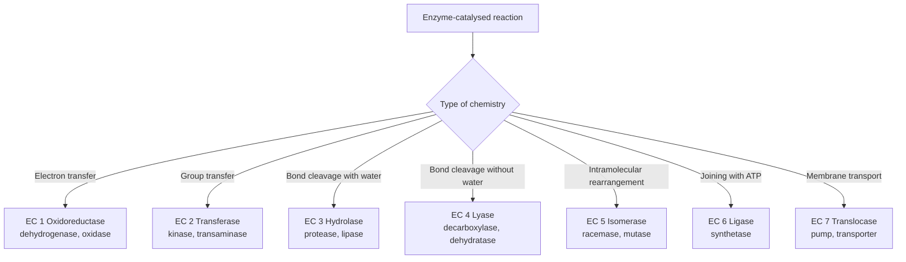
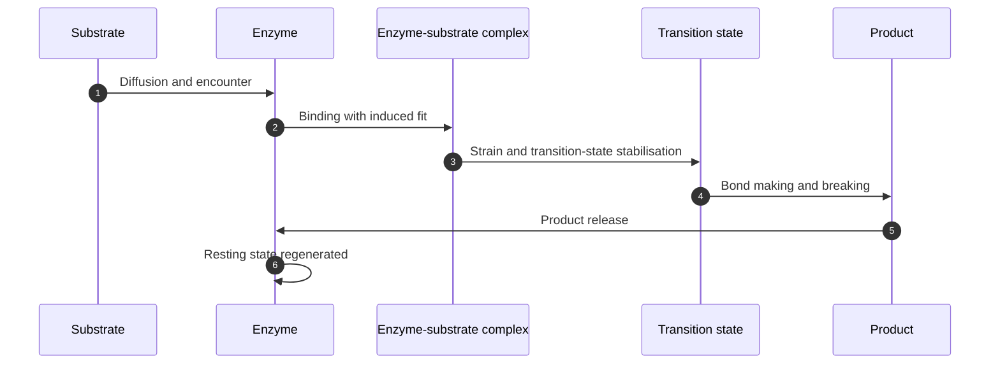
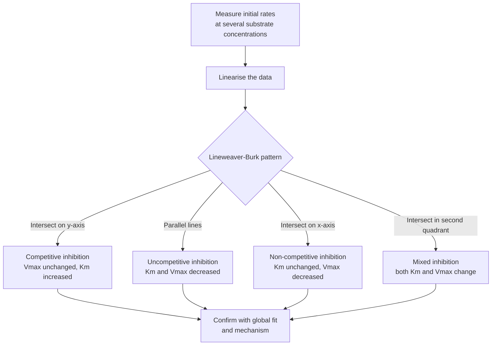

# Chapter 3 — Enzymes: Kinetics, Mechanism and Regulation

> **Level:** University (Level 8 — Biochemistry)
> **Estimated study time:** 10 hours (7 h reading + 3 h exercises)
> **Prerequisites:** [Amino Acids and Proteins](02-amino-acids-and-proteins.md); [Chemical Kinetics and Reaction Mechanisms](../04-advanced-chemistry/05-chemical-kinetics-and-reaction-mechanisms.md); [Catalysis](../04-advanced-chemistry/06-catalysis.md)
> **Related chapters:** [Level 8 index](README.md); [Water and Biological Systems](01-water-and-biological-systems.md); [Metabolism and Bioenergetics](07-metabolism-and-bioenergetics.md)
> **Difficulty:** ★★★★★ (5/5)

---

## 1. Learning Objectives

After working through this chapter you will be able to:

- Assign an enzyme to one of the seven EC classes and interpret a four-digit EC number.
- Describe the active site and explain how binding energy, specificity and transition-state
complementarity produce catalysis.

- Explain the lock-and-key, induced-fit and conformational-selection models, and state
what each omits.

- Describe the principal catalytic mechanisms with a named enzyme example for each.
- Derive the Michaelis–Menten equation from the steady-state assumption and define
$K_\mathrm{M}$, $V_\mathrm{max}$, $k_\mathrm{cat}$ and $k_\mathrm{cat}/K_\mathrm{M}$.

- Construct and interpret Lineweaver–Burk, Eadie–Hofstee and Hanes plots, and identify
their statistical pitfalls.

- Distinguish competitive, uncompetitive, non-competitive, mixed and irreversible
inhibition from their effects on $K_\mathrm{M}$ and $V_\mathrm{max}$.

- Explain allosteric regulation using the MWC and KNF models, the Hill equation and the
concepts of cooperativity, feedback inhibition and covalent modification.

- Describe zymogen activation, enzyme immobilisation and the use of enzymes in industry
and clinical diagnosis.

- Solve quantitative problems on steady-state kinetics, inhibition and cooperativity.

---

## 2. Introduction

Enzymes are biological catalysts, and they are extraordinary ones. They accelerate reactions by
factors of $10^5$ to $10^{17}$, they operate under mild conditions of temperature and pH, and
they are highly specific — often discriminating between two molecules that differ by a single
methyl group or by the configuration of one chiral centre. A cell contains thousands of enzymes,
and the flux through each is regulated so that metabolism matches demand.

The study of enzymes has two complementary sides. **Enzymology** asks what an enzyme is and how
it works: the structure of the active site, the chemical steps of catalysis and the
conformational changes that accompany binding. **Enzyme kinetics** asks how fast an enzyme works
and how rate depends on substrate, inhibitor and effector concentrations. The two are connected:
the kinetic constants are summaries of the underlying mechanism, and a change in mechanism shows
up as a change in the constants.

This chapter develops both sides. It begins with classification and active-site structure, then
the models of substrate binding and the chemical mechanisms of catalysis. It derives the
Michaelis–Menten equation from the steady-state assumption, defines the kinetic constants and
explains what each one does and does not mean. It treats the linear transformations of the rate
equation, the inhibition patterns that distinguish binding modes, and the allosteric models that
explain sigmoidal kinetics and metabolic control. The final sections cover covalent regulation,
zymogen activation, immobilisation and the industrial and clinical uses of enzymes.

The treatment is quantitative. Six worked calculations cover the determination of $K_\mathrm{M}$
and $V_\mathrm{max}$, the calculation of $k_\mathrm{cat}$ and catalytic efficiency, competitive
and uncompetitive inhibition, and the Hill equation. The mathematics is algebra, but the
interpretation is subtle: $K_\mathrm{M}$ is not simply a dissociation constant,
$k_\mathrm{cat}/K_\mathrm{M}$ is not simply a second-order rate constant, and the Hill
coefficient is not the number of binding sites. The chapter says so explicitly.

---

## 3. Fundamental Concepts

### 3.1 Classification and EC numbers

The International Union of Biochemistry and Molecular Biology classifies enzymes into seven
classes according to the reaction catalysed. Each enzyme has a four-digit **EC number** of the
form EC $a.b.c.d$, where $a$ is the class, $b$ the subclass, $c$ the sub-subclass and $d$ the
serial number within that group.

| Class | Reaction type | Example | EC number |
|---|---|---|---|
| 1 Oxidoreductases | Oxidation–reduction | Alcohol dehydrogenase | EC 1.1.1.1 |
| 2 Transferases | Transfer of a group | Hexokinase | EC 2.7.1.1 |
| 3 Hydrolases | Hydrolysis | Trypsin | EC 3.4.21.4 |
| 4 Lyases | Cleavage without water | Carbonic anhydrase | EC 4.2.1.1 |
| 5 Isomerases | Intramolecular rearrangement | Triose phosphate isomerase | EC 5.3.1.1 |
| 6 Ligases | Joining with ATP hydrolysis | Tyrosyl-tRNA synthetase | EC 6.1.1.1 |
| 7 Translocases | Transport across membranes | ATP synthase | EC 7.1.2.2 |

Names are informative but not systematic: a **kinase** transfers phosphate from ATP, a
**synthase** forms a bond without ATP, a **synthetase** uses ATP, and a **phosphatase**
hydrolyses phosphate esters. The EC number is the unambiguous identifier used by BRENDA and the
IUBMB.

### 3.2 The active site and specificity

The **active site** is the region of the enzyme where substrate binds and catalysis occurs. It
is usually a cleft or pocket at the surface of the protein, formed by residues that may be far
apart in the sequence but are brought together by folding. It occupies a small fraction of the
enzyme surface — typically 10–20 % — and it is lined with **catalytic residues** and with
residues that bind the substrate.

Specificity has several levels. **Substrate specificity** is the ability to discriminate between
different substrates; **stereospecificity** is the ability to discriminate between enantiomers;
**regiospecificity** is the ability to act at one position of a molecule. Specificity comes from
the shape, charge and hydrogen-bonding pattern of the binding pocket, which must be
complementary to the substrate. A classic illustration is chymotrypsin, which cleaves after
aromatic residues because its specificity pocket is lined with hydrophobic residues, whereas
trypsin cleaves after basic residues because its pocket contains a negatively charged aspartate.

### 3.3 Lock-and-key, induced fit and conformational selection

Emil Fischer proposed the **lock-and-key** model in 1894: the substrate fits the active site as
a key fits a lock, and the enzyme is rigid. The model explains specificity but not the
observation that enzymes often change conformation on binding, and it cannot explain why some
enzymes act on substrates that differ substantially from the natural one.

Daniel Koshland proposed **induced fit** in 1958: the active site is flexible, and the substrate
induces a conformational change that brings catalytic groups into position. The model explains
why binding can be accompanied by a large conformational change and why the enzyme can stabilise
the transition state more tightly than the substrate. It also explains **substrate strain**:
binding can distort the substrate towards the transition state.

A third picture is **conformational selection**: the substrate selects a pre-existing
conformation from an ensemble. In practice both mechanisms operate, and none of the three models
is complete: catalysis depends on the whole free-energy landscape, not a static fit.

### 3.4 Mechanisms of catalysis

Enzymes use a small number of chemical strategies, often in combination.

**Proximity and orientation.** Binding brings substrates together in the correct orientation and
reduces the entropic cost of reaction. The effective concentration of a substrate bound to an
enzyme can be orders of magnitude higher than its bulk concentration.

**Acid–base catalysis.** A residue donates or accepts a proton, stabilising a developing charge
or activating a nucleophile. Histidine ($\mathrm{p}K_\mathrm{a} \approx 6$) is the most common
general acid–base catalyst; aspartate, glutamate, lysine, cysteine and tyrosine also
participate.

**Covalent catalysis.** A nucleophilic residue forms a transient covalent bond with the
substrate, creating an intermediate that is subsequently hydrolysed. Serine, cysteine, histidine
and aspartate are common nucleophiles; the acyl-enzyme intermediate of serine proteases is the
canonical example.

**Metal-ion catalysis.** A metal ion acts as a Lewis acid, polarising a bond or stabilising a
negative charge. Carbonic anhydrase uses $\ce{Zn^{2+}}$ to deprotonate water; enolase uses
$\ce{Mg^{2+}}$ to stabilise the enolate intermediate; many phosphatases use two metal ions to
stabilise the pentacoordinate phosphate transition state.

**Transition-state stabilisation.** The enzyme binds the transition state more tightly than
either the substrate or the product. This is the unifying principle proposed by Linus Pauling in
1946: the rate enhancement is proportional to the difference in binding energy between the
transition state and the substrate. **Transition-state analogues** are potent inhibitors
precisely because they exploit this preference.

**Strain and distortion.** Binding can distort the substrate towards a geometry closer to the
transition state, reducing the barrier. The effect is sometimes called ground-state
destabilisation.

### 3.5 The free-energy profile of a catalysed reaction

A reaction proceeds through a transition state at the top of a free-energy barrier. The height
of the barrier, $\Delta G^\ddagger$, determines the rate through the transition-state equation

$$
k = \frac{k_\mathrm{B}T}{h}\exp\left(-\frac{\Delta G^\ddagger}{RT}\right)
$$

An enzyme lowers $\Delta G^\ddagger$ by providing a different pathway — binding, chemical
transformation and release — whose highest point is lower. It does not change the free energies
of the reactants or products, so it does not change $\Delta_r G$ or the equilibrium constant.
The overall free-energy change of the reaction is the same; only the path is different.

### 3.6 Michaelis–Menten kinetics

The simplest model is

$$
\ce{E(aq) + S(aq) <=>[k_1][k_{-1}] ES(aq) ->[k_2] E(aq) + P(aq)}
$$

The **steady-state assumption** states that the concentration of the enzyme–substrate complex is
constant during the initial phase of the reaction:

$$
\frac{\mathrm{d}[\ce{ES}]}{\mathrm{d}t}
= k_1[\ce{E}][\ce{S}] - k_{-1}[\ce{ES}] - k_2[\ce{ES}] = 0
$$

With the conservation relation $[\ce{E}]_\mathrm{t} = [\ce{E}] + [\ce{ES}]$, rearrangement gives
the **Michaelis–Menten equation**:

$$
v = \frac{V_\mathrm{max}[\ce{S}]}{K_\mathrm{M} + [\ce{S}]}
$$

where

$$
V_\mathrm{max} = k_2[\ce{E}]_\mathrm{t},
\qquad
K_\mathrm{M} = \frac{k_{-1} + k_2}{k_1}
$$

The assumptions are $[\ce{S}] \gg [\ce{E}]$, steady state, an irreversible product step and a
single substrate; real enzymes deviate, so the equation is an approximation.

### 3.7 The meaning of the kinetic constants

$K_\mathrm{M}$ is the substrate concentration at which the initial rate is half of
$V_\mathrm{max}$. It has units of concentration. It is *not* generally the dissociation constant
of the enzyme–substrate complex: $K_\mathrm{M} = (k_{-1} + k_2)/k_1$, which equals $K_\mathrm{d}
= k_{-1}/k_1$ only when $k_2 \ll k_{-1}$. A low $K_\mathrm{M}$ is often described as high
affinity, but the statement is only valid under that condition.

$V_\mathrm{max}$ is the rate at saturating substrate, when all enzyme molecules are in the
enzyme–substrate complex. It is proportional to total enzyme concentration, so it is not a
molecular constant.

$k_\mathrm{cat}$, the **turnover number**, is the number of substrate molecules converted per
enzyme molecule per unit time at saturation:

$$
k_\mathrm{cat} = \frac{V_\mathrm{max}}{[\ce{E}]_\mathrm{t}}
$$

$k_\mathrm{cat}/K_\mathrm{M}$ is the **catalytic efficiency**, a second-order rate constant
combining binding and chemistry. Its upper limit is the diffusion-controlled encounter rate,
about $10^8$–$10^9\ \mathrm{M^{-1}\ s^{-1}}$; enzymes near this limit are called **catalytically
perfect**.

### 3.8 Linear transformations and their pitfalls

The Michaelis–Menten equation is nonlinear, so several linear transformations have been used to
estimate $K_\mathrm{M}$ and $V_\mathrm{max}$ graphically.

**Lineweaver–Burk.** Taking reciprocals gives

$$
\frac{1}{v} = \frac{K_\mathrm{M}}{V_\mathrm{max}}\frac{1}{[\ce{S}]}
+ \frac{1}{V_\mathrm{max}}
$$

A plot of $1/v$ against $1/[\ce{S}]$ has slope $K_\mathrm{M}/V_\mathrm{max}$, intercept
$1/V_\mathrm{max}$ on the ordinate and $-1/K_\mathrm{M}$ on the abscissa.

**Eadie–Hofstee.** Rearranging gives

$$
\frac{v}{[\ce{S}]} = -\frac{1}{K_\mathrm{M}}v + \frac{V_\mathrm{max}}{K_\mathrm{M}}
$$

A plot of $v/[\ce{S}]$ against $v$ has slope $-1/K_\mathrm{M}$.

**Hanes.** Multiplying the reciprocal form by $[\ce{S}]$ gives

$$
\frac{[\ce{S}]}{v} = \frac{[\ce{S}]}{V_\mathrm{max}} + \frac{K_\mathrm{M}}{V_\mathrm{max}}
$$

A plot of $[\ce{S}]/v$ against $[\ce{S}]$ has slope $1/V_\mathrm{max}$ and intercept
$K_\mathrm{M}/V_\mathrm{max}$.

Lineweaver–Burk is the least reliable: reciprocals compress high-substrate points, exaggerate
errors at low substrate and violate ordinary regression assumptions. Eadie–Hofstee has
correlated errors on both axes; Hanes is statistically better. Nonlinear regression on the
untransformed equation is preferred, but the linear plots remain useful for diagnosing
inhibition patterns.

### 3.9 Inhibition

An **inhibitor** is a molecule that reduces enzyme activity. Inhibitors are classified by
whether they bind the free enzyme, the enzyme–substrate complex or both, and by whether the
inhibition is reversible.

| Type | Binds | Effect on $K_\mathrm{M}$ | Effect on $V_\mathrm{max}$ | Lineweaver–Burk pattern |
|---|---|---|---|---|
| Competitive | Free enzyme | Increases by $\alpha = 1+[I]/K_\mathrm{i}$ | Unchanged | Lines intersect on the $y$-axis |
| Uncompetitive | ES complex only | Decreases by $\alpha'$ | Decreases by $\alpha'$ | Parallel lines |
| Non-competitive (pure) | E and ES equally | Unchanged | Decreases | Lines intersect on the $x$-axis |
| Mixed | E and ES with different affinities | Increases or decreases | Decreases | Lines intersect away from the axes |
| Irreversible | Covalent modification | Not applicable | Not applicable | Time-dependent loss of activity |

For competitive inhibition, the apparent Michaelis constant is $K_\mathrm{M}^\mathrm{app} =
K_\mathrm{M}(1 + [I]/K_\mathrm{i})$, while $V_\mathrm{max}$ is unchanged because saturating
substrate displaces the inhibitor. For uncompetitive inhibition, both $K_\mathrm{M}$ and
$V_\mathrm{max}$ are divided by $1 + [I]/K_\mathrm{i}'$, so their ratio is unchanged and the
lines are parallel. For pure non-competitive inhibition, $K_\mathrm{M}$ is unchanged and
$V_\mathrm{max}$ is divided by $1 + [I]/K_\mathrm{i}$.

**Irreversible inhibitors** form a covalent or very tight complex and do not dissociate on the
timescale of the assay. Their effect is time-dependent: the enzyme loses activity progressively,
and the loss cannot be reversed by dilution or dialysis. Aspirin acetylates a serine in
cyclooxygenase; penicillin acylates the transpeptidase that builds bacterial cell walls;
organophosphates phosphorylate the active-site serine of acetylcholinesterase.

### 3.10 Allosteric regulation, cooperativity and the Hill equation

**Allosteric enzymes** are regulated by molecules that bind at sites other than the active site.
They typically have multiple subunits and show **cooperativity**: binding of a ligand at one
site changes the affinity of the other sites. Positive cooperativity gives a sigmoidal rate
curve; negative cooperativity gives a curve that approaches saturation more slowly than a
hyperbola.

The **MWC model** (Monod, Wyman and Changeux, 1965) assumes an equilibrium between T
(low-affinity) and R (high-affinity) states, with all subunits changing concertedly. Ligand
binds preferentially to R and shifts the equilibrium.

The **KNF model** (Koshland, Némethy and Filmer, 1966) assumes sequential transitions: ligand
binding to one subunit induces a conformational change in that subunit, which changes the
affinity of its neighbours. Hybrid states with some subunits in each conformation are allowed.
The model can produce both positive and negative cooperativity.

Both models are limiting descriptions: real proteins may show concerted or sequential behaviour,
and hybrid states exist. They are useful because they generate testable predictions, not because
either is universally true.

The **Hill equation** is a phenomenological description of cooperativity:

$$
\theta = \frac{[\ce{L}]^n}{K_\mathrm{d} + [\ce{L}]^n}
$$

where $\theta$ is the fractional saturation, $[\ce{L}]$ the ligand concentration, $K_\mathrm{d}$
the dissociation constant and $n$ the Hill coefficient. A plot of $\log(\theta/(1-\theta))$
against $\log[\ce{L}]$ has slope $n$. Positive cooperativity gives $n > 1$, negative
cooperativity $n < 1$, and no cooperativity $n = 1$. The Hill coefficient is an empirical
measure of the steepness of the curve; it is not the number of binding sites, and it cannot
exceed the number of sites.

### 3.11 Feedback inhibition, covalent regulation and zymogens

**Feedback inhibition** occurs when the end product of a pathway inhibits an enzyme near the
start of the pathway, usually the first committed step. The logic is economical: when the
product is abundant, the pathway shuts down and resources are diverted. A classic example is the
inhibition of aspartate transcarbamoylase by cytidine triphosphate (CTP), the end product of
pyrimidine biosynthesis; ATP activates the same enzyme, balancing purine and pyrimidine pools.
Phosphofructokinase-1, the committed step of glycolysis, is inhibited by ATP and citrate and
activated by AMP and fructose-2,6-bisphosphate.

**Covalent modification** is reversible regulation by attachment or removal of a chemical group.
Phosphorylation by protein kinases and dephosphorylation by phosphatases is the most widespread;
it can activate or inhibit an enzyme depending on the site. Glycogen phosphorylase is activated
by phosphorylation, whereas glycogen synthase is inhibited. Other modifications include
adenylylation, methylation, acetylation and ubiquitination.

**Zymogens** are inactive precursors of enzymes that are activated by proteolytic cleavage.
Trypsinogen is activated by enteropeptidase in the duodenum, chymotrypsinogen by trypsin, and
pepsinogen by acid in the stomach. The blood-clotting cascade is a sequence of zymogen
activations in which each activated protease activates the next. The advantage is that dangerous
proteolytic activity is confined to the place and time where it is needed; the disadvantage is
that activation is irreversible, so the process must be controlled by inhibitors and by spatial
separation.

### 3.12 Immobilisation and the industrial enzyme

**Immobilisation** attaches an enzyme to a solid support or entraps it in a matrix so that it
can be reused and separated from the product. The main methods are adsorption to a surface,
covalent attachment through reactive groups, entrapment in a gel or polymer, and cross-linking
of enzyme molecules. Immobilisation can increase stability by restricting unfolding, but it can
also reduce activity by restricting conformational changes or by creating mass-transfer
limitations.

Industrial enzymes are used in detergents (proteases, lipases, amylases), starch processing
(α-amylase, glucoamylase, glucose isomerase), food (lactase, rennet, pectinase), textiles
(cellulase, catalase), paper (xylanase, lipase), biofuels (cellulase, lipase) and fine chemicals
(nitrile hydratase, penicillin acylase). The choice of enzyme is dictated by stability,
specificity, cost and compatibility with the process conditions.

---

## 4. Detailed Scientific Explanation

### 4.1 Case studies in mechanism

**Chymotrypsin** is a serine protease with a catalytic triad of Ser195, His57 and Asp102. The
histidine abstracts a proton from serine, making the serine hydroxyl a better nucleophile; the
aspartate stabilises the positive charge that develops on histidine. The substrate's carbonyl
carbon is attacked, forming a tetrahedral intermediate whose negative oxygen is stabilised by
the **oxyanion hole** formed by the backbone amides of Gly193 and Ser195. The intermediate
collapses, releasing the amine product and forming an acyl-enzyme. Water then hydrolyses the
acyl-enzyme in a second tetrahedral step.

**Lysozyme** cleaves the glycosidic bond of bacterial peptidoglycan. Glu35 acts as a general
acid, protonating the leaving group; Asp52 stabilises the developing oxocarbenium ion; the
substrate is distorted towards a half-chair conformation in the active site. The enzyme
illustrates strain and transition-state stabilisation.

**Carbonic anhydrase** uses a zinc ion coordinated by three histidines and a water
molecule. The zinc polarises the water, lowering its $\mathrm{p}K_\mathrm{a}$ so that it is
deprotonated to hydroxide at physiological pH. The hydroxide attacks carbon dioxide, forming
bicarbonate, which is displaced by water. A proton relay through His64 and a chain of water
molecules regenerates the zinc-bound hydroxide. Its turnover number is about $10^6 \mathrm{s^{-1}}$.
**Triose phosphate isomerase** converts dihydroxyacetone phosphate to glyceraldehyde 3-phosphate
through an enediol intermediate. Glu165 abstracts a proton, the enediol is stabilised by the
active site, and the product is released. The enzyme closes a loop over the active site during
catalysis, excluding water and preventing the wrong proton from being transferred. Its
$k_\mathrm{cat}/K_\mathrm{M}$ is near $2\times10^8\ \mathrm{M^{-1}\ s^{-1}}$, close to the
diffusion limit.

### 4.2 Clinical enzymology

Enzymes are measured in plasma as markers of tissue damage. **Alanine aminotransferase** and
**aspartate aminotransferase** rise in hepatocellular injury; **alkaline phosphatase** rises in
cholestasis and bone disease; **creatine kinase** and **troponin** rise after myocardial
infarction; **amylase** and **lipase** rise in pancreatitis. The pattern, timing and magnitude
of the rise give information about the tissue and the severity.

Enzyme assays are also used to diagnose inherited deficiencies: phenylketonuria reflects
phenylalanine hydroxylase deficiency, G6PD deficiency reflects glucose-6-phosphate dehydrogenase
deficiency, and lysosomal storage diseases reflect specific hydrolase deficiencies. In each
case, the enzyme activity in blood cells or fibroblasts is the diagnostic measurement, and the
genetic lesion explains the loss of function.

### 4.3 Evidence for mechanism

Mechanisms are established by convergent evidence, not by kinetics alone. Steady-state
kinetics gives $K_\mathrm{M}$ and $k_\mathrm{cat}$ but cannot resolve individual steps;
pre-steady-state methods such as stopped-flow and rapid quench detect intermediates on the
millisecond timescale and give their rates of formation and decay. **Kinetic isotope
effects** identify bond-breaking steps: a primary $k_\mathrm{H}/k_\mathrm{D}$ of 2–10
indicates that cleavage of a C–H bond is rate-limiting, while an inverse solvent isotope
effect can indicate proton transfer. **Site-directed mutagenesis** removes a candidate
catalytic residue and measures the loss of activity; restoration by a compensatory
mutation strengthens the assignment. **Transition-state analogues** that bind far more
tightly than the substrate provide chemical support for transition-state stabilisation,
and crystal or cryo-EM structures of enzyme–analogue complexes show the geometry directly.
Computational methods, including quantum-mechanical/molecular-mechanical models, test
whether a proposed mechanism is energetically plausible.

---

## 5. Visual Diagrams

**Figure 3.1 — The seven EC classes.** The classification follows the chemistry of the reaction
rather than the identity of the substrate. The same substrate can be acted on by enzymes from
different classes, and the EC number specifies which reaction is meant. The examples are
representative, not exhaustive.

**Figure 3.2 — The catalytic cycle.** Binding, chemical transformation and product release are
distinct steps, each with its own rate constant and conformational change. The transition state
is stabilised preferentially; the enzyme is regenerated at the end. The slowest step relative to
the resting state determines the turnover rate.

**Figure 3.3 — Diagnosing inhibition from primary plots.** The pattern of lines in a
Lineweaver–Burk plot identifies the inhibition type, but the visual diagnosis should be
confirmed by nonlinear regression and by direct binding or structural evidence. The diagram
assumes rapid reversible inhibition and a single substrate.

---

## 6. Mathematical Formulas

**Michaelis–Menten equation.**

$$
v = \frac{V_\mathrm{max}[\ce{S}]}{K_\mathrm{M} + [\ce{S}]},
\qquad
K_\mathrm{M} = \frac{k_{-1} + k_2}{k_1}
$$

**Turnover number and catalytic efficiency.**

$$
k_\mathrm{cat} = \frac{V_\mathrm{max}}{[\ce{E}]_\mathrm{t}},
\qquad
\frac{k_\mathrm{cat}}{K_\mathrm{M}}
= \frac{k_1 k_2}{k_{-1} + k_2}
$$

**Lineweaver–Burk, Eadie–Hofstee and Hanes transformations.**

$$
\frac{1}{v} = \frac{K_\mathrm{M}}{V_\mathrm{max}}\frac{1}{[\ce{S}]}
+ \frac{1}{V_\mathrm{max}},
\qquad
\frac{v}{[\ce{S}]} = -\frac{1}{K_\mathrm{M}}v + \frac{V_\mathrm{max}}{K_\mathrm{M}}
$$

$$
\frac{[\ce{S}]}{v} = \frac{[\ce{S}]}{V_\mathrm{max}}
+ \frac{K_\mathrm{M}}{V_\mathrm{max}}
$$

**Apparent constants in inhibition.** With $\alpha = 1 + [I]/K_\mathrm{i}$ and $\alpha' = 1 +
[I]/K_\mathrm{i}'$:
$$
K_\mathrm{M}^\mathrm{comp} = \alpha K_\mathrm{M},
\qquad
K_\mathrm{M}^\mathrm{uncomp} = \frac{K_\mathrm{M}}{\alpha'},
\qquad
V_\mathrm{max}^\mathrm{uncomp} = \frac{V_\mathrm{max}}{\alpha'}
$$

For pure non-competitive inhibition, $K_\mathrm{M}$ is unchanged and
$V_\mathrm{max}^\mathrm{app} = V_\mathrm{max}/\alpha$.

**Hill equation and its linear form.**

$$
\theta = \frac{[\ce{L}]^n}{K_\mathrm{d} + [\ce{L}]^n},
\qquad
\log\frac{\theta}{1-\theta} = n\log[\ce{L}] - \log K_\mathrm{d}
$$

**Cheng–Prusoff relation.**

$$
K_\mathrm{i} = \frac{\mathrm{IC}_{50}}{1 + [\ce{S}]/K_\mathrm{M}}
$$

**Specific activity and turnover.** Specific activity is the rate per milligram of
protein, usually expressed in units per milligram, where $1\ \mathrm{U} = 1\ \mu\mathrm{mol min^{-1}}$. The SI unit is the katal, $1\ \mathrm{kat} = 1\ \mathrm{mol\ s^{-1}}$; $1 \mathrm{U} = 16.67\ \mathrm{nkat}$.

| Symbol | Meaning | SI unit |
|---|---|---|
| $v$ | Initial rate | mol m⁻³ s⁻¹ |
| $V_\mathrm{max}$ | Maximum rate | mol m⁻³ s⁻¹ |
| $[\ce{S}]$ | Substrate concentration | mol m⁻³ |
| $K_\mathrm{M}$ | Michaelis constant | mol m⁻³ |
| $K_\mathrm{d}$ | Ligand dissociation constant | mol m⁻³ |
| $k_\mathrm{cat}$ | Turnover number | s⁻¹ |
| $[\ce{E}]_\mathrm{t}$ | Total enzyme concentration | mol m⁻³ |
| $K_\mathrm{i}, K_\mathrm{i}'$ | Inhibition constants | mol m⁻³ |
| $\mathrm{IC}_{50}$ | Half-maximal inhibitory concentration | mol m⁻³ |
| $n$ | Hill coefficient | dimensionless |
| $\theta$ | Fractional saturation | dimensionless |
| $k_\mathrm{B}$ | Boltzmann constant, $1.381\times10^{-23}$ | J K⁻¹ |
| $h$ | Planck constant, $6.626\times10^{-34}$ | J s |

---

## 7. Chemical Equations

Carbonic anhydrase interconverts carbon dioxide and bicarbonate:

$$
\ce{CO2(aq) + H2O(l) <=> H2CO3(aq) <=> H+(aq) + HCO3-(aq)}
$$

The enzyme accelerates the hydration step by about $10^7$; the reverse reaction is the
dehydration that releases carbon dioxide in the lung.

Triose phosphate isomerase interconverts two triose phosphates through an enediol:

$$
\ce{C3H7O6P(aq) <=> C3H7O6P(aq)}
$$

The reaction is near equilibrium in the cell, but the enzyme is required for flux because the
uncatalysed isomerisation is slow.

ATP hydrolysis provides the energy for phosphorylation, transport and mechanical work:

$$
\ce{ATP^{4-}(aq) + H2O(l) -> ADP^{3-}(aq) + HPO4^{2-}(aq) + H+(aq)}
$$

The standard free-energy change is about $-30.5\ \mathrm{kJ\ mol^{-1}}$ at pH 7 and $37 ^\circ\mathrm{C}$; the actual free energy depends on the concentrations of ATP, ADP and
phosphate.

---

## 8. Worked Examples

### Worked Example 8.1 — Determining $K_\mathrm{M}$ and $V_\mathrm{max}$

**Problem.** Initial rates were measured at $[\ce{S}] = 0.5, 1.0, 2.0, 4.0$ and $8.0 \mathrm{mM}$, giving $v = 0.25, 0.40, 0.571, 0.727$ and $0.842\ \mu\mathrm{mol\ min^{-1}}$.
Determine $K_\mathrm{M}$ and $V_\mathrm{max}$.

**Strategy.** Use the Lineweaver–Burk transformation; the intercept gives $1/V_\mathrm{max}$ and
the slope gives $K_\mathrm{M}/V_\mathrm{max}$.

**Solution.** The reciprocal pairs are $(2, 4.00)$, $(1, 2.50)$, $(0.5, 1.75)$, $(0.25, 1.375)$
and $(0.125, 1.188)$. The slope is $(4.00 - 1.188)/(2 - 0.125) = 1.50$ and the intercept is
$4.00 - 1.50 \times 2 = 1.00$. Therefore $V_\mathrm{max} = 1.00 \mu\mathrm{mol\ min^{-1}}$ and $K_\mathrm{M} = 1.50\ \mathrm{mM}$.
**Check.** Substituting $[\ce{S}] = 1.5\ \mathrm{mM}$ gives $v = 1.00 \times 1.5/(1.5+1.5) =
0.50\ \mu\mathrm{mol\ min^{-1}}$, half of $V_\mathrm{max}$, as required by the definition of
$K_\mathrm{M}$.

### Worked Example 8.2 — Turnover number and catalytic efficiency

**Problem.** For the enzyme in Worked Example 8.1, the assay contains $0.50\ \mathrm{nmol}$ of enzyme. Calculate $k_\mathrm{cat}$ and $k_\mathrm{cat}/K_\mathrm{M}$.

**Strategy.** Convert $V_\mathrm{max}$ to mol s⁻¹, divide by the enzyme concentration in mol
L⁻¹, then divide by $K_\mathrm{M}$ in mol L⁻¹.

**Solution.** $V_\mathrm{max} = 1.00\ \mu\mathrm{mol\ min^{-1}} = 16.7\ \mathrm{nmol\ s^{-1}}$
in the assay. With $0.50\ \mathrm{nmol}$ of enzyme, $k_\mathrm{cat} = 16.7/0.50 = 33.4 \mathrm{s^{-1}}$. Then $k_\mathrm{cat}/K_\mathrm{M} = 33.4/(1.5\times10^{-3}) = 2.2\times10^{4}
\mathrm{M^{-1}\ s^{-1}}$.
**Check.** The value is well below the diffusion limit, so binding or chemistry, not encounter,
limits this enzyme. A $k_\mathrm{cat}$ of $33\ \mathrm{s^{-1}}$ means each enzyme molecule turns
over about 33 times per second.

### Worked Example 8.3 — Competitive inhibition

**Problem.** An inhibitor gives 50 % inhibition at $10\ \mu\mathrm{M}$ when $[\ce{S}] =
K_\mathrm{M} = 1.5\ \mathrm{mM}$. Calculate $K_\mathrm{i}$ and the apparent $K_\mathrm{M}$ at
$[\ce{I}] = 15\ \mu\mathrm{M}$.

**Strategy.** Use the Cheng–Prusoff relation for a competitive inhibitor, then
$K_\mathrm{M}^\mathrm{app} = K_\mathrm{M}(1 + [I]/K_\mathrm{i})$.

**Solution.** $K_\mathrm{i} = 10/(1 + 1) = 5\ \mu\mathrm{M}$. At $15\ \mu\mathrm{M}$, $\alpha =
1 + 15/5 = 4$, so $K_\mathrm{M}^\mathrm{app} = 4 \times 1.5 = 6.0\ \mathrm{mM}$.
$V_\mathrm{max}$ is unchanged.

**Check.** Raising the substrate concentration can outcompete the inhibitor, which is the
defining test of competitive inhibition. The Lineweaver–Burk lines intersect on the $y$-axis,
consistent with an unchanged $V_\mathrm{max}$.

### Worked Example 8.4 — Uncompetitive inhibition

**Problem.** An uncompetitive inhibitor has $K_\mathrm{i}' = 5\ \mu\mathrm{M}$. At $[\ce{I}] =
10\ \mu\mathrm{M}$, calculate the apparent $K_\mathrm{M}$ and $V_\mathrm{max}$ for the enzyme of
Worked Example 8.1.

**Strategy.** For uncompetitive inhibition, both parameters are divided by $\alpha' = 1 +
[I]/K_\mathrm{i}'$.
**Solution.** $\alpha' = 1 + 10/5 = 3$, so $K_\mathrm{M}^\mathrm{app} = 1.5/3 = 0.50 \mathrm{mM}$ and $V_\mathrm{max}^\mathrm{app} = 1.00/3 = 0.333\ \mu\mathrm{mol\ min^{-1}}$.
**Check.** The ratio $V_\mathrm{max}/K_\mathrm{M}$ is unchanged ($0.333/0.500 = 0.667$, the same
as $1.00/1.50$), which is why the Lineweaver–Burk lines are parallel. Uncompetitive inhibitors
bind only the enzyme–substrate complex, so their effect increases as substrate concentration
rises.

### Worked Example 8.5 — Hill coefficient from two points

**Problem.** A cooperative enzyme is 10 % saturated at $1\ \mu\mathrm{M}$ ligand and 90 %
saturated at $10\ \mu\mathrm{M}$. Estimate the Hill coefficient and $K_\mathrm{d}$.

**Strategy.** Use the linear form of the Hill equation; the slope between the two points gives
$n$.

**Solution.**

$$
n = \frac{\log(9/0.111)}{\log(10/1)} = \frac{\log 81}{1} = 1.91
$$

Using $\theta/(1-\theta) = ([\ce{L}]/K_\mathrm{d})^n$ at $1\ \mu\mathrm{M}$: $0.111 =
(1/K_\mathrm{d})^{1.91}$, so $K_\mathrm{d} = 3.16\ \mu\mathrm{M}$.
**Check.** Substituting $10\ \mu\mathrm{M}$ gives $(10/3.16)^{1.91} = 8.99$, so $\theta = 0.90$.
A Hill coefficient of 1.9 indicates positive cooperativity but is not the number of binding
sites; the true site count must come from structure or binding stoichiometry.

---

## 9. Real-World Applications

**Clinical diagnosis.** Serum enzyme activities are used to detect tissue damage: ALT and AST
for liver, alkaline phosphatase for bile ducts and bone, creatine kinase and troponin for heart,
amylase and lipase for pancreas. The pattern and timing of the rise, together with isoenzyme
analysis, identify the tissue and the extent of injury.

**Drug discovery.** Enzyme inhibitors are among the most successful classes of drugs: statins
inhibit HMG-CoA reductase, ACE inhibitors block angiotensin-converting enzyme, protease
inhibitors block HIV maturation, and methotrexate inhibits dihydrofolate reductase.
Transition-state analogues and covalent inhibitors are designed from the mechanism, and
$K_\mathrm{i}$, $k_\mathrm{off}$ and residence time are used to optimise them.

---

## 10. Common Mistakes

| Mistake | Why it happens | Correct approach |
|---|---|---|
| "$K_\mathrm{M}$ is the dissociation constant of the enzyme–substrate complex." | The equation resembles a binding isotherm. | $K_\mathrm{M} = (k_{-1}+k_2)/k_1$; it equals $K_\mathrm{d}$ only when $k_2 \ll k_{-1}$. |
| "A low $K_\mathrm{M}$ always means high affinity." | Affinity is inferred from a single constant. | Binding affinity is $k_{-1}/k_1$; $K_\mathrm{M}$ also contains the catalytic step. |
| "An inhibitor that lowers $V_\mathrm{max}$ must be non-competitive." | The inhibition types are memorised by effect rather than by mechanism. | Uncompetitive inhibition also lowers $V_\mathrm{max}$ and lowers $K_\mathrm{M}$; the pattern distinguishes them. |
| "The Hill coefficient is the number of binding sites." | It often approximates the site count in haemoglobin. | $n$ is an empirical measure of cooperativity and cannot exceed the number of sites. |
| "An enzyme changes the equilibrium constant." | The rate increase is mistaken for a thermodynamic effect. | Enzymes lower $\Delta G^\ddagger$ and leave $\Delta_r G$ and $K$ unchanged. |
| "Irreversible inhibition can be overcome by adding more substrate." | It is confused with competitive inhibition. | Irreversible inhibitors covalently modify the enzyme; dilution or substrate does not restore activity. |

---

## 11. Chapter Summary

- Enzymes are classified into seven EC classes by the reaction they catalyse; the EC
number is the stable identifier.

- The active site provides binding energy, specificity and transition-state
complementarity; lock-and-key, induced fit and conformational selection are partial
descriptions.

- Catalysis uses proximity, acid–base, covalent, metal-ion, transition-state and strain
mechanisms, often in combination.

- The Michaelis–Menten equation follows from the steady-state assumption; $K_\mathrm{M}$
is the half-saturation concentration, $V_\mathrm{max}$ is proportional to enzyme concentration,
and $k_\mathrm{cat}/K_\mathrm{M}$ measures catalytic efficiency.

- Linear transformations are useful for diagnosis but statistically inferior to
nonlinear regression; reciprocal plots distort errors.

- Inhibition types are distinguished by their effects on $K_\mathrm{M}$ and
$V_\mathrm{max}$ and by their Lineweaver–Burk patterns.

- Allosteric enzymes show cooperativity described by the Hill equation; the MWC and KNF
models are limiting descriptions of a more complex reality.

- Feedback inhibition, covalent modification and zymogen activation control flux, and
immobilised enzymes underpin industrial biocatalysis.

---

## 12. Exercises

### 12.1 Conceptual questions

1. Why does an enzyme not change the equilibrium constant of a reaction?
2. Distinguish induced fit from conformational selection and state one observation that
supports each.

3. Explain why $K_\mathrm{M}$ is not a direct measure of substrate affinity.

### 12.2 Basic problems

4. An enzyme has $V_\mathrm{max} = 2.0\ \mu\mathrm{mol\ min^{-1}}$ and
$K_\mathrm{M} = 0.50\ \mathrm{mM}$. Calculate $v$ at $[\ce{S}] = 0.25\ \mathrm{mM}$.

5. Calculate $k_\mathrm{cat}$ for an enzyme with $V_\mathrm{max} = 3.0 \mu\mathrm{mol\ min^{-1}}$ and $[\ce{E}]_\mathrm{t} = 2.0\ \mathrm{nmol}$.
6. What is the specific activity in U mg⁻¹ if $5.0\ \mu\mathrm{g}$ of enzyme produces
$0.15\ \mu\mathrm{mol\ min^{-1}}$?

### 12.3 Intermediate problems

7. A competitive inhibitor has $K_\mathrm{i} = 2.0\ \mu\mathrm{M}$. Calculate the
apparent $K_\mathrm{M}$ at $[\ce{I}] = 6.0\ \mu\mathrm{M}$ if $K_\mathrm{M} = 0.80 \mathrm{mM}$.
8. An uncompetitive inhibitor reduces $V_\mathrm{max}$ from $1.2$ to
$0.40\ \mu\mathrm{mol\ min^{-1}}$. What is the factor $\alpha'$, and what happens to
$K_\mathrm{M}$?

9. A Lineweaver–Burk plot of inhibited enzyme gives lines that intersect on the
$x$-axis. Identify the inhibition type and state the effect on $K_\mathrm{M}$.

### 12.4 Advanced problems

10. An enzyme has $k_\mathrm{cat} = 50\ \mathrm{s^{-1}}$ and $K_\mathrm{M} = 0.20 \mathrm{mM}$. Is it likely to be diffusion-limited? Justify your answer.
11. A mutation increases $K_\mathrm{M}$ tenfold without changing $k_\mathrm{cat}$.
What does this suggest about the role of the mutated residue?

### 12.5 Calculation problems

12. A cooperative enzyme is 20 % saturated at $2\ \mu\mathrm{M}$ and 80 % saturated at
$20\ \mu\mathrm{M}$. Estimate the Hill coefficient and $K_\mathrm{d}$.

### 12.6 Answers

1. The enzyme lowers the activation barrier for both directions equally; the free energies
of reactants and products are unchanged, so $K$ is unchanged.

2. Induced fit: the substrate changes the enzyme conformation. Conformational selection:
the substrate chooses a pre-existing conformation. Both are observed in different systems.

3. $K_\mathrm{M} = (k_{-1}+k_2)/k_1$ contains the catalytic rate $k_2$; only when
$k_2 \ll k_{-1}$ does it approximate $K_\mathrm{d}$.

4. $v = 2.0 \times 0.25/(0.50+0.25) = 0.67\ \mu\mathrm{mol\ min^{-1}}$.
5. $k_\mathrm{cat} = 3.0\ \mu\mathrm{mol\ min^{-1}}/2.0\ \mathrm{nmol} = 1500 \mathrm{min^{-1}} = 25\ \mathrm{s^{-1}}$.
6. $0.15\ \mathrm{U}/0.0050\ \mathrm{mg} = 30\ \mathrm{U\ mg^{-1}}$.
7. $\alpha = 1 + 6.0/2.0 = 4$; $K_\mathrm{M}^\mathrm{app} = 3.2\ \mathrm{mM}$.
8. $\alpha' = 1.2/0.40 = 3$; $K_\mathrm{M}$ falls by the same factor to one third of its
original value.

9. Pure non-competitive inhibition; $K_\mathrm{M}$ is unchanged and $V_\mathrm{max}$ falls.
10. $k_\mathrm{cat}/K_\mathrm{M} = 50/2.0\times10^{-4} = 2.5\times10^{5} \mathrm{M^{-1}\ s^{-1}}$, far below $10^8$–$10^9$, so it is not diffusion-limited.
11. The mutation weakens substrate binding or increases $k_\mathrm{off}$ while leaving
chemistry unchanged; the residue is likely part of the substrate-binding site rather than a
catalytic group.

12. $n = \log(4/0.25)/\log(10) = \log 16 = 1.20$; $K_\mathrm{d}$ from
$0.25 = (2/K_\mathrm{d})^{1.20}$ gives $K_\mathrm{d} \approx 6.3\ \mu\mathrm{M}$.

---

## 13. Further Reading

- Fersht, A. *Structure and Mechanism in Protein Science: A Guide to Enzyme Catalysis and
Protein Folding*. W. H. Freeman, 1999. The standard mechanistic treatment.

- Cornish-Bowden, A. *Fundamentals of Enzyme Kinetics*, 4th ed. Wiley-Blackwell, 2012.
Derivation, statistical pitfalls and inhibition analysis.

- Nelson, D. L.; Cox, M. M. *Lehninger Principles of Biochemistry*, 7th ed. Macmillan,
  2017. Chapters 6–8 on enzymes and kinetics.
- Berg, J. M.; Tymoczko, J. L.; Gatto, G. J.; Stryer, L. *Biochemistry*, 9th ed.
W. H. Freeman, 2019. Chapters 8–10.

- BRENDA Enzyme Database. <https://www.brenda-enzymes.org/>
- IUBMB Enzyme Nomenclature. <https://iubmb.qmul.ac.uk/enzyme/>
- Segel, I. H. *Enzyme Kinetics: Behavior and Analysis of Rapid Equilibrium and
Steady-State Enzyme Systems*. Wiley, 1975. Comprehensive reference for rate laws.

---

**Navigation:** [Level 8 index](README.md) · [Curriculum map](../CURRICULUM.md) · [Amino Acids and Proteins](02-amino-acids-and-proteins.md)
