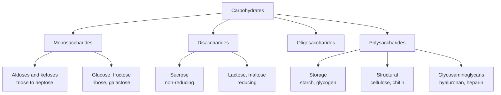
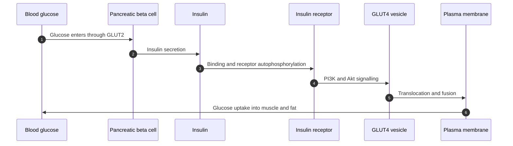
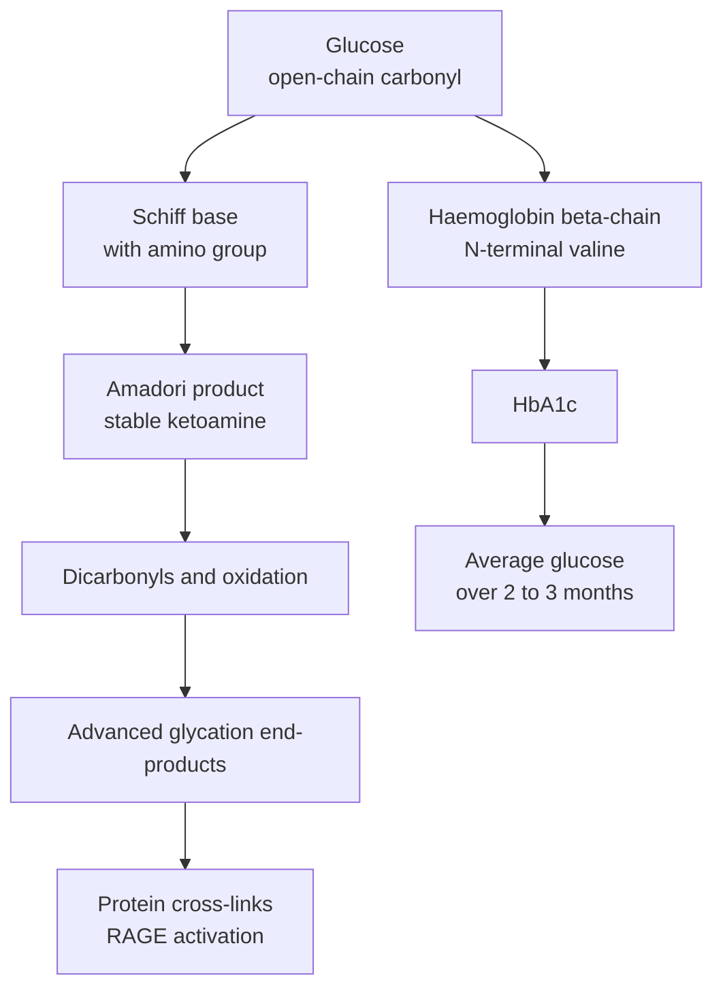

# Chapter 4 — Carbohydrates

> **Level:** University (Level 8 — Biochemistry)
> **Estimated study time:** 7 hours (5 h reading + 2 h exercises)
> **Prerequisites:** [Isomerism and Stereochemistry](../05-organic-chemistry/03-isomerism-and-stereochemistry.md); [Conformations](../05-organic-chemistry/04-conformations.md); [Aldehydes, Ketones and Carbonyl Chemistry](../05-organic-chemistry/10-aldehydes-ketones-and-carbonyl-chemistry.md)
> **Related chapters:** [Level 8 index](README.md); [Amino Acids and Proteins](02-amino-acids-and-proteins.md); [Lipids and Membranes](05-lipids.md); [Metabolism and Bioenergetics](07-metabolism-and-bioenergetics.md)
> **Difficulty:** ★★★★☆ (4/5)

---

## 1. Learning Objectives

After working through this chapter you will be able to:

- Classify carbohydrates as monosaccharides, disaccharides, oligosaccharides and
  polysaccharides, and give a biological example of each class.
- Assign D and L configurations from a Fischer projection and identify epimers and
  anomers.
- Explain how cyclic hemiacetals form, why glucopyranose has two anomers, and what
  mutarotation is.
- Convert between Fischer, Haworth and chair representations of glucose, and explain why
  β-D-glucopyranose is the most stable form.
- Describe the glycosidic bond and the structural consequences of α- and β-linkages.
- Relate the structures of starch, glycogen, cellulose, chitin and glycosaminoglycans to
  their biological functions.
- Distinguish reducing from non-reducing sugars and predict the result of Fehling's,
  Benedict's and Tollens' tests.
- Explain glucose transport, non-enzymatic glycation and the use of HbA1c as a clinical
  marker.
- Describe the industrial uses of carbohydrates and the chemistry behind first- and
  second-generation biofuels.

---

## 2. Introduction

Carbohydrates are the most abundant organic compounds on Earth. Cellulose forms the
structural framework of plant cell walls, starch and glycogen store energy, ribose and
deoxyribose form the backbone of RNA and DNA, and oligosaccharides attached to proteins
and lipids carry information for recognition, trafficking and immunity. The name
"carbohydrate" comes from the empirical formula of simple sugars, $\ce{C_n(H2O)_n}$, but
the class is defined by structure and chemistry rather than by that ratio: not every
compound with the formula is a carbohydrate, and not every carbohydrate has it.

The chemistry of carbohydrates is the chemistry of the carbonyl group and the hydroxyl
group. An aldose has an aldehyde at C1; a ketose has a ketone, usually at C2. In water the
carbonyl reacts with a hydroxyl group to form a cyclic hemiacetal, creating a new
stereocentre — the anomeric carbon — and two anomers. The ring can open and close, so the
anomers interconvert in solution, a phenomenon called mutarotation. Glycosidic bonds join
monosaccharides into polymers, and the stereochemistry of each bond determines whether
the polymer is a storage fuel, a structural fibre or a recognition signal.

This chapter builds the subject from the single sugar to the polymer and then to the
cell. It covers stereochemistry, ring formation, projection formulas and conformations,
the glycosidic bond, the important monosaccharides and disaccharides, and the
polysaccharides. It then treats reducing sugars and their tests, glycoproteins and
glycolipids, glucose transport and glycation, and the industrial and biofuel context.
The treatment is structural and mechanistic; it explains why cellulose is indigestible
to humans, why sucrose is non-reducing, and why HbA1c reports average blood glucose over
the preceding two to three months.

A worked exercise counts anomeric carbons and free reducing ends, the most reliable way
to reason about reducing sugars and polymer architecture.

---

## 3. Fundamental Concepts

### 3.1 Classification

Carbohydrates are classified by the number of monosaccharide units they contain.
**Monosaccharides** are single polyhydroxy aldehydes or ketones and cannot be hydrolysed
to simpler sugars. **Disaccharides** contain two units joined by a glycosidic bond;
**oligosaccharides** contain three to about ten units; **polysaccharides** contain more
than ten and may contain thousands. The boundary between oligo- and polysaccharide is
conventional, not chemical.

Monosaccharides are further classified by the carbonyl type and the number of carbons. An
**aldose** has an aldehyde group; a **ketose** has a ketone group. A three-carbon sugar is
a triose, four a tetrose, five a pentose, six a hexose, and seven a heptose. Glucose is an
aldohexose, fructose a ketohexose, ribose an aldopentose, and glyceraldehyde an aldotriose.
Polysaccharides are **homopolysaccharides** if they contain one type of monosaccharide
(starch, glycogen, cellulose, chitin) and **heteropolysaccharides** if they contain more
than one (hyaluronan, heparin, pectin).

### 3.2 Stereochemistry: D and L, epimers and anomers

Most monosaccharides contain several stereocentres, so they exist as many stereoisomers.
The **D/L** designation is defined by the configuration of the highest-numbered
stereocentre, compared with glyceraldehyde: in a Fischer projection, a hydroxyl group on
the right at that carbon is D, and on the left is L. The convention is historical and does
not imply optical rotation; D-glucose is dextrorotatory, but D-fructose is laevorotatory.
Most naturally occurring sugars are D-sugars, with L-ascorbic acid and some bacterial
sugars as notable exceptions.

Stereoisomers that differ at one stereocentre are **epimers**. D-Glucose and D-mannose are
C2 epimers; D-glucose and D-galactose are C4 epimers. Epimers are diastereomers, not
enantiomers, so they have different physical properties and different biological
activities. The enzyme that converts glucose to galactose, or the lectin that
distinguishes them, exploits a single stereocentre.

### 3.3 Cyclic hemiacetals, anomers and mutarotation

An aldehyde reacts with an alcohol to form a hemiacetal. In a monosaccharide, the C1
aldehyde of an aldose reacts intramolecularly with a hydroxyl group, usually the C5
hydroxyl, to form a six-membered **pyranose** ring; reaction with the C4 hydroxyl gives a
five-membered **furanose** ring. Ketoses react similarly, with the carbonyl at C2 becoming
the anomeric carbon and the C5 hydroxyl closing to a furanose in fructose.

The new stereocentre at the anomeric carbon has two configurations, called **α** and
**β**. For D-glucose in the standard Haworth orientation, α has the anomeric hydroxyl
below the ring and β has it above. The two anomers are diastereomers with different
specific rotations and different reactivities; α-D-glucopyranose has
$[\alpha]_\mathrm{D} = +112.2^\circ$ and β-D-glucopyranose has
$[\alpha]_\mathrm{D} = +18.7^\circ$.

In aqueous solution the ring opens to the open-chain aldehyde and recloses, so the two
anomers interconvert until equilibrium is reached. This is **mutarotation**. For glucose
at 25 °C the equilibrium mixture is about 36 % α-pyranose, 64 % β-pyranose and less than
1 % open chain, with a specific rotation of $+52.7^\circ$. The open-chain form is a minor
species, but it is the form that participates in oxidation and in glycation.

### 3.4 Fischer, Haworth and chair representations

A **Fischer projection** draws the carbon chain vertically, with the most oxidised carbon
at the top. Horizontal bonds project towards the viewer and vertical bonds away. The
projection is useful for determining configuration and for comparing epimers, but it does
not represent the cyclic form.

A **Haworth projection** draws the ring as a flat polygon viewed edge-on, with the
anomeric carbon on the right and the ring oxygen at the back. Substituents are drawn
above or below the plane. To convert a Fischer projection of a D-aldohexose to a Haworth
pyranose, the C5 hydroxyl is used to close the ring; groups on the right in Fischer point
down, groups on the left point up, and the terminal $\ce{CH2OH}$ of a D-sugar points up.
The α-anomer has the anomeric hydroxyl down and the β-anomer up.

A **chair conformation** is the three-dimensional shape of the ring. The
$^{4}C_{1}$ chair of D-glucopyranose places the bulky $\ce{CH2OH}$ group equatorial and
all non-anomeric hydroxyls equatorial, which is why β-D-glucose is the most stable
monosaccharide. α-D-Glucose has an axial anomeric hydroxyl and is about
$23\ \mathrm{kJ\ mol^{-1}}$ less stable than the β-anomer in the gas phase, although the
difference is smaller in water. The **anomeric effect** — the preference of an
electronegative substituent at the anomeric carbon for the axial position — partly
opposes the steric preference for equatorial.

### 3.5 The glycosidic bond

A **glycosidic bond** forms when the anomeric hydroxyl of one sugar reacts with a
hydroxyl of another, with loss of water. The product is an acetal, not a hemiacetal, so
the anomeric carbon is no longer free to open. The bond is described by the configuration
at the anomeric carbon (α or β), the two carbons involved (for example $(1\to4)$) and the
identity of the sugars.

Glycosidic bonds are stable to base but hydrolysed by acid and by specific enzymes. The
enzyme specificity is the basis of carbohydrate biology: α-amylase cleaves α(1→4) bonds
in starch, cellulase cleaves β(1→4) bonds in cellulose, and lactase cleaves β(1→4) bonds
in lactose. A polysaccharide with one free anomeric carbon has one **reducing end** and
many **non-reducing ends**; the non-reducing ends are where biosynthesis and degradation
usually occur.

### 3.6 The important monosaccharides

**Glucose** is an aldohexose and the principal fuel of most cells. Its open-chain form is
$\ce{CH2OH-(CHOH)4-CHO}$; in solution it is mainly β-D-glucopyranose. Its multiple
hydroxyl groups make it highly soluble, and its stable pyranose ring makes it a good
storage molecule. **Fructose** is a ketohexose, found in fruit and honey and produced
industrially from glucose by isomerisation; in sucrose it is present as β-D-fructofuranose.
**Galactose** is the C4 epimer of glucose and a component of lactose and of
glycoproteins and glycolipids. **Ribose** is an aldopentose and a component of RNA;
**deoxyribose** lacks the 2′-hydroxyl and is a component of DNA.

Other biologically important monosaccharides include **mannose**, a C2 epimer of glucose
used in glycoproteins; **xylose**, a pentose in plant hemicellulose; **N-acetylglucosamine**,
the monomer of chitin and a component of glycosaminoglycans; **sialic acid**
(N-acetylneuraminic acid), a nine-carbon sugar at the ends of glycoprotein and glycolipid
chains; and **glucuronic acid**, a uronic acid used in detoxification and in
glycosaminoglycans.

### 3.7 Disaccharides

**Sucrose** is α-D-glucopyranosyl-(1→2)-β-D-fructofuranoside. Both anomeric carbons are
involved in the glycosidic bond, so sucrose has no free anomeric carbon and is
**non-reducing**. It is the main transport sugar in plants and the common table sugar.
Hydrolysis gives glucose and fructose; the product mixture is called **invert sugar**
because the sign of optical rotation changes from positive to negative.

**Lactose** is β-D-galactopyranosyl-(1→4)-D-glucopyranose. The glucose anomeric carbon is
free, so lactose is **reducing**. It is the main sugar in milk; lactase hydrolyses it in
the small intestine, and its deficiency causes lactose intolerance.

**Maltose** is α-D-glucopyranosyl-(1→4)-D-glucopyranose, produced by the hydrolysis of
starch. It is reducing because the second glucose unit retains a free anomeric carbon. It
is the substrate of maltase and a component of malt.

**Cellobiose** is β-D-glucopyranosyl-(1→4)-D-glucopyranose, the repeating disaccharide of
cellulose. It is reducing and is produced by the partial hydrolysis of cellulose. The
β-linkage is the structural feature that distinguishes cellulose from starch.

### 3.8 Polysaccharides

**Starch** is the storage polysaccharide of plants. It consists of **amylose**, a linear
α(1→4) glucan that forms a helical structure and gives a blue colour with iodine, and
**amylopectin**, an α(1→4) glucan with α(1→6) branches every 24–30 residues that gives a
purple colour with iodine. Starch is insoluble in cold water but gelatinises on heating,
a process that disrupts the crystalline regions and allows water to enter.

**Glycogen** is the storage polysaccharide of animals, with the same α(1→4) backbone but
more frequent α(1→6) branches, every 8–12 residues. The extensive branching creates many
non-reducing ends for rapid synthesis and degradation, and it increases solubility. It is
stored mainly in liver and muscle.

**Cellulose** is a linear β(1→4) glucan. The β-linkage makes the chain straight, and
adjacent chains hydrogen-bond into flat sheets that stack into crystalline microfibrils.
Cellulose is the most abundant organic polymer on Earth and the main structural component
of plant cell walls. Humans lack the enzyme to hydrolyse β(1→4) bonds, so cellulose passes
through the digestive tract as insoluble fibre; ruminants and termites rely on microbial
cellulases.

**Chitin** is a linear β(1→4) polymer of N-acetylglucosamine, the structural material of
arthropod exoskeletons and fungal cell walls. It is the second most abundant biopolymer
after cellulose. **Glycosaminoglycans** are unbranched heteropolysaccharides of repeating
disaccharide units, usually a uronic acid and a sulfated amino sugar. Examples include
hyaluronan (unsulfated), chondroitin sulfate, keratan sulfate, dermatan sulfate, heparan
sulfate and heparin. Their high negative charge attracts water and cations, giving the
extracellular matrix its osmotic properties; heparin is an anticoagulant.

### 3.9 Reducing and non-reducing sugars

A **reducing sugar** has a free anomeric carbon that can open to an aldehyde and reduce
an oxidising agent. **Fehling's solution** contains copper(II) sulfate in alkaline
tartrate and is reduced to copper(I) oxide, a brick-red precipitate. **Benedict's
solution** uses copper(II) citrate and gives a red, orange or yellow precipitate depending
on the amount of reducing sugar. **Tollens' reagent** contains silver(I) diamminesilver
and is reduced to metallic silver, producing a mirror. The **DNS assay** uses
3,5-dinitrosalicylic acid, which is reduced to a coloured product measured
spectrophotometrically.

Sucrose is non-reducing because both anomeric carbons are in the glycosidic bond. Lactose,
maltose, cellobiose, glucose, fructose and most monosaccharides are reducing. Ketoses such
as fructose give positive tests because they isomerise to aldoses under the alkaline
conditions of the assay. Starch and glycogen have only one free reducing end per molecule,
so they react weakly; the intensity depends on the number of molecules and on their
accessibility.

### 3.10 Glycoproteins and glycolipids

**Glycoproteins** are proteins with covalently attached oligosaccharides. **N-linked**
glycans are attached to the side-chain amide of asparagine in the sequon Asn-X-Ser/Thr,
where X is any residue except proline; **O-linked** glycans are attached to serine or
threonine hydroxyls. Glycosylation occurs in the endoplasmic reticulum and Golgi and
affects folding, stability, trafficking and recognition. The oligosaccharide chains form
the **glycocalyx** on the cell surface, and they determine the ABO blood-group antigens:
the A and B antigens differ by a single sugar and its linkage, while the O antigen lacks
the terminal sugar.

**Glycolipids** are lipids with covalently attached carbohydrates. **Cerebrosides** have a
single sugar attached to ceramide; **gangliosides** have oligosaccharides with sialic acid
and are abundant in neuronal membranes. Glycolipids participate in cell recognition,
signalling and immune responses, and their degradation defects cause lysosomal storage
diseases such as Tay–Sachs disease.

### 3.11 Glucose uptake and glycation

Glucose enters cells through **GLUT** transporters, a family of facilitative uniporters.
GLUT1 is ubiquitous and maintains basal uptake; GLUT2 is present in liver and pancreatic
β-cells and has a high $K_\mathrm{M}$, so it responds to high glucose concentrations;
GLUT3 is abundant in neurons; GLUT4 is present in muscle and adipose tissue and is
translocated to the plasma membrane in response to insulin. **SGLT1** and **SGLT2** are
sodium-dependent cotransporters in the intestine and kidney.

**Glycation** is the non-enzymatic reaction of glucose with amino groups, distinct from
enzymatic glycosylation. The carbonyl group of glucose reacts with a lysine or N-terminal
amino group to form a Schiff base, which rearranges to a more stable ketoamine, an
**Amadori product**. Further oxidation and rearrangement produce **advanced glycation
end-products** (AGEs), which cross-link proteins and activate the receptor RAGE. Glycation
affects haemoglobin, albumin, collagen and lens crystallins, and it contributes to the
complications of diabetes.

**HbA1c** is haemoglobin glycated at the N-terminal valine of the β-chain. Because red
cells live about 120 days, HbA1c reflects average blood glucose over the preceding two to
three months. It is reported as a percentage of total haemoglobin (NGSP units) or as
mmol/mol (IFCC units), and it is used to diagnose and monitor diabetes. The conversion is
given in Section 6.

### 3.12 Industrial uses and biofuels

Carbohydrates are feedstocks for food, fuel and chemicals. Sucrose and glucose are
fermented to ethanol by yeast; starch is hydrolysed to glucose by α-amylase and
glucoamylase before fermentation. **High-fructose corn syrup** is produced by isomerising
glucose to fructose with glucose isomerase. Cellulose and hemicellulose from agricultural
residues can be converted to ethanol or other fuels, but the recalcitrance of crystalline
cellulose and the presence of lignin make pretreatment and enzymatic hydrolysis costly.
This distinction is the basis of the **first-generation** (sugar and starch) and
**second-generation** (lignocellulosic) biofuel categories.

Other uses include paper and textiles, food thickeners, pharmaceuticals (heparin,
dextran, cyclodextrins) and biodegradable plastics.

---
## 4. Detailed Scientific Explanation

### 4.1 Why the glycosidic linkage determines digestibility

The α and β designations describe the configuration at the anomeric carbon, and that
single stereochemical difference changes the shape of the polymer. In an α(1→4) glucan
such as amylose, each successive glucose unit is rotated by about 120° relative to its
neighbour, so the chain coils into a helix with six residues per turn. In a β(1→4) glucan
such as cellulose, each successive unit is rotated by 180°, so the chain is straight and
the hydroxyl groups project alternately above and below the plane. The straight chains
hydrogen-bond to their neighbours, forming flat sheets that stack into crystalline
microfibrils.

Cellulose is therefore insoluble, rigid and resistant to hydrolysis, whereas starch is
partially crystalline but accessible. Human amylases hydrolyse α(1→4) but not β(1→4)
bonds, so starch is digestible and cellulose is not; ruminants rely on microbial
cellulases.

### 4.2 Starch: structure, gelatinisation and retrogradation

Starch granules contain amylose and amylopectin in proportions that depend on the plant.
Amylose is essentially linear and forms a left-handed helix; the helix binds iodine,
giving the blue-black colour used as a test for starch. Amylopectin is branched and gives
a reddish-purple colour. The branches are concentrated in amorphous regions, while the
linear segments form crystalline lamellae that alternate with amorphous lamellae.

Heating starch in water causes **gelatinisation**: water enters the granule, the
crystalline regions melt, the granules swell and amylose leaches out, and the viscosity
rises. On cooling, the chains reassociate into ordered structures — **retrogradation** —
which expels water (syneresis) and makes the gel firm. Retrogradation is desirable in some
foods and undesirable in others; it is slowed by lipids, sugars and chemical modification.
**Resistant starch** escapes digestion in the small intestine and is fermented by the
colon microbiota, with effects on glycaemia and gut health.

### 4.3 Glycogen and the control of glucose release

Glycogen is a highly branched α(1→4) glucan with α(1→6) branch points every 8–12
residues. The branching creates a large number of non-reducing ends, which is where
glycogen phosphorylase releases glucose-1-phosphate. The debranching enzyme transfers
short oligosaccharides and hydrolyses the α(1→6) bonds, allowing complete degradation.
Liver glycogen is used to maintain blood glucose; muscle glycogen is used locally for
contraction and is not released as free glucose because muscle lacks glucose-6-phosphatase.

The branching also increases solubility and osmotic efficiency: a single large glycogen
molecule exerts less osmotic pressure than the same number of glucose molecules, which
matters inside a cell. Glycogen synthesis and degradation are reciprocally regulated by
insulin, glucagon, adrenaline and phosphorylation cascades.

### 4.4 Glycosaminoglycans and the extracellular matrix

Glycosaminoglycans are linear heteropolysaccharides of repeating disaccharide units,
typically a uronic acid (glucuronic or iduronic acid) and a sulfated amino sugar
(N-acetylglucosamine or N-acetylgalactosamine). The sulfate and carboxylate groups give
them a high negative charge, so they attract water and cations and form hydrated gels.
**Hyaluronan** is the only common GAG without sulfate; it is a very large molecule that
lubricates joints and forms the backbone of proteoglycan aggregates. **Chondroitin
sulfate** and **keratan sulfate** are abundant in cartilage, **dermatan sulfate** in skin
and blood vessels, and **heparan sulfate** on cell surfaces.

**Heparin** is a highly sulfated GAG used clinically as an anticoagulant. It binds
antithrombin III through a specific pentasaccharide sequence, increasing the rate at which
antithrombin inactivates thrombin and factor Xa by several orders of magnitude. The
structure–activity relationship is a classic example of carbohydrate recognition: the
sulfation pattern, not just the charge, determines binding.

### 4.5 Glycoproteins, glycolipids and recognition

N-linked glycans are attached to asparagine in the sequon Asn-X-Ser/Thr and are processed
in the endoplasmic reticulum and Golgi from a common high-mannose precursor to complex
forms. O-linked glycans are attached to serine or threonine and are often clustered. The
attached sugars affect protein folding through calnexin and calreticulin, protect against
proteolysis, confer solubility and mediate recognition by lectins.

The **ABO blood-group antigens** are oligosaccharides on glycoproteins and glycolipids of
red cells. The H antigen is the precursor; the A antigen adds N-acetylgalactosamine in an
α(1→3) linkage, and the B antigen adds galactose in an α(1→3) linkage. The O antigen lacks
the terminal sugar. Individuals lacking the corresponding glycosyltransferase produce
antibodies against the missing antigen, which is why blood typing is required before
transfusion. **Sialic acid** at the ends of glycans contributes to charge, stability and
recognition, and it is exploited by influenza virus as a receptor.

### 4.6 Glucose transport and insulin signalling

Glucose is polar and cannot cross lipid bilayers at a useful rate, so it enters cells
through transporters. **GLUT1** is ubiquitous and has a $K_\mathrm{M}$ near
$1$–$2\ \mathrm{mM}$, so it is saturated at normal blood glucose and provides basal
uptake. **GLUT2** has a $K_\mathrm{M}$ near $15$–$20\ \mathrm{mM}$ and is found in liver
and pancreatic β-cells, where it senses glucose concentration. **GLUT3** is neuronal and
has a low $K_\mathrm{M}$. **GLUT4** is stored in intracellular vesicles in muscle and
adipose tissue and is translocated to the membrane in response to insulin.

Insulin binds its receptor tyrosine kinase, which signals through PI3K and Akt to
translocate GLUT4 vesicles to the plasma membrane. In type 2 diabetes, insulin resistance
reduces this response and compensatory secretion eventually fails. **SGLT1** and
**SGLT2** couple glucose uptake to sodium; SGLT2 inhibitors lower glucose by increasing
urinary excretion.

### 4.7 Glycation and HbA1c

Glycation begins with the nucleophilic attack of an amino group on the open-chain carbonyl
of glucose, forming a reversible **Schiff base**. The Schiff base rearranges to a
**Amadori product**, a stable ketoamine. Further oxidation, dehydration and fragmentation
produce **advanced glycation end-products** such as carboxymethyllysine, pentosidine and
cross-links. These modify protein function and activate RAGE, contributing to vascular
damage, neuropathy and nephropathy in diabetes.

Haemoglobin A is glycated at the N-terminal valine of the β-chain and at other lysine
residues; the N-terminal product is HbA1c. Because the reaction is slow and essentially
irreversible over the lifespan of the red cell, HbA1c integrates glucose exposure over
about 120 days, with most weight on the preceding two to three months. It is reported as a
percentage (NGSP) or in mmol/mol (IFCC), and the two scales are related by a fixed
equation. HbA1c is used to diagnose diabetes (≥6.5 % NGSP), to monitor treatment and to
estimate average glucose. Conditions that alter red-cell lifespan — haemolysis, blood loss,
haemoglobinopathies, iron deficiency — affect the result independently of glycaemia.

### 4.8 The Maillard reaction and food chemistry

The **Maillard reaction** is the non-enzymatic reaction of reducing sugars with amino
groups that produces the brown colour and flavour of cooked foods. It begins with a Schiff
base, proceeds through Amadori products and dicarbonyl intermediates, and ends with
melanoidins and volatile aroma compounds. It is distinct from **caramelisation**, which is
the thermal degradation of sugars without amino groups. The reaction is favoured by heat,
low water activity and alkaline pH, which is why bread crust, roasted coffee and grilled
meat brown.

The same chemistry has consequences. Acrylamide, a probable carcinogen, forms from
asparagine and reducing sugars at temperatures above about 120 °C in fried and baked
starchy foods. Food manufacturers control precursors, temperature and time to reduce it.
In the body, the same reaction produces AGEs, which are implicated in ageing and diabetic
complications.

### 4.9 Carbohydrates as industrial feedstocks

Sucrose and glucose are fermented to ethanol by *Saccharomyces cerevisiae* through
glycolysis and pyruvate decarboxylase. Starch must first be hydrolysed by α-amylase and
glucoamylase to glucose; the process is called saccharification. Glucose isomerase
converts glucose to fructose for high-fructose syrup, which is sweeter and more soluble.

Lignocellulosic biomass contains cellulose, hemicellulose and lignin. Pretreatment
disrupts the lignin seal and reduces crystallinity; cellulases then release glucose and
hemicellulases release pentoses. Pentose fermentation is inefficient and lignin is hard to
valorise, so second-generation fuels remain more expensive than first-generation fuels.

---

## 5. Visual Diagrams

**Figure 4.1 — Classification of carbohydrates.** The classes differ in the number of
monosaccharide units and in their biological role. The same monosaccharide can appear in
storage, structural and recognition polymers; the linkage and the branching pattern, not
the sugar alone, determine the function.

**Figure 4.2 — Insulin-stimulated glucose uptake.** GLUT2 on the β-cell senses glucose and
triggers insulin secretion. Insulin signals through its receptor, PI3K and Akt to move
GLUT4 vesicles to the plasma membrane. The pathway explains why insulin lowers blood
glucose and why insulin resistance produces hyperglycaemia.

**Figure 4.3 — Glycation from glucose to HbA1c and AGEs.** The initial Schiff base is
reversible; the Amadori product is stable, and further chemistry produces irreversible
AGEs. HbA1c is a specific Amadori product on haemoglobin that integrates glucose exposure
over the red-cell lifespan. The same pathway produces the AGEs implicated in diabetic
complications.

---

## 6. Mathematical Formulas

**Specific rotation.** The observed rotation of a chiral compound in solution is

$$
[\alpha]_\mathrm{D}^{T} = \frac{\alpha}{l c}
$$

where $\alpha$ is the observed rotation in degrees, $l$ the path length in decimetres and
$c$ the concentration in grams per millilitre. The measurement is made at the sodium D
line (589 nm) and a stated temperature.

**Mutarotation of glucose.** If $x$ is the fraction of β-anomer at equilibrium,

$$
[\alpha]_\mathrm{eq} = x[\alpha]_\beta + (1-x)[\alpha]_\alpha
$$

so

$$
x = \frac{[\alpha]_\alpha - [\alpha]_\mathrm{eq}}{[\alpha]_\alpha - [\alpha]_\beta}
$$

**Degree of polymerisation and molar mass.**

$$
\mathrm{DP} = \frac{M}{M_\mathrm{res}},
\qquad
M = n M_\mathrm{res} + M_{\ce{H2O}}
$$

where $M_\mathrm{res} = 162.14\ \mathrm{g\ mol^{-1}}$ for a hexose residue and
$M_{\ce{H2O}} = 18.015\ \mathrm{g\ mol^{-1}}$.

**HbA1c conversions.** The NGSP percentage and the IFCC value in mmol/mol are related by

$$
\mathrm{NGSP} = 0.09148 \times \mathrm{IFCC} + 2.152
$$

$$
\mathrm{IFCC} = \frac{\mathrm{NGSP} - 2.152}{0.09148}
$$

The estimated average glucose is

$$
\mathrm{eAG}\ (\mathrm{mg\ dL^{-1}}) = 28.7 \times \mathrm{NGSP} - 46.7
$$

$$
\mathrm{eAG}\ (\mathrm{mmol\ L^{-1}}) = 1.59 \times \mathrm{NGSP} - 2.59
$$

**Energy from a polysaccharide.** Hydrolysis of one hexose residue consumes one water
molecule:

$$
\ce{(C6H10O5)_n(s) + nH2O(l) -> nC6H12O6(aq)}
$$

The mass yield of glucose from starch is therefore $180.16/162.14 = 1.111$, and the energy
yield is correspondingly higher than that of the anhydrous polymer on a mass basis.

| Symbol | Meaning | SI unit |
|---|---|---|
| $[\alpha]_\mathrm{D}$ | Specific rotation at the sodium D line | degrees dm⁻¹ mL g⁻¹ |
| $\alpha$ | Observed rotation | degrees |
| $l$ | Path length | dm |
| $c$ | Concentration | g mL⁻¹ |
| $x$ | Fraction of β-anomer | dimensionless |
| $M$ | Molar mass | g mol⁻¹ |
| $n$ | Degree of polymerisation | dimensionless |
| $\mathrm{DP}$ | Degree of polymerisation | dimensionless |
| $\mathrm{NGSP}$ | HbA1c as a percentage | % |
| $\mathrm{IFCC}$ | HbA1c in mmol/mol | mmol mol⁻¹ |

---
## 7. Chemical Equations

Glycosidic bond formation is a condensation. For two glucose molecules forming maltose:

$$
\ce{C6H12O6(aq) + C6H12O6(aq) -> C12H22O11(aq) + H2O(l)}
$$

The reverse reaction is hydrolysis, catalysed by α-glucosidases and by acid:

$$
\ce{C12H22O11(aq) + H2O(l) -> 2C6H12O6(aq)}
$$

Anaerobic fermentation of glucose by yeast produces ethanol and carbon dioxide:

$$
\ce{C6H12O6(aq) -> 2C2H5OH(aq) + 2CO2(g)}
$$

The reaction is the basis of brewing, winemaking and industrial ethanol production.

Reducing sugars reduce copper(II) in alkaline solution to copper(I) oxide. For glucose:

$$
\ce{C6H12O6(aq) + 2Cu^{2+}(aq) + 5OH-(aq) -> C6H11O7-(aq) + Cu2O(s) + 3H2O(l)}
$$

The brick-red precipitate of $\ce{Cu2O}$ is the positive result in Fehling's and
Benedict's tests. The stoichiometry is approximate in practice because the assay is not a
clean single reaction, but the electron balance is exact: one aldehyde group supplies two
electrons and reduces two copper(II) ions.

---

## 8. Worked Examples

### Worked Example 8.1 — Counting anomeric carbons

**Problem.** For sucrose, lactose, maltose and amylopectin, count the anomeric carbons
and the number of free anomeric carbons per molecule, and state whether each is reducing.

**Strategy.** Identify the carbonyl carbon of each monosaccharide unit (C1 of an aldose,
C2 of a ketose). It is free only if it is not part of a glycosidic bond. A non-reducing
end is not the same as a free anomeric carbon: at a non-reducing end the anomeric carbon
is still in a glycosidic bond.

**Solution.**

| Sugar | Units | Anomeric carbons | Free anomeric carbons per molecule | Reducing? |
|---|---|---|---|---|
| Sucrose | glucose + fructose | 2 | 0 | No |
| Lactose | galactose + glucose | 2 | 1 (glucose C1) | Yes |
| Maltose | glucose + glucose | 2 | 1 (second glucose C1) | Yes |
| Amylopectin | many glucose units | one per residue | 1 (the reducing end) | Weakly |

**Check.** Sucrose is non-reducing; lactose and maltose have one free anomeric carbon
each; amylopectin has one reducing end per molecule despite many non-reducing ends.

### Worked Example 8.2 — Composition of mutarotated glucose

**Problem.** α-D-Glucopyranose has $[\alpha]_\mathrm{D} = +112.2^\circ$ and
β-D-glucopyranose has $[\alpha]_\mathrm{D} = +18.7^\circ$. The equilibrium value is
$+52.7^\circ$. Calculate the equilibrium fractions of the two anomers.

**Strategy.** Use the linear mixture equation and solve for the fraction of β-anomer.

**Solution.**

$$
x_\beta = \frac{112.2 - 52.7}{112.2 - 18.7} = \frac{59.5}{93.5} = 0.636
$$

So the equilibrium mixture is 63.6 % β and 36.4 % α.

**Check.** The rotation lies closer to the β value, so β predominates; the accepted
composition is about 64 % β and 36 % α.

### Worked Example 8.3 — Molar mass of an amylose chain

**Problem.** An amylose fraction has a degree of polymerisation of 2000. Calculate its
molar mass.

**Strategy.** Use the residue mass of a hexose, $162.14\ \mathrm{g\ mol^{-1}}$, and add
the mass of one water molecule for the terminal groups.

**Solution.**

$$
M = 2000 \times 162.14 + 18.02 = 324\,298\ \mathrm{g\ mol^{-1}}
\approx 324\ \mathrm{kDa}
$$

**Check.** The value is within the range of natural amylose, which contains 500–6000
residues, and reflects the loss of one water molecule per glycosidic bond.

### Worked Example 8.4 — Converting HbA1c units

**Problem.** A patient has HbA1c of 7.0 % (NGSP). Convert this to IFCC units and to
estimated average glucose.

**Strategy.** Use the NGSP–IFCC relation and the eAG equations.

**Solution.**

$$
\mathrm{IFCC} = \frac{7.0 - 2.152}{0.09148} = 53.0\ \mathrm{mmol\ mol^{-1}}
$$

$$
\mathrm{eAG} = 28.7 \times 7.0 - 46.7 = 154\ \mathrm{mg\ dL^{-1}}
$$

which is $154/18.0 = 8.6\ \mathrm{mmol\ L^{-1}}$.

**Check.** 7.0 % exceeds the 6.5 % diagnostic threshold and corresponds to average
glucose in the diabetic range.

### Worked Example 8.5 — Specific rotation from an observed rotation

**Problem.** A 50 g L⁻¹ glucose solution in a 1 dm tube rotates plane-polarised light by
$+2.64^\circ$. Calculate the specific rotation.

**Strategy.** Convert the concentration to g mL⁻¹ and apply
$[\alpha] = \alpha/(lc)$.

**Solution.** $c = 50\ \mathrm{g\ L^{-1}} = 0.050\ \mathrm{g\ mL^{-1}}$, so

$$
[\alpha]_\mathrm{D} = \frac{2.64}{1 \times 0.050} = 52.8^\circ
$$

**Check.** The value is close to the equilibrium rotation of $+52.7^\circ$, so the
solution has already mutarotated.

---

## 9. Real-World Applications

**Food science.** Starch gelatinisation thickens sauces; retrogradation stiffens gels and
staling bread; Maillard chemistry browns bread crust and roasted coffee; pectin and
carrageenan form gels; cellulose derivatives stabilise emulsions. Sugar substitutes and
modified starches are designed by changing the glycosidic linkages and the degree of
substitution.

**Medicine.** HbA1c is a standard diabetes marker; heparin is an anticoagulant; blood-group
oligosaccharides determine transfusion compatibility; glycosaminoglycan injections treat
osteoarthritis; and osmotic diuretics such as mannitol exploit sugar alcohols. Lactose
intolerance and galactosaemia are disorders of carbohydrate digestion and metabolism.

**Industry and biofuels.** Sucrose and starch are fermented to ethanol; glucose isomerase
produces high-fructose syrup; cellulases serve second-generation biofuels, feed and
textiles; cellulose derivatives are used in paper and coatings.

---

## 10. Common Mistakes

| Mistake | Why it happens | Correct approach |
|---|---|---|
| "All carbohydrates have the formula $\ce{C_n(H2O)_n}$." | The name suggests a hydrate of carbon. | Deoxy sugars, amino sugars and uronic acids are carbohydrates without that ratio. |
| "D-glucose and L-glucose are enantiomers but have the same biological activity." | The D/L prefix is confused with a minor structural detail. | They are enantiomers; enzymes and transporters are stereospecific, so only D-glucose is metabolised. |
| "Sucrose is reducing because it contains glucose and fructose." | The constituent sugars are reducing. | Both anomeric carbons are in the glycosidic bond, so sucrose has no free anomeric carbon. |
| "A non-reducing end has a free anomeric carbon." | The two ideas sound equivalent. | At a non-reducing end the anomeric carbon is still in a glycosidic bond; only the reducing end is free. |
| "Cellulose and starch differ only in molecular mass." | Both are glucose polymers. | They differ in linkage: β(1→4) versus α(1→4), which changes shape, crystallinity and digestibility. |

---

## 11. Chapter Summary

- Carbohydrates are polyhydroxy aldehydes, ketones and their derivatives, classified by
  the number of monosaccharide units.
- Monosaccharides have multiple stereocentres; D/L, epimers and anomers describe
  configuration, and only the anomeric carbon can open to a carbonyl.
- Cyclic hemiacetals form pyranose or furanose rings; mutarotation interconverts α and β
  anomers through the open-chain form.
- Glycosidic bonds are acetals whose configuration and linkage determine polymer shape,
  digestibility and biological recognition.
- Starch and glycogen are α-linked storage polymers; cellulose and chitin are β-linked
  structural polymers; glycosaminoglycans are sulfated heteropolysaccharides.

---

## 12. Exercises

### 12.1 Conceptual questions

1. Why is cellulose indigestible to humans while starch is digestible, even though both
   are glucose polymers?
2. Explain why sucrose is non-reducing and lactose is reducing.
3. Why does β-D-glucopyranose predominate at equilibrium over α-D-glucopyranose?

### 12.2 Basic problems

4. Classify glucose, fructose, ribose and sucrose as aldose or ketose and as mono-, di- or
   polysaccharide.
5. Draw the Fischer projection of D-glucose and identify its C2 and C4 epimers.
6. Name the glycosidic linkage in lactose and in sucrose.

### 12.3 Intermediate problems

7. A solution contains 40 % α-D-glucose and 60 % β-D-glucose. Calculate its expected
   specific rotation using the values in Worked Example 8.2.
8. Explain why amylopectin gives a weaker Fehling's test than an equivalent mass of
   maltose.
9. Why does HbA1c not change rapidly after a single meal, whereas plasma glucose does?

### 12.4 Advanced problems

10. A patient with haemolytic anaemia has a normal plasma glucose but a low HbA1c.
    Explain the discrepancy.
11. Explain how a single glycosidic linkage difference between the A and B blood-group
    antigens determines transfusion compatibility.

### 12.5 Calculation problems

12. A glycogen sample has a degree of polymerisation of 5000. Calculate its molar mass and
    the number of reducing ends per gram.

### 12.6 Answers

1. Humans lack β(1→4)-glucosidase; α-amylase cleaves α(1→4) bonds in starch but not the
   β-linkage in cellulose.
2. Sucrose has both anomeric carbons in the glycosidic bond; lactose has a free anomeric
   carbon on its glucose unit.
3. The β-anomer has all bulky substituents equatorial in the $^{4}C_{1}$ chair, so it is
   sterically more stable; the anomeric effect partially offsets this but not enough to
   reverse the preference in water.
4. Glucose: aldohexose; fructose: ketohexose; ribose: aldopentose; sucrose: disaccharide.
5. CHO at top, C2–C5 hydroxyls right-left-right-right, $\ce{CH2OH}$ at bottom; C2 epimer
   is mannose, C4 epimer is galactose.
6. Lactose: β-D-galactopyranosyl-(1→4)-D-glucopyranose. Sucrose:
   α-D-glucopyranosyl-(1→2)-β-D-fructofuranoside.
7. $0.40(112.2) + 0.60(18.7) = 44.9 + 11.2 = 56.1^\circ$.
8. Amylopectin has one free anomeric carbon per molecule and a large mass, so it presents
   far fewer reducing ends per gram than maltose.
9. HbA1c forms slowly and irreversibly over the red-cell lifespan, so it integrates
   glucose exposure; plasma glucose reflects the moment of sampling.
10. Haemolysis shortens red-cell lifespan, so less glycation occurs; HbA1c falls despite
    normal average glucose. Fructosamine is more reliable.
11. The A antigen has N-acetylgalactosamine α(1→3) on the H antigen, the B antigen has
    galactose α(1→3); recipients have antibodies against the antigen they lack, so the
    terminal sugar determines compatibility.
12. $M \approx 811\ \mathrm{kDa}$; one reducing end per molecule gives $7.4\times10^{17}$ per gram.

---

## 13. Further Reading

- Nelson, D. L.; Cox, M. M. *Lehninger Principles of Biochemistry*, 7th ed. Macmillan,
  2017. Chapter 7 on carbohydrates and glycobiology.
- Berg, J. M.; Tymoczko, J. L.; Gatto, G. J.; Stryer, L. *Biochemistry*, 9th ed.
  W. H. Freeman, 2019. Chapter 11 on carbohydrates.
- Robyt, J. F. *Essentials of Carbohydrate Chemistry*. Springer, 1998. Structure and
  reactions of sugars.
- IUPAC. *Compendium of Chemical Terminology* ("Gold Book"), 2nd ed. (the "corrected"
  version), entries "carbohydrate", "anomeric" and "glycosidic bond".
  <https://goldbook.iupac.org/>

---

**Navigation:** [Level 8 index](README.md) · [Curriculum map](../CURRICULUM.md) · [Amino Acids and Proteins](02-amino-acids-and-proteins.md) · [Lipids and Membranes](05-lipids.md)
