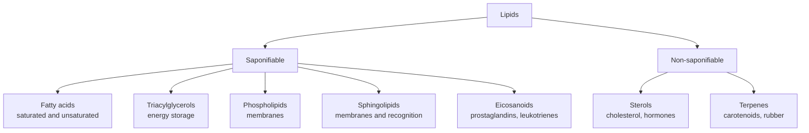
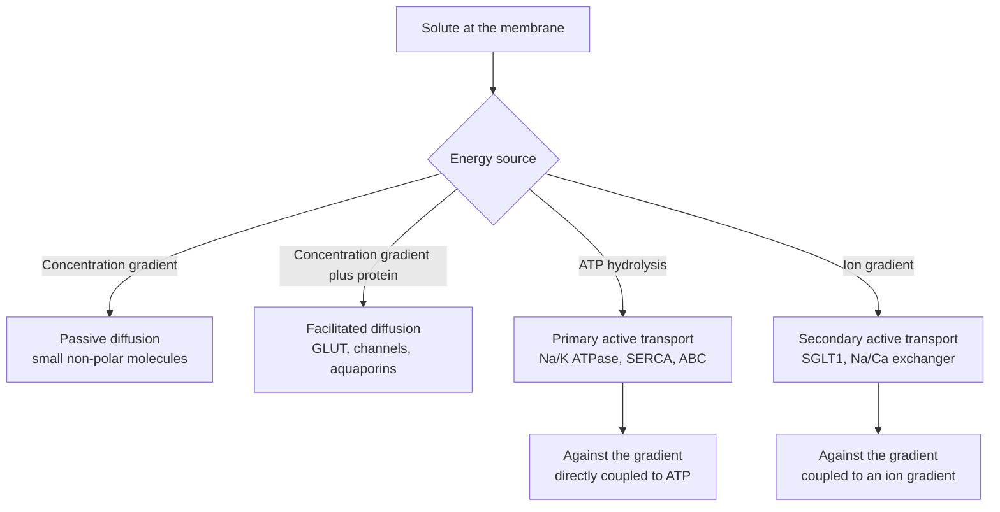
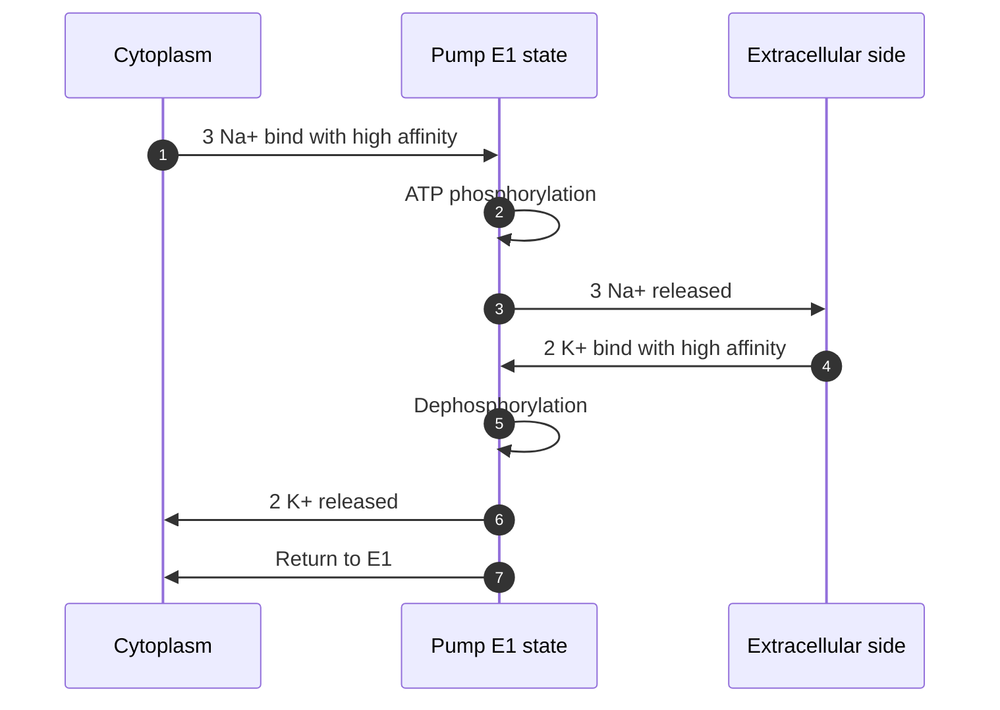

# Chapter 5 — Lipids and Membranes

> **Level:** University (Level 8 — Biochemistry)
> **Estimated study time:** 7 hours (5 h reading + 2 h exercises)
> **Prerequisites:** [Intermolecular Forces](../03-intermediate-chemistry/05-intermolecular-forces.md); [Conformations](../05-organic-chemistry/04-conformations.md); [Carboxylic Acids, Esters and Amines](../05-organic-chemistry/11-carboxylic-acids-esters-and-amines.md)
> **Related chapters:** [Level 8 index](README.md); [Water and Biological Systems](01-water-and-biological-systems.md); [Carbohydrates](04-carbohydrates.md); [Metabolism and Bioenergetics](07-metabolism-and-bioenergetics.md)
> **Difficulty:** ★★★★☆ (4/5)

---

## 1. Learning Objectives

After working through this chapter you will be able to:

- Classify lipids into fatty acids, triacylglycerols, phospholipids, sphingolipids,
  sterols, waxes, terpenes and eicosanoids, and give a biological example of each.
- Explain how chain length and cis/trans unsaturation determine the melting points and
  packing of fatty acids and triacylglycerols.
- Distinguish cis and trans geometry, and describe the chemical and health consequences
  of industrial trans fats.
- Explain the amphipathic principle and predict micelle, bilayer or liposome formation
  from the packing parameter.
- Describe membrane fluidity, the role of cholesterol and the evidence for and against
  lipid rafts.
- Explain the fluid-mosaic model and the classification of membrane proteins.
- Distinguish passive diffusion, facilitated diffusion, primary active transport and
  secondary active transport, and describe the Na⁺/K⁺-ATPase with its stoichiometry.
- Calculate the thermodynamic cost of transport and estimate the energy efficiency of the
  Na⁺/K⁺-ATPase.
- Describe lipoprotein metabolism, cholesterol transport and the mechanism of statins.
- Explain lipid peroxidation and antioxidant defence, and describe the analytical methods
  used to study lipids.

---

## 2. Introduction

Lipids are defined by solubility rather than by a single functional group: they are
biological molecules that are sparingly soluble in water and soluble in organic solvents.
That operational definition covers a diverse family — fatty acids, triacylglycerols,
phospholipids, sphingolipids, sterols, waxes, terpenes and eicosanoids — united by their
hydrophobicity and by their roles in energy storage, membrane structure and signalling.

The most familiar lipid function is energy storage. Triacylglycerols are reduced, anhydrous
and compact, and they store about $38\ \mathrm{kJ\ g^{-1}}$, more than twice the energy per
gram of carbohydrate or protein. The second major function is membrane structure: amphipathic
phospholipids and sphingolipids assemble into bilayers that separate the cell from its
environment and define its internal compartments. The third is signalling: sterols give rise
to steroid hormones and bile acids, eicosanoids mediate inflammation and thrombosis, and
phosphoinositides recruit proteins to membranes.

This chapter follows that functional logic. It begins with classification and with the
chemistry of fatty acids, especially the effect of chain length and cis/trans geometry on
packing and melting. It then treats the amphipathic principle and self-assembly, membrane
fluidity and cholesterol, membrane proteins and the fluid-mosaic model, and the mechanisms
of transport. The thermodynamics of transport is developed with a worked calculation for the
Na⁺/K⁺-ATPase. The final sections cover lipoproteins and cholesterol transport, lipid
peroxidation and antioxidants, lipid analytics, and soaps and detergents as applied lipid
chemistry.

The treatment distinguishes saponifiable from non-saponifiable lipids, explains why trans
fats behave like saturated fats, and states where the lipid-raft hypothesis remains
controversial. Laboratory context is limited to principles.

---

## 3. Fundamental Concepts

### 3.1 Classification of lipids

Lipids are classified by backbone and by function. **Fatty acids** are long-chain
monocarboxylic acids, usually with an even number of carbons. **Triacylglycerols** are
esters of glycerol with three fatty acids and are the main storage lipids.
**Phospholipids** are glycerol or sphingosine derivatives with a phosphate-containing head
group; they are the main membrane lipids. **Sphingolipids** are based on sphingosine and
include ceramides, sphingomyelin, cerebrosides and gangliosides. **Sterols** have a
four-ring steroid nucleus; cholesterol is the principal animal sterol, and ergosterol and
phytosterols are the fungal and plant analogues. **Waxes** are esters of long-chain fatty
acids with long-chain alcohols. **Terpenes** are built from isoprene units and include
monoterpenes, sesquiterpenes, diterpenes, triterpenes and tetraterpenes such as carotenoids.
**Eicosanoids** are oxygenated derivatives of 20-carbon polyunsaturated fatty acids,
including prostaglandins, thromboxanes and leukotrienes.

A second classification distinguishes **saponifiable** lipids — those with ester bonds that
hydrolyse in alkali to glycerol and fatty acid salts — from **non-saponifiable** lipids such
as sterols and terpenes. The distinction is useful analytically: saponification is the basis
of soap making and of fatty acid analysis.

### 3.2 Fatty acids, saturation and melting points

Fatty acids are described by chain length and number of double bonds: 16:0 is palmitic acid,
18:0 is stearic acid, 18:1 is oleic acid and 18:2 is linoleic acid. The position of a double
bond is given relative to the carboxyl carbon (Δ9) or relative to the methyl end (ω-9 or
n-9). Most naturally occurring double bonds are *cis*.

Saturation strongly affects packing and melting. Saturated chains are flexible and pack
into a dense, ordered array with many van der Waals contacts, so they have high melting
points: palmitic acid melts at $63\ ^\circ\mathrm{C}$ and stearic acid at
$69\ ^\circ\mathrm{C}$. A *cis* double bond introduces a kink of about 30°, which prevents
tight packing and lowers the melting point: oleic acid melts at $13\ ^\circ\mathrm{C}$,
linoleic acid at $-5\ ^\circ\mathrm{C}$ and α-linolenic acid at $-11\ ^\circ\mathrm{C}$.
The effect is large enough that a single *cis* double bond can lower the melting point by
more than 50 K.

| Fatty acid | Notation | Melting point / °C | Character |
|---|---|---|---|
| Palmitic | 16:0 | 63 | Saturated, common in animal fat |
| Stearic | 18:0 | 69 | Saturated, common in cocoa butter |
| Oleic | 18:1 Δ9 cis | 13 | Monounsaturated, olive oil |
| Elaidic | 18:1 Δ9 trans | 45 | Industrial trans fat |
| Linoleic | 18:2 Δ9,12 cis | −5 | Essential ω-6 |
| α-Linolenic | 18:3 Δ9,12,15 cis | −11 | Essential ω-3 |
| Arachidonic | 20:4 Δ5,8,11,14 cis | −49 | Eicosanoid precursor |

Membrane lipids usually contain at least one unsaturated fatty acid, which keeps the
bilayer fluid at physiological temperature. Storage triacylglycerols can be more saturated
because they do not need to form a fluid bilayer. **Essential fatty acids** — linoleic acid
(ω-6) and α-linolenic acid (ω-3) — cannot be synthesised by humans because we lack the
Δ12 and Δ15 desaturases; they must come from the diet, and they are precursors of
arachidonic acid, eicosapentaenoic acid and docosahexaenoic acid.

### 3.3 Cis, trans and health

The *cis* double bond is the natural configuration and produces a kink. The *trans* double
bond is straighter and packs like a saturated chain, so trans fats have higher melting
points and behave like saturated fats in membranes. Partial hydrogenation of vegetable oils
converts some *cis* bonds to *trans* bonds, producing semi-solid fats with longer shelf life
and better frying performance. The same process was used for margarine and shortening.

The health consequences are well established. Trans fatty acids raise low-density
lipoprotein cholesterol, lower high-density lipoprotein cholesterol, increase inflammation
and endothelial dysfunction, and increase the risk of coronary heart disease. The World
Health Organization has called for the elimination of industrially produced trans fats, and
many countries have banned them or restricted their use. The mechanism is partly the
straight-chain packing, which alters membrane fluidity and lipoprotein metabolism, and
partly the effects of trans fats on hepatic lipid metabolism.

### 3.4 Amphipathy and self-assembly

An **amphipathic** molecule has a hydrophilic region and a hydrophobic region. Phospholipids
have a polar head group and two hydrophobic tails; detergents and bile salts have a polar
head and a single tail; cholesterol has a hydroxyl group and a rigid hydrophobic steroid
body. In water, amphipathic molecules self-assemble so that the hydrophobic parts avoid
water and the hydrophilic parts remain solvated.

The shape of the assembly is predicted by the **packing parameter**

$$
P = \frac{v}{a_0 l_\mathrm{c}}
$$

where $v$ is the tail volume, $a_0$ the optimal head-group area and $l_\mathrm{c}$ the
maximum extended chain length. Spherical micelles form when $P < 1/3$, cylindrical micelles
when $1/3 < P < 1/2$, bilayers and vesicles when $1/2 < P < 1$, and inverted structures when
$P > 1$. The parameter is a simplification — it ignores head-group charge, specific ion
binding and curvature elasticity — but it captures the competition between tail packing and
head-group repulsion.

**Micelles** are aggregates with a hydrophobic core and a hydrophilic surface; they form
above the **critical micelle concentration** (CMC). **Bilayers** are two-dimensional sheets
with hydrophobic cores; they close into **vesicles** or **liposomes** to eliminate exposed
edges. Liposomes are used as drug-delivery vehicles, and ionisable lipid nanoparticles are
the basis of mRNA vaccines.

### 3.5 Membrane fluidity, cholesterol and lipid rafts

Biological membranes are fluid at physiological temperature. **Fluidity** depends on
temperature, on the proportion of unsaturated fatty acids, on chain length and on
cholesterol. Unsaturated chains and shorter chains increase fluidity; saturated and longer
chains decrease it. The **gel-to-liquid-crystalline transition temperature** $T_\mathrm{m}$
is the temperature at which the membrane changes from an ordered gel to a fluid state.

**Cholesterol** is amphipathic: its hydroxyl group interacts with the polar head groups,
and its rigid steroid ring intercalates between the acyl chains. Below $T_\mathrm{m}$,
cholesterol disrupts the ordered packing of saturated chains and increases fluidity; above
$T_\mathrm{m}$, it restricts the motion of the chains and decreases fluidity. The net effect
is to broaden the transition and to buffer the membrane against temperature change. This is
why cholesterol is essential in animal cell membranes but absent from most bacterial
membranes.

**Lipid rafts** are proposed nanometre-scale domains enriched in sphingolipids, cholesterol
and specific proteins. They are thought to concentrate signalling molecules and to regulate
membrane trafficking. The evidence includes detergent-resistant membrane fractions,
single-molecule tracking and super-resolution imaging. The hypothesis remains debated
because the domains are small, transient and sensitive to the methods used to study them;
the current view is that rafts are dynamic, heterogeneous and stabilised by protein
interactions rather than large stable platforms.

### 3.6 Membrane proteins and the fluid-mosaic model

The **fluid-mosaic model**, proposed by Singer and Nicolson in 1972, describes the membrane
as a fluid lipid bilayer with proteins embedded in or associated with it. The model replaced
the earlier idea of a static lipid–protein sandwich and remains the standard framework,
although it has been refined to include domains, asymmetry and protein–lipid interactions.

**Integral membrane proteins** span the bilayer. Most have α-helical transmembrane segments
that are identified by hydropathy plots; β-barrel proteins are found in the outer membranes
of Gram-negative bacteria, mitochondria and chloroplasts. **Peripheral membrane proteins**
bind to the surface through electrostatic and hydrogen-bonding interactions and can be
removed by salt. **Lipid-anchored proteins** are covalently attached to fatty acids, prenyl
groups or glycosylphosphatidylinositol (GPI) anchors.

The bilayer is **asymmetric**: phosphatidylserine is normally on the inner leaflet, and its
exposure on the outer leaflet signals apoptosis and triggers phagocytosis. Glycolipids and
glycoproteins are on the outer leaflet and form the glycocalyx. This asymmetry is maintained
by flippases, floppases and scramblases, and it is essential for recognition and signalling.

### 3.7 Transport across membranes

Small non-polar molecules — $\ce{O2}$, $\ce{CO2}$, $\ce{N2}$, ethanol and steroid hormones —
cross the bilayer by **passive diffusion** down their concentration gradient. Water crosses
by simple diffusion and through aquaporins. Ions and polar molecules require proteins.

**Facilitated diffusion** uses a carrier or channel and is saturable, stereospecific and
downhill. GLUT transporters move glucose; ion channels move $\ce{Na+}$, $\ce{K+}$,
$\ce{Ca^{2+}}$ and $\ce{Cl-}$; aquaporins move water. **Primary active transport** uses ATP
to move solutes against their gradient. The Na⁺/K⁺-ATPase, the Ca²⁺-ATPase (SERCA) and the
H⁺/K⁺-ATPase are P-type ATPases; ABC transporters form a large family that includes the
multidrug resistance protein and CFTR. **Secondary active transport** couples the downhill
movement of one ion to the uphill movement of another solute. SGLT1 cotransports two
$\ce{Na+}$ with one glucose; the $\ce{Na+}/\ce{Ca^{2+}}$ exchanger is an antiport that
couples three $\ce{Na+}$ inward to one $\ce{Ca^{2+}}$ outward.

The **Na⁺/K⁺-ATPase** is the best-characterised primary pump. It is an α₂β₂ tetramer; the
α-subunit contains the ATP-binding site and the ion-binding sites, and the β-subunit is
required for folding and trafficking. For each ATP hydrolysed, the pump exports three
$\ce{Na+}$ and imports two $\ce{K+}$, which makes it electrogenic and contributes about
$-5$ to $-10\ \mathrm{mV}$ to the resting membrane potential. It consumes roughly 20–25 % of
resting metabolic energy in humans and up to 70 % in nervous tissue. Ouabain and digoxin
inhibit the pump, increasing intracellular sodium and, indirectly, intracellular calcium.

### 3.8 Thermodynamics of transport

The free-energy change for moving a solute from outside to inside is

$$
\Delta G = RT\ln\frac{C_\mathrm{in}}{C_\mathrm{out}} + zF\Delta\psi
$$

where $z$ is the charge, $F$ the Faraday constant and $\Delta\psi = \psi_\mathrm{in} -
\psi_\mathrm{out}$ the membrane potential. A negative $\Delta G$ means the movement is
spontaneous; a positive $\Delta G$ means it requires energy. For an uncharged solute,
only the concentration term remains. For an ion, the electrical term can be large: a
membrane potential of $-70\ \mathrm{mV}$ corresponds to $zF\Delta\psi = -6.75 \mathrm{kJ\ mol^{-1}}$ for a monovalent cation.

ATP hydrolysis supplies about $50\ \mathrm{kJ\ mol^{-1}}$ under cellular conditions. A
pump that moves three $\ce{Na+}$ outward and two $\ce{K+}$ inward against their gradients
can therefore be powered by one ATP, with an efficiency that can be estimated by comparing
the work done with the free energy released.

### 3.9 Lipoproteins and cholesterol transport

Lipids are transported in plasma as **lipoproteins**, complexes of triacylglycerols,
cholesterol, phospholipids and apolipoproteins. **Chylomicrons** carry dietary
triacylglycerols from the intestine; they contain apolipoprotein B-48, acquire ApoC-II and
ApoE from HDL, and are cleared as remnants by the liver. **VLDL** carries endogenous
triacylglycerols from the liver and contains ApoB-100; lipoprotein lipase, activated by
ApoC-II, releases fatty acids for storage. **IDL** and **LDL** are products of VLDL
metabolism; LDL is cholesterol-rich and is cleared by the LDL receptor, which recognises
ApoB-100.

**HDL** mediates reverse cholesterol transport. ApoA-I on nascent HDL accepts cholesterol
from cells through ABCA1, and lecithin–cholesterol acyltransferase (LCAT) esterifies it,
allowing mature HDL to carry cholesterol to the liver. HDL also delivers cholesterol to
steroidogenic tissues through SR-B1. High HDL is associated with lower cardiovascular risk,
although raising HDL pharmacologically has not reliably reduced events, which shows that
the relationship is more complex than a simple good/bad dichotomy.

Cholesterol synthesis is regulated by HMG-CoA reductase, the rate-limiting enzyme.
**Statins** inhibit this enzyme and lower LDL cholesterol. **Ezetimibe** blocks intestinal
cholesterol absorption through NPC1L1. **PCSK9 inhibitors** prevent the degradation of the
LDL receptor and increase LDL clearance. The LDL receptor pathway was elucidated by Brown
and Goldstein, who received the 1985 Nobel Prize in Physiology or Medicine.

### 3.10 Lipid peroxidation and antioxidants

**Lipid peroxidation** is the oxidative degradation of polyunsaturated fatty acids. It
begins when a radical removes a hydrogen atom from a bis-allylic methylene group, forming a
lipid radical. The radical reacts with oxygen to form a peroxyl radical, which abstracts
another hydrogen from a neighbouring lipid, propagating a chain reaction and producing a
lipid hydroperoxide. The hydroperoxide decomposes to aldehydes such as malondialdehyde and
4-hydroxynonenal, which are toxic and are used as markers of oxidative stress.

Transition metals catalyse the reaction. The **Fenton reaction** generates hydroxyl
radicals from hydrogen peroxide:

$$
\ce{Fe^{2+}(aq) + H2O2(aq) -> Fe^{3+}(aq) + OH^{.}(aq) + OH-(aq)}
$$

**Antioxidants** interrupt the chain. α-Tocopherol (vitamin E) donates a hydrogen atom to a
peroxyl radical, forming a relatively stable tocopheryl radical that can be regenerated by
ascorbate. Glutathione peroxidase reduces lipid hydroperoxides to alcohols using
glutathione; superoxide dismutase and catalase remove superoxide and hydrogen peroxide.
The balance between oxidants and antioxidants is a major determinant of membrane integrity
and of ageing-related damage.

### 3.11 Lipid analytics

**Gas chromatography of fatty acid methyl esters (GC-FAME)** is the standard method for
fatty acid composition. Lipids are hydrolysed and the fatty acids converted to methyl
esters, which are volatile and stable; separation by chain length and unsaturation is
achieved on a non-polar or polar column, and detection is by flame ionisation or mass
spectrometry. Retention times are compared with standards, and internal standards allow
quantification.

**Liquid chromatography–mass spectrometry (LC-MS)** is the basis of modern lipidomics.
Crude lipid extracts are separated by reversed-phase or normal-phase HPLC, ionised by
electrospray, and analysed by tandem mass spectrometry. Shotgun lipidomics infuses the
extract directly and uses MS/MS to identify and quantify lipid species. The methods resolve
lipid classes, acyl-chain composition and double-bond position, and they can be combined
with imaging mass spectrometry to map lipids in tissue.

Other methods include thin-layer chromatography for class separation, the iodine value for
total unsaturation, the saponification value for average chain length, and NMR for
structural analysis. Each method answers a different question, and lipidomics usually
combines several.

### 3.12 Soaps and detergents

**Soap** is the sodium or potassium salt of a long-chain fatty acid, produced by
**saponification** of a triacylglycerol with alkali. Soap molecules are amphipathic: the
carboxylate head is hydrophilic and the hydrocarbon tail is hydrophobic. In water they form
micelles above the CMC, solubilising oils and dirt in the hydrophobic core. In hard water,
calcium and magnesium ions precipitate the soap as insoluble scum, which is why synthetic
detergents were developed.

**Detergents** are synthetic surfactants, usually alkylbenzene sulfonates, alcohol
ethoxylates or other petrochemical derivatives. They are less sensitive to hard water and
can be designed for specific pH, temperature and foaming behaviour. The **hydrophile–lipophile
balance** (HLB) predicts whether a surfactant acts as an emulsifier, wetting agent or
solubiliser. **Biodiesel** is produced by transesterification of triacylglycerols with
methanol, yielding fatty acid methyl esters and glycerol; the same chemistry underlies the
analysis of fatty acids by GC-FAME.

---
## 4. Detailed Scientific Explanation

### 4.1 Packing, phase behaviour and homeoviscous adaptation

A lipid bilayer can exist in a **gel** phase, with ordered and tightly packed acyl chains,
or a **liquid-crystalline** phase, with disordered and mobile chains. The transition
between them occurs at $T_\mathrm{m}$, which depends on chain length, unsaturation,
head-group charge and cholesterol content. Saturated chains pack well and raise
$T_\mathrm{m}$; *cis* unsaturation introduces kinks that prevent packing and lower
$T_\mathrm{m}$. Organisms adjust their membrane composition to keep fluidity roughly
constant as temperature changes — **homeoviscous adaptation**. Bacteria increase the
proportion of unsaturated fatty acids at low temperature; plants and animals do the same,
and cholesterol broadens the transition.

Lipids can also adopt non-bilayer phases. Cone-shaped lipids with small head groups, such
as phosphatidylethanolamine, favour inverted hexagonal phases, which are important in
membrane fusion and in the curvature of the inner mitochondrial membrane. The balance between bilayer and non-bilayer propensity is described by the packing
parameter.

### 4.2 Cholesterol and lipid rafts

Cholesterol has a rigid steroid ring, a hydroxyl group at C3 and a short hydrocarbon tail.
The hydroxyl interacts with the polar head groups of phospholipids and sphingolipids,
while the ring intercalates between acyl chains. In the liquid-crystalline phase,
cholesterol restricts chain motion and increases order; in the gel phase, it disrupts
packing and increases fluidity. The result is a **condensing effect** and a broadening of
the phase transition, which makes the membrane less sensitive to temperature.

The **lipid-raft hypothesis** proposes that sphingolipids and cholesterol cluster into
nanometre-scale domains that recruit specific proteins and concentrate signalling
molecules. Evidence comes from detergent-resistant membranes, single-particle tracking and
super-resolution microscopy. The interpretation is contested because the domains are small,
dynamic and easily perturbed by detergents and fixation; the current consensus is that rafts
are transient, heterogeneous and stabilised by protein–protein and protein–lipid
interactions rather than by a stable phase separation.

### 4.3 Membrane proteins and asymmetry

Integral membrane proteins are held in the bilayer by hydrophobic transmembrane segments.
Most are α-helical bundles, but β-barrels occur in the outer membranes of Gram-negative
bacteria, mitochondria and chloroplasts. The transmembrane topology can be predicted from
hydropathy plots, which identify stretches of about 20 hydrophobic residues, and it is
confirmed by proteolysis, chemical labelling or structure determination.

Lipid-anchored proteins attach through palmitoyl, myristoyl, prenyl or GPI anchors. The
anchor targets the protein to specific membrane domains and can regulate its trafficking.
The bilayer is asymmetric: phosphatidylserine is maintained on the inner leaflet by
flippases, and its exposure on the outer leaflet is a signal for apoptosis. Glycolipids and
glycoproteins face the extracellular space and form the glycocalyx.

### 4.4 The Na⁺/K⁺-ATPase mechanism

The Na⁺/K⁺-ATPase belongs to the P-type ATPase family. It alternates between two major
conformations: E1, which binds three $\ce{Na+}$ with high affinity on the cytoplasmic side
and is phosphorylated by ATP, and E2, which binds two $\ce{K+}$ with high affinity on the
extracellular side and is dephosphorylated. The **Albers–Post cycle** describes the
sequence: binding of three sodium ions and ATP, phosphorylation and occlusion of sodium,
conformational change to E2, release of sodium to the outside, binding of two potassium
ions, dephosphorylation, and return to E1 with release of potassium to the cytoplasm.

The pump is electrogenic because it moves three positive charges out and two in per cycle,
contributing about $-5$ to $-10\ \mathrm{mV}$ to the resting potential. It is inhibited by
cardiac glycosides such as ouabain and digoxin, which bind the E2 conformation. Inhibition
raises intracellular sodium, reduces the sodium gradient driving the Na⁺/Ca²⁺ exchanger,
and thereby raises intracellular calcium — the basis of digoxin's positive inotropic effect.

### 4.5 Lipoproteins and atherosclerosis

Lipoproteins are classified by density, which reflects their lipid-to-protein ratio.
Chylomicrons are the largest and least dense; they carry dietary triacylglycerols and are
cleared by lipoprotein lipase and by hepatic remnant receptors. VLDL carries endogenous
triacylglycerols; as its triacylglycerols are removed by lipoprotein lipase, it becomes IDL
and then LDL. LDL is the main cholesterol carrier and is cleared by the LDL receptor,
which recognises ApoB-100.

**Atherosclerosis** begins with the retention of LDL in the subendothelial space, where it
is oxidised and taken up by macrophages through scavenger receptors. The macrophages become
**foam cells**, which accumulate and form fatty streaks. Inflammation, smooth-muscle
proliferation and fibrous cap formation follow, and plaque rupture causes thrombosis.
Statins lower LDL by inhibiting HMG-CoA reductase, the rate-limiting step of cholesterol
synthesis, and they also stabilise plaques and reduce inflammation. PCSK9 inhibitors
increase LDL-receptor recycling and produce large additional reductions in LDL.

### 4.6 Peroxidation chemistry and antioxidant defence

Polyunsaturated fatty acids are especially vulnerable to oxidation because the
bis-allylic methylene groups have weak C–H bonds. A hydroxyl radical abstracts a hydrogen,
forming a delocalised lipid radical that reacts rapidly with oxygen to form a peroxyl
radical. The peroxyl radical abstracts hydrogen from a neighbouring lipid, producing a
hydroperoxide and a new lipid radical, so the reaction propagates as a chain. Hydroperoxides
decompose in the presence of iron or copper to aldehydes, including malondialdehyde and
4-hydroxynonenal, which form protein adducts and are used as biomarkers.

Antioxidant defence has enzymatic and non-enzymatic components. Superoxide dismutase
converts superoxide to hydrogen peroxide; catalase and glutathione peroxidase remove
hydrogen peroxide and lipid hydroperoxides; α-tocopherol interrupts the chain by donating
a hydrogen to the peroxyl radical; and ascorbate regenerates α-tocopherol. The balance
between oxidant production and antioxidant capacity determines the extent of damage.

### 4.7 Lipid analytics in practice

GC-FAME is the workhorse for fatty acid composition. It requires hydrolysis or
transesterification, which converts glycerolipids to methyl esters; the esters are
separated on a capillary column and detected by flame ionisation or mass spectrometry. The
method resolves chain length and degree of unsaturation but not the position of double
bonds without additional derivatisation or MS/MS.

LC-MS lipidomics resolves intact lipid species. Reversed-phase chromatography separates by
acyl-chain hydrophobicity; normal-phase chromatography separates by class. Electrospray
ionisation produces ions that are fragmented in tandem MS, and the fragmentation pattern
identifies the head group and the acyl chains. Quantification uses class-specific internal
standards because ionisation efficiencies vary widely. Imaging mass spectrometry adds
spatial resolution, and lipidomics is increasingly used in biomarker discovery and in the
study of metabolic disease.

### 4.8 Applied lipid chemistry

Soaps are produced by saponification of triacylglycerols with sodium or potassium
hydroxide. The product is a mixture of fatty acid salts and glycerol; the salts form
micelles and solubilise oily dirt. In hard water, calcium and magnesium salts of the fatty
acids precipitate as scum, which reduces cleaning efficiency and leaves deposits.

Synthetic detergents avoid this problem because their calcium and magnesium salts are
soluble. Their HLB determines whether they act as detergents, emulsifiers or wetting agents.
Liposomes exploit the same self-assembly for drug delivery.

---

## 5. Visual Diagrams

**Figure 5.1 — Classification of lipids.** Saponifiable lipids contain ester bonds that
hydrolyse in alkali; non-saponifiable lipids do not. The functional grouping cuts across the chemical classes: phospholipids and sphingolipids
are structural, triacylglycerols are storage and eicosanoids are signalling molecules.

**Figure 5.2 — Mechanisms of membrane transport.** Passive and facilitated diffusion are
downhill and do not require energy. Primary active transport uses ATP directly; secondary
active transport uses the electrochemical gradient established by a primary pump.

**Figure 5.3 — The Na⁺/K⁺-ATPase cycle.** The pump alternates between E1 and E2
conformations. Three sodium ions are exported and two potassium ions are imported per ATP
hydrolysed, so the cycle is electrogenic.
---

## 6. Mathematical Formulas

**Free energy of transport.**

$$
\Delta G = RT\ln\frac{C_\mathrm{in}}{C_\mathrm{out}} + zF\Delta\psi
$$

where $\Delta\psi = \psi_\mathrm{in} - \psi_\mathrm{out}$. A negative $\Delta G$ indicates
spontaneous movement.

**Energy efficiency of a pump.**

$$
\eta = \frac{\Delta G_\mathrm{transport}}{|\Delta G_\mathrm{ATP}|}
$$

where $\Delta G_\mathrm{transport}$ is the work done per cycle and
$\Delta G_\mathrm{ATP}$ is the free energy of ATP hydrolysis, about
$-50\ \mathrm{kJ\ mol^{-1}}$ in the cell.

**Iodine value.** The mass of iodine absorbed by 100 g of fat:

$$
\mathrm{IV} = \frac{n_{\ce{I2}} M_{\ce{I2}}}{m_\mathrm{fat}} \times 100
$$

where $n_{\ce{I2}}$ is the number of moles of iodine consumed and
$M_{\ce{I2}} = 253.8\ \mathrm{g\ mol^{-1}}$.

**Saponification value.** The mass of potassium hydroxide in milligrams required to
saponify 1 g of fat:

$$
\mathrm{SV} = \frac{3 M_{\ce{KOH}}}{M_\mathrm{fat}} \times 1000
$$

for a triacylglycerol, where $M_{\ce{KOH}} = 56.11\ \mathrm{g\ mol^{-1}}$.

**Packing parameter.**

$$
P = \frac{v}{a_0 l_\mathrm{c}}
$$

**Friedewald estimate of LDL cholesterol.**

$$
[\mathrm{LDL}] = [\mathrm{TC}] - [\mathrm{HDL}] - \frac{[\mathrm{TG}]}{5}
$$

with concentrations in mg/dL; in mmol/L the last term is $[\mathrm{TG}]/2.2$. The estimate
assumes triacylglycerol below $400\ \mathrm{mg\ dL^{-1}}$ and is unreliable in
dyslipidaemia.

| Symbol | Meaning | SI unit |
|---|---|---|
| $\Delta G$ | Gibbs energy change | J mol⁻¹ |
| $R$ | Gas constant, $8.314$ | J K⁻¹ mol⁻¹ |
| $T$ | Thermodynamic temperature | K |
| $C_\mathrm{in}, C_\mathrm{out}$ | Solute concentrations | mol m⁻³ |
| $z$ | Charge number | dimensionless |
| $F$ | Faraday constant, $96\,485$ | C mol⁻¹ |
| $\Delta\psi$ | Membrane potential | V |
| $\eta$ | Energy efficiency | dimensionless |
| $\mathrm{IV}$ | Iodine value | g I₂ per 100 g |
| $\mathrm{SV}$ | Saponification value | mg KOH g⁻¹ |
| $P$ | Packing parameter | dimensionless |
| $v$ | Tail volume | m³ |
| $a_0$ | Head-group area | m² |
| $l_\mathrm{c}$ | Chain length | m |
| $M$ | Molar mass | g mol⁻¹ |

---
## 7. Chemical Equations

Saponification of a triacylglycerol with sodium hydroxide produces soap and glycerol. For
triolein:

$$
\ce{C57H104O6(s) + 3NaOH(aq) -> 3C18H33NaO2(aq) + C3H8O3(aq)}
$$

The sodium salts of the fatty acids are the soaps; the glycerol is a by-product.

Transesterification with methanol produces biodiesel and glycerol:

$$
\ce{C57H104O6(s) + 3CH3OH(l) -> 3C19H36O2(l) + C3H8O3(l)}
$$

The methyl esters have lower viscosity and better combustion properties than the parent
oil.

The Na⁺/K⁺-ATPase hydrolyses ATP to drive ion transport:

$$
\ce{ATP^{4-}(aq) + H2O(l) -> ADP^{3-}(aq) + HPO4^{2-}(aq) + H+(aq)}
$$

The free energy released is coupled to the export of three sodium ions and the import of
two potassium ions.

---

## 8. Worked Examples

### Worked Example 8.1 — Thermodynamics of the Na⁺/K⁺-ATPase

**Problem.** Calculate the free-energy cost of one pump cycle at 310 K with
$[\ce{Na+}]_\mathrm{out} = 145\ \mathrm{mM}$, $[\ce{Na+}]_\mathrm{in} = 12\ \mathrm{mM}$,
$[\ce{K+}]_\mathrm{in} = 140\ \mathrm{mM}$, $[\ce{K+}]_\mathrm{out} = 4\ \mathrm{mM}$ and
$\Delta\psi = -70\ \mathrm{mV}$. Compare with the free energy of ATP hydrolysis,
$-50\ \mathrm{kJ\ mol^{-1}}$.

**Strategy.** Apply $\Delta G = RT\ln(C_\mathrm{in}/C_\mathrm{out}) + zF\Delta\psi$ to
each ion, multiply by the stoichiometry and sum.

**Solution.** $RT = 8.314 \times 310 = 2.577\ \mathrm{kJ\ mol^{-1}}$.

For sodium export:

$$
\Delta G_{\ce{Na}} = 2.577\ln\frac{145}{12} + (1)(96.485)(0.070)
= 6.42 + 6.75 = 13.17\ \mathrm{kJ\ mol^{-1}}
$$

For three sodium ions, $39.5\ \mathrm{kJ\ mol^{-1}}$. For potassium import:

$$
\Delta G_{\ce{K}} = 2.577\ln\frac{140}{4} + (1)(96.485)(-0.070)
= 9.16 - 6.75 = 2.41\ \mathrm{kJ\ mol^{-1}}
$$

For two potassium ions, $4.82\ \mathrm{kJ\ mol^{-1}}$. The total is
$44.3\ \mathrm{kJ\ mol^{-1}}$ per cycle.

**Check.** The cost is less than the $50\ \mathrm{kJ\ mol^{-1}}$ released by ATP, so one
ATP can power the cycle with a thermodynamic efficiency of about 89 %. The real efficiency
is lower because of proton leakage and slip, but the calculation shows that the
stoichiometry is energetically feasible.

### Worked Example 8.2 — Secondary active transport by SGLT1

**Problem.** SGLT1 cotransports two $\ce{Na+}$ with one glucose. Using the gradients in
Worked Example 8.1, calculate the free energy for glucose uptake from $5\ \mathrm{mM}$
outside to $10\ \mathrm{mM}$ inside, coupled to the inward movement of two sodium ions.

**Strategy.** Calculate the sodium influx free energy (negative) and the glucose influx
free energy (positive), then sum.

**Solution.** For sodium influx:

$$
\Delta G_{\ce{Na}} = 2.577\ln\frac{12}{145} + (1)(96.485)(-0.070)
= -6.42 - 6.75 = -13.17\ \mathrm{kJ\ mol^{-1}}
$$

For two sodium ions, $-26.3\ \mathrm{kJ\ mol^{-1}}$. For glucose:

$$
\Delta G_\mathrm{glucose} = 2.577\ln\frac{10}{5} = +1.79\ \mathrm{kJ\ mol^{-1}}
$$

The coupled free-energy change is $-24.5\ \mathrm{kJ\ mol^{-1}}$.

**Check.** The sodium gradient is more than sufficient to drive glucose against a
twofold concentration gradient. The calculation also shows why the pump is essential:
without the Na⁺/K⁺-ATPase maintaining the sodium gradient, SGLT1 could not concentrate
glucose.

### Worked Example 8.3 — Iodine value of triolein

**Problem.** Triolein ($M = 885.4\ \mathrm{g\ mol^{-1}}$) has three *cis* double bonds.
Calculate its iodine value.

**Strategy.** One mole of triolein consumes three moles of $\ce{I2}$; convert to grams of
iodine per 100 g of fat.

**Solution.**

$$
\mathrm{IV} = \frac{3 \times 253.8}{885.4} \times 100 = 86.0\ \mathrm{g\ I_2\ per\ 100\ g}
$$

**Check.** The value is typical of a monounsaturated oil such as olive oil, which has an
iodine value of about 80–90. A fully saturated fat would give zero, and a highly
polyunsaturated oil would give a much higher value.

### Worked Example 8.4 — Packing parameter and assembly shape

**Problem.** A phospholipid has tail volume $v = 1.0\ \mathrm{nm^3}$, head-group area
$a_0 = 0.70\ \mathrm{nm^2}$ and chain length $l_\mathrm{c} = 2.0\ \mathrm{nm}$. Predict
the assembly.

**Strategy.** Calculate $P = v/(a_0 l_\mathrm{c})$ and compare with the packing boundaries.

**Solution.**

$$
P = \frac{1.0}{0.70 \times 2.0} = 0.71
$$

Since $0.5 < P < 1$, the lipid prefers a bilayer or vesicle.

**Check.** The result agrees with the behaviour of phosphatidylcholine, which forms
bilayers rather than micelles. A lysophospholipid, with only one tail and a larger
effective head-group area, has $P < 1/3$ and forms micelles.

---

## 9. Real-World Applications

**Cardiovascular medicine.** LDL cholesterol, ApoB and lipoprotein(a) are risk markers, and
statins, ezetimibe and PCSK9 inhibitors lower LDL by distinct mechanisms. Lipoprotein
apheresis is used in severe familial hypercholesterolaemia.

**Metabolic disease.** Ectopic lipid accumulation in liver and muscle contributes to
insulin resistance, and lipidomics is used to discover biomarkers of metabolic dysfunction.

**Drug delivery.** Liposomes and lipid nanoparticles encapsulate hydrophilic and
hydrophobic drugs, protect nucleic acids from degradation and deliver them to cells. The
mRNA vaccines are the most visible recent example.

---

## 10. Common Mistakes

| Mistake | Why it happens | Correct approach |
|---|---|---|
| "A cis double bond and a trans double bond have the same effect on melting point." | Both are double bonds. | Cis bonds kink the chain and lower the melting point; trans bonds pack like saturated chains and raise it. |
| "Cholesterol always makes membranes rigid." | Its effect depends on temperature. | Cholesterol increases fluidity below $T_\mathrm{m}$ and decreases it above $T_\mathrm{m}$, broadening the transition. |
| "Lipid rafts are stable, micrometre-scale platforms." | Detergent-resistant membranes are easy to interpret that way. | Rafts are small, dynamic and method-dependent; the evidence supports transient nanoscale domains. |
| "The Na⁺/K⁺-ATPase is electroneutral." | Three sodium out and two potassium in are both positive. | The stoichiometry is 3:2, so one net positive charge leaves per cycle; the pump is electrogenic. |
| "LDL is bad cholesterol and HDL is good cholesterol." | The shorthand is used clinically. | LDL and HDL are lipoprotein particles with different protein and lipid compositions; the relationship to disease is more complex. |

---

## 11. Chapter Summary

- Lipids are defined by hydrophobicity and include fatty acids, triacylglycerols,
  phospholipids, sphingolipids, sterols, waxes, terpenes and eicosanoids.
- Chain length and *cis* unsaturation control fatty acid melting points; *trans* fats pack
  like saturated chains and are associated with cardiovascular disease.
- Amphipathic lipids self-assemble into micelles, bilayers or vesicles according to their
  packing parameter.
- Membrane fluidity depends on temperature, acyl-chain composition and cholesterol;
  cholesterol buffers fluidity and rafts are small, dynamic domains.
- The fluid-mosaic model describes a fluid bilayer with integral, peripheral and
  lipid-anchored proteins; the bilayer is asymmetric.
- The Na⁺/K⁺-ATPase exports three sodium ions and imports two potassium ions per ATP,
  is electrogenic and consumes a large fraction of resting energy.

---

## 12. Exercises

### 12.1 Conceptual questions

1. Why are lipids defined by solubility rather than by a single functional group?
2. Explain why a *cis* double bond lowers the melting point of a fatty acid more than a
   *trans* double bond does.
3. Why is the Na⁺/K⁺-ATPase described as electrogenic?

### 12.2 Basic problems

4. Classify each lipid: triolein, phosphatidylcholine, cholesterol, prostaglandin E2.
5. Which has the higher melting point, stearic acid or oleic acid? Explain.
6. Name the lipoprotein that carries dietary triacylglycerols and the apolipoprotein that
   activates lipoprotein lipase.

### 12.3 Intermediate problems

7. A triacylglycerol contains one palmitic, one oleic and one stearic acid. Calculate its
   approximate molar mass and saponification value.
8. Explain why a lysophospholipid forms micelles rather than bilayers.
9. Why does inhibition of the Na⁺/K⁺-ATPase raise intracellular calcium?

### 12.4 Advanced problems

10. A patient with familial hypercholesterolaemia has very high LDL despite a normal diet.
    Suggest two molecular defects that could produce this phenotype.
11. Explain how a *trans* fatty acid can alter membrane fluidity and lipoprotein
    metabolism.

### 12.5 Calculation problems

12. A liposome is prepared from a lipid with $v = 0.9\ \mathrm{nm^3}$,
    $a_0 = 0.65\ \mathrm{nm^2}$ and $l_\mathrm{c} = 1.8\ \mathrm{nm}$. Calculate the
    packing parameter and predict the assembly.

### 12.6 Answers

1. Lipids share hydrophobicity and solubility in organic solvents, not a common functional
   group.
2. A *cis* bond introduces a 30° kink that prevents packing; a *trans* bond keeps the chain
   nearly straight, so packing and melting point are closer to those of a saturated chain.
3. It moves three positive charges out and two in per cycle, leaving a net outward current
   and contributing to the negative resting potential.
4. Triolein: triacylglycerol. Phosphatidylcholine: glycerophospholipid. Cholesterol:
   sterol. Prostaglandin E2: eicosanoid.
5. Stearic acid ($69\ ^\circ\mathrm{C}$) is higher than oleic acid
   ($13\ ^\circ\mathrm{C}$) because it is saturated and packs more tightly.
6. Chylomicrons; ApoC-II activates lipoprotein lipase.
7. $M \approx 861\ \mathrm{g\ mol^{-1}}$; $\mathrm{SV} \approx 195\ \mathrm{mg\ KOH\ g^{-1}}$.
8. One tail and a large head group give $P < 1/3$, favouring a spherical micelle.
9. Inhibition raises intracellular sodium, which reduces the driving force for the
   Na⁺/Ca²⁺ exchanger and therefore reduces calcium export.
10. Defective LDL receptor, defective ApoB-100 or gain-of-function PCSK9.
11. They pack like saturated chains, altering membrane order and hepatic lipid metabolism.
12. $P = 0.9/(0.65 \times 1.8) = 0.77$, so the lipid forms a bilayer or vesicle.

---

## 13. Further Reading

- Nelson, D. L.; Cox, M. M. *Lehninger Principles of Biochemistry*, 7th ed. Macmillan,
  2017. Chapter 10 on lipids and Chapter 11 on membranes.
- Berg, J. M.; Tymoczko, J. L.; Gatto, G. J.; Stryer, L. *Biochemistry*, 9th ed.
  W. H. Freeman, 2019. Chapters 12–13.
- Vance, J. E.; Vance, D. E., eds. *Biochemistry of Lipids, Lipoproteins and Membranes*,
  6th ed. Elsevier, 2015. Comprehensive reference.
- LIPID MAPS Lipidomics Gateway. <https://www.lipidmaps.org/>

---

**Navigation:** [Level 8 index](README.md) · [Curriculum map](../CURRICULUM.md) · [Carbohydrates](04-carbohydrates.md)
