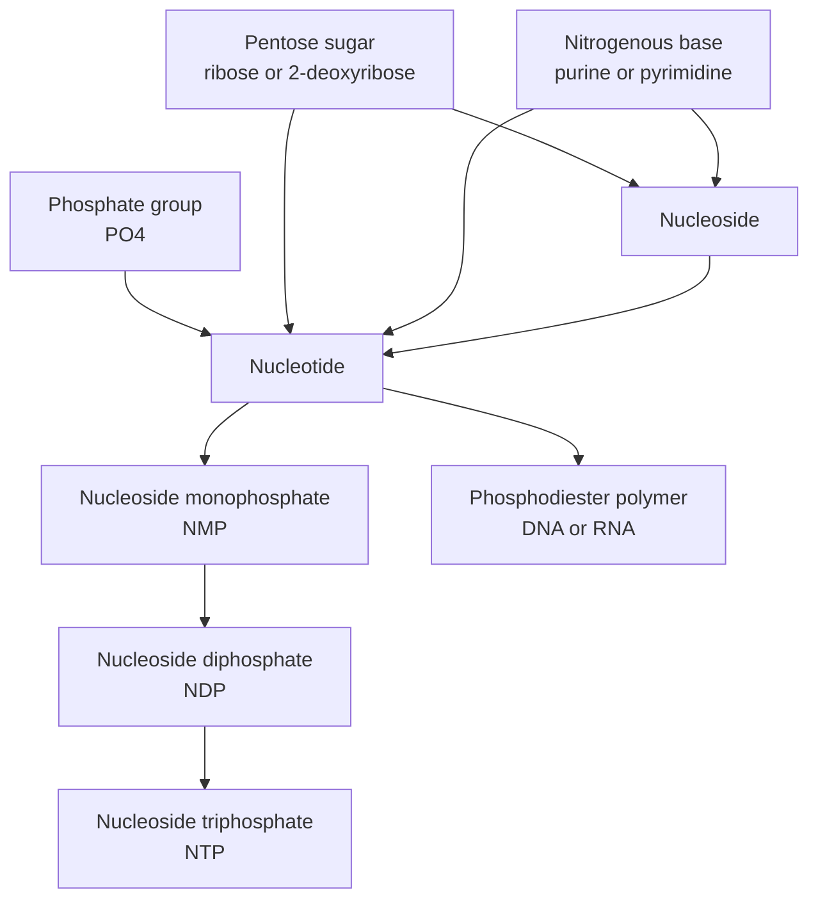
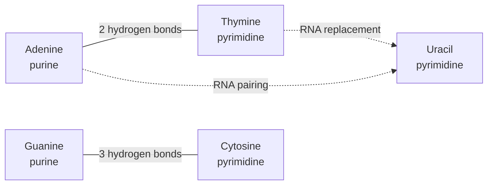
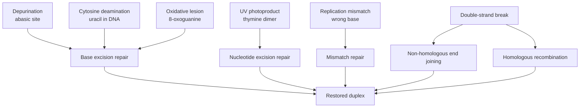

# Chapter 6 — Nucleic Acids and DNA/RNA Chemistry

> **Level:** Advanced (Level 8 — Biochemistry)
> **Estimated study time:** 9 hours (6 h reading + 3 h exercises)
> **Prerequisites:** Chapter 4 of this level (carbohydrate stereochemistry and glycosidic bonds); Level 5 Chapter 2 (heterocyclic nomenclature); Level 3 Chapter 11 (acid–base equilibria and buffers)
> **Difficulty:** ★★★★★ (5/5)
> **Related chapters:** [Metabolism and Bioenergetics](07-metabolism-and-bioenergetics.md), [Molecular Biology and Biochemical Regulation](09-molecular-biology-and-biochemical-regulation.md), [Level 8 index](../README.md)

---

## 1. Learning Objectives

After working through this chapter you will be able to:

- Identify the base, sugar and phosphate components of a nucleotide and distinguish
  a nucleoside from a nucleotide.
- Explain how lactam–lactim and amino–imino tautomerism changes the hydrogen-bonding
  face of a base, and why rare tautomers are mutagenic.
- Explain why the phosphodiester backbone is a polyanion at pH 7 and how that charge
  is screened in cells.
- State the Watson–Crick rules with the correct number and geometry of hydrogen bonds,
  and explain why only purine–pyrimidine pairs fit the helix.
- Compare A-, B- and Z-DNA in handedness, pitch, rise per residue and biological
  context.
- Define denaturation, hyperchromicity and melting temperature, and predict how
  $T_\mathrm{m}$ responds to GC content, salt and length.
- Use the linking-number equation to describe supercoiling and the action of type I
  and type II topoisomerases.
- Account for the chemical instability of RNA in terms of the 2′-hydroxyl group.
- Classify common DNA lesions and match each to its repair pathway.
- Outline the chemistry of Sanger sequencing, next-generation sequencing, PCR and
  CRISPR–Cas9.
- Describe the modifications that turn oligonucleotides and mRNA into drugs.
- Calculate $T_\mathrm{m}$, GC content, nucleic acid concentration and superhelical
  density.

---

## 2. Introduction

A human diploid cell contains about 6.4 billion base pairs of DNA. Unwound, the
molecule would stretch roughly 2 metres, yet it is packed into a nucleus 6 µm across —
a compaction ratio near $3\times10^{5}$. The polymer that achieves this is built from
four deoxyribonucleotides joined by phosphodiester bonds and paired by hydrogen bonds.
Its chemistry is austere: one sugar, one phosphate, four bases, repeated billions of
times. Almost everything molecular biology does with DNA follows from that repetitiveness.

Nucleic acids matter to a chemist for three reasons. They are polyelectrolytes governed
by electrostatics, hydrogen bonding and base stacking; they are chemically reactive in
ways medicine exploits, where one deamination or one photochemical dimer separates a
healthy cell from a tumour; and they are the substrate of an industry, because PCR,
sequencing, CRISPR and mRNA vaccines are chemistry dressed as biology.

This chapter builds the molecule from its parts and follows the consequences into sequencing,
amplification, editing and therapeutics; Chapter [9](09-molecular-biology-and-biochemical-regulation.md)
covers replication and expression, and Chapter [7](07-metabolism-and-bioenergetics.md) the
nucleotide triphosphates and reducing power.

---

## 3. Fundamental Concepts

### 3.1 The three components of a nucleotide

A **nucleotide** is a phosphate ester of a **nucleoside**, and a nucleoside is an
$N$-glycoside of a pentose with a nitrogenous base.

| Component | Chemistry | Role |
|---|---|---|
| Base | Planar aromatic heterocycle, p$K_\mathrm{a}$ 3–10 | Hydrogen-bonding face; stacking surface; information |
| Pentose | Furanose; 2′-OH in RNA, 2′-H in DNA | Sets helix geometry; controls stability |
| Phosphate | Mono-, di- or triphosphate ester | Negative charge; backbone link; transfer potential |

The base is joined to C1′ of the sugar by a **β-$N$-glycosidic bond** — N9 of a purine
or N1 of a pyrimidine. Rotation about this bond gives the **anti** conformation, normal
in B-DNA, or the **syn** conformation, found in Z-DNA and in many protein complexes.
Pyrimidines are numbered N1 to C6; purines add a fused imidazole ring numbered N7, C8,
N9. Sugar positions carry primed numbers, and the phosphate is esterified at O5′.

### 3.2 The bases: purines and pyrimidines

| Base | Class | Formula | Occurrence | p$K_\mathrm{a}$ |
|---|---|---|---|---|
| Adenine | Purine | $\ce{C5H5N5}$ | DNA, RNA | 3.5 (N1) |
| Guanine | Purine | $\ce{C5H5N5O}$ | DNA, RNA | 9.2 (N1) |
| Cytosine | Pyrimidine | $\ce{C4H5N3O}$ | DNA, RNA | 4.2 (N3) |
| Thymine | Pyrimidine | $\ce{C5H6N2O2}$ | DNA | 9.8 (N3) |
| Uracil | Pyrimidine | $\ce{C4H4N2O2}$ | RNA | 9.5 (N3) |

At pH 7.4 all five bases are neutral: their p$K_\mathrm{a}$ values lie far enough from
physiological pH that the hydrogen-bonding face is neither protonated nor depleted, so
the pairing rules hold without acid–base correction.

**Thymine is 5-methyluracil.** The methyl group is chemically almost inert but
biologically decisive: it improves stacking, it allows repair enzymes to distinguish a
deaminated cytosine (uracil) from a legitimate base, and it is the chromophore that
forms cyclobutane dimers under ultraviolet light.

### 3.3 Tautomerism and protonation

Each base exists as several tautomers, and the tautomer determines the hydrogen-bonding
pattern. The dominant forms in water are the lactam (keto) forms of guanine, thymine and
uracil and the amino forms of adenine and cytosine.

$$ \ce{Cyt-NH2 <=> Cyt=NH} \qquad \text{amino} \rightleftharpoons \text{imino} $$

$$ \ce{Thy-HN-C=O <=> Thy-N=C-OH} \qquad \text{lactam} \rightleftharpoons \text{lactim} $$

The keto forms dominate by factors of $10^{3}$ to $10^{5}$, but the rare tautomers are
mutagenic: imino adenine pairs with cytosine rather than thymine, and enol guanine pairs
with thymine rather than cytosine. If a rare tautomer is present when a polymerase reads
the template, the wrong nucleotide is inserted and a transition mutation is fixed. This
is the **tautomeric-shift** mechanism proposed by Watson and Crick in 1953.

### 3.4 Nucleosides and nucleotides

| Name | Components | Example | Role |
|---|---|---|---|
| Nucleoside | Base + sugar | Adenosine | Precursor; signalling molecule |
| Nucleoside monophosphate | Base + sugar + 1 phosphate | AMP | RNA building block |
| Nucleoside triphosphate | Base + sugar + 3 phosphates | ATP | Energy currency; RNA substrate |
| Deoxynucleoside triphosphate | Base + deoxyribose + 3 phosphates | dATP | DNA substrate |

The triphosphates are the activated substrates of polymerases: the 3′-hydroxyl of the
growing chain attacks the α-phosphate of the incoming nucleotide, releasing
pyrophosphate, whose hydrolysis drives the reaction. Nucleotides also serve as energy
carriers (ATP), signalling molecules (cAMP, cGMP) and redox cofactors (NAD⁺, FAD).

### 3.5 The phosphodiester backbone and its charge

Nucleotides are joined by a **phosphodiester** linkage: the phosphate is esterified to
the 5′-hydroxyl of one sugar and the 3′-hydroxyl of the next. The chain therefore has a
**5′ end** and a **3′ end**, and sequences are written 5′ → 3′.

A phosphate monoester has p$K_\mathrm{a}$ values near 1 and 6.5; in a phosphodiester the
second esterification removes the 6.5 ionisation, so at pH 7.4 every internucleotidic
phosphate carries exactly one negative charge and the backbone is a **polyanion**. The
charge makes the polymer water-soluble and extended, and it must be screened for the
duplex to form: Mg²⁺, K⁺, polyamines and histone tails provide counterions in cells.

### 3.6 The Watson–Crick double helix and the base-pairing rules

In 1953 Watson and Crick proposed a right-handed double helix in which adenine pairs
with thymine and guanine with cytosine, with the strands running in opposite directions.
The proposal rested on the X-ray fibre diffraction of Franklin and Wilkins, the 1:1
ratios of A to T and G to C observed by Chargaff, and the hydrogen-bonding geometries of
the free bases.

$$ \ce{A=T} \qquad \text{two hydrogen bonds} $$

$$ \ce{G#C} \qquad \text{three hydrogen bonds} $$

The hash is a typographic shorthand for the triple hydrogen bond, not a bond order, and
is used only in running text. In A=T, the N6 amino group of adenine donates to O4 of
thymine and N1 of adenine accepts from N3 of thymine. In G≡C, O6 of guanine accepts from
N4 of cytosine, N1 of guanine donates to N3 of cytosine, and N2 of guanine donates to O2
of cytosine. Each pair presents a donor and an acceptor in the positions required for the
**Watson–Crick edge** of the bases to meet.

Geometry matters as much as the count. A purine–pyrimidine pair spans about 1.08 nm
between the two C1′ atoms, close to the width of the helix interior; a purine–purine pair
would be too wide and a pyrimidine–pyrimidine pair too narrow. Both glycosidic bonds are
*anti*, so the sugars sit on the same side of the pair and the backbone runs smoothly.
Base pairs stack almost perpendicular to the axis with a rise of 0.34 nm and a twist of
about 34° per pair.

The result is a helix with two grooves of unequal width. The **major groove** exposes N7
and C8 of purines and is read by most sequence-specific proteins; the **minor groove**
exposes N3 of purines and O2 of pyrimidines. The strands are **antiparallel** and
**complementary**, which is what makes semi-conservative replication possible.

### 3.7 A-, B- and Z-DNA

| Property | A-DNA | B-DNA | Z-DNA |
|---|---|---|---|
| Handedness | Right | Right | Left |
| Residues per turn | 11 | 10.5 | 12 |
| Rise per residue / nm | 0.26 | 0.34 | 0.37 |
| Pitch per turn / nm | 2.9 | 3.6 | 4.4 |
| Diameter / nm | 2.3 | 2.0 | 1.8 |
| Sugar pucker | C3′-endo | C2′-endo | C3′-endo and C2′-endo |
| Glycosidic angle | anti | anti | anti and syn |
| Major groove | Narrow, deep | Wide, deep | Flat |
| Context | Dehydrated DNA, RNA duplexes | Physiological DNA | Alternating GC, high salt, negative supercoiling |

**B-DNA** is the form described by the original model and the form present under
physiological conditions; its wide major groove is what most proteins recognise.
**A-DNA** is shorter and fatter, with the pairs displaced from the axis; it forms on
dehydration and in DNA–protein complexes, and it is the conformation of RNA–RNA and
RNA–DNA duplexes because the 2′-hydroxyl enforces C3′-endo puckering. That geometry is
why RNase H recognises an RNA–DNA hybrid rather than a DNA–DNA duplex. **Z-DNA** is
left-handed, with a zig-zag backbone; it requires alternating purine–pyrimidine
sequence, is favoured by high salt and negative supercoiling, and forms behind actively
transcribing polymerases. These are idealisations, not discrete states: A-form and
B-form stretches can coexist in one molecule.

### 3.8 RNA structure and its types

RNA is usually single-stranded but rarely unstructured. Intramolecular complementarity
produces **stem-loops**, **bulges**, **internal loops** and, when two loops pair,
**pseudoknots**. Duplex regions adopt A-form geometry, which makes RNA–RNA helices
shorter and wider than B-DNA and gives them a deep, narrow major groove.

| RNA type | Length | Function |
|---|---|---|
| mRNA | 0.5–10 kb | Carries coding information to the ribosome |
| tRNA | 76–90 nt | Adaptor between codon and amino acid |
| rRNA | 1.5–5 kb | Scaffold and catalytic peptidyl transferase centre |
| miRNA | 21–23 nt | Post-transcriptional repression via RISC |
| lncRNA | > 200 nt | Scaffold, decoy, guide and enhancer functions |
| piRNA | 24–31 nt | Silences transposons in the germ line |

**tRNA** folds into a cloverleaf with four stems and three loops, then into an L-shaped
tertiary structure in which the anticodon loop and the acceptor stem are about 7 nm
apart. Its 3′ end carries the invariant sequence CCA, to which the amino acid is
esterified; modified bases such as inosine and pseudouridine are essential for folding
and codon recognition. **rRNA** is a ribozyme: the peptidyl transferase centre of the
large subunit is built entirely of RNA, with no protein side chain within catalytic
distance, which supports the RNA-world hypothesis.

---

## 4. Detailed Scientific Explanation

### 4.1 Duplex stability, denaturation and melting temperature

Hydrogen bonds provide *specificity*, not most of the *stability*. The main contributions
are base stacking (roughly $-4$ to $-8\ \text{kJ mol}^{-1}$ per pair), hydrogen bonding
(about $-2$ to $-3\ \text{kJ mol}^{-1}$ per pair after desolvation), the hydrophobic
effect of burying aromatic surface, counterion release when the two polyanions approach,
and the conformational pre-organisation of B-DNA, whose C2′-endo pucker and *anti*
glycosidic angle already match the duplex geometry.

Heating separates the duplex into two disordered coils in a cooperative transition.
Absorbance at 260 nm rises by about 37 % (the **hyperchromic effect**), viscosity falls
and optical rotation changes. The **melting temperature** $T_\mathrm{m}$ is the
temperature at which half of the duplex is denatured, and for a two-state transition it
is the temperature at which $\Delta G = 0$:

$$ T_\mathrm{m} = \frac{\Delta H^\circ}{\Delta S^\circ + R\ln\!\left(C_T/4\right)} $$

where $C_T$ is the total strand concentration. The factor 4 applies to two
non-self-complementary strands; for a self-complementary duplex the argument is $C_T$.

Three variables dominate $T_\mathrm{m}$. **GC content** raises it, because G≡C has three
hydrogen bonds and stronger stacking: roughly $0.4\ \text{°C}$ per percentage point of GC
in 0.1 M salt. **Salt** raises it, because cations screen phosphate repulsion; the
dependence is approximately $16.6\log_{10}[\ce{Na+}]$ degrees between 0.05 and 1 M.
**Length** raises it, because the entropy cost of association is spread over more
favourable interactions. The classical empirical relation combines all three:

$$ T_\mathrm{m}/^\circ\text{C} = 81.5 + 16.6\log_{10}[\ce{Na+}] + 0.41(\%\,\text{GC}) - \frac{675}{N} $$

For short oligonucleotides the **Wallace rule** is a useful estimate:

$$ T_\mathrm{m}/^\circ\text{C} \approx 2(A+T) + 4(G+C) $$

It was derived for 14–20-mers at high salt with perfect complementarity and is not a
thermodynamic prediction. The **nearest-neighbour model** is the accurate approach:
duplex stability depends on the ten possible dinucleotide steps (AA/TT, AT/TA, TA/AT,
CA/GT, GT/CA, CT/GA, GA/CT, CG/GC, GC/CG, GG/CC), each with its own $\Delta H^\circ$ and
$\Delta S^\circ$, plus initiation and terminal terms. The SantaLucia unified parameters
tabulate these values and are used by primer-design software. The model assumes a
two-state transition, ignores hairpins and needs an empirical salt correction; for a
20-mer it predicts $T_\mathrm{m}$ to within 1–2 °C, enough for PCR but not enough for
single-nucleotide discrimination without an empirical check.

### 4.2 Supercoiling and topoisomerases

A closed circular DNA cannot change its **linking number** $L_k$ without breaking a
strand. The linking number is the number of times one strand winds around the other, and
it decomposes into twist and writhe:

$$ L_k = T_w + W_r $$

$T_w$ is the number of helical turns and $W_r$ the coiling of the axis. For a relaxed
B-DNA circle of $N$ base pairs, $L_{k,0} = N/10.5$. A molecule with $L_k < L_{k,0}$ is
**negatively supercoiled** — underwound, with the axis coiling to compensate — and one
with $L_k > L_{k,0}$ is positively supercoiled. The **superhelical density** is

$$ \sigma = \frac{\Delta L_k}{L_{k,0}} = \frac{L_k - L_{k,0}}{L_{k,0}} $$

Cellular DNA is maintained at $\sigma \approx -0.05$ to $-0.07$. Negative supercoiling
stores elastic energy that helps open the duplex for transcription and replication, and
it promotes the B-to-Z transition in alternating GC tracts.

**Topoisomerases** change $L_k$. Type I enzymes make a transient single-strand break,
pass the strand through the gap and religate, changing $L_k$ by 1 per cycle without ATP.
Type II enzymes make a double-strand break, pass an intact duplex through it and
religate, changing $L_k$ by 2 per cycle with ATP. Bacterial **DNA gyrase** is a type II
enzyme that actively introduces negative supercoils and is the target of
fluoroquinolones, which trap the cleaved complex. Eukaryotic topo II removes positive
supercoils ahead of replication forks and decatenates daughter circles; etoposide and
doxorubicin trap it. Topoisomerase poisons are effective anticancer drugs precisely
because they convert a transient enzyme intermediate into a persistent double-strand break.

### 4.3 The chemical instability of RNA and why DNA is the archive

RNA and DNA differ by one oxygen atom at C2′, and that atom controls the lifetime of
the polymer. The 2′-hydroxyl is a nucleophile held close to the phosphodiester backbone:
a base or metal-bound hydroxide removes its proton, and the resulting 2′-alkoxide
attacks the adjacent phosphorus. The attack is **in-line**, with an O2′–P–O5′ angle near
180°, which is the geometry required for a pentacoordinate transition state. The
products are a **2′,3′-cyclic phosphate** on the upstream residue and a free 5′-hydroxyl
on the downstream residue; a slower second hydrolysis opens the cyclic phosphate.

$$ \ce{RNA-2'-OH + RNA-3'-O-PO2^{-}-O-5'RNA -> RNA-2',3'-cyclic\ phosphate + RNA-5'-OH} $$

The rate-determining step is deprotonation of the 2′-hydroxyl, whose p$K_\mathrm{a}$ is
about 13. At pH 7 a folded tRNA has a half-life of years; at pH 12 the same molecule is
cleaved within minutes. RNA is kinetically stable at physiological pH but fragile
whenever a base or metal ion can deprotonate the 2′-OH.

DNA has no 2′-hydroxyl and cannot perform the intramolecular attack, so alkaline
hydrolysis is orders of magnitude slower — the basis of the classical experiment in
which KOH digests RNA while leaving DNA intact. Two further differences reinforce the
division of labour. DNA uses **thymine** where RNA uses uracil: cytosine deaminates
spontaneously to uracil, and if DNA contained uracil the repair machinery could not
distinguish a deaminated cytosine from a legitimate base. Thymine's methyl group is the
tag that makes uracil in DNA always a lesion. And DNA is double-stranded, so a lesion on
one strand can be corrected from the intact partner; single-stranded RNA has no such
template.

RNA is therefore the functional molecule and DNA the archive. The 2′-hydroxyl makes RNA
chemically versatile — a nucleophile, a general acid or base, a metal ligand — which is
why the catalytic cores of the ribosome and spliceosome are RNA; the same hydroxyl makes
it unsuitable for long-term storage.

### 4.4 DNA damage, mutation and repair

| Lesion | Agent | Chemical change | Consequence | Repair |
|---|---|---|---|---|
| Abasic site | Hydrolysis, acid | Purine lost | Blocks replication | Base excision |
| Uracil | Cytosine deamination | C4 amino → C4 oxo | C→T transition | Base excision, UNG |
| 8-Oxoguanine | Reactive oxygen species | C8 oxidation | G→T transversion | Base excision, OGG1 |
| Cyclobutane dimer | UV-B, UV-C | Adjacent pyrimidines joined | CC→TT transitions | Nucleotide excision |
| 6-4 Photoproduct | UV-B | C4–C6 covalent link | Helix distortion | Nucleotide excision |
| $O^6$-Methylguanine | Alkylating agents | Methylation at O6 | G→A transition | Direct reversal, MGMT |
| Mismatch | Replication error | Wrong base paired | Transition or transversion | Mismatch repair |
| Double-strand break | Radiation, topo poisons | Backbone cut on both strands | Deletion, translocation | NHEJ or homologous recombination |

**Depurination** is the most frequent single lesion: the $N$-glycosidic bond hydrolyses,
releasing adenine or guanine and leaving an **abasic site**, and a mammalian cell loses
several thousand purines per day. AP endonuclease nicks the backbone 5′ to the site,
polymerase β inserts a base, lyase removes the sugar fragment and ligase III seals the
nick. **Deamination** converts cytosine to uracil, adenine to hypoxanthine, guanine to
xanthine and 5-methylcytosine to thymine. The last reaction makes CpG dinucleotides
mutational hotspots, because the product is a normal base repaired less efficiently than
uracil; about a third of pathogenic human point mutations are C→T transitions at CpG
sites.

**Ultraviolet light** at 254 nm promotes a [2+2] cycloaddition between the C5=C6 bonds of
adjacent pyrimidines, giving a **cyclobutane pyrimidine dimer**; a competing pathway
gives the **6-4 photoproduct**. Both distort the helix and block replication.
**Nucleotide excision repair** removes them: XPC recognises the distortion, TFIIH
unwinds with XPB and XPD, XPF and XPG incise on either side, a 25–30 nt oligonucleotide
is removed and the gap is filled by polymerase δ or ε. Inherited defects cause
xeroderma pigmentosum, with extreme photosensitivity and a thousand-fold increase in
skin cancer risk.

**Oxidative damage** is dominated by **8-oxoguanine**, which favours the *syn*
conformation and pairs with adenine, so replication converts G:C to T:A; OGG1 removes
it by base excision repair and MTH1 hydrolyses 8-oxo-dGTP before incorporation.
**Double-strand breaks** are the most dangerous lesion. Non-homologous end joining
ligates the ends directly, is error-prone and operates throughout the cell cycle;
homologous recombination uses a sister chromatid as template, is error-free and requires
BRCA1, BRCA2 and RAD51. Loss of BRCA function forces cells onto error-prone repair and
creates the vulnerability exploited by PARP inhibitors.

Mutation is the fixation of a lesion as a heritable change. Transitions replace a purine
with a purine or a pyrimidine with a pyrimidine; transversions change the class; indels
not divisible by three produce frameshifts. Replication fidelity is about $10^{-9}$ per
base pair because base selection is followed by proofreading and mismatch repair.

### 4.5 The chemistry of DNA sequencing

**Sanger dideoxy sequencing** (1977) remains the gold standard for accuracy. Its key
reagent is a **2′,3′-dideoxynucleoside triphosphate** (ddNTP), which lacks both the 2′-
and the 3′-hydroxyl groups. Polymerase incorporates a ddNTP using its α-phosphate, but
the resulting chain has no 3′-OH and cannot accept the next nucleotide.

$$ \ce{DNA_n-3'-OH + ddNTP -> DNA_{n+1}-3'-H + PP_i} $$

A reaction contains primer, single-stranded template, all four dNTPs and a small amount
of one ddNTP, or all four ddNTPs each with a different fluorophore. The ddNTP:dNTP ratio
sets the read length. Products are separated by capillary electrophoresis and detected
by laser-induced fluorescence, giving reads of 500–1000 nt at above 99.9 % accuracy,
which is why Sanger sequencing still confirms clinically important variants.

**Next-generation sequencing** replaces electrophoretic separation with spatial
separation and parallel imaging. In the Illumina chemistry, library fragments are
immobilised on a flow cell, amplified clonally by bridge PCR and sequenced by
**sequencing by synthesis**. Each cycle adds one labelled nucleotide carrying a
**reversible 3′-O-blocking group**, images the flow cell, then cleaves both fluorophore
and block before the next cycle. Every cluster incorporates exactly one base per cycle,
so the signal is digital and the read length is set by the number of cycles
(150–300 nt). **Pyrosequencing** detects the pyrophosphate released by polymerisation,
which ATP sulfurylase converts to ATP for luciferase to oxidise luciferin; **ion
semiconductor** sequencing detects the released proton with a field-effect transistor;
**PacBio** observes a single polymerase in a zero-mode waveguide; and **nanopore**
sequencing measures the current blockade as a strand threads through a protein pore,
reading native DNA and RNA with direct detection of methylation.

### 4.6 PCR chemistry

A PCR contains template, two primers flanking the target, the four dNTPs, Mg²⁺ as
cofactor, a buffer at pH 8.3 and a thermostable polymerase. **Denaturation** at 94–98 °C
separates the duplex, **annealing** at 50–65 °C lets the primers hybridise, usually
3–5 °C below their $T_\mathrm{m}$, and **extension** at 72 °C, the optimum for *Thermus
aquaticus* (Taq) polymerase, synthesises the complementary strand at about 1 kb per
minute.

Each cycle doubles the target, so after $n$ cycles

$$ N_n = N_0(1+E)^n $$

where $E$ is the efficiency, typically 0.85–0.95. After 30 cycles a single molecule can
give $10^{9}$ copies. The reaction plateaus when primers or dNTPs are exhausted, when the
polymerase loses activity, or when product reannealing outcompetes primer annealing.
Taq polymerase survives the denaturation step but lacks 3′→5′ exonuclease activity and
misincorporates at about $10^{-4}$ per base; proofreading polymerases (Pfu, Phusion, Q5)
reduce that to $10^{-6}$.

**Quantitative PCR** measures accumulation in real time with an intercalating dye or a
hydrolysis probe. The **threshold cycle** $C_t$ is inversely proportional to the
logarithm of the starting copy number, and relative changes are calculated as
$2^{-\Delta\Delta C_t}$ assuming equal efficiencies. **Digital PCR** partitions the
reaction into droplets and counts positive end-points for absolute quantification.

### 4.7 CRISPR–Cas9 at the chemical level

The type II system from *Streptococcus pyogenes* uses a CRISPR RNA carrying a 20 nt
spacer and a trans-activating crRNA, fused in the laboratory into a single guide RNA.
Cas9 binds a 5′-NGG-3′ protospacer adjacent motif on the non-target strand through its
PAM-interacting domain; no PAM, no binding. The spacer then base-pairs with the target
strand, displacing the non-target strand and forming a 20 bp RNA–DNA hybrid. Pairing
nucleates in the **seed region** proximal to the PAM, so seed mismatches abolish activity
while distal mismatches are tolerated.

R-loop formation triggers a conformational change that positions the HNH and RuvC
nuclease domains on opposite strands. HNH cuts the target strand and RuvC the
non-target strand, each using a Mg²⁺-coordinated active site, producing a **blunt
double-strand break** three base pairs upstream of the PAM. Non-homologous end joining
then rejoins the ends with small insertions or deletions that shift the reading frame and
knock out the gene; homology-directed repair uses a supplied template for a precise
change, at much lower efficiency.

Catalytically dead Cas9 can be fused to activators or repressors; a nickase paired with
cytidine deaminase gives a **base editor** that converts C·G to T·A without a
double-strand break; and a nickase fused to reverse transcriptase with a **prime-editing
guide RNA** writes short insertions and deletions directly.

### 4.8 Nucleic-acid therapeutics and their chemical modifications

**Antisense oligonucleotides** are 18–30 nt single strands that bind a target mRNA. The
**gapmer** architecture has a central 8–10 nt DNA window that recruits RNase H1, flanked
by modified wings that raise affinity and nuclease resistance. Phosphorothioate linkages
(P–O⁻ replaced by P–S⁻) resist exonucleases; 2′-O-methoxyethyl or locked-nucleic-acid
wings raise $T_\mathrm{m}$; 2′-O-methyl and 2′-fluoro groups block the 2′-OH attack.
Nusinersen, used in spinal muscular atrophy, is a 2′-MOE gapmer that redirects SMN2
splicing; eteplirsen is a morpholino oligomer that induces dystrophin exon skipping.

**Small interfering RNAs** are 21–23 nt duplexes with two-nucleotide 3′ overhangs. The
guide strand loads into Argonaute 2, which cleaves the target opposite the middle of the
guide. 2′-O-Methyl and 2′-fluoro modifications reduce immunogenicity without blocking
RISC loading, and conjugation to $N$-acetylgalactosamine delivers the duplex to
hepatocytes through the asialoglycoprotein receptor. Patisiran, inclisiran and givosiran
are approved examples.

**mRNA vaccines** deliver a coding transcript that the cell translates into antigen. The
chemistry is in the modifications: a Cap1 analogue (m⁷GpppNm) for efficient initiation and
reduced innate sensing; optimised untranslated regions; a codon-optimised open reading
frame; **N1-methylpseudouridine** in place of uridine, which suppresses Toll-like
receptor and RIG-I activation and increases translation; and a poly(A) tail of 100–150 nt.
The mRNA is formulated in ionisable lipid nanoparticles that condense the polyanion,
protect it from RNases and release it into the cytosol after endosomal acidification.

Every modification trades a natural chemical feature for a pharmacological one —
stability, affinity, delivery or immune silence — while preserving the Watson–Crick face
that performs the recognition.

---

## 5. Visual Diagrams

**Figure 6.1 — From components to polymer.** The diagram separates the two nested
definitions that students confuse: a nucleoside is base plus sugar, and a nucleotide adds
at least one phosphate. The vertical path through NMP, NDP and NTP converts a building
block into an activated substrate; the horizontal path shows that the polymer is a
phosphodiester chain, not a chain of triphosphates.

**Figure 6.2 — The Watson–Crick pairing rules.** A pairs with T through two hydrogen
bonds and G pairs with C through three; in RNA, uracil replaces thymine and pairs with
adenine through the same two bonds. The count is not decoration: the third bond in G≡C
adds about $1\ \text{kJ mol}^{-1}$ per pair and, with stronger stacking, is why GC-rich
duplexes melt at higher temperature. Uracil is thymine without its 5-methyl group, so
the RNA rule is a substitution, not a new pairing geometry.

**Figure 6.3 — Lesion-to-pathway matching.** Each pathway is specialised for a chemical
lesion: base excision for small, non-distorting damage; nucleotide excision for bulky,
helix-distorting damage; mismatch repair for replication errors; and two double-strand-
break pathways that differ in fidelity. Repair is a division of labour defined by the
chemistry of the lesion.

## 6. Mathematical Formulas

### 6.1 Absorbance, concentration and base composition

$$ A_{260} = \varepsilon\,c\,l $$

| Symbol | Meaning | SI unit |
|---|---|---|
| $A_{260}$ | Absorbance at 260 nm | dimensionless |
| $\varepsilon$ | Molar absorption coefficient | m² mol⁻¹ |
| $c$ | Concentration | mol m⁻³ |
| $l$ | Path length | m |

For routine work, $A_{260} = 1$ in a 1 cm cuvette corresponds to
$50\ \mu\text{g mL}^{-1}$ of double-stranded DNA, $33\ \mu\text{g mL}^{-1}$ of
single-stranded DNA or $40\ \mu\text{g mL}^{-1}$ of RNA.

For double-stranded DNA, Chargaff's rules give $A = T$ and $G = C$, so

$$ f_{\mathrm{GC}} = \frac{G+C}{A+T+G+C} = \frac{G+C}{N} $$

where $N$ is the number of base pairs. For RNA, $A = U$ need not hold, so counts must
be used directly.

### 6.2 Empirical melting temperature

$$ T_\mathrm{m}/^\circ\text{C} = 81.5 + 16.6\log_{10}[\ce{Na+}] + 0.41(\%\,\text{GC}) - \frac{675}{N} $$

with $[\ce{Na+}]$ in mol L⁻¹, GC content in per cent and $N$ in base pairs; valid for
$N > 100$ bp and 0.05–1 M salt. For short primers the Wallace rule replaces it:

$$ T_\mathrm{m}/^\circ\text{C} \approx 4(G+C) + 2(A+T) $$

### 6.3 Thermodynamic melting temperature

$$ T_\mathrm{m} = \frac{\Delta H^\circ}{\Delta S^\circ + R\ln\!\left(C_T/4\right)} $$

| Symbol | Meaning | SI unit |
|---|---|---|
| $\Delta H^\circ$ | Enthalpy of duplex formation | J mol⁻¹ |
| $\Delta S^\circ$ | Entropy of duplex formation | J K⁻¹ mol⁻¹ |
| $R$ | Gas constant | J K⁻¹ mol⁻¹ |
| $C_T$ | Total strand concentration | mol L⁻¹ |
| $T_\mathrm{m}$ | Melting temperature | K |

The factor 4 applies to non-self-complementary strands; for a self-complementary duplex
the argument is $C_T$. Nearest-neighbour construction replaces the enthalpy and entropy
by sums over dinucleotide steps plus initiation terms.

$$ L_k = T_w + W_r, \qquad \sigma = \frac{L_k - L_{k,0}}{L_{k,0}}, \qquad L_{k,0} = \frac{N}{10.5} $$

**Linking number.** All quantities are dimensionless. $L_k$ is an integer for a closed circle and changes
only when a strand is broken.

$$ N_n = N_0(1+E)^n $$

**PCR amplification.** With $N_0$ the initial copy number, $E$ the efficiency per cycle and $n$ the number of
cycles. One $C_t$ unit corresponds to a factor of approximately $1+E$.

---

## 7. Chemical Equations

### 7.1 Phosphodiester formation

$$ \ce{DNA_n-3'-OH(aq) + dNTP^{4-}(aq) -> DNA_{n+1}-3'-O-PO2^{-}(aq) + PP_i^{3-}(aq) + H+(aq)} $$

The reaction is close to thermoneutral and is driven by pyrophosphate hydrolysis:

$$ \ce{PP_i^{3-}(aq) + H2O(l) -> 2 HPO4^{2-}(aq) + H+(aq)} $$

$$
\ce{ATP^{4-}(aq) + H2O(l) -> ADP^{3-}(aq) + HPO4^{2-}(aq) + H+(aq)}
\qquad \Delta G^{\circ\prime} = -30.5\ \text{kJ mol}^{-1}
$$

In cells most ATP is the Mg²⁺ complex, $\ce{MgATP^{2-}}$, so the physiological reaction
also includes magnesium:

$$ \ce{MgATP^{2-}(aq) + H2O(l) -> MgADP^{-}(aq) + HPO4^{2-}(aq) + H+(aq)} $$

$$ \ce{Cyt(aq) + H2O(l) -> Ura(aq) + NH3(aq)} $$

$$ \ce{5mCyt(aq) + H2O(l) -> Thy(aq) + NH3(aq)} $$

Both are hydrolytic deaminations: the C4 amino group becomes a carbonyl oxygen and
ammonia is released. The second is the chemical basis of the CpG mutation hotspot.

### 7.2 Depurination

$$ \ce{DNA-adenine(s) + H2O(l) -> DNA-AP(s) + Ade(aq)} $$

The $N$-glycosidic bond between deoxyribose C1′ and adenine N9 is hydrolysed, leaving an
abasic site; the reaction is acid-catalysed and also occurs with guanine.

### 7.3 Photochemical thymine dimerisation

$$ \ce{2 Thy(s) ->[h\nu] Thy<>Thy(s)} $$

$\ce{Thy<>Thy}$ denotes a cyclobutane ring joining the C5 and C6 atoms of adjacent
thymines. The reaction is a [2+2] photocycloaddition requiring light below about 320 nm.

### 7.4 Alkaline hydrolysis of RNA

$$ \ce{RNA-2'-OH(aq) + OH^{-}(aq) -> RNA-2',3'-cyclic\ phosphate(aq) + RNA-5'-OH(aq) + H2O(l)} $$

The intramolecular version of this reaction is the reason RNA is labile; the cyclic
phosphate is then hydrolysed to a mixture of 2′- and 3′-monophosphates.

### 7.5 Chain termination and Cas9 cleavage

$$ \ce{DNA_n-3'-OH(aq) + ddGTP^{4-}(aq) -> DNA_{n+1}-3'-H(aq) + PP_i^{3-}(aq) + H+(aq)} $$

$$ \ce{DNA(aq) + H2O(l) -> DNA-3'-OH(aq) + DNA-5'-phosphate(aq)} $$

The first equation is Sanger termination; the second is the blunt double-strand break
made by Cas9 three base pairs upstream of the PAM.

---

## 8. Worked Examples

### Worked Example 8.1 — Concentration and copy number from absorbance

**Problem.** A 1:20 dilution of a 1000 bp double-stranded DNA sample gives
$A_{260} = 0.620$ in a 1 cm cuvette. Calculate the mass concentration, the molar
concentration and the number of molecules per microlitre of the original sample.

**Strategy.** Use the double-stranded conversion factor, correct for dilution and divide
by the molar mass; one base pair of sodium salt has a mean molar mass near
$650\ \text{g mol}^{-1}$.

**Solution.**

$$ c_\text{mass} = 0.620 \times 50\ \mu\text{g mL}^{-1} \times 20 = 620\ \mu\text{g mL}^{-1} $$

$$
c = \frac{0.620\ \text{g L}^{-1}}{1000 \times 650\ \text{g mol}^{-1}}
= 9.54\times10^{-7}\ \text{mol L}^{-1}
$$

$$
N_\text{per µL} = 9.54\times10^{-7} \times 10^{-6} \times 6.022\times10^{23}
= 5.75\times10^{11}
$$

**Check.** A concentration near 1 µM and hundreds of billions of molecules per
microlitre are typical of a plasmid preparation. The ratio $A_{260}/A_{280}$ should be
near 1.8; a lower value indicates protein contamination.

### Worked Example 8.2 — GC content from a melting temperature

**Problem.** A 1000 bp DNA sample melts at 85.0 °C in 0.100 M NaCl. Estimate its GC
content.

**Strategy.** Rearrange the empirical relation for $\%\,\text{GC}$.

**Solution.**

$$ 85.0 = 81.5 + 16.6\log_{10}(0.100) + 0.41(\%\,\text{GC}) - \frac{675}{1000} $$

$$
85.0 = 64.225 + 0.41(\%\,\text{GC})
\qquad\Longrightarrow\qquad
\%\,\text{GC} = \frac{20.775}{0.41} = 50.7\,\%
$$

**Check.** A GC content near 51 % is typical of many bacterial genomes, which range from
20 % to 75 %. At 1 M NaCl the same melting temperature would imply a GC content
40 percentage points lower, so the salt concentration must always be stated.

### Worked Example 8.3 — Nearest-neighbour melting temperature and free energy

**Problem.** A 20 bp duplex has $\Delta H^\circ = -450.0\ \text{kJ mol}^{-1}$ and
$\Delta S^\circ = -1200\ \text{J K}^{-1}\text{mol}^{-1}$ at 1 M NaCl, with
$C_T = 2.0\ \mu\text{M}$. Calculate $T_\mathrm{m}$, $\Delta G^\circ$ at 37 °C and
$T_\mathrm{m}$ at 0.050 M NaCl.

**Strategy.** Use the two-state expression, $\Delta G = \Delta H - T\Delta S$ and the
salt correction $16.6\log_{10}[\ce{Na+}]$.

**Solution.**

$$ R\ln(C_T/4) = 8.314\ln(5.0\times10^{-7}) = -120.6\ \text{J K}^{-1}\text{mol}^{-1} $$

$$ T_\mathrm{m} = \frac{-450\,000}{-1200 - 120.6} = 340.8\ \text{K} = 67.6\ ^\circ\text{C} $$

$$ \Delta G^\circ_{310} = -450\,000 - 310.15(-1200) = -77.8\ \text{kJ mol}^{-1} $$

$$
\Delta T_\mathrm{m} = 16.6\log_{10}(0.050) = -21.6\ ^\circ\text{C},
\qquad T_\mathrm{m} \approx 46.0\ ^\circ\text{C}
$$

**Check.** A 20-mer with 60 % GC melting near 68 °C at micromolar concentration is
typical, and the 22 °C fall on lowering salt to 50 mM is why PCR buffers specify their
KCl concentration. The Wallace rule gives 64 °C for 12 G·C and 8 A·T pairs; that
agreement is fortuitous and the nearest-neighbour value is the one to trust.

### Worked Example 8.4 — PCR yield and product mass

**Problem.** A PCR starts with 100 copies of a 200 bp target and runs for 25 cycles at
an efficiency of 0.92. Calculate the number of product molecules and the mass of product.

**Strategy.** Apply $N_n = N_0(1+E)^n$, convert molecules to moles and multiply by the
molar mass of the product.

**Solution.**

$$
N_{25} = 100(1.92)^{25} = 100\,e^{25 \times 0.6523} = 100\,e^{16.31}
= 1.21\times10^{9}
$$

$$
m = \frac{1.21\times10^{9}}{6.022\times10^{23}} \times (200 \times 650)
= 2.6\times10^{-10}\ \text{g} = 0.26\ \text{ng}
$$

**Check.** The product is below the 1–5 ng detection limit of a standard
ethidium-stained gel, so a real reaction would need more cycles or more template. Five
extra cycles multiply the yield by $1.92^{5} \approx 26$, which is why PCR is described
as exponential rather than linear.

---

## 9. Real-World Applications

**Clinical diagnostics.** Quantitative PCR detects viral genomes within hours,
allele-specific PCR distinguishes single-nucleotide variants, and cell-free fetal DNA is
sequenced to screen for trisomies.

**mRNA vaccines.** The COVID-19 vaccines showed that chemically modified mRNA can be
manufactured at scale, formulated in lipid nanoparticles and delivered worldwide; the
platform is now applied to influenza and personalised cancer neoantigens.

---

## 10. Common Mistakes

| Mistake | Why it happens | Correct approach |
|---|---|---|
| Treating ATP as a nucleoside | The names are similar | A nucleoside is base plus sugar; ATP has three phosphates and is a nucleotide |
| Saying A–T has three hydrogen bonds | The pairs are confused | A=T has two; G≡C has three |
| Using GC content as the only predictor of $T_\mathrm{m}$ | The empirical rule is easy to apply | Length, salt and nearest-neighbour stacking also matter |
| Claiming RNA is unstable because it is single-stranded | Single-strandedness is visible | The main cause is attack by the 2′-hydroxyl; single-strandedness prevents template repair but does not cause hydrolysis |
| Assuming DNA is always B-form | The textbook image is B-DNA | A-, B- and Z-forms interconvert with hydration, salt, sequence and protein binding |
| Confusing topoisomerase with helicase | Both act on DNA | Helicase unwinds without breaking strands; topoisomerase breaks and rejoins strands to change $L_k$ |
| Thinking a ddNTP lacks only the 3′-OH | "Dideoxy" is read as "deoxy" | ddNTPs lack both hydroxyls; the 3′-H terminates the chain |
| Expecting PCR to double indefinitely | Exponential growth is the headline | Efficiency falls below 1 and the reaction plateaus |

---

## 11. Chapter Summary

- A nucleotide is a phosphate ester of a nucleoside; base, sugar and phosphate supply
  information, geometry and charge.
- Bases are planar aromatic heterocycles whose tautomers control hydrogen bonding; the
  keto and amino forms dominate at pH 7.
- The phosphodiester backbone carries one negative charge per residue, so nucleic acids
  are polyanions that require counterion screening.
- Watson–Crick pairing is A=T with two hydrogen bonds and G≡C with three, in a geometry
  that keeps the helix width constant.
- Duplex stability comes mainly from stacking; $T_\mathrm{m}$ rises with GC content and
  salt and is predicted accurately only by nearest-neighbour thermodynamics.
- RNA is labile because its 2′-hydroxyl attacks the adjacent phosphate; DNA lacks the
  group and is the archive, while RNA is the functional and catalytic polymer.
- PCR amplifies exponentially, and qPCR converts the threshold cycle into a quantitative
  measure of starting material.

---

## 12. Exercises

### 12.1 Conceptual questions

1. Define nucleoside and nucleotide, and explain why ATP is a nucleotide.
2. Explain, with a mechanism, why RNA is cleaved in 0.1 M NaOH while DNA is not.
3. Give two reasons why G≡C stabilises a duplex more than A=T.

### 12.2 Basic problems

4. A double-stranded DNA sample contains 28 % adenine. Calculate the percentages of
   thymine, guanine and cytosine.
5. Calculate the Wallace-rule melting temperature of 5′-ATGCGTACGTAGCTAGCTAG-3′.
6. Why does a GC-rich primer need a higher annealing temperature than an AT-rich one?

### 12.3 Intermediate problems

7. Explain why every fragment in the ddATP tube of a Sanger reaction ends in adenine but
   the fragments differ in length.
8. A 6300 bp plasmid has $L_k = 590$. Calculate $\Delta L_k$ and $\sigma$, and state
   whether it is negatively or positively supercoiled.

### 12.4 Advanced problems

9. A duplex melts at 68 °C by nearest-neighbour prediction but at 64 °C by the Wallace
   rule. Which value would you use to set a PCR annealing temperature, and why?
10. A heterozygous mutation changes a CpG dinucleotide from 5′-CG-3′ to 5′-TG-3′.
    Explain its chemical origin and why CpG sites are hotspots.

### 12.5 Calculation problems

11. A 1:10 dilution of double-stranded DNA gives $A_{260} = 0.310$ in a 1 cm cuvette.
    The fragment is 500 bp. Calculate the mass and molar concentrations.
12. A PCR starts with 1000 copies and runs for 18 cycles at an efficiency of 0.90.
    Calculate the number of product molecules.

### 12.6 Answers

1. A nucleoside is a base linked to a sugar; a nucleotide adds phosphates. Adenosine is
   adenine plus ribose; ATP is adenosine with three phosphates.
2. The 2′-hydroxyl is deprotonated and attacks the adjacent phosphate in-line, giving a
   2′,3′-cyclic phosphate and a free 5′-hydroxyl; DNA has no 2′-hydroxyl.
3. Three hydrogen bonds rather than two, and more favourable G·C stacking.
4. T = 28 %; G + C = 44 %; G = C = 22 %.
5. Ten G·C and ten A·T pairs give $4(10) + 2(10) = 60\ ^\circ\text{C}$.
6. Higher GC raises $T_\mathrm{m}$, so the primer stays annealed at a higher temperature
   and non-specific binding is avoided.
7. Each fragment terminates when ddATP is incorporated, so the last base is adenine and
   the length is set by the position of that adenine in the template.
8. $L_{k,0} = 600$; $\Delta L_k = -10$; $\sigma = -0.0167$; negatively supercoiled.
9. Use the nearest-neighbour value, which accounts for stacking, initiation and salt;
   set the annealing temperature a few degrees below it and optimise empirically.
10. Cytosine deaminates to uracil; in CpG it is often methylated, and deamination of
    5-methylcytosine gives thymine, a normal base repaired less efficiently, so the C→T
    transition is fixed at high frequency.
11. $c_\text{mass} = 0.310 \times 50 \times 10 = 155\ \mu\text{g mL}^{-1}$;
    $M_r = 3.25\times10^{5}\ \text{g mol}^{-1}$;
    $c = 0.155/3.25\times10^{5} = 4.77\times10^{-7}\ \text{mol L}^{-1}$.
12. $N = 1000(1.90)^{18} = 1.04\times10^{8}$ molecules.

---

## 13. Further Reading

- Watson, J. D.; Crick, F. H. C. "Molecular Structure of Nucleic Acids: A Structure for
  Deoxyribose Nucleic Acid." *Nature* **1953**, *171*, 737–738.
- Berg, J. M.; Tymoczko, J. L.; Gatto, G. J.; Stryer, L. *Biochemistry*, 9th ed.
  Macmillan, 2019. Nucleotides, DNA structure and replication.
- Nelson, D. L.; Cox, M. M. *Lehninger Principles of Biochemistry*, 8th ed. Macmillan,
  2021. Nucleotide metabolism and DNA repair.
- SantaLucia, J.; Hicks, D. "The thermodynamics of DNA structural motifs." *Annual Review
  of Biophysics and Biomolecular Structure* **2004**, *33*, 415–440.
- Sanger, F.; Nicklen, S.; Coulson, A. R. "DNA sequencing with chain-terminating
  inhibitors." *Proceedings of the National Academy of Sciences* **1977**, *74*,
  5463–5467.
- Lindahl, T. "Instability and decay of the primary structure of DNA." *Nature* **1993**,
  *362*, 709–715.
- Jinek, M.; Chylinski, K.; Fonfara, I.; Hauer, M.; Doudna, J. A.; Charpentier, E. "A
  programmable dual-RNA-guided DNA endonuclease in adaptive bacterial immunity."
  *Science* **2012**, *337*, 816–821.
- IUPAC. *Compendium of Chemical Terminology* (the "Gold Book"), 2nd ed. (the "corrected"
  version). <https://goldbook.iupac.org/> Entries for *nucleotide*, *nucleoside* and
  *tautomerism*.
- NIST. *CODATA Internationally Recommended Values of the Fundamental Physical
  Constants*. <https://physics.nist.gov/cuu/Constants/>
