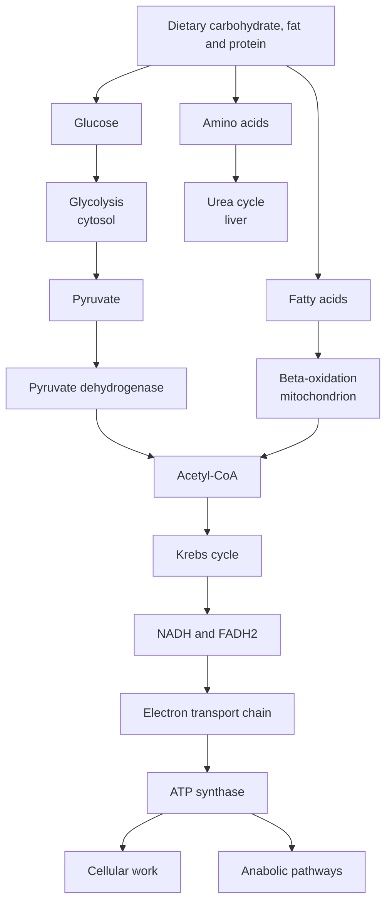
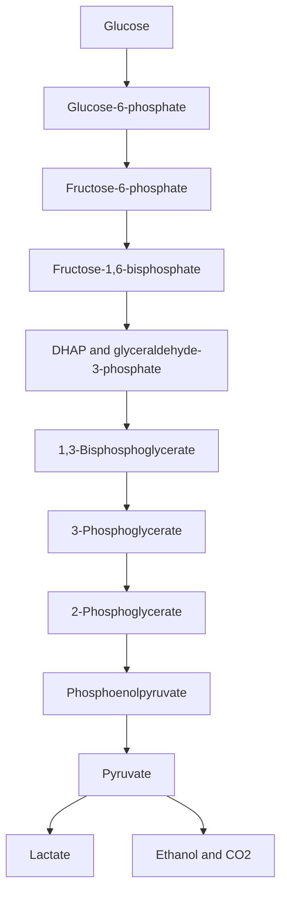
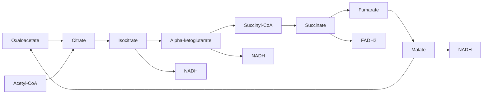
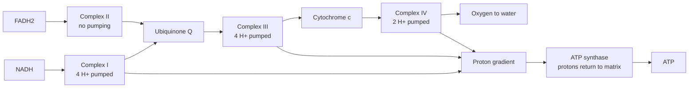

# Chapter 7 — Metabolism and Bioenergetics

> **Level:** Advanced (Level 8 — Biochemistry)
> **Estimated study time:** 12 hours (8 h reading + 4 h exercises)
> **Prerequisites:** [Nucleic Acids and DNA/RNA Chemistry](06-nucleic-acids-and-dna-rna-chemistry.md) for nucleotide chemistry; Level 3 Chapter 8 (thermochemistry); Level 4 Chapter 4 (chemical thermodynamics); Level 5 Chapters 10–11 (carbonyl and carboxylic acid chemistry)
> **Difficulty:** ★★★★★ (5/5)
> **Related chapters:** [Photosynthesis](08-photosynthesis.md), [Molecular Biology and Biochemical Regulation](09-molecular-biology-and-biochemical-regulation.md), [Level 8 index](../README.md)

---

## 1. Learning Objectives

After working through this chapter you will be able to:

- Explain why metabolism requires coupling, and why ATP hydrolysis is exergonic
  without appealing to a "high-energy bond".
- Calculate the phosphorylation potential and the adenylate energy charge.
- Assign standard reduction potentials to the major redox cofactors and convert a
  potential difference into a Gibbs energy change.
- Write all ten glycolytic reactions with their enzymes, cofactors and regulatory
  logic, and state the net yield.
- Describe the pyruvate dehydrogenase complex and the eight reactions of the Krebs
  cycle, including their cofactors and regulation.
- Explain the chemiosmotic theory, the proton stoichiometry of complexes I–IV and the
  mechanism of ATP synthase.
- Calculate P/O ratios from proton accounting and explain why the classical integers
  were replaced by non-integral values.
- Describe gluconeogenesis, the Cori cycle, glycogen metabolism and the pentose
  phosphate pathway.
- Trace fatty acid β-oxidation, ketogenesis and amino acid catabolism into the urea
  cycle.
- Explain how insulin and glucagon coordinate the fed and fasted states.
- Calculate the ATP yield of glucose and palmitate oxidation and the thermodynamic
  efficiency of each.

---

## 2. Introduction

Metabolism is the sum of the chemical reactions that keep a cell alive: several
thousand reactions, most of them reversible, organised into a few dozen pathways that
convert food into energy, building blocks and waste. The chemistry is familiar —
phosphoryl transfer, redox, aldol condensation, decarboxylation, transamination — but
the organisation is not. A living cell runs an enormous network of coupled reactions
far from equilibrium, and it does so at a temperature at which the same reactions in a
flask would be too slow to matter.

Two ideas organise the subject. The first is **coupling**: an unfavourable reaction is
driven by a favourable one, usually ATP hydrolysis or a redox gradient. The second is
**regulation**: flux through a pathway is controlled at a small number of irreversible
steps, so that the cell makes what it needs and stops when it has enough.

---

## 3. Fundamental Concepts

### 3.1 Catabolism, anabolism and coupling

**Catabolism** is the oxidative breakdown of nutrients into smaller molecules, with
the release of free energy and reducing power. **Anabolism** is the reductive synthesis
of cellular components, which consumes free energy and reducing power. The two are
linked by a small set of carriers: ATP for phosphoryl transfer, NADH and FADH₂ for
electrons destined for oxygen, and NADPH for reductive biosynthesis.

A reaction is spontaneous when $\Delta G < 0$. Cells cannot make an unfavourable
reaction spontaneous by wishing it; they couple it to a favourable one, either through
a shared intermediate (as in glycolysis, where ATP hydrolysis and sugar phosphorylation
share the phosphoryl group) or through a shared gradient (as in oxidative
phosphorylation, where proton flow drives ATP synthesis). The overall $\Delta G$ of a
coupled pair is the sum of the individual values, so a reaction with $\Delta G = +20\
\text{kJ mol}^{-1}$ becomes favourable when coupled to ATP hydrolysis at
$-50\ \text{kJ mol}^{-1}$.

Compartmentation is part of the logic. Glycolysis is cytosolic; the Krebs cycle and
β-oxidation are mitochondrial; gluconeogenesis is partly mitochondrial and partly
cytosolic; fatty acid synthesis is cytosolic. Separate pools of NADH and NADPH, and
separate membranes with different permeability, allow opposing pathways to run at the
same time without a futile cycle.

### 3.2 ATP and the phosphoryl-transfer potential

ATP is a nucleotide: adenine, ribose and a triphosphate chain (Chapter 6). Its terminal
phosphoanhydride bond is hydrolysed by water to ADP and inorganic phosphate:

$$ \ce{ATP^{4-}(aq) + H2O(l) -> ADP^{3-}(aq) + HPO4^{2-}(aq) + H+(aq)} $$

The standard transformed free energy at pH 7, 1 mM Mg²⁺, ionic strength 0.25 M and
298 K is $\Delta G^{\circ\prime} = -30.5\ \text{kJ mol}^{-1}$. In the cytoplasm, where
[ATP] greatly exceeds [ADP][P$_i$], the actual free energy is closer to
$-50$ to $-60\ \text{kJ mol}^{-1}$.

The phrase "high-energy bond" is misleading. Breaking a bond costs energy; the
hydrolysis is exergonic because the *products* are more stable than the reactants.
Four factors contribute:

1. **Electrostatic relief.** At pH 7 ATP carries four negative charges, crowded on
   three adjacent phosphate groups. Hydrolysis separates them.
2. **Resonance stabilisation.** Inorganic phosphate has several equivalent resonance
   forms; the terminal phosphoanhydride does not. ADP and P$_i$ together are better
   stabilised than ATP.
3. **Solvation.** The products are solvated more strongly, particularly the smaller
   orthophosphate ion.
4. **Proton release at pH 7.** The reaction releases a proton that is buffered by the
   medium, adding a small but favourable term.

The proper quantity is the **phosphoryl-transfer potential**, the free energy released
when a phosphorylated compound transfers its phosphoryl group to water. It defines a
scale on which ATP sits in the middle:

| Compound | $\Delta G^{\circ\prime}$ / kJ mol⁻¹ | Role |
|---|---|---|
| Phosphoenolpyruvate | $-61.9$ | Glycolysis; phosphorylates ADP |
| 1,3-Bisphosphoglycerate | $-49.4$ | Glycolysis; phosphorylates ADP |
| Creatine phosphate | $-43.1$ | Muscle phosphagen; regenerates ATP |
| ATP → ADP + P$_i$ | $-30.5$ | Universal currency |
| Glucose-6-phosphate | $-13.8$ | Trapped metabolite |
| Glycerol-3-phosphate | $-9.2$ | Lipid intermediate |

Compounds above ATP can phosphorylate ADP directly — that is **substrate-level
phosphorylation**. Compounds below ATP cannot, which is why glucose phosphorylation
requires ATP rather than occurring spontaneously.

### 3.3 Energy charge and the adenylate pool

The adenine nucleotides form a pool whose composition reports the cell's energetic state:

$$
\text{Energy charge} = \frac{[\mathrm{ATP}] + \tfrac{1}{2}[\mathrm{ADP}]}
{[\mathrm{ATP}] + [\mathrm{ADP}] + [\mathrm{AMP}]}
$$

The value lies between 0 (all AMP) and 1 (all ATP). Most cells maintain 0.80–0.95. The
**adenylate kinase** reaction, $\ce{2 ADP <=> ATP + AMP}$, buffers the pool: when ATP
falls, the small rise in AMP is amplified into a strong allosteric signal, because AMP
activates phosphofructokinase-1 and inhibits fructose-1,6-bisphosphatase.

Energy charge is a regulatory index, not a thermodynamic quantity. It correlates with
the direction of flux: low charge favours catabolism and inhibits anabolism; high
charge does the reverse.

### 3.4 Redox cofactors and standard potentials

Oxidation of fuel is the central energy-releasing process. The electrons are carried
by a small set of soluble and membrane-bound cofactors:

| Cofactor | Couple | $E^{\circ\prime}$ / V | Function |
|---|---|---|---|
| NAD⁺/NADH | $\ce{NAD+ + H+ + 2e- -> NADH}$ | $-0.320$ | Catabolic electron carrier |
| NADP⁺/NADPH | $\ce{NADP+ + H+ + 2e- -> NADPH}$ | $-0.324$ | Reductive biosynthesis |
| FAD/FADH₂ | $\ce{FAD + 2H+ + 2e- -> FADH2}$ | $-0.219$ | Bound to dehydrogenases |
| Ubiquinone/QH₂ | $\ce{Q + 2H+ + 2e- -> QH2}$ | $+0.045$ | Mobile carrier in the membrane |
| Cytochrome $b$ | $\ce{cyt\ b(Fe^{3+}) + e- -> cyt\ b(Fe^{2+})}$ | $+0.077$ | Electron transport |
| Cytochrome $c$ | $\ce{cyt\ c(Fe^{3+}) + e- -> cyt\ c(Fe^{2+})}$ | $+0.254$ | Mobile carrier |
| $\ce{O2/H2O}$ | $\ce{1/2 O2 + 2H+ + 2e- -> H2O}$ | $+0.816$ | Terminal acceptor |

The table is ordered by reducing power: NADH is a strong reductant, oxygen a strong
oxidant. The free energy released by transferring two electrons from NADH to oxygen is

$$
\Delta G^{\circ\prime} = -nF\Delta E^{\circ\prime} = -2(96\,485)(0.816 + 0.320)\ \text{J mol}^{-1}
= -219\ \text{kJ mol}^{-1}
$$

That is the thermodynamic driving force for the whole electron transport chain, and it
is enough to pump about ten protons and synthesise roughly 2.5 ATP.

### 3.5 Flux, regulation and the logic of irreversible steps

A pathway running in one direction needs at least one thermodynamically irreversible
step, otherwise it would simply equilibrate. In glycolysis the irreversible steps are
hexokinase, phosphofructokinase-1 and pyruvate kinase; in gluconeogenesis they are
bypassed by pyruvate carboxylase, PEP carboxykinase, fructose-1,6-bisphosphatase and
glucose-6-phosphatase. Regulation is concentrated at these steps because they are the
only ones that can control net flux.

Three mechanisms do the controlling:

- **Allostery.** ATP inhibits phosphofructokinase-1; AMP and fructose-2,6-bisphosphate
  activate it. The response is immediate and reversible.
- **Covalent modification.** Phosphorylation by protein kinases and dephosphorylation
  by phosphatases switch enzymes between active and inactive forms on a timescale of
  seconds to minutes.
- **Hormonal control.** Insulin and glucagon change the concentrations of second
  messengers and transcription of metabolic genes, acting over minutes to hours.

Substrate cycles — pairs of opposing reactions that both consume ATP — seem wasteful
but provide sensitivity: a small change in the activity of either enzyme can reverse
the net flux through the cycle.

---

## 4. Detailed Scientific Explanation

### 4.1 Glycolysis: ten steps from glucose to pyruvate

Glycolysis converts one glucose into two pyruvate molecules in the cytosol, with a net
gain of two ATP and two NADH. It has three phases: investment (steps 1–5), cleavage
(step 4) and payoff (steps 6–10).

| Step | Reaction | Enzyme | Cofactor | Notes |
|---|---|---|---|---|
| 1 | Glucose → glucose-6-phosphate | Hexokinase | ATP | Irreversible; inhibited by G6P |
| 2 | G6P → fructose-6-phosphate | Phosphoglucose isomerase | — | Aldose–ketose isomerisation |
| 3 | F6P → fructose-1,6-bisphosphate | Phosphofructokinase-1 | ATP | Rate-limiting; committed step |
| 4 | F1,6BP → DHAP + GAP | Aldolase | — | Cleavage of a six-carbon sugar |
| 5 | DHAP → GAP | Triose phosphate isomerase | — | Completes the investment phase |
| 6 | GAP → 1,3-bisphosphoglycerate | Glyceraldehyde-3-phosphate dehydrogenase | NAD⁺, P$_i$ | Oxidation and phosphorylation |
| 7 | 1,3BPG → 3-phosphoglycerate | Phosphoglycerate kinase | ADP | Substrate-level phosphorylation |
| 8 | 3PG → 2-phosphoglycerate | Phosphoglycerate mutase | — | Phosphate migration |
| 9 | 2PG → phosphoenolpyruvate | Enolase | — | Dehydration; generates a high-transfer phosphate |
| 10 | PEP → pyruvate | Pyruvate kinase | ADP | Second substrate-level phosphorylation |

The net reaction is

$$
\ce{C6H12O6(aq) + 2 NAD+(aq) + 2 ADP(aq) + 2 HPO4^{2-}(aq) -> 2 C3H3O3^{-}(aq) + 2 NADH(aq) + 2 H+(aq) + 2 ATP(aq) + 2 H2O(l)}
$$

with $\Delta G^{\circ\prime} \approx -85\ \text{kJ mol}^{-1}$. The equation is written
with nucleotide abbreviations; the phosphorylation stoichiometry, two ADP and two
P$_i$ per glucose, is exact.

Regulation is exerted at the three irreversible steps. **Hexokinase** is inhibited by
its product glucose-6-phosphate; the liver isozyme glucokinase has a high $K_M$ and is
not inhibited, which lets the liver take up glucose after a meal. **Phosphofructokinase-
1** is the committed step: ATP and citrate inhibit it, while AMP, ADP and
fructose-2,6-bisphosphate activate it. **Pyruvate kinase** is activated by
fructose-1,6-bisphosphate and inhibited by ATP, alanine and phosphorylation by protein kinase A.

### 4.2 Fermentation

When oxygen is unavailable, NADH cannot be reoxidised by the electron transport chain,
and glycolysis would stop for want of NAD⁺. Fermentation regenerates NAD⁺ by reducing
pyruvate or a derivative of it.

**Lactate fermentation** reduces pyruvate directly:

$$ \ce{CH3COCOO^{-}(aq) + NADH(aq) + H+(aq) -> CH3CH(OH)COO^{-}(aq) + NAD+(aq)} $$

The enzyme is lactate dehydrogenase, and the reaction is reversible; the Cori cycle
uses it to return muscle lactate to the liver.

**Ethanol fermentation** proceeds in two steps. Pyruvate decarboxylase, which requires
thiamine pyrophosphate, converts pyruvate to acetaldehyde and carbon dioxide; alcohol
dehydrogenase then reduces acetaldehyde to ethanol:

$$ \ce{CH3CHO(aq) + NADH(aq) + H+(aq) -> CH3CH2OH(aq) + NAD+(aq)} $$

Fermentation yields only the two ATP of glycolysis per glucose, which is why anaerobic
tissues consume far more glucose for the same energy.

### 4.3 The pyruvate dehydrogenase complex

Pyruvate dehydrogenase links glycolysis to the Krebs cycle by oxidatively
decarboxylating pyruvate to acetyl-CoA:

$$ \ce{CH3COCOO^{-}(aq) + CoA-SH(aq) + NAD+(aq) -> CH3CO-S-CoA(aq) + CO2(g) + NADH(aq)} $$

The reaction is irreversible and commits carbon to oxidation or to fatty acid synthesis.
It is catalysed by a large multienzyme complex with three activities and five cofactors:

| Component | Activity | Cofactor |
|---|---|---|
| E1 | Pyruvate dehydrogenase | Thiamine pyrophosphate, Mg²⁺ |
| E2 | Dihydrolipoyl transacetylase | Lipoamide, coenzyme A |
| E3 | Dihydrolipoyl dehydrogenase | FAD, NAD⁺ |

The mechanism is a relay. E1 decarboxylates pyruvate on TPP, forming
hydroxyethyl-TPP, and transfers the two-carbon unit to the oxidised lipoamide of E2.
E2 transfers it to coenzyme A, forming acetyl-CoA and reduced lipoamide. E3 reoxidises
dihydrolipoamide using FAD, and FADH₂ is reoxidised by NAD⁺. The complex is a
**substrate channel** that keeps reactive intermediates bound and increases the overall
rate by channelling. It is regulated by phosphorylation: PDH kinase inactivates E1 and
phosphatase reactivates it, with acetyl-CoA and NADH activating the kinase.

### 4.4 The Krebs cycle

The Krebs cycle oxidises acetyl-CoA to two carbon dioxide molecules, generating
reducing equivalents and GTP. It has eight steps.

| Step | Reaction | Enzyme | Cofactor | Product |
|---|---|---|---|---|
| 1 | Oxaloacetate + acetyl-CoA → citrate | Citrate synthase | H₂O | Citrate, CoA |
| 2 | Citrate ⇌ isocitrate | Aconitase | Fe–S cluster | Isocitrate |
| 3 | Isocitrate → α-ketoglutarate | Isocitrate dehydrogenase | NAD⁺ | αKG, CO₂, NADH |
| 4 | αKG → succinyl-CoA | αKG dehydrogenase | NAD⁺, CoA | Succinyl-CoA, CO₂, NADH |
| 5 | Succinyl-CoA → succinate | Succinyl-CoA synthetase | GDP, P$_i$ | Succinate, GTP |
| 6 | Succinate → fumarate | Succinate dehydrogenase | FAD | Fumarate, FADH₂ |
| 7 | Fumarate → malate | Fumarase | H₂O | Malate |
| 8 | Malate → oxaloacetate | Malate dehydrogenase | NAD⁺ | OAA, NADH |

The net reaction per turn is

$$
\ce{CH3CO-S-CoA(aq) + 3 NAD+(aq) + FAD(aq) + GDP(aq) + HPO4^{2-}(aq) + 2 H2O(l) -> 2 CO2(g) + 3 NADH(aq) + FADH2(aq) + GTP(aq) + CoA-SH(aq) + 3 H+(aq)}
$$

The cycle is **amphibolic**: it oxidises fuel and supplies precursors. Oxaloacetate is
used for gluconeogenesis, α-ketoglutarate for glutamate, succinyl-CoA for heme and
citrate for fatty acid synthesis. Anaplerotic reactions replenish the pool, the most
important being pyruvate carboxylase, which converts pyruvate to oxaloacetate at the
cost of one ATP.

Regulation occurs at citrate synthase, isocitrate dehydrogenase and αKG dehydrogenase.
ATP, NADH and succinyl-CoA inhibit; ADP and NAD⁺ activate. The cycle is therefore
pulled forward by demand for ATP and pulled back when the mitochondrial NADH/NAD⁺ ratio is high.

### 4.5 Oxidative phosphorylation

The electron transport chain transfers electrons from NADH and FADH₂ to oxygen through
a series of carriers embedded in the inner mitochondrial membrane. The free energy
released is used to pump protons from the matrix to the intermembrane space.

**Complex I** (NADH:ubiquinone oxidoreductase) transfers two electrons from NADH to
ubiquinone and pumps four protons. **Complex II** (succinate dehydrogenase) is the
Krebs-cycle enzyme; it transfers electrons from FADH₂ to ubiquinone but pumps no
protons, which is why FADH₂ yields less ATP. **Complex III** (cytochrome $bc_1$)
oxidises ubiquinol and reduces cytochrome $c$ through the **Q cycle**, pumping four
protons per pair of electrons. **Complex IV** (cytochrome $c$ oxidase) transfers
electrons to oxygen and pumps two protons, consuming two more in the chemistry of water formation.

The proton stoichiometry is therefore ten protons per NADH (four at I, four at III, two
at IV) and six per FADH₂ (four at III, two at IV). The resulting electrochemical
gradient has two components:

$$ \Delta p = \Delta\psi - \frac{2.303RT}{F}\Delta\mathrm{pH} $$

where $\Delta\psi$ is the membrane potential, typically 150–180 mV, and $\Delta$pH is
about 0.5–1 unit. The total proton-motive force is equivalent to about 180–200 mV, or
$-17$ to $-21\ \text{kJ mol}^{-1}$ per proton.

**Chemiosmotic theory**, proposed by Peter Mitchell in 1961, holds that the gradient
itself is the immediate energy store, not a chemical intermediate. The theory was
controversial because no "high-energy" chemical intermediate could be found, and it was
confirmed by the demonstration that a synthetic proton gradient could drive ATP
synthesis in inverted membrane vesicles.

**ATP synthase** is a rotary motor. The $F_0$ sector is a membrane rotor with a ring of
$c$ subunits; proton flow turns the ring, which turns the $\gamma$ subunit inside the
$F_1$ head. The $\gamma$ shaft forces the three catalytic $\beta$ subunits through a
sequence of conformations — loose, tight and open — that bind ADP and P$_i$, form ATP
and release it. The enzyme is a **rotary catalysis** machine, and the number of
protons per ATP is set by the number of $c$ subunits: a ring of 8 (mammals) requires
about 2.7 protons per ATP synthesised, plus one more for phosphate transport, giving
about 3.7 protons per cytosolic ATP.

The **P/O ratio** is the number of ATP molecules made per pair of electrons passed to
oxygen. Dividing the proton count by the proton cost gives about 2.5 for NADH
(10/4) and 1.5 for FADH₂ (6/4) if a $c_{10}$ ring is assumed. The classical values were
integers, 3 and 2, derived from chemical-coupling bookkeeping; they were replaced in the
1970s and 1980s by non-integral values after chemiosmotic accounting and direct
measurement. The exact value depends on the organism, the tissue and the shuttle used,
and modern estimates cluster around 2.4–2.8 for NADH and 1.4–1.7 for FADH₂. The honest
statement is that P/O is a measured, non-integral, condition-dependent quantity.

### 4.6 Gluconeogenesis, the Cori cycle and glycogen

**Gluconeogenesis** synthesises glucose from lactate, glycerol, alanine and other
glucogenic amino acids. It is not glycolysis run backwards: four irreversible steps
must be bypassed.

1. Pyruvate → oxaloacetate, by **pyruvate carboxylase** (biotin, ATP, mitochondria).
2. Oxaloacetate → phosphoenolpyruvate, by **PEP carboxykinase** (GTP).
3. Fructose-1,6-bisphosphate → fructose-6-phosphate, by **fructose-1,6-bisphosphatase**.
4. Glucose-6-phosphate → glucose, by **glucose-6-phosphatase** (liver and kidney only).

The net cost is six high-energy phosphate bonds per glucose: four ATP and two GTP, plus
two NADH. Gluconeogenesis is therefore expensive, which is why it is confined to the
liver and kidney cortex and why it is tightly regulated.

The **Cori cycle** closes the loop between muscle and liver. Muscle converts glucose to
lactate anaerobically and releases it; the liver takes up lactate, oxidises it to
pyruvate and rebuilds glucose, which returns to muscle. The cycle costs the liver six
ATP equivalents per glucose and transfers the metabolic burden from muscle to liver.

**Glycogen** is the storage form of glucose. **Glycogen phosphorylase** cleaves α-1,4
bonds by phosphorolysis, releasing glucose-1-phosphate; the enzyme requires pyridoxal
phosphate as a cofactor. **Debranching enzyme** transfers short oligosaccharides and
hydrolyses the α-1,6 branch points. **Phosphoglucomutase** converts G1P to G6P.
Synthesis uses **UDP-glucose** and **glycogen synthase**, with **branching enzyme**
creating α-1,6 links. Regulation is reciprocal: insulin activates synthase and
inhibits phosphorylase; glucagon and epinephrine, acting through cAMP and protein
kinase A, do the reverse.

### 4.7 The pentose phosphate pathway

The pentose phosphate pathway has two phases. The **oxidative phase** converts
glucose-6-phosphate to ribulose-5-phosphate, producing two NADPH and one CO₂.
Glucose-6-phosphate dehydrogenase is rate-limiting and is inhibited by NADPH. The
**non-oxidative phase** interconverts five-carbon sugars and glycolytic intermediates
through transketolase and transaldolase, both of which require thiamine pyrophosphate.

The pathway supplies NADPH for reductive biosynthesis and for regeneration of reduced
glutathione, and ribose-5-phosphate for nucleotide synthesis. In erythrocytes, the
NADPH produced is essential for glutathione reductase and therefore for protection
against oxidative haemolysis; glucose-6-phosphate dehydrogenase deficiency is the most
common enzyme deficiency in humans.

### 4.8 Fatty acid β-oxidation and ketogenesis

Fatty acids are activated to acyl-CoA at the cost of two ATP equivalents and enter the
mitochondrion through the carnitine shuttle: CPT1 on the outer membrane, the carnitine–
acylcarnitine translocase, and CPT2 on the inner membrane. Each cycle of β-oxidation
removes two carbons through four reactions:

1. **Acyl-CoA dehydrogenase** oxidises the α–β bond to a *trans*-enoyl-CoA, using FAD.
2. **Enoyl-CoA hydratase** adds water across the double bond.
3. **3-Hydroxyacyl-CoA dehydrogenase** oxidises the hydroxyl to a ketone, using NAD⁺.
4. **β-Ketothiolase** cleaves the chain with coenzyme A, releasing acetyl-CoA and a
   shortened acyl-CoA.

One cycle yields one FADH₂, one NADH and one acetyl-CoA. **Palmitate** (C16) gives seven
cycles, eight acetyl-CoA, seven FADH₂ and seven NADH, at a net cost of two ATP for activation.

**Ketogenesis** occurs in the liver when acetyl-CoA exceeds the capacity of the Krebs
cycle. Two acetyl-CoA molecules condense to acetoacetyl-CoA; HMG-CoA synthase adds a
third to form HMG-CoA; HMG-CoA lyase releases acetoacetate and acetyl-CoA. Acetoacetate
is reduced to β-hydroxybutyrate or decarboxylates spontaneously to acetone. Ketone
bodies are exported to tissues, especially the brain, which oxidises them to acetyl-CoA
during fasting. The liver lacks the enzyme needed to use ketone bodies, so it makes them
for export rather than for its own use.

### 4.9 Amino acid catabolism and the urea cycle

Amino acids are deaminated in two steps. **Transamination** transfers the α-amino group
to α-ketoglutarate, forming glutamate, using pyridoxal phosphate as cofactor. **Oxidative
deamination** then releases ammonium from glutamate: glutamate dehydrogenase uses
NAD⁺ or NADP⁺ and produces α-ketoglutarate. The carbon skeletons enter the Krebs cycle
as pyruvate, acetyl-CoA, α-ketoglutarate, succinyl-CoA, fumarate or oxaloacetate, and
are classified as glucogenic or ketogenic accordingly.

Ammonium is toxic, so it is converted to urea in the liver. The **urea cycle** has five steps:

1. Carbamoyl phosphate synthetase I condenses ammonium and bicarbonate at the cost of
   two ATP, activated by N-acetylglutamate.
2. Ornithine transcarbamoylase transfers carbamoyl phosphate to ornithine, forming
   citrulline.
3. Argininosuccinate synthetase condenses citrulline and aspartate, using ATP.
4. Argininosuccinase releases fumarate, leaving arginine.
5. Arginase hydrolyses arginine to urea and ornithine.

$$
\ce{CO2(g) + NH4+(aq) + aspartate(aq) + 3 ATP(aq) + H2O(l) -> urea(aq) + fumarate^{2-}(aq) + 2 ADP(aq) + AMP(aq) + 2 HPO4^{2-}(aq) + PP_i(aq)}
$$

which costs four high-energy bonds, because the AMP produced by argininosuccinate
synthetase must be rephosphorylated at the cost of two ATP equivalents.

### 4.10 Integration by insulin and glucagon

The fed state is dominated by **insulin**. Insulin binds its receptor tyrosine kinase,
recruits phosphoinositide 3-kinase and activates Akt, which promotes translocation of
GLUT4 to the plasma membrane in muscle and adipose tissue. It activates glycogen
synthase by inhibiting glycogen synthase kinase 3, activates acetyl-CoA carboxylase and
fatty acid synthesis, and activates phosphofructokinase-2 to raise
fructose-2,6-bisphosphate, which stimulates glycolysis. It suppresses gluconeogenesis
by repressing PEP carboxykinase and glucose-6-phosphatase.

The fasted state is dominated by **glucagon** (and, in muscle, epinephrine). Glucagon
raises cAMP, activates protein kinase A, and thereby activates glycogen phosphorylase,
inactivates glycogen synthase, stimulates gluconeogenesis and β-oxidation, and promotes
ketogenesis. The liver becomes a glucose-exporting organ; adipose tissue releases fatty
acids; muscle oxidises fatty acids and ketone bodies and spares glucose for the brain.

---

## 5. Visual Diagrams

**Figure 7.1 — The catabolic funnel and its anabolic branches.** Carbohydrate, fat and
protein converge on glucose, pyruvate, acetyl-CoA and the Krebs-cycle acids. Oxidation
reduces NAD⁺ and FAD, and the electron transport chain converts that reducing power into
a proton gradient and then ATP. The return arrows show coupling: the currency paid out by
catabolism is spent by biosynthesis. Compartmentation is omitted for clarity.

**Figure 7.2 — Glycolysis and fermentation.** The upper half invests two ATP to
phosphorylate glucose and fructose-6-phosphate; the lower half recovers four ATP by
substrate-level phosphorylation, for a net gain of two. Hexokinase, phosphofructokinase-1
and pyruvate kinase are the irreversible valves. When oxygen is limiting, pyruvate is
reduced to lactate or to ethanol, regenerating the NAD⁺ that step 6 requires.

**Figure 7.3 — The Krebs cycle.** Acetyl-CoA enters by condensing with oxaloacetate, and
two carbons leave as CO₂. The loop shows that oxaloacetate is regenerated, which is why a
catalytic amount suffices and why intermediates can be withdrawn for biosynthesis and
must be replenished by anaplerotic reactions. Each turn yields three NADH, one FADH₂ and one GTP.

**Figure 7.4 — The electron transport chain and chemiosmosis.** Electrons enter at
complex I from NADH or at complex II from FADH₂, travel through ubiquinone and cytochrome
$c$, and leave at complex IV, reducing oxygen to water. Complexes I, III and IV pump
protons; complex II does not, which is why FADH₂ yields less ATP. ATP synthase lets the
protons return and uses the flow to rotate its catalytic head.

## 6. Mathematical Formulas

### 6.1 Gibbs energy under cellular conditions

$$ \Delta G = \Delta G^{\circ\prime} + RT\ln Q $$

| Symbol | Meaning | SI unit |
|---|---|---|
| $\Delta G$ | Actual Gibbs energy change | J mol⁻¹ |
| $\Delta G^{\circ\prime}$ | Standard transformed Gibbs energy | J mol⁻¹ |
| $R$ | Gas constant, 8.314 | J K⁻¹ mol⁻¹ |
| $T$ | Thermodynamic temperature | K |
| $Q$ | Reaction quotient | dimensionless |

For ATP hydrolysis, $Q = [\mathrm{ADP}][\mathrm{P_i}]/[\mathrm{ATP}]$ at pH 7. The
equation assumes ideal solutions and a single defined standard state; intracellular
activity coefficients and Mg²⁺ binding make the calculated value an estimate.

### 6.2 Energy charge

$$
\text{EC} = \frac{[\mathrm{ATP}] + \tfrac{1}{2}[\mathrm{ADP}]}
{[\mathrm{ATP}] + [\mathrm{ADP}] + [\mathrm{AMP}]}
$$

Energy charge is dimensionless and lies between 0 and 1. The adenylate kinase reaction
$\ce{2 ADP <=> ATP + AMP}$ keeps the pool near 0.9 in healthy cells.

### 6.3 Redox free energy

$$ \Delta G^{\circ\prime} = -nF\Delta E^{\circ\prime} $$

| Symbol | Meaning | SI unit |
|---|---|---|
| $n$ | Number of electrons transferred | dimensionless |
| $F$ | Faraday constant, 96 485 | C mol⁻¹ |
| $\Delta E^{\circ\prime}$ | Difference of standard reduction potentials | V |

The equation converts an electrochemical driving force into a chemical one. A positive
$\Delta E^{\circ\prime}$ gives a negative $\Delta G^{\circ\prime}$ and therefore a
spontaneous electron transfer.

### 6.4 Proton-motive force and P/O ratio

$$
\Delta p = \Delta\psi - \frac{2.303RT}{F}\Delta\mathrm{pH},
\qquad \frac{\mathrm{P}}{\mathrm{O}} = \frac{n_{\mathrm{H^+}}} {n_{\mathrm{H^+}}/\mathrm{ATP}}
$$

$\Delta p$ is in volts; $\Delta\psi$ is the membrane potential and $\Delta$pH the
transmembrane pH difference. The P/O ratio divides the protons pumped per pair of
electrons by the protons required per ATP, including the proton consumed by the phosphate carrier.

### 6.5 ATP yield from a fuel

$$
n_{\mathrm{ATP}} = n_{\mathrm{acetyl\text{-}CoA}} \times 10
+ n_{\mathrm{FADH_2}} \times 1.5 + n_{\mathrm{NADH}} \times 2.5 - n_{\mathrm{activation}}
$$

The coefficients 10, 1.5 and 2.5 follow from the P/O values in Section 4.5: each
acetyl-CoA gives 3 NADH, 1 FADH₂ and 1 GTP, worth $3(2.5) + 1(1.5) + 1 = 10$ ATP.

---

## 7. Chemical Equations

### 7.1 Glycolysis

$$
\ce{C6H12O6(aq) + 2 NAD+(aq) + 2 ADP(aq) + 2 HPO4^{2-}(aq) -> 2 C3H3O3^{-}(aq) + 2 NADH(aq) + 2 H+(aq) + 2 ATP(aq) + 2 H2O(l)}
$$

The equation is balanced in carbon and phosphorus with nucleotide abbreviations; the
net gain is two ATP and two NADH per glucose.

### 7.2 Pyruvate dehydrogenase

$$ \ce{CH3COCOO^{-}(aq) + CoA-SH(aq) + NAD+(aq) -> CH3CO-S-CoA(aq) + CO2(g) + NADH(aq)} $$

### 7.3 Krebs cycle

$$
\ce{CH3CO-S-CoA(aq) + 3 NAD+(aq) + FAD(aq) + GDP(aq) + HPO4^{2-}(aq) + 2 H2O(l) -> 2 CO2(g) + 3 NADH(aq) + FADH2(aq) + GTP(aq) + CoA-SH(aq) + 3 H+(aq)}
$$

### 7.4 Electron transport and ATP synthesis

$$
\ce{NADH(aq) + H+(aq) + 1/2 O2(aq) -> NAD+(aq) + H2O(l)}
\qquad \Delta G^{\circ\prime} = -219\ \text{kJ mol}^{-1}
$$

$$ \ce{ADP^{3-}(aq) + HPO4^{2-}(aq) + n H^+_{out} -> ATP^{4-}(aq) + H2O(l) + n H^+_{in}} $$

### 7.5 β-Oxidation of palmitoyl-CoA

$$
\ce{palmitoyl-CoA(aq) + 7 CoA-SH(aq) + 7 FAD(aq) + 7 NAD+(aq) + 7 H2O(l) -> 8 CH3CO-S-CoA(aq) + 7 FADH2(aq) + 7 NADH(aq) + 7 H+(aq)}
$$

### 7.6 Urea cycle

$$
\ce{CO2(g) + NH4+(aq) + aspartate(aq) + 3 ATP(aq) + H2O(l) -> urea(aq) + fumarate^{2-}(aq) + 2 ADP(aq) + AMP(aq) + 2 HPO4^{2-}(aq) + PP_i(aq)}
$$

The cycle consumes four high-energy bonds, because AMP must be rephosphorylated.

---

## 8. Worked Examples

### Worked Example 8.1 — ATP hydrolysis free energy inside a cell

**Problem.** A hepatocyte contains 3.0 mM ATP, 0.50 mM ADP and 5.0 mM inorganic
phosphate at 298 K. Calculate $\Delta G$ for ATP hydrolysis, taking
$\Delta G^{\circ\prime} = -30.5\ \text{kJ mol}^{-1}$.

**Strategy.** Calculate $Q = [\mathrm{ADP}][\mathrm{P_i}]/[\mathrm{ATP}]$, then apply
$\Delta G = \Delta G^{\circ\prime} + RT\ln Q$.

**Solution.**

$$
Q = \frac{(0.50\times10^{-3})(5.0\times10^{-3})}{3.0\times10^{-3}} = 8.33\times10^{-4}
$$

$$ RT\ln Q = (8.314)(298)(-7.09) = -17.6\ \text{kJ mol}^{-1} $$

$$ \Delta G = -30.5 - 17.6 = -48.1\ \text{kJ mol}^{-1} $$

**Check.** The cellular value is about 60 % larger than the standard value, as expected
because ATP is far from its equilibrium ratio with ADP and P$_i$. A value near
$-50\ \text{kJ mol}^{-1}$ is typical of healthy cytoplasm; in ischaemic tissue, where
ATP falls and ADP rises, the magnitude shrinks and ATP becomes a less effective currency.

### Worked Example 8.2 — ATP yield from glucose oxidation

**Problem.** Calculate the ATP yield from complete oxidation of one glucose molecule
using P/O values of 2.5 for NADH and 1.5 for FADH₂, (a) with the malate–aspartate
shuttle and (b) with the glycerol-3-phosphate shuttle.

**Strategy.** Count the reducing equivalents and substrate-level phosphorylations, then
multiply by the P/O values.

**Solution.** Glycolysis gives 2 ATP and 2 NADH; pyruvate dehydrogenase gives 2 NADH;
the Krebs cycle gives 6 NADH, 2 FADH₂ and 2 GTP.

(a) $2 + 2(2.5) + 2(2.5) + 6(2.5) + 2(1.5) + 2 = 2 + 5 + 5 + 15 + 3 + 2 = 32$ ATP.

(b) The glycerol-3-phosphate shuttle delivers cytosolic NADH as FADH₂, so
$2 + 2(1.5) + 5 + 15 + 3 + 2 = 30$ ATP.

**Check.** The 30–32 range is the modern textbook value. The older integer arithmetic
(3 and 2 per NADH and FADH₂) gave 38, a number still found in older texts. The
difference is not biological variation but a change in the proton accounting used to
convert reducing equivalents into ATP.

### Worked Example 8.3 — ATP yield from palmitate

**Problem.** Calculate the ATP yield from complete oxidation of palmitate (C16:0),
using 2.5 ATP per NADH and 1.5 per FADH₂, and compare the result with the older integer value.

**Strategy.** Seven β-oxidation cycles give 8 acetyl-CoA, 7 FADH₂ and 7 NADH; activation
costs 2 ATP; each acetyl-CoA yields 10 ATP.

**Solution.**

$$
n_{\mathrm{ATP}} = 8(10) + 7(1.5) + 7(2.5) - 2 = 80 + 10.5 + 17.5 - 2 = 106
$$

With the older integers (12 per acetyl-CoA, 2 per FADH₂, 3 per NADH) the same count
gives $8(12) + 7(2) + 7(3) - 2 = 129$.

**Check.** Palmitate yields about 3.3 times as much ATP as glucose on a molar basis,
which is why fat is the denser fuel. Per gram the advantage is smaller — about 2.3
times — because palmitate has a higher molar mass. The 106 value is the modern
consensus; 129 is a historical artefact of integer P/O ratios.

### Worked Example 8.4 — P/O ratio from proton accounting

**Problem.** Complexes I, III and IV pump 4, 4 and 2 protons per NADH respectively. The
ATP synthase $c$-ring of a mammal has 8 subunits and the enzyme makes 3 ATP per full
rotation; one further proton is consumed by the phosphate carrier per ATP. Calculate the
P/O ratio for NADH and for FADH₂.

**Strategy.** Divide the protons pumped by the protons required per cytosolic ATP.

**Solution.** Protons per ATP:

$$ n_{\mathrm{H^+}}/\mathrm{ATP} = \frac{8}{3} + 1 = 3.67 $$

For NADH:

$$ \mathrm{P/O} = \frac{10}{3.67} = 2.73 $$

For FADH₂, which pumps 4 + 2 = 6 protons:

$$ \mathrm{P/O} = \frac{6}{3.67} = 1.63 $$

**Check.** These values sit within the measured ranges of 2.4–2.8 and 1.4–1.7. Using
the simplified $c_{10}$ ring and 4 H⁺ per ATP gives the familiar 2.5 and 1.5. The
difference between 2.5 and 2.73 is not an error in either calculation; it is the reason
P/O ratios are quoted with their assumptions.

---

## 9. Real-World Applications

**Medicine.** Metformin inhibits mitochondrial complex I and lowers hepatic
gluconeogenesis; statins inhibit HMG-CoA reductase; 2,4-dinitrophenol was used as a
weight-loss drug until fatal hyperthermia revealed the danger of uncoupling. Inherited
defects of the electron transport chain cause mitochondrial diseases that present with
muscle weakness, lactic acidosis and neurological decline.

---

## 10. Common Mistakes

| Mistake | Why it happens | Correct approach |
|---|---|---|
| Calling ATP's terminal bond "high-energy" | The phrase is standard shorthand | Hydrolysis is exergonic because the products are stabilised, not because the bond is unusually strong |
| Using $\Delta G^{\circ\prime}$ as the cellular value | The standard value is easier to quote | Cellular concentrations make the actual $\Delta G$ more negative, near $-50\ \text{kJ mol}^{-1}$ |
| Saying glycolysis produces 4 ATP | The gross and net yields are confused | Four ATP are made and two consumed, so the net gain is two |
| Counting FADH₂ as equal to NADH | Both are "reducing equivalents" | FADH₂ enters at complex II, bypassing complex I, so it yields about 1.5 ATP rather than 2.5 |
| Believing P/O ratios are integers | Older textbooks used 3 and 2 | Proton accounting gives non-integral values that depend on the $c$-ring and the shuttle |
| Thinking the Krebs cycle only oxidises fuel | Its name suggests a furnace | It is amphibolic and supplies precursors for biosynthesis |
| Assuming gluconeogenesis is glycolysis reversed | The pathways share most enzymes | Four irreversible steps are bypassed at a cost of six high-energy bonds per glucose |
| Confusing ketogenesis with ketosis | The words are similar | Ketogenesis is hepatic synthesis of ketone bodies; ketosis is their accumulation in blood |

---

## 11. Chapter Summary

- Glycolysis converts glucose to two pyruvate with a net gain of two ATP and two NADH;
  it is regulated at hexokinase, phosphofructokinase-1 and pyruvate kinase.
- The Krebs cycle oxidises acetyl-CoA to two CO₂, producing three NADH, one FADH₂ and
  one GTP per turn.
- Chemiosmotic theory holds that the proton gradient, not a chemical intermediate, is
  the immediate energy store; ATP synthase is a rotary motor driven by proton flow.
- Complexes I, III and IV pump 10 protons per NADH and 6 per FADH₂, giving P/O ratios
  near 2.5 and 1.5 and a glucose yield of 30–32 ATP.
- Gluconeogenesis bypasses four irreversible steps at a cost of six high-energy bonds
  per glucose; the Cori cycle transfers lactate from muscle to liver.

---

## 12. Exercises

### 12.1 Conceptual questions

1. Explain why "high-energy bond" is a misleading description of ATP hydrolysis.
2. Why does FADH₂ yield less ATP than NADH?
3. Why is the Krebs cycle described as amphibolic?

### 12.2 Basic problems

4. A cell contains 3.0 mM ATP, 0.50 mM ADP and 0.10 mM AMP. Calculate its energy charge.
5. Name the three irreversible steps of glycolysis and one allosteric regulator of each.
6. What is the net yield of ATP and NADH from one glucose molecule in glycolysis?

### 12.3 Intermediate problems

7. Explain how an uncoupler such as 2,4-dinitrophenol increases oxygen consumption while
   decreasing ATP synthesis.
8. Why does gluconeogenesis cost six high-energy phosphate bonds per glucose rather than
   the two ATP produced by glycolysis?

### 12.4 Advanced problems

9. Explain why the P/O ratio for NADH is not an integer, and why its value depends on the
   organism.
10. A patient with a defect in carnitine palmitoyltransferase I cannot oxidise long-chain
    fatty acids. Predict the effect on ketone body production during fasting.

### 12.5 Calculation problems

11. Calculate the ATP yield from one molecule of stearate (C18:0), using 2.5 ATP per
    NADH and 1.5 per FADH₂.
12. Calculate $\Delta G$ for ATP hydrolysis at 310 K when [ATP] = 4.0 mM, [ADP] = 0.20 mM
    and [P$_i$] = 2.0 mM.

### 12.6 Answers

1. Breaking a bond requires energy; the reaction is exergonic because ADP and P$_i$ are
   more stable than ATP, through charge relief, resonance, solvation and proton release.
2. FADH₂ transfers electrons at complex II, which pumps no protons, so fewer protons are
   available for ATP synthesis.
3. It oxidises acetyl-CoA and also supplies oxaloacetate, α-ketoglutarate, succinyl-CoA
   and citrate for biosynthesis.
4. $(3.0 + 0.25)/3.6 = 0.90$.
5. Hexokinase, inhibited by glucose-6-phosphate; phosphofructokinase-1, inhibited by ATP
   and citrate and activated by AMP and fructose-2,6-bisphosphate; pyruvate kinase,
   inhibited by ATP and alanine.
6. Two ATP and two NADH per glucose.
7. The uncoupler carries protons across the inner membrane, so the gradient is dissipated
   and ATP synthase has less driving force; electron transport accelerates because the
   back-pressure is relieved, consuming more oxygen.
8. Four irreversible steps must be bypassed: pyruvate carboxylase uses one ATP, PEP
   carboxykinase one GTP, and the two phosphatases hydrolyse phosphate bonds, giving a
   net cost of six high-energy bonds.
9. The ratio depends on the number of $c$ subunits in ATP synthase and on the proton cost
   of phosphate transport, both of which differ between organisms and tissues.
10. β-Oxidation is blocked, so acetyl-CoA and ketone body production fall; fatty acids
    accumulate and the patient may develop hypoketotic hypoglycaemia.
11. Stearate has 18 carbons: 8 β-oxidation cycles give 9 acetyl-CoA, 8 FADH₂ and 8 NADH.
    $9(10) + 8(1.5) + 8(2.5) - 2 = 90 + 12 + 20 - 2 = 120$ ATP.
12. $Q = (0.20\times10^{-3})(2.0\times10^{-3})/(4.0\times10^{-3}) = 1.0\times10^{-4}$;
    $RT\ln Q = (8.314)(310)(-9.21) = -23.7\ \text{kJ mol}^{-1}$;
    $\Delta G = -30.5 - 23.7 = -54.2\ \text{kJ mol}^{-1}$.

---

## 13. Further Reading

- Berg, J. M.; Tymoczko, J. L.; Gatto, G. J.; Stryer, L. *Biochemistry*, 9th ed.
  Macmillan, 2019. The standard treatment of glycolysis, the Krebs cycle and oxidative
  phosphorylation.
- Nelson, D. L.; Cox, M. M. *Lehninger Principles of Biochemistry*, 8th ed. Macmillan,
  2021. More detailed on the thermodynamics and regulation of metabolism.
- Nicholls, D. G.; Ferguson, S. J. *Bioenergetics*, 4th ed. Academic Press, 2013. The
  authoritative account of chemiosmosis, proton circuits and P/O ratios.
- Mitchell, P. "Coupling of Phosphorylation to Electron and Hydrogen Transfer by a
  Chemi-Osmotic Type of Mechanism." *Nature* **1961**, *191*, 144–148. The original
  chemiosmotic proposal.
- NIST. *CODATA Internationally Recommended Values of the Fundamental Physical
  Constants*. <https://physics.nist.gov/cuu/Constants/> Values of $R$ and $F$.
