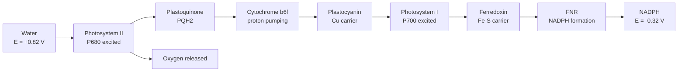
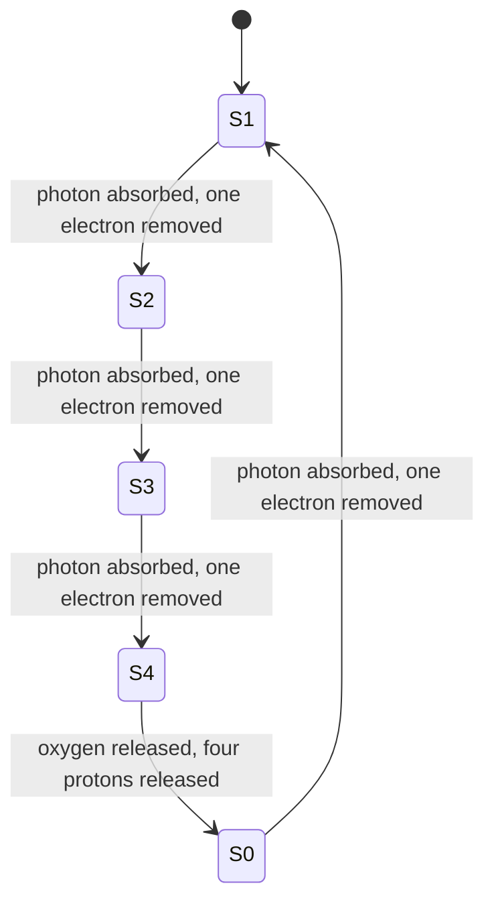
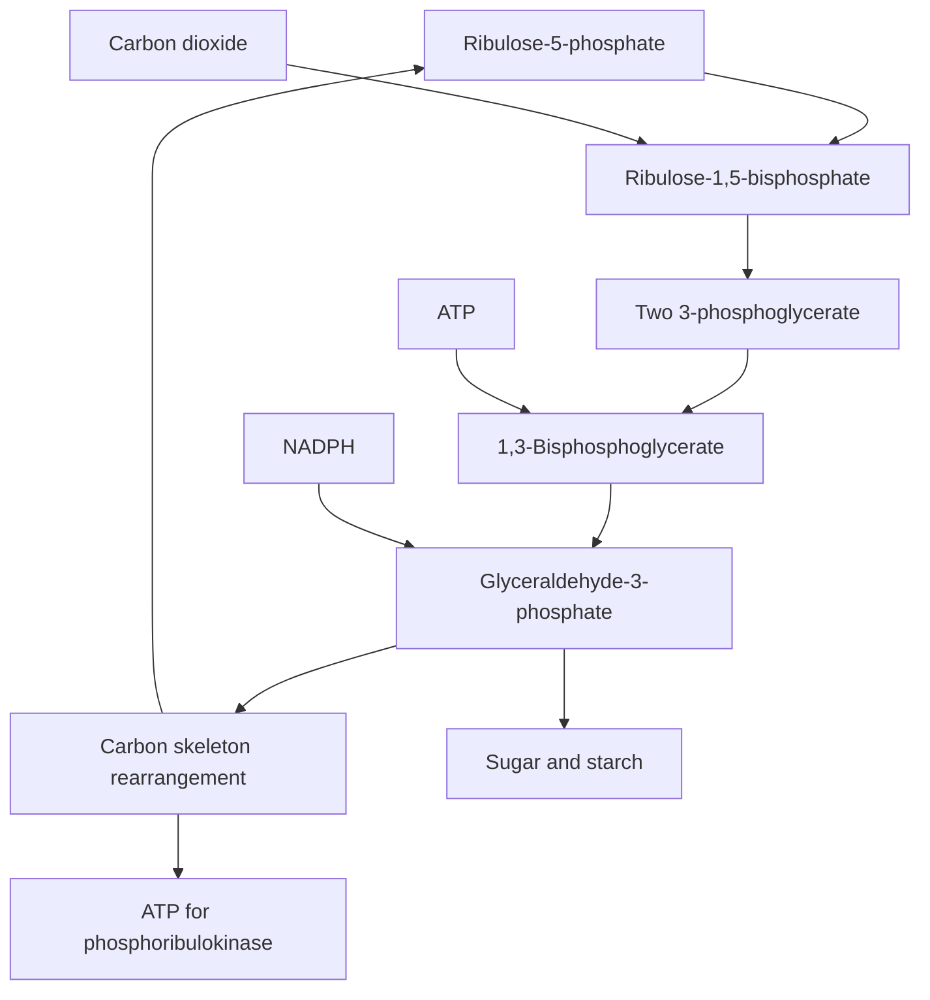
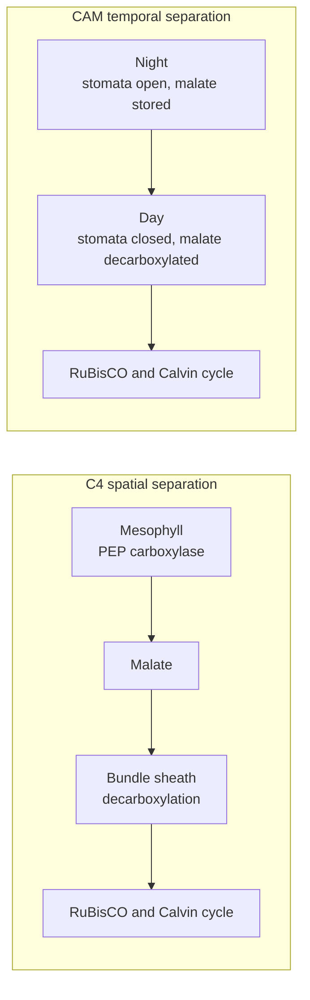

# Chapter 8 — Photosynthesis

> **Level:** Advanced (Level 8 — Biochemistry)
> **Estimated study time:** 7 hours (5 h reading + 2 h exercises)
> **Prerequisites:** [Metabolism and Bioenergetics](07-metabolism-and-bioenergetics.md) (electron transport, chemiosmosis, ATP synthase); Level 4 Chapter 8 (electrochemical cells and redox potentials); Level 5 Chapter 2 (porphyrins and conjugation)
> **Difficulty:** ★★★★★ (5/5)
> **Related chapters:** [Metabolism and Bioenergetics](07-metabolism-and-bioenergetics.md), [Molecular Biology and Biochemical Regulation](09-molecular-biology-and-biochemical-regulation.md), [Level 8 index](../README.md)

---

## 1. Learning Objectives

After working through this chapter you will be able to:

- Write the overall equation of oxygenic photosynthesis and explain it as a
  light-driven redox reaction.
- Calculate the energy of a photon and of a mole of photons at a given wavelength.
- Describe the antenna complex and the mechanism of resonance energy transfer.
- Explain the structure of photosystem II, the Mn₄CaO₅ cluster and the Kok cycle.
- Draw and interpret the Z-scheme, assigning redox potentials to each carrier.
- Distinguish linear from cyclic electron flow and explain why cyclic flow is needed.
- Describe the proton gradient of the thylakoid and its use by ATP synthase.
- Reproduce the Calvin–Benson cycle with its enzymes and its 3 ATP : 2 NADPH
  stoichiometry per CO₂.
- Explain the oxygenase activity of RuBisCO, the photorespiratory pathway and the C4
  and CAM adaptations.
- Relate chlorophyll structure to its absorption spectrum and explain chlorophyll
  fluorescence as a probe of photosystem II.
- Assess artificial photosynthesis and solar fuels against the natural process.
- Calculate quantum requirements, energy efficiencies and pigment concentrations.

---

## 2. Introduction

Photosynthesis is the largest chemical industry on Earth. Globally it fixes about 120
gigatonnes of carbon per year, releases the oxygen in every breath, and supplies the
energy that nearly every food chain runs on. The overall reaction is deceptively simple:

$$ \ce{6 CO2(g) + 6 H2O(l) ->[h\nu] C6H12O6(aq) + 6 O2(g)} $$

The equation hides the difficulty. Carbon dioxide is a fully oxidised, thermodynamically
stable molecule; water is a poor electron donor; and the product, glucose, is a
reduced fuel whose synthesis costs about $2870\ \text{kJ mol}^{-1}$. Photosynthesis
pays that cost with sunlight, and it does so through a chain of pigment–protein
complexes that convert photons into separated charge with a quantum efficiency close to one.

The chemistry is a sequence of redox events. Water is oxidised at a manganese–calcium
cluster to oxygen, releasing electrons that travel through quinones, cytochromes and
iron–sulfur centres to NADP⁺. Those transfers pump protons across the thylakoid membrane,
and the gradient drives ATP synthesis. The resulting ATP and NADPH reduce carbon dioxide
in the Calvin–Benson cycle, chemically the reverse of the oxidative pentose phosphate pathway.

This chapter follows that sequence from photon to sugar. It treats the two photosystems
as enzymes with measured redox potentials, the oxygen-evolving complex as an inorganic
catalyst, and RuBisCO as an imperfect enzyme whose oxygenase side reaction shaped the
evolution of C4 and CAM plants. It ends with fluorescence, the most widely used
non-invasive probe of photosynthesis, and with artificial systems that attempt to
reproduce the same chemistry.

Chapter [7](07-metabolism-and-bioenergetics.md) supplies the chemiosmotic framework and ATP
thermodynamics; this chapter concentrates on light-driven electron transfer.

---

## 3. Fundamental Concepts

### 3.1 The overall redox logic

Photosynthesis transfers electrons from water to carbon dioxide. Water is oxidised:

$$ \ce{2 H2O(l) -> O2(g) + 4 H+(aq) + 4 e-} \qquad E^{\circ\prime} = -0.816\ \text{V} $$

and carbon dioxide is reduced to carbohydrate:

$$ \ce{CO2(g) + 4 H+(aq) + 4 e- -> CH2O(aq) + H2O(l)} \qquad E^{\circ\prime} = -0.43\ \text{V} $$

The empirical formula $\ce{CH2O}$ represents one carbohydrate carbon. The cell must move four
electrons from a donor with a reduction potential of $-0.816\ \text{V}$ to an acceptor
at $-0.43\ \text{V}$, an uphill transfer of about $0.39\ \text{V}$ per electron, or
$+150\ \text{kJ mol}^{-1}$ for four electrons. Light supplies that energy in two
separate boosts, one at each photosystem.

The redox potentials explain the architecture. No single photon of visible light could
bridge the whole gap efficiently, so evolution split the work: photosystem II uses a
very strong oxidant to take electrons from water, and photosystem I uses a very strong
reductant to pass them to NADP⁺. The two photosystems are connected in series, and the
energy-level diagram that results is the **Z-scheme**.

### 3.2 Light as energy

Light is absorbed in discrete quanta. The energy of one photon is

$$ E = \frac{hc}{\lambda} $$

with $h = 6.626\times10^{-34}\ \text{J s}$ and $c = 2.998\times10^{8}\ \text{m s}^{-1}$.
At 680 nm, the red absorption maximum of chlorophyll $a$ in the reaction centre,

$$
E = \frac{(6.626\times10^{-34})(2.998\times10^{8})}{680\times10^{-9}}
= 2.92\times10^{-19}\ \text{J}
$$

which is $176\ \text{kJ mol}^{-1}$. At 430 nm, in the blue, the same calculation gives
$278\ \text{kJ mol}^{-1}$. Blue photons carry more energy, but photosynthesis is not
more efficient in blue light, because the extra energy is dissipated as heat before it
reaches the reaction centre — a point that the action spectrum makes clear.

The relevant quantity for a leaf is the **photon flux density**, measured in
$\mu\text{mol m}^{-2}\text{s}^{-1}$ of photosynthetically active radiation (PAR,
400–700 nm). Full sunlight corresponds to about $2000\ \mu\text{mol m}^{-2}\text{s}^{-1}$;
shade leaves operate at a few tens.

### 3.3 Pigments and the antenna

A photosynthetic antenna is an array of pigment–protein complexes that absorbs light
and funnels excitation energy to a reaction centre. The pigments are chlorophylls and
carotenoids, held at precise distances and orientations by membrane proteins.

**Chlorophyll** is a magnesium porphyrin with a long phytol tail. The conjugated
tetrapyrrole ring absorbs strongly in the blue (Soret band) and red, and the phytol
anchors the molecule in the thylakoid membrane. Chlorophyll $a$ has a methyl group at
C7; chlorophyll $b$ has a formyl group instead, which shifts the absorption maxima to
about 453 and 642 nm and makes it a better absorber in the green–blue region.

**Carotenoids** absorb at 400–500 nm and serve two functions: they extend the range of
light harvested, and they quench triplet chlorophyll and singlet oxygen, protecting
the apparatus from photo-oxidative damage. The xanthophyll cycle — interconversion of
violaxanthin, antheraxanthin and zeaxanthin — dissipates excess excitation as heat.

Energy transfer from antenna to reaction centre occurs by **Förster resonance energy
transfer** (FRET), a non-radiative dipole–dipole process whose rate falls as the sixth
power of the donor–acceptor distance. Because pigments are packed at 1–2 nm, transfer
is fast (sub-picosecond to picosecond) and efficient. The antenna is therefore an
energy funnel: pigments absorbing at shorter wavelengths sit farther from the reaction
centre, so energy flows downhill to the lowest-energy pigment, P680 or P700.

### 3.4 Photosystems and reaction centres

A **photosystem** consists of a reaction-centre complex surrounded by a light-harvesting
antenna. The reaction centre contains a special pair of chlorophyll molecules — P680 in
photosystem II and P700 in photosystem I, named for their absorption maxima — that
donate an electron when excited.

Excitation of the special pair transfers an electron to a nearby acceptor within
picoseconds. The result is a **charge-separated state**: a chlorophyll cation radical
and a reduced acceptor. This is the primary photochemical event, and its quantum yield
is close to 1 because the forward electron transfer is much faster than the competing
fluorescence and heat dissipation.

The charge separation is stabilised by the protein environment, which places electron
donors and acceptors at the right potentials and distances. The protein is not a passive
scaffold; it tunes the redox potentials of the cofactors by several hundred millivolts,
which is why the same chlorophyll molecule can be a strong oxidant in PSII and a strong
reductant in PSI.

### 3.5 The electron carriers

Between the two photosystems, electrons travel through a small set of mobile and
membrane-bound carriers:

| Carrier | Chemistry | Location | Function |
|---|---|---|---|
| Plastoquinone (PQ) | Lipid-soluble quinone | Thylakoid membrane | Two-electron, two-proton carrier; forms PQH₂ |
| Cytochrome $b_6f$ | Heme protein | Membrane complex | Q cycle; proton pumping |
| Plastocyanin (PC) | Copper protein, Cu⁺/Cu²⁺ | Lumen | One-electron carrier to PSI |
| Ferredoxin (Fd) | Iron–sulfur protein | Stroma | One-electron carrier from PSI |
| Ferredoxin–NADP⁺ reductase (FNR) | FAD enzyme | Stroma | Reduces NADP⁺ to NADPH |

Plastoquinone is the analogue of mitochondrial ubiquinone and performs the same
chemistry: it accepts two electrons and two protons to become plastoquinol, and it
releases the protons into the lumen when it is oxidised. Plastocyanin is a blue copper
protein in which the copper switches between Cu⁺ and Cu²⁺; its small size and peripheral
location make it an efficient mobile carrier.

### 3.6 The proton gradient and ATP synthesis

Electron transfer is coupled to proton translocation at three sites: water oxidation
releases protons into the lumen, plastoquinol oxidation releases protons into the
lumen, and the cytochrome $b_6f$ Q cycle contributes additional protons. The result is
a proton concentration in the lumen perhaps 1000-fold higher than in the stroma, a
$\Delta$pH of about 3 units, with a small membrane potential because the stroma and
lumen are both buffered and charge-compensated.

The thylakoid ATP synthase is a rotary enzyme of the same family as the mitochondrial
one, with the $F_1$ head facing the stroma. Protons returning through the $F_0$ channel
drive rotation and ATP synthesis. The chloroplast enzyme has a $c$-ring of 14 subunits
in spinach, so about 4.7 protons are needed per ATP, compared with about 3.7 in
mammalian mitochondria. The difference matters: linear electron flow supplies about
12 protons per pair of electrons, enough for roughly 2.6 ATP, slightly short of the
3 ATP required per 2 NADPH by the Calvin cycle. Cyclic electron flow around
photosystem I makes up the deficit.

### 3.7 Carbon fixation: an overview

The ATP and NADPH produced by the light reactions are consumed in the stroma by the
**Calvin–Benson cycle**, which fixes CO₂ onto a five-carbon sugar, ribulose-1,5-
bisphosphate, and reduces the product to carbohydrate. The cycle has three phases:
carboxylation, reduction and regeneration. Its net equation per CO₂ is

$$
\ce{CO2(g) + 3 ATP(aq) + 2 NADPH(aq) + 2 H2O(l) -> CH2O(aq) + 3 ADP(aq) + 2 NADP+(aq) + 3 HPO4^{2-}(aq) + 3 H+(aq)}
$$

The stoichiometry is the central energetic fact of photosynthesis: three ATP and two
NADPH per carbon fixed, eighteen ATP and twelve NADPH per glucose.

---

## 4. Detailed Scientific Explanation

### 4.1 Photosystem II and the oxygen-evolving complex

Photosystem II is a membrane protein complex with more than twenty subunits. Its
reaction centre, formed by the D1 and D2 proteins, binds P680, a pheophytin acceptor, two
plastoquinone molecules (Q$_A$ and Q$_B$), and the **oxygen-evolving complex** (OEC) on
the lumenal side.

The OEC is a **Mn₄CaO₅** cluster: a cubane-like Mn₃CaO₄ unit with a fourth manganese
attached by oxo bridges, coordinated by carboxylate side chains of D1 and by the
intrinsic protein PsbO. The cluster accumulates oxidising equivalents through five
oxidation states, S₀ to S₄, known as the **Kok cycle**. Each photon absorbed by PSII
produces one electron transfer from P680 to pheophytin, and the resulting P680⁺ is
reduced by a tyrosine residue, Tyr$_Z$, which in turn takes an electron from the
manganese cluster. Four turnovers accumulate four oxidising equivalents and release one
oxygen molecule:

$$ \ce{2 H2O(l) -> O2(g) + 4 H+(aq) + 4 e-} $$

The S₁ state is the dark-stable resting state; S₂ and S₃ are increasingly oxidised;
S₄ is transient and decays to S₀ with release of O₂. The cycle therefore requires four
photons per oxygen molecule, and the four protons released appear in the lumen, where
they contribute to the gradient.

The redox potential of P680⁺ is estimated at $+1.1$ to $+1.3\ \text{V}$, making it the
strongest biological oxidant known. That potential is what allows water — a very poor
electron donor — to be oxidised at ambient temperature. The price is that P680⁺ would
also oxidise nearby proteins, so the reaction centre must repair itself constantly; the
D1 protein is degraded and replaced in the photoinhibition cycle.

### 4.2 The Z-scheme

The **Z-scheme** plots the redox potential of each carrier against the reaction
sequence. Electrons start at water ($+0.82\ \text{V}$ for the O₂/H₂O couple), are
raised by light at PSII to a strong reductant, fall through the carriers to P700, are
raised again at PSI, and finally reduce NADP⁺ at $-0.32\ \text{V}$.

| Step | Redox couple | $E^{\circ\prime}$ / V | Energy source |
|---|---|---|---|
| Water oxidation | $\ce{O2/H2O}$ | $+0.816$ | — |
| PSII excitation | P680*/P680⁺ | $\approx -0.7$ | Photon, 680 nm |
| Primary acceptor | Pheophytin/PQ | $-0.5$ to $-0.3$ | — |
| Cytochrome $b_6f$ | PQH₂/PQ | $+0.045$ to $+0.11$ | — |
| PSI excitation | P700*/P700⁺ | $\approx -1.2$ | Photon, 700 nm |
| Terminal acceptor | NADP⁺/NADPH | $-0.320$ | — |

The two light reactions are connected in series, which is why the scheme is named after
the letter Z: the energy rises at PSII, falls through the cytochrome complex, rises
again at PSI, and falls to NADPH. Each photon raises one electron by roughly 1.8 V at
PSII and 1.7 V at PSI, and the two boosts together are more than enough to bridge the
1.14 V gap between water and NADPH.

### 4.3 Plastoquinone, cytochrome $b_6f$ and plastocyanin

**Plastoquinone** is reduced at the Q$_B$ site of PSII. It accepts two electrons
sequentially, and each reduction is accompanied by proton uptake from the stroma:

$$ \ce{PQ(aq) + 2 e- + 2 H+_{stroma} -> PQH2(aq)} $$

The reduced quinol diffuses through the membrane to the cytochrome $b_6f$ complex,
where it is oxidised at the Q$_o$ site. The complex contains a Rieske iron–sulfur
protein, cytochrome $f$ and two $b$-type hemes. Its **Q cycle** oxidises PQH₂ and
reduces plastocyanin, while transferring protons to the lumen. The overall stoichiometry
is two protons released into the lumen per electron pair passing through the complex,
plus the two protons carried by PQH₂ itself.

**Plastocyanin** accepts one electron from cytochrome $f$ and delivers it to P700⁺ in
photosystem I. The copper centre is coordinated by two histidines, a cysteine and a
methionine in a distorted tetrahedral geometry that keeps the reorganisation energy low
and the electron transfer fast.

### 4.4 Photosystem I and NADPH formation

Photosystem I is a trimeric complex with a reaction centre formed by PsaA and PsaB. Its
special pair, P700, is excited to P700*, a very strong reductant ($\approx -1.2\ \text{V}$)
that transfers an electron through a chain of chlorophyll $a$ (A₀), phylloquinone (A₁),
and three iron–sulfur centres (F$_X$, F$_A$, F$_B$) to ferredoxin. Ferredoxin is a
soluble 2Fe–2S protein that shuttles electrons to ferredoxin–NADP⁺ reductase, an FAD
enzyme that reduces NADP⁺:

$$ \ce{2 Fd_{red}(aq) + NADP+(aq) + H+(aq) -> 2 Fd_{ox}(aq) + NADPH(aq)} $$

The reaction consumes one proton from the stroma, which is part of the reason the
stroma becomes alkaline during illumination. The NADPH produced is used in the Calvin
cycle and in reductive biosynthesis; it is not used for ATP synthesis.

### 4.5 Linear and cyclic electron flow

In **linear electron flow**, electrons travel from water through PSII, the cytochrome
$b_6f$ complex, plastocyanin, PSI, ferredoxin and FNR to NADP⁺. The products are ATP,
NADPH and oxygen. The ATP:NADPH ratio is about 2.6:2, slightly below the 3:2 required
by the Calvin cycle.

In **cyclic electron flow**, electrons from ferredoxin return to the plastoquinone pool
instead of going to NADP⁺, then pass through the cytochrome $b_6f$ complex and
plastocyanin back to PSI. No NADPH is made and no oxygen is evolved, but protons are
still pumped, so the process generates extra ATP. Cyclic flow is essential when the
stromal ATP:NADPH ratio is low, during drought or high light, and it protects PSI from
photoinhibition by keeping the electron acceptors oxidised.

The balance between linear and cyclic flow is regulated by the redox state of the
plastoquinone pool and by the proton gradient itself: a high gradient slows the
cytochrome complex and favours cyclic routing.

### 4.6 The Calvin–Benson cycle

The cycle has three phases and eleven enzymes.

**Carboxylation.** RuBisCO condenses CO₂ with ribulose-1,5-bisphosphate (RuBP, C5) to
give two molecules of 3-phosphoglycerate (3-PGA, C3):

$$ \ce{CO2(g) + ribulose-1,5-bisphosphate(aq) + H2O(l) -> 2 3-phosphoglycerate(aq)} $$

**Reduction.** 3-PGA is phosphorylated by ATP to 1,3-bisphosphoglycerate, then reduced
by NADPH to glyceraldehyde-3-phosphate (GAP), using the same chemistry as glycolysis in reverse:

$$ \ce{3-phosphoglycerate(aq) + ATP(aq) -> 1,3-bisphosphoglycerate(aq) + ADP(aq)} $$

$$ \ce{1,3-bisphosphoglycerate(aq) + NADPH(aq) + H+(aq) -> GAP(aq) + NADP+(aq) + HPO4^{2-}(aq)} $$

**Regeneration.** Five of every six GAP molecules are rearranged to rebuild three RuBP.
Triose phosphate isomerase, aldolase, fructose-1,6-bisphosphatase, transketolase and
ribulose-5-phosphate epimerase and isomerase rearrange the carbon skeleton, and
phosphoribulokinase uses ATP to phosphorylate ribulose-5-phosphate:

$$ \ce{ribulose-5-phosphate(aq) + ATP(aq) -> ribulose-1,5-bisphosphate(aq) + ADP(aq)} $$

Per three CO₂, the cycle consumes nine ATP and six NADPH and produces one GAP; per CO₂,
three ATP and two NADPH. Per glucose, eighteen ATP and twelve NADPH are required.

Regulation is light-dependent. Several Calvin-cycle enzymes — RuBisCO, fructose-1,6-
bisphosphatase, sedoheptulose-1,7-bisphosphatase and phosphoribulokinase — are
activated by thioredoxin, which is reduced by ferredoxin in the light. RuBisCO is also
activated by RuBisCO activase, an ATPase that removes inhibitory sugar phosphates. In
the dark, the enzymes are oxidised and the cycle stops.

### 4.7 The RuBisCO problem and photorespiration

RuBisCO is the most abundant enzyme on Earth and one of the slowest: its catalytic rate
is about 3–10 turnovers per second, compared with thousands for many metabolic enzymes.
It is also not perfectly specific. Oxygen competes with CO₂ at the same active site:

$$ \ce{ribulose-1,5-bisphosphate(aq) + O2(g) -> 3-phosphoglycerate(aq) + 2-phosphoglycolate(aq)} $$

The oxygenase reaction produces one useful 3-PGA and one **2-phosphoglycolate**, which
cannot be used directly. The salvage pathway — photorespiration — spans chloroplast,
peroxisome and mitochondrion: 2-phosphoglycolate phosphatase, glycolate oxidase (which
produces H₂O₂, decomposed by catalase), transamination to glycine, glycine
decarboxylase (which releases CO₂ and NH₃), serine hydroxymethyltransferase, and
hydroxypyruvate reductase to glycerate, which returns to the Calvin cycle as 3-PGA.

Photorespiration consumes ATP and reducing power and releases previously fixed CO₂ and
ammonia. At 25 °C and ambient CO₂, roughly one in four RuBisCO reactions is an
oxygenation, so the loss is substantial. The ratio worsens at higher temperature,
because the solubility of CO₂ falls faster than that of O₂ and because RuBisCO's
specificity for CO₂ relative to O₂ declines.

### 4.8 C4 photosynthesis and CAM

Two evolutionary solutions concentrate CO₂ around RuBisCO.

**C4 photosynthesis** separates the two carboxylations spatially. In mesophyll cells,
phosphoenolpyruvate carboxylase fixes bicarbonate onto PEP to give oxaloacetate, which
is reduced to malate and transported to bundle-sheath cells. There, decarboxylation
releases CO₂ at a concentration ten to twenty times atmospheric, and RuBisCO fixes it
in the normal Calvin cycle. PEP carboxylase has no oxygenase activity and a high
affinity for bicarbonate, so the initial fixation is efficient even at low CO₂. The cost
is five ATP and two NADPH per CO₂ instead of three and two, because PEP must be
regenerated. C4 plants — maize, sugarcane, sorghum — dominate hot, bright environments.

**CAM photosynthesis** separates the two carboxylations in time. At night, stomata open
and PEP carboxylase fixes CO₂ into malate, which is stored in the vacuole. During the
day, stomata close to conserve water, malate is decarboxylated, and the released CO₂ is
fixed by RuBisCO behind closed stomata. CAM plants — cacti, Agave, pineapple — achieve
extremely high water-use efficiency at the cost of slow growth.

| Feature | C3 | C4 | CAM |
|---|---|---|---|
| First carboxylase | RuBisCO | PEP carboxylase | PEP carboxylase |
| CO₂ concentration mechanism | None | Spatial, bundle sheath | Temporal, vacuole |
| ATP per CO₂ | 3 | 5 | 5 |
| Photorespiration | High | Low | Low |
| Typical habitat | Temperate, moist | Hot, bright | Arid |

### 4.9 Chlorophyll fluorescence as a probe

When a chlorophyll molecule absorbs a photon, the excitation can be used for
photochemistry, dissipated as heat, or emitted as fluorescence. The three pathways
compete, so fluorescence reports the fate of excitation. Measuring fluorescence with a
modulated fluorometer gives the minimum yield $F_0$ (all PSII centres open), the maximum
yield $F_m$ (a saturating pulse closes all centres), and the variable fluorescence
$F_v = F_m - F_0$. The ratio

$$ \frac{F_v}{F_m} = \frac{F_m - F_0}{F_m} $$

is the maximum quantum efficiency of photosystem II, about 0.83 in healthy leaves and
lower in stressed plants. The **Kautsky effect** — the slow rise and decline of
fluorescence after illumination — reflects the onset of carbon fixation and of
non-photochemical quenching.

Fluorescence is used in plant phenotyping, in remote sensing of vegetation, in
herbicide testing (PSII inhibitors such as diuron block electron transfer and raise
fluorescence) and in oceanography, where satellite measurements of solar-induced
fluorescence estimate global photosynthesis.

### 4.10 Artificial photosynthesis and solar fuels

Artificial photosynthesis aims to split water or reduce CO₂ using sunlight and
Earth-abundant catalysts. The simplest system is photoelectrochemical: a
semiconductor photoanode absorbs light, oxidises water, and sends electrons to a
cathode where protons are reduced to hydrogen. Titanium dioxide was the first stable
photoanode, but its 3.2 eV band gap absorbs only ultraviolet light; bismuth vanadate,
hematite and tantalum oxynitride extend absorption into the visible.

A more ambitious approach reproduces the Z-scheme with two light absorbers and a redox
mediator, or couples a photovoltaic cell to an electrolyser. The theoretical maximum
efficiency for a single-junction water-splitting cell is about 30 %, but practical
systems reach 10–20 %, and the best tandem devices approach 30 % under concentrated
light. Natural photosynthesis, by comparison, stores about 1 % of incident solar
energy in biomass in crops, and less in most ecosystems.

The comparison is unfair in one respect: natural photosynthesis produces a
self-replicating, self-repairing system from abundant materials, whereas artificial
systems use rare or unstable components and produce a single product. The engineering
target is not to beat the leaf on efficiency but to store solar energy in a dense,
transportable fuel.

---

## 5. Visual Diagrams

**Figure 8.1 — The Z-scheme as a flow of electrons.** The diagram reads from left to
right as the electron path from water to NADPH, with the two light-driven boosts at
photosystem II and photosystem I. The vertical positions in the corresponding
energy-level diagram would rise at each photosystem and fall through the cytochrome
$b_6f$ complex; the flow diagram makes the sequence and the carriers explicit. Water
supplies electrons at a high potential, light lowers their potential twice, and NADPH
leaves at a low potential. The protons released at water oxidation and at plastoquinol
oxidation are the source of the gradient used for ATP synthesis.

**Figure 8.2 — The Kok cycle of the oxygen-evolving complex.** The manganese cluster
advances through five oxidation states as it accumulates four oxidising equivalents. The
S₁ state is stable in the dark, which is why dark-adapted leaves begin at S₁, and oxygen
is released only on the S₃ → S₄ → S₀ transition. Four photons are therefore required per
O₂ molecule, and the four protons released into the lumen contribute to the proton-motive
force. The cycle is the clearest example in biology of a multielectron redox catalyst
built from an inorganic cluster rather than from organic cofactors.

**Figure 8.3 — The Calvin–Benson cycle.** Carbon dioxide enters at the carboxylation of
ribulose-1,5-bisphosphate, and the resulting 3-phosphoglycerate is phosphorylated and
reduced to glyceraldehyde-3-phosphate. Five of every six triose phosphates are
rearranged to regenerate the acceptor, and the sixth is exported as product. The cycle
consumes three ATP and two NADPH per CO₂ fixed; the ATP is used both in the reduction
phase and in the regeneration of ribulose-1,5-bisphosphate. The diagram condenses the
regeneration phase into one node because it involves eight enzymes and several
rearrangements of carbon skeletons.

**Figure 8.4 — Two solutions to the RuBisCO problem.** C4 plants separate the initial
carboxylation from the Calvin cycle in space, using PEP carboxylase in mesophyll cells
and RuBisCO in bundle-sheath cells. CAM plants separate them in time, fixing CO₂ at
night and releasing it behind closed stomata during the day. Both mechanisms raise the
CO₂ concentration around RuBisCO and suppress photorespiration, and both pay for the
concentration step with extra ATP. The trade-off is visible in the ecology: C4 plants
dominate hot, bright habitats, while CAM plants dominate arid ones where water
conservation matters more than growth rate.

## 6. Mathematical Formulas

### 6.1 Photon energy

$$ E = \frac{hc}{\lambda}, \qquad E_\text{mol} = \frac{N_A hc}{\lambda} $$

| Symbol | Meaning | SI unit |
|---|---|---|
| $E$ | Energy of one photon | J |
| $h$ | Planck constant, $6.626\times10^{-34}$ | J s |
| $c$ | Speed of light, $2.998\times10^{8}$ | m s⁻¹ |
| $\lambda$ | Wavelength | m |
| $N_A$ | Avogadro constant, $6.022\times10^{23}$ | mol⁻¹ |
| $E_\text{mol}$ | Energy per mole of photons | J mol⁻¹ |

A mole of 680 nm photons carries $176\ \text{kJ}$, which is the natural unit for
comparing light input with the enthalpy of a chemical product.

### 6.2 Quantum requirement and efficiency

$$
n_\gamma = \frac{8\ \text{photons}}{\text{CO}_2},
\qquad \eta = \frac{\Delta G^\circ_\text{product}/n_{\mathrm{CO_2}}}{n_\gamma E_\text{mol}}
$$

The theoretical minimum is eight photons per CO₂: four electrons must be transferred,
two per photosystem, and each photosystem absorbs one photon per electron. The
efficiency $\eta$ is dimensionless; it compares the free energy stored in carbohydrate
with the energy of the absorbed photons.

### 6.3 Calvin-cycle stoichiometry

$$ \ce{6 CO2 + 18 ATP + 12 NADPH + 12 H2O -> C6H12O6 + 18 ADP + 12 NADP+ + 18 HPO4^{2-} + 18 H+} $$

Per CO₂ the cycle consumes three ATP and two NADPH. The ratio 3:2 is the demand that
linear electron flow almost satisfies and that cyclic flow tops up.

### 6.4 Chlorophyll fluorescence

$$ \frac{F_v}{F_m} = \frac{F_m - F_0}{F_m} $$

$F_0$ is the minimum fluorescence with all PSII centres open, $F_m$ the maximum with all
centres closed by a saturating pulse, and $F_v$ the variable fluorescence. The ratio is
dimensionless and is about 0.83 in healthy leaves.

### 6.5 Chlorophyll determination

In 80 % acetone, with a 1 cm path, the Arnon equations give concentrations in
$\mu\text{g mL}^{-1}$:

$$ c_a = 13.71A_{664} - 2.85A_{647}, \qquad c_b = 22.39A_{647} - 5.10A_{664} $$

The coefficients are empirical and apply only to that solvent and path length. The total
chlorophyll concentration is $c_a + c_b$.

---

## 7. Chemical Equations

### 7.1 Overall photosynthesis

$$
\ce{6 CO2(g) + 12 H2O(l) ->[h\nu] C6H12O6(aq) + 6 O2(g) + 6 H2O(l)}
\qquad \Delta G^{\circ\prime} = +2870\ \text{kJ mol}^{-1}
$$

The equation is written with 12 water molecules on the left and 6 on the right to show
that water is both a reactant and a product; the net consumption is six.

### 7.2 Water oxidation at photosystem II

$$ \ce{2 H2O(l) -> O2(g) + 4 H+(aq) + 4 e-} $$

The reaction occurs at the Mn₄CaO₅ cluster after four photochemical turnovers and
releases four protons into the thylakoid lumen.

### 7.3 Carboxylation by RuBisCO

$$ \ce{CO2(g) + ribulose-1,5-bisphosphate(aq) + H2O(l) -> 2 3-phosphoglycerate(aq)} $$

### 7.4 Oxygenation by RuBisCO

$$ \ce{ribulose-1,5-bisphosphate(aq) + O2(g) -> 3-phosphoglycerate(aq) + 2-phosphoglycolate(aq)} $$

This competing reaction initiates photorespiration and wastes carbon, ATP and reducing power.

### 7.5 Reduction and regeneration in the Calvin cycle

$$ \ce{3-phosphoglycerate(aq) + ATP(aq) -> 1,3-bisphosphoglycerate(aq) + ADP(aq)} $$

$$
\ce{1,3-bisphosphoglycerate(aq) + NADPH(aq) + H+(aq) -> glyceraldehyde-3-phosphate(aq) + NADP+(aq) + HPO4^{2-}(aq)}
$$

### 7.6 NADPH formation

$$ \ce{2 Fd_{red}(aq) + NADP+(aq) + H+(aq) -> 2 Fd_{ox}(aq) + NADPH(aq)} $$

Ferredoxin–NADP⁺ reductase catalyses the reaction at the stromal side of photosystem I.

### 7.7 ATP synthesis in the chloroplast

$$ \ce{ADP^{3-}(aq) + HPO4^{2-}(aq) + n H^+_{lumen} -> ATP^{4-}(aq) + H2O(l) + n H^+_{stroma}} $$

The chloroplast ATP synthase uses about 4.7 protons per ATP, because its $c$-ring has 14 subunits.

---

## 8. Worked Examples

### Worked Example 8.1 — Energy of a mole of red photons

**Problem.** Calculate the energy of one photon and of one mole of photons at 680 nm.

**Strategy.** Use $E = hc/\lambda$ and multiply by Avogadro's number.

**Solution.**

$$
E = \frac{(6.626\times10^{-34})(2.998\times10^{8})}{680\times10^{-9}}
= 2.92\times10^{-19}\ \text{J}
$$

$$
E_\text{mol} = (2.92\times10^{-19})(6.022\times10^{23})
= 1.76\times10^{5}\ \text{J mol}^{-1} = 176\ \text{kJ mol}^{-1}
$$

**Check.** A mole of 680 nm photons carries 176 kJ, enough to hydrolyse about six moles
of ATP at the standard free energy of $-30.5\ \text{kJ mol}^{-1}$. Photosynthesis needs
eight such photons per CO₂, so the light input is 1.4 MJ per mole of CO₂, against
478 kJ stored — an upper bound on efficiency of about one third.

### Worked Example 8.2 — Quantum requirement and thermodynamic efficiency

**Problem.** Using eight photons of 680 nm per CO₂ and a standard free energy of
$+2870\ \text{kJ mol}^{-1}$ for glucose, calculate the thermodynamic efficiency of
photosynthesis.

**Strategy.** Compute the light energy per CO₂, then divide the free energy stored per
CO₂ by that input.

**Solution.**

$$ E_\text{light per CO}_2 = 8 \times 176 = 1408\ \text{kJ mol}^{-1} $$

$$ \Delta G_\text{per CO}_2 = \frac{2870}{6} = 478\ \text{kJ mol}^{-1} $$

$$ \eta = \frac{478}{1408} = 0.34 $$

**Check.** A maximum thermodynamic efficiency of 34 % at 680 nm is a useful benchmark.
The actual efficiency of a crop is far lower — about 1 % of incident sunlight over a
season — because of reflection, transmission, photorespiration, respiration and the
energetic cost of making the plant. The calculation therefore bounds the process rather
than describing a field.

### Worked Example 8.3 — ATP and NADPH per glucose

**Problem.** Verify that the Calvin cycle requires 18 ATP and 12 NADPH per glucose, and
express the cost in ATP equivalents using 2.5 ATP per NADPH.

**Strategy.** Multiply the per-CO₂ requirement by six, then convert NADPH to ATP
equivalents.

**Solution.**

$$ n_\mathrm{ATP} = 6 \times 3 = 18, \qquad n_\mathrm{NADPH} = 6 \times 2 = 12 $$

$$ n_\text{ATP equivalents} = 18 + 12(2.5) = 48 $$

$$ \Delta G_\text{cost} = 48 \times 30.5 = 1464\ \text{kJ mol}^{-1} $$

**Check.** The cost is about half of the 2870 kJ released by glucose combustion, which
is the thermodynamic price of building an ordered molecule from CO₂. The remaining
energy is lost in the many steps of the cycle and in the light reactions. The 3:2 ratio
of ATP to NADPH is the reason cyclic electron flow exists: linear flow alone supplies
slightly too little ATP.

### Worked Example 8.4 — Chlorophyll concentration from absorbance

**Problem.** An 80 % acetone extract gives $A_{664} = 0.52$ and $A_{647} = 0.21$ in a
1 cm cuvette. Calculate the chlorophyll $a$, chlorophyll $b$ and total chlorophyll concentrations.

**Strategy.** Apply the Arnon equations for 80 % acetone.

**Solution.**

$$ c_a = 13.71(0.52) - 2.85(0.21) = 7.13 - 0.60 = 6.53\ \mu\text{g mL}^{-1} $$

$$ c_b = 22.39(0.21) - 5.10(0.52) = 4.70 - 2.65 = 2.05\ \mu\text{g mL}^{-1} $$

$$ c_\text{total} = 6.53 + 2.05 = 8.58\ \mu\text{g mL}^{-1} $$

**Check.** The chlorophyll $a$:$b$ ratio is about 3.2, typical of a sun leaf; shade
leaves have a lower ratio because they invest more in the accessory pigment that
absorbs the wavelengths available in shade. The values are in the expected range for a
dilute leaf extract, and the total is consistent with the absorbance sum.

### Worked Example 8.5 — Efficiency of a leaf from gas exchange

**Problem.** A leaf of area $10\ \text{cm}^{2}$ fixes CO₂ at
$12\ \mu\text{mol m}^{-2}\text{s}^{-1}$ under a PAR irradiance of
$400\ \text{W m}^{-2}$. Estimate the solar-energy conversion efficiency.

**Strategy.** Convert the CO₂ fixation rate to stored power using 478 kJ per mole of
CO₂, then divide by the incident irradiance.

**Solution.**

$$
P_\text{stored} = (12\times10^{-6}\ \text{mol m}^{-2}\text{s}^{-1})
(478\times10^{3}\ \text{J mol}^{-1}) = 5.74\ \text{W m}^{-2}
$$

$$ \eta = \frac{5.74}{400} = 0.014 = 1.4\,\% $$

**Check.** About 1.4 % is a realistic instantaneous efficiency for a C3 crop leaf under
moderate light, and it falls when photorespiration and respiration are included. The
value is far below the 34 % thermodynamic bound because most absorbed light is not at
the red absorption maximum, and because the plant dissipates excess excitation as heat
to protect photosystem II.

---

## 9. Real-World Applications

**Food and agriculture.** Crop yield is limited by the efficiency of photosynthesis.
Engineering RuBisCO, introducing C4 traits into C3 crops, and optimising canopy
architecture are active research programmes. The Haber–Bosch process supplies the
nitrogen that lets crops convert more light into protein, which is why the Green
Revolution depended on fertiliser as much as on genetics.

**Carbon accounting.** Satellite measurements of solar-induced chlorophyll fluorescence
estimate gross primary production from space. The same fluorescence signal is used to
detect drought stress before visible wilting, because PSII efficiency falls early.

**Bioenergy and solar fuels.** Bioethanol from sugarcane and maize, biodiesel from oil
crops, and algal hydrogen production all rely on photosynthetic electron transport.
Artificial photosynthetic cells that split water or reduce CO₂ are being developed as a
route to carbon-neutral fuels.

---

## 10. Common Mistakes

| Mistake | Why it happens | Correct approach |
|---|---|---|
| Saying photosynthesis "produces oxygen from CO₂" | The overall equation is misread | Oxygen comes from water; CO₂ supplies carbon and oxygen for carbohydrate |
| Treating the two photosystems as independent | Both are drawn as light-driven pumps | They operate in series, and the Z-scheme connects them through the cytochrome $b_6f$ complex |
| Believing cyclic flow makes NADPH | Cyclic flow does involve photosystem I | It makes ATP only; electrons return to the plastoquinone pool instead of reducing NADP⁺ |
| Thinking RuBisCO is perfectly specific | The carboxylation reaction is the only one taught | Oxygen competes at the same site, producing 2-phosphoglycolate and driving photorespiration |
| Assuming C4 plants are always more productive | C4 is described as an improvement | C4 costs extra ATP and is favoured mainly in hot, bright, potentially dry habitats |
| Believing photosynthesis is efficient | The quantum yield is high | Quantum yield per absorbed photon is high, but whole-plant conversion of sunlight is about 1 % |

---

## 11. Chapter Summary

- Photosynthesis transfers four electrons from water to CO₂, driven by two
  light-dependent charge separations in series.
- A 680 nm photon carries 176 kJ mol⁻¹; eight photons per CO₂ give a thermodynamic
  maximum efficiency near 34 %.
- Antenna pigments absorb light and funnel excitation to reaction centres by
  Förster resonance energy transfer.
- Photosystem II oxidises water at the Mn₄CaO₅ cluster through the five-state Kok
  cycle, releasing O₂ and four protons per turnover.
- The Z-scheme connects P680 and P700 through plastoquinone, cytochrome $b_6f$ and
  plastocyanin; photosystem I reduces ferredoxin and then NADP⁺.
- Linear electron flow makes ATP and NADPH; cyclic flow makes extra ATP and no NADPH,
  balancing the 3:2 demand of the Calvin cycle.
- The Calvin–Benson cycle fixes CO₂ onto ribulose-1,5-bisphosphate and consumes three
  ATP and two NADPH per carbon.
- RuBisCO also catalyses an oxygenase reaction, and photorespiration wastes carbon;
  C4 and CAM plants concentrate CO₂ to suppress it.
- Chlorophyll fluorescence reports the competition between photochemistry, heat and
  emission, and $F_v/F_m$ is a standard stress index.
- Artificial photosynthesis aims to split water or reduce CO₂ with sunlight, but
  practical efficiencies remain below the thermodynamic limit.

---

## 12. Exercises

### 12.1 Conceptual questions

1. Why is water, rather than an organic molecule, the electron donor in oxygenic
   photosynthesis?
2. Explain the roles of P680⁺ and P700* in the Z-scheme.
3. Why does cyclic electron flow exist when linear flow already produces ATP?

### 12.2 Basic problems

4. List the five oxidation states of the Kok cycle and state at which transition oxygen
   is released.
5. Name the mobile carriers between photosystem II and photosystem I and between
   photosystem I and NADP⁺.
6. Why does photorespiration increase at higher temperature?

### 12.3 Intermediate problems

7. Explain why a C4 plant spends five ATP per CO₂ while a C3 plant spends three, and why
   the extra cost can still be an advantage.
8. A leaf has $F_0 = 0.32$ and $F_m = 1.86$. Calculate $F_v/F_m$ and comment on the
   value.

### 12.4 Advanced problems

9. Explain how the redox potentials of P680⁺ and P700* make the Z-scheme possible.
10. Why is the chlorophyll $c$-ring stoichiometry of ATP synthase relevant to the
    ATP:NADPH balance of photosynthesis?

### 12.5 Calculation problems

11. Calculate the energy of one mole of 450 nm photons.
12. A leaf fixes CO₂ at $15\ \mu\text{mol m}^{-2}\text{s}^{-1}$ under
    $500\ \text{W m}^{-2}$ of PAR. Estimate its conversion efficiency.

### 12.6 Answers

1. Water is abundant, and its oxidation potential is accessible to the very strong
   oxidant P680⁺; the by-product, oxygen, is released.
2. P680⁺ is the oxidant that extracts electrons from water; P700* is the reductant that
   passes them to ferredoxin and ultimately NADP⁺.
3. Linear flow supplies about 2.6 ATP per 2 NADPH, slightly short of the 3:2 ratio;
   cyclic flow makes up the difference without producing NADPH.
4. S₀, S₁, S₂, S₃ and S₄; oxygen is released on the S₃ → S₄ → S₀ transition.
5. Plastoquinone and plastocyanin between the photosystems; ferredoxin between
   photosystem I and ferredoxin–NADP⁺ reductase.
6. The solubility of CO₂ falls faster than that of O₂ as temperature rises, and the
   specificity of RuBisCO for CO₂ relative to O₂ decreases.
7. PEP carboxylase has no oxygenase activity and concentrates CO₂, suppressing
   photorespiration; in hot, bright conditions the saving exceeds the extra ATP cost.
8. $F_v/F_m = (1.86 - 0.32)/1.86 = 0.828$, a healthy value close to the optimum of
   about 0.83.
9. P680⁺ at about $+1.1$ to $+1.3\ \text{V}$ can oxidise water at $+0.82\ \text{V}$, and
   P700* at about $-1.2\ \text{V}$ can reduce NADP⁺ at $-0.32\ \text{V}$; the two boosts
   span the gap in two steps.
10. A $c_{14}$ ring requires about 4.7 protons per ATP, so linear flow yields slightly
    less than the 3 ATP per 2 NADPH that the Calvin cycle needs; cyclic flow supplies
    the balance.
11. $E = hc/\lambda = 4.41\times10^{-19}\ \text{J}$ per photon, so
    $E_\text{mol} = 266\ \text{kJ mol}^{-1}$.
12. $P = (15\times10^{-6})(478\times10^{3}) = 7.17\ \text{W m}^{-2}$, so
    $\eta = 7.17/500 = 1.4\,\%$.

---

## 13. Further Reading

- Blankenship, R. E. *Molecular Mechanisms of Photosynthesis*, 2nd ed. Wiley-Blackwell,
  2014. The standard advanced text on pigments, reaction centres and electron transfer.
- Taiz, L.; Zeiger, E.; Møller, I. M.; Murphy, A. *Plant Physiology and Development*,
  6th ed. Sinauer, 2015. The Calvin cycle, photorespiration and C4/CAM in plant context.
- Nelson, D. L.; Cox, M. M. *Lehninger Principles of Biochemistry*, 8th ed. Macmillan,
  2021. Chapters on photosynthesis and the Calvin cycle.
- Berg, J. M.; Tymoczko, J. L.; Gatto, G. J.; Stryer, L. *Biochemistry*, 9th ed.
  Macmillan, 2019. Clear treatment of the Z-scheme and photophosphorylation.
- Umena, Y.; Kawakami, K.; Shen, J.-R.; Kamiya, N. "Crystal structure of
  oxygen-evolving photosystem II at a resolution of 1.9 Å." *Nature* **2011**, *473*,
  55–60. The structure of the Mn₄CaO₅ cluster.
- Barber, J. "Photosynthetic energy conversion: natural and artificial." *Chemical
  Society Reviews* **2009**, *38*, 185–196. A comparison of natural and artificial
  systems.
- Mitchell, P. "Coupling of Phosphorylation to Electron and Hydrogen Transfer by a
  Chemi-Osmotic Type of Mechanism." *Nature* **1961**, *191*, 144–148. The chemiosmotic
  framework that applies equally to chloroplasts and mitochondria.
- IUPAC. *Compendium of Chemical Terminology* (the "Gold Book"), 2nd ed. (the
  "corrected" version). <https://goldbook.iupac.org/> Entries for *photosynthesis*,
  *redox potential* and *quantum yield*.
- NIST. *CODATA Internationally Recommended Values of the Fundamental Physical
  Constants*. <https://physics.nist.gov/cuu/Constants/> Values of $h$, $c$ and $N_A$.
