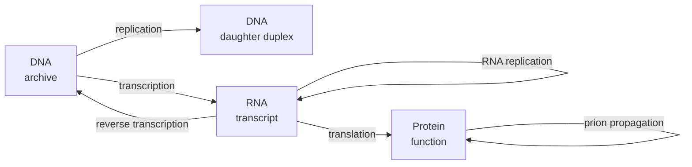
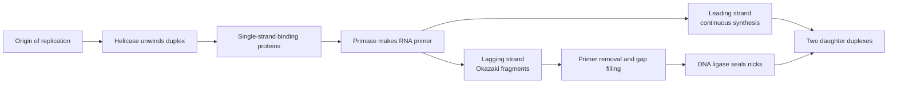
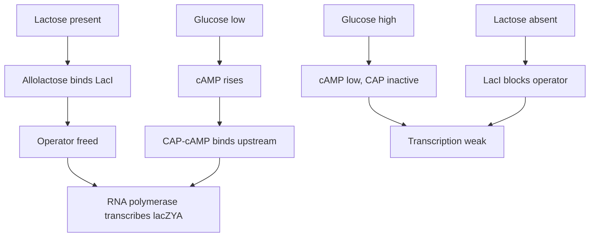
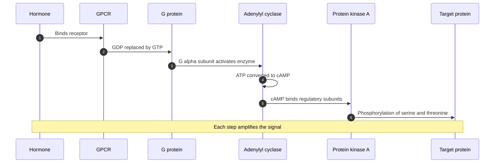

# Chapter 9 — Molecular Biology and Biochemical Regulation

> **Level:** Advanced (Level 8 — Biochemistry)
> **Estimated study time:** 8 hours (6 h reading + 2 h exercises)
> **Prerequisites:** [Nucleic Acids and DNA/RNA Chemistry](06-nucleic-acids-and-dna-rna-chemistry.md); [Metabolism and Bioenergetics](07-metabolism-and-bioenergetics.md) for ATP and redox energetics; Level 5 Chapter 2 (heterocycles and amino acids)
> **Difficulty:** ★★★★★ (5/5)
> **Related chapters:** [Nucleic Acids and DNA/RNA Chemistry](06-nucleic-acids-and-dna-rna-chemistry.md), [Metabolism and Bioenergetics](07-metabolism-and-bioenergetics.md), [Level 8 index](../README.md)

---

## 1. Learning Objectives

After working through this chapter you will be able to:

- State the central dogma and describe the exceptions that qualify it.
- Explain the chemistry of DNA polymerisation, proofreading and the
  leading/lagging-strand problem.
- Describe telomeres and telomerase and explain the end-replication problem.
- Compare prokaryotic and eukaryotic transcription, including promoters, RNA
  polymerases and transcription factors.
- Describe capping, polyadenylation and splicing as chemical modifications of RNA.
- Decode a gene using the genetic code and explain wobble and tRNA charging.
- Describe the three phases of translation and the energetics of peptide-bond
  formation.
- Explain the logic of the *lac* and *trp* operons, including attenuation.
- Describe epigenetic marks — DNA methylation, histone modification and chromatin
  remodelling — and how they are inherited.
- Explain RNA interference and the roles of miRNA and siRNA.
- Describe ubiquitin-dependent protein degradation and the proteasome.
- Trace a signal from a G-protein-coupled receptor or receptor tyrosine kinase to a
  cellular response, and explain amplification.
- Compare metabolic regulation with gene regulation, and apply the distinction to a
  disease example.
- Explain what qPCR, RNA-seq, proteomics and CRISPR screens measure.

---

## 2. Introduction

A genome is a chemical archive that must be read, copied, repaired and regulated. The
copying is done by polymerases that achieve error rates near one in a billion; the
reading is done by RNA polymerase and the ribosome; the regulation is done by proteins
that bind specific DNA sequences and by chemical marks on DNA and histones. Each of
these processes is a chemical reaction with a mechanism, a rate and an energy cost.

The central dogma — DNA makes RNA makes protein — is the organising principle, but it
is a summary rather than a law. Retroviruses reverse-transcribe RNA into DNA;
telomerase is a reverse transcriptase; RNA viruses replicate RNA directly; prions
propagate a protein conformation; and alternative splicing lets one gene produce many
proteins. Modern molecular biology is therefore the study of a network with feedback,
not a one-way pipeline.

Regulation is the part that makes the network interesting. A liver cell and a neuron
contain the same genome but different proteomes, because different genes are expressed.
The differences are established by transcription factors, chromatin structure,
epigenetic marks and non-coding RNAs, and they are maintained through cell division.
Understanding regulation requires both thermodynamics — which promoters can be bound —
and kinetics — how fast a gene is turned on and off.

---

## 3. Fundamental Concepts

### 3.1 The central dogma and its qualifications

The **central dogma**, stated by Francis Crick in 1958 and refined in 1970, holds that
sequence information flows from nucleic acid to nucleic acid or from nucleic acid to
protein, but never from protein to nucleic acid. The usual summary — DNA → RNA →
protein — describes the dominant route in cells.

The qualifications matter:

- **Reverse transcription.** Retroviruses carry an RNA-dependent DNA polymerase that
  copies RNA into DNA; telomerase uses an RNA template to extend DNA; retrotransposons
  move through an RNA intermediate.
- **RNA replication.** Many RNA viruses encode an RNA-dependent RNA polymerase that
  copies RNA directly, without a DNA stage.
- **Protein-based inheritance.** Prions propagate a misfolded protein conformation from
  one molecule to another, which is information transfer without nucleic acid.
- **One gene, many proteins.** Alternative splicing, alternative promoters and RNA
  editing mean that the number of proteins exceeds the number of genes.
- **Catalytic RNA.** Ribozymes and the ribosome show that RNA can be both information
  and catalyst, which is the basis of the RNA-world hypothesis.

The dogma is therefore best read as a statement about the direction of sequence
information in the processes that replicate and express genomes, not as a prohibition
on every imaginable transfer.

### 3.2 DNA replication

Replication is **semi-conservative**: each daughter duplex contains one parental strand
and one new strand. The Meselson–Stahl experiment demonstrated this in 1958 by labelling
DNA with $^{15}\mathrm{N}$ and following the density of the product through generations.

The chemistry is a nucleophilic substitution at phosphorus. The 3′-hydroxyl of the
growing strand attacks the α-phosphate of an incoming deoxynucleoside triphosphate,
releasing pyrophosphate; pyrophosphate hydrolysis then drives the reaction. DNA
polymerases can only extend a 3′-OH, so they require a primer, and they synthesise
only in the 5′ → 3′ direction.

That directionality creates the **leading/lagging-strand problem**. The replication
fork is asymmetric: one strand is synthesised continuously toward the fork (the leading
strand), while the other must be synthesised in short **Okazaki fragments** away from
the fork and then joined. In bacteria, DNA polymerase III extends Okazaki fragments,
DNA polymerase I removes the RNA primer with its 5′ → 3′ exonuclease and fills the gap,
and DNA ligase seals the nick.

Fidelity comes from three layers: base selection by the polymerase (about $10^{-4}$ to
$10^{-5}$), 3′ → 5′ exonuclease proofreading (about $10^{-7}$), and mismatch repair
after replication (about $10^{-9}$ to $10^{-10}$).

**Telomeres** solve the end-replication problem. Because the lagging strand cannot
copy the very end of a linear chromosome, each round of replication shortens the
telomere. Telomeres are repetitive G-rich sequences — 5′-TTAGGG-3′ in humans, several
kilobases long — that protect the chromosome end and are extended by **telomerase**, a
reverse transcriptase with an RNA template. Most somatic cells express little
telomerase, so telomeres shorten with each division and eventually trigger replicative
senescence; stem cells and most cancer cells reactivate the enzyme.

### 3.3 Transcription and RNA processing

**Transcription** is the synthesis of RNA from a DNA template by RNA polymerase. The
chemistry resembles DNA replication: the 3′-OH of the growing RNA attacks the
α-phosphate of an incoming nucleoside triphosphate, releasing pyrophosphate. The
differences are that RNA polymerase does not require a primer, uses NTPs rather than
dNTPs, and incorporates uracil instead of thymine.

In bacteria, a single RNA polymerase core enzyme ($\alpha_2\beta\beta'\omega$) binds a
**σ factor** that recognises the promoter: the $-35$ element and the $-10$ element
(the Pribnow box). Initiation melts the DNA to form an open complex; elongation
maintains an RNA–DNA hybrid of about 8–9 bp inside a transcription bubble; termination
is either intrinsic, through a GC-rich hairpin followed by a poly-U tract, or Rho-dependent.

Eukaryotes have three nuclear RNA polymerases. **Pol I** makes the 45S rRNA precursor;
**Pol II** makes mRNA, snRNA and miRNA; **Pol III** makes tRNA and 5S rRNA. Pol II
requires general transcription factors — TFIID, which binds the TATA box through its
TBP subunit, then TFIIA, TFIIB, TFIIE, TFIIF and TFIIH — and is regulated by enhancers,
silencers and the Mediator complex. The C-terminal domain of the largest Pol II subunit
is phosphorylated on Ser5 during initiation and on Ser2 during elongation, and the
phosphorylation pattern recruits capping, splicing and polyadenylation factors.

Three processing reactions convert the primary transcript into mature mRNA:

1. **5′ capping.** A 7-methylguanosine is attached through an unusual 5′–5′
   triphosphate linkage while the transcript is still being made. The cap protects the
   RNA from exonucleases, recruits the ribosome and marks the RNA as self.
2. **3′ cleavage and polyadenylation.** The sequence AAUAAA directs cleavage 10–30 nt
   downstream, and poly(A) polymerase adds a tail of about 200 adenines.
3. **Splicing.** Introns are removed by the **spliceosome**, a complex of snRNPs U1, U2,
   U4, U5 and U6. The reaction is two transesterifications: the 2′-OH of a branch-point
   adenosine attacks the 5′ splice site, forming a lariat, and the freed 5′ exon attacks
   the 3′ splice site. The consensus is GU at the 5′ end and AG at the 3′ end of the
   intron. Alternative splicing produces multiple mRNAs from one gene and is used by
   more than 95 % of human multi-exon genes.

### 3.4 Translation and the genetic code

The **genetic code** maps triplets of RNA bases to amino acids. There are
$4^{3} = 64$ codons: 61 sense codons and three stop codons (UAA, UAG, UGA). AUG is the
start codon and also codes for methionine. The code is degenerate — most amino acids
are encoded by several codons — but not ambiguous: one codon never specifies two amino acids.

**tRNA charging** is catalysed by aminoacyl-tRNA synthetases in two steps: the amino
acid is activated with ATP to an aminoacyl-adenylate, releasing pyrophosphate, and the
activated amino acid is transferred to the 3′-OH of the terminal adenosine of tRNA. The
synthetase has an editing site that hydrolyses incorrectly charged tRNAs, which is the
second layer of fidelity in translation.

**Wobble** explains how about 40 tRNAs can read 61 codons. The first position of the
anticodon (which pairs with the third position of the codon) tolerates non-standard
pairing: G pairs with U or C, U with A or G, and inosine with U, C or A. The result is
that a single tRNA can read several synonymous codons.

**Ribosomes** are ribozymes. The bacterial 70S particle has a 30S subunit (16S rRNA and
about 21 proteins) and a 50S subunit (23S and 5S rRNA and about 34 proteins); the
eukaryotic 80S particle has 40S and 60S subunits. The peptidyl transferase centre is
in the 23S or 28S rRNA, with no protein side chain within catalytic distance. The
ribosome has three tRNA sites: A (aminoacyl), P (peptidyl) and E (exit).

Translation has three phases:

1. **Initiation.** In bacteria, the Shine–Dalgarno sequence pairs with the 16S rRNA and
   places the start codon in the P site. In eukaryotes, the cap is bound by eIF4E, the
   small subunit scans to the first AUG in a favourable Kozak context, and eIF2–GTP
   delivers the initiator Met-tRNA.
2. **Elongation.** A ternary complex of EF-Tu, GTP and aminoacyl-tRNA delivers the
   charged tRNA to the A site. Peptidyl transferase forms the peptide bond, and EF-G–GTP
   translocates the ribosome by one codon. The cycle repeats at about 2–20 amino acids
   per second.
3. **Termination.** Release factors recognise the stop codon, hydrolyse the peptidyl–
   tRNA bond and release the completed chain; the ribosome is recycled.

The energy cost is about four ATP equivalents per peptide bond: two for tRNA charging,
one GTP for EF-Tu and one GTP for EF-G. A 400-amino-acid protein therefore costs about
1600 ATP equivalents, which is a substantial fraction of a cell's budget.

### 3.5 The logic of gene regulation

A gene is regulated by proteins that bind DNA and by the accessibility of the
chromatin. **Repressors** bind operators and block transcription; **activators** bind
upstream sites and recruit or stabilise RNA polymerase. In bacteria, genes with related
functions are often grouped in an **operon** under a single promoter, so one signal
controls a whole pathway.

The *lac* operon is the classic example of combinatorial control. It contains
$\beta$-galactosidase (*lacZ*), lactose permease (*lacY*) and transacetylase (*lacA*).
The repressor LacI binds the operator and blocks transcription when lactose is absent.
When lactose is present, it is converted to allolactose, which binds LacI and reduces
its affinity for DNA, so transcription can begin. The second signal is glucose: when
glucose is low, cAMP rises, CAP–cAMP binds upstream and activates transcription. The
operon is therefore expressed only when lactose is present *and* glucose is absent — a
logical AND gate.

The *trp* operon encodes the enzymes of tryptophan biosynthesis. It is controlled by
repression — TrpR with bound tryptophan blocks the operator — and by **attenuation**, a
second mechanism specific to amino acid biosynthetic operons. The leader region encodes
a short peptide containing two tryptophan codons. When tryptophan is plentiful, the
ribosome translates the leader quickly, the RNA behind it folds into a
terminator hairpin, and transcription stops. When tryptophan is scarce, the ribosome
stalls at the Trp codons, an antiterminator hairpin forms, and transcription continues.
Attenuation is a kinetic coupling between transcription and translation, and it gives
finer control than repression alone.

### 3.6 Epigenetics and chromatin

**Epigenetics** is the inheritance of gene-expression states without a change in DNA
sequence. The main mechanisms are DNA methylation, histone modification and chromatin remodelling.

**DNA methylation** in mammals occurs at cytosine in CpG dinucleotides, producing
5-methylcytosine. It is deposited by DNMT3A and DNMT3B during development and maintained
through replication by DNMT1, which recognises hemimethylated sites. Methylation of
promoter CpG islands usually represses transcription, both by blocking transcription
factor binding and by recruiting methyl-CpG-binding proteins that in turn recruit
histone deacetylases. TET enzymes oxidise 5-methylcytosine to 5-hydroxymethylcytosine
and further derivatives, providing a route to active demethylation.

**Histone modification** is a combinatorial code. Acetylation of lysine neutralises the
positive charge of the histone tail and loosens chromatin, and it is written by histone
acetyltransferases and erased by deacetylases. Methylation can be activating or
repressive depending on the residue: H3K4me3 marks active promoters, H3K27me3 marks
Polycomb-repressed regions, and H3K9me3 marks constitutive heterochromatin.
Phosphorylation, ubiquitination and sumoylation add further marks.

**Chromatin remodelling** complexes such as SWI/SNF use ATP to slide, eject or
restructure nucleosomes, changing the accessibility of DNA. The combination of
methylation, histone marks and remodelling determines which regions are open.

### 3.7 Non-coding RNAs and RNA interference

Only about 2 % of the human genome encodes protein, but a large fraction is
transcribed into non-coding RNA. Two classes regulate gene expression post-transcriptionally.

**miRNA** is processed from a primary transcript by Drosha and Dicer into a 21–23 nt
duplex. One strand loads into Argonaute 2, which uses the seed region to find
complementary sites in the 3′ untranslated regions of target mRNAs. Extensive pairing
leads to cleavage; partial pairing leads to translational repression and deadenylation.
A single miRNA can repress hundreds of targets.

**siRNA** is a 21–23 nt duplex, often of exogenous origin. It loads into the same RISC
machinery but typically pairs perfectly and directs cleavage. In plants and insects,
siRNA is an antiviral defence; in the laboratory it is a knockdown tool.

**lncRNA** acts through scaffolding, decoy and guide mechanisms, as described in
Chapter [6](06-nucleic-acids-and-dna-rna-chemistry.md).

### 3.8 Protein degradation and turnover

Proteins have half-lives ranging from minutes to days, and their degradation is as
regulated as their synthesis. The major pathway is the **ubiquitin–proteasome system**.

**Ubiquitin** is a 76-amino-acid protein. It is activated by an E1 enzyme at the cost of
ATP, transferred to an E2 conjugating enzyme, and attached by an E3 ligase to a lysine
on the target protein. Repeated cycles build a polyubiquitin chain; a chain linked
through Lys48 is the signal for proteasomal degradation, while Lys63-linked chains
regulate signalling and trafficking.

The **26S proteasome** consists of a 20S catalytic core — four stacked rings of seven
subunits, with the $\beta$1, $\beta$2 and $\beta$5 subunits providing caspase-like,
trypsin-like and chymotrypsin-like activities — and two 19S regulatory particles that
recognise ubiquitin, unfold substrates and feed them into the core. Degradation is
ATP-dependent and processive, releasing short peptides.

The system controls the cell cycle, immune signalling, protein quality control and the
response to stress. It is also a drug target: bortezomib inhibits the proteasome and is
used in multiple myeloma.

### 3.9 Signal transduction

Cells sense their environment through receptors that convert an extracellular signal
into an intracellular response. Two receptor families dominate.

**G-protein-coupled receptors** (GPCRs) have seven transmembrane helices. Ligand
binding changes the conformation of the intracellular loops, allowing the receptor to
act as a guanine nucleotide exchange factor for a heterotrimeric G protein. In the
active state, G$\alpha$ exchanges GDP for GTP and dissociates from G$\beta\gamma$.
Different G$\alpha$ subtypes act on different effectors: G$\alpha_s$ activates adenylyl
cyclase, raising cAMP and activating protein kinase A; G$\alpha_i$ inhibits adenylyl
cyclase; G$\alpha_q$ activates phospholipase C, which produces inositol trisphosphate
and diacylglycerol, releasing calcium and activating protein kinase C.

**Receptor tyrosine kinases** dimerise on ligand binding and autophosphorylate tyrosine
residues in their cytoplasmic domains. The phosphotyrosines are docking sites for SH2
domains: Grb2 recruits SOS, which activates Ras, which activates the MAPK cascade
(Raf → MEK → ERK); PI3K generates phosphatidylinositol 3,4,5-trisphosphate, which
recruits Akt. These pathways control proliferation, survival and differentiation, and
their mutation is common in cancer.

**Second messengers** — cAMP, cGMP, IP₃, DAG and Ca²⁺ — carry the signal inside the cell.
The characteristic of the system is **amplification**: one hormone molecule can activate
many receptors, each receptor many G proteins, each adenylyl cyclase many cAMP
molecules, and each kinase many substrates. The glycogenolytic cascade amplifies the
original signal by a factor of $10^{4}$ to $10^{8}$.

### 3.10 Modern tools and what they measure

| Method | What it measures | Chemical basis |
|---|---|---|
| qPCR | Amount of a specific DNA or cDNA sequence | Fluorescence proportional to product accumulation; $C_t$ |
| RNA-seq | Abundance and sequence of all transcripts | Reverse transcription, adaptor ligation, sequencing |
| Proteomics | Protein identity, abundance and modifications | Proteolytic digestion, LC–MS/MS, peptide spectra |
| ChIP-seq | Protein binding sites on DNA | Cross-linking, immunoprecipitation, sequencing |
| ATAC-seq | Open chromatin regions | Tn5 transposase insertion into accessible DNA |
| CRISPR screen | Genes required for a phenotype | Pooled sgRNA library, selection, sequencing of guides |

---

## 4. Detailed Scientific Explanation

### 4.1 Replication: initiation, elongation and fidelity

Replication begins at an **origin** recognised by an initiator protein. In bacteria,
DnaA binds *oriC* and opens the duplex; in eukaryotes, the origin recognition complex
recruits Cdc6 and Cdt1, which load the MCM helicase. Licensing ensures that each origin
fires once per cell cycle.

At the fork, helicase unwinds the duplex, single-strand binding proteins protect the
exposed strands, topoisomerase removes the positive supercoiling generated ahead of the
fork, and primase synthesises a short RNA primer. DNA polymerase extends from the
primer. The leading strand is extended continuously; the lagging strand is extended in
Okazaki fragments, each requiring a new primer and each joined by ligase after primer removal.

Processivity comes from a sliding clamp — the $\beta$ clamp in bacteria, PCNA in
eukaryotes — which encircles the DNA and tethers the polymerase. The clamp loader uses
ATP to open and close the ring.

Fidelity is a three-tier system. The polymerase active site selects the correct
base by shape and hydrogen bonding, with an error rate of about $10^{-4}$ to $10^{-5}$.
The 3′ → 5′ exonuclease domain removes mismatched nucleotides, improving the rate to
about $10^{-7}$. Mismatch repair then scans the new strand for errors and excises the
mismatched region, improving the overall rate to about $10^{-9}$ to $10^{-10}$.

### 4.2 Prokaryotic transcription

Bacterial RNA polymerase is a large enzyme with a crab-claw shape and a channel that
holds the DNA and the RNA–DNA hybrid. The σ factor recognises the $-35$ and $-10$
elements and positions the enzyme for melting. After the first few nucleotides, σ is
released and the enzyme enters processive elongation.

Elongation is remarkably stable: the enzyme can transcribe tens of kilobases without
dissociating, and it pauses at certain sequences, which affects termination and
regulation. Intrinsic termination occurs when the RNA forms a GC-rich hairpin followed
by a run of uridines; the hairpin destabilises the hybrid and the weak rU–dA pairs
allow release. Rho-dependent termination uses an ATP-dependent helicase that catches
the RNA and pulls it off the template.

### 4.3 Eukaryotic transcription and processing

Eukaryotic transcription is more complex because the template is chromatin and because
processing is co-transcriptional. Pol II is recruited to promoters by general
transcription factors, and its activity is modulated by enhancers that contact the
promoter through looping and the Mediator complex.

The C-terminal domain of Pol II is a heptad repeat with phosphorylatable serines. Ser5
phosphorylation by TFIIH marks the initiation phase and recruits the capping enzymes;
Ser2 phosphorylation by CDK9 marks elongation and recruits splicing and
polyadenylation factors. The modification state of the CTD is therefore a
positional code that coordinates transcription with RNA processing.

Splicing is catalysed by the spliceosome, which assembles on the intron in a defined
order. U1 binds the 5′ splice site, U2 binds the branch point, and the U4/U5/U6
tri-snRNP joins; rearrangements then activate the catalytic RNA. The chemistry is two
transesterifications, and the spliceosome is an RNA enzyme in the same sense as the
ribosome. Mutations in splice sites cause disease, and splicing-modulating drugs such
as nusinersen exploit the machinery.

### 4.4 Translation: mechanism and energetics

Translation is the most energy-expensive process in a growing cell. The ribosome
selects the aminoacyl-tRNA whose anticodon matches the codon in the A site, catalyses
peptidyl transfer, and translocates. The selection step is kinetic proofreading: the
correct tRNA has a longer residence time, allowing EF-Tu to hydrolyse GTP before rejection.

The peptidyl transferase centre is a ribozyme. The 2′-OH of the A-site adenosine and
the surrounding RNA backbone position the substrates and stabilise the transition
state; no protein side chain participates directly. The reaction is an aminolysis of
the peptidyl–tRNA ester, releasing the deacylated tRNA and extending the peptide by one residue.

Elongation consumes two GTP per peptide bond, and charging each amino acid costs two
ATP equivalents, so the total is four ATP equivalents per residue. Quality control
adds more: stalled ribosomes are rescued by tmRNA tagging in bacteria or by no-go decay in eukaryotes.

### 4.5 Operons, repression and attenuation

The *lac* operon integrates two signals. LacI is a tetramer that binds the operator and
loops the DNA, blocking Pol II access. Allolactose binding reduces the affinity of LacI
for the operator by about three orders of magnitude, so the operator becomes free.
CAP is a dimer that binds cAMP; the CAP–cAMP complex binds a site upstream of the
promoter and contacts the polymerase, increasing initiation. When glucose is high, cAMP
is low, CAP is inactive, and transcription is weak even if lactose is present.

The *trp* operon is controlled by repression and attenuation. TrpR is a repressor that
binds the operator only when tryptophan is bound; that is a simple feedback loop.
Attenuation adds a second layer that senses the charging level of Trp-tRNA. The leader
transcript contains two Trp codons; the ribosome's position on the leader determines
whether the RNA folds into a terminator or an antiterminator. When tryptophan is
abundant, the ribosome translates through the Trp codons and the terminator forms;
when it is scarce, the ribosome stalls and the antiterminator forms.

### 4.6 RNA interference

RNA interference is a sequence-specific silencing mechanism. In the miRNA pathway,
Drosha and Dicer produce a duplex; Argonaute loads one strand and discards the other;
the seed region scans mRNAs; and the outcome depends on the extent of complementarity.
In the siRNA pathway, the same machinery uses perfect pairing to cleave the target.

The mechanism is catalytic: one RISC complex can cleave many mRNA molecules. This is why
siRNA is such an effective laboratory tool and why chemically modified siRNA drugs can
silence a hepatic gene with infrequent dosing. The same machinery is exploited by
viruses and by the cell's own defences, and it is the basis of RNA therapeutics
described in Chapter [6](06-nucleic-acids-and-dna-rna-chemistry.md).

### 4.7 The ubiquitin–proteasome system

Ubiquitination is a three-enzyme cascade. E1 activates ubiquitin by forming a
thioester with its C-terminal glycine at the cost of ATP; E2 accepts the ubiquitin; E3
brings the target protein and the E2 together and catalyses isopeptide bond formation
between the ubiquitin C-terminus and a lysine of the target. The human genome encodes
two E1s, about forty E2s and more than six hundred E3s, which is how the system achieves specificity.

Polyubiquitin chains are read by receptors on the 19S particle. The particle unfolds
the substrate and feeds it into the 20S core, where the three protease activities
cleave after hydrophobic, basic and acidic residues respectively. The products are
peptides of 7–9 residues, which are further degraded by cytosolic peptidases.

### 4.8 Signalling cascades

A GPCR cascade begins with ligand binding. The receptor acts as a GEF, G$\alpha$–GTP
dissociates, and the effector is activated. Adenylyl cyclase converts ATP to cAMP, which
binds the regulatory subunits of protein kinase A and releases the catalytic subunits.
PKA phosphorylates serine and threonine residues on target proteins, including glycogen
phosphorylase kinase and the transcription factor CREB.

The same architecture appears in many systems: a receptor, a transducer, an amplifier
enzyme and a kinase. The **sequence diagram** in Figure 9.4 shows the temporal order of
the events. Each step is a potential drug target, which is why GPCRs are the largest
class of drug targets.

### 4.9 A molecular disease: sickle cell anaemia

Sickle cell anaemia illustrates the path from a single base change to a clinical
phenotype. A GAG → GTG mutation in the sixth codon of the $\beta$-globin gene changes
glutamate to valine. The substitution replaces a charged surface residue with a
hydrophobic one, creating a sticky patch on the surface of deoxygenated haemoglobin.
The mutant molecules polymerise into fibres, distorting the red cell into a sickle shape.

The sickled cells occlude capillaries, causing pain crises and organ damage, and they
are removed prematurely by the spleen, causing anaemia. The mutation is a missense
change, but its effects are pleiotropic because haemoglobin is abundant and its
polymerisation is cooperative. Heterozygotes are protected against malaria, which is
why the allele is common in malarial regions.

### 4.10 Metabolic regulation versus gene regulation

Metabolic regulation acts on existing enzymes within seconds to minutes, through allostery
and covalent modification; gene regulation changes enzyme amount over minutes to hours. The two systems are complementary:
a cell meets a sudden demand for ATP allosterically and a sustained demand by
transcribing glycolytic genes. The distinction is not absolute, since
some transcription factors are themselves regulated by phosphorylation.

---

## 5. Visual Diagrams

**Figure 9.1 — The central dogma with its qualifications.** The bold arrows show the
dominant DNA to RNA to protein route; the thin arrows show reverse transcription, RNA
replication and prion propagation. The dogma concerns the direction of sequence
information, not the impossibility of other chemistries. The RNA-to-DNA loop underlies
retroviral biology and telomerase.

**Figure 9.2 — The replication fork.** The leading strand is extended continuously
toward the fork; the lagging strand is extended in Okazaki fragments away from it. The
asymmetry follows from the 5′ to 3′ directionality of DNA polymerase. Primase,
polymerase and ligase act in order on the lagging strand, and the RNA primer must be
removed before ligation.

**Figure 9.3 — The *lac* operon as a logical AND gate.** Transcription requires two
conditions at once: allolactose must remove LacI, and CAP must be activated by cAMP when
glucose is low. Either condition alone is insufficient. The two independent negative
inputs keep the operon off when its products would be useless.

**Figure 9.4 — A G-protein-coupled receptor cascade.** The sequence emphasises order and
amplification: one hormone activates many receptors, many G proteins, many adenylyl
cyclase molecules and many kinase substrates. The final phosphorylation changes target
activity within seconds, and the same architecture underlies most rapid hormonal signalling.

## 6. Mathematical Formulas

### 6.1 Relative quantification by qPCR

$$
\text{fold change} = 2^{-\Delta\Delta C_t},
\qquad \Delta\Delta C_t = \Delta C_{t,\text{treated}} - \Delta C_{t,\text{control}}
$$

| Symbol | Meaning | Unit |
|---|---|---|
| $C_t$ | Threshold cycle | cycles (dimensionless) |
| $\Delta C_t$ | $C_{t,\text{target}} - C_{t,\text{reference}}$ | cycles |
| $\Delta\Delta C_t$ | Difference of $\Delta C_t$ between samples | cycles |

The method assumes equal amplification efficiencies for target and reference. A
difference of one cycle corresponds to a factor of about 2.

### 6.2 Replication time

$$ t = \frac{N}{n_{\text{forks}}\, v} $$

with $N$ the genome length in base pairs, $n_{\text{forks}}$ the number of active forks
and $v$ the rate per fork in base pairs per second. The equation assumes that all forks
move at the same rate and that initiation is synchronous.

### 6.3 Coding capacity

$$ N_{\text{codons}} = 4^{n} $$

For triplets, $4^{3} = 64$ codons, of which 61 are sense codons and 3 are stop codons.
The genetic code is degenerate but not ambiguous.

### 6.4 Protein turnover

$$
\frac{\mathrm{d}[P]}{\mathrm{d}t} = k_s - k_d[P], \qquad t_{1/2} = \frac{\ln 2}{k_d}
$$

At steady state, synthesis balances degradation. The half-life $t_{1/2}$ is the time
for half of the protein to be degraded when synthesis is blocked.

### 6.5 Energy cost of protein synthesis

$$ n_{\mathrm{ATP}} = 4N_{\text{residues}} $$

The factor four is two ATP equivalents for aminoacyl-tRNA synthesis, one GTP for
EF-Tu and one GTP for EF-G per residue. Folding, transport and quality control add further costs.

---

## 7. Chemical Equations

### 7.1 DNA polymerisation

$$ \ce{DNA_n-3'-OH(aq) + dNTP^{4-}(aq) -> DNA_{n+1}-3'-O-PO2^{-}(aq) + PP_i^{3-}(aq) + H+(aq)} $$

The reaction is a nucleophilic substitution at the α-phosphate; pyrophosphate
hydrolysis provides the driving force.

### 7.2 Transcription

$$ \ce{RNA_n-3'-OH(aq) + NTP^{4-}(aq) -> RNA_{n+1}-3'-O-PO2^{-}(aq) + PP_i^{3-}(aq) + H+(aq)} $$

RNA polymerase does not require a primer, so the first nucleotide retains its
triphosphate at the 5′ end.

### 7.3 Peptide bond formation

$$ \ce{peptidyl-tRNA(aq) + aminoacyl-tRNA(aq) -> extended\ peptidyl-tRNA(aq) + tRNA(aq)} $$

The reaction is an aminolysis of the ester bond between the peptide and the tRNA at
the P site, catalysed by the rRNA of the peptidyl transferase centre.

### 7.4 Aminoacyl-tRNA charging

$$ \ce{amino\ acid(aq) + ATP(aq) + tRNA(aq) -> aminoacyl-tRNA(aq) + AMP(aq) + PP_i(aq)} $$

The reaction consumes two high-energy bonds because the pyrophosphate is subsequently hydrolysed.

### 7.5 Ubiquitin activation

$$ \ce{ubiquitin-COOH(aq) + ATP(aq) + E1-SH(aq) -> ubiquitin-C(=O)-S-E1(aq) + AMP(aq) + PP_i(aq)} $$

The thioester is transferred to E2 and then to a lysine of the target protein.

### 7.6 DNA methylation

$$ \ce{CpG\ cytosine(aq) + S-adenosylmethionine(aq) -> 5-methylcytosine(aq) + S-adenosylhomocysteine(aq)} $$

The methyl group is transferred from S-adenosylmethionine to C5 of the cytosine ring.

---

## 8. Worked Examples

### Worked Example 8.1 — Relative quantification by qPCR

**Problem.** In a qPCR experiment the target gene has $C_t = 20.0$ in the control and
$22.0$ in the treated sample; the reference gene has $C_t = 18.0$ and $18.2$
respectively. Calculate the fold change.

**Strategy.** Compute $\Delta C_t$ for each sample, then $\Delta\Delta C_t$, then
$2^{-\Delta\Delta C_t}$.

**Solution.**

$$ \Delta C_{t,\text{control}} = 20.0 - 18.0 = 2.0 $$

$$ \Delta C_{t,\text{treated}} = 22.0 - 18.2 = 3.8 $$

$$ \Delta\Delta C_t = 3.8 - 2.0 = 1.8 $$

$$ \text{fold change} = 2^{-1.8} = 0.287 $$

**Check.** A fold change below 1 means down-regulation: the target is reduced to about
29 % of control, a 3.5-fold decrease. The result depends on the assumption of equal
efficiencies; a standard curve should confirm that the target and reference amplify
with efficiencies within 5 % of each other.

### Worked Example 8.2 — Replication time of a bacterial genome

**Problem.** *Escherichia coli* has a 4.6 Mbp genome. If replication proceeds
bidirectionally from one origin at 1000 nucleotides per second per fork, calculate the
minimum replication time.

**Strategy.** Two forks move in opposite directions, so the effective rate is twice the
single-fork rate.

**Solution.**

$$ t = \frac{4.6\times10^{6}}{2 \times 1000} = 2300\ \text{s} = 38\ \text{min} $$

**Check.** The observed doubling time of *E. coli* in rich medium is about 20–30 min,
which is possible because new rounds of replication initiate before the previous round
has finished, so a cell can have more than two forks. The calculation gives the time for
one complete round, not the minimum doubling time.

### Worked Example 8.3 — Time and energy cost of gene expression

**Problem.** A 10 kb gene is transcribed at 50 nucleotides per second and translated
into a 400-amino-acid protein at 20 residues per second. Calculate the transcription
time, the translation time and the ATP-equivalent cost of synthesis.

**Strategy.** Divide the length by the rate for each process and multiply the protein
length by four ATP equivalents per residue.

**Solution.**

$$ t_\text{transcription} = \frac{10\,000}{50} = 200\ \text{s} = 3.3\ \text{min} $$

$$ t_\text{translation} = \frac{400}{20} = 20\ \text{s} $$

$$ n_\mathrm{ATP} = 4 \times 400 = 1600 $$

**Check.** Transcription is slower than translation because the gene is much longer
than the protein. The energy cost of 1600 ATP equivalents is comparable to the yield of
about 50 glucose molecules, which is why rapidly growing cells devote a large fraction
of their metabolism to protein synthesis.

### Worked Example 8.4 — Decoding a mutation

**Problem.** The coding strand of a gene reads 5′-ATG GAA TTT TAA-3′. Predict the
protein and the consequence of (a) GAA → GAG, (b) GAA → AAA and (c) TTT → TGA.

**Strategy.** Transcribe the coding strand to mRNA (T → U) and translate each codon
using the standard code.

**Solution.** The wild-type mRNA is 5′-AUG GAA UUU UAA-3′, which translates as
Met–Glu–Phe–Stop.

(a) GAA → GAG gives 5′-GAG-3′, which also codes for glutamate: a silent mutation.

(b) GAA → AAA gives 5′-AAA-3′, which codes for lysine: a missense mutation.

(c) TTT → TGA gives 5′-UGA-3′, a stop codon: a nonsense mutation that truncates the
protein after methionine and glutamate.

**Check.** The three outcomes illustrate the degeneracy of the code and the different
consequences of point mutations. A silent mutation changes the DNA but not the protein;
a missense mutation changes one residue; a nonsense mutation removes the rest of the
protein. None of these is a frameshift, which would require an insertion or deletion
not divisible by three.

### Worked Example 8.5 — Protein half-life

**Problem.** When translation is blocked with cycloheximide, the amount of a protein
falls from 100 % to 25 % in 6 hours. Calculate the degradation rate constant and the half-life.

**Strategy.** Use first-order decay, $[P] = [P]_0 e^{-k_d t}$, and solve for $k_d$,
then $t_{1/2} = \ln 2/k_d$.

**Solution.**

$$
\ln\!\left(\frac{25}{100}\right) = -k_d(6) \qquad\Longrightarrow\qquad
k_d = \frac{\ln 4}{6} = 0.231\ \text{h}^{-1}
$$

$$ t_{1/2} = \frac{\ln 2}{0.231} = 3.0\ \text{h} $$

**Check.** A half-life of 3 hours means that about 0.8 % of the protein remains after
24 hours, consistent with the observed decay. Half-lives of mammalian proteins range
from minutes for regulatory proteins such as cyclins to days for structural proteins such as collagen.

---

## 9. Real-World Applications

**Medicine.** Imatinib inhibits the BCR–ABL tyrosine kinase that drives chronic myeloid
leukaemia; trastuzumab targets HER2, a receptor tyrosine kinase amplified in some breast
cancers; and immune checkpoint inhibitors block the signalling that suppresses T cells.
Each drug exploits a specific step in a signalling cascade.

---

## 10. Common Mistakes

| Mistake | Why it happens | Correct approach |
|---|---|---|
| Treating the central dogma as an absolute law | The simplified DNA → RNA → protein slogan is memorable | Reverse transcription, RNA replication and prions are established exceptions |
| Saying DNA polymerase synthesises 3′ → 5′ | The template is read 3′ → 5′ | The new strand grows 5′ → 3′; the template is read in the opposite direction |
| Confusing the coding strand with the template | Both are DNA and look similar | The coding strand has the same sequence as the mRNA, with T instead of U |
| Assuming one gene makes one protein | The statement was once standard | Alternative splicing, alternative promoters and RNA editing produce multiple products |
| Thinking attenuation is the same as repression | Both reduce transcription | Repression blocks initiation; attenuation terminates transcription after initiation |
| Treating miRNA and siRNA as identical | Both are small RNAs | miRNA pairing is usually partial and represses translation; siRNA pairing is usually perfect and cleaves |

---

## 11. Chapter Summary

- The central dogma describes the dominant flow of sequence information, with
  established exceptions in reverse transcription, RNA replication and prions.
- Replication is semi-conservative and bidirectional; the leading strand is continuous
  and the lagging strand is made of Okazaki fragments.
- Fidelity depends on base selection, 3′ → 5′ proofreading and mismatch repair.
- Bacterial transcription uses a σ factor and a single RNA polymerase; eukaryotes use
  three polymerases, general transcription factors and the Mediator complex.
- The genetic code is a degenerate triplet code read by tRNAs; wobble allows about
  40 tRNAs to read 61 sense codons.
- Translation proceeds through initiation, elongation and termination, at a cost of
  about four ATP equivalents per residue.
- The *lac* operon integrates lactose and glucose signals; the *trp* operon uses
  repression and attenuation.
- Epigenetic marks — DNA methylation, histone modification and chromatin remodelling —
  alter gene expression without changing the sequence.
- miRNA and siRNA silence transcripts through RISC; the proteasome degrades
  ubiquitinated proteins.
- GPCR and RTK cascades amplify signals through second messengers and kinase cascades.

---

## 12. Exercises

### 12.1 Conceptual questions

1. State the central dogma and give two established exceptions.
2. Why is DNA synthesised only in the 5′ → 3′ direction, and what problem does this
   create at the replication fork?
3. Explain how the *lac* operon behaves as an AND gate.

### 12.2 Basic problems

4. Write the mRNA and protein produced from the coding strand 5′-ATG CGT TAA-3′.
5. Name the three RNA processing reactions that convert a eukaryotic primary transcript
   into mature mRNA.
6. What is the difference between a missense, a nonsense and a silent mutation?

### 12.3 Intermediate problems

7. Explain how attenuation in the *trp* operon depends on the rate of translation.
8. Why does a single miRNA often repress many targets while an siRNA usually silences
   one?

### 12.4 Advanced problems

9. Explain how the three-tier fidelity system of replication achieves an error rate of
   $10^{-9}$ when the polymerase alone achieves only $10^{-4}$.
10. A drug inhibits the proteasome. Predict its effect on the NF-κB pathway and on
    cell-cycle progression.

### 12.5 Calculation problems

11. In a qPCR experiment the target $C_t$ rises from 18.0 to 20.0 while the reference
    rises from 17.0 to 17.1. Calculate the fold change.
12. A 300-amino-acid protein is synthesised at 15 residues per second. Calculate the
    translation time and the ATP-equivalent cost.

### 12.6 Answers

1. Sequence information flows from nucleic acid to nucleic acid or to protein, not from
   protein to nucleic acid; exceptions include reverse transcription and prion
   propagation.
2. Polymerase extends only a 3′-OH, so the new strand grows 5′ → 3′; the lagging strand
   must be synthesised in fragments and joined.
3. Transcription requires both the removal of LacI by allolactose and activation by
   CAP–cAMP when glucose is low; either alone is insufficient.
4. mRNA 5′-AUG CGU UAA-3′; protein Met–Arg–Stop.
5. 5′ capping, 3′ cleavage and polyadenylation, and splicing.
6. Missense changes one amino acid; nonsense creates a stop codon and truncates the
   protein; silent changes the codon but not the amino acid.
7. When tryptophan is abundant, the ribosome translates the leader quickly and the
   terminator forms; when it is scarce, the ribosome stalls and the antiterminator forms.
8. miRNA pairing is partial, so one miRNA can bind many transcripts; siRNA pairing is
   usually perfect and sequence-specific.
9. Base selection gives $10^{-4}$, proofreading $10^{-7}$, and mismatch repair $10^{-9}$ to $10^{-10}$.
10. NF-κB activation requires Lys63-linked ubiquitination, so the pathway is inhibited;
    blocked cyclin degradation arrests the cell cycle.
11. $\Delta C_t$ control $= 1.0$; treated $= 2.9$; $\Delta\Delta C_t = 1.9$; fold change
    $= 2^{-1.9} = 0.27$, a 3.7-fold decrease.
12. $t = 300/15 = 20\ \text{s}$; cost $= 4 \times 300 = 1200$ ATP equivalents.

---

## 13. Further Reading

- Alberts, B. et al. *Molecular Biology of the Cell*, 7th ed. Norton, 2022. The standard
  reference for replication, transcription, translation and signalling.
- Watson, J. D. et al. *Molecular Biology of the Gene*, 7th ed. Pearson, 2014. A
  chemistry-rich treatment of the central dogma and its regulation.
- Crick, F. "Central Dogma of Molecular Biology." *Nature* **1970**, *227*, 561–563. The
  statement and its qualifications in Crick's own words.
- Fire, A.; Xu, S.; Montgomery, M. K.; Kostas, S. A.; Driver, S. E.; Mello, C. C.
  "Potent and specific genetic interference by double-stranded RNA in *Caenorhabditis
  elegans*." *Nature* **1998**, *391*, 806–811. The discovery of RNA interference.
- Jinek, M.; Chylinski, K.; Fonfara, I.; Hauer, M.; Doudna, J. A.; Charpentier, E. "A
  programmable dual-RNA-guided DNA endonuclease in adaptive bacterial immunity."
  *Science* **2012**, *337*, 816–821. The biochemical basis of CRISPR–Cas9.
- IUPAC. *Compendium of Chemical Terminology* (the "Gold Book"), 2nd ed. (the
  "corrected" version). <https://goldbook.iupac.org/> Entries for *central dogma*,
  *operon* and *epigenetics*.
