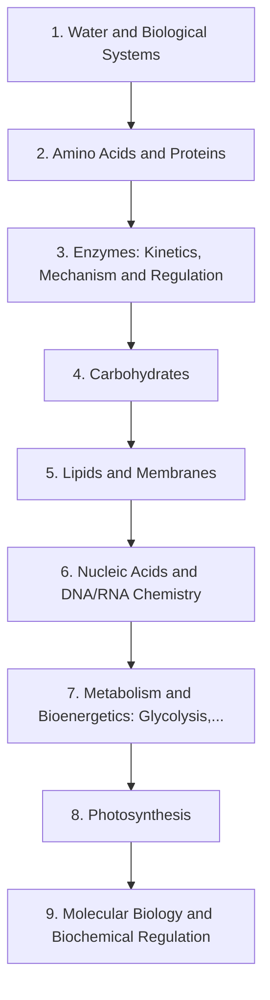

# Level 8 — Biochemistry

> **Audience:** Undergraduate biochemistry  
> **Chapters:** 9  
> **Estimated study time:** ≈ 75 h  
> **Difficulty:** ★★★☆☆ – ★★★★★

The chemistry of living systems: water and non-covalent interactions, amino acids and proteins, enzymes, carbohydrates, lipids, nucleic acids, metabolism, photosynthesis and regulation.

Biochemistry applies organic and physical chemistry to living systems. The themes are non-covalent interactions, energy coupling and regulation; the chapters use them to explain proteins, nucleic acids and metabolism.

---

## Chapters

| # | Chapter | Difficulty | Hours | Prerequisites |
|---|---|---|---|---|
| 1 | [Water and Biological Systems](01-water-and-biological-systems.md) | ★★★☆☆ | 6 | Level 2 Ch. 5, 11 |
| 2 | [Amino Acids and Proteins](02-amino-acids-and-proteins.md) | ★★★★☆ | 9 | Ch. 1; Level 4 Ch. 3 |
| 3 | [Enzymes: Kinetics, Mechanism and Regulation](03-enzymes.md) | ★★★★★ | 10 | Ch. 2; Level 3 Ch. 5 |
| 4 | [Carbohydrates](04-carbohydrates.md) | ★★★★☆ | 7 | Level 4 Ch. 9 |
| 5 | [Lipids and Membranes](05-lipids.md) | ★★★★☆ | 7 | Level 4 Ch. 11 |
| 6 | [Nucleic Acids and DNA/RNA Chemistry](06-nucleic-acids-and-dna-rna-chemistry.md) | ★★★★★ | 9 | Ch. 4 |
| 7 | [Metabolism and Bioenergetics: Glycolysis, Krebs Cycle, Oxidative Phosphorylation](07-metabolism-and-bioenergetics.md) | ★★★★★ | 12 | Ch. 3–5; Level 3 Ch. 4 |
| 8 | [Photosynthesis](08-photosynthesis.md) | ★★★★★ | 7 | Ch. 7; Level 6 Ch. 7 |
| 9 | [Molecular Biology and Biochemical Regulation](09-molecular-biology-and-biochemical-regulation.md) | ★★★★★ | 8 | Ch. 6–7 |

---

## Knowledge map

The chain is the *recommended* order. Chapters that share prerequisites can be
read out of order; the table above tells you what each one actually needs.

---

## Study routine for this level

1. Read the chapter once without taking notes, to see the shape of the argument.
2. Re-read with the chapter's learning objectives in front of you and answer them in writing.
3. Reproduce every Mermaid diagram from memory, then check it.
4. Do the exercises **before** opening the solutions file.
5. Record every mistake in a log; re-test yourself on those specific items a week later.

---

## Practice

- Exercise set: [`exercises/level-8-exercises.md`](exercises/level-8-exercises.md)
- Worked solutions: [`solutions/level-8-solutions.md`](solutions/level-8-solutions.md)

---

## Navigation

- Level index: [CURRICULUM.md](../CURRICULUM.md)
- Study methods: [00-learning-guide](../00-learning-guide/learning-path.md)
- Terminology: [GLOSSARY.md](../GLOSSARY.md)
- Sources: [REFERENCES.md](../REFERENCES.md)
