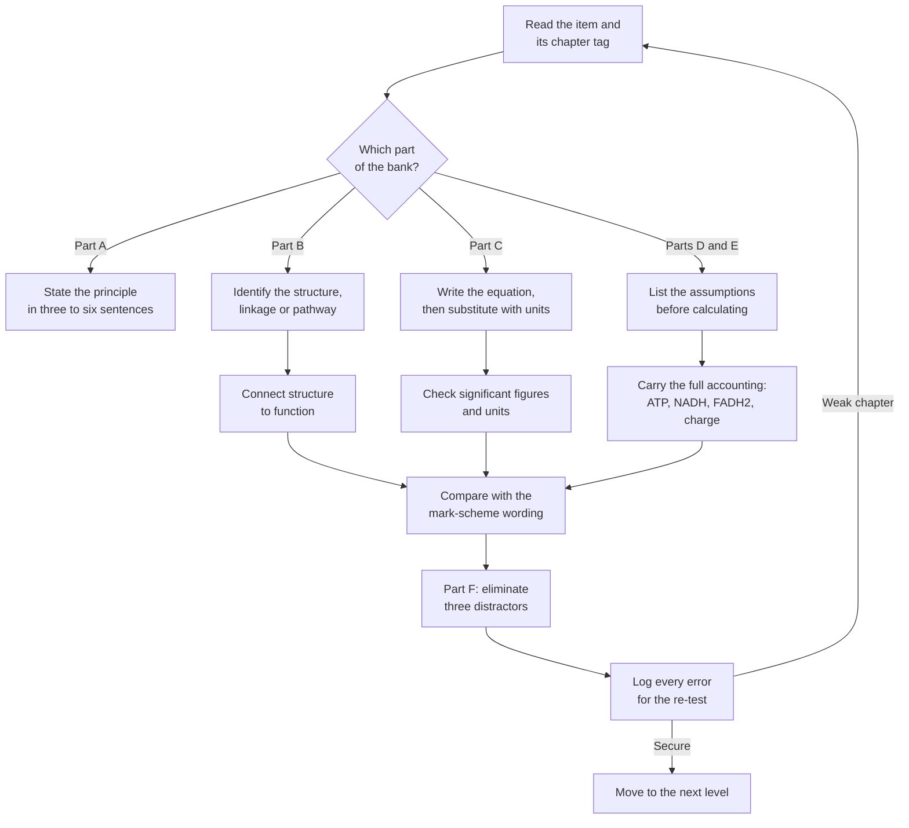

# Level 8 — Exercise Bank: Biochemistry

> **Level:** 8 (Biochemistry)
> **Estimated time:** 240 minutes
> **Items:** 58
> **Covers:** [Ch. 1](../01-water-and-biological-systems.md), [Ch. 2](../02-amino-acids-and-proteins.md), [Ch. 3](../03-enzymes.md), [Ch. 4](../04-carbohydrates.md), [Ch. 5](../05-lipids.md), [Ch. 6](../06-nucleic-acids-and-dna-rna-chemistry.md), [Ch. 7](../07-metabolism-and-bioenergetics.md), [Ch. 8](../08-photosynthesis.md), [Ch. 9](../09-molecular-biology-and-biochemical-regulation.md)
> **Solutions:** [`../solutions/level-8-solutions.md`](../solutions/level-8-solutions.md)

Work through the bank with the chapters closed. Every item names the chapter that
supplies the method, so an error can be traced to a section rather than to
"biochemistry" in general. Give numerical answers to three significant figures unless
the question states otherwise, and carry units through every substitution. In Parts D
and E, state the assumptions before the arithmetic: several items have more than one
legitimate answer if the assumptions are left implicit.

**Figure 1 — Working order for this bank.** The loop back to the item is deliberate:
an error in a multi-step calculation is usually an assumption error, not an arithmetic
error, so the correction belongs at the start of the working.

---

## Data sheet

| Quantity | Value |
|---|---|
| Gas constant | $R = 8.314\ \mathrm{J\ mol^{-1}\ K^{-1}}$ |
| Faraday constant | $F = 96\,485\ \mathrm{C\ mol^{-1}}$ |
| Planck constant | $h = 6.626\times10^{-34}\ \mathrm{J\ s}$ |
| Speed of light | $c = 2.998\times10^{8}\ \mathrm{m\ s^{-1}}$ |
| Avogadro constant | $N_\mathrm{A} = 6.022\times10^{23}\ \mathrm{mol^{-1}}$ |
| Standard temperature | $T = 298.15\ \mathrm{K}$ |
| Phosphate $\mathrm{p}K_{a2}$ | $6.86$ at 25 °C |
| Bicarbonate $\mathrm{p}K_{a1}$ | $6.10$ at 37 °C |
| Lysine $\mathrm{p}K_\mathrm{a}$ values | $2.18$, $8.95$, $10.53$ |
| Aspartate $\mathrm{p}K_\mathrm{a}$ values | $2.09$, $3.86$, $9.82$ |
| Histidine side-chain $\mathrm{p}K_\mathrm{a}$ | $6.00$ |
| Peptide N-terminus $\mathrm{p}K_\mathrm{a}$ (model) | $9.60$ |
| Peptide C-terminus $\mathrm{p}K_\mathrm{a}$ (model) | $2.34$ |
| Hexose residue molar mass | $162.14\ \mathrm{g\ mol^{-1}}$ |
| Water molar mass | $18.015\ \mathrm{g\ mol^{-1}}$ |
| Glucose molar mass | $180.16\ \mathrm{g\ mol^{-1}}$ |
| Ethanol molar mass | $46.07\ \mathrm{g\ mol^{-1}}$ |
| Molar volume at STP | $22.414\ \mathrm{L\ mol^{-1}}$ |
| dsDNA conversion | $A_{260} = 1$ corresponds to $50\ \mu\mathrm{g\ mL^{-1}}$ |
| Mean molar mass per base pair (sodium salt) | $650\ \mathrm{g\ mol^{-1}}$ |
| Iodine molar mass | $253.8\ \mathrm{g\ mol^{-1}}$ |
| Triolein molar mass | $885.4\ \mathrm{g\ mol^{-1}}$ |
| Palmitate molar mass | $256.42\ \mathrm{g\ mol^{-1}}$ |
| Standard free energy of ATP hydrolysis | $\Delta G^{\circ\prime} = -30.5\ \mathrm{kJ\ mol^{-1}}$ |

The hydrolysis reaction to which the last value refers is

$$
\ce{ATP^{4-}(aq) + H2O(l) -> ADP^{3-}(aq) + HPO4^{2-}(aq) + H+(aq)}
\qquad \Delta G^{\circ\prime} = -30.5\ \mathrm{kJ\ mol^{-1}}.
$$

---

## Part A — Conceptual questions (10 items)

1. **[Ch. 1]** The hydrophobic effect is entropic, yet it is often described as an
   attractive force between non-polar groups. Resolve the contradiction: state what is
   ordered and what is released when a non-polar side chain is buried, and explain why
   the effect drives both protein folding and bilayer assembly.

2. **[Ch. 1]** A buffer is most effective within one pH unit of its
   $\mathrm{p}K_\mathrm{a}$. Derive this statement from the Henderson–Hasselbalch
   equation and the buffer-capacity expression, and explain why capacity, not pH, is
   maximal at the $\mathrm{p}K_\mathrm{a}$.

3. **[Ch. 2]** Explain why the peptide bond is planar and why that planarity reduces
   the conformational freedom of the backbone to two dihedral angles per residue. State
   the consequence for the Ramachandran plot.

4. **[Ch. 2]** Anfinsen's ribonuclease experiment and Levinthal's paradox appear to make
   opposite claims about folding. Explain what each establishes and why they are
   consistent.

5. **[Ch. 3]** $K_\mathrm{M}$ is often called a measure of affinity, but it is not a
   dissociation constant. State the condition under which $K_\mathrm{M} = K_\mathrm{d}$,
   and explain what $k_\mathrm{cat}/K_\mathrm{M}$ measures and why it has an upper limit.

6. **[Ch. 4]** Sucrose is non-reducing, whereas lactose and maltose are reducing.
   Identify the anomeric carbons in each and use them to explain the difference.

7. **[Ch. 5]** Cholesterol is described as a membrane-fluidity buffer. Explain its effect
   below and above the gel-to-liquid-crystalline transition temperature, and why the
   effect is not simply "cholesterol makes membranes rigid".

8. **[Ch. 6]** RNA is hydrolysed rapidly in dilute alkali, whereas DNA is stable.
   Explain the mechanism, naming the functional group responsible and the product formed.

9. **[Ch. 7]** Older textbooks give $36$–$38$ ATP per glucose; modern texts give about
   $30$–$32$. Explain the origin of both figures, identify the assumptions that differ,
   and state why neither is a universal constant.

10. **[Ch. 8]** Explain why photosynthesis uses two photosystems in series rather than
    one, and why linear electron flow alone cannot supply the $3$ ATP : $2$ NADPH ratio
    required by the Calvin cycle.

---

## Part B — Structure and function (10 items)

11. **[Ch. 1]** Describe the hydrogen-bond network of liquid water. Use it to account
    for three anomalous properties: the high boiling point, the density maximum at
    $3.98\ ^\circ\mathrm{C}$ and the high relative permittivity.

12. **[Ch. 2]** Compare the $\alpha$-helix and the antiparallel $\beta$-sheet:
    hydrogen-bond pattern, residues per turn or per strand, rise per residue, and the
    Ramachandran regions they occupy.

13. **[Ch. 2]** For the peptide Asp-His-Lys, list every ionisable group, give its
    $\mathrm{p}K_\mathrm{a}$, and rank the groups in order of deprotonation as pH rises
    from $1$ to $13$. State which groups are charged at pH $7.4$.

14. **[Ch. 3]** Distinguish competitive, uncompetitive and pure non-competitive
    inhibition by binding site, effect on $K_\mathrm{M}$ and $V_\mathrm{max}$, and
    Lineweaver–Burk pattern.

15. **[Ch. 4]** Give the full glycosidic linkage and reducing status of sucrose,
    lactose, maltose and cellulose. Relate the linkage to why humans digest starch but
    not cellulose.

16. **[Ch. 5]** A phospholipid, a lysophospholipid and a bile salt have packing
    parameters $P \approx 0.9$, $0.4$ and $0.2$ respectively. Predict the assembly each
    forms and explain the structural features that set $P$.

17. **[Ch. 6]** Compare A-, B- and Z-DNA in handedness, residues per turn, rise per
    residue and groove geometry. Explain why an RNA–RNA duplex adopts A-form geometry.

18. **[Ch. 7]** Trace one acetyl group from pyruvate to two $\ce{CO2}$ in the Krebs
    cycle. Account for every carbon, every $\ce{NADH}$, the $\ce{FADH2}$ and the
    $\ce{GTP}$ produced per turn.

19. **[Ch. 8]** Draw the Z-scheme in words: name the electron donors and acceptors at
    each photosystem, explain why water is the ultimate electron donor, and state where
    the proton gradient is generated.

20. **[Ch. 9]** Explain the logic of the *lac* operon as an AND gate and the *trp*
    operon as a repression-plus-attenuation system. Why does each system use more than
    one signal?

---

## Part C — Basic calculations (12 items)

21. **[Ch. 1]** Calculate the masses of anhydrous $\ce{Na2HPO4}$
    ($M = 141.96\ \mathrm{g\ mol^{-1}}$) and $\ce{NaH2PO4}$
    ($M = 119.98\ \mathrm{g\ mol^{-1}}$) needed to prepare $1.00\ \mathrm{L}$ of
    $0.0500\ \mathrm{M}$ phosphate buffer at pH $7.00$. Use
    $\mathrm{p}K_{a2} = 6.86$.

22. **[Ch. 1]** Calculate the osmotic pressure at $298.15\ \mathrm{K}$ and at
    $310.15\ \mathrm{K}$ of $0.154\ \mathrm{M}$ $\ce{NaCl}$, assuming complete
    dissociation. Express the answers in bar and compare them with plasma
    ($290\ \mathrm{mOsm\ L^{-1}}$).

23. **[Ch. 2]** Calculate the isoelectric point of aspartate and of lysine from their
    $\mathrm{p}K_\mathrm{a}$ values.

24. **[Ch. 2]** Calculate the net charge at pH $7.40$ of the peptide Ala-His-Asp. Use
    $\mathrm{p}K_\mathrm{a} = 9.60$ for the N-terminus, $2.34$ for the C-terminus,
    $6.00$ for histidine and $3.86$ for aspartate.

25. **[Ch. 3]** Initial rates for an enzyme are $v = 0.24$, $0.40$, $0.60$, $0.80$ and
    $0.96\ \mu\mathrm{mol\ min^{-1}}$ at $[\ce{S}] = 0.50$, $1.0$, $2.0$, $4.0$ and
    $8.0\ \mathrm{mM}$. Determine $K_\mathrm{M}$ and $V_\mathrm{max}$ by the
    Lineweaver–Burk transformation.

26. **[Ch. 3]** For the enzyme in item 25, the assay contains $0.50\ \mathrm{nmol}$ of
    enzyme in $1.00\ \mathrm{mL}$ and $V_\mathrm{max} = 1.20\ \mu\mathrm{mol\ min^{-1}}$.
    Calculate $k_\mathrm{cat}$ and $k_\mathrm{cat}/K_\mathrm{M}$.

27. **[Ch. 4]** $\alpha$-D-Glucopyranose has
    $[\alpha]_\mathrm{D} = +112.2^\circ$ and $\beta$-D-glucopyranose has
    $[\alpha]_\mathrm{D} = +18.7^\circ$. A mutarotated solution has an equilibrium
    rotation of $+75.0^\circ$. Calculate the equilibrium percentages of the two anomers.

28. **[Ch. 4]** An amylose fraction has a degree of polymerisation of $1500$. Calculate
    its molar mass and the mass of glucose obtained by complete hydrolysis of
    $1.00\ \mathrm{g}$ of the polymer.

29. **[Ch. 5]** Calculate the iodine value of triolein
    ($M = 885.4\ \mathrm{g\ mol^{-1}}$).

30. **[Ch. 6]** A $1:10$ dilution of a $2000\ \mathrm{bp}$ double-stranded DNA sample
    gives $A_{260} = 0.310$ in a $1.00\ \mathrm{cm}$ cuvette. Calculate the mass
    concentration, the molar concentration and the number of molecules per microlitre
    of the original sample. Use $50\ \mu\mathrm{g\ mL^{-1}}$ per $A_{260}$ unit and
    $650\ \mathrm{g\ mol^{-1}}$ per base pair.

31. **[Ch. 7]** A hepatocyte contains $3.0\ \mathrm{mM}$ $\ce{ATP}$,
    $0.50\ \mathrm{mM}$ $\ce{ADP}$ and $0.10\ \mathrm{mM}$ $\ce{AMP}$. Calculate the
    energy charge. Then calculate it after $\ce{ATP}$ falls to $2.0\ \mathrm{mM}$,
    $\ce{ADP}$ rises to $1.2\ \mathrm{mM}$ and $\ce{AMP}$ rises to
    $0.30\ \mathrm{mM}$.

32. **[Ch. 8]** Calculate the energy of one $680\ \mathrm{nm}$ photon and of one mole
    of such photons. How many moles of photons are required, at the theoretical minimum
    of $8$ photons per $\ce{CO2}$, to fix $1.00\ \mathrm{mol}$ of glucose, and what is
    the total light energy?

---

## Part D — Intermediate problems (12 items)

33. **[Ch. 1]** $1.00\ \mathrm{L}$ of $0.100\ \mathrm{M}$ phosphate buffer at pH
    $7.00$ ($\mathrm{p}K_{a2} = 6.86$) is treated with $1.00\ \mathrm{mmol}$ $\ce{HCl}$.
    Calculate the new pH, the buffer capacity at the initial pH, and the pH change
    predicted by the capacity. Compare with the pH change of $1.00\ \mathrm{L}$ of
    unbuffered water.

34. **[Ch. 2]** For the peptide Asp-His-Lys-Gly, calculate the net charge at pH $7.40$
    and at pH $6.00$. Estimate the $\mathrm{pI}$, and state whether the peptide binds a
    cation or an anion exchanger at each pH.

35. **[Ch. 3]** An enzyme has $K_\mathrm{M} = 2.0\ \mathrm{mM}$ and
    $V_\mathrm{max} = 1.20\ \mu\mathrm{mol\ min^{-1}}$. A competitive inhibitor gives
    $\mathrm{IC}_{50} = 12\ \mu\mathrm{M}$ at $[\ce{S}] = K_\mathrm{M}$. Calculate
    $K_\mathrm{i}$. At $[\ce{I}] = 18\ \mu\mathrm{M}$, calculate
    $K_\mathrm{M}^\mathrm{app}$ and the velocity at $[\ce{S}] = 2.0\ \mathrm{mM}$, and
    express it as a percentage of the uninhibited velocity.

36. **[Ch. 3]** A cooperative enzyme is $10\%$ saturated at $1.0\ \mu\mathrm{M}$ ligand
    and $90\%$ saturated at $16\ \mu\mathrm{M}$. Calculate the Hill coefficient,
    $K_\mathrm{d}$, and the fractional saturation at $8.0\ \mu\mathrm{M}$.

37. **[Ch. 4]** A glucose solution in a $1.00\ \mathrm{dm}$ polarimeter tube gives an
    observed rotation of $+3.16^\circ$. Taking the equilibrium specific rotation as
    $+52.7^\circ$, calculate the concentration in $\mathrm{g\ L^{-1}}$ and the mass of
    glucose in $250.0\ \mathrm{mL}$.

38. **[Ch. 4]** $5.00\ \mathrm{g}$ of starch is hydrolysed completely to glucose and
    fermented to ethanol and $\ce{CO2}$. Calculate the mass of glucose, the mass of
    ethanol and the volume of $\ce{CO2}$ at STP.

39. **[Ch. 5]** For the $\ce{Na+}$/$\ce{K+}$-ATPase at $310\ \mathrm{K}$,
    $[\ce{Na+}]_\mathrm{out} = 150\ \mathrm{mM}$,
    $[\ce{Na+}]_\mathrm{in} = 15\ \mathrm{mM}$,
    $[\ce{K+}]_\mathrm{in} = 150\ \mathrm{mM}$,
    $[\ce{K+}]_\mathrm{out} = 5\ \mathrm{mM}$ and $\Delta\psi = -70\ \mathrm{mV}$.
    Calculate the free-energy cost of exporting $3$ $\ce{Na+}$ and importing
    $2$ $\ce{K+}$ per ATP, and the thermodynamic efficiency relative to
    $\Delta G_\mathrm{ATP} = -50\ \mathrm{kJ\ mol^{-1}}$.

40. **[Ch. 5]** A lipid has tail volume $v = 0.90\ \mathrm{nm^3}$, head-group area
    $a_0 = 0.60\ \mathrm{nm^2}$ and chain length $l_\mathrm{c} = 1.8\ \mathrm{nm}$.
    Calculate $P$ and predict the assembly. Recalculate $P$ if the head-group area
    doubles, and state the new assembly.

41. **[Ch. 6]** A $1000\ \mathrm{bp}$ double-stranded DNA has $A = 28.0\%$ of total
    bases. Calculate the percentages of all four bases, the number of hydrogen bonds in
    the duplex, and the net charge at pH $7.4$. Ignore terminal groups.

42. **[Ch. 7]** Calculate the ATP yield from one glucose molecule with (a) the
    malate–aspartate shuttle and (b) the glycerol-3-phosphate shuttle, using
    $\mathrm{P/O} = 2.5$ for $\ce{NADH}$ and $1.5$ for $\ce{FADH2}$. Repeat for one
    glucose residue released from glycogen. State every assumption.

43. **[Ch. 8]** The Calvin cycle fixes $10.0\ \mathrm{mol}$ $\ce{CO2}$. Calculate the
    $\ce{ATP}$ and $\ce{NADPH}$ required, the glucose produced, the photons required at
    $8$ photons per $\ce{CO2}$ at $680\ \mathrm{nm}$, and the thermodynamic efficiency
    relative to $+2870\ \mathrm{kJ\ mol^{-1}}$ for glucose.

44. **[Ch. 9]** In qPCR, the target has $C_t = 24.0$ in the control and $26.0$ in the
    treated sample; the reference has $C_t = 18.0$ and $18.5$. Calculate
    $\Delta C_t$, $\Delta\Delta C_t$ and the fold change.

---

## Part E — Advanced problems (8 items)

45. **[Ch. 1]** Seawater at $298.15\ \mathrm{K}$ has water activity $0.980$. Calculate
    its osmotic pressure using
    $\pi = -(RT/V_\mathrm{m})\ln a_\mathrm{w}$ with
    $V_\mathrm{m} = 1.8\times10^{-5}\ \mathrm{m^3\ mol^{-1}}$. Convert to an effective
    osmolarity and compare with $0.9\%$ $\ce{NaCl}$ ($308\ \mathrm{mOsm\ L^{-1}}$).

46. **[Ch. 2]** A protein unfolds with $\Delta H^\circ = +220\ \mathrm{kJ\ mol^{-1}}$
    and $\Delta S^\circ = +650\ \mathrm{J\ K^{-1}\ mol^{-1}}$ (unfolding convention).
    Calculate $T_\mathrm{m}$, $\Delta G^\circ$ at $298.15\ \mathrm{K}$ and at
    $310.15\ \mathrm{K}$, and the fraction folded at each temperature. Assume a
    two-state transition.

47. **[Ch. 3]** For an enzyme with $K_\mathrm{M} = 2.0\ \mathrm{mM}$ and
    $V_\mathrm{max} = 1.20\ \mu\mathrm{mol\ min^{-1}}$, an inhibitor at
    $15\ \mu\mathrm{M}$ gives velocities $0.267$, $0.343$ and
    $0.400\ \mu\mathrm{mol\ min^{-1}}$ at $[\ce{S}] = 1.0$, $2.0$ and
    $4.0\ \mathrm{mM}$. Determine the inhibition type from the Lineweaver–Burk
    parameters, calculate $K_\mathrm{i}'$, and predict $v$ at $[\ce{S}] = 4.0\ \mathrm{mM}$
    as a fraction of the control.

48. **[Ch. 4]** An amylopectin molecule has $10\,000$ glucose residues and one
    $\alpha(1\to6)$ branch point every $25$ residues. Calculate the number of branch
    points, non-reducing ends and reducing ends, and its molar mass. Explain how
    glycogen differs.

49. **[Ch. 6]** A $25\ \mathrm{bp}$ duplex has
    $\Delta H^\circ = -400.0\ \mathrm{kJ\ mol^{-1}}$ and
    $\Delta S^\circ = -1100\ \mathrm{J\ K^{-1}\ mol^{-1}}$ at $1\ \mathrm{M}$ $\ce{NaCl}$,
    with $C_T = 4.0\ \mu\mathrm{M}$. Calculate $T_\mathrm{m}$, $\Delta G^\circ$ at
    $310\ \mathrm{K}$ and $T_\mathrm{m}$ at $0.050\ \mathrm{M}$ $\ce{NaCl}$. Use the
    salt correction $16.6\log_{10}[\ce{Na+}]$.

50. **[Ch. 7]** Calculate the ATP yield from one glucose and one palmitate molecule,
    using $\mathrm{P/O} = 2.5$ and $1.5$ and the malate–aspartate shuttle. Compare the
    yields per gram and explain the historical $36$–$38$ versus modern $30$–$32$ values.

51. **[Ch. 8]** Calculate the maximum thermodynamic efficiency of photosynthesis at
    $680\ \mathrm{nm}$ using $8$ photons per $\ce{CO2}$ and
    $\Delta G^{\circ\prime} = +2870\ \mathrm{kJ\ mol^{-1}}$ for glucose. Repeat for
    $10$ photons per $\ce{CO2}$, and explain why blue ($430\ \mathrm{nm}$) light does
    not increase the efficiency.

52. **[Ch. 9]** A $12\ \mathrm{kb}$ gene is transcribed at $50\ \mathrm{nt\ s^{-1}}$
    and translated into a $400$-residue protein at $18$ residues per second. Calculate
    the transcription and translation times and the ATP-equivalent cost ($4$ per
    residue). If the protein has a half-life of $4.0\ \mathrm{h}$ and a steady-state
    concentration of $50\ \mu\mathrm{M}$, calculate the synthesis rate needed to
    maintain it.

---

## Part F — Multiple-choice self-check (6 items)

53. **[Ch. 1]** At $37\ ^\circ\mathrm{C}$, neutral pH is closest to:
    - A. $7.00$
    - B. $6.81$
    - C. $7.40$
    - D. $6.10$

54. **[Ch. 2]** Which peptide has a net charge closest to $+2$ at pH $7.4$?
    - A. Gly-Asp-Lys
    - B. Gly-Lys-Arg
    - C. Gly-His-Lys
    - D. Gly-Lys-Glu

55. **[Ch. 3]** A competitive inhibitor:
    - A. lowers $V_\mathrm{max}$ and leaves $K_\mathrm{M}$ unchanged
    - B. raises $K_\mathrm{M}^\mathrm{app}$ and leaves $V_\mathrm{max}$ unchanged
    - C. lowers both $K_\mathrm{M}^\mathrm{app}$ and $V_\mathrm{max}^\mathrm{app}$
    - D. raises both $K_\mathrm{M}^\mathrm{app}$ and $V_\mathrm{max}^\mathrm{app}$

56. **[Ch. 4]** Which carbohydrate is non-reducing?
    - A. Lactose
    - B. Maltose
    - C. Sucrose
    - D. Cellobiose

57. **[Ch. 6]** A $150\ \mathrm{bp}$ double-stranded DNA with $60\%$ GC in
    $0.100\ \mathrm{M}$ $\ce{NaCl}$ has a melting temperature closest to:
    - A. $75.0\ ^\circ\mathrm{C}$
    - B. $85.0\ ^\circ\mathrm{C}$
    - C. $102\ ^\circ\mathrm{C}$
    - D. $77.0\ ^\circ\mathrm{C}$

58. **[Ch. 7]** Using $\mathrm{P/O} = 2.5$ for $\ce{NADH}$ and $1.5$ for
    $\ce{FADH2}$, the net ATP yield from one glucose molecule with the
    malate–aspartate shuttle is:
    - A. $30$
    - B. $32$
    - C. $36$
    - D. $38$

---

## Marks

| Part | Type | Items | Marks per item | Total |
|---|---|---|---:|---:|
| A | Conceptual | 10 | 2 | 20 |
| B | Structure and function | 10 | 3 | 30 |
| C | Basic calculations | 12 | 3 | 36 |
| D | Intermediate problems | 12 | 4 | 48 |
| E | Advanced problems | 8 | 6 | 48 |
| F | Multiple-choice self-check | 6 | 2 | 12 |
| **Total** | | **58** | | **194** |

**Total marks:** 194

**Solutions:** [`../solutions/level-8-solutions.md`](../solutions/level-8-solutions.md)
