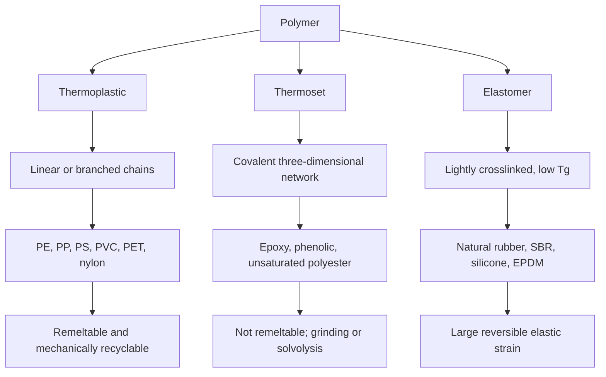
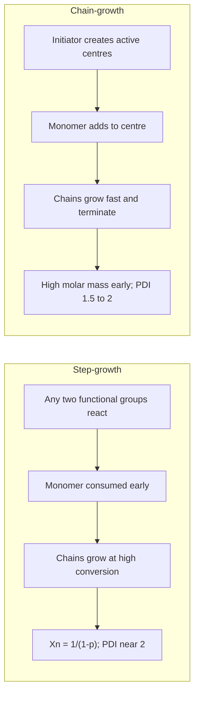
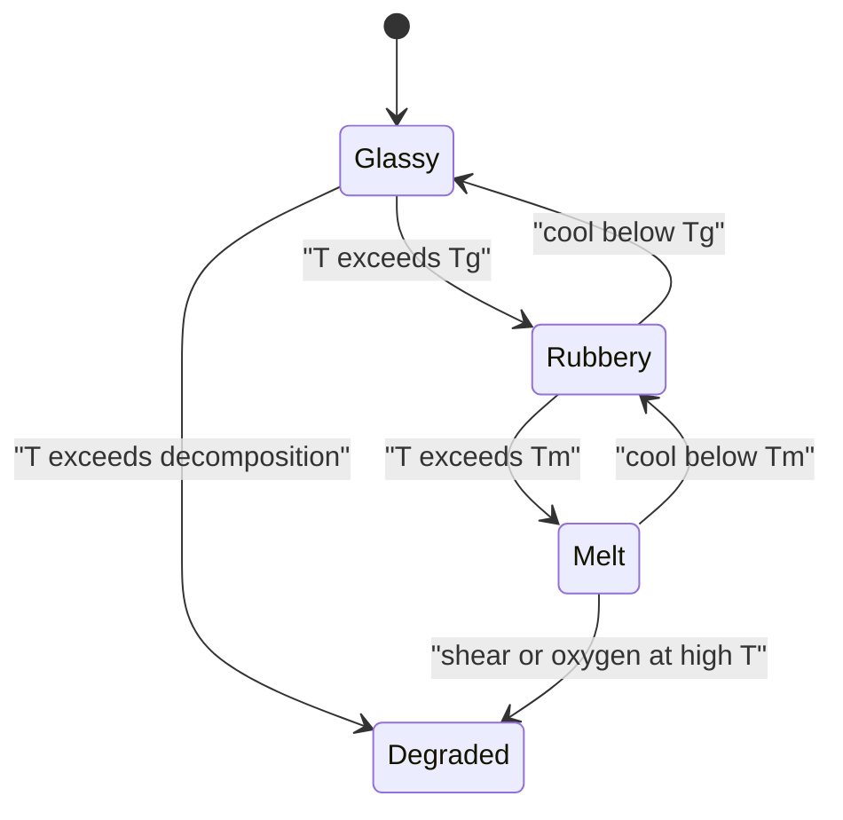

# Chapter 1 — Polymer Chemistry

> **Level:** Level 9 — Materials and Industrial Chemistry (advanced undergraduate / industrial)
> **Estimated study time:** 8 hours (reading) + 3 hours (exercises)
> **Prerequisites:** [Level 4 — Advanced Chemistry](../04-advanced-chemistry/README.md), especially [Chemical Kinetics and Reaction Mechanisms](../04-advanced-chemistry/05-chemical-kinetics-and-reaction-mechanisms.md), and [Organic Chemistry](../05-organic-chemistry/README.md)
> **Difficulty:** ★★★★☆ (4/5)
> **Related chapters:** [Nanochemistry](02-nanochemistry.md), [Materials and Semiconductor Chemistry](03-materials-and-semiconductor-chemistry.md), [Green and Sustainable Chemistry](../11-environmental-chemistry/01-green-and-sustainable-chemistry.md)

---

## 1. Learning Objectives

After working through this chapter you will be able to:

- Define monomer, repeat unit, oligomer, degree of polymerisation and molar mass.
- Compute $M_n$ and $M_w$ from a distribution and interpret the polydispersity index.
- Write mechanisms for step-growth and chain-growth polymerisation, including
  free-radical, ionic, coordination and ring-opening routes.
- Predict step-growth molar mass from stoichiometry and conversion, and locate
  the gel point.
- Classify copolymers by architecture and explain how reactivity ratios control
  composition and tacticity controls crystallinity.
- Connect chain conformation and free volume to $T_g$, $T_m$ and viscoelasticity.
- Compare thermoplastics, thermosets and elastomers, and explain crosslinking.
- Select an industrial polymerisation technique for a stated product.
- Explain hydrolytic, photochemical and thermal degradation, and evaluate
  mechanical, chemical and feedstock recycling.
- Distinguish bio-based, biodegradable and compostable, and state the limits of
  each claim.
- Interpret GPC/SEC, DSC, TGA, FTIR and NMR data for a polymer sample.

---

## 2. Introduction

A polyethylene bag, a PET bottle, a car tyre and a DNA molecule are all polymers:
covalent chains built by joining small molecules, often thousands of times. The
consequences are not merely quantitative. A chain of molar mass
$10^{5}\ \text{g mol}^{-1}$ entangles with its neighbours, dissolves slowly, forms
a glass rather than a crystal on cooling, and loses strength above a temperature
that depends on how the chains pack. None of these properties can be read off the
monomer.

Polymers are also where chemistry meets the circular-economy problem most
visibly. Global plastics production is of order $4\times10^{8}$ tonnes per year,
and only a minority of that mass is recycled. The chemical reasons are specific:
carbon–carbon backbones are inert by design, additives complicate reprocessing,
and mixed streams cannot be separated economically by melting point alone.

This chapter builds vocabulary and mechanisms, then structure–property
relationships, then industrial and environmental consequences. It assumes radical
and ionic mechanisms, Gibbs energy and intermolecular forces. Two warnings frame
it: "polymer" is not one substance class, and safety data are not transferable
between polymers, because additives, residual monomers, solvents and processing
temperatures govern hazard. Nothing here is an operating procedure.

---

## 3. Fundamental Concepts

### 3.1 Monomers, repeat units and degree of polymerisation

A **monomer** supplies the repeating unit. A **repeat unit** is the smallest
constitutional unit whose repetition generates the chain. For addition polymers it
contains the same atoms as the monomer; for condensation polymers it is smaller
because a small molecule is eliminated.

| Polymer | Repeat unit | $M_0$ / g mol⁻¹ |
|---|---|---|
| Polyethylene (PE) | $\ce{-CH2-CH2-}$ | 28.05 |
| Polypropene (PP) | $\ce{-CH2-CH(CH3)-}$ | 42.08 |
| Polystyrene (PS) | $\ce{-CH2-CH(C6H5)-}$ | 104.15 |
| Poly(vinyl chloride) (PVC) | $\ce{-CH2-CHCl-}$ | 62.50 |
| Poly(methyl methacrylate) (PMMA) | $\ce{-CH2-C(CH3)(CO2CH3)-}$ | 100.12 |
| Nylon-6,6 | $\ce{-NH-(CH2)6-NH-CO-(CH2)4-CO-}$ | 226.32 |
| PET | $\ce{-O-CH2-CH2-O-CO-C6H4-CO-}$ | 192.17 |

The **degree of polymerisation** $X$ is the number of repeat units per chain:
$M = X M_0 + M_\text{end}$, where the end-group term is negligible above
$X \approx 50$. Commercial polymers have $X$ between 100 and $10^{5}$; below about
ten repeat units the substance is an **oligomer**, with a definite molar mass and
no entanglement. A **backbone** is the continuous path through the chain;
**side groups** hang from it. Branching and crosslinking are topological features,
not compositional ones: polyethylene can be linear, branched or crosslinked with
one repeat unit.

### 3.2 Molar mass distributions

Synthetic polymerisation is stochastic, so a sample contains chains of many
lengths. For $N_i$ chains of molar mass $M_i$,

$$
M_n = \frac{\sum_i N_i M_i}{\sum_i N_i}, \qquad
M_w = \frac{\sum_i N_i M_i^2}{\sum_i N_i M_i}, \qquad
\mathrm{PDI} = \frac{M_w}{M_n}.
$$

$M_n$ is the **number-average**: colligative methods count molecules, so every
chain contributes equally. $M_w$ is the **mass-average**: light scattering depends
on chain mass, so large chains dominate. The ratio is the **polydispersity index**
(PDI, or dispersity Đ); it equals 1 for a monodisperse sample and cannot be less.
The **viscosity-average** $M_v$ lies between $M_n$ and $M_w$, closer to $M_w$.

The **most probable** step-growth distribution is the Flory distribution, for
which $M_w/M_n \to 2$ at high conversion. Ideal living chain-growth gives a
Poisson distribution with $\mathrm{PDI} \to 1 + 1/X$. Conventional radical
polymerisation gives $1.5 \lesssim \mathrm{PDI} \lesssim 2.0$ for combination
termination and more when transfer intervenes: these are diagnostic signatures.

### 3.3 Step-growth polymerisation

In **step-growth** (polycondensation) polymerisation any two molecules carrying
complementary functional groups react. Monomer disappears early, oligomers build
up and long chains appear only near the end. Molar mass is controlled by
conversion and stoichiometry, not by initiator. For a stoichiometric
bifunctional system the **Carothers equation** is

$$
X_n = \frac{1}{1-p},
$$

where $p$ is the **extent of reaction**, the fraction of functional groups that
have reacted. $X_n = 100$ requires $p = 0.99$; $X_n = 200$ requires $p = 0.995$.
The last per cent of conversion makes nearly all the molar mass, so step-growth
demands high purity, exact stoichiometry and efficient removal of the condensate.

With a stoichiometric imbalance $r = N_A/N_B \le 1$,

$$
X_n = \frac{1+r}{1+r-2rp},
$$

which at complete conversion becomes $X_n = (1+r)/(1-r)$. A 1 % excess caps
$X_n$ near 199 however long the reaction runs; monofunctional impurities do the
same and are called **chain stoppers**. Monomers with more than two functional
groups create branches and eventually a network. The **gel point** is the
conversion at which $M_w$ diverges and an insoluble fraction appears:

$$
p_c = \frac{1}{1 + r(f-2)} \ (r \ne 1), \qquad
p_c = \frac{1}{f-1} \ (r = 1),
$$

with $f$ the functionality of the branch monomer. The Carothers estimate
$p_c = 2/\bar f$ is a mean-field approximation that ignores intramolecular
cyclisation and therefore underestimates $p_c$.

### 3.4 Chain-growth polymerisation

In **chain-growth** (addition) polymerisation monomer adds to a small number of
active centres — radicals or ions — and the chain grows by successive insertion.
Monomer concentration falls steadily, while molar mass is set early and changes
little with conversion. Each centre lives for milliseconds to seconds.

**Free-radical polymerisation** initiates by thermal decomposition of a peroxide
or azo compound:

$$
\ce{I ->[k_d] 2R.} \qquad R_i = 2fk_d[I],
$$

where $f$ is the **initiator efficiency**, the fraction of radicals that start a
chain. Propagation has rate $R_p = k_p[M][P.]$; termination by combination or
disproportionation removes two radicals:

$$
\ce{R_n. + R_m. ->[k_t] P_{n+m}} \quad \text{or} \quad
\ce{R_n. + R_m. ->[k_t] P_n + P_m}.
$$

The steady-state approximation gives

$$
R_p = k_p[M]\left(\frac{f k_d [I]}{k_t}\right)^{1/2},
\qquad
X_n = \frac{R_p}{R_i}\ \text{(disproportionation)}, \qquad
X_n = \frac{2R_p}{R_i}\ \text{(combination)}.
$$

The $[I]^{1/2}$ dependence is a fingerprint of bimolecular termination: doubling
the initiator raises the rate only by $\sqrt{2}$ and lowers the molar mass by
$\sqrt{2}$. Chain transfer to monomer, solvent or polymer ends one chain and
starts another; it lowers $X_n$ without changing $R_p$ much, and transfer to
polymer produces long branches.

**Living** polymerisation suppresses termination. In anionic polymerisation of
styrene by butyllithium each initiator starts one chain, so
$X_n = c_{\mathrm{M},0}/c_{\mathrm{I},0}$ and PDI approaches $1 + 1/X_n$;
sequential addition gives block copolymers. Cationic polymerisation is less
controlled because carbocations rearrange and transfer. **Coordination
polymerisation** with Ziegler–Natta catalysts ($\ce{TiCl4}$ on $\ce{MgCl2}$ plus
triethylaluminium) or metallocenes orients the monomer at a metal centre, giving
stereocontrol at 5–10 bar and 60–80 °C. **Ring-opening polymerisation** converts a
cyclic monomer such as lactide into a linear chain driven by ring strain.

### 3.5 Copolymers

A **copolymer** contains two or more residues. Architecture matters: random,
alternating, block, graft and gradient copolymers of identical overall composition
can behave completely differently. Composition follows the **Mayo–Lewis equation**:

$$
\frac{F_1}{F_2} = \frac{r_1 f_1^2 + f_1 f_2}{r_2 f_2^2 + f_1 f_2},
\qquad
r_1 = \frac{k_{11}}{k_{12}}, \quad r_2 = \frac{k_{22}}{k_{21}},
$$

where $f_i$ are feed mole fractions, $F_i$ instantaneous copolymer fractions and
$r_i$ **reactivity ratios**. $r_1 \approx r_2 \approx 1$ gives random
copolymerisation, $r_1 r_2 \approx 1$ with $r_2 \approx 0$ gives alternation, and
$r_1, r_2 \gg 1$ gives blocks. Because the feed drifts in batch, composition drift
is controlled by semi-batch feeding.

### 3.6 Tacticity and stereoregularity

When a repeat unit carries two different substituents on a backbone carbon, that
carbon is a stereocentre. The relative configuration of successive centres is
**tacticity**. In **diad** notation $m$ (meso) means adjacent centres have the
same configuration and $r$ (racemo) means opposite; **triads** $mm$, $mr$ and $rr$
describe three consecutive centres. **Isotactic** material has $mm$ dominant,
**syndiotactic** has $rr$ dominant, and **atactic** material has $mr$ dominant
with no long-range order.

Tacticity is decisive. Isotactic polypropene is a stiff crystalline thermoplastic
with $T_m \approx 165\ ^\circ\text{C}$; atactic polypropene is amorphous and
useless structurally, because only a regular chain packs into a lattice. Metallocene
and Ziegler–Natta catalysts control orientation; radical polymerisation cannot.

### 3.7 Conformation, morphology and the glass transition

Bond rotation generates a **random coil** whose size scales as
$R_g \propto N^{\nu}$, with $\nu \approx 0.6$ in a good solvent, $0.5$ in a theta
solvent and $1/3$ in a melt of strongly interacting chains. The **radius of
gyration** $R_g$ and end-to-end distance $R$ are the usual measures; for a
Gaussian coil $R_g^2 = R^2/6$.

Chains do not crystallise completely. **Amorphous** regions contain entangled,
disordered chains; **crystalline** regions contain chain-folded **lamellae**,
10–20 nm thick, stacked into **spherulites** visible under crossed polarisers.
The **degree of crystallinity** is

$$
\chi_c = \frac{\Delta H_f}{\Delta H_f^\circ}
\quad \text{or} \quad
\chi_c = \frac{1/\rho - 1/\rho_a}{1/\rho_c - 1/\rho_a},
$$

where $\Delta H_f^\circ$ is the heat of fusion of fully crystalline polymer and
$\rho$, $\rho_c$, $\rho_a$ are sample, crystalline and amorphous densities.

The **glass transition** $T_g$ is a kinetic freezing of cooperative segmental
motion, not a thermodynamic phase transition. Below $T_g$ the material is a hard,
brittle glass; above it, amorphous regions are rubbery or fluid. The **melting
temperature** $T_m$ is a first-order transition of the crystalline phase, always
above $T_g$, and depends on lamellar thickness. For a random copolymer $T_g$ is
estimated by the **Fox equation**,

$$
\frac{1}{T_g} = \frac{w_1}{T_{g1}} + \frac{w_2}{T_{g2}},
$$

with $w_i$ mass fractions. Plasticisers act the same way, lowering $T_g$ by
increasing free volume: PVC is rigid without plasticiser and flexible with it.

### 3.8 Thermoplastics, thermosets and elastomers

| Class | Network | On heating | Examples |
|---|---|---|---|
| Thermoplastic | Linear or branched, no covalent crosslinks | Softens, flows, remeltable | PE, PP, PS, PVC, PET, nylon |
| Thermoset | Covalently crosslinked network | Does not flow; decomposes | Epoxy, phenolic, unsaturated polyester |
| Elastomer | Lightly crosslinked, $T_g$ below service | Large reversible extension | Natural rubber, SBR, silicone, EPDM |

A **thermoset** is formed by a curing reaction that creates a three-dimensional
network. Because the network is covalent, it cannot be remelted; it can only be
ground as filler or chemically solvolysed. An **elastomer** is a network with low
crosslink density: chains between crosslinks uncoil under stress, and the entropy
of the coiled state provides the restoring force. Rubber elasticity is therefore
entropic, and the modulus rises with temperature — the opposite of a metal spring.

**Vulcanisation** of natural rubber with sulfur and an accelerator forms mono-,
di- and polysulfide bridges between allylic sites of polyisoprene. The sulfur rank
controls the balance of strength, heat resistance and fatigue life: polysulfidic
networks are flexible and fatigue-resistant but age poorly; monosulfidic networks
are heat-stable but brittle.

---

## 4. Detailed Scientific Explanation

### 4.1 Mechanism selection in practice

The same monomer can be polymerised by different mechanisms, and the mechanism
determines microstructure. Ethene by radical polymerisation at 200 °C and 2000 bar
gives LDPE with long and short branches, because chain transfer competes with
propagation. Ethene by Ziegler–Natta or Phillips catalysis at 5–40 bar gives HDPE
with little branching and higher crystallinity. Propene is more demanding: radical
polymerisation gives atactic material, Ziegler–Natta gives isotactic PP, and
metallocenes give isotactic or syndiotactic PP depending on ligand symmetry.

### 4.2 Industrial polymerisation techniques

| Technique | Medium | Heat removal | Product | Typical polymers |
|---|---|---|---|---|
| Bulk | Monomer only | Poor; viscosity limits conversion | Pellets or sheet | PS, PMMA, LDPE |
| Solution | Inert solvent | Good | Dilute solution | PVA, acrylics |
| Suspension | Water + stabiliser | Good | Beads 0.1–1 mm | PVC, PS, PMMA |
| Emulsion | Water + surfactant | Excellent | Latex 50–500 nm | SBR, PVAc, PTFE |
| Gas phase | Gaseous monomer, fluidised bed | Good | Granules | HDPE, LLDPE, PP |

**Bulk** polymerisation is simplest and purest but suffers **autoacceleration**
(the Trommsdorff–Norrish effect): rising viscosity makes termination
diffusion-limited, so radicals accumulate and the rate accelerates while the
distribution broadens. **Suspension** polymerisation disperses monomer droplets in
water with a protective colloid, each droplet acting as a small bulk reactor.
**Emulsion** polymerisation nucleates particles in surfactant micelles and grows
them from radicals in the aqueous phase. **Gas-phase** processes with supported
catalysts avoid solvent entirely and dominate modern polyolefin production.

### 4.3 Viscoelasticity

A polymer melt is **viscoelastic**: it stores elastic energy over short times and
dissipates it over long times. The response depends on the **Deborah number**
$\mathrm{De} = \tau_\text{relax}/\tau_\text{obs}$: $\mathrm{De} \gg 1$ gives glassy
elastic response, $\mathrm{De} \ll 1$ gives flow. Above the entanglement molar
mass, chains form a transient network with a **plateau modulus** nearly
independent of molar mass, and the zero-shear viscosity scales as
$\eta_0 \propto M^{3.4}$ rather than $M^1$. Doubling the molar mass therefore
raises melt viscosity more than eightfold, which is why processing windows are
tight. **Creep** is time-dependent strain at constant stress; **stress relaxation**
is the decay of stress at constant strain. A **Maxwell model** gives
$\sigma(t) = \sigma_0 \exp(-t/\tau)$ with $\tau = \eta/E$, capturing the
qualitative behaviour but not the distribution of relaxation times.

### 4.4 Mechanical properties and additives

The **stress–strain curve** gives modulus, yield strength, strain at break and
toughness. Semicrystalline polymers are stiff below $T_g$, leathery between $T_g$
and $T_m$, and fluid above $T_m$; amorphous polymers have no melting transition.

Commercial polymers contain **additives**. **Plasticisers** (phthalates, citrates,
adipates) lower $T_g$; some phthalates are restricted for reproductive toxicity.
**Stabilisers** include hindered amine light stabilisers, UV absorbers, phenolic
antioxidants and calcium–zinc stabilisers for PVC. **Fillers** such as calcium
carbonate, talc and glass fibre raise modulus and reduce cost. **Flame
retardants** range from halogenated compounds to phosphorus esters, aluminium
hydroxide and expandable graphite. Additives complicate recycling: a mixed stream
carries an unknown package, some of it restricted, so mechanical recycling needs
mono-stream collection or a tolerant specification.

### 4.5 Degradation

**Hydrolysis** breaks ester, amide and carbonate bonds, catalysed by acid or base
and accelerated by heat and water uptake. PET hydrolyses slowly at ambient
temperature but rapidly in steam or hot alkali, which is both the basis of
alkaline depolymerisation and the failure mode of polyester fibres in hot humid
service.

**Photo-oxidation** starts with UV absorption by chromophores — carbonyl
impurities, catalyst residues, additives — because the C–H bond does not absorb
strongly above 290 nm. The Norrish reactions cleave the backbone:

$$
\ce{R-CO-CH2-CH2-R' ->[h\nu] R-CO. + .CH2-CH2-R'},
$$

followed by Norrish type II hydrogen abstraction and further scission. The result
is surface embrittlement, chalking and crack initiation; HALS and UV absorbers
retard it. **Thermal degradation** depends on the backbone: PMMA depolymerises
almost quantitatively to monomer above about 300 °C, polyethylene undergoes random
scission and crosslinking, and PVC releases HCl, leaving a coloured polyene whose
further degradation is catalysed by the HCl. Antioxidants extend the induction
period before rapid oxidation, measured as oxidative induction time by DSC.

### 4.6 Recycling routes

| Route | Principle | Products | Limitations |
|---|---|---|---|
| Mechanical | Sort, wash, melt, repelletise | Regranulate | Chain scission, contamination |
| Chemical | Depolymerise to monomers | PET monomers, polyols, lactide | Only condensation or ring-opening polymers |
| Feedstock | Pyrolysis or gasification | Oil, syngas | Energy input; mixed feeds |
| Energy recovery | Controlled combustion | Heat, electricity | CO₂; material value lost |
| Dissolution | Selective solvent | Polymer with retained mass | Solvent recovery; narrow feed |

**Mechanical recycling** is the default for PET bottles, HDPE containers and PP
crates. It requires sorting by polymer type (near-infrared, density, flotation),
removal of caps and labels, washing, drying and reprocessing with a stabiliser
package. Each melt pass shortens the chains, so recycled PET has lower intrinsic
viscosity and higher acetaldehyde than virgin resin.

**Chemical recycling** is selective. PET can be glycolysed to
bis(2-hydroxyethyl) terephthalate, methanolysed to dimethyl terephthalate, or
hydrolysed to terephthalic acid and ethylene glycol; polyurethanes can be
glycolysed to polyols, polylactide to lactide and PMMA to monomer. The route is
attractive only where the polymer was made by a reversible step-growth or
ring-opening process; polyolefins resist depolymerisation because their C–C bonds
are strong and unselective. **Feedstock recycling** accepts mixed waste and returns
hydrocarbons or syngas, losing the polymer organisational energy and requiring
honest mass and energy accounting.

### 4.7 Biopolymers and biodegradability

**Bio-based** means the carbon came recently from biomass; **biodegradable** means
microorganisms can mineralise the material under defined conditions;
**compostable** means it meets a standard such as EN 13432 or ASTM D6400, which
requires disintegration, biodegradation and ecotoxicity limits. The words are not
synonyms.

**PLA** is made by ring-opening polymerisation of lactide from starch. It is
compostable industrially at 55–60 °C but hydrolyses very slowly in soil or
seawater, so a discarded PLA cup behaves much like conventional plastic for years.
**PHA** polyhydroxyalkanoates are made by fermentation and biodegrade in soil and
marine environments, but cost several times more than polyolefins. **Starch
blends** are partly biodegradable. **Bio-PE** is chemically identical to fossil PE
and is **not** biodegradable; its benefit is the renewable feedstock.
**Oxo-degradable** additives fragment polyolefins into microplastics and are
restricted in the EU because fragmentation is not biodegradation. Biodegradability
is a systems property of chemistry, thickness and receiving environment.

### 4.8 Characterisation

**Gel-permeation chromatography (GPC)**, or size-exclusion chromatography,
separates dissolved polymer by hydrodynamic volume: large molecules are excluded
from the pores and elute first. Polystyrene calibration gives relative molar mass;
absolute values need light scattering or universal calibration with the
Mark–Houwink relation $\left[\eta\right] = K M_v^{a}$.

**DSC** gives $T_g$ as a step in heat capacity and $T_m$, $\Delta H_f$ and
crystallinity from the melting endotherm; heating and cooling rates must be
stated. **TGA** separates volatiles, backbone scission and inorganic residue,
**FTIR** identifies oxidation products, **NMR** gives tacticity and sequence
distribution, and **DMA** separates $T_g$ from secondary relaxations.

---

## 5. Visual Diagrams

**Figure 1.1 — The three commercial classes of polymer.** The division is
topological, not chemical: the same repeat unit can give a thermoplastic or a
thermoset depending on whether crosslinks are introduced. The end-of-life
consequence follows directly from whether the network is covalent and permanent.

**Figure 1.2 — Step-growth and chain-growth contrasted.** Molar mass is negligible
until the last few per cent of a step-growth reaction, whereas chain-growth molar
mass is high from the start. Step-growth therefore needs exact stoichiometry and
high purity; chain-growth needs control of initiator, transfer and termination.

**Figure 1.3 — Thermal regimes of a semicrystalline thermoplastic.** Below $T_g$
the material is a glass regardless of crystallinity; between $T_g$ and $T_m$ the
amorphous phase is rubbery while crystals reinforce it; above $T_m$ it flows.

---

## 6. Mathematical Formulas

$$
M_n = \frac{\sum_i N_i M_i}{\sum_i N_i}, \qquad
M_w = \frac{\sum_i N_i M_i^2}{\sum_i N_i M_i}, \qquad
\mathrm{PDI} = \frac{M_w}{M_n}.
$$

| Symbol | Meaning | SI unit |
|---|---|---|
| $N_i$ | Number of chains in fraction $i$ | 1 |
| $M_i$ | Molar mass of fraction $i$ | kg mol⁻¹ |
| $M_n$ | Number-average molar mass | kg mol⁻¹ |
| $M_w$ | Mass-average molar mass | kg mol⁻¹ |
| $\mathrm{PDI}$ | Polydispersity index | 1 |

$$
X_n = \frac{1}{1-p}, \qquad
X_n = \frac{1+r}{1+r-2rp}, \qquad
p_c = \frac{1}{1+r(f-2)}.
$$

| Symbol | Meaning | SI unit |
|---|---|---|
| $X_n$ | Number-average degree of polymerisation | 1 |
| $p$ | Extent of reaction | 1 |
| $r$ | Stoichiometric ratio $N_A/N_B \le 1$ | 1 |
| $f$ | Functionality of branch monomer | 1 |
| $p_c$ | Gel-point conversion | 1 |

$$
R_p = k_p c_\mathrm{M}\left(\frac{f k_d c_\mathrm{I}}{k_t}\right)^{1/2},
\qquad \nu = \frac{R_p}{R_i}, \qquad
\left[\eta\right] = K M_v^{a}.
$$

| Symbol | Meaning | SI unit |
|---|---|---|
| $R_p$ | Rate of polymerisation | mol m⁻³ s⁻¹ |
| $k_p$, $k_t$, $k_d$ | Rate constants | m³ mol⁻¹ s⁻¹ or s⁻¹ |
| $c_\mathrm{M}$, $c_\mathrm{I}$ | Monomer and initiator concentration | mol m⁻³ |
| $f$ | Initiator efficiency | 1 |
| $\nu$ | Kinetic chain length | 1 |
| $\left[\eta\right]$ | Intrinsic viscosity | m³ kg⁻¹ |

The assumptions are steady state for radicals, equal reactivity for Carothers and
dilute solution for Mark–Houwink; none is exact for a real reactor.

---

## 7. Chemical Equations

$$
\ce{n H2N-(CH2)6-NH2(l) + n HOOC-(CH2)4-COOH(s) ->[-H2O] [-NH-(CH2)6-NH-CO-(CH2)4-CO-]_{n}(s)}
$$

$$
\ce{n HO-CH2-CH2-OH(l) + n HOOC-C6H4-COOH(s) ->[-H2O] [-O-CH2-CH2-O-CO-C6H4-CO-]_{n}(s)}
$$

$$
\ce{R. + n CH2=CH2(g) -> R-[CH2-CH2]_{n}.}
$$

$$
\ce{n C3H4O2(s) ->[Sn(Oct)2] [-O-CH(CH3)-CO-]_{n}(s)}
$$

The first two are condensations, the third radical propagation and the fourth
ring-opening. Conditions explain selectivity; they are not operating instructions.

---

## 8. Worked Examples

### Worked Example 8.1 — Number-average, mass-average and PDI

**Problem.** A polyethylene sample contains five fractions: 10 g at
10 000 g mol⁻¹, 20 g at 20 000 g mol⁻¹, 40 g at 50 000 g mol⁻¹, 20 g at
100 000 g mol⁻¹ and 10 g at 200 000 g mol⁻¹. Compute $M_n$, $M_w$ and PDI.

**Strategy.** Convert each mass to moles, sum, then apply the definitions; the
total mass is 100 g, so mass fractions are the percentages directly.

**Solution.** The mole numbers are 1.00, 1.00, 0.80, 0.20 and 0.05 mmol, total
3.05 mmol, so $M_n = 100/3.05 = 32\,787\ \text{g mol}^{-1}$. For $M_w$,

$$
M_w = 0.10(10\,000) + 0.20(20\,000) + 0.40(50\,000) + 0.20(100\,000) + 0.10(200\,000)
= 65\,000\ \text{g mol}^{-1},
$$

and $\mathrm{PDI} = 65\,000/32\,787 = 1.98$.

**Check.** The PDI is close to 2, as expected for a broad radical or step-growth
distribution. $M_w$ exceeds $M_n$ because the 200 000 g mol⁻¹ fraction contributes
10 % of the mass but only 1.6 % of the molecules.

### Worked Example 8.2 — Extent of reaction for a target molar mass

**Problem.** Nylon-6,6 has repeat-unit molar mass 226.32 g mol⁻¹. (a) What extent of
reaction gives $M_n = 25\,000\ \text{g mol}^{-1}$? (b) What is $M_n$ at
$p = 0.980$? (c) What conversion is needed for gelation with a trifunctional
monomer?

**Strategy.** Use $X_n = 1/(1-p)$ for a stoichiometric bifunctional system and
$X_n = M_n/M_0$; for the branched system use $p_c = 1/(f-1)$.

**Solution.** (a) $X_n = 25\,000/226.32 = 110.5$, so $p = 1 - 1/110.5 = 0.9909$.
(b) $X_n = 1/(1-0.980) = 50.0$, so $M_n = 50.0 \times 226.32 =
11\,316\ \text{g mol}^{-1}$. (c) With $f = 3$, $p_c = 1/(3-1) = 0.50$.

**Check.** A $p$ above 0.99 is the industrial target for nylon fibre, which is why
water is removed continuously and the diamine/diacid balance is controlled. Part
(b) shows the steepness: a 1 % loss of conversion halves $M_n$.

### Worked Example 8.3 — Rate and chain length in radical polymerisation

**Problem.** Styrene is polymerised at 60 °C with
$c_\mathrm{M} = 5.0\ \text{mol dm}^{-3}$,
$c_\mathrm{I} = 0.010\ \text{mol dm}^{-3}$,
$k_p = 2.0\times10^{3}\ \text{dm}^3\text{mol}^{-1}\text{s}^{-1}$,
$k_t = 2.0\times10^{7}\ \text{dm}^3\text{mol}^{-1}\text{s}^{-1}$,
$k_d = 1.0\times10^{-5}\ \text{s}^{-1}$ and $f = 0.60$. Compute $R_p$, the kinetic
chain length and $X_n$ for combination termination.

**Strategy.** Apply the steady-state rate law, then divide by
$R_i = 2fk_d c_\mathrm{I}$.

**Solution.** $fk_d c_\mathrm{I} = 6.0\times10^{-8}\ \text{mol dm}^{-3}\text{s}^{-1}$
and $fk_d c_\mathrm{I}/k_t = 3.0\times10^{-15}\ \text{mol dm}^{-3}$, whose square
root is $5.48\times10^{-8}$. Thus $R_p = (2.0\times10^{3})(5.0)(5.48\times10^{-8})
= 5.48\times10^{-4}\ \text{mol dm}^{-3}\text{s}^{-1}$.
$R_i = 1.20\times10^{-7}\ \text{mol dm}^{-3}\text{s}^{-1}$, so
$\nu = 4.56\times10^{3}$ and $X_n = 2\nu = 9.1\times10^{3}$.

**Check.** The rate is typical for bulk styrene at 60 °C, and a molar mass near
$10^{6}\ \text{g mol}^{-1}$ is plausible before transfer limits it. Adding a
transfer constant would lower $X_n$ without changing $R_p$.

### Worked Example 8.4 — Crystallinity from density and from DSC

**Problem.** A polyethylene sample has density $0.940\ \text{g cm}^{-3}$; the
crystalline and amorphous densities are 1.004 and $0.855\ \text{g cm}^{-3}$. A DSC
run on 5.00 mg gives a melting endotherm of 0.225 J; the heat of fusion of fully
crystalline polyethylene is $293\ \text{J g}^{-1}$. Compute crystallinity by both
methods and comment.

**Strategy.** Use the two-phase density relation and
$\chi_c = \Delta H_f/\Delta H_f^\circ$.

**Solution.** Density method:

$$
\chi_c = \frac{1/0.940 - 1/0.855}{1/1.004 - 1/0.855}
= \frac{-0.1058}{-0.1736} = 0.609.
$$

DSC method: $\Delta H_f = 0.225/5.00\ \text{mg} = 45.0\ \text{J g}^{-1}$, so
$\chi_c = 45.0/293 = 0.154$.

**Check.** The values differ by a factor of four: the density value describes a
slowly cooled, annealed sample, the DSC value a rapidly cooled film with small,
imperfect lamellae. Neither is wrong; reporting crystallinity without method and
thermal history is meaningless.

---

## 9. Real-World Applications

Polyolefins dominate packaging because they are cheap, inert and easily
melt-processed. HDPE bottles, LDPE film and PP caps have mature recycling
streams, though only PET has a bottle-to-bottle infrastructure at scale. PVC
dominates pipes and cable insulation, and its plasticiser content is the main
regulatory issue. Expanded PS is difficult to recycle because of its low bulk
density.

Engineering polymers trade cost for temperature and strength: polyamides in gears,
polycarbonate in glazing and electronics, polyetheretherketone in aerospace.
Thermosets dominate where a permanent network is essential: epoxy in composites,
phenolic resins in brake linings and unsaturated polyester in wind-turbine blades.
Elastomers serve as tyres, seals and hoses, and cannot be remelted.

Degradable polyesters — PLA, PLGA, polycaprolactone — serve as sutures and
drug-delivery matrices because they hydrolyse to metabolites; the design
requirement is controlled hydrolysis, the opposite of a pipe.

---

## 10. Common Mistakes

| Mistake | Why it happens | Correct approach |
|---|---|---|
| Using $M_w$ and $M_n$ interchangeably | Both are called "molecular weight" | State the average and the method; melt viscosity tracks $M_w$, osmosis and end-group titration track $M_n$ |
| Treating a narrow PDI as "better" | Narrow distributions are associated with living polymerisation | PDI is a process signature; a broad distribution may be deliberate for processing |
| Assuming high conversion means high molar mass | True for step-growth, false for radical chain-growth | In radical polymerisation, more initiator lowers $M_n$ even at full conversion |
| Treating $T_g$ as a melting point | Both are "softening" transitions | $T_g$ is kinetic and rate-dependent; $T_m$ is a first-order transition of a crystal |
| Calling bio-based plastics biodegradable | Marketing conflates feedstock and end of life | Check certification and receiving environment; bio-PE is not biodegradable |
| Assuming all recycling is equivalent | Mechanical, chemical and feedstock routes are conflated | Report route, yield and product quality |
| Ignoring additives in recycling | Additives are invisible in the polymer name | Obtain a full material declaration; restricted flame retardants can block a route |
| Comparing $T_g$ at different heating rates | $T_g$ depends on thermal history and rate | Compare at the same rate after an identical cooling programme |

---

## 11. Chapter Summary

- Polymers are chains of repeat units; molar mass, distribution and architecture
  determine properties as much as composition does.
- $M_n$ counts molecules, $M_w$ weights them by mass, and PDI is a process signature.
- Step-growth needs high conversion; chain-growth is controlled by initiator,
  transfer and termination.
- Radical, ionic, coordination and ring-opening mechanisms give different
  microstructures from the same monomer.
- Tacticity and crystallinity control stiffness, melting and barrier properties.
- $T_g$ is a kinetic glass transition, $T_m$ a first-order melting transition; both
  define service and processing windows.
- Thermoplastics can be remelted; thermosets and elastomers are networks and cannot.
- Hydrolysis, photo-oxidation and heat limit service life and enable or obstruct
  recycling.
- Mechanical recycling preserves value but suffers chain scission; chemical
  recycling is selective; biodegradability is a systems property, not a synonym
  for bio-based.

---

## 12. Exercises

### 12.1 Conceptual questions

1. Why does step-growth polymerisation need 99 % conversion for a useful molar
   mass, whereas radical polymerisation reaches high molar mass at low conversion?
2. Explain why doubling the initiator concentration raises the rate by only about
   40 % and lowers the molar mass.
3. Distinguish tacticity from copolymer sequence and explain why both affect
   crystallinity.

### 12.2 Basic problems

4. A polymer has $M_n = 20\,000$ and $M_w = 40\,000\ \text{g mol}^{-1}$. What is the
   PDI, and what does it suggest about the mechanism?
5. A polyamide repeat unit has molar mass 113.16 g mol⁻¹. What degree of
   polymerisation corresponds to $M_n = 30\,000\ \text{g mol}^{-1}$?
6. Sketch the expected DSC traces of an amorphous and a semicrystalline polymer of
   the same $T_g$, labelling the transitions.

### 12.3 Intermediate problems

7. A step-growth reaction has $r = 0.98$. Calculate $X_n$ at $p = 0.995$ and at
   $p = 1.000$, and explain the difference.
8. A copolymer feed contains 30 mol % monomer 1 with $r_1 = 0.5$ and $r_2 = 2.0$.
   Calculate the instantaneous copolymer composition.
9. Explain why a polysulfidic network has better fatigue resistance but poorer heat
   ageing than a monosulfidic network.

### 12.4 Advanced problems

10. Derive $R_p \propto [I]^{1/2}$ from the steady-state approximation, stating
    every assumption, and explain what changes if termination is first order.
11. A PET sample has intrinsic viscosity 0.75 dL g⁻¹. Using
    $K = 2.1\times10^{-4}$ dL g⁻¹ and $a = 0.82$, estimate $M_v$ and discuss the
    uncertainty.
12. A mixed stream contains 60 % PE, 25 % PP and 15 % PET. Propose a sorting and
    recycling sequence and identify the stream that limits product quality.

### Answers

1. Step-growth molar mass is $1/(1-p)$ and diverges only as $p \to 1$; radical chains
   reach full length within milliseconds.
2. $R_p \propto [I]^{1/2}$: doubling $[I]$ raises the rate by 1.41 and lowers $X_n$.
3. Tacticity is the configuration along one chain; sequence is the order of residues;
   both disrupt lattice regularity.
4. PDI = 2.0, typical of step-growth or broad radical polymerisation.
5. $X_n = 30\,000/113.16 = 265$.
6. Amorphous: a step at $T_g$. Semicrystalline: that step plus a melting endotherm.
7. $X_n = 1.98/(1.98 - 1.951) = 68.3$; at $p = 1$, $X_n = 99$.
8. $F_1/F_2 = 0.255/1.19 = 0.214$, so $F_1 = 0.176$: richer in monomer 2 than the feed.
9. Polysulfide bridges exchange and redistribute stress; they also oxidise and
   revert more easily at high temperature.
10. Set $\mathrm{d}[P.]/\mathrm{d}t = 0$, equate initiation and termination, then
    substitute into $R_p$; first-order termination gives $R_p \propto [I]$.
11. $M_v = (3571)^{1.22} = 2.3\times10^{4}\ \text{g mol}^{-1}$, with perhaps 10–20 %
    uncertainty from solvent- and temperature-specific constants.
12. Density or near-infrared sorting removes PET; PE and PP are separated by density
    or triboelectric methods. PET limits quality because traces of PVC or PLA
    yellow at its processing temperature.

---

## 13. Further Reading

- Callister, W. D. and Rethwisch, D. G. *Materials Science and Engineering: An
  Introduction*, 10th ed., Wiley, 2018. Chapters on polymers and composites.
- West, A. R. *Solid State Chemistry and its Applications*, 2nd ed., Wiley, 2014.
- Cowie, J. M. G. and Arrighi, V. *Polymers: Chemistry and Physics of Modern
  Materials*, 3rd ed., CRC Press, 2007.
- Odian, G. *Principles of Polymerization*, 4th ed., Wiley, 2004.
- Sperling, L. H. *Introduction to Physical Polymer Science*, 4th ed., Wiley, 2006.
- IUPAC. *Compendium of Chemical Terminology* (Gold Book).
  <https://goldbook.iupac.org/>
- European Commission. *EU Strategy for Plastics in the Circular Economy*.
  <https://environment.ec.europa.eu/>
- Ellen MacArthur Foundation. *The New Plastics Economy* reports.
  <https://ellenmacarthurfoundation.org/>

See [CURRICULUM.md](../CURRICULUM.md), [GLOSSARY.md](../GLOSSARY.md) and
[REFERENCES.md](../REFERENCES.md).
