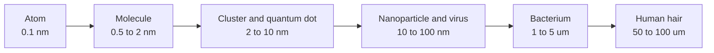
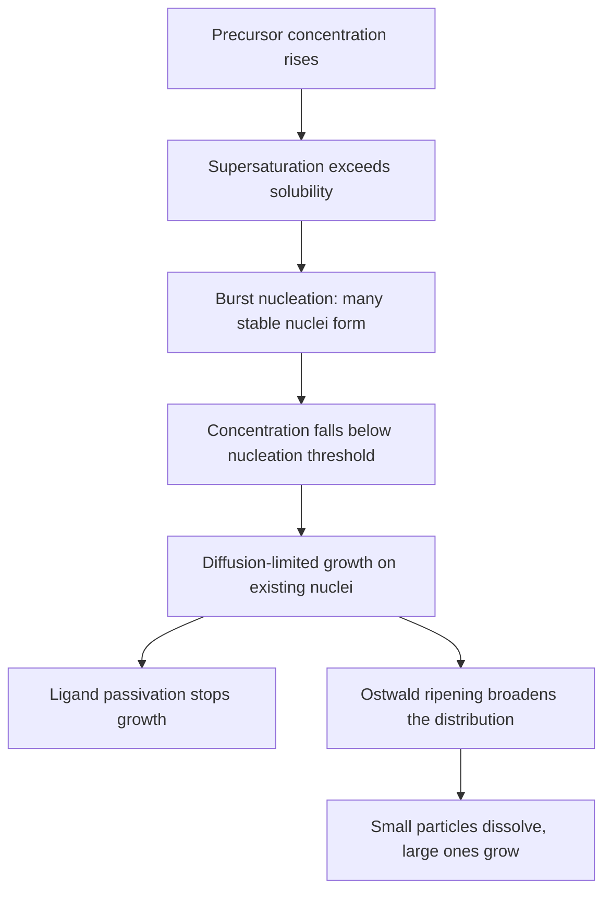
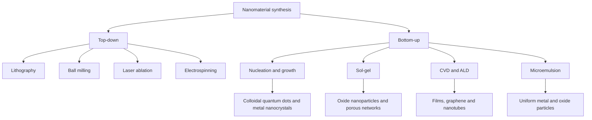

# Chapter 2 — Nanochemistry

> **Level:** Level 9 — Materials and Industrial Chemistry (advanced undergraduate / research-facing)
> **Estimated study time:** 7 hours (reading) + 3 hours (exercises)
> **Prerequisites:** [Crystal Structures and Defects](../06-inorganic-chemistry/06-solid-state-chemistry-crystal-structures-and-defects.md); [Quantum Mechanics Foundations](../04-advanced-chemistry/01-quantum-mechanics-foundations.md); [Chemical Kinetics and Reaction Mechanisms](../04-advanced-chemistry/05-chemical-kinetics-and-reaction-mechanisms.md); [Intermolecular Forces](../03-intermediate-chemistry/05-intermolecular-forces.md)
> **Difficulty:** ★★★★★ (5/5)
> **Related chapters:** [Polymer Chemistry](01-polymer-chemistry.md), [Materials and Semiconductor Chemistry](03-materials-and-semiconductor-chemistry.md)

---

## 1. Learning Objectives

After working through this chapter you will be able to:

- Define the nanoscale and explain why properties change at that scale.
- Separate surface-area effects from quantum-confinement effects with examples.
- Classify nanomaterials by dimensionality, composition and porosity.
- Compare top-down and bottom-up synthesis and select a route for a target size.
- Explain the LaMer model of nucleation and growth, including size focusing and
  Ostwald ripening.
- Interpret size-tunable quantum-dot emission with the Brus equation.
- Describe steric and electrostatic stabilisation and apply DLVO reasoning.
- Explain self-assembly at interfaces and in block copolymers.
- Select characterisation methods for size, shape, surface and porosity.
- Assess nanomaterial toxicity, fate and the precautionary principle honestly.
- Evaluate applications in medicine, energy and electronics against their
  performance and hazard trade-offs.

---

## 2. Introduction

Gold is yellow, inert and a good conductor. A suspension of 5 nm gold particles
is red, catalytically active and melts far below 1064 °C. Neither observation is
explained by a new element: the particles contain the same atoms in the same
face-centred cubic lattice. What changed is the fraction of atoms at the surface
and the confinement of electrons to a box only a few nanometres wide.

"Nanochemistry" is the chemistry of matter with at least one dimension between
about 1 and 100 nm, where the surface-to-volume ratio and the electronic density
of states become size-dependent. The field is old in practice — colloidal gold
was used to stain glass in Roman times — and young in its mechanistic
understanding. What changed after the 1980s was the ability to make particles of
controlled size, shape and surface chemistry, and to see them atom by atom.

The chapter is organised around three questions: how are nanomaterials made, how
does size control property, and what happens when they enter the environment or
the body? The third is not an afterthought: nanomaterials are designed to be
reactive, and reactivity cuts both ways. Claims of benefit and harm must be
examined against dose, route, persistence and the specific material.

---

## 3. Fundamental Concepts

### 3.1 The nanoscale and why properties change

A nanometre is $10^{-9}$ m, roughly ten atomic diameters. The lower bound of the
usual 1–100 nm definition is where a particle still retains a recognisable
lattice; the upper bound is where surface effects become negligible. Both are
conventions, not physical walls.

Two distinct effects operate. The first is **surface-to-volume ratio**. For a
sphere of diameter $D$, the fraction of atoms at the surface scales roughly as
$4d_\text{atom}/D$, where $d_\text{atom}$ is an atomic diameter. A 5 nm gold
particle contains about 3900 atoms, of which roughly 28 % lie at the surface; a
5 µm particle has a surface fraction below 0.03 %. Surface atoms have fewer
neighbours, higher energy and different coordination, so surface energy, sintering
temperature and catalytic activity all rise as size falls.

The second effect is **quantum confinement**. Below the exciton Bohr radius —
about 5.6 nm for CdSe and 28 nm for GaAs — electron and hole energies become
quantised and the band gap increases as size falls, shifting absorption and
emission to shorter wavelength. A classical third effect is the **mean free path**
of electrons in metals, typically 10–40 nm: below that size, surface scattering
dominates resistivity. **Surface plasmon resonance** in gold and silver depends on
size, shape and dielectric environment, giving the red of gold colloids.

| Effect | Length scale | Observable consequence |
|---|---|---|
| Surface fraction | $< 100$ nm | Higher catalytic activity, lower sintering temperature |
| Quantum confinement | $< 5$–30 nm | Size-tunable band gap and emission |
| Electron mean free path | 10–40 nm | Increased resistivity in thin films and wires |
| Surface plasmon | 5–100 nm | Colour and refractive-index sensitivity |
| Superparamagnetism | $< 20$ nm | No hysteresis; magnetically guidable colloids |

### 3.2 Classification of nanomaterials

Nanomaterials are classified by dimensionality, meaning the number of dimensions
outside the nanoscale.

- **0D**: all three dimensions nanoscale — clusters, quantum dots, fullerenes.
- **1D**: two dimensions nanoscale — nanotubes, nanowires, nanorods.
- **2D**: one dimension nanoscale — graphene, transition-metal dichalcogenides,
  thin films.
- **3D**: nanostructured bulk — nanocomposites, nanoporous monoliths, MOFs.

| Material | Structure | Characteristic scale | Property driver |
|---|---|---|---|
| Fullerene $\ce{C60}$ | Truncated icosahedron, 60 atoms | 0.7 nm | Curvature and discrete orbitals |
| Single-walled carbon nanotube | Rolled graphene cylinder | 0.7–2 nm diameter | Chiral index sets metallic or semiconducting behaviour |
| Graphene | One-atom-thick hexagonal sheet | 0.34 nm thickness | Linear bands at the Dirac point |
| Quantum dot | Inorganic nanocrystal, often core–shell | 2–10 nm | Quantum confinement |
| Nanowire | Single-crystal rod | 10–100 nm diameter | High aspect ratio and surface depletion |
| Zeolite | Microporous aluminosilicate | Pores $< 2$ nm | Molecular sieving and acid sites |
| Metal–organic framework | Metal nodes linked by organic struts | Pores 1–10 nm | Exceptional surface area and tunable chemistry |

The **chiral index** $(n,m)$ of a carbon nanotube determines whether it is
metallic or semiconducting. Separating tubes by $(n,m)$ remains a manufacturing
problem, which is one reason nanotube electronics has not displaced silicon.

### 3.3 Top-down and bottom-up synthesis

**Top-down** methods carve or mill bulk material into nanostructures. They include
photolithography and electron-beam lithography, ball milling, laser ablation and
electrospinning. They are well suited to patterned devices and to materials that
cannot be grown from solution, but they produce broad size distributions, surface
damage and contamination, and they become expensive below about 20 nm.

**Bottom-up** methods assemble atoms or molecules into nanostructures. They include
nucleation and growth from solution, sol–gel processing, chemical vapour
deposition, colloidal synthesis and microemulsion methods. They can give narrow
size distributions, crystalline cores and designed surfaces, and they scale
industrially for oxides, metals and quantum dots. The price is sensitivity to
impurity, pH, temperature and mixing.

| Route | Typical size | Advantages | Limitations |
|---|---|---|---|
| Photolithography | $> 10$ nm | Precise placement; device integration | Cost; diffraction limit; damage |
| Ball milling | 10–1000 nm | Simple; broad materials range | Broad distribution; contamination |
| Sol–gel | 5–500 nm | Mild conditions; porous oxides | Shrinkage; residual organics |
| Colloidal synthesis | 2–20 nm | Narrow distribution; shape control | Ligands required; scale-up mixing |
| CVD | 1–100 nm films | High purity; conformal films | High temperature; substrate specific |
| Microemulsion | 2–50 nm | Uniform droplets as nanoreactors | Surfactant removal; low yield |

### 3.4 Nucleation and growth: the LaMer model

LaMer and co-workers described monodisperse particle formation in three stages.
First, monomer concentration rises as precursor decomposes, until it exceeds the
solubility limit. Second, **burst nucleation** occurs: the supersaturation is
consumed rapidly and a large number of stable nuclei form in a short time. Third,
the remaining monomer deposits on the existing nuclei, which grow without further
nucleation.

The separation of nucleation from growth is what produces a narrow distribution.
If nucleation continues during growth, later nuclei stay small and the
distribution broadens. In practice, a **hot-injection** synthesis achieves the
separation by injecting a cold precursor into a hot coordinating solvent: the
sudden supersaturation produces a nucleation burst, and the temperature drop
suppresses further nucleation.

Classical nucleation theory gives a **critical radius**

$$
r^* = \frac{2\gamma V_m}{RT\ln S},
$$

where $\gamma$ is interfacial energy, $V_m$ the molar volume of the solid and
$S = c/c_\text{sat}$ the supersaturation ratio. Particles smaller than $r^*$
dissolve because the surface energy penalty exceeds the bulk free-energy gain;
particles larger than $r^*$ grow. During the growth stage, smaller particles
dissolve and larger ones grow by **Ostwald ripening**, driven by the Gibbs–Thomson
increase in solubility with curvature. Ripening broadens distributions and is
suppressed by stopping the reaction, lowering temperature, or adding a ligand that
passivates the surface.

### 3.5 Quantum dots and size-tunable emission

A **quantum dot** is a semiconductor nanocrystal small enough for quantum
confinement. The lowest optical transition is approximated by the **Brus
equation**:

$$
E(R) = E_g + \frac{h^2}{8\mu R^2} - \frac{1.8e^2}{4\pi\varepsilon_0\varepsilon R},
$$

where $E_g$ is the bulk band gap, $R$ the particle radius, $\mu$ the reduced
effective mass of the electron–hole pair, and $\varepsilon$ the relative
permittivity. The second term is confinement; the third is the Coulomb attraction
between electron and hole. As $R$ falls, the confinement term rises and the
emission blue-shifts.

CdSe quantum dots tune from about 2.5 eV (500 nm) at 2 nm radius to about 1.8 eV
(690 nm) at 5 nm. **Core–shell** structures such as CdSe/ZnS passivate surface
states and raise photoluminescence quantum yield above 50 %. Because cadmium and
lead are toxic, InP, CuInS₂ and carbon dots are pursued as alternatives, with
lower quantum yields or broader emission. Perovskite quantum dots offer narrow
emission and high yield, but their stability against moisture, heat and ion
migration remains a serious limitation.

### 3.6 Surface functionalisation and stabilisation

A nanoparticle in a liquid is a high-energy surface. Without stabilisation,
particles aggregate to reduce interfacial area, and aggregation destroys the
size-dependent properties. Two mechanisms prevent it.

**Electrostatic stabilisation** uses adsorbed ions to create a charged surface and
a diffuse double layer. The **zeta potential** measures the potential at the slip
plane; magnitudes above roughly 30 mV usually indicate a stable dispersion, while
values near the isoelectric point favour aggregation. **Steric stabilisation** uses
grafted polymers or surfactants that extend into the solvent and resist
compression by osmotic and entropic forces. **Electrosteric** stabilisation
combines both and is common in commercial dispersions.

**DLVO theory** balances van der Waals attraction against electrostatic double-layer
repulsion. The total potential has a primary minimum at contact, a maximum that
provides the kinetic barrier, and a secondary minimum at longer range. Adding salt
compresses the double layer, lowers the barrier, and causes aggregation — which is
why nanoparticle suspensions are sensitive to ionic strength and why environmental
media, with millimolar to molar salt, often aggregate engineered particles.

**Ligands** do more than stabilise. Thiols on gold, phosphines and amines on
quantum dots, and carboxylic acids on oxides control growth, passivate traps and
determine biocompatibility. Ligand exchange is a chemical reaction: it can change
size, charge and toxicity, and it must be reported when a material is claimed to
be "the same" nanoparticle.

### 3.7 Self-assembly

**Self-assembly** is the spontaneous organisation of components into ordered
structures through non-covalent interactions. It is the bottom-up route that most
closely resembles biology.

- **Self-assembled monolayers** form when alkanethiols chemisorb on gold or
  silanes condense on silica; the tail groups define wettability and reactivity.
- **Block copolymers** microphase-separate into lamellae, cylinders or spheres
  with periods of 5–100 nm, set by the Flory–Huggins interaction parameter and
  the degree of polymerisation.
- **DNA origami** uses Watson–Crick pairing to fold a long scaffold strand into
  designed shapes with nanometre addressability.
- **Langmuir–Blodgett films** transfer amphiphiles from a water surface onto a
  solid support, layer by layer.

Self-assembly is thermodynamically controlled and therefore reversible; defects
can anneal. Its weakness is that the final structure depends on many weak
interactions, so it is sensitive to temperature, solvent and impurity.

### 3.8 Characterisation

| Method | Information | Typical resolution | Limitation |
|---|---|---|---|
| TEM and HRTEM | Size, shape, lattice fringes | 0.1–0.2 nm | Vacuum; projection; beam damage |
| SEM | Surface morphology | 1–5 nm | Requires coating for insulators |
| AFM | Surface topography, height | Sub-nanometre height | Tip convolution; slow |
| DLS | Hydrodynamic diameter | 1 nm–5 µm | Intensity-weighted; aggregates dominate |
| XRD with Scherrer | Crystallite size and phase | 2–100 nm | Only crystalline domains |
| BET physisorption | Specific surface area, porosity | Pore 0.4–50 nm | Model-dependent; dry state |
| XPS | Surface composition and oxidation state | 5–10 nm depth | Vacuum; not imaging |
| UV–visible and PL | Band gap, size, quantum yield | Ensemble | Optical transitions only |
| Raman | Bond identity; nanotube quality | Micrometre spot | Fluorescence interference |

No single method gives the whole picture. TEM gives number-weighted size in
vacuum, DLS gives intensity-weighted hydrodynamic size in liquid, and BET gives
surface area averaged over the sample. Disagreement between them is information,
not error: it usually means aggregation or a non-spherical shape.

---

## 4. Detailed Scientific Explanation

### 4.1 Solution-phase synthesis

**Sol–gel processing** hydrolyses and condenses molecular precursors into a
colloidal sol, then a gel. For silica, tetraethoxysilane reacts with water in
ethanol with ammonia as catalyst. The Stöber method controls particle size between
about 50 and 500 nm through the ammonia and water concentrations; the particles
are amorphous, monodisperse and easily surface-modified with silanes. For titania
and zirconia, hydrolysis of alkoxides is fast and must be moderated with acid or
chelating ligands to avoid uncontrolled precipitation.

**Hydrothermal and solvothermal** synthesis runs in a sealed autoclave above the
boiling point of the solvent, typically 100–250 °C. High temperature and pressure
increase precursor solubility and crystallinity; zeolites, MOFs, metal oxides and
some phosphors are made this way. The method gives highly crystalline products but
offers less direct control over mixing than a flow reactor.

**Microemulsion** synthesis uses water-in-oil droplets stabilised by surfactant as
nanoreactors. Droplet size, set by the water-to-surfactant ratio, fixes particle
size, and coalescence exchanges reactants. The method produces narrow
distributions of metals, oxides and sulfides, but surfactant removal is difficult
and yields are low.

**Hot-injection colloidal synthesis** injects a precursor into a hot coordinating
solvent, producing a nucleation burst followed by growth. It is the workhorse for
quantum dots and metal nanocrystals: CdSe is made from cadmium oleate and
trioctylphosphine selenide in octadecene at 240–300 °C. The ligands — oleic acid,
trioctylphosphine, thiols — control nucleation, passivate the surface and keep the
particles dispersed.

### 4.2 Gas-phase and vacuum synthesis

**Chemical vapour deposition** decomposes a volatile precursor on a heated
substrate. Graphene is grown on copper foil from methane at about 1000 °C;
carbon nanotubes grow from hydrocarbon precursors on iron or nickel catalyst
particles; silicon and silicon nitride films are deposited from silane and
ammonia. CVD gives high purity and conformal coverage but requires a substrate
that survives the temperature.

**Atomic layer deposition** separates two self-limiting surface reactions, so each
cycle adds at most one monolayer. It gives angstrom-level thickness control and
excellent conformality on high-aspect-ratio structures, at the cost of slow
throughput. **Physical vapour deposition**, including evaporation and sputtering,
transfers material from a target to a substrate without chemical reaction; it is
used for metal contacts and optical coatings. **Molecular beam epitaxy** deposits
single-crystal layers in ultra-high vacuum and is the route to semiconductor
superlattices and quantum wells, at very high cost per wafer.

### 4.3 Size and shape control

Size is controlled by the balance of nucleation and growth. More nucleation gives
more, smaller particles for the same mass; slower growth gives narrower
distributions. Temperature, precursor concentration, ligand concentration and
injection rate are the practical levers.

Shape control exploits anisotropic growth. A face-centred cubic metal can grow
into cubes, octahedra, rods or plates depending on which facets are stabilised by
adsorbed ions or ligands. Silver nitrate with polyvinylpyrrolidone gives silver
nanowires; gold nanorods grow in the presence of cetyltrimethylammonium bromide,
and their longitudinal plasmon resonance tunes from visible to near-infrared with
aspect ratio. **Seeded growth** decouples nucleation from growth by adding
pre-formed seeds, which improves monodispersity and allows core–shell structures.

Shape matters as much as size. Rods have two plasmon bands, plates have sharp
near-infrared resonances, and high-aspect-ratio particles have large surface areas
but also greater viscosity and deposition problems.

### 4.4 Surface chemistry, dispersion and the corona

As-made nanoparticles carry the ligands of synthesis, which are rarely the
ligands required for an application. **Ligand exchange** replaces them with
molecules that provide charge, biocompatibility or a reactive handle. Silica
coating is a common intermediate: it is chemically inert, optically transparent
and can be functionalised with silanes.

In biological fluids, nanoparticles adsorb proteins to form a **protein corona**.
The corona determines how the particle is recognised by cells and cleared by the
immune system; it is not a fixed property of the material but depends on the
biological medium, time and particle surface. This is why in vitro toxicity data
are difficult to translate to organisms.

Dispersion stability is quantified by zeta potential and by DLVO analysis. In
environmental water, ionic strength and natural organic matter dominate: calcium
and magnesium compress the double layer and promote aggregation, while humic
substances can adsorb and re-stabilise particles. The environmentally relevant
particle is therefore usually an aggregate with a transformed surface, not the
pristine particle in the catalogue.

### 4.5 Toxicity, environmental fate and precaution

Nanomaterial hazard depends on composition, size, shape, surface charge,
solubility, aggregation state and dose metric. Mass concentration alone is a poor
predictor: a 10 nm particle has far more surface area per gram than a 1 µm
particle, and surface area often correlates better with oxidative stress and
inflammation.

Three mechanisms recur. **Reactive oxygen species** generated at surfaces or by
photocatalysis damage membranes and DNA; TiO₂ and ZnO nanoparticles generate
radicals under UV light, which is why sunscreen formulations coat them. **Ion
release** dissolves toxic metals: silver nanoparticles release Ag⁺, and zinc oxide
releases Zn²⁺, so the observed toxicity may be ionic rather than particulate.
**Fibre effects** apply to high-aspect-ratio, biopersistent materials; the WHO
fibre definition uses length $> 5\ \mu$m, diameter $< 3\ \mu$m and aspect ratio
$> 3{:}1$, and carbon nanotubes of that geometry raise the same concern as
asbestos fibres.

Environmental fate includes aggregation, sedimentation, dissolution,
sulfidation, phototransformation and uptake by organisms. Silver nanoparticles
sulfide rapidly in wastewater to $\ce{Ag2S}$, which is far less soluble and less
toxic than the pristine metal; this transformation is one reason laboratory
ecotoxicity studies overestimate risk in real sewers. Conversely, some coatings
delay dissolution and prolong persistence. Trophic transfer has been demonstrated
for some materials, but biomagnification of nanoparticles is not established as a
general phenomenon.

The **precautionary principle**, stated in the 1992 Rio Declaration, justifies
measures in the face of uncertain but potentially serious harm. Applied to
nanomaterials, it argues for containment, exposure monitoring and life-cycle
assessment before mass deployment, not for a blanket ban. The honest position is
that hazard is material-specific and that the absence of evidence is not evidence
of safety. Regulatory frameworks now treat "nanoforms" as distinct substances
under REACH, requiring characterisation and, in some cases, additional
toxicological data.

### 4.6 Applications in medicine and biology

**Drug delivery** exploits size for biodistribution: particles below about 10 nm
are cleared rapidly by the kidney, particles of 20–100 nm circulate longer, and
particles above 200 nm are taken up by the liver and spleen. Liposomes, polymeric
nanoparticles and lipid nanoparticles encapsulate drugs, protect them from
degradation and release them at a target. The mRNA vaccines exemplify the
engineering: ionisable lipids form complexes with RNA, a PEG lipid controls
circulation time, and cholesterol and helper lipids stabilise the particle.

**Imaging** uses superparamagnetic iron oxide particles as MRI contrast agents,
gold nanoparticles as CT and photoacoustic contrast agents, and quantum dots as
fluorescent labels. Quantum dots are bright and photostable but contain toxic
elements, so clinical translation is limited. **Therapy** includes photothermal
ablation with gold nanoshells, magnetic hyperthermia with iron oxide, and
radiosensitisation with high-Z nanoparticles.

### 4.7 Energy, electronics and materials

**Catalysis** is the most mature application. Gold nanoparticles on metal oxides
catalyse CO oxidation at low temperature, a reaction that bulk gold does not
catalyse at all; the effect depends on particle size and support. Platinum
nanoparticles in fuel cells and cobalt–molybdenum sulfide in hydrotreating are
industrial.

**Energy storage** uses nanostructuring to shorten diffusion paths and accommodate
strain. Silicon anodes store ten times the lithium of graphite but expand about
300 % on lithiation; silicon nanowires and porous silicon accommodate the strain
better than bulk films. LiFePO₄ benefits from carbon coating and nanosizing
because its lithium diffusion is slow along one crystal direction.

**Electronics** uses nanoscale films as gate dielectrics, barriers and
interconnects. Transistors have been nanoscale for two decades, and the gate
length of production devices is now a few tens of nanometres. Carbon-nanotube
transistors and 2D semiconductors are research alternatives to silicon, limited by
purification, contact resistance and integration.

**Materials** applications include self-cleaning and photocatalytic TiO₂ coatings,
antimicrobial silver, barrier films with nanoclay, and lightweight nanocomposites.
In each case the benefit must be weighed against persistence and end-of-life
release.

---

## 5. Visual Diagrams

**Figure 2.1 — The nanoscale in context.** The 1–100 nm window sits between
molecular chemistry and colloidal science. At its lower end, every atom counts and
the band structure is size-dependent; at its upper end, surface effects are still
large but bulk thermodynamics is recovering. The boundaries are conventions, and
the interesting physics spans them continuously.

**Figure 2.2 — The LaMer model of monodisperse particle formation.** The essential
feature is the separation of a short nucleation burst from a longer growth stage.
When the separation is clean, all particles experience the same growth time and the
distribution is narrow. Ripening is the slow equilibrium process that eventually
undoes that uniformity, so the reaction must be quenched or the surface passivated.

**Figure 2.3 — Top-down and bottom-up routes.** Top-down methods preserve bulk
composition but introduce damage and broad distributions; bottom-up methods build
order from molecules and give better size control at the cost of solvent, ligand
and purification burden. Most industrial products combine both: a bottom-up
particle synthesis followed by top-down formulation and coating.

---

## 6. Mathematical Formulas

Specific surface area for monodisperse spheres is

$$
S_\text{BET} = \frac{6}{\rho D},
$$

where $\rho$ is the skeletal density and $D$ the particle diameter. Crystallite
size from powder diffraction follows the **Scherrer equation**:

$$
D = \frac{K\lambda}{\beta\cos\theta},
$$

where $K$ is a shape factor, $\lambda$ the wavelength, $\beta$ the full width at
half maximum in radians and $\theta$ the Bragg angle. The hydrodynamic diameter
comes from the **Stokes–Einstein equation**:

$$
D_\text{h} = \frac{k_\text{B}T}{3\pi\eta D_\text{d}},
$$

with $D_\text{d}$ the translational diffusion coefficient and $\eta$ the dynamic
viscosity. The Brus equation for a quantum dot is

$$
E(R) = E_g + \frac{h^2}{8\mu R^2} - \frac{1.8e^2}{4\pi\varepsilon_0\varepsilon R}.
$$

| Symbol | Meaning | SI unit |
|---|---|---|
| $S_\text{BET}$ | Specific surface area | m² kg⁻¹ |
| $\rho$ | Skeletal density | kg m⁻³ |
| $D$ | Particle diameter | m |
| $K$ | Scherrer shape factor, near 0.9 | 1 |
| $\lambda$ | X-ray wavelength | m |
| $\beta$ | Peak width, FWHM | rad |
| $\theta$ | Bragg angle | rad |
| $D_\text{h}$ | Hydrodynamic diameter | m |
| $k_\text{B}$ | Boltzmann constant | J K⁻¹ |
| $T$ | Thermodynamic temperature | K |
| $\eta$ | Dynamic viscosity | Pa s |
| $D_\text{d}$ | Diffusion coefficient | m² s⁻¹ |
| $E_g$ | Bulk band gap | J (practical: eV) |
| $\mu$ | Reduced effective mass | kg |
| $\varepsilon$ | Relative permittivity | 1 |

Two warnings apply. Scherrer gives a volume-weighted crystallite size, not a
particle size, and ignores strain broadening; a strained sample appears too small.
Stokes–Einstein gives the equivalent sphere diameter, so a rod or aggregate is
reported larger than its TEM size.

**BET analysis** fits the physisorption isotherm over $p/p_0 = 0.05$–$0.30$ to
obtain the monolayer capacity, then converts it to area using the nitrogen
cross-section of $0.162\ \text{nm}^2$.

---

## 7. Chemical Equations

Hydrolysis and condensation of tetraethoxysilane give colloidal silica:

$$
\ce{Si(OC2H5)4(l) + 4H2O(l) -> Si(OH)4(aq) + 4C2H5OH(l)}
$$

$$
\ce{Si(OH)4(aq) -> SiO2(s) + 2H2O(l)}
$$

Gold nanoparticles form by reduction of chloroaurate; citrate is both reductant
and stabiliser. The reduction half-reaction is

$$
\ce{AuCl4^-(aq) + 3e^- -> Au(s) + 4Cl^-(aq)}
$$

and citrate is oxidised to acetone dicarboxylate and carbon dioxide. The overall
reaction depends on pH and on the exact citrate species present.

Cadmium selenide quantum dots form from a cadmium carboxylate and a
phosphine selenide:

$$
\ce{Cd(O2CR)2(sol) + Se=P(C8H17)3(l) -> CdSe(s) + (RCO)2O(l) + OP(C8H17)3(l)}
$$

Graphene grows on copper by catalytic dehydrogenation of methane:

$$
\ce{CH4(g) ->[Cu, 1000 C] C(s) + 2H2(g)}
$$

The equations are stoichiometric summaries of surface and colloidal reactions.
Real syntheses involve mixtures of hydrolysis and condensation products, and the
ligands shown are representative rather than universal.

---

## 8. Worked Examples

### Worked Example 8.1 — Crystallite size from powder XRD

**Problem.** A TiO₂ nanopowder shows an anatase (101) reflection at
$2\theta = 25.3^\circ$ with Cu Kα radiation ($\lambda = 0.15406$ nm). The full
width at half maximum is $0.70^\circ$. Estimate the crystallite size using
$K = 0.90$.

**Strategy.** Convert the width to radians, take $\theta = 2\theta/2$, and apply
the Scherrer equation.

**Solution.** $\theta = 12.65^\circ$, $\cos\theta = 0.9757$, and
$\beta = 0.70 \times \pi/180 = 0.01222$ rad. Then

$$
D = \frac{0.90(0.15406)}{0.01222(0.9757)} = 11.6\ \text{nm}.
$$

**Check.** The value is consistent with anatase made by sol–gel and calcined below
500 °C. Instrumental broadening must be subtracted in quadrature, and the result is
a crystallite size: a particle may contain several crystallites.

### Worked Example 8.2 — Specific surface area of nanoparticles

**Problem.** Anatase TiO₂ has a skeletal density of $3.89\ \text{g cm}^{-3}$.
Calculate the specific surface area of monodisperse spheres of diameter (a) 10 nm
and (b) 1.0 µm, and compare with a measured BET value of $50\ \text{m}^2\text{g}^{-1}$
for a commercial sample.

**Strategy.** Use $S = 6/(\rho D)$ with consistent units.

**Solution.** For $D = 10$ nm, $S = 6/[(3.89\times10^{3}\ \text{kg m}^{-3})
(10\times10^{-9}\ \text{m})] = 1.54\times10^{5}\ \text{m}^2\text{kg}^{-1} =
154\ \text{m}^2\text{g}^{-1}$. For $D = 1.0$ µm, the same calculation gives
$1.54\ \text{m}^2\text{g}^{-1}$.

**Check.** The measured $50\ \text{m}^2\text{g}^{-1}$ corresponds to an equivalent
diameter of about 31 nm, so the powder is aggregated or has a larger primary size
than 10 nm. A tenfold reduction in diameter gives a tenfold increase in area.

### Worked Example 8.3 — Quantum-dot emission from the Brus equation

**Problem.** A CdSe quantum dot has radius 2.0 nm. Take $E_g = 1.74$ eV,
$m_e^* = 0.13m_e$, $m_h^* = 0.45m_e$ and $\varepsilon = 10.6$. Estimate the lowest
transition energy and the emission wavelength.

**Strategy.** Compute the confinement term and the Coulomb term in electronvolts,
then convert energy to wavelength with $\lambda = hc/E$.

**Solution.** The reduced mass is
$\mu = (0.13)(0.45)/(0.13+0.45)m_e = 0.101m_e$. The confinement term is

$$
\frac{h^2}{8\mu R^2} = \frac{(6.626\times10^{-34})^2}
{8(0.101)(9.109\times10^{-31})(2.0\times10^{-9})^2}
= 1.49\times10^{-19}\ \text{J} = 0.93\ \text{eV}.
$$

The Coulomb term is
$1.8(1.602\times10^{-19})^2/[4\pi(8.854\times10^{-12})(10.6)(2.0\times10^{-9})]
= 1.96\times10^{-20}\ \text{J} = 0.12\ \text{eV}$. Hence
$E = 1.74 + 0.93 - 0.12 = 2.55$ eV, and $\lambda = 1240/2.55 = 486$ nm.

**Check.** Measured 2 nm CdSe dots emit near 480–500 nm, so the model is reasonable
here; below about 1.5 nm the bulk parameters fail and atomistic theory is needed.

### Worked Example 8.4 — Hydrodynamic diameter from dynamic light scattering

**Problem.** A nanoparticle suspension at 298 K in water ($\eta = 8.9\times10^{-4}$
Pa s) has a translational diffusion coefficient of $4.0\times10^{-12}\ \text{m}^2\text{s}^{-1}$.
Calculate the hydrodynamic diameter and comment on the difference from a TEM
diameter of 20 nm.

**Strategy.** Apply the Stokes–Einstein equation.

**Solution.**

$$
D_\text{h} = \frac{(1.381\times10^{-23})(298)}
{3\pi(8.9\times10^{-4})(4.0\times10^{-12})} = 1.23\times10^{-7}\ \text{m}
= 123\ \text{nm}.
$$

**Check.** The hydrodynamic diameter is six times the TEM diameter, indicating
aggregation or a thick adsorbed layer. DLS weights by intensity, so a few large
aggregates dominate; both results can be correct for the same sample.

---

## 9. Real-World Applications

Colloidal silica thickens paints and cosmetics, carbon black reinforces tyres, and
titanium dioxide nanoparticles provide UV protection. These are mature, high-volume
nanomaterials governed by aggregation and surface treatment.

In energy, nanostructured catalysts dominate refining and emission control, and
nanosized electrodes improve the rate capability of lithium-ion cells. In
electronics, nanometre gates and chemical–mechanical polishing slurries are routine.

Medicine uses lipid nanoparticles for nucleic-acid delivery, iron oxide for MRI
contrast, and gold for lateral-flow diagnostics. The common thread is that the
particle must be manufactured reproducibly, sterilised, and characterised for
size, surface and endotoxin before it can be used.

---

## 10. Common Mistakes

| Mistake | Why it happens | Correct approach |
|---|---|---|
| Treating "nano" as a hazard class | The prefix is a size range, not a toxicity label | Assess the specific composition, size, surface and dose metric |
| Reporting a single size | TEM, DLS and BET measure different averages | Report number, intensity and surface-area-weighted results with methods |
| Equating crystallite size with particle size | Scherrer sees coherent domains only | State the method; use TEM for particle size and XRD for crystallinity |
| Ignoring aggregation | Properties are measured on dispersed particles | Measure in the relevant medium and report the dispersion protocol |
| Assuming a ligand is inert | Ligands control charge, corona and toxicity | Report ligand identity and exchange history |
| Assuming mass concentration predicts effect | Surface area and ion release often matter more | Use surface-area or particle-number dose metrics where relevant |
| Extrapolating in vitro toxicity to organisms | Protein corona and clearance change exposure | Treat in vitro data as screening, not risk assessment |
| Calling a material biodegradable without a test standard | "Green" marketing outruns evidence | Cite the standard, the receiving environment and the test duration |

---

## 11. Chapter Summary

- At the nanoscale, surface fraction, confinement and mean free path rival size.
- Top-down routes give placement; bottom-up routes give size and surface control.
- LaMer nucleation separates a burst from growth; ripening broadens distributions.
- Quantum-dot emission blue-shifts as size falls, approximately as the Brus equation.
- DLVO theory explains why salt and surfaces destabilise a dispersion.
- Characterisation must combine imaging, scattering, diffraction and sorption.
- Hazard is material-specific and requires life-cycle assessment, not a claim
  about "nanotechnology".

---

## 12. Exercises

### 12.1 Conceptual questions

1. Distinguish a surface-area effect from a quantum-confinement effect.
2. Why does burst nucleation give a narrower size distribution than continuous
   nucleation?
3. Explain why DLS can report a much larger size than TEM for the same sample.

### 12.2 Basic problems

4. A spherical particle has diameter 20 nm and density $5.0\ \text{g cm}^{-3}$.
   Calculate its specific surface area.
5. A powder XRD peak at $2\theta = 38.2^\circ$ has FWHM $0.50^\circ$ with Cu Kα
   radiation. Estimate the crystallite size with $K = 0.9$.
6. A quantum dot emits at 620 nm. What is the photon energy in eV?

### 12.3 Intermediate problems

7. A 4 nm CdSe dot is estimated with the Brus parameters of Worked Example 8.3.
   Calculate the emission wavelength and compare with the 2 nm result.
8. Explain why adding 0.1 mol dm⁻³ NaCl destabilises a citrate-stabilised gold
   sol.
9. Why is the BET surface area of a dried nanopowder often lower than the value
   calculated from TEM size?

### 12.4 Advanced problems

10. Derive the critical radius from classical nucleation theory and explain how a
    ligand can suppress ripening.
11. A sample contains 1 % by mass of 50 nm aggregates and 99 % of 10 nm primary
    particles. Estimate which population dominates the DLS intensity and explain.
12. Propose a characterisation plan to distinguish a core–shell quantum dot from a
    mixture of two separate particle populations.

### Answers

1. Area scales as $1/D$; confinement changes the density of states below the
   exciton radius.
2. A burst consumes supersaturation before growth begins, so all nuclei grow for a
   similar time.
3. DLS weights by intensity, which scales roughly as $D^6$; a few aggregates dominate.
4. $S = 6/[(5.0\times10^{3})(20\times10^{-9})] = 60\ \text{m}^2\text{g}^{-1}$.
5. $\beta = 8.73\times10^{-3}$ rad, $\theta = 19.1^\circ$,
   $D = 0.9(0.15406)/(8.73\times10^{-3} \times 0.945) = 16.8$ nm.
6. $E = 1240/620 = 2.00$ eV.
7. $E \approx 1.91$ eV and $\lambda \approx 649$ nm: larger dots emit redder.
8. Salt compresses the double layer, lowers the DLVO barrier and allows aggregation.
9. Drying aggregates the particles irreversibly and loses accessible pore area.
10. Set $\mathrm{d}\Delta G/\mathrm{d}r = 0$; a ligand lowers interfacial energy and
    blocks surface sites.
11. Intensity scales as $D^6$; the aggregates contribute about 156 times the
    primary-particle signal.
12. Use STEM–HAADF mapping and HRTEM lattice spacings, and confirm one emission
    peak with a single lifetime.

---

## 13. Further Reading

- Callister, W. D. and Rethwisch, D. G. *Materials Science and Engineering: An
  Introduction*, 10th ed., Wiley, 2018. Chapters on nanomaterials.
- West, A. R. *Solid State Chemistry and its Applications*, 2nd ed., Wiley, 2014.
- Ozin, G. A., Arsenault, A. C. and Cademartiri, L. *Nanochemistry: A Chemical
  Approach to Nanomaterials*, 2nd ed., Royal Society of Chemistry, 2009.
- Lindsay, S. M. *Introduction to Nanoscience*, Oxford University Press, 2010.
- ISO. *Nanotechnologies — Vocabulary*, ISO/TS 80004 series.
  <https://www.iso.org/standard/68058.html>
- Royal Society and Royal Academy of Engineering. *Nanoscience and
  Nanotechnologies: Opportunities and Uncertainties*, 2004.
  <https://royalsociety.org/>
- European Chemicals Agency. *REACH and nanomaterials*.
  <https://echa.europa.eu/>

See [CURRICULUM.md](../CURRICULUM.md), [GLOSSARY.md](../GLOSSARY.md) and
[REFERENCES.md](../REFERENCES.md).

