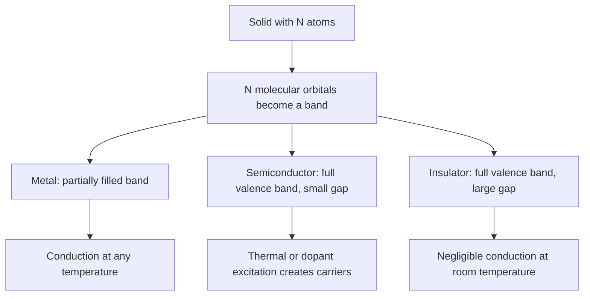
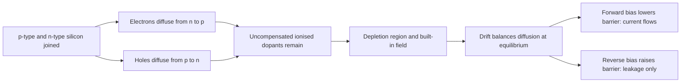

# Chapter 3 — Materials and Semiconductor Chemistry

> **Level:** Level 9 — Materials and Industrial Chemistry (advanced undergraduate / device-facing)
> **Estimated study time:** 8 hours (reading) + 3 hours (exercises)
> **Prerequisites:** [Molecular Orbital Theory](../04-advanced-chemistry/03-molecular-orbital-theory.md); [Crystal Structures and Defects](../06-inorganic-chemistry/06-solid-state-chemistry-crystal-structures-and-defects.md); [Magnetic and Electronic Properties](../06-inorganic-chemistry/07-magnetic-and-electronic-properties.md); [Electrochemical Cells and the Nernst Equation](../04-advanced-chemistry/08-electrochemical-cells-nernst-equation-and-electrolysis.md)
> **Difficulty:** ★★★★★ (5/5)
> **Related chapters:** [Nanochemistry](02-nanochemistry.md), [Battery Chemistry](04-battery-chemistry.md), [Polymer Chemistry](01-polymer-chemistry.md)

---

## 1. Learning Objectives

After working through this chapter you will be able to:

- Explain how atomic orbitals become bands and why metals, semiconductors and
  insulators differ.
- Distinguish direct from indirect band gaps and predict optical behaviour.
- Calculate intrinsic carrier concentrations and describe doping qualitatively
  and quantitatively.
- Locate the Fermi level in doped silicon and explain its temperature dependence.
- Describe the p–n junction, depletion region, built-in potential and diode
  behaviour.
- Outline transistor operation and the reason for nanoscale gate lengths.
- Compare compound semiconductors with silicon and match materials to applications.
- Describe silicon purification, crystal growth, wafering, deposition, lithography
  and etching in outline.
- Explain the role of point defects, dislocations and grain boundaries.
- Assess organic semiconductors and perovskites with honest stability caveats.
- Contrast band conduction in metals with ionic conduction in solid electrolytes.
- Interpret XRD, Hall, photoluminescence and ellipsometry data.

---

## 2. Introduction

Silicon is the second most abundant element in the Earth's crust and, in its
purified form, one of the most perfect materials ever manufactured. A modern
integrated circuit contains billions of transistors patterned on a single crystal
with impurity concentrations controlled to parts per billion. The chemistry that
makes this possible is a chain of reductions, distillations and depositions, each
of which must deliver an extraordinarily pure product.

The chapter begins with the electronic structure that separates a metal from a
semiconductor and a semiconductor from an insulator. It then explains how a tiny
concentration of impurity — one atom in a million — controls conductivity, and how
a junction between p-type and n-type material produces the diode and transistor
behaviour on which electronics depends. The second half covers the industrial
chemistry: silicon purification, crystal growth, thin-film deposition,
lithography and etching. It closes with materials that challenge silicon:
compound semiconductors, organic semiconductors, perovskites, superconductors and
solid electrolytes.

Two simplifications are flagged at the outset. Band structure is treated with the
free-electron and nearly-free-electron pictures, which explain trends but not
quantitative details; real devices are designed with density-functional and
k·p models. And the industrial processes are described as principles: reactor
conditions, precursor handling and wafer fabrication are specialised operations
that require trained personnel and engineered safety systems.

---

## 3. Fundamental Concepts

### 3.1 From orbitals to bands

In an isolated atom, electrons occupy discrete orbitals. When atoms bond, their
orbitals combine: two atoms give two molecular orbitals, three give three, and a
solid containing $N$ atoms gives $N$ closely spaced levels. At $N \approx 10^{23}$
the spacing is far below thermal energy, and the levels form a continuous **band**.

The highest occupied band at absolute zero is the **valence band**; the lowest
unoccupied band is the **conduction band**. Their separation is the **band gap**
$E_g$. A metal has a partially filled band, so electrons can move with arbitrarily
small energy input. An insulator has a full valence band and a large gap, typically
above about 4 eV, so thermal excitation is negligible. A semiconductor has a full
valence band and a small gap, typically 0.5–3 eV, so a modest temperature or a
dopant can create mobile carriers.

| Class | Band occupation | Gap at 300 K | Example |
|---|---|---|---|
| Metal | Partially filled band | None | Cu, Al, Ag |
| Semimetal | Small overlap | None, small overlap | Bi, graphite |
| Semiconductor | Full valence band | 0.5–3 eV | Si 1.12, GaAs 1.42 |
| Insulator | Full valence band | $> 4$ eV | SiO₂ about 9, diamond 5.5 |

The **density of states** $g(E)$ counts available states per unit energy. In a
crystalline semiconductor near the band edges it varies as $\sqrt{E - E_c}$ for
the conduction band and $\sqrt{E_v - E}$ for the valence band, which is the
starting point for the effective-density-of-states expressions used below.

### 3.2 Direct and indirect band gaps

The band gap is a difference in energy, but momentum also matters. In a **direct**
gap, the conduction-band minimum and valence-band maximum occur at the same
crystal momentum; an electron can absorb or emit a photon without a phonon. In an
**indirect** gap, they occur at different momenta, so an optical transition
requires a phonon to conserve momentum. Indirect transitions are therefore much
weaker, and the material is a poor light emitter.

Silicon and germanium are indirect. This is why silicon cannot make a good laser
or LED despite decades of effort: radiative recombination is slow and competes
with non-radiative pathways. GaAs, GaN, InP and CdTe are direct, which is why they
dominate LEDs, laser diodes and thin-film photovoltaics. The distinction is not a
detail of solid-state theory; it decides which materials are commercially viable
for optoelectronics.

Absorption strength follows the same logic. Direct-gap materials absorb photons
within a few micrometres near the gap, so a thin film suffices. Indirect silicon
absorbs weakly near 1.1 eV and requires hundreds of micrometres for complete
absorption, which sets the wafer thickness of a silicon solar cell.

### 3.3 Intrinsic and extrinsic semiconductors

A pure semiconductor has equal numbers of electrons in the conduction band and
holes in the valence band. Their concentration is the **intrinsic carrier
concentration** $n_i$, which depends strongly on temperature and gap:

$$
n_i = \sqrt{N_c N_v}\,\exp\!\left(-\frac{E_g}{2k_\text{B}T}\right),
$$

where $N_c$ and $N_v$ are the effective densities of states. For silicon at 300 K,
$n_i \approx 1.0\times10^{10}\ \text{cm}^{-3}$, compared with about
$5\times10^{22}$ silicon atoms per cm³. Only one atom in $5\times10^{12}$ supplies
a carrier.

**Doping** introduces substitutional impurities that donate or accept electrons.

- **Donors** (Group 15: P, As, Sb) have one more valence electron than silicon.
  The extra electron is loosely bound, with an ionisation energy of about 45 meV
  for phosphorus, and is thermally ionised at room temperature. The result is
  **n-type** material, where electrons are the majority carriers.
- **Acceptors** (Group 13: B, Al, Ga) have one fewer valence electron. They
  create a hole that is loosely bound, with an ionisation energy of about 45 meV
  for boron. The result is **p-type** material, where holes are the majority
  carriers.

Doping levels range from $10^{14}$ to $10^{20}\ \text{cm}^{-3}$, still a tiny
fraction of the host lattice. Heavily doped material is called **degenerate**
because the Fermi level enters the band and the behaviour approaches that of a
metal.

### 3.4 Carrier concentration and the Fermi level

The **Fermi level** $E_F$ is the electrochemical potential of electrons; at
absolute zero it is the highest occupied state. For non-degenerate material,

$$
n = N_c \exp\!\left(-\frac{E_c - E_F}{k_\text{B}T}\right), \qquad
p = N_v \exp\!\left(-\frac{E_F - E_v}{k_\text{B}T}\right),
$$

and the **mass-action law** holds:

$$
np = n_i^2.
$$

Doping one carrier type suppresses the other. In n-type silicon with
$N_D = 5\times10^{16}\ \text{cm}^{-3}$, $n \approx N_D$ and
$p \approx n_i^2/N_D \approx 2\times10^{3}\ \text{cm}^{-3}$: the hole population
falls by seven orders of magnitude. The Fermi level moves toward the conduction
band, by about 0.16 eV in this example.

Temperature changes the picture. At low temperature, carriers **freeze out** onto
the dopant sites because there is insufficient thermal energy to ionise them. In
the middle range, the extrinsic plateau, carrier concentration is set by doping.
At high temperature, intrinsic excitation dominates and the material returns to
its own $n_i$. A device must therefore be designed for its operating temperature.

### 3.5 The p–n junction

When p-type and n-type material are joined, electrons diffuse from n to p and
holes from p to n. The uncompensated ionised dopants left behind form a **depletion
region** with a built-in electric field that opposes further diffusion. Equilibrium
is reached when drift and diffusion balance; the result is a **built-in potential**

$$
V_\text{bi} = \frac{k_\text{B}T}{e}\ln\!\left(\frac{N_A N_D}{n_i^2}\right),
$$

typically 0.6–0.8 V for silicon.

The junction is a diode. Forward bias (p positive) lowers the barrier and allows
a large current; reverse bias raises it and permits only a small leakage current
until breakdown. The **Shockley diode equation** is

$$
I = I_0\left[\exp\!\left(\frac{eV}{nk_\text{B}T}\right) - 1\right],
$$

with $n$ the ideality factor, between 1 and 2. In a solar cell the same junction
is illuminated: photons create electron–hole pairs, the built-in field separates
them, and the cell delivers power in the fourth quadrant. In an LED, forward bias
injects carriers that recombine radiatively; the light energy is approximately the
band gap, which is why LED colour is set by material choice.

### 3.6 Transistors in outline

A **metal–oxide–semiconductor field-effect transistor** (MOSFET) consists of a
source, a drain and a gate separated from the channel by a thin insulator. The gate
voltage controls the conductivity of the channel through the field effect; a small
gate charge therefore controls a large drain current. The device is a switch and
an amplifier, and its scaling has driven integrated circuits for sixty years.

As gate lengths fell below about 20 nm, short-channel effects — drain-induced
barrier lowering, leakage and variability — became severe. The industry responded
with new geometries: **FinFETs**, where the gate wraps a thin fin, and
**gate-all-around** devices, where the channel is a stack of nanosheets. High-κ
dielectrics such as hafnium oxide replaced silicon dioxide to reduce tunnelling
leakage while maintaining capacitance. The chemistry of these interfaces — native
oxide, interfacial layer, work-function metals — dominates device performance.

### 3.7 Compound semiconductors

| Material | Gap / eV | Type | Lattice constant / nm | Main applications |
|---|---|---|---|---|
| Si | 1.12 | Indirect | 0.543 | Logic, power, solar cells |
| Ge | 0.67 | Indirect | 0.566 | Photodetectors, SiGe |
| GaAs | 1.42 | Direct | 0.565 | RF, lasers, solar cells |
| GaN | 3.40 | Direct | 0.319 | LEDs, power devices |
| InP | 1.35 | Direct | 0.587 | Telecom lasers at 1.3–1.55 µm |
| CdTe | 1.50 | Direct | 0.648 | Thin-film solar cells |
| CIGS | 1.0–1.2 | Direct | 0.56–0.58 | Thin-film solar cells |
| SiC | 3.26 | Indirect | 0.436 | High-power, high-temperature |

Compound semiconductors allow **band-gap engineering**. Alloying GaAs with AlAs
gives AlGaAs with a larger gap; alloying GaN with InN gives InGaN with a smaller
gap, which is how a single material system produces blue, green and white LEDs.
Lattice matching is the constraint: layers with different lattice constants
accumulate strain and form dislocations above a critical thickness. **Epitaxy**
grows a crystalline layer that continues the substrate lattice, and
**heterostructures** with designed band offsets are the basis of quantum wells,
lasers and high-electron-mobility transistors.

### 3.8 Defects and dislocations

No crystal is perfect, and defects control more device properties than ideal band
theory suggests.

- **Point defects**: vacancies, interstitials and antisites. In silicon, vacancies
  and self-interstitials mediate diffusion and can trap carriers.
- **Dislocations**: line defects that accommodate misorientation or strain. They
  act as non-radiative recombination centres and leakage paths.
- **Grain boundaries**: interfaces between misoriented grains in polycrystalline
  films. They scatter carriers and diffuse dopants, which is why solar-grade
  multicrystalline silicon performs below monocrystalline.
- **Stacking faults and twins**: planar defects that disturb the lattice sequence.

Silicon technology manages defects by **gettering**: intentional traps, such as
oxygen precipitates or a damaged back surface, capture metallic impurities away
from the active region. In compound semiconductors, dislocation density is quoted
per square centimetre and must often fall below $10^{5}\ \text{cm}^{-2}$ for laser
reliability. In perovskites and organic semiconductors, defects are less about
lattice perfection and more about trap states at interfaces.

---

## 4. Detailed Scientific Explanation

### 4.1 Silicon purification and wafer production

Metallurgical-grade silicon is made by carbothermic reduction of quartz in an
electric arc furnace at about 1800 °C:

$$
\ce{SiO2(s) + 2C(s) -> Si(l) + 2CO(g)}
$$

The product is 98–99 % pure, far below electronic grade. The **Siemens process**
converts it to trichlorosilane, purifies that by distillation, and decomposes it
on a hot silicon filament:

$$
\ce{Si(s) + 3HCl(g) -> SiHCl3(g) + H2(g)}, \qquad
\ce{SiHCl3(g) + H2(g) -> Si(s) + 3HCl(g)}
$$

The second reaction runs at about 1100 °C on slim rods; silicon deposits on the
rod, which grows into a high-purity polysilicon ingot. Electronic-grade silicon
reaches 9N to 11N purity, with metallic impurities in the parts-per-trillion range.
The process is energy-intensive and produces chlorinated by-products that must be
recycled; trichlorosilane is corrosive and pyrophoric in some mixtures, so the
plant is a major safety engineering exercise.

Single crystals are grown by the **Czochralski** method: a seed is dipped into a
silicon melt at 1414 °C and withdrawn while rotating, so the crystal grows at the
interface, with dopant added to set resistivity. Czochralski silicon contains
oxygen from the quartz crucible, typically $10^{17}$–$10^{18}$ cm⁻³, which can
help gettering or worsen leakage. **Float-zone** growth avoids the crucible and
gives lower oxygen and higher resistivity at higher cost. Wafers are sliced,
lapped, etched, polished and cleaned; 300 mm is the mainstream diameter.

### 4.2 Thin-film deposition

| Method | Principle | Typical use | Strength |
|---|---|---|---|
| CVD | Chemical reaction of gaseous precursors | Poly-Si, SiO₂, Si₃N₄ | Conformal, high throughput |
| PECVD | Plasma-activated CVD | Low-temperature dielectrics | Low thermal budget |
| PVD evaporation | Thermal or electron-beam evaporation | Metal contacts | Simple, directional |
| Sputtering | Ion bombardment of a target | Metals, oxides, nitrides | Broad materials, adhesion |
| ALD | Self-limiting surface reactions | High-κ dielectrics, barriers | Angstrom thickness control |
| MBE | Molecular beams in ultra-high vacuum | III–V superlattices | Atomic precision, slow |

**CVD** is the workhorse. Silane decomposes to amorphous or polycrystalline
silicon, dichlorosilane with ammonia gives silicon nitride, and tetraethoxysilane
gives silicon dioxide. **ALD** separates two half-reactions, each self-limiting, so
the growth per cycle is fixed by surface chemistry rather than by flux. Aluminium
oxide from trimethylaluminium and water is the textbook case:

$$
\ce{2Al(CH3)3(g) + 3H2O(g) -> Al2O3(s) + 6CH4(g)}
$$

**Sputtering** uses a plasma to eject atoms from a target; it is line-of-sight and
suits metals and compound films. **MBE** evaporates elemental sources in an
ultra-high-vacuum chamber and is used where interfaces must be abrupt to a single
atomic layer, such as quantum wells and superlattices.

### 4.3 Lithography and etching

**Photolithography** transfers a pattern from a mask to a photoresist: the wafer
is coated, exposed and developed, and exposed or unexposed regions dissolve
depending on resist polarity. Deep ultraviolet lithography at 193 nm, often with
immersion, defines features near 10–20 nm; extreme ultraviolet at 13.5 nm extends
the pattern further but requires vacuum and reflective optics. Resolution is
limited by diffraction, resist chemistry and overlay accuracy.

**Etching** removes material through the resist windows. Wet etching is isotropic
and selective, and is used for cleaning and blanket removal. **Reactive ion
etching** combines chemical reaction with ion bombardment, giving anisotropic
profiles; the chemistry of the etch gas determines selectivity between silicon,
oxide and nitride. **Atomic layer etching** removes one atomic layer per cycle,
analogous to ALD, and is increasingly used for critical dimensions.

### 4.4 Organic semiconductors

Organic semiconductors are conjugated molecules or polymers with alternating
single and double bonds. Their electronic structure is described by **HOMO** and
**LUMO** levels, and conduction occurs by hopping between localised states.
Mobilities of $10^{-3}$–$10\ \text{cm}^2\text{V}^{-1}\text{s}^{-1}$ are far below
crystalline silicon, but the materials can be deposited on flexible substrates.

OLEDs use a multilayer stack of hole-transport, emissive and electron-transport
layers between transparent and reflective electrodes. They are efficient and
colour-tunable, and are used in displays. Organic photovoltaics use a bulk
heterojunction of donor and acceptor phases; power conversion efficiencies are
around 10–20 % in research cells, below silicon, but the low material and
processing cost is attractive. The dominant limitation is stability: oxygen,
water and UV light degrade the conjugated backbone, so encapsulation is critical.

### 4.5 Perovskites

**Halide perovskites** have the formula ABX₃, with A a monovalent cation such as
methylammonium or caesium, B a divalent metal such as lead or tin, and X a halide.
They form a corner-sharing octahedral network with a direct band gap tunable from
about 1.5 to 2.3 eV by halide substitution. Absorption is strong, carrier
diffusion lengths are long, and defect tolerance is high, so solar cells reached
over 25 % efficiency within a decade of their first report.

The problems are equally real. Perovskites degrade in moisture and heat, phase
segregation occurs under illumination, lead is toxic, and tin alternatives oxidise
readily. Ion migration causes hysteresis and degrades contacts. Commercial modules
need encapsulation, lead capture and thousands of hours of stability testing, so
the technology is promising rather than solved.

### 4.6 Superconductors and ionic conductors as contrast

A **superconductor** conducts with zero direct-current resistance below a critical
temperature and expels magnetic flux (the Meissner effect). BCS theory explains
conventional superconductivity through electron pairing mediated by phonons;
cuprates, MgB₂ and some hydrides require other descriptions. Critical temperatures
range from 9 K for niobium to 39 K for MgB₂, about 92 K for YBa₂Cu₃O₇ and above
200 K for hydrides under high pressure. The electrons are delocalised and coherent,
which is the opposite limit from ionic conduction.

An **ionic conductor** transports ions through a lattice via vacancies or
interstitial sites. Yttria-stabilised zirconia conducts oxide ions at 700–1000 °C
and is the electrolyte in solid-oxide fuel cells; lithium garnets and sulfide
glasses conduct Li⁺ at room temperature and are candidates for solid-state
batteries. Conductivity follows an Arrhenius law,
$\sigma = \sigma_0\exp(-E_a/k_\text{B}T)$, and the activation energy measures the
barrier for ion hopping. The contrast is instructive: electronic band conduction
is limited by scattering, ionic conduction by defect mobility and electrochemical
stability.

### 4.7 Characterisation

**X-ray diffraction** identifies phase, lattice parameter and strain; Bragg's law
gives the interplanar spacing. **Hall-effect** measurements give carrier type,
density and mobility. **Photoluminescence** gives the band gap, defect levels and
radiative efficiency. **Ellipsometry** measures thickness and complex refractive
index of thin films. **XPS** gives surface composition and oxidation state;
**SIMS** gives depth profiles of dopants; **C–V** profiling gives carrier
concentration versus depth. No single measurement is sufficient: a complete
picture combines structural, electrical and optical data.

---

## 5. Visual Diagrams

**Figure 3.1 — From atomic orbitals to band structure.** The band picture explains
the three electrical classes with one model. The distinction between a
semiconductor and an insulator is quantitative — the size of the gap relative to
thermal energy — not a difference in kind. At sufficiently high temperature an
insulator also conducts, which is why the classification is practical rather than
absolute.

**Figure 3.2 — Formation and behaviour of a p–n junction.** The junction is not a
static structure but a balance of two transport processes. The built-in field is
the reason a diode rectifies, a solar cell separates charge, and an LED can inject
carriers into a region where they recombine radiatively.

**Figure 3.3 — The silicon value chain.** Each step removes a different kind of
impurity: carbon and slag in the arc furnace, chlorides and metals in distillation,
and particulates and surface damage in wafering. The energy and chlorine burden is
concentrated in the first three steps, which is why the environmental footprint of
a chip is dominated by materials production rather than by assembly.

---

## 6. Mathematical Formulas

Photon energy and wavelength are related by

$$
E = \frac{hc}{\lambda}, \qquad
\lambda/\text{nm} = \frac{1240}{E/\text{eV}}.
$$

The intrinsic carrier concentration and the mass-action law are

$$
n_i = \sqrt{N_c N_v}\,\exp\!\left(-\frac{E_g}{2k_\text{B}T}\right),
\qquad np = n_i^2.
$$

Carrier concentrations and the Fermi level in non-degenerate material are

$$
n = N_c \exp\!\left(-\frac{E_c - E_F}{k_\text{B}T}\right), \qquad
p = N_v \exp\!\left(-\frac{E_F - E_v}{k_\text{B}T}\right).
$$

Conductivity, the diode law and the Hall voltage are

$$
\sigma = e(n\mu_n + p\mu_p), \qquad
I = I_0\left[\exp\!\left(\frac{eV}{nk_\text{B}T}\right)-1\right], \qquad
V_\text{H} = \frac{IB}{net}.
$$

Bragg's law for diffraction is

$$
n\lambda = 2d\sin\theta.
$$

| Symbol | Meaning | SI unit |
|---|---|---|
| $E$ | Photon energy | J (practical: eV) |
| $h$ | Planck constant | J s |
| $c$ | Speed of light in vacuum | m s⁻¹ |
| $\lambda$ | Wavelength | m |
| $E_g$ | Band gap | J (practical: eV) |
| $N_c$, $N_v$ | Effective density of states | m⁻³ |
| $E_F$ | Fermi level | J (practical: eV) |
| $k_\text{B}$ | Boltzmann constant | J K⁻¹ |
| $T$ | Thermodynamic temperature | K |
| $\sigma$ | Electrical conductivity | S m⁻¹ |
| $e$ | Elementary charge | C |
| $\mu_n$, $\mu_p$ | Electron and hole mobility | m² V⁻¹ s⁻¹ |
| $I_0$ | Reverse saturation current | A |
| $n$ | Diode ideality factor | 1 |
| $V_\text{H}$ | Hall voltage | V |
| $B$ | Magnetic flux density | T |
| $t$ | Film thickness | m |
| $d$ | Interplanar spacing | m |
| $\theta$ | Bragg angle | rad |

The relations assume parabolic bands, Boltzmann statistics and negligible
compensation. At degenerate doping the Fermi–Dirac integral must replace the
exponential, and at high fields mobility becomes field-dependent.

---

## 7. Chemical Equations

Metallurgical silicon comes from carbothermic reduction:

$$
\ce{SiO2(s) + 2C(s) ->[1800 C] Si(l) + 2CO(g)}
$$

The Siemens process converts silicon to trichlorosilane and back:

$$
\ce{Si(s) + 3HCl(g) ->[300 C] SiHCl3(g) + H2(g)}
$$

$$
\ce{SiHCl3(g) + H2(g) ->[1100 C] Si(s) + 3HCl(g)}
$$

Thermal oxidation grows silicon dioxide, the gate dielectric of classic MOSFETs:

$$
\ce{Si(s) + O2(g) ->[900 to 1100 C] SiO2(s)}
$$

Atomic layer deposition of alumina proceeds in two self-limiting half-reactions:

$$
\ce{2Al(CH3)3(g) + 3H2O(g) -> Al2O3(s) + 6CH4(g)}
$$

Metal–organic chemical vapour deposition of gallium nitride is

$$
\ce{Ga(CH3)3(g) + NH3(g) ->[1000 C] GaN(s) + 3CH4(g)}
$$

A halide perovskite forms by solution reaction:

$$
\ce{PbI2(s) + CH3NH3I(s) -> CH3NH3PbI3(s)}
$$

The equations summarise stoichiometry and typical temperature ranges. They are not
recipes: trichlorosilane, silane, metal alkyls and lead halides require engineered
containment, exhaust treatment and trained operators.

---

## 8. Worked Examples

### Worked Example 8.1 — Doping concentration and resistivity

**Problem.** Silicon has a density of $2.33\ \text{g cm}^{-3}$ and molar mass
28.09 g mol⁻¹. (a) How many silicon atoms are there per cm³? (b) If one boron atom
replaces one silicon atom in $10^{6}$, what is the acceptor concentration?
(c) Estimate the resistivity, taking $\mu_p = 450\ \text{cm}^2\text{V}^{-1}\text{s}^{-1}$.

**Strategy.** Compute the atomic density from density and molar mass, divide by
$10^{6}$, then apply $\rho = 1/(e p \mu_p)$.

**Solution.** (a) $n_\text{Si} = (2.33/28.09)(6.022\times10^{23}) =
5.00\times10^{22}\ \text{cm}^{-3}$. (b) $N_A = 5.00\times10^{22}/10^{6} =
5.0\times10^{16}\ \text{cm}^{-3}$. (c)
$\sigma = (1.602\times10^{-19})(5.0\times10^{16})(450) = 3.6\ \text{S cm}^{-1}$,
so $\rho = 1/\sigma = 0.28\ \Omega\ \text{cm}$.

**Check.** A resistivity of 0.28 Ω cm corresponds to a moderately doped p-type
wafer, typical of a CMOS substrate. The calculation ignores electron contribution,
which is negligible because $n \ll p$, and assumes complete ionisation, valid at
room temperature for boron.

### Worked Example 8.2 — Fermi level in doped silicon

**Problem.** For the wafer in Example 8.1, take $N_v = 1.04\times10^{19}$ cm⁻³
and $T = 300$ K. Calculate the position of the Fermi level relative to the valence
band.

**Strategy.** Use $p = N_v\exp[-(E_F - E_v)/k_\text{B}T]$ and solve for
$E_F - E_v$.

**Solution.**

$$
E_F - E_v = k_\text{B}T\ln\!\left(\frac{N_v}{p}\right)
= 0.02585\ln\!\left(\frac{1.04\times10^{19}}{5.0\times10^{16}}\right)
= 0.02585(5.33) = 0.138\ \text{eV}.
$$

**Check.** The Fermi level lies 0.138 eV above the valence band, well inside the
gap and far from mid-gap (0.56 eV). This is what "p-type" means quantitatively.
The value depends on the effective density of states, which is temperature-dependent;
using a room-temperature value at 400 K would misplace the level.

### Worked Example 8.3 — Band gap and emission wavelength

**Problem.** Calculate the wavelength corresponding to band gaps of (a) 1.12 eV
for silicon, (b) 3.40 eV for GaN and (c) 1.50 eV for CdTe. Which material can emit
blue light?

**Strategy.** Use $\lambda = 1240/E$ with $E$ in eV.

**Solution.** (a) $1240/1.12 = 1107$ nm, in the near infrared. (b)
$1240/3.40 = 365$ nm, in the ultraviolet. (c) $1240/1.50 = 827$ nm, in the near
infrared.

**Check.** GaN emits ultraviolet, not blue; blue LEDs use InGaN alloys with a
smaller gap, around 2.7 eV (460 nm). Silicon is indirect and emits very weakly
even at 1107 nm, so the wavelength alone does not make it a useful emitter.

### Worked Example 8.4 — Carrier density from the Hall effect

**Problem.** A 0.50 mm thick n-type film carries 1.0 mA in a magnetic field of
0.50 T and develops a Hall voltage of 2.5 mV. Calculate the carrier density and
identify the carrier type from the sign.

**Strategy.** Rearrange $V_\text{H} = IB/(net)$ for $n$.

**Solution.**

$$
n = \frac{IB}{e t V_\text{H}}
= \frac{(1.0\times10^{-3})(0.50)}
{(1.602\times10^{-19})(5.0\times10^{-4})(2.5\times10^{-3})}
= 2.5\times10^{21}\ \text{m}^{-3} = 2.5\times10^{15}\ \text{cm}^{-3}.
$$

**Check.** The density is typical of a lightly doped epitaxial layer. A positive
Hall voltage for this geometry indicates holes; a negative voltage would indicate
electrons. The mobility follows from the sheet resistance, which is why Hall
measurements usually report resistivity and mobility together.

### Worked Example 8.5 — Lattice parameter from XRD

**Problem.** The Si (111) reflection appears at $2\theta = 28.44^\circ$ with Cu Kα
radiation ($\lambda = 0.15406$ nm). Calculate the (111) spacing and the cubic
lattice parameter.

**Strategy.** Use Bragg's law with $\theta = 14.22^\circ$; for a cubic crystal,
$d_{111} = a/\sqrt{3}$.

**Solution.** $d = 0.15406/[2\sin(14.22^\circ)] = 0.15406/(2 \times 0.2456) =
0.3137$ nm, so $a = d\sqrt{3} = 0.5433$ nm.

**Check.** The accepted lattice parameter of silicon is 0.5431 nm at 25 °C, so the
result is within 0.04 %. A larger apparent value would indicate strain or a
temperature difference; a smaller one could indicate substitutional impurities.

---

## 9. Real-World Applications

Silicon photovoltaics dominate renewable electricity deployment: a crystalline
module converts 20–25 % of sunlight, and the chain from polysilicon to module
accounts for most of the embodied energy and cost. Thin-film CdTe and CIGS modules
use less material but compete on cost and on tellurium and indium availability.

Light-emitting diodes based on III–V materials now provide efficient white light
and display backlights. GaN power devices switch at higher frequency and voltage
than silicon, reducing losses in chargers and inverters; SiC serves similar roles
at higher power. GaAs and InP remain the materials of choice for high-frequency
electronics and telecom lasers because of their direct gaps and high mobilities.

Sensors, MEMS and photonics use the same toolbox of deposition, lithography,
etching and packaging; economics are driven by yield, which depends on defect
density, contamination and process control.

---

## 10. Common Mistakes

| Mistake | Why it happens | Correct approach |
|---|---|---|
| Treating the band gap as a fixed material constant | Gap depends on temperature, strain and alloy composition | Quote the composition and temperature |
| Confusing carrier concentration with dopant concentration | Incomplete ionisation and compensation | Measure by Hall or C–V; state the assumption of full ionisation |
| Assuming a direct gap from the absorption edge alone | Indirect edges are weak but present | Check the band structure or the photoluminescence efficiency |
| Ignoring the depletion region | The junction is treated as an ideal switch | Include built-in potential and depletion width in device models |
| Using resistivity without the doping type | Resistivity alone does not identify carriers | Report type, density and mobility together |
| Treating "9N" purity as sufficient | Surface and interface contamination matter at device scale | Specify metallic contamination limits and cleaning procedures |
| Assuming perovskites are ready for deployment | Laboratory efficiency is not module lifetime | Require damp-heat and photostability data with encapsulation |
| Comparing mobilities across materials without context | Measurement conditions differ | Compare at stated doping, temperature and film quality |

---

## 11. Chapter Summary

- Bands arise from overlapping orbitals; the gap and its occupation classify
  metals, semiconductors and insulators.
- Direct gaps give strong optical transitions; indirect gaps require phonons and
  make poor emitters.
- Doping controls carrier type and concentration over many orders of magnitude.
- The Fermi level position quantifies doping and shifts with temperature.
- A p–n junction balances diffusion and drift, producing rectification, light
  emission or photocurrent depending on bias and illumination.
- Transistor scaling required new geometries and high-κ dielectrics.
- Compound semiconductors enable band-gap engineering and optoelectronics.
- Defects and dislocations limit yield and reliability.
- Silicon purification and wafering carry large energy and chlorine footprints.
- Organic and perovskite semiconductors remain stability-limited.

---

## 12. Exercises

### 12.1 Conceptual questions

1. Why is silicon a poor light emitter although it absorbs light?
2. Explain why doping one carrier type reduces the concentration of the other.
3. Why does the depletion region width change with applied bias?

### 12.2 Basic problems

4. A photon has wavelength 850 nm. Calculate its energy in eV.
5. Silicon is doped with $10^{17}\ \text{cm}^{-3}$ phosphorus. Estimate the
   electron concentration and the hole concentration at 300 K.
6. Calculate the built-in potential of a silicon junction with
   $N_A = 10^{17}\ \text{cm}^{-3}$, $N_D = 10^{16}\ \text{cm}^{-3}$ and
   $n_i = 1.0\times10^{10}\ \text{cm}^{-3}$.

### 12.3 Intermediate problems

7. A Hall sample 0.2 mm thick carries 2.0 mA in 0.8 T and shows 1.5 mV. Calculate
   the carrier density.
8. Explain why the resistivity of a doped semiconductor rises at low temperature
   and again at high temperature.
9. Estimate the wavelength of a GaAs laser ($E_g = 1.42$ eV) and explain why it is
   direct-gap.

### 12.4 Advanced problems

10. Derive the built-in potential from the Fermi-level difference across a junction.
11. A 100 nm SiO₂ gate oxide is replaced by 20 nm of HfO₂ ($\varepsilon_r = 25$).
    Compare the areal capacitance and explain the benefit.
12. Propose a characterisation sequence to distinguish a strained SiGe layer from
    a relaxed one.

### Answers

1. Silicon is indirect, so radiative recombination requires a phonon and is very
   slow compared with non-radiative paths.
2. The mass-action law $np = n_i^2$ holds; adding donors increases $n$ and forces
   $p$ down.
3. Reverse bias adds to the built-in field and widens the depletion region;
   forward bias narrows it.
4. $E = 1240/850 = 1.46$ eV.
5. $n \approx 10^{17}\ \text{cm}^{-3}$ and
   $p \approx 10^{20}/10^{17} = 10^{3}\ \text{cm}^{-3}$.
6. $V_\text{bi} = 0.02585\ln(10^{33}/10^{20}) = 0.02585(29.93) = 0.774$ V.
7. $n = 1.6\times10^{-3}/[ (1.602\times10^{-19})(2\times10^{-4})(1.5\times10^{-3})]
   = 3.3\times10^{22}$ m⁻³.
8. Low temperature: freeze-out reduces ionised dopants. High temperature: intrinsic
   excitation adds carriers but mobility falls.
9. $\lambda = 1240/1.42 = 873$ nm; GaAs has its band extrema at the same momentum,
   so the transition is direct and efficient.
10. At equilibrium the electrochemical potential is constant, so the potential
    difference equals the Fermi-level difference divided by $e$.
11. $C = \varepsilon_0\varepsilon_r/t$: SiO₂ gives 0.345 µF cm⁻², HfO₂
    1.11 µF cm⁻², allowing a thicker oxide with less tunnelling.
12. Reciprocal-space maps plus Raman shift and XRD peak position: strain changes
    both lattice spacing and Raman frequency.

---

## 13. Further Reading

- Callister, W. D. and Rethwisch, D. G. *Materials Science and Engineering: An
  Introduction*, 10th ed., Wiley, 2018. Chapters on electronic materials.
- West, A. R. *Solid State Chemistry and its Applications*, 2nd ed., Wiley, 2014.
- Sze, S. M. and Ng, K. K. *Physics of Semiconductor Devices*, 3rd ed., Wiley, 2006.
- Kittel, C. *Introduction to Solid State Physics*, 8th ed., Wiley, 2004.
- Green, M. A. *Solar Cells: Operating Principles, Technology and System
  Applications*, University of New South Wales, 1998.
- IUPAC. *Compendium of Chemical Terminology* (Gold Book).
  <https://goldbook.iupac.org/>
- NIST. *Chemistry WebBook, SRD 69*. <https://webbook.nist.gov/chemistry/>

See [CURRICULUM.md](../CURRICULUM.md), [GLOSSARY.md](../GLOSSARY.md) and
[REFERENCES.md](../REFERENCES.md).

