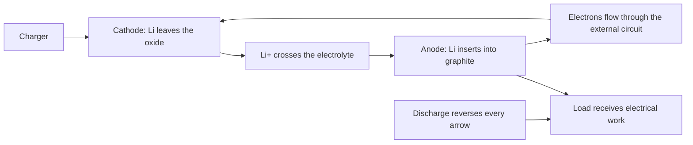
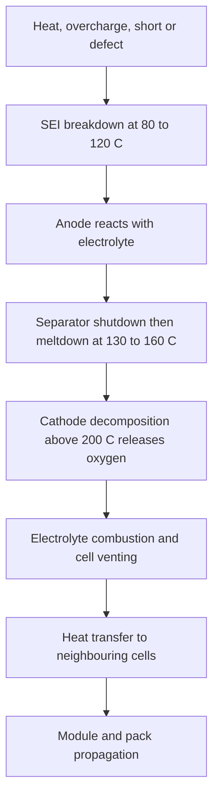
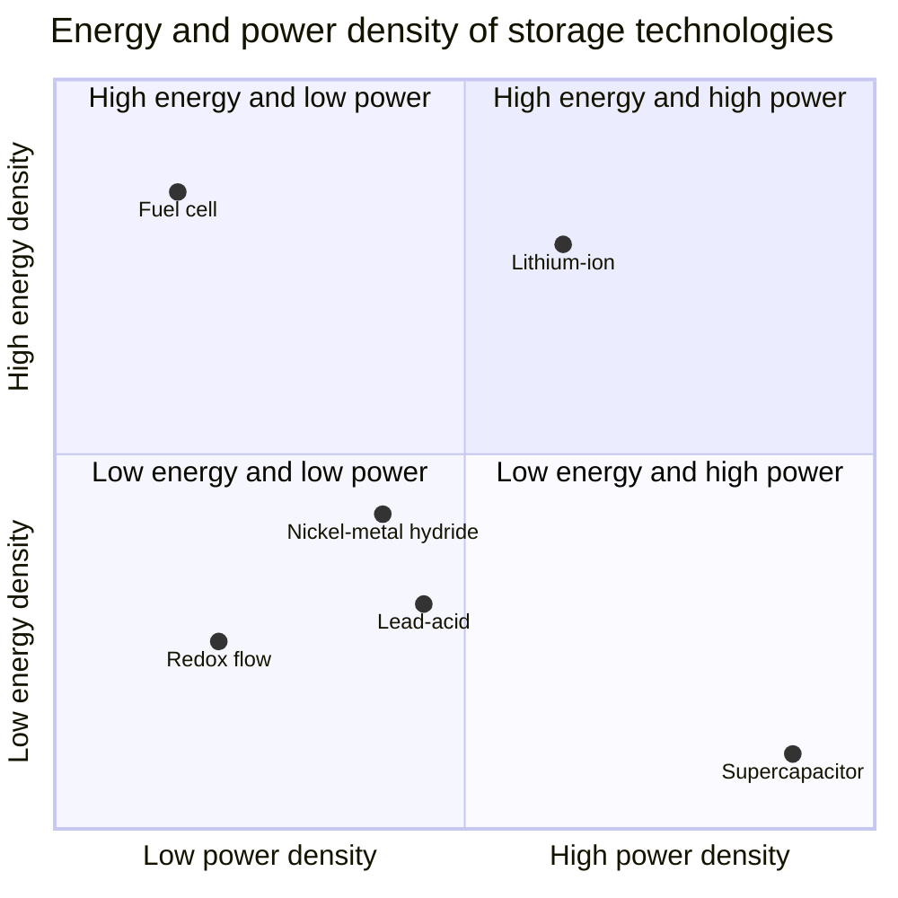

# Chapter 4 — Battery Chemistry

> **Level:** Level 9 — Materials and Industrial Chemistry (advanced undergraduate / energy-facing)
> **Estimated study time:** 8 hours (reading) + 3 hours (exercises)
> **Prerequisites:** [Redox Reactions and Electrochemistry Fundamentals](../03-intermediate-chemistry/12-redox-reactions-and-electrochemistry-fundamentals.md); [Electrochemical Cells, the Nernst Equation and Electrolysis](../04-advanced-chemistry/08-electrochemical-cells-nernst-equation-and-electrolysis.md); [Chemical Thermodynamics](../04-advanced-chemistry/04-chemical-thermodynamics.md)
> **Difficulty:** ★★★★★ (5/5)
> **Related chapters:** [Corrosion](05-corrosion.md), [Materials and Semiconductor Chemistry](03-materials-and-semiconductor-chemistry.md), [Green and Sustainable Chemistry](../11-environmental-chemistry/01-green-and-sustainable-chemistry.md)

---

## 1. Learning Objectives

After working through this chapter you will be able to:

- Relate cell voltage to Gibbs energy and apply the Nernst equation.
- Define capacity, energy density, power density, C-rate and Coulombic efficiency.
- Distinguish primary from secondary cells and match chemistries to applications.
- Describe the lead–acid, nickel–cadmium and nickel–metal hydride reactions.
- Explain intercalation, the solid–electrolyte interphase and the cathode families
  LCO, NMC, NCA, LFP and LMO.
- Analyse the sequence of events in thermal runaway.
- Assess lithium–sulfur and solid-state batteries with honest limitations.
- Explain redox flow batteries and supercapacitors and where they compete.
- Identify degradation mechanisms and the charging protocols that avoid them.
- Describe pyrometallurgical, hydrometallurgical and direct recycling.
- Size a battery pack from energy, voltage and cell specifications.
- Evaluate safety, abuse testing and grid-storage requirements.

---

## 2. Introduction

A battery is a chemical reactor whose product is electrical work. The reactants
are separated by an electrolyte that conducts ions but not electrons, so the redox
reaction can proceed only when the external circuit allows charge to balance. The
cell voltage is the Gibbs energy of that reaction per mole of electrons, and the
capacity is the number of electrons the reactants can supply.

Lithium-ion batteries changed the scale of what is possible. A lead–acid battery
stores about 35 Wh kg⁻¹; a modern lithium-ion cell stores 150–250 Wh kg⁻¹. The
difference is not a single invention but a system: a light, strongly reducing
anode, a high-potential intercalation cathode, a stable electrolyte that forms a
passivating interphase, and a separator that prevents contact while allowing ion
transport. Each component is a compromise, and the compromises explain the
failures.

This chapter treats batteries as chemistry first and devices second. It covers the
thermodynamics and metrics, the established aqueous chemistries, lithium-ion in
detail, the emerging chemistries that are often announced prematurely, and the
end-of-life problem. Safety is treated as a chemical pathway, not as a checklist:
thermal runaway is a sequence of exothermic reactions that can be described and
interrupted.

---

## 3. Fundamental Concepts

### 3.1 Cell voltage and Gibbs energy

For a cell reaction transferring $n$ electrons,

$$
\Delta_\text{r}G = -nFE_\text{cell},
$$

where $F = 96\,485\ \text{C mol}^{-1}$. A reaction with a large negative Gibbs
energy gives a large positive cell voltage. The **standard cell potential** is the
difference between the standard electrode potentials of the cathode and anode:

$$
E^\circ_\text{cell} = E^\circ_\text{cathode} - E^\circ_\text{anode}.
$$

Under non-standard conditions the **Nernst equation** applies:

$$
E = E^\circ - \frac{RT}{nF}\ln Q,
$$

where $Q$ is the reaction quotient. For a lithium cell, changing the activity of
lithium in the host by a factor of ten shifts the potential by about 59 mV at
298 K, which is why the voltage of an intercalation cell slides gradually with
state of charge rather than staying constant.

A cell delivers energy only while it drives current through an external load. The
**open-circuit voltage** is the thermodynamic value; the **operating voltage** is
lower on discharge and higher on charge because of ohmic, kinetic and
concentration overpotentials. Energy efficiency is the ratio of discharge energy
to charge energy, and it is always below the Coulombic efficiency because some
charge is lost and because the voltage window is not symmetric.

### 3.2 Capacity, energy, power and C-rate

**Capacity** is the charge a cell can deliver, usually in ampere-hours (Ah) or
milliampere-hours (mAh). **Specific capacity** is capacity per mass of active
material, in mAh g⁻¹. From Faraday's law,

$$
Q_\text{sp} = \frac{nF}{3.6\,M}\ \text{mAh g}^{-1},
$$

where $M$ is the molar mass of the active material in g mol⁻¹ and the factor 3.6
converts coulombs to mAh.

**Energy density** is capacity multiplied by average voltage, per mass (Wh kg⁻¹)
or volume (Wh L⁻¹). **Power density** is energy per unit time per mass
(W kg⁻¹). A cell can be optimised for energy or for power, but not both at once:
thick electrodes store more energy and impede transport, while thin electrodes
deliver power and waste packaging mass.

The **C-rate** normalises current to capacity: 1C discharges the nominal capacity
in one hour, 2C in half an hour, C/10 in ten hours. The same cell at 5C delivers
less capacity than at C/10 because polarisation and transport limits intervene.
**Coulombic efficiency** is the ratio of discharge to charge capacity in a cycle;
values above 99.9 % are required for long cycle life, because a 0.1 % loss per
cycle consumes 10 % of capacity in a hundred cycles.

### 3.3 Primary and secondary cells

A **primary** cell is discharged once. Its reaction is irreversible under normal
use, either thermodynamically or because the products cannot be re-formed
efficiently. The alkaline zinc–manganese dioxide cell, the zinc–air button cell
and lithium primary cells (Li–FeS₂, Li–MnO₂) are common. Primary cells have low
self-discharge and high energy density, which suits remote sensors, medical
implants and emergency equipment.

A **secondary** cell is rechargeable. Its redox reaction is reversible, and the
electrodes are designed to accept and release ions without catastrophic structural
change. Lead–acid, nickel–cadmium, nickel–metal hydride, lithium-ion and
vanadium redox flow cells are secondary. The distinction is not absolute: some
primary cells can be recharged shallowly with damage, and some secondary cells
lose reversibility if deeply discharged.

### 3.4 Lead–acid

The lead–acid cell has a lead anode, a lead dioxide cathode and aqueous sulfuric
acid electrolyte. On discharge, both electrodes convert to lead sulfate:

$$
\ce{Pb(s) + PbO2(s) + 2H2SO4(aq) -> 2PbSO4(s) + 2H2O(l)}
$$

The standard cell voltage is about 2.05 V, and a 12 V battery contains six cells
in series. The electrolyte participates in the reaction, so acid concentration
falls on discharge and rises on charge — which is why specific gravity was used
as a state-of-charge indicator.

Lead–acid is cheap, tolerant of abuse and recyclable at high rates, which is why
it still dominates engine starting, uninterrupted power supplies and many
stationary applications. Its weaknesses are low specific energy (30–40 Wh kg⁻¹),
poor cycle life at deep discharge, and **sulfation**: lead sulfate recrystallises
into a coarse, poorly soluble form that cannot be recharged. **Stratification** of
acid concentration and **positive-grid corrosion** also limit life.

### 3.5 Nickel–cadmium and nickel–metal hydride

The nickel–cadmium cell uses cadmium metal and nickel oxyhydroxide:

$$
\ce{Cd(s) + 2NiOOH(s) + 2H2O(l) -> Cd(OH)2(s) + 2Ni(OH)2(s)}
$$

It is robust, tolerant of overcharge and low temperature, and delivers high
current. Cadmium is toxic and is restricted in many jurisdictions, so NiCd has
largely been replaced. The "memory effect" is real but often overstated: it
arises from voltage depression after repeated shallow cycling, not from a
fundamental loss of capacity, and is reversed by a full discharge.

The nickel–metal hydride cell replaces cadmium with a hydrogen-storage alloy,
usually AB₅ or A₂B₇:

$$
\ce{MH(s) + NiOOH(s) -> M(s) + Ni(OH)2(s)}
$$

NiMH has higher energy density than NiCd, avoids cadmium, and is used in hybrid
vehicles and low-cost consumer cells. Its weaknesses are self-discharge, heat
generation on overcharge and a narrower temperature window.

### 3.6 Lithium-ion: intercalation chemistry

A lithium-ion cell stores lithium in two host structures rather than plating
metal. On charge, lithium leaves the cathode, crosses the electrolyte and inserts
into the anode; on discharge the process reverses. The cathode is a lithium
transition-metal oxide or phosphate, the anode is graphite or a silicon composite,
and the electrolyte is a lithium salt in an organic carbonate mixture.

For lithium cobalt oxide,

$$
\ce{LiCoO2(s) <=> Li_{1-x}CoO2(s) + xLi^+(solv) + xe^-},
$$

and for graphite,

$$
\ce{xLi^+(solv) + xe^- + 6C(s) <=> Li_{x}C6(s)}.
$$

The cell voltage is the difference between the cathode and anode potentials,
about 3.6–3.9 V for LCO and graphite. The **solid–electrolyte interphase** (SEI)
forms on the anode during the first cycles when electrolyte decomposes at low
potential. It is electronically insulating but ionically conducting, and it
prevents further decomposition. A good SEI is the difference between a cell that
lasts a thousand cycles and one that fails in fifty.

### 3.7 Cathode families

| Family | Formula | Practical capacity / mAh g⁻¹ | Average voltage | Strengths | Weaknesses |
|---|---|---|---|---|---|
| LCO | LiCoO₂ | 140–150 | 3.7 V | High energy, mature | Cost, cobalt, thermal stability |
| NMC | LiNiₓMnᵧCo₁₋ₓ₋ᵧO₂ | 160–200 | 3.6–3.7 V | Balanced | Cobalt, cracking at high voltage |
| NCA | LiNi₀.₈Co₀.₁₅Al₀.₀₅O₂ | 180–200 | 3.6 V | High energy | Thermal stability, cost |
| LFP | LiFePO₄ | 150–170 | 3.2 V | Safety, cycle life, low cost | Lower voltage, poor cold performance |
| LMO | LiMn₂O₄ | 100–120 | 3.8 V | Cheap, high power | Manganese dissolution, low energy |

**NMC** trade-offs are explicit in the composition: increasing nickel raises
capacity but lowers thermal stability and increases sensitivity to moisture;
increasing cobalt improves rate capability and structural stability but raises
cost and supply risk. **LFP** is intrinsically safer because the olivine
structure releases oxygen only at high temperature, and it has become dominant
for grid storage and standard-range vehicles. Its flat voltage curve makes state
of charge estimation difficult from voltage alone.

### 3.8 Anodes, emerging chemistries and alternatives

**Graphite** stores lithium between graphene layers up to LiC₆, giving
372 mAh g⁻¹. Its potential is close to lithium metal, so the electrolyte must be
stable against reduction; the SEI does that job. **Silicon** stores lithium as
Li₄.₄Si, giving about 4200 mAh g⁻¹, but expands about 300 % on lithiation, which
cracks particles and consumes electrolyte. Silicon–graphite blends with 5–10 %
silicon are commercial; higher fractions remain a research problem.

**Lithium–sulfur** has a theoretical capacity of 1675 mAh g⁻¹ for sulfur and a
cell voltage near 2.1 V, using the reaction
$\ce{2Li(s) + S(s) <=> Li2S(s)}$. It is cheap and abundant, but polysulfide intermediates
shuttle between electrodes, the sulfur cathode changes volume, and lithium metal
forms dendrites. Practical cells remain limited in cycle life.

**Solid-state** batteries replace the liquid electrolyte with a solid ion
conductor, which promises safety and, with a lithium-metal anode, higher energy.
Sulfide electrolytes such as Li₆PS₅Cl have high conductivity but react with
moisture and with lithium; oxide electrolytes such as LLZO are stable but require
high-temperature sintering and have high interfacial resistance. Dendrite
penetration at grain boundaries and stack pressure remain unsolved at scale.

**Sodium-ion** uses abundant sodium and aluminium current collectors. Its energy
density is lower than lithium-ion, but it is attractive for stationary storage
where cost and cycle life matter more than mass.

---

## 4. Detailed Scientific Explanation

### 4.1 Electrolytes and the solid–electrolyte interphase

A lithium-ion electrolyte is typically LiPF₆ in a mixture of ethylene carbonate,
dimethyl carbonate and ethyl methyl carbonate, with per-cent additives such as
vinylene carbonate. The solvent must dissolve the salt, resist oxidation at the
cathode and reduction at the anode, and stay liquid over the operating range.

No solvent is stable against both electrodes. The SEI resolves the conflict
kinetically: reduction products precipitate on the anode and stop electron
transfer while allowing Li⁺ to pass. Ethylene carbonate is reduced to lithium
carbonate and ethylene:

$$
\ce{C3H4O3(l) + 2Li^+(solv) + 2e^- -> Li2CO3(s) + C2H4(g)}
$$

The SEI is a layered, partly organic assemblage of Li₂CO₃, LiF, Li₂O, alkyl
carbonates and polymer, whose composition depends on salt, solvent, additive,
temperature and current. It grows slowly over life, consuming lithium and
electrolyte and raising impedance. LiPF₆ is sensitive to water; hydrolysis
produces HF, which attacks the cathode and dissolves transition metals:

$$
\ce{LiPF6(solv) + H2O(l) -> LiF(s) + POF3(g) + 2HF(g)}
$$

Trace water is therefore a lifetime issue: manufacturing dries electrodes and
electrolyte to parts per million, and the formation cycle builds a stable SEI.

### 4.2 Degradation mechanisms

Degradation is the loss of usable capacity and power over time. It has several
distinct chemical causes, and the dominant one changes with chemistry,
temperature and use pattern.

- **SEI growth** consumes lithium and electrolyte. It is fastest at high
  temperature and high state of charge, and its rate falls roughly as the square
  root of time, which produces the familiar capacity fade curve.
- **Lithium plating** occurs when the anode potential falls below 0 V versus
  Li/Li⁺, usually at high charge rate, low temperature or high loading. Plated
  lithium reacts with electrolyte, forms mossy or dendritic deposits, and can
  produce internal short circuits.
- **Particle cracking** in NMC and NCA follows anisotropic volume change. Cracks
  expose fresh surface, forming more SEI and isolating material.
- **Transition-metal dissolution**, especially manganese and cobalt, poisons the
  anode SEI and accelerates capacity loss.
- **Electrolyte oxidation** at high cathode potential produces gas and a thicker
  cathode–electrolyte interphase.
- **Current-collector corrosion**, binder decomposition and separator ageing
  complete the list.

The consequences are rising resistance, loss of lithium inventory and loss of
active material; diagnosis requires impedance spectroscopy, differential capacity
analysis and post-mortem microscopy rather than a single number.

### 4.3 Thermal runaway and abuse testing

Thermal runaway is a self-accelerating exothermic sequence. It begins with
external heating, overcharge, internal short or a manufacturing defect. The
sequence in a typical lithium-ion cell is:

1. **SEI breakdown** at roughly 80–120 °C, exposing the anode to electrolyte.
2. **Separator shutdown and meltdown** at 130–160 °C, depending on the polymer;
   shutdown may stop current, but meltdown allows contact.
3. **Cathode decomposition** above about 200 °C, releasing oxygen that sustains
   combustion of the electrolyte.
4. **Cell venting and fire**, with propagation to neighbouring cells through
   heat transfer.

The engineering response is layered: shutdown separators, thermal fuses,
pressure-relief vents, flame-retardant electrolytes, ceramic coatings and pack
design that isolates modules and directs vent gases. **Abuse testing** includes
nail penetration, external short, overcharge, crush, vibration, drop and thermal
propagation. UN 38.3 and IEC 62133 define procedures; passing a test proves
performance under that test, not intrinsic safety.

### 4.4 Charging protocols and battery management

The standard lithium-ion charge is **constant current–constant voltage**: a fixed
current until the cell reaches its voltage limit, typically 4.2 V for LCO/NMC and
3.65 V for LFP, followed by a voltage hold while current tapers. Charging above
the limit oxidises the electrolyte and degrades the cathode; charging below 0 °C
plates lithium. Fast charging therefore requires preheating, adaptive current and
careful cell design.

A **battery management system** measures cell voltages and temperature, estimates
state of charge and state of health, balances cells, and enforces limits. State of
charge is inferred from voltage, current integration and models; none is exact,
because voltage hysteresis and ageing change the relationship. Balancing is
passive (dissipating energy from the highest cell) or active (transferring charge),
and it matters because the weakest cell limits the pack.

### 4.5 Redox flow batteries

A **redox flow battery** stores energy in liquid electrolytes held in external
tanks and pumped through a stack of cells. Power and energy are decoupled: the
stack sets power, the tank volume sets energy. The vanadium redox flow battery
uses four oxidation states of vanadium in sulfuric acid:

$$
\ce{VO2^+(aq) + 2H^+(aq) + e^- <=> VO^{2+}(aq) + H2O(l)} \quad (+1.00\ \text{V}),
$$

$$
\ce{V^{3+}(aq) + e^- <=> V^{2+}(aq)} \quad (-0.26\ \text{V}).
$$

The cell voltage is about 1.3–1.4 V, lower than lithium-ion, and the energy
density is low because the electrolytes are dilute aqueous solutions. The advantages are
long life, tolerance of deep discharge, non-flammable electrolytes and independent
scaling. Vanadium crossover degrades efficiency but can be rebalanced; the cost
of vanadium and the ionic membranes are the main limitations.

### 4.6 Supercapacitors

A **supercapacitor** stores charge in an electric double layer at a high-surface-area
electrode, typically activated carbon with $1000$–$2000\ \text{m}^2\text{g}^{-1}$.
There is no Faradaic reaction in an EDLC, so the response is fast and the cycle
life is very long, but the energy density is low (5–10 Wh kg⁻¹). **Pseudocapacitors**
use fast surface redox reactions in materials such as MnO₂ or conducting polymers
and sit between capacitors and batteries. **Hybrid** devices combine a battery-like
electrode with a capacitor-like one.

The Ragone plot places supercapacitors at high power and low energy, batteries at
high energy and moderate power, and fuel cells at high energy and low power. The
choice is application-driven: a supercapacitor recovers braking energy and buffers
power peaks, while a battery supplies sustained energy.

### 4.7 Recycling

Battery recycling has three families of process.

| Route | Principle | Recovery | Limitations |
|---|---|---|---|
| Pyrometallurgical | Smelting at 1200–1500 °C | Co, Ni, Cu; slag | Energy-intensive; lithium lost to slag |
| Hydrometallurgical | Leaching and separation | Co, Ni, Mn, Li at high yield | Reagent use; effluent treatment |
| Direct | Separation and re-lithiation of cathode | Cathode material with structure retained | Requires uniform, undamaged feedstock |

**Pyrometallurgy** is robust to mixed chemistries but loses lithium to slag.
**Hydrometallurgy** leaches shredded cathode with sulfuric acid and hydrogen
peroxide, then separates metals by solvent extraction or precipitation; it
recovers more than 95 % of cobalt and nickel, and most of the lithium, at the cost
of a complex flowsheet. **Direct recycling** preserves the crystal structure but needs
disassembly, sorting by chemistry and a cathode that has not degraded too far.

The system problem is larger than the chemistry: cells are designed for energy
density, not disassembly, and packs contain mixed chemistries. Design for
recycling — standard formats, reversible fasteners and chemistry labelling — is as
important as the extraction process.

### 4.8 Grid storage and application matching

Grid storage values cost per kWh, cycle life, efficiency and safety more than mass.
LFP and sodium-ion avoid cobalt and nickel, tolerate deep cycling and are
thermally stable; flow batteries suit long-duration storage where tank cost
dominates. Round-trip efficiency is 85–95 % for lithium-ion and 65–80 % for flow,
and that difference decides the economics.

---

## 5. Visual Diagrams

**Figure 4.1 — Charge and discharge in a lithium-ion cell.** Lithium ions shuttle
between two host structures while electrons travel through the external circuit.
The electrolyte blocks electronic contact, so the redox reaction can proceed only
when the circuit is closed. The arrows reverse on discharge; the electrodes are
not consumed, which is why the process can be repeated thousands of times.

**Figure 4.2 — The thermal runaway sequence.** Each step supplies heat to the
next, so the process accelerates once the first barrier fails. The engineering
response is to interrupt the chain at a chosen point: a shutdown separator, a vent
that directs gases, a ceramic coating that delays meltdown, or a pack design that
prevents cell-to-cell propagation.

**Figure 4.3 — Ragone comparison of storage technologies.** Positions are
indicative for complete systems, not active materials. Lithium-ion occupies the
high-energy, moderate-power region that made portable electronics and electric
vehicles possible. Supercapacitors trade energy for power and cycle life, while
flow batteries trade energy density for scalability and durability.

---

## 6. Mathematical Formulas

Specific capacity from Faraday's law, energy density and C-rate are

$$
Q_\text{sp} = \frac{nF}{3.6M}, \qquad
E_\text{sp} = Q_\text{sp}V_\text{avg}, \qquad
I = C_\text{rate} \times Q_\text{nom}.
$$

| Symbol | Meaning | SI unit |
|---|---|---|
| $Q_\text{sp}$ | Specific capacity | mAh g⁻¹ (SI: C kg⁻¹) |
| $n$ | Electrons per formula unit | 1 |
| $F$ | Faraday constant | C mol⁻¹ |
| $M$ | Molar mass of active material | g mol⁻¹ |
| $E_\text{sp}$ | Specific energy | Wh kg⁻¹ |
| $V_\text{avg}$ | Average cell voltage | V |
| $I$ | Current | A |
| $C_\text{rate}$ | C-rate | h⁻¹ |
| $Q_\text{nom}$ | Nominal capacity | Ah |

The Nernst equation and the diffusion time scale are

$$
E = E^\circ - \frac{RT}{nF}\ln Q_r, \qquad
\tau_\text{diff} \approx \frac{L^2}{D},
$$

| Symbol | Meaning | SI unit |
|---|---|---|
| $E$ | Cell potential | V |
| $E^\circ$ | Standard cell potential | V |
| $R$ | Gas constant | J K⁻¹ mol⁻¹ |
| $T$ | Thermodynamic temperature | K |
| $Q_r$ | Reaction quotient | 1 |
| $\tau_\text{diff}$ | Diffusion time | s |
| $L$ | Diffusion length | m |
| $D$ | Diffusion coefficient | m² s⁻¹ |

The diffusion time explains why thick electrodes cannot deliver high power: a
tenfold increase in thickness raises the diffusion time a hundredfold. The
practical limit is reached when $\tau_\text{diff}$ becomes comparable to the
discharge time $1/C_\text{rate}$.

---

## 7. Chemical Equations

Lead–acid discharge and charge:

$$
\ce{Pb(s) + PbO2(s) + 2H2SO4(aq) <=> 2PbSO4(s) + 2H2O(l)}
$$

Nickel–cadmium:

$$
\ce{Cd(s) + 2NiOOH(s) + 2H2O(l) <=> Cd(OH)2(s) + 2Ni(OH)2(s)}
$$

Nickel–metal hydride:

$$
\ce{MH(s) + NiOOH(s) <=> M(s) + Ni(OH)2(s)}
$$

Lithium cobalt oxide and graphite half-reactions:

$$
\ce{LiCoO2(s) <=> Li_{1-x}CoO2(s) + xLi^+(solv) + xe^-}
$$

$$
\ce{xLi^+(solv) + xe^- + 6C(s) <=> Li_{x}C6(s)}
$$

Lithium–iron phosphate, the LFP cathode:

$$
\ce{LiFePO4(s) <=> FePO4(s) + Li^+(solv) + e^-}
$$

Lithium–sulfur:

$$
\ce{2Li(s) + S(s) <=> Li2S(s)}
$$

Vanadium flow battery half-reactions:

$$
\ce{VO2^+(aq) + 2H^+(aq) + e^- <=> VO^{2+}(aq) + H2O(l)}, \qquad
\ce{V^{3+}(aq) + e^- <=> V^{2+}(aq)}
$$

The arrows are reversible in principle. In practice, side reactions, impedance
and mechanical degradation make each cycle slightly irreversible, which is the
chemical origin of capacity fade.

---

## 8. Worked Examples

### Worked Example 8.1 — Specific capacity from Faraday's law

**Problem.** Calculate the theoretical specific capacity of (a) LiFePO₄
($M = 157.76\ \text{g mol}^{-1}$, one electron per formula unit) and (b) graphite
as LiC₆ ($M = 72.06\ \text{g mol}^{-1}$ for six carbon atoms, one electron per
six carbons).

**Strategy.** Apply $Q_\text{sp} = nF/(3.6M)$ with $n = 1$.

**Solution.** (a)
$Q = 96\,485/(3.6 \times 157.76) = 169.9\ \text{mAh g}^{-1}$.
(b) $Q = 96\,485/(3.6 \times 72.06) = 371.9\ \text{mAh g}^{-1}$.

**Check.** The LFP value agrees with the commonly quoted 170 mAh g⁻¹ and the
graphite value with 372 mAh g⁻¹. Both are theoretical maxima for the active
material; practical electrodes deliver 80–95 % because of inactive phases,
binder, conductive additive and incomplete utilisation.

### Worked Example 8.2 — Energy density of a cell

**Problem.** A cell pairs an LFP cathode (170 mAh g⁻¹) with a graphite anode
(372 mAh g⁻¹) at an average voltage of 3.2 V. (a) Calculate the specific energy
based on the two active materials only. (b) Estimate the cell-level specific
energy if active materials are 35 % of the cell mass.

**Strategy.** Combine the two capacities in series, then multiply by voltage and
by the active-mass fraction.

**Solution.** (a) The series capacity is

$$
Q_\text{cell} = \left(\frac{1}{170} + \frac{1}{372}\right)^{-1}
= 116.6\ \text{mAh g}^{-1},
$$

so $E = 116.6 \times 3.2 = 373\ \text{Wh kg}^{-1}$.
(b) $E_\text{cell} = 373 \times 0.35 = 131\ \text{Wh kg}^{-1}$.

**Check.** Commercial LFP cells achieve 120–160 Wh kg⁻¹, so the estimate is in the
right range. The calculation ignores the mass of current collectors, separator,
electrolyte, tabs and packaging, which is why the active-material value is nearly
three times the cell value.

### Worked Example 8.3 — C-rate and charge time

**Problem.** A 5.0 Ah cell is charged at 2C. (a) What current flows? (b) How long
does a full charge take at constant current, ignoring the constant-voltage taper?
(c) What current corresponds to C/3?

**Strategy.** Use $I = C_\text{rate}Q_\text{nom}$ and $t = Q/I$.

**Solution.** (a) $I = 2 \times 5.0 = 10$ A. (b) $t = 5.0/10 = 0.50$ h = 30 min.
(c) $I = 5.0/3 = 1.67$ A, giving 3.0 h.

**Check.** Real 2C charging takes longer than 30 min because the constant-voltage
stage tapers the current near full charge, and because fast charging may be
limited by temperature or lithium plating. The C-rate is a normalised current, not
a promise about time.

### Worked Example 8.4 — Cell voltage from Gibbs energy and the Nernst shift

**Problem.** A cell reaction transfers one electron and has
$\Delta_\text{r}G^\circ = -370\ \text{kJ mol}^{-1}$. (a) Calculate $E^\circ$.
(b) By how much does the voltage change when the activity ratio changes by a
factor of ten at 298 K?

**Strategy.** Use $\Delta G^\circ = -nFE^\circ$ and the Nernst slope
$RT/F \times \ln 10$.

**Solution.** (a) $E^\circ = 370\,000/96\,485 = 3.83$ V. (b)
$\Delta E = (RT/F)\ln 10 = 0.0591$ V = 59 mV per decade.

**Check.** The voltage is typical of an LCO/graphite cell. The 59 mV per decade
slope is the same for any one-electron process at 298 K; for $n = 2$ it halves.
Intercalation cells show a sloping voltage because the activity of lithium in the
host changes continuously with state of charge.

### Worked Example 8.5 — Sizing a battery pack

**Problem.** A pack must store 60 kWh at a nominal 350 V using cells of 3.7 V and
5.0 Ah. Determine a series–parallel arrangement and the resulting nominal energy.

**Strategy.** Divide the pack voltage by the cell voltage for the series count,
then divide the required capacity by the cell capacity for the parallel count.

**Solution.** Series cells: $350/3.7 = 94.6$, so use 96 cells, giving 355.2 V.
Required capacity: $60\,000/350 = 171$ Ah. Parallel strings:
$171/5.0 = 34.3$, so use 34 strings, giving 170 Ah. Nominal energy:
$355.2 \times 170 = 60.4$ kWh, from $96 \times 34 = 3264$ cells.

**Check.** The design meets the target within 1 %. Real packs add 5–15 % unusable
capacity as a buffer against ageing and to avoid full charge, and the cell count is
rounded to a configuration that the battery management system can balance.

---

## 9. Real-World Applications

Portable electronics use lithium-ion because energy per gram and per litre
dominates. Electric vehicles use large-format packs with active thermal
management; LFP dominates standard-range and commercial vehicles, while
high-nickel NMC serves long-range models. Stationary storage uses LFP, sodium-ion
and flow batteries, where 6000–10 000 cycles and low cost per kWh matter more than
mass. Medical implants use primary lithium cells; aerospace uses high-power
lithium-ion with stringent abuse testing.

---

## 10. Common Mistakes

| Mistake | Why it happens | Correct approach |
|---|---|---|
| Comparing specific energy of active materials with cell-level values | The two differ by a factor of two to three | State the basis: material, electrode, cell or pack |
| Treating C-rate as a fixed capacity rating | Available capacity falls at high rate | Report capacity at a stated C-rate and temperature |
| Assuming a flat voltage during discharge | Only some chemistries are flat | Use the measured curve; LFP is flat, NMC slopes |
| Charging below 0 °C at high rate | Low temperature raises plating risk | Preheat or reduce current; respect the cell specification |
| Equating Coulombic efficiency with energy efficiency | Voltage hysteresis adds loss | Report both, with the voltage window |
| Calling a battery "solid-state" when it contains a gel | Marketing language | Check the electrolyte composition and cell architecture |
| Assuming recycling recovers all metals | Pyrometallurgy loses lithium to slag | State the route and the recovery rate per element |
| Treating thermal runaway as a single event | It is a sequence of reactions | Identify the stage and the applicable barrier |

---

## 11. Chapter Summary

- Cell voltage is Gibbs energy per mole of electrons; Nernst gives its composition
  dependence, so intercalation cells slope with state of charge.
- Capacity, energy density, power density and C-rate are distinct metrics, and the
  basis of each must be stated.
- Lead–acid is cheap but heavy; NiCd robust but toxic; NiMH denser.
- Lithium-ion stores lithium in two hosts, with an SEI that stabilises the anode.
- Cathode families trade energy, safety, cost and supply risk.
- Degradation arises from SEI growth, plating, cracking and dissolution.
- Thermal runaway is a chain of exothermic reactions that can be interrupted by
  design.
- Flow batteries decouple power from energy; supercapacitors trade energy for power.
- Recycling requires design for disassembly as much as extraction chemistry.

---

## 12. Exercises

### 12.1 Conceptual questions

1. Why is the operating voltage lower than the open-circuit voltage on discharge?
2. Explain why a stable SEI is essential for graphite anodes.
3. Why does a flow battery decouple power from energy?

### 12.2 Basic problems

4. Calculate the theoretical capacity of LiCoO₂ ($M = 97.87\ \text{g mol}^{-1}$,
   one electron) in mAh g⁻¹.
5. A 3.0 Ah cell is discharged at 6.0 A. What is the C-rate and the ideal
   discharge time?
6. A cell has 150 Wh kg⁻¹ and a mass of 400 kg. What energy does it store?

### 12.3 Intermediate problems

7. A cell reaction has $E^\circ = 1.20$ V and $n = 2$. Calculate
   $\Delta_\text{r}G^\circ$.
8. Estimate the diffusion time for lithium in a 100 µm thick electrode with
   $D = 10^{-14}\ \text{m}^2\text{s}^{-1}$, and compare with a 10C discharge.
9. Explain why NMC cathodes with higher nickel content are more difficult to
   manufacture and less thermally stable.

### 12.4 Advanced problems

10. Estimate the cell-level energy density for a silicon–graphite anode
    (10 % silicon by capacity) paired with NMC811 at 3.7 V, stating your
    assumptions.
11. A cell loses 0.02 % capacity per cycle. Estimate the capacity after 2000
    cycles and comment on the assumption of linear fade.
12. Propose a recycling flowsheet for a mixed stream of LFP and NMC cells and
    identify the step that limits recovery.

### Answers

1. Ohmic, kinetic and concentration overpotentials reduce the terminal voltage
   when current flows.
2. The SEI prevents electrolyte reduction at the anode while allowing Li⁺
   transport; without it, solvent decomposes continuously.
3. The electrolyte is stored in external tanks, so tank volume sets energy and
   stack area sets power.
4. $Q = 96\,485/(3.6 \times 97.87) = 274$ mAh g⁻¹.
5. $C_\text{rate} = 6.0/3.0 = 2$C; ideal time 30 min.
6. $150 \times 400 = 60$ kWh.
7. $\Delta G^\circ = -2(96\,485)(1.20) = -231.6$ kJ mol⁻¹.
8. $\tau = (10^{-4})^2/10^{-14} = 10^{6}$ s, far longer than 360 s at 10C, which
   is why thick electrodes cannot sustain high rate.
9. Higher nickel needs tighter moisture control, forms a more reactive surface and
   releases oxygen at lower temperature.
10. A 10 % silicon share gives an anode capacity near 1000 mAh g⁻¹; with NMC811
    at 200 mAh g⁻¹ the series capacity is 167 mAh g⁻¹, so active-material energy
    is about 620 Wh kg⁻¹ and cell-level energy 250–300 Wh kg⁻¹.
11. $0.98^{2000} = 0.018$; real fade is closer to linear with a knee, and 0.02 %
    per cycle would be unacceptable.
12. Discharge, dismantle, sort by chemistry, shred, separate current collectors and
    leach; sorting limits recovery because mixed chemistries contaminate products.

---

## 13. Further Reading

- Bard, A. J. and Faulkner, L. R. *Electrochemical Methods: Fundamentals and
  Applications*, 2nd ed., Wiley, 2001.
- Callister, W. D. and Rethwisch, D. G. *Materials Science and Engineering: An
  Introduction*, 10th ed., Wiley, 2018.
- West, A. R. *Solid State Chemistry and its Applications*, 2nd ed., Wiley, 2014.
- IEA. *Global EV Outlook* and *Batteries and Secure Energy Transitions*, annual
  reports. <https://www.iea.org/reports>
- Tarascon, J.-M. and Armand, M. "Issues and challenges facing rechargeable
  lithium batteries", *Nature*, 2001.
- Nitta, N., Wu, F., Lee, J. T. and Yushin, G. "Li-ion battery materials: present
  and future", *Materials Today*, 2015.
- IUPAC. *Compendium of Chemical Terminology* (Gold Book).
  <https://goldbook.iupac.org/>

See [CURRICULUM.md](../CURRICULUM.md), [GLOSSARY.md](../GLOSSARY.md) and
[REFERENCES.md](../REFERENCES.md).

