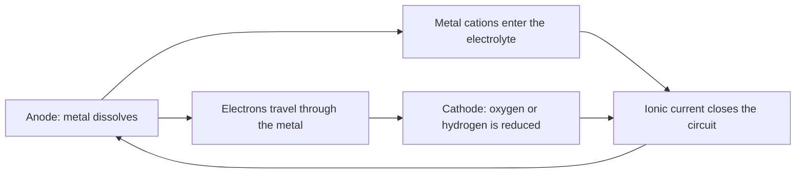
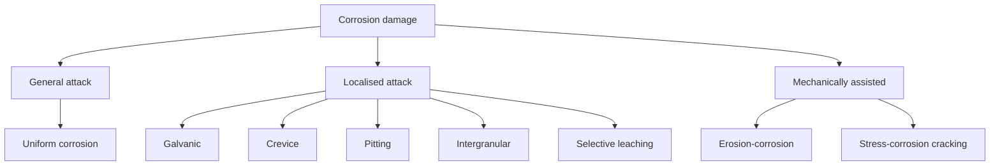
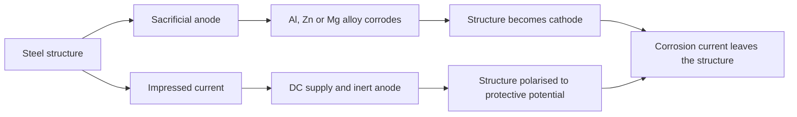

# Chapter 5 — Corrosion

> **Level:** Level 9 — Materials and Industrial Chemistry (advanced undergraduate / engineering-facing)
> **Estimated study time:** 6 hours (reading) + 2 hours (exercises)
> **Prerequisites:** [Redox Reactions and Electrochemistry Fundamentals](../03-intermediate-chemistry/12-redox-reactions-and-electrochemistry-fundamentals.md); [Electrochemical Cells, the Nernst Equation and Electrolysis](../04-advanced-chemistry/08-electrochemical-cells-nernst-equation-and-electrolysis.md); [Chemical Kinetics and Reaction Mechanisms](../04-advanced-chemistry/05-chemical-kinetics-and-reaction-mechanisms.md)
> **Difficulty:** ★★★★☆ (4/5)
> **Related chapters:** [Battery Chemistry](04-battery-chemistry.md), [Materials and Semiconductor Chemistry](03-materials-and-semiconductor-chemistry.md), [Water Chemistry and Water Pollution](../11-environmental-chemistry/03-water-chemistry-and-pollution.md)

---

## 1. Learning Objectives

After working through this chapter you will be able to:

- Explain why aqueous corrosion is an electrochemical process requiring an anode,
  a cathode and an electrolyte.
- Write anodic and cathodic half-reactions and combine them into a corrosion cell.
- Use standard potentials, the Nernst equation and the galvanic series.
- Interpret a mixed-potential diagram and explain the meaning of $E_\text{corr}$
  and $i_\text{corr}$.
- Read a Pourbaix diagram and state its limitations.
- Identify the eight forms of corrosion and their mechanisms.
- Explain passivation and the breakdown of passive films by chloride.
- Describe the chemistry of iron corrosion and the formation of rust.
- Select prevention methods: materials, coatings, cathodic protection, inhibitors
  and design.
- Explain high-temperature oxidation and the Pilling–Bedworth ratio.
- Calculate corrosion rates from current or mass loss and size a cathodic
  protection system.
- Interpret corrosion standards and cost estimates critically.

---

## 2. Introduction

Iron is unstable in the presence of oxygen and water. The thermodynamic driving
force is large: iron oxide is several hundred kilojoules per mole lower in Gibbs
energy than the metal. Yet steel bridges, ships and pipelines survive for decades.
The explanation is kinetics, not thermodynamics: a combination of alloying,
coatings, cathodic protection and design keeps the rate of attack low enough that
the structure outlives its required service life.

Corrosion is an electrochemical process. Oxidation of a metal at one location
supplies electrons to a reduction reaction at another, and the circuit is completed
by ionic conduction through an electrolyte. This separation of half-reactions is
what makes corrosion so sensitive to small differences — a scratch, a weld, a
crevice, a chloride ion, a temperature gradient. It also explains why the same
metal can be immune in one environment, passive in another and rapidly attacked in
a third.

The chapter is organised from mechanism to mitigation. It treats the eight
recognised forms of corrosion as consequences of the same electrochemical
framework, then covers the industrial countermeasures and the economics. Safety is
implicit throughout: corrosion failures are structural failures, and the chemicals
used for inhibition, cleaning and cathodic protection are hazardous in their own
right.

---

## 3. Fundamental Concepts

### 3.1 The electrochemical corrosion cell

A corrosion cell has four components: an **anode**, where metal is oxidised; a
**cathode**, where an oxidising species is reduced; an **electrolyte** connecting
them ionically; and an **electronic path** through the metal. Remove any one and
the corrosion current stops.

At the anode, metal atoms lose electrons and enter solution as ions, either
hydrated or complexed:

$$
\ce{M(s) -> M^{n+}(aq) + ne^-}.
$$

At the cathode, the electrons are consumed. In acidic solution the usual reaction
is hydrogen evolution:

$$
\ce{2H^+(aq) + 2e^- -> H2(g)},
$$

and in neutral aerated solution it is oxygen reduction:

$$
\ce{O2(g) + 2H2O(l) + 4e^- -> 4OH^-(aq)}.
$$

The two half-reactions occur on the same metal surface in most cases. The anode
and cathode are then local regions distinguished by composition, stress,
temperature or oxygen concentration, and the corrosion current circulates through
the metal between them.

### 3.2 Potentials and the driving force

Each half-reaction has a standard electrode potential. The cell potential is the
difference between cathode and anode potentials, and a positive value means the
reaction is spontaneous. The **electromotive force series** orders standard
potentials; the **galvanic series** orders practical corrosion potentials in a
specific environment, usually seawater. The two are not the same: the galvanic
series includes kinetic and film effects, which is why stainless steel appears
noble in seawater despite a relatively active standard potential for chromium.

The **Nernst equation** gives the potential at non-standard activities:

$$
E = E^\circ - \frac{RT}{nF}\ln Q.
$$

For oxygen reduction at pH 7, $E = 1.229 - 0.0591(7) = 0.82$ V versus the standard
hydrogen electrode; for hydrogen evolution at pH 7, $E = -0.41$ V. The difference
is about 1.23 V, the same as the thermodynamic voltage of a water electrolyser.
Oxygen is therefore a far stronger cathodic reactant than hydrogen at neutral pH,
which is why aerated water is more corrosive than deaerated water for many metals.

### 3.3 Mixed potential and the Evans diagram

A corroding metal is not at equilibrium. The anodic and cathodic reactions polarise
each other until the total anodic current equals the total cathodic current. The
common potential is the **corrosion potential** $E_\text{corr}$, and the common
current density is the **corrosion current density** $i_\text{corr}$.

A **mixed-potential diagram** plots potential against the logarithm of current
density. The anodic curve rises from the equilibrium potential of the metal
dissolution reaction; the cathodic curve falls from the equilibrium potential of
the reduction reaction. Their intersection gives $E_\text{corr}$ and
$i_\text{corr}$. The slope of each branch is the **Tafel slope**, and the linear
region follows

$$
\eta = \pm \beta \log_{10}\left(\frac{i}{i_0}\right),
$$

where $\eta$ is the overpotential and $i_0$ the exchange current density. Near
$E_\text{corr}$ the response is approximately linear, which is the basis of the
**Stern–Geary** relation:

$$
i_\text{corr} = \frac{B}{R_p}, \qquad
B = \frac{\beta_a\beta_c}{2.303(\beta_a+\beta_c)}.
$$

This is how a corrosion rate is measured in the field: apply a small potential
perturbation, measure the polarisation resistance $R_p$, and convert to current.

### 3.4 Pourbaix diagrams

A **Pourbaix diagram** plots equilibrium potential against pH for a metal–water
system, showing **immunity**, **corrosion** and **passivation**. Boundaries come
from the Nernst equation and solubility equilibria; the water stability lines
bracket the conditions where water itself is stable.

For iron, the diagram shows immunity below about $-0.6$ V versus SHE, soluble Fe²⁺
at low pH, and oxide films at higher pH. This explains why steel survives in
alkaline concrete but corrodes in acid. The diagram is thermodynamic, not kinetic:
it predicts no rate and cannot predict pitting or crevice attack, because those
depend on local chemistry and film breakdown. Chloride can destroy passivity in a
region the diagram labels passive.

### 3.5 Passivation

**Passivation** is the formation of a thin, adherent, sparingly soluble oxide film
that reduces the corrosion rate by orders of magnitude. Aluminium, titanium,
chromium, stainless steel and nickel alloys rely on it. The film is 1–10 nm thick,
forms spontaneously in air or water, and repairs itself if damaged, provided the
environment can reform it.

The **Pilling–Bedworth ratio** compares the volume of oxide formed with the volume
of metal consumed:

$$
\mathrm{PBR} = \frac{V_\text{oxide}}{V_\text{metal}}
= \frac{M_\text{oxide}\,\rho_\text{metal}}{n M_\text{metal}\,\rho_\text{oxide}}.
$$

A ratio near 1–2 is favourable: the film is coherent without excessive stress.
Aluminium (1.29) and chromium (about 2.0) are protective; iron (2.15) forms a
voluminous film that spalls, which is why rust does not protect. Ratios far below
1 give porous films, and ratios far above 2 give brittle films.

Passivity fails by **breakdown** at a critical potential in chloride, by
**transpassivity** at high potential, or by **reductive dissolution** under
cathodic conditions. Stainless steel's resistance depends on molybdenum and
chromium content and on potential; it is not absolute.

### 3.6 The eight forms of corrosion

| Form | Mechanism | Typical location | Prevention |
|---|---|---|---|
| Uniform | Even anodic dissolution over the surface | Bare steel in acid or seawater | Coatings, inhibitors, thicker section |
| Galvanic | Coupling of dissimilar metals | Joints, fasteners, welds | Insulate, choose close potentials, area ratio |
| Crevice | Oxygen depletion in a shielded gap | Gaskets, lap joints, under deposits | Design out crevices, seal, maintain |
| Pitting | Local breakdown of passive film | Stainless steel in chloride | Higher Mo, lower chloride, cathodic protection |
| Intergranular | Grain-boundary depletion or precipitation | Sensitised stainless steel welds | Low-carbon grades, solution anneal |
| Selective leaching | One component dissolves | Brass dezincification, grey iron | Change alloy, control potential |
| Erosion-corrosion | Mechanical removal of film by flow | Pipes, pumps, bends | Reduce velocity, change geometry, hard alloys |
| Stress-corrosion cracking | Crack growth under stress and environment | Chloride SCC of austenitic stainless | Reduce stress, change alloy, coatings |

**Galvanic corrosion** depends on the potential difference and the **area ratio**:
a small anode coupled to a large cathode concentrates anodic current and produces
rapid penetration. A stainless-steel bolt in an aluminium plate is dangerous for
exactly this reason.

**Crevice corrosion** begins when oxygen inside a gap is consumed faster than it
can diffuse in. The local cathode stops, the anode continues, cations hydrolyse to
produce acid, chloride migrates in, and the local pH can fall below 2.

**Pitting** is similar but starts at a film defect. The pit interior becomes acidic
and chloride-rich, and the mouth may be covered by a film that isolates it from the
bulk. Penetration can be deep with little mass loss.

**Intergranular corrosion** occurs when grain boundaries are less resistant than
the grain interiors. In sensitised austenitic stainless steel, chromium carbide
precipitates at boundaries and depletes the adjacent matrix of chromium; welding
can create this zone, so low-carbon or stabilised grades are used.

**Selective leaching** removes the less noble component — zinc from brass,
aluminium from bronze, iron from cast iron — leaving a porous, weak structure.

**Erosion-corrosion** is flow-assisted attack: high velocity removes the passive
film, the bare metal repassivates, and metal is consumed. Bends and pump impellers
are vulnerable.

**Stress-corrosion cracking** requires a susceptible alloy, a specific environment
and tensile stress. Chloride SCC of austenitic stainless steel, caustic cracking of
carbon steel and ammonia cracking of brass are classic cases. The crack grows by
anodic dissolution at the tip, often with hydrogen embrittlement contributing, and
can occur far below the yield strength.

### 3.7 Oxygen, chloride, pH and temperature

**Oxygen** is the most common cathodic reactant in neutral environments. Removing
it — by deaeration, scavenging or cathodic protection — reduces corrosion of steel
dramatically. In acid solution, hydrogen evolution dominates and oxygen matters
less.

**Chloride** attacks passive films, increases conductivity and forms soluble
complexes with metal cations. It is the single most important aggressive ion in
practice, responsible for pitting, crevice corrosion and SCC of stainless steels.

**pH** controls both the thermodynamics and the solubility of films. Steel corrodes
rapidly below about pH 4, is protected by oxide films above about pH 9, and can
suffer hydrogen damage at very high pH or in the presence of sulfide. Aluminium is
amphoteric: it corrodes in both strong acid and strong alkali.

**Temperature** raises reaction rates and diffusion coefficients, typically
doubling the rate for a 10 K rise in the absence of other changes. It also changes
oxygen solubility, which falls with temperature, and can shift the location of
attack from general to local.

**Differential aeration** is the principle behind crevice corrosion and
concentration cells: the oxygen-rich region becomes cathodic, and the oxygen-poor
region becomes anodic. The same principle explains why the waterline on a steel
piling corrodes and why soil-covered pipe corrodes preferentially.

---

## 4. Detailed Scientific Explanation

### 4.1 The chemistry of rust

Iron dissolves at an anodic site as Fe²⁺. In aerated neutral water, the cathodic
reaction is oxygen reduction, and the Fe²⁺ is oxidised further:

$$
\ce{Fe(s) -> Fe^{2+}(aq) + 2e^-}
$$

$$
\ce{O2(g) + 2H2O(l) + 4e^- -> 4OH^-(aq)}
$$

$$
\ce{4Fe^{2+}(aq) + O2(g) + 6H2O(l) -> 4FeOOH(s) + 8H^+(aq)}
$$

The product is **goethite** or **lepidocrocite**, both hydrated iron(III)
oxyhydroxides, plus magnetite under oxygen-limited conditions. The familiar
red-brown rust is a mixture, and its volume is about twice that of the iron
consumed. Because the film is voluminous, brittle and permeable, it does not
protect: it cracks, admits water and oxygen, and falls away.

The overall reaction is often written as

$$
\ce{4Fe(s) + 3O2(g) + 2H2O(l) -> 2Fe2O3.H2O(s)},
$$

with the caveat that the exact hydrate and morphology depend on the environment.
In acid solution, hydrogen evolution replaces oxygen reduction and the corrosion
rate rises sharply.

### 4.2 Pitting and crevice corrosion

Both forms begin with a local breakdown of passivity and are self-sustaining once
started. In a pit, the anodic dissolution of metal produces cations that hydrolyse
water, lowering pH:

$$
\ce{M^{n+}(aq) + nH2O(l) -> M(OH)_n(s) + nH^+(aq)}.
$$

The acidity attracts chloride, which forms soluble complexes and increases
conductivity. The result is an autocatalytic cell: the pit interior becomes more
aggressive, the exterior remains passive and cathodic, and the small anode-to-large
cathode area ratio concentrates the current.

Crevice corrosion follows the same logic but starts geometrically. A gap of a few
tens of micrometres, such as under a gasket or a deposit, restricts mass transport.
Oxygen is consumed faster than it can diffuse in, so the interior becomes anodic.
The critical crevice temperature and the critical pitting temperature are practical
parameters used to rank stainless steels in chloride service.

### 4.3 Stress-corrosion cracking and hydrogen embrittlement

**Stress-corrosion cracking** (SCC) is crack growth under the combined action of
tensile stress and a specific corrosive environment. Three conditions are needed:
a susceptible material, a tensile stress and an aggressive environment. Chloride
SCC of austenitic stainless steel typically occurs above about 60 °C in aerated
chloride solutions, and the crack path is often transgranular. Caustic SCC of
carbon steel occurs in concentrated hydroxide at high temperature, and ammonia
cracks brass.

The mechanism is not a single one. **Anodic dissolution** at the crack tip, **film
rupture** and **hydrogen embrittlement** all contribute depending on the system.
Cathodic protection can stop anodic dissolution but, if over-applied, generates
hydrogen that embrittles high-strength steels — a direct conflict between two
protection strategies.

**Hydrogen embrittlement** is the loss of ductility caused by absorbed hydrogen.
Hydrogen atoms diffuse into the steel, accumulate at traps such as dislocations and
inclusions, and reduce cohesive strength. High-strength steels, welds and
electroplated parts are vulnerable. Baking after plating and avoiding excessive
cathodic protection are the standard mitigations.

### 4.4 Material selection and coatings

The first defence is a material that is passive or cathodic in service. Stainless
steels rely on chromium-rich films; duplex grades combine austenite and ferrite for
strength and chloride resistance; nickel alloys resist reducing acids; titanium
resists seawater but not hydrofluoric acid. Selection must consider weldability,
cost and the consequences of failure, not just corrosion rate.

**Coatings** isolate the metal from the electrolyte. A barrier coating must be
adherent, defect-free and environment-resistant. A **zinc-rich primer** adds
galvanic protection at defects, and **hot-dip galvanising** gives a zinc layer that
corrodes preferentially. **Conversion coatings** and **anodising** modify the
natural oxide. Coatings fail at defects, edges and welds, where a small anode
surrounded by a large cathode accelerates penetration; hence the system approach
of preparation, primer, intermediate coat, topcoat and inspection.

### 4.5 Cathodic protection

**Cathodic protection** makes the structure the cathode of an electrochemical cell,
so that oxidation of the protected metal stops. There are two methods.

**Sacrificial anode** systems connect the structure to a more active metal —
aluminium, zinc or magnesium alloys — which corrodes instead. They are simple,
self-regulating and need no power supply, and are used for ships, pipelines and
buried tanks. The driving voltage is limited, and the anodes must be replaced
periodically.

**Impressed-current** systems use an external power supply and an inert anode to
drive the structure to a protective potential. They can protect large structures
and adjust to changing conditions, but require power, control and monitoring, and
can cause overprotection and hydrogen damage if misused.

The protective criterion for steel in soil or water is usually a potential of
$-0.85$ V versus a copper–copper sulfate reference electrode, or a polarisation of
100 mV from the free-corrosion potential. These criteria are empirical and
environment-specific; they are codified in standards such as NACE SP0169 and
ISO 15589.

### 4.6 Inhibitors and design

**Inhibitors** are added in small concentrations. **Anodic inhibitors** (chromate,
nitrite, molybdate) passivate the metal and can stimulate localised attack if
underdosed. **Cathodic inhibitors** (zinc salts, phosphonates) slow the cathodic
reaction, and **mixed inhibitors** (amines, imidazolines) adsorb and block both.
Chromate is effective but carcinogenic; phosphonates and azoles are common
substitutes, and their environmental fate must be considered.

**Design** is the cheapest control: drainage, avoidance of crevices, smooth
transitions, dissimilar-metal separation, thickness allowance and inspection
access. A joint that traps water is a design error no coating can fully correct.

### 4.7 High-temperature oxidation

At high temperature, dry oxidation replaces aqueous corrosion:

$$
\ce{M(s) + O2(g) -> MO2(s)}.
$$

A dense, adherent scale grows by solid-state diffusion and follows a **parabolic
rate law**, $x^2 = k_p t$, where $x$ is scale thickness. A porous or spalling scale
gives linear kinetics and rapid metal loss. Engineering alloys form **chromia** or
**alumina** scales — stainless steels rely on Cr₂O₃, superalloys on Al₂O₃ or Cr₂O₃.
**Hot corrosion** occurs when molten sulfates or chlorides flux the oxide, a major
issue in gas turbines and incinerators; MCrAlY coatings and thermal barrier
ceramics extend life.

### 4.8 Testing, standards and cost

Testing ranges from immersion and salt spray to electrochemical polarisation,
impedance spectroscopy and slow-strain-rate tests. **Weight-loss coupons** give an
average rate, **polarisation curves** give instantaneous kinetics, and **impedance**
separates charge transfer from diffusion and film effects. ASTM G1, G31 and B117
and ISO 9223 and 15589 define procedures. Accelerated tests rank materials; they
do not predict service life.

The **cost of corrosion** is large: the NACE IMPACT study estimated about 2.5 % of
global GDP, with a significant avoidable fraction. The boundaries of such estimates
are debatable, but the order of magnitude explains why corrosion engineering
matters.

---

## 5. Visual Diagrams

**Figure 5.1 — The corrosion cell as a closed circuit.** All four elements — anode,
cathode, electrolyte and electronic path — are required. Controlling any one of
them stops the current: coatings break the electrolyte path, cathodic protection
makes the whole surface cathodic, and insulation between dissimilar metals breaks
the electronic path.

**Figure 5.2 — The eight recognised forms of corrosion.** The classification is
practical rather than fundamental: all eight are electrochemical, but they differ
in where the anode is and why it stays localised. Localised forms are more
dangerous than uniform attack because failure can occur with little total mass
loss and little visible warning.

**Figure 5.3 — Two routes to cathodic protection.** Both make the protected
structure cathodic, so anodic dissolution stops. Sacrificial systems are
self-powered and simple; impressed-current systems are controllable and suit large
structures but require power, monitoring and overprotection control.

---

## 6. Mathematical Formulas

The corrosion rate from current density is

$$
\mathrm{CR} = 3.27\times10^{-3}\,\frac{i_\text{corr}\,M_\text{eq}}{\rho},
$$

where $\mathrm{CR}$ is in mm yr⁻¹, $i_\text{corr}$ in µA cm⁻², $M_\text{eq}$ the
equivalent mass in g eq⁻¹ and $\rho$ the density in g cm⁻³. From mass loss:

$$
\mathrm{CR} = \frac{8.76\times10^{4}\,\Delta m}{\rho A t},
$$

with $\Delta m$ in g, $A$ in cm², $t$ in h and $\rho$ in g cm⁻³.

The Nernst equation, Tafel behaviour and the Stern–Geary relation are

$$
E = E^\circ - \frac{RT}{nF}\ln Q, \qquad
\eta = \beta\log_{10}\frac{i}{i_0}, \qquad
i_\text{corr} = \frac{B}{R_p}.
$$

Parabolic oxidation and the Pilling–Bedworth ratio are

$$
x^2 = k_p t, \qquad
\mathrm{PBR} = \frac{M_\text{oxide}\,\rho_\text{metal}}
{n M_\text{metal}\,\rho_\text{oxide}}.
$$

| Symbol | Meaning | SI unit |
|---|---|---|
| $\mathrm{CR}$ | Corrosion rate | m s⁻¹ (practical: mm yr⁻¹) |
| $i_\text{corr}$ | Corrosion current density | A m⁻² (practical: µA cm⁻²) |
| $M_\text{eq}$ | Equivalent mass | kg eq⁻¹ |
| $\rho$ | Density | kg m⁻³ |
| $\Delta m$ | Mass loss | kg |
| $A$ | Exposed area | m² |
| $t$ | Exposure time | s |
| $E$ | Electrode potential | V |
| $\eta$ | Overpotential | V |
| $\beta$ | Tafel slope | V decade⁻¹ |
| $i_0$ | Exchange current density | A m⁻² |
| $R_p$ | Polarisation resistance | Ω m² |
| $B$ | Stern–Geary constant | V |
| $x$ | Scale thickness | m |
| $k_p$ | Parabolic rate constant | m² s⁻¹ |

The Faraday conversion assumes uniform attack, a single oxidation state and 100 %
current efficiency. Localised attack violates all three, which is why a coupon
corrosion rate can understate the danger of a deep pit.

---

## 7. Chemical Equations

Iron dissolution and oxygen reduction in neutral aerated water:

$$
\ce{Fe(s) -> Fe^{2+}(aq) + 2e^-}
$$

$$
\ce{O2(g) + 2H2O(l) + 4e^- -> 4OH^-(aq)}
$$

Oxidation and hydrolysis of the ferrous ion to rust:

$$
\ce{4Fe^{2+}(aq) + O2(g) + 6H2O(l) -> 4FeOOH(s) + 8H^+(aq)}
$$

Acid corrosion with hydrogen evolution:

$$
\ce{Fe(s) + 2H^+(aq) -> Fe^{2+}(aq) + H2(g)}
$$

Passivation of aluminium and chromium:

$$
\ce{4Al(s) + 3O2(g) -> 2Al2O3(s)}, \qquad
\ce{4Cr(s) + 3O2(g) -> 2Cr2O3(s)}
$$

Sacrificial protection by zinc:

$$
\ce{Zn(s) -> Zn^{2+}(aq) + 2e^-}
$$

Pit acidification by hydrolysis:

$$
\ce{Fe^{2+}(aq) + 2H2O(l) -> Fe(OH)2(s) + 2H^+(aq)}
$$

The equations show why the anodic and cathodic sites must be spatially separated
for a corrosion cell to operate. In a homogeneous environment, the reactions occur
on adjacent microscopic areas; in a crevice or pit, the separation becomes
macroscopic and the damage becomes localised.

---

## 8. Worked Examples

### Worked Example 8.1 — Corrosion rate from current density

**Problem.** A mild-steel coupon in aerated water shows a corrosion current density
of $10\ \mu\text{A cm}^{-2}$. Take $M_\text{eq} = 27.92\ \text{g eq}^{-1}$ for iron
and $\rho = 7.87\ \text{g cm}^{-3}$. Calculate the penetration rate in mm yr⁻¹.

**Strategy.** Apply $\mathrm{CR} = 3.27\times10^{-3} i_\text{corr} M_\text{eq}/\rho$.

**Solution.**

$$
\mathrm{CR} = 3.27\times10^{-3}(10)\frac{27.92}{7.87}
= 0.116\ \text{mm yr}^{-1}.
$$

**Check.** A rate of 0.12 mm yr⁻¹ is typical of steel in quiet aerated water and
corresponds to about 1 mm in nine years. A pipeline with a 6 mm wall and no
protection would fail within a few decades, which is why coatings and cathodic
protection are used together.

### Worked Example 8.2 — Corrosion rate from mass loss

**Problem.** A steel coupon of area $50\ \text{cm}^2$ loses 0.85 g in 30 days.
Calculate the penetration rate.

**Strategy.** Convert the mass loss to volume, divide by area and time, then
convert to mm yr⁻¹.

**Solution.** Volume lost $= 0.85/7.87 = 0.108\ \text{cm}^{3}$. Depth
$= 0.108/50 = 2.16\times10^{-3}$ cm over 720 h, so the rate is
$3.00\times10^{-6}$ cm h⁻¹. Multiplying by 8760 h yr⁻¹ gives 0.0263 cm yr⁻¹, or
**0.263 mm yr⁻¹**.

**Check.** The rate is about twice that of Example 8.1, consistent with a more
aggressive exposure. Weight-loss coupons give an average over the exposure and
cannot detect pitting; a coupon that looks acceptable by mass loss may still have
perforated.

### Worked Example 8.3 — Sacrificial anode mass

**Problem.** A buried pipeline requires 100 mA of protection current for 20 years.
Zinc anodes have a capacity of $780\ \text{A h kg}^{-1}$ and 85 % utilisation.
Calculate the anode mass required.

**Strategy.** Convert current and time to charge, divide by capacity and
utilisation.

**Solution.** Charge $= 0.100\ \text{A} \times 20 \times 8760\ \text{h} =
17\,520\ \text{A h}$. Mass $= 17\,520/(780 \times 0.85) = 26.4$ kg.

**Check.** The result is about 26 kg of zinc, or several anodes along the pipeline.
The same charge would consume
$(0.100)(6.31\times10^{8})(55.85)/(2\times96\,485) = 18.3$ kg of iron if the
current were spent on steel, which shows why the anode must be replaced
periodically. Real designs add margin for backfill resistance and current
distribution and monitor the protective potential rather than trusting the
calculation.

### Worked Example 8.4 — Pilling–Bedworth ratio and film protection

**Problem.** Calculate the Pilling–Bedworth ratio for (a) Al₂O₃ on aluminium
($M_\text{oxide} = 101.96$, $\rho_\text{oxide} = 3.95$; $M_\text{Al} = 26.98$,
$\rho_\text{Al} = 2.70$; $n = 2$) and (b) Fe₂O₃ on iron
($M_\text{oxide} = 159.69$, $\rho_\text{oxide} = 5.24$; $M_\text{Fe} = 55.85$,
$\rho_\text{Fe} = 7.87$; $n = 2$). Comment on protection.

**Strategy.** Apply the volume-ratio formula.

**Solution.** (a)
$\mathrm{PBR} = (101.96 \times 2.70)/(2 \times 26.98 \times 3.95) = 1.29$.
(b) $\mathrm{PBR} = (159.69 \times 7.87)/(2 \times 55.85 \times 5.24) = 2.15$.

**Check.** Alumina at 1.29 is coherent and protective; iron oxide at 2.15 is
voluminous and spalls, which is why rust is not a barrier. The ratio is a guide,
not a guarantee: film adhesion, defect density and environment also matter.

---

## 9. Real-World Applications

Infrastructure accounts for much of the cost: bridges, reinforced concrete,
pipelines, water mains and tanks. Concrete protects steel by its high pore-solution
pH, but chloride from de-icing salt or seawater destroys passivity and causes
spalling; cathodic protection and chloride barriers are the main interventions.

Marine environments combine chloride, oxygen and flow. Ships use coated hulls with
sacrificial anodes; offshore structures use impressed-current systems and duplex
stainless steels. The splash zone is worst because it alternates wetting, drying
and oxygen access. Automotive corrosion is controlled by galvanised steel and
electrophoretic coatings; aerospace uses clad aluminium, anodising and titanium.
Cultural heritage metals require conservation, where chloride and organic-acid
chemistry dominate.

---

## 10. Common Mistakes

| Mistake | Why it happens | Correct approach |
|---|---|---|
| Using standard potentials to predict practical corrosion | Kinetics, films and environment dominate | Use the galvanic series for the actual environment |
| Assuming stainless steel never corrodes | Passive films can break down | Specify grade, chloride level and temperature |
| Ignoring the anode-to-cathode area ratio | A small anode coupled to a large cathode is worst | Insulate dissimilar metals; avoid small anodes |
| Treating corrosion rate as uniform | Coupons average over the surface | Inspect for pitting and crevice attack separately |
| Underdosing an anodic inhibitor | Insufficient coverage stimulates local attack | Control dose and monitor; prefer mixed inhibitors |
| Overprotecting with cathodic protection | Excess current generates hydrogen | Hold the protective potential, not the maximum current |
| Using salt spray as a service-life prediction | It is an accelerated ranking test | Use site-specific exposure and electrochemical data |
| Confusing passivation with immunity | Passivation is a kinetic film | Check film stability in the specific environment |

---

## 11. Chapter Summary

- Corrosion is electrochemical: anode, cathode, electrolyte and electronic path.
- The driving force is thermodynamic, but the rate is kinetic and film-controlled.
- The mixed-potential diagram gives $E_\text{corr}$ and $i_\text{corr}$; Tafel and
  Stern–Geary analysis converts polarisation data into rates.
- Pourbaix diagrams map immunity, corrosion and passivation but not kinetics.
- Passivation depends on a coherent, self-repairing oxide film.
- The eight forms of corrosion are localised consequences of the same cell.
- Oxygen, chloride, pH and temperature control both thermodynamics and film
  stability.
- Prevention combines material selection, coatings, cathodic protection,
  inhibitors and design.
- High-temperature oxidation follows parabolic kinetics when the scale is
  protective.
- Standards and cost estimates must be read with their boundaries in mind.

---

## 12. Exercises

### 12.1 Conceptual questions

1. Why does removing oxygen stop steel corrosion in neutral water but not in acid?
2. Explain why a small anode coupled to a large cathode is dangerous.
3. Distinguish passivation from immunity.

### 12.2 Basic problems

4. Calculate the corrosion rate for $i_\text{corr} = 25\ \mu\text{A cm}^{-2}$ on
   copper ($M_\text{eq} = 31.77$, $\rho = 8.96$).
5. A steel coupon of 20 cm² loses 0.20 g in 10 days. Calculate the penetration
   rate.
6. Calculate the PBR for Cr₂O₃ on chromium ($M = 151.99$, $\rho = 5.22$;
   $M_\text{Cr} = 52.00$, $\rho = 7.19$; $n = 2$).

### 12.3 Intermediate problems

7. A zinc anode of 10 kg protects a structure drawing 50 mA. Estimate its life
   with 80 % utilisation and 780 A h kg⁻¹.
8. Explain why chloride causes pitting rather than uniform corrosion on stainless
   steel.
9. Why does cathodic protection sometimes cause hydrogen embrittlement?

### 12.4 Advanced problems

10. Derive the Stern–Geary relation from the Tafel equations and state its
    assumptions.
11. A pipeline has a coating holiday of 1 cm² in a 100 m² coated surface. Explain
    the galvanic consequence and the protection strategy.
12. Propose a corrosion management plan for a coastal bridge, naming the
    inspection methods and the decision criteria.

### Answers

1. Oxygen reduction is the cathodic reaction in neutral water; in acid, hydrogen
   evolution can proceed without oxygen.
2. The cathode area controls the total current, and the small anode concentrates
   it, giving rapid penetration.
3. Immunity is thermodynamic: the metal is stable at that potential and pH.
   Passivation is kinetic: a film slows attack but can break down.
4. $\mathrm{CR} = 3.27\times10^{-3}(25)(31.77)/8.96 = 0.29$ mm yr⁻¹.
5. Volume $= 0.20/7.87 = 0.0254$ cm³; depth over 240 h
   $= 1.27\times10^{-3}$ cm, giving about 0.46 mm yr⁻¹.
6. $\mathrm{PBR} = (151.99 \times 7.19)/(2 \times 52.00 \times 5.22) = 2.01$.
7. Charge $= 0.050 \times 8760 = 438$ A h yr⁻¹; usable capacity
   $= 10 \times 780 \times 0.80 = 6240$ A h, so life is about 14 years.
8. Chloride adsorbs on the passive film, raises its solubility and creates
   meta-stable pits; the local chemistry then stabilises the pit.
9. Overprotection drives the potential below the hydrogen equilibrium, generating
   atomic hydrogen that diffuses into high-strength steel.
10. Expand the anodic and cathodic currents as exponentials of overpotential, set
    $i_a = |i_c|$ and linearise near $E_\text{corr}$; the result assumes Tafel
    kinetics and no mass-transport limitation.
11. The holiday is a small anode in a large cathode; the coating concentrates
    current at the defect. Use a coating plus cathodic protection and monitor the
    potential at the holiday.
12. Inspect for chloride ingress, delamination, cracking and rebar corrosion; use
    half-cell potential mapping, chloride profiling and visual survey, with
    intervention thresholds tied to the residual service life.

---

## 13. Further Reading

- Bard, A. J. and Faulkner, L. R. *Electrochemical Methods: Fundamentals and
  Applications*, 2nd ed., Wiley, 2001.
- Callister, W. D. and Rethwisch, D. G. *Materials Science and Engineering: An
  Introduction*, 10th ed., Wiley, 2018. Chapter on corrosion and degradation.
- West, A. R. *Solid State Chemistry and its Applications*, 2nd ed., Wiley, 2014.
- Pourbaix, M. *Atlas of Electrochemical Equilibria in Aqueous Solutions*,
  2nd ed., NACE International, 1974.
- NACE International. *IMPACT: International Measures of Prevention, Application
  and Economics of Corrosion Technologies Study*, 2016.
  <https://impact.nace.org/>
- ASTM. *G1 Standard Practice for Preparing, Cleaning and Evaluating Corrosion
  Test Specimens*; *G31 Standard Guide for Laboratory Immersion Corrosion Testing*.
  <https://www.astm.org/>
- ISO. *ISO 9223 Corrosion of metals and alloys — Corrosivity of atmospheres*.
  <https://www.iso.org/>

See [CURRICULUM.md](../CURRICULUM.md), [GLOSSARY.md](../GLOSSARY.md) and
[REFERENCES.md](../REFERENCES.md).

