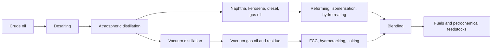
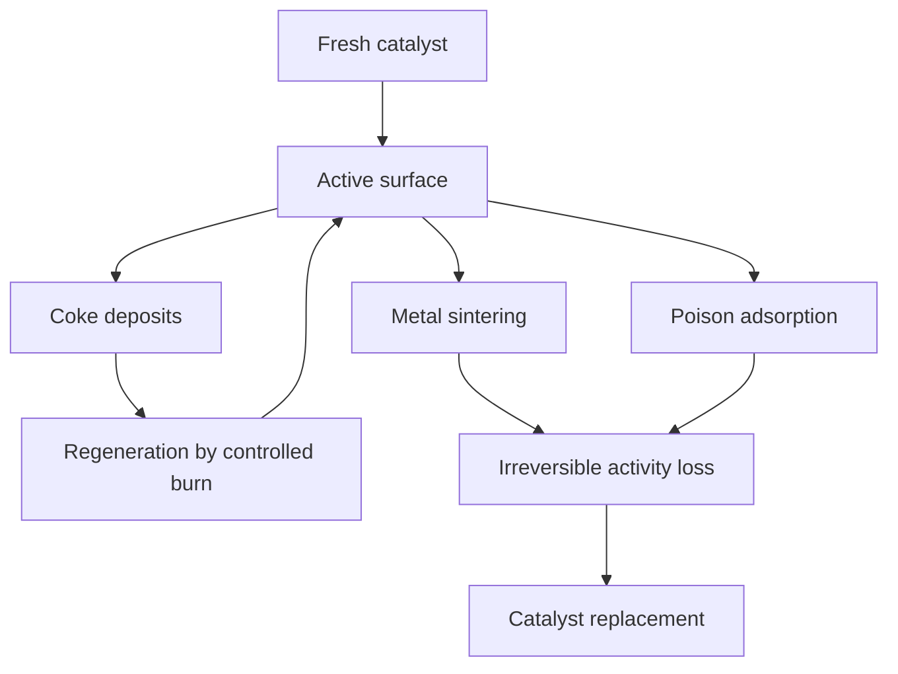
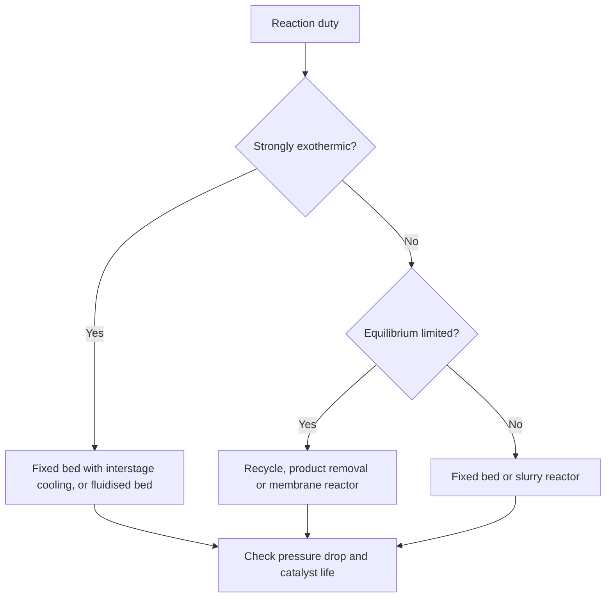

# Chapter 6 — Catalytic Industrial Processes and Petroleum Chemistry

> **Level:** Level 9 — Materials and Industrial Chemistry (advanced undergraduate / process-facing)
> **Estimated study time:** 8 hours (reading) + 3 hours (exercises)
> **Prerequisites:** [Chemical Kinetics and Reaction Mechanisms](../04-advanced-chemistry/05-chemical-kinetics-and-reaction-mechanisms.md); [Catalysis](../04-advanced-chemistry/06-catalysis.md); [Chemical Equilibrium and Le Chatelier's Principle](../03-intermediate-chemistry/10-chemical-equilibrium-and-le-chateliers-principle.md); [Chemical Thermodynamics](../04-advanced-chemistry/04-chemical-thermodynamics.md)
> **Difficulty:** ★★★★★ (5/5)
> **Related chapters:** [Green and Sustainable Chemistry](../11-environmental-chemistry/01-green-and-sustainable-chemistry.md), [Atmospheric Chemistry](../11-environmental-chemistry/02-atmospheric-chemistry.md), [Polymer Chemistry](01-polymer-chemistry.md)

---

## 1. Learning Objectives

After working through this chapter you will be able to:

- Describe the refining sequence from crude oil to products.
- Distinguish thermal cracking, catalytic cracking and hydrocracking.
- Explain reforming, alkylation, isomerisation and hydrotreating.
- Define octane number and relate fuel composition to performance and emissions.
- Trace petrochemical routes from steam cracking and catalytic reforming.
- Explain the thermodynamics and catalysts of ammonia, nitric acid, sulfuric
  acid, methanol, syngas and Fischer–Tropsch synthesis.
- Describe hydroformylation, ethylene oxide and polyethylene processes.
- Explain catalyst deactivation and regeneration.
- Select a reactor type for a given duty.
- Account for process energy integration and carbon capture efficiency honestly.
- Describe SCR and three-way catalysis for emission control.

---

## 2. Introduction

A refinery is a chemical plant that converts a mixture of hydrocarbons into
molecules with the right boiling range, branching, sulfur content and stability
for a market. It does not make a single product; it makes a slate, and the
economics depend on matching that slate to demand. The chemistry is mostly
catalytic, and the catalysts are among the most carefully engineered materials in
industry.

The same industry supplies the feedstock for most petrochemicals. Steam cracking
produces ethylene and propylene; catalytic reforming produces benzene, toluene and
xylenes; these are the building blocks for polymers, solvents, detergents and
pharmaceuticals. The boundary between fuel chemistry and petrochemical chemistry
is a matter of destination, not of mechanism.

This chapter covers the refining and catalytic processes that underpin industrial
chemistry, with real operating conditions and catalyst compositions. It also
covers the accounting that is often missing from enthusiastic descriptions of
"clean" processes: hydrogen efficiency, carbon capture rate, energy penalty and
the difference between a laboratory yield and an industrial one.

---

## 3. Fundamental Concepts

### 3.1 The refining sequence

Crude oil is a mixture of hydrocarbons with a wide boiling range, plus sulfur,
nitrogen, oxygen and metals. Refining separates and transforms it in four stages.

**Separation** begins with desalting to remove salts and water, then atmospheric
distillation to separate light gases, naphtha, kerosene, diesel and atmospheric
gas oil. The residue is distilled under vacuum to avoid thermal cracking, giving
vacuum gas oil and vacuum residue.

**Conversion** changes molecular size and shape. Cracking breaks large molecules
into smaller ones; reforming rearranges them into more branched or aromatic
structures; alkylation and isomerisation adjust branching; coking converts residue
into coke and lighter products.

**Treating** removes heteroatoms. Hydrotreating removes sulfur and nitrogen with
hydrogen; amine scrubbing removes H₂S from gases; Claus recovery converts H₂S into
elemental sulfur.

**Blending** combines streams to meet specifications for volatility, octane,
cetane, sulfur, density and cold flow. Blending is where the refinery meets the
market, and it is constrained by regulations on benzene, sulfur and vapor pressure.

### 3.2 Cracking: thermal, catalytic and hydrocracking

**Thermal cracking** breaks C–C bonds by radical mechanisms. Steam cracking of
naphtha at 800–870 °C with 0.1–0.5 s residence time gives ethylene, propylene,
butadiene and pyrolysis gasoline; visbreaking and coking are milder routes for
residue.

**Catalytic cracking** uses acid zeolites and carbocation intermediates. FCC feeds
vacuum gas oil into a riser at 500–550 °C over zeolite Y or ZSM-5, and the spent
catalyst is regenerated by burning coke at about 700 °C. It produces gasoline and
propylene and is the main conversion process in most refineries.

**Hydrocracking** combines a sulfide hydrogenation phase with an acidic support at
300–450 °C and 100–200 bar H₂. It suits heavy feeds and makes low-sulfur,
high-cetane diesel.

| Process | Temperature | Pressure | Catalyst | Main product |
|---|---|---|---|---|
| Steam cracking | 800–870 °C | 1–3 bar | None, radical | Ethylene, propylene |
| FCC | 500–550 °C | 2–3 bar | Zeolite Y or ZSM-5 | Gasoline, propylene |
| Hydrocracking | 300–450 °C | 100–200 bar H₂ | NiMo or CoMo on acid support | Diesel, naphtha |
| Catalytic reforming | 480–530 °C | 10–30 bar | Pt–Re or Pt–Sn on alumina | Reformate, aromatics |
| Hydrotreating | 300–400 °C | 30–100 bar H₂ | CoMo or NiMo on alumina | Low-sulfur products |

### 3.3 Reforming, isomerisation and alkylation

**Catalytic reforming** raises the octane of naphtha by dehydrogenating naphthenes
to aromatics, dehydrocyclising paraffins and isomerising the remainder. It uses
platinum on chlorided alumina, promoted with rhenium or tin, at 480–530 °C and
10–30 bar, in several adiabatic beds with interstage reheating because the
reactions are strongly endothermic.

**Isomerisation** branches straight-chain paraffins over chlorided alumina or
zeolite at 100–250 °C; butane isomerisation supplies isobutane for alkylation.
**Alkylation** combines isobutane with light olefins over HF, H₂SO₄ or a solid acid
at 0–40 °C. HF is effective but hazardous; solid acids avoid the liquid acid but
have shorter life.

### 3.4 Hydrotreating and sulfur recovery

**Hydrotreating** reacts hydrogen with sulfur, nitrogen and oxygen compounds to
give H₂S, NH₃ and water over CoMo or NiMo sulfides on alumina at 300–400 °C and
30–100 bar. The 10 ppm sulfur limit in transport fuel requires deep
hydrodesulfurisation and, for refractory species, more active catalysts or
two-stage operation.

The H₂S is converted to sulfur by the **Claus process**: one third is burned to
SO₂, which reacts with the remainder:

$$
\ce{2H2S(g) + SO2(g) -> 3S(l) + 2H2O(g)}.
$$

The furnace runs at 950–1200 °C, followed by alumina catalysts at 200–300 °C.
Recovery is 95–97 % for two or three stages; tail-gas treatment reaches 99 % or
more. Sulfur is also removed from natural gas and fuel gas to protect downstream
catalysts, and is sold for sulfuric acid and fertiliser.

### 3.5 Octane number and fuel specification

**Octane number** measures a fuel's resistance to autoignition in a spark-ignition
engine. It is defined against reference mixtures of isooctane (100) and n-heptane
(0). **Research octane number** (RON) and **motor octane number** (MON) use
different test conditions; the average is the **anti-knock index**. A higher
octane number allows a higher compression ratio and therefore higher efficiency.

Molecular structure controls octane: highly branched paraffins and aromatics have
high octane, straight-chain paraffins and olefins lower. Ethanol and ethers raise
octane and add oxygen, which reduces CO and particulate emissions but increases
volatility and can increase NOx in some regimes. Tetraethyl lead was the historic
anti-knock agent and was eliminated because of neurotoxicity and catalyst poisoning.

Modern specifications also limit sulfur, benzene, aromatics, olefins and vapor
pressure. These limits are chemical constraints on the refinery: reducing benzene
may require reformer feed fractionation or benzene saturation; reducing sulfur
requires more severe hydrotreating; reducing vapor pressure limits butane blending.

### 3.6 Petrochemical feedstock routes

**Steam cracking** of ethane or naphtha is the main source of ethylene and
propylene. Ethane gives a high ethylene yield; naphtha gives a broader slate
including butadiene and pyrolysis gasoline. The product mix depends on feedstock,
coil temperature and residence time.

**Catalytic reforming** supplies benzene, toluene and xylenes (BTX). Xylenes are
separated and isomerised; p-xylene is oxidised to terephthalic acid for PET.
**Methanol-to-olefins** converts methanol over a zeolite catalyst into ethylene and
propylene, decoupling olefin production from oil. **Propane dehydrogenation**
produces on-purpose propylene.

The petrochemical tree is large, but the first steps are few: ethylene,
propylene, butadiene, benzene, toluene, xylenes and syngas. Almost every plastic,
fibre, solvent and detergent is a derivative of one of these.

### 3.7 Catalysis fundamentals for industrial processes

A catalyst provides a lower-energy pathway without changing the equilibrium
position. Industrial catalysts are porous solids with high surface area, active
sites dispersed on a support, and promoters that modify activity or stability.
Activity is quoted per mass, per surface area or per site; **turnover frequency**
is the number of catalytic cycles per site per second, and **turnover number** is
the total before deactivation.

**Selectivity** is often more important than activity: a catalyst that converts
all the feed but makes the wrong product is worthless. Selectivity is controlled
by the active site, the support, the pore structure and the residence time. Zeolites
are shape-selective because their pores admit some molecules and exclude others.

The **Sabatier principle** states that binding should be neither too weak nor too
strong: too weak and the reactant does not activate, too strong and the product
does not leave. Volcano plots of activity against binding energy express this
trade-off and guide catalyst selection.

### 3.8 Deactivation and regeneration

Catalysts lose activity by several mechanisms.

- **Coking**: carbon deposits cover sites and block pores. It is reversible by
  burning in air, but the burn must be controlled to avoid sintering.
- **Sintering**: small metal particles agglomerate at high temperature, reducing
  active area. It is largely irreversible.
- **Poisoning**: sulfur, chlorine, arsenic, lead or vanadium bind strongly to
  active sites. Guard beds and feedstock purification protect the main catalyst.
- **Fouling**: deposits block the catalyst bed and raise pressure drop.
- **Leaching**: the active phase dissolves in the reaction medium, especially in
  liquid-phase processes.

Regeneration may be continuous (FCC catalyst circulation and burn), periodic
(reformer regeneration) or impossible (irreversible poisoning). Catalyst life is
an economic variable: a short life can be acceptable if the catalyst is cheap,
and a long life is essential if the reactor must not be opened.

---

## 4. Detailed Scientific Explanation

### 4.1 Ammonia: the Haber–Bosch process

Ammonia synthesis is the canonical example of a process constrained by
thermodynamics and rescued by catalysis and recycle:

$$
\ce{N2(g) + 3H2(g) <=> 2NH3(g)} \qquad \Delta_\text{r}H^\circ = -92\ \text{kJ mol}^{-1}.
$$

The reaction is exothermic and reduces the mole number of gas, so high pressure
and low temperature favour ammonia; low temperature, however, gives an
impractically slow rate. The industrial compromise is 400–500 °C, 150–300 bar and
an iron catalyst promoted with K₂O, Al₂O₃ and CaO. Conversion per pass is only
25–35 %, so unreacted gas is recycled after ammonia is condensed.

The catalyst is made by melting magnetite with promoters and reducing it to porous
α-iron. Potassium oxide donates charge to the surface and weakens the N≡N bond;
alumina and calcium oxide prevent sintering. Nitrogen dissociation is
rate-limiting, so surface chemistry is decisive.

Ammonia supplies fertilisers, explosives and plastics, and increasingly hydrogen
carriers. Its production consumes 1–2 % of global energy and emits about 1 % of
global CO₂, which is why green ammonia is a major target.

### 4.2 Nitric acid: the Ostwald process

Ammonia is oxidised over a platinum–rhodium gauze at 800–900 °C and 1–10 bar:

$$
\ce{4NH3(g) + 5O2(g) -> 4NO(g) + 6H2O(g)} \qquad \Delta_\text{r}H^\circ = -905\ \text{kJ mol}^{-1}.
$$

The reaction is extremely exothermic and the gauze is self-heating. Nitric oxide
is then oxidised to nitrogen dioxide and absorbed in water:

$$
\ce{2NO(g) + O2(g) -> 2NO2(g)}, \qquad
\ce{3NO2(g) + H2O(l) -> 2HNO3(aq) + NO(g)}.
$$

The overall yield is 95–98 %. The gauze loses platinum slowly by volatilisation
and is recovered from downstream equipment. Nitric acid serves fertilisers, adipic
acid, nitration and explosives. Tail gas contains NO and N₂O, both greenhouse
gases and NOx precursors; N₂O has a global warming potential hundreds of times
that of CO₂, so catalytic abatement matters.

### 4.3 Sulfuric acid: the contact process

Sulfuric acid is the most produced industrial chemical. Sulfur is burned to SO₂,
catalysed to SO₃ over vanadium(V) oxide, and absorbed in sulfuric acid:

$$
\ce{S(s) + O2(g) -> SO2(g)}
$$

$$
\ce{2SO2(g) + O2(g) <=> 2SO3(g)} \qquad \Delta_\text{r}H^\circ = -198\ \text{kJ mol}^{-1}
$$

$$
\ce{SO3(g) + H2O(l) -> H2SO4(l)}.
$$

The catalyst is V₂O₅ on silica with potassium sulfate promoters at 400–450 °C. The
reaction is exothermic and favoured by low temperature, but the catalyst must stay
above its ignition temperature. **Double absorption** — removing SO₃ between beds
and returning the remaining gas — pushes conversion above 99.5 % by shifting the
equilibrium. Absorption into water is violent and forms acid mist, so SO₃ is
absorbed in concentrated acid to give oleum or 98 % acid.

### 4.4 Syngas, steam reforming and methanol

**Steam reforming** converts methane or naphtha into syngas over a nickel catalyst
on alumina at 700–900 °C and 20–40 bar:

$$
\ce{CH4(g) + H2O(g) <=> CO(g) + 3H2(g)} \qquad \Delta_\text{r}H^\circ = +206\ \text{kJ mol}^{-1}.
$$

The reaction is strongly endothermic and runs in fired tubular reactors with a
steam-to-carbon ratio of 2.5–3.5 to prevent carbon deposition. The gas is shifted:

$$
\ce{CO(g) + H2O(g) <=> CO2(g) + H2(g)} \qquad \Delta_\text{r}H^\circ = -41\ \text{kJ mol}^{-1},
$$

over Fe–Cr at 350–450 °C and then Cu–Zn at 200–250 °C. Pressure-swing adsorption
or amine scrubbing separates hydrogen.

**Methanol synthesis** uses syngas over Cu/ZnO/Al₂O₃ at 220–280 °C and 50–100 bar:

$$
\ce{CO(g) + 2H2(g) <=> CH3OH(g)}, \qquad
\ce{CO2(g) + 3H2(g) <=> CH3OH(g) + H2O(g)}.
$$

The stoichiometric number $(H_2 - CO_2)/(CO + CO_2)$ should be near 2 for methanol.
The reaction is exothermic and equilibrium-limited; conversion per pass is moderate,
so gas recycle is used. Methanol is a feedstock for formaldehyde, acetic acid,
olefins and, potentially, a hydrogen carrier.

### 4.5 Fischer–Tropsch synthesis

Fischer–Tropsch converts syngas into liquid hydrocarbons over cobalt or iron
catalysts at 200–240 °C and 20–40 bar:

$$
\ce{nCO(g) + 2nH2(g) -> C_{n}H_{2n+2}(l) + nH2O(g)}.
$$

The product distribution follows the **Anderson–Schulz–Flory** model:

$$
w_n = n(1-\alpha)^2\alpha^{n-1},
$$

where $w_n$ is the mass fraction of chains with $n$ carbons and $\alpha$ the
chain-growth probability. $\alpha \approx 0.9$ gives a broad gasoline–diesel
distribution; higher values favour waxes. A single pass cannot make a narrow
product, which is why FT is followed by hydrocracking.

Cobalt catalysts favour long chains and have low water–gas shift activity; iron is
cheaper and tolerates a wider H₂/CO ratio but produces more CO₂. FT is
capital-intensive and economic only with cheap gas, coal or biomass, and is the
basis of gas-to-liquid and biogenic sustainable aviation fuel.

### 4.6 Hydroformylation, ethylene oxide and polyethylene

**Hydroformylation** adds H₂ and CO across an alkene to give an aldehyde:

$$
\ce{C3H6(g) + CO(g) + H2(g) -> C4H8O(l)}.
$$

The catalyst is a rhodium complex with triphenylphosphine ligands, at 80–120 °C
and 20 bar. The selectivity for the linear aldehyde (n-butanal) versus the
branched isomer depends on ligand structure and CO partial pressure. Butanal is
hydrogenated to butanol or aldol-condensed to 2-ethylhexanol, a plasticiser alcohol.

**Ethylene oxide** is produced by silver-catalysed partial oxidation:

$$
\ce{C2H4(g) + 1/2 O2(g) -> C2H4O(g)} \qquad \Delta_\text{r}H^\circ = -105\ \text{kJ mol}^{-1}.
$$

The catalyst is silver on α-alumina with promoters; selectivity is 80–90 % at
220–280 °C and 15–25 bar, the main side reaction being complete combustion to CO₂.
Ethylene oxide is hydrolysed to monoethylene glycol or reacted with ammonia and
alcohols.

**Polyethylene** uses coordination polymerisation: Phillips chromium on silica at
90–110 °C and 30–40 bar, or Ziegler–Natta TiCl₄/MgCl₂ with triethylaluminium at
60–80 °C and 5–10 bar. LLDPE copolymerises ethylene with butene, hexene or octene;
metallocenes give narrow distributions and precise comonomer placement.

### 4.7 FCC, zeolites and Claus

**FCC** uses a spray-dried zeolite Y in a clay matrix, with ZSM-5 as an additive
for propylene. Feed enters a riser, contacts hot regenerated catalyst and cracks in
2–4 s; the spent catalyst is stripped and regenerated by burning coke. Circulating
catalyst carries heat from regenerator to riser, so the process is energy
self-sufficient.

Zeolites are crystalline aluminosilicates with molecular-sized pores. Brønsted acid
sites catalyse carbocation cracking, isomerisation and alkylation, while the pores
impose shape selectivity. The Si/Al ratio controls site density and stability.
**Claus** recovery, described in Section 3.4, is the main route from H₂S to sulfur;
tail-gas treatment is needed to exceed 99 % recovery.

### 4.8 Reactors, economics and carbon accounting

| Reactor | Mixing | Heat management | Typical use |
|---|---|---|---|
| Fixed bed | Plug flow | Adiabatic or interstage cooling | Ammonia, methanol, hydrotreating |
| Fluidised bed | Well mixed solids | Excellent, circulating solids | FCC, some oxidations |
| Slurry bubble column | Well mixed liquid | Good, high heat capacity | Fischer–Tropsch |
| Membrane reactor | Separation integrated | Removal of product shifts equilibrium | Dehydrogenation, WGS |
| Microchannel | High surface-to-volume | Excellent | Compact or hazardous reactions |

Reactor choice follows from heat release, catalyst life and the need to shift
equilibrium. A membrane reactor removes product and can exceed the equilibrium
limit, but membranes are expensive and fragile.

Process economics depend on feedstock, capital, energy, catalyst life and product
slate. **Energy integration** can cut fuel use by 20–40 % in a new design.
**Carbon capture** adds an energy penalty: amine scrubbing consumes 3–4 GJ per
tonne of CO₂ and cuts plant efficiency by 8–12 percentage points. **Blue hydrogen**
with 90 % capture still emits 5–10 % of the original CO₂, and the rate must be
quoted on a defined basis. Electrolytic hydrogen consumes 50–55 kWh per kg at
70–80 % efficiency (LHV), while steam reforming emits 9–10 kg CO₂ per kg H₂ without
capture; comparing routes requires consistent boundaries.

**Emission control** closes the chapter. **Selective catalytic reduction** injects
ammonia or urea into flue gas over V₂O₅–WO₃/TiO₂ at 300–400 °C, reducing NOx to
N₂. **Three-way catalysts** in gasoline vehicles oxidise CO and hydrocarbons while
reducing NOx, but only near stoichiometric air–fuel ratio; a lambda sensor
maintains that window. Diesel vehicles use oxidation catalysts, particulate
filters and SCR with urea.

---

## 5. Visual Diagrams

**Figure 6.1 — The refinery as a separation and conversion network.** Distillation
sets the boiling range; conversion changes molecular size and shape; treating
removes heteroatoms; blending meets specifications. The arrows are not a strict
sequence: streams are recycled and combined, and the economic optimum depends on
crude assay and product prices.

**Figure 6.2 — Catalyst deactivation and regeneration.** Coking is reversible if
the burn is controlled; sintering and poisoning are usually permanent. The
distinction determines the reactor design: FCC regenerates continuously, reformers
regenerate periodically, and hydrotreaters use guard beds to protect the main bed
from poisons.

**Figure 6.3 — Reactor selection logic.** Heat release and equilibrium limitation
are the first discriminators. A strongly exothermic reaction needs heat removal or
a circulating solids system; an equilibrium-limited reaction needs recycle or
in-situ product removal. Catalyst life and pressure drop then determine the final
configuration.

---

## 6. Mathematical Formulas

The equilibrium constant and its temperature dependence are

$$
\Delta_\text{r}G^\circ = -RT\ln K, \qquad
\ln\frac{K_2}{K_1} = -\frac{\Delta_\text{r}H^\circ}{R}
\left(\frac{1}{T_2}-\frac{1}{T_1}\right).
$$

For ammonia synthesis, $K_p = p_\text{NH3}^2/(p_\text{N2}p_\text{H2}^3)$ in bar⁻².

Conversion, selectivity and yield are

$$
X = \frac{\text{moles converted}}{\text{moles fed}}, \qquad
S = \frac{\text{moles to product}}{\text{moles converted}}, \qquad
Y = XS.
$$

The Anderson–Schulz–Flory distribution and gas hourly space velocity are

$$
w_n = n(1-\alpha)^2\alpha^{n-1}, \qquad
\mathrm{GHSV} = \frac{\dot{V}_\text{feed}}{V_\text{catalyst}}.
$$

| Symbol | Meaning | SI unit |
|---|---|---|
| $\Delta_\text{r}G^\circ$ | Standard Gibbs energy of reaction | J mol⁻¹ |
| $K$ | Equilibrium constant | depends on stoichiometry |
| $\Delta_\text{r}H^\circ$ | Standard enthalpy of reaction | J mol⁻¹ |
| $R$ | Gas constant | J K⁻¹ mol⁻¹ |
| $T$ | Thermodynamic temperature | K |
| $X$ | Conversion | 1 |
| $S$ | Selectivity | 1 |
| $Y$ | Yield | 1 |
| $w_n$ | Mass fraction of chain length $n$ | 1 |
| $\alpha$ | Chain-growth probability | 1 |
| $\mathrm{GHSV}$ | Gas hourly space velocity | h⁻¹ |
| $\dot{V}_\text{feed}$ | Volumetric feed rate | m³ h⁻¹ |
| $V_\text{catalyst}$ | Catalyst volume | m³ |

Equilibrium calculations assume ideal gases. At 200–300 bar, fugacity coefficients
differ from unity by tens of per cent, so industrial designs use an equation of
state rather than partial pressures.

---

## 7. Chemical Equations

Ammonia synthesis:

$$
\ce{N2(g) + 3H2(g) <=> 2NH3(g)}
$$

Ostwald oxidation and absorption:

$$
\ce{4NH3(g) + 5O2(g) -> 4NO(g) + 6H2O(g)}, \qquad
\ce{2NO(g) + O2(g) -> 2NO2(g)}, \qquad
\ce{3NO2(g) + H2O(l) -> 2HNO3(aq) + NO(g)}.
$$

Contact process:

$$
\ce{S(s) + O2(g) -> SO2(g)}, \qquad
\ce{2SO2(g) + O2(g) <=> 2SO3(g)}, \qquad
\ce{SO3(g) + H2O(l) -> H2SO4(l)}.
$$

Steam reforming and water–gas shift:

$$
\ce{CH4(g) + H2O(g) <=> CO(g) + 3H2(g)}, \qquad
\ce{CO(g) + H2O(g) <=> CO2(g) + H2(g)}.
$$

Methanol synthesis, Fischer–Tropsch, hydroformylation and ethylene oxide:

$$
\ce{CO(g) + 2H2(g) <=> CH3OH(g)}, \qquad
\ce{nCO(g) + 2nH2(g) -> C_{n}H_{2n+2}(l) + nH2O(g)},
$$

$$
\ce{C3H6(g) + CO(g) + H2(g) -> C4H8O(l)}, \qquad
\ce{C2H4(g) + 1/2 O2(g) -> C2H4O(g)}.
$$

Claus recovery:

$$
\ce{2H2S(g) + SO2(g) -> 3S(l) + 2H2O(g)}
$$

The equations are balanced stoichiometric summaries. Industrial reactors operate
far from equilibrium and use recycle, heat exchange and selective catalysts to
reach the stated yields.

---

## 8. Worked Examples

### Worked Example 8.1 — Haber–Bosch equilibrium conversion

**Problem.** For $\ce{N2(g) + 3H2(g) <=> 2NH3(g)}$ at 450 °C, take
$\Delta_\text{r}G^\circ = +62.9\ \text{kJ mol}^{-1}$. (a) Calculate $K_p$.
(b) Estimate the equilibrium conversion at 200 bar for a stoichiometric 1:3 feed.

**Strategy.** Use $\Delta G^\circ = -RT\ln K$, then solve the equilibrium
expression numerically with $p_i = y_iP$.

**Solution.** (a) $\ln K = -62\,900/(8.314 \times 723) = -10.46$, so
$K = 2.9\times10^{-5}\ \text{bar}^{-2}$. (b) Let $\alpha$ be the conversion of N₂.
The mole fractions are $(1-\alpha)/(4-2\alpha)$ for N₂, $3(1-\alpha)/(4-2\alpha)$
for H₂ and $2\alpha/(4-2\alpha)$ for NH₃. Solving
$K_p = p_\text{NH3}^2/(p_\text{N2}p_\text{H2}^3)$ gives $\alpha = 0.35$.

**Check.** A per-pass conversion of about 35 % at 200 bar is consistent with
industrial operation, where unreacted gas is recycled. At 100 bar the same
calculation gives about 23 %, illustrating the pressure sensitivity. Real designs
use fugacity coefficients, which lower the predicted conversion by several per cent.

### Worked Example 8.2 — Hydrogen yield from steam reforming

**Problem.** A steam reformer converts 1.00 kmol of methane to syngas, followed by
complete water–gas shift. (a) How many kmol of H₂ are produced? (b) What mass of
H₂ per kg of methane is that? (c) If the H₂ lower heating value is
$120\ \text{MJ kg}^{-1}$ and the reformer duty is $206\ \text{kJ mol}^{-1}$ of
CH₄, estimate the process efficiency.

**Strategy.** Use the stoichiometry of reforming plus shift, convert moles to mass,
and compare useful hydrogen energy with feed energy plus reformer duty.

**Solution.** (a) $\ce{CH4 + H2O -> CO + 3H2}$ gives 3 kmol H₂; the shift
$\ce{CO + H2O -> CO2 + H2}$ adds 1 kmol, total 4 kmol H₂ = 8.06 kg.
(b) $8.06/16.04 = 0.503$ kg H₂ per kg CH₄.
(c) Hydrogen energy $= 0.503 \times 120 = 60.3$ MJ per kg CH₄; reformer duty
$= 206 \times (1000/16.04) = 12.8$ MJ per kg CH₄. The simple efficiency is
$60.3/(60.3 + 12.8) = 0.82$, or about 82 % on this basis.

**Check.** Industrial steam reforming with heat recovery reaches 70–80 % on an LHV
basis, so the estimate is optimistic but of the right order. The calculation
excludes compression, purification and CO₂ capture, each of which reduces the
delivered efficiency.

### Worked Example 8.3 — Fischer–Tropsch product distribution

**Problem.** An FT catalyst has chain-growth probability $\alpha = 0.90$. Calculate
the mass fraction of products in the C₁₀–C₂₀ diesel range.

**Strategy.** Sum $w_n = n(1-\alpha)^2\alpha^{n-1}$ from $n = 10$ to 20.

**Solution.**

$$
\sum_{n=10}^{20} n(0.10)^2(0.90)^{n-1} = 0.371.
$$

So 37 % of the product mass is in the C₁₀–C₂₀ range.

**Check.** The remainder is split between light gases (C₁–C₄), naphtha and wax.
Raising $\alpha$ to 0.95 shifts the distribution to waxes and reduces the diesel
fraction; the ASF model cannot make a narrow cut in one pass, which is why
hydrocracking follows FT.

### Worked Example 8.4 — Claus sulfur recovery

**Problem.** A Claus unit treats 100 kmol h⁻¹ of H₂S with 97 % recovery. Calculate
the sulfur produced per hour and per day.

**Strategy.** The overall reaction is
$\ce{3H2S + 3/2 O2 -> 3S + 3H2O}$, so one mole of H₂S gives one mole of sulfur at
full conversion.

**Solution.** Sulfur moles $= 100 \times 0.97 = 97$ kmol h⁻¹. Mass
$= 97 \times 32.06 = 3.11\times10^{3}$ kg h⁻¹ $= 3.11$ t h⁻¹, or 74.7 t day⁻¹.

**Check.** A 100 kmol h⁻¹ H₂S stream corresponds to about 3.4 t h⁻¹ of H₂S, and a
97 % recovery is typical of a three-stage unit with tail-gas treatment. The sulfur
product is low-value but essential: without recovery, the same sulfur would be
emitted as SO₂ and contribute to acid deposition.

---

## 9. Real-World Applications

Ammonia production supports roughly half the world's food supply through
fertiliser. Nitric acid and sulfuric acid underpin fertilisers, plastics, metals
processing and batteries. Methanol is a platform molecule for formaldehyde,
acetic acid, olefins and emerging e-fuels. Fischer–Tropsch supplies liquid fuels
from gas, coal or biomass and is central to sustainable aviation fuel.

Refining supplies transport fuels and petrochemical feedstocks, and its products
include the solvents, monomers and intermediates used throughout this curriculum.
The industry is also a major source of CO₂ and a test case for carbon capture,
hydrogen and process electrification.

Emission-control catalysis is installed on virtually every new vehicle and on many
industrial plants. Three-way catalysts, diesel particulate filters and SCR systems
have reduced urban air pollution substantially, at the cost of platinum-group
metal demand and catalyst end-of-life recycling.

---

## 10. Common Mistakes

| Mistake | Why it happens | Correct approach |
|---|---|---|
| Quoting equilibrium conversion as plant yield | Recycle and kinetics change the result | Distinguish per-pass conversion, overall conversion and yield |
| Ignoring fugacity at high pressure | Ideal-gas equilibrium is convenient | Use an equation of state for 100–300 bar |
| Treating selectivity and yield as synonyms | Both are reported as percentages | Yield = conversion × selectivity |
| Assuming a catalyst changes equilibrium | Catalysts accelerate approach to equilibrium | They change rate and selectivity, not $\Delta G$ |
| Comparing hydrogen routes on stack efficiency only | System boundaries differ | Use a consistent LHV or system boundary and include capture |
| Calling captured CO₂ "zero emission" | Capture is never complete | Quote capture rate and residual emissions |
| Forgetting catalyst deactivation in economics | Laboratory tests are short | Include replacement cost and downtime |
| Assuming octane blends linearly | Interactions are non-ideal | Use measured blending octane numbers |

---

## 11. Chapter Summary

- Refining separates, converts, treats and blends, each with distinct catalysts.
- FCC and hydrocracking dominate conversion; reforming and alkylation raise octane.
- Hydrotreating and Claus recovery control sulfur.
- Ammonia synthesis is equilibrium-limited and saved by pressure, catalysis and
  recycle.
- Nitric and sulfuric acid processes are exothermic and heat-integrated.
- Syngas, methanol and FT convert carbon resources into fuels and chemicals.
- Hydroformylation, ethylene oxide and polyethylene illustrate selective
  catalysis and polymerisation.
- Catalyst deactivation determines reactor design and economics.
- Carbon capture and hydrogen accounting must use consistent boundaries.

---

## 12. Exercises

### 12.1 Conceptual questions

1. Why is ammonia synthesis run at high pressure but not at low temperature?
2. Explain the difference between FCC and hydrocracking in feed, catalyst and
   product.
3. Why does double absorption raise sulfuric acid conversion?

### 12.2 Basic problems

4. A reactor converts 80 % of feed and is 90 % selective. What is the yield?
5. Calculate the H₂/CO ratio after steam reforming of methane followed by complete
   shift.
6. A gasoline blend contains 90 % component of RON 95 and 10 % of RON 110. Estimate
   the blend RON.

### 12.3 Intermediate problems

7. For the Haber process at 300 bar and 450 °C, would you expect conversion to be
   higher or lower than at 200 bar? Justify with Le Chatelier.
8. A Claus unit receives 50 kmol h⁻¹ H₂S and achieves 95 % recovery. Calculate
   the sulfur output.
9. Explain why a high Si/Al ratio in a zeolite improves hydrothermal stability but
   lowers acid site density.

### 12.4 Advanced problems

10. Estimate the CO₂ emitted per tonne of ammonia produced, assuming natural gas
    feed, 0.5 kg H₂ per kg CH₄ and complete conversion, and compare with a
    low-carbon route.
11. An FT product has $\alpha = 0.85$. Calculate the mass fraction above C₃₀ and
    comment on the wax treatment required.
12. Propose a process sequence to convert naphtha into p-xylene, naming the main
    units and catalysts.

### Answers

1. High pressure favours the lower-mole-number product; low temperature is
   thermodynamically favourable but kinetically too slow.
2. FCC cracks vacuum gas oil over zeolite at low pressure; hydrocracking uses
   hydrogen and a bifunctional sulfide catalyst at high pressure and gives
   low-sulfur, high-cetane diesel.
3. Removing SO₃ shifts the equilibrium $2SO_2 + O_2 \rightleftharpoons 2SO_3$ to
   the right.
4. $Y = 0.80 \times 0.90 = 0.72$.
5. Reforming gives 3 H₂ per CO; shift adds one H₂, so the ratio is 4:0 after
   complete shift, or 3:1 before.
6. About $0.9(95) + 0.1(110) = 96.5$, an approximation because blending is
   non-ideal.
7. Higher pressure favours products, so conversion rises; the effect diminishes as
   fugacity effects and heat removal limit the design.
8. $50 \times 0.95 = 47.5$ kmol S = 1.52 t h⁻¹.
9. Fewer aluminium sites mean fewer Brønsted acid sites but greater resistance to
   dealumination and steam.
10. Reforming and shift produce about 0.176 kg H₂ per kg NH₃ and co-produce
    roughly 0.5–0.6 kg CO₂ per kg NH₃ after capture; a green route using
    electrolytic H₂ avoids that CO₂ but shifts the burden to electricity.
11. $\sum_{n=31}^{\infty} n(0.15)^2(0.85)^{n-1} \approx 0.20$, so about 20 % wax,
    requiring hydrocracking or dewaxing.
12. Naphtha hydrotreating, catalytic reforming, aromatics extraction, xylene
    isomerisation and p-xylene separation by crystallisation or adsorption.

---

## 13. Further Reading

- Satterfield, C. N. *Heterogeneous Catalysis in Industrial Practice*, 2nd ed.,
  McGraw-Hill, 1991.
- Fogler, H. S. *Elements of Chemical Reaction Engineering*, 5th ed., Prentice
  Hall, 2016.
- Speight, J. G. *The Chemistry and Technology of Petroleum*, 5th ed., CRC Press,
  2014.
- Atkins, P. W., de Paula, J. and Keeler, J. *Atkins' Physical Chemistry*, 12th ed.,
  Oxford University Press, 2022.
- IEA. *The Future of Hydrogen* and *Net Zero Roadmap*.
  <https://www.iea.org/reports>
- IPCC. *Climate Change 2021: The Physical Science Basis*.
  <https://www.ipcc.ch/>
- IUPAC. *Compendium of Chemical Terminology* (Gold Book).
  <https://goldbook.iupac.org/>

See [CURRICULUM.md](../CURRICULUM.md), [GLOSSARY.md](../GLOSSARY.md) and
[REFERENCES.md](../REFERENCES.md).

