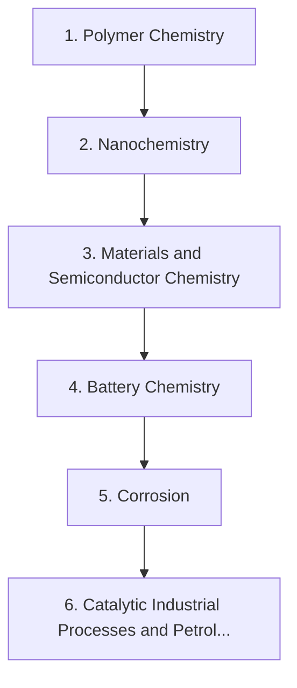

# Level 9a — Materials and Industrial Chemistry

> **Audience:** Applied / industrial chemistry  
> **Chapters:** 6  
> **Estimated study time:** ≈ 45 h  
> **Difficulty:** ★★★★☆ – ★★★★★

Polymers, nanomaterials, semiconductors, batteries, corrosion and the large-scale catalytic and petrochemical processes that underpin industry.

This level shows where chemistry meets engineering: polymers, nanoscale materials, semiconductors, energy storage, degradation and the catalytic processes behind industrial products.

---

## Chapters

| # | Chapter | Difficulty | Hours | Prerequisites |
|---|---|---|---|---|
| 1 | [Polymer Chemistry](01-polymer-chemistry.md) | ★★★★☆ | 8 | Level 4 Ch. 6–8 |
| 2 | [Nanochemistry](02-nanochemistry.md) | ★★★★★ | 7 | Level 5 Ch. 6 |
| 3 | [Materials and Semiconductor Chemistry](03-materials-and-semiconductor-chemistry.md) | ★★★★★ | 8 | Level 5 Ch. 6–7 |
| 4 | [Battery Chemistry](04-battery-chemistry.md) | ★★★★★ | 8 | Level 3 Ch. 8; Level 5 Ch. 7 |
| 5 | [Corrosion](05-corrosion.md) | ★★★★☆ | 6 | Level 3 Ch. 8 |
| 6 | [Catalytic Industrial Processes and Petroleum Chemistry](06-catalytic-industrial-processes-and-petroleum-chemistry.md) | ★★★★★ | 8 | Level 3 Ch. 6; Level 6 Ch. 6 |

---

## Knowledge map

The chain is the *recommended* order. Chapters that share prerequisites can be
read out of order; the table above tells you what each one actually needs.

---

## Study routine for this level

1. Read the chapter once without taking notes, to see the shape of the argument.
2. Re-read with the chapter's learning objectives in front of you and answer them in writing.
3. Reproduce every Mermaid diagram from memory, then check it.
4. Do the exercises **before** opening the solutions file.
5. Record every mistake in a log; re-test yourself on those specific items a week later.

---

## Practice

- Exercise set: [`exercises/level-9a-materials-exercises.md`](exercises/level-9a-materials-exercises.md)
- Worked solutions: [`solutions/level-9a-materials-solutions.md`](solutions/level-9a-materials-solutions.md)

---

## Navigation

- Level index: [CURRICULUM.md](../CURRICULUM.md)
- Study methods: [00-learning-guide](../00-learning-guide/learning-path.md)
- Terminology: [GLOSSARY.md](../GLOSSARY.md)
- Sources: [REFERENCES.md](../REFERENCES.md)
