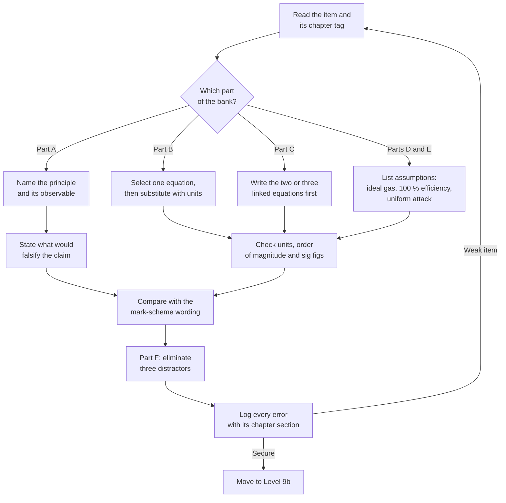

# Level 9a — Exercise Bank: Materials and Industrial Chemistry

> **Level:** 9a (Materials and Industrial Chemistry)
> **Estimated time:** 300 minutes
> **Items:** 58
> **Covers:** [Ch. 1](../01-polymer-chemistry.md), [Ch. 2](../02-nanochemistry.md), [Ch. 3](../03-materials-and-semiconductor-chemistry.md), [Ch. 4](../04-battery-chemistry.md), [Ch. 5](../05-corrosion.md), [Ch. 6](../06-catalytic-industrial-processes-and-petroleum-chemistry.md)
> **Solutions:** [`../solutions/level-9a-materials-solutions.md`](../solutions/level-9a-materials-solutions.md)

Work through the bank with the chapters closed. Every item names the chapter that
supplies the method, so an error can be traced to a section rather than to
"materials chemistry" in general. Give numerical answers to three significant
figures unless the question states otherwise, and carry units through every
substitution. Several items have more than one legitimate answer if the
assumptions are left implicit; in Parts D and E, state the assumptions before the
arithmetic.

**Figure 1 — Working order for this bank.** The loop back to the item is
deliberate: in Parts D and E the usual failure is a wrong assumption, not wrong
arithmetic, so the correction belongs at the start of the working.

---

## Data sheet

| Quantity | Value |
|---|---|
| Gas constant | $R = 8.314462618\ \mathrm{J\ mol^{-1}\ K^{-1}}$ |
| Faraday constant | $F = 96\,485.33212\ \mathrm{C\ mol^{-1}}$ |
| Avogadro constant | $N_\mathrm{A} = 6.02214076\times10^{23}\ \mathrm{mol^{-1}}$ |
| Planck constant | $h = 6.62607015\times10^{-34}\ \mathrm{J\ s}$ |
| Speed of light | $c = 2.99792458\times10^{8}\ \mathrm{m\ s^{-1}}$ |
| Boltzmann constant | $k_\mathrm{B} = 1.380649\times10^{-23}\ \mathrm{J\ K^{-1}}$ |
| Electron mass | $m_e = 9.1093837\times10^{-31}\ \mathrm{kg}$ |
| Vacuum permittivity | $\varepsilon_0 = 8.8541878128\times10^{-12}\ \mathrm{F\ m^{-1}}$ |
| Elementary charge | $e = 1.602176634\times10^{-19}\ \mathrm{C}$ |
| Electronvolt | $1\ \mathrm{eV} = 1.602176634\times10^{-19}\ \mathrm{J}$ |
| Kilowatt hour | $1\ \mathrm{kW\ h} = 3.6\ \mathrm{MJ}$ |
| Year | $1\ \mathrm{a} = 8760\ \mathrm{h} = 3.1536\times10^{7}\ \mathrm{s}$ |
| Standard temperature | $T = 298.15\ \mathrm{K}$; at $300\ \mathrm{K}$, $k_\mathrm{B}T/e = 25.85\ \mathrm{mV}$ |
| Repeat unit, polyethylene | $M_0 = 28.05\ \mathrm{g\ mol^{-1}}$ |
| Repeat unit, polystyrene | $M_0 = 104.15\ \mathrm{g\ mol^{-1}}$ |
| Repeat unit, nylon-6,6 | $M_0 = 226.32\ \mathrm{g\ mol^{-1}}$ |
| Repeat unit, PET | $M_0 = 192.17\ \mathrm{g\ mol^{-1}}$ |
| Molar mass, $\ce{LiCoO2}$ | $97.87\ \mathrm{g\ mol^{-1}}$ |
| Molar mass, $\ce{S}$; $\ce{Li2S}$ | $32.06$; $45.95\ \mathrm{g\ mol^{-1}}$ |
| Molar mass, $\ce{CH4}$; $\ce{H2}$; $\ce{CO2}$ | $16.04$; $2.016$; $44.01\ \mathrm{g\ mol^{-1}}$ |
| Molar mass, $\ce{H2S}$; $\ce{SO2}$; $\ce{H2O}$ | $34.08$; $64.06$; $18.015\ \mathrm{g\ mol^{-1}}$ |
| Molar mass, $\ce{TiO2}$; $\ce{Cr2O3}$; $\ce{Pt}$ | $79.87$; $151.99$; $195.08\ \mathrm{g\ mol^{-1}}$ |
| Molar mass, $\ce{Fe}$; $\ce{Cr}$; $\ce{Si}$ | $55.85$; $52.00$; $28.09\ \mathrm{g\ mol^{-1}}$ |
| Density, anatase $\ce{TiO2}$ | $3.89\ \mathrm{g\ cm^{-3}}$ |
| Density, polyethylene crystal; amorphous | $1.004$; $0.855\ \mathrm{g\ cm^{-3}}$ |
| Density, $\ce{Fe}$; $\ce{Cr}$; $\ce{Cr2O3}$ | $7.87$; $7.15$; $5.22\ \mathrm{g\ cm^{-3}}$ |
| Density, silicon | $2.33\ \mathrm{g\ cm^{-3}}$ |
| Heat of fusion, fully crystalline PE | $\Delta H_f^\circ = 293\ \mathrm{J\ g^{-1}}$ |

Two conventions apply throughout. First, the Carothers and Flory relations assume
equal reactivity of all functional groups and no intramolecular reaction. Second,
the Faraday conversions for capacity and corrosion assume one defined oxidation
state, complete reaction and $100\ \%$ current efficiency.

---

## Part A — Conceptual questions (10 items)

1. **[Ch. 1]** Step-growth polymerisation needs an extent of reaction near $0.99$
   to reach a useful molar mass, whereas radical polymerisation reaches
   $M_n \approx 10^{5}\ \mathrm{g\ mol^{-1}}$ when most monomer is still unreacted.
   Explain the difference in terms of when chains grow relative to conversion, and
   state the two practical consequences for a step-growth reactor.

2. **[Ch. 1]** Isotactic polypropene melts near $165\ ^\circ\mathrm{C}$ and is a
   stiff structural plastic; atactic polypropene of the same molar mass is
   amorphous and useless structurally. Explain why the configuration at each
   stereocentre has this consequence, name the two catalyst families that give
   stereocontrol, and state why radical polymerisation of propene cannot.

3. **[Ch. 2]** A $5\ \mathrm{nm}$ gold colloid is red and catalytically active,
   while a $3\ \mathrm{nm}$ CdSe nanocrystal emits at a wavelength set by its
   diameter. Separate the two size effects at work: state the scaling law for
   each, identify which observation belongs to which effect, and give one further
   size-dependent property that belongs to neither.

4. **[Ch. 2]** A sample is reported as "$20\ \mathrm{nm}$". Explain what each of
   powder XRD (Scherrer), TEM, DLS and BET actually measures, and why disagreement
   between them is information rather than error.

5. **[Ch. 3]** Silicon has a band gap of $1.12\ \mathrm{eV}$ and GaAs
   $1.42\ \mathrm{eV}$, yet GaAs is used in LEDs and silicon is not. Explain the
   role of crystal momentum and phonons, and connect the distinction to the
   absorption depth that sets solar-cell wafer thickness.

6. **[Ch. 3]** Atomic layer deposition gives angstrom-level thickness control and
   exceptional conformity on high-aspect-ratio trenches; chemical vapour deposition
   does not. Explain the mechanistic difference using the two half-reactions of
   alumina ALD, and state why a gate dielectric is deposited by ALD rather than by
   a single CVD step.

7. **[Ch. 4]** Capacity fade in a lithium-ion cell has several distinct chemical
   causes. Name four, state which dominates at high state of charge and elevated
   temperature, and explain why a single capacity number cannot diagnose the
   failure.

8. **[Ch. 5]** On a Pourbaix diagram, distinguish immunity, passivation and
   corrosion, and explain why the diagram cannot predict pitting or crevice attack.
   Then explain why steel reinforcement survives in sound concrete but corrodes
   where chloride penetrates.

9. **[Ch. 5]** The galvanic series and the electromotive force series are not the
   same list. Explain the difference, state the role of the anode-to-cathode area
   ratio, and predict what happens to a small aluminium rivet in a large
   stainless-steel plate immersed in seawater.

10. **[Ch. 6]** Define research octane number and motor octane number, explain how
    molecular structure controls octane, and state why ethanol raises octane while
    tetraethyl lead was withdrawn from gasoline.

---

## Part B — Basic problems (12 items)

11. **[Ch. 1]** A polyethylene sample contains five fractions: $5\ \mathrm{g}$ at
    $20\,000$, $15\ \mathrm{g}$ at $40\,000$, $30\ \mathrm{g}$ at $60\,000$,
    $40\ \mathrm{g}$ at $100\,000$ and $10\ \mathrm{g}$ at
    $200\,000\ \mathrm{g\ mol^{-1}}$. Calculate $M_n$, $M_w$ and the
    polydispersity index, and state which mechanism the index is consistent with.

12. **[Ch. 1]** A PET sample has $M_n = 30\,000\ \mathrm{g\ mol^{-1}}$ and a repeat
    unit of $192.17\ \mathrm{g\ mol^{-1}}$. Calculate the degree of polymerisation
    and the extent of reaction required by the Carothers equation. State the
    assumption behind the calculation.

13. **[Ch. 1]** A plasticised PVC contains $30\ \%$ by mass of a plasticiser with
    $T_g = 200\ \mathrm{K}$; unplasticised PVC has $T_g = 354\ \mathrm{K}$. Use the
    Fox equation to estimate the $T_g$ of the blend and comment on the result in
    terms of free volume.

14. **[Ch. 2]** Anatase $\ce{TiO2}$ has a skeletal density of
    $3.89\ \mathrm{g\ cm^{-3}}$. Calculate the specific surface area of
    monodisperse spheres $20\ \mathrm{nm}$ in diameter and compare it with a
    measured BET value of $50\ \mathrm{m^{2}\ g^{-1}}$. What does the comparison
    imply?

15. **[Ch. 2]** A diffraction peak is observed at $2\theta = 43.0^\circ$ with
    Cu K$\alpha$ radiation ($\lambda = 0.15406\ \mathrm{nm}$) and a full width at
    half maximum of $0.50^\circ$. Estimate the crystallite size with $K = 0.90$,
    and give two reasons why the result may differ from a TEM particle size.

16. **[Ch. 3]** Calculate the energy of a $520\ \mathrm{nm}$ photon in joules and
    in electronvolts, and identify the region of the visible spectrum.

17. **[Ch. 3]** Calculate the wavelength corresponding to the GaAs band gap of
    $1.42\ \mathrm{eV}$ and to the silicon band gap of $1.12\ \mathrm{eV}$. State
    which material is suitable for an emitter and why the other is not, despite
    having a convenient wavelength.

18. **[Ch. 4]** $\ce{LiCoO2}$ has a molar mass of $97.87\ \mathrm{g\ mol^{-1}}$ and
    transfers one electron per formula unit. Calculate its theoretical specific
    capacity. If a practical electrode delivers $145\ \mathrm{mAh\ g^{-1}}$, what
    fraction of the theoretical value is utilised?

19. **[Ch. 4]** A cell is rated $2.5\ \mathrm{Ah}$. Calculate the current and the
    discharge time at C/5 and at 2C, ignoring polarisation and assuming the full
    nominal capacity is accessible.

20. **[Ch. 5]** A mild-steel coupon in aerated water shows a corrosion current
    density of $25\ \mu\mathrm{A\ cm^{-2}}$. Take
    $M_\mathrm{eq} = 27.92\ \mathrm{g\ eq^{-1}}$ for iron and
    $\rho = 7.87\ \mathrm{g\ cm^{-3}}$. Calculate the penetration rate in
    $\mathrm{mm\ yr^{-1}}$ and state the assumption that makes the conversion
    valid.

21. **[Ch. 5]** Calculate the Pilling–Bedworth ratio for $\ce{Cr2O3}$ on chromium
    using $M_\mathrm{oxide} = 151.99\ \mathrm{g\ mol^{-1}}$,
    $\rho_\mathrm{oxide} = 5.22\ \mathrm{g\ cm^{-3}}$,
    $M_\mathrm{Cr} = 52.00\ \mathrm{g\ mol^{-1}}$ and
    $\rho_\mathrm{Cr} = 7.15\ \mathrm{g\ cm^{-3}}$, with $n = 2$. The relevant
    reaction is

    $$
    \ce{4Cr(s) + 3O2(g) -> 2Cr2O3(s)}.
    $$

    Comment on whether the film should be protective.

22. **[Ch. 6]** The overall Claus reaction is

    $$
    \ce{2H2S(g) + SO2(g) -> 3S(l) + 2H2O(g)}.
    $$

    Calculate the atom economy for sulfur as the desired product, using the molar
    masses in the data sheet, and state what the remainder of the mass is.

---

## Part C — Intermediate problems (12 items)

23. **[Ch. 1]** A step-growth polyester is made with a stoichiometric imbalance
    $r = 0.98$. Calculate $X_n$ at $p = 0.995$ and at $p = 1.000$, and explain why
    the second value is a ceiling rather than a target.

24. **[Ch. 1]** A tetrafunctional branch monomer ($f = 4$) is used with a
    stoichiometric imbalance $r = 0.90$ relative to the bifunctional comonomer.
    Calculate the gel-point conversion and compare it with the value for a
    stoichiometric system. State why the expression is a statistical estimate
    rather than an exact threshold.

25. **[Ch. 2]** Classical nucleation theory gives
    $r^{*} = 2\gamma V_m/(RT\ln S)$. Take $\gamma = 0.20\ \mathrm{J\ m^{-2}}$,
    $V_m = 2.00\times10^{-5}\ \mathrm{m^{3}\ mol^{-1}}$, $T = 298.15\ \mathrm{K}$
    and $S = 10$. Calculate $r^{*}$ and then recalculate it for $S = 100$. State
    what the change implies for a burst-nucleation synthesis.

26. **[Ch. 2]** A CdSe quantum dot has radius $1.8\ \mathrm{nm}$. Take
    $E_g = 1.74\ \mathrm{eV}$, $m_e^{*} = 0.13m_e$, $m_h^{*} = 0.45m_e$ and
    $\varepsilon = 10.6$. Using the Brus equation, calculate the lowest transition
    energy and the emission wavelength. State which term opposes the confinement
    term.

27. **[Ch. 3]** A p-type silicon wafer is doped with boron to
    $N_A = 2.0\times10^{16}\ \mathrm{cm^{-3}}$. Take
    $N_v = 1.04\times10^{19}\ \mathrm{cm^{-3}}$ and $T = 300\ \mathrm{K}$.
    Calculate the Fermi level relative to the valence-band edge and state whether
    the material is degenerate.

28. **[Ch. 3]** A silicon p–n junction has
    $N_A = 1.0\times10^{17}\ \mathrm{cm^{-3}}$,
    $N_D = 1.0\times10^{16}\ \mathrm{cm^{-3}}$ and
    $n_i = 1.0\times10^{10}\ \mathrm{cm^{-3}}$ at $300\ \mathrm{K}$. Calculate the
    built-in potential. State the assumption about the dopant ionisation.

29. **[Ch. 4]** A cell pairs a cathode of $200\ \mathrm{mAh\ g^{-1}}$ with an anode
    of $350\ \mathrm{mAh\ g^{-1}}$ at an average voltage of $3.7\ \mathrm{V}$.
    Calculate the specific energy based on the two active materials and then the
    cell-level value if active materials are $32\ \%$ of the cell mass. State what
    the second calculation omits.

30. **[Ch. 4]** A one-electron cell reaction has
    $\Delta_\mathrm{r}G^\circ = -370\ \mathrm{kJ\ mol^{-1}}$. Calculate
    $E^\circ$, and calculate the voltage shift per tenfold change in reaction
    quotient at $298.15\ \mathrm{K}$. Repeat the shift for a two-electron
    reaction and comment.

31. **[Ch. 5]** A buried pipeline needs $0.150\ \mathrm{A}$ of protection current
    for $15$ years. Zinc anodes have a capacity of $780\ \mathrm{A\ h\ kg^{-1}}$
    and $85\ \%$ utilisation. Calculate the anode mass required and state the two
    assumptions in the calculation.

32. **[Ch. 5]** A polarisation-resistance measurement gives
    $R_p = 2.50\ \mathrm{k\Omega\ cm^{2}}$ with a Stern–Geary constant
    $B = 0.026\ \mathrm{V}$. Calculate $i_\mathrm{corr}$ and the penetration rate
    for iron ($M_\mathrm{eq} = 27.92\ \mathrm{g\ eq^{-1}}$,
    $\rho = 7.87\ \mathrm{g\ cm^{-3}}$). Explain why $R_p$ is measured over a
    small potential window.

33. **[Ch. 6]** For the contact process,

    $$
    \ce{2SO2(g) + O2(g) <=> 2SO3(g)} \qquad
    \Delta_\mathrm{r}H^\circ = -198\ \mathrm{kJ\ mol^{-1}},
    $$

    take $K_p(700\ \mathrm{K}) = 9.0\times10^{4}\ \mathrm{bar^{-1}}$ and assume
    $\Delta_\mathrm{r}H^\circ$ is constant. Calculate $K_p$ at $750\ \mathrm{K}$,
    and state the consequence for the converter design.

34. **[Ch. 6]** A process step consumes $120\ \mathrm{kg}$ of raw materials,
    including $80\ \mathrm{kg}$ of solvent, to produce $15.0\ \mathrm{kg}$ of
    product. Calculate the process mass intensity and the E-factor on a gross-input
    basis. A recovery unit returns $72\ \mathrm{kg}$ of solvent to the process;
    recalculate the process mass intensity on a fresh-input basis and state why the
    boundary must always be declared.

---

## Part D — Advanced problems (10 items)

35. **[Ch. 1]** Styrene is polymerised at $60\ ^\circ\mathrm{C}$ with
    $c_\mathrm{M} = 4.0\ \mathrm{mol\ dm^{-3}}$ and
    $c_\mathrm{I} = 0.020\ \mathrm{mol\ dm^{-3}}$. The rate coefficients are
    $k_p = 1.8\times10^{3}\ \mathrm{dm^{3}\ mol^{-1}\ s^{-1}}$,
    $k_t = 1.5\times10^{7}\ \mathrm{dm^{3}\ mol^{-1}\ s^{-1}}$,
    $k_d = 1.2\times10^{-5}\ \mathrm{s^{-1}}$ and $f = 0.55$. Calculate $R_p$,
    the kinetic chain length and $X_n$ for combination termination, and hence
    $M_n$. Then state quantitatively what happens to $R_p$ and $X_n$ if the
    initiator concentration is doubled at constant temperature.

36. **[Ch. 1]** Nylon-6,6 is to be made with $M_n = 32\,000\ \mathrm{g\ mol^{-1}}$
    from a repeat unit of $226.32\ \mathrm{g\ mol^{-1}}$. Calculate the degree of
    polymerisation, the stoichiometric ratio $r$ required at complete conversion,
    and the percentage excess of the diamine, stating which monomer is in excess.

37. **[Ch. 1]** Recycled PET has an intrinsic viscosity of
    $0.62\ \mathrm{dL\ g^{-1}}$; virgin PET from the same line gives
    $0.78\ \mathrm{dL\ g^{-1}}$. Use the Mark–Houwink relation
    $[\eta] = K M_v^{a}$ with $K = 2.1\times10^{-4}\ \mathrm{dL\ g^{-1}}$ and
    $a = 0.82$ to calculate both viscosity-average molar masses and the percentage
    loss. Explain the chemical origin of the loss and one consequence for
    bottle-to-bottle recycling.

38. **[Ch. 2]** A $\ce{TiO2}$ powder has a BET specific surface area of
    $45\ \mathrm{m^{2}\ g^{-1}}$, a skeletal density of
    $3.89\ \mathrm{g\ cm^{-3}}$ and the Scherrer crystallite size calculated in
    item 15. Calculate
    the equivalent spherical particle diameter from the BET area, the ratio of that
    diameter to the crystallite size, and the number of crystallites per particle
    if the crystallites are cubes of equal size. State two assumptions.

39. **[Ch. 3]** Silicon contains $5.00\times10^{22}$ atoms per $\mathrm{cm^{3}}$
    and has a hole mobility of $450\ \mathrm{cm^{2}\ V^{-1}\ s^{-1}}$. If one
    silicon atom in $5.0\times10^{5}$ is replaced by boron and every acceptor is
    ionised, calculate the acceptor concentration, the conductivity and the
    resistivity. State why the electron contribution is neglected.

40. **[Ch. 3]** A $0.30\ \mathrm{mm}$ thick n-type film carries
    $2.0\ \mathrm{mA}$ in a magnetic flux density of $0.80\ \mathrm{T}$ and
    develops a Hall voltage of $3.5\ \mathrm{mV}$. Calculate the carrier density in
    $\mathrm{m^{-3}}$ and $\mathrm{cm^{-3}}$, and state what the sign of the Hall
    voltage would be if the carriers were holes.

41. **[Ch. 4]** A pack must store $75\ \mathrm{kWh}$ at a nominal $400\ \mathrm{V}$
    using cells of $3.7\ \mathrm{V}$ and $5.0\ \mathrm{Ah}$. Determine the series
    and parallel counts, the resulting nominal voltage, capacity and energy, and
    the total number of cells. Explain why the parallel count is rounded up rather
    than to the nearest integer.

42. **[Ch. 5]** A pipeline has a wall thickness of $8.0\ \mathrm{mm}$ and a
    minimum allowable thickness of $3.0\ \mathrm{mm}$. The measured corrosion rate
    is $0.18\ \mathrm{mm\ yr^{-1}}$. Calculate the remaining life on a uniform-thin
    model and the corrosion current density that corresponds to the measured rate
    ($M_\mathrm{eq} = 27.92\ \mathrm{g\ eq^{-1}}$,
    $\rho = 7.87\ \mathrm{g\ cm^{-3}}$). Cathodic protection reduces $i_\mathrm{corr}$
    by a factor of $20$; calculate the new life and state why the number is not a
    prediction.

43. **[Ch. 6]** For ammonia synthesis,

    $$
    \ce{N2(g) + 3H2(g) <=> 2NH3(g)},
    $$

    take $K_p = 1.0\times10^{-4}\ \mathrm{bar^{-2}}$ at $673\ \mathrm{K}$ and a
    stoichiometric $1:3$ feed at $200\ \mathrm{bar}$. Assuming ideal gases,
    calculate the equilibrium conversion of nitrogen, the mole fractions of all
    three components and the ammonia mole fraction in the reactor outlet. Repeat
    the conversion at $300\ \mathrm{bar}$.

44. **[Ch. 6]** A $3.0\ \mathrm{g}$ sample of $2.0\ \mathrm{wt\%}$ Pt on alumina has
    a metal dispersion of $0.25$, meaning that $25\ \%$ of the platinum atoms are at
    the surface ($M_\mathrm{Pt} = 195.08\ \mathrm{g\ mol^{-1}}$). It converts
    $\ce{CO}$ at $1.2\times10^{-4}\ \mathrm{mol\ s^{-1}}$. Calculate the number of
    surface platinum sites and the turnover frequency in $\mathrm{s^{-1}}$.

---

## Part E — Calculation problems (8 items)

45. **[Ch. 1]** A polyethylene sample contains six fractions by mass:
    $4\ \%$ at $15\,000$, $8\ \%$ at $30\,000$, $18\ \%$ at $50\,000$,
    $35\ \%$ at $80\,000$, $25\ \%$ at $120\,000$ and $10\ \%$ at
    $250\,000\ \mathrm{g\ mol^{-1}}$. Calculate $M_n$, $M_w$, the polydispersity
    index and the number-average degree of polymerisation. Comment on whether the
    distribution is consistent with a living anionic polymerisation.

46. **[Ch. 1]** A polyethylene sample has a density of
    $0.930\ \mathrm{g\ cm^{-3}}$, with crystalline and amorphous densities of
    $1.004$ and $0.855\ \mathrm{g\ cm^{-3}}$. A DSC run on $4.80\ \mathrm{mg}$
    gives a melting
    endotherm of $0.170\ \mathrm{J}$; the heat of fusion of fully crystalline
    polyethylene is $293\ \mathrm{J\ g^{-1}}$. Calculate the crystallinity by both
    methods and explain why they differ by a factor of about four.

47. **[Ch. 2]** Using the Brus equation and the parameters of item 26, calculate the
    lowest transition energy and emission wavelength for CdSe dots of radius
    $1.5\ \mathrm{nm}$ and $3.0\ \mathrm{nm}$. Tabulate the confinement, Coulomb and
    total energies and state which term dominates the size dependence.

48. **[Ch. 3]** A $1.0\ \mathrm{mW}$ light-emitting diode operates at
    $450\ \mathrm{nm}$. Calculate the photon energy, the photon flux in
    $\mathrm{s^{-1}}$, and the current that would be required to supply the same
    number of electrons per second. Comment on the result in terms of the internal
    quantum efficiency of a real device.

49. **[Ch. 4]** A lithium–sulfur cell uses the reaction

    $$
    \ce{2Li(s) + S(s) -> Li2S(s)}
    $$

    with an average discharge voltage of $2.1\ \mathrm{V}$. Calculate the
    theoretical specific capacity per gram of sulfur and per gram of $\ce{Li2S}$,
    the specific energy per gram of sulfur, and the cell-level value if active
    materials are $30\ \%$ of the cell mass. State why the last number is an upper
    bound.

50. **[Ch. 4]** A pack must store $60\ \mathrm{kWh}$ at a nominal $400\ \mathrm{V}$
    using cells of $3.7\ \mathrm{V}$ and $4.8\ \mathrm{Ah}$. Determine the series
    and parallel counts, the resulting voltage, capacity and energy, and the total
    number of cells. Hence estimate the cell-level specific energy if the pack mass
    is $420\ \mathrm{kg}$.

51. **[Ch. 5]** A steel tank wall is $10.0\ \mathrm{mm}$ thick with a minimum
    allowable thickness of $4.0\ \mathrm{mm}$; the corrosion rate is
    $0.12\ \mathrm{mm\ yr^{-1}}$. Calculate the corrosion allowance life. The tank
    is then protected by zinc anodes delivering $0.20\ \mathrm{A}$ continuously for
    $20$ years; using $780\ \mathrm{A\ h\ kg^{-1}}$ and $85\ \%$ utilisation,
    calculate the anode mass. State why the anode mass does not scale with the
    protected steel area in this calculation.

52. **[Ch. 6]** A steam reformer converts $1.00\ \mathrm{kmol}$ of methane by

    $$
    \ce{CH4(g) + H2O(g) -> CO(g) + 3H2(g)}
    $$

    followed by complete water–gas shift,

    $$
    \ce{CO(g) + H2O(g) -> CO2(g) + H2(g)}.
    $$

    Calculate the hydrogen produced in kmol and in kg, the mass of hydrogen per kg
    of methane, the reformer duty in $\mathrm{MJ\ per\ kg}$ of methane if
    $\Delta_\mathrm{r}H^\circ = +206\ \mathrm{kJ\ mol^{-1}}$ of methane, the simple
    efficiency on a hydrogen lower heating value of $120\ \mathrm{MJ\ kg^{-1}}$, and
    the stoichiometric $\ce{CO2}$ emission per kg of hydrogen.

---

## Part F — Multiple-choice self-check (6 items)

53. **[Ch. 1]** Which polydispersity index is most consistent with ideal living
    anionic polymerisation at $X_n = 100$?
    - A. $1.02$
    - B. $1.50$
    - C. $2.00$
    - D. $3.00$

54. **[Ch. 2]** Which method gives a volume-weighted crystallite size rather than a
    particle or hydrodynamic size?
    - A. Dynamic light scattering
    - B. Powder XRD with the Scherrer equation
    - C. BET physisorption
    - D. X-ray photoelectron spectroscopy

55. **[Ch. 3]** Which of the following is a direct-gap semiconductor?
    - A. $\ce{Si}$
    - B. $\ce{Ge}$
    - C. $\ce{GaAs}$
    - D. $\ce{SiC}$

56. **[Ch. 4]** A $4.0\ \mathrm{Ah}$ cell is discharged at 5C. What current flows?
    - A. $0.80\ \mathrm{A}$
    - B. $4.0\ \mathrm{A}$
    - C. $5.0\ \mathrm{A}$
    - D. $20\ \mathrm{A}$

57. **[Ch. 5]** A small aluminium rivet fastens a large stainless-steel plate
    immersed in seawater. Which statement is correct?
    - A. The rivet corrodes rapidly.
    - B. The plate corrodes because stainless steel is anodic to aluminium.
    - C. Neither corrodes, because both metals are passive in seawater.
    - D. The rivet is cathodically protected by the plate.

58. **[Ch. 6]** Which catalyst system is used in the contact process?
    - A. Iron with $\ce{K2O}$, $\ce{Al2O3}$ and $\ce{CaO}$ promoters
    - B. $\ce{V2O5}$ on silica with potassium sulfate promoters
    - C. A platinum–rhodium gauze
    - D. Zeolite Y in a fluidised riser

---

## Marks

| Part | Type | Items | Marks per item | Total |
|---|---|---|---:|---:|
| A | Conceptual | 10 | 2 | 20 |
| B | Basic problems | 12 | 3 | 36 |
| C | Intermediate problems | 12 | 4 | 48 |
| D | Advanced problems | 10 | 6 | 60 |
| E | Calculation problems | 8 | 8 | 64 |
| F | Multiple-choice self-check | 6 | 2 | 12 |
| **Total** | | **58** | | **240** |

**Total marks:** 240

**Solutions:** [`../solutions/level-9a-materials-solutions.md`](../solutions/level-9a-materials-solutions.md)
