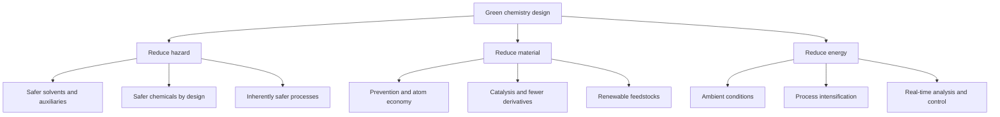

# Chapter 1 — Green and Sustainable Chemistry

> **Level:** Level 9 — Environmental Chemistry (advanced undergraduate / industrial)
> **Estimated study time:** 6 hours (reading) + 2 hours (exercises)
> **Prerequisites:** [Chemical Kinetics and Reaction Mechanisms](../04-advanced-chemistry/05-chemical-kinetics-and-reaction-mechanisms.md); [Catalysis](../04-advanced-chemistry/06-catalysis.md); [Organic Chemistry](../05-organic-chemistry/README.md); [Thermochemistry and Enthalpy](../03-intermediate-chemistry/08-thermochemistry-and-enthalpy.md)
> **Difficulty:** ★★★★☆ (4/5)
> **Related chapters:** [Atmospheric Chemistry](02-atmospheric-chemistry.md), [Waste Treatment and Circular Chemistry](04-waste-treatment.md), [Catalytic Industrial Processes and Petroleum Chemistry](../10-materials-and-industrial-chemistry/06-catalytic-industrial-processes-and-petroleum-chemistry.md)

---

## 1. Learning Objectives

After working through this chapter you will be able to:

- State the twelve principles of green chemistry and give an example of each.
- Calculate atom economy, E-factor, process mass intensity, reaction mass
  efficiency, yield and carbon efficiency.
- Compare two routes to the same product using several metrics.
- Select solvents using selection guides and explain solvent-free alternatives.
- Explain how catalysis changes the material and energy balance of a process.
- Assess renewable feedstocks without ignoring land, energy and competition.
- Design for degradation and for safer chemicals.
- Outline life-cycle assessment and state its limitations honestly.
- Explain the circular economy, industrial symbiosis and planetary boundaries.
- Describe how REACH and TSCA shape synthetic routes.
- Recognise greenwashing and distinguish a measured claim from a marketing claim.

---

## 2. Introduction

Green chemistry is the design of chemical products and processes that reduce or
eliminate the use and generation of hazardous substances. It is not the same as
environmental chemistry, which studies what chemicals do in the environment, nor
the same as sustainability, which is a broader economic and social goal. Green
chemistry is a design philosophy for the laboratory and the plant.

The field began as a response to pollution control. The old approach was to treat
waste at the end of the pipe; the green approach is to avoid making the waste in
the first place. That shift is not altruism. Solvent, energy and waste treatment
cost money, and a route that uses less of all three is often cheaper. The
pharmaceutical industry, which produces large volumes of complex molecules in
small quantities, has been a particularly active adopter because its E-factors are
among the highest in manufacturing.

This chapter gives the principles, the metrics and the honest limits. It treats
life-cycle assessment as a tool with boundaries and uncertainties, not as a
verdict. It treats "natural" and "bio-based" as descriptions of origin, not
guarantees of safety. And it insists that claims be quantified: an atom economy
without a yield, or an E-factor without a boundary, is not evidence.

---

## 3. Fundamental Concepts

### 3.1 The twelve principles

Anastas and Warner formulated twelve principles that together define green
chemistry. They are design rules, not a checklist to be applied in order.

| Principle | Meaning | Example |
|---|---|---|
| 1. Prevention | Avoid waste rather than treat it | Catalytic direct oxidation replaces a stoichiometric oxidant |
| 2. Atom economy | Maximise atoms incorporated into product | Diels–Alder addition instead of a substitution |
| 3. Less hazardous synthesis | Use and generate less toxic substances | Water instead of chlorinated solvent |
| 4. Designing safer chemicals | Preserve function while reducing toxicity | Less bioaccumulative insecticide |
| 5. Safer solvents and auxiliaries | Avoid solvents where possible; choose benign ones | Solvent-free mechanochemistry |
| 6. Energy efficiency | Run at ambient temperature and pressure | Enzymatic catalysis at 30 °C |
| 7. Renewable feedstocks | Use biomass or waste-derived carbon | Bio-based succinic acid |
| 8. Reduce derivatives | Avoid protecting groups and temporary modifications | Direct C–H functionalisation |
| 9. Catalysis | Use catalytic rather than stoichiometric reagents | Zeolite cracking instead of AlCl₃ |
| 10. Design for degradation | Products break down to benign substances | Biodegradable chelating agents |
| 11. Real-time analysis for pollution prevention | Monitor and control in process | In-line spectroscopy |
| 12. Inherently safer chemistry | Minimise the potential for accidents | Replace a flammable solvent with water |

The principles sometimes conflict. A bio-based solvent may be renewable but
energy-intensive to purify; a catalytic route may use a scarce metal; a safer
chemical may be less effective and require a larger dose. Green chemistry is the
practice of making those trade-offs explicit.

### 3.2 Metrics: atom economy, E-factor, PMI and RME

**Atom economy** (AE) measures how much of the reactant mass ends up in the
desired product, assuming ideal stoichiometry and complete conversion:

$$
\mathrm{AE} = \frac{M_\text{product}}{\sum_i \nu_i M_{\text{reactant},i}} \times 100\,\%.
$$

It is a property of the reaction equation, not of the process. A reaction with
100 % atom economy can still generate waste through solvents, work-up and
purification.

The **E-factor** (environmental factor) is the mass of waste per mass of product:

$$
E = \frac{m_\text{waste}}{m_\text{product}}.
$$

It includes solvents and auxiliaries if the boundary says so, and the boundary
must always be stated. **Process mass intensity** (PMI) is the total mass of
materials input per mass of product:

$$
\mathrm{PMI} = \frac{m_\text{total input}}{m_\text{product}} = E + 1.
$$

**Reaction mass efficiency** (RME) is the mass of product divided by the total
mass of reactants, accounting for stoichiometry and yield:

$$
\mathrm{RME} = \frac{m_\text{product}}{\sum_i m_{\text{reactant},i}} \times 100\,\%.
$$

**Yield** is the moles of product divided by the theoretical moles from the
limiting reagent. **Selectivity** is the moles of desired product divided by the
moles of reactant converted. **Carbon efficiency** is the fraction of carbon in
the feed that ends up in the product.

The metrics answer different questions. AE asks whether the reaction is
intrinsically wasteful; E-factor asks how much waste the process produces;
PMI asks how much material the plant handles; RME asks how efficiently the
reactants are used. A route can score well on one and badly on another.

### 3.3 Solvents

Solvents are often the largest mass in a pharmaceutical or fine-chemical process,
and they are frequently the largest contributor to waste and to safety hazard.
Solvent selection considers boiling point, polarity, water miscibility, toxicity,
flammability, recyclability and cost.

Selection guides, such as the CHEM21 and GSK tables, rank solvents as
recommended, usable, hazardous or problematic. Water, ethanol, isopropanol,
ethyl acetate, heptane and dimethyl sulfoxide occupy favourable positions;
dichloromethane, chloroform, benzene, carbon tetrachloride and
N-methylpyrrolidinone are problematic for toxicity or environmental persistence.

Alternatives include **water** as a reaction medium, **supercritical carbon
dioxide** for extractions and polymerisations, **ionic liquids** for low volatility
(but with persistence and toxicity concerns), **deep eutectic solvents** and
**solvent-free** methods such as ball milling, melt reactions and reactive
extrusion. Solvent recovery by distillation is often the single largest energy
consumer in a batch plant, so reducing solvent volume can be more valuable than
switching to a "greener" solvent.

### 3.4 Catalysis as a green strategy

A catalyst reduces the activation energy and is not consumed, so it replaces
stoichiometric reagents and reduces waste. The classic comparison is the
oxidation of cyclohexene or the epoxidation of propylene: the chlorohydrin route
uses chlorine and lime stoichiometrically and produces a large salt waste, while
the hydrogen peroxide route uses a titanium silicalite catalyst and produces only
water as the by-product.

Catalysis also changes energy demand. Enzymes operate at 20–40 °C and neutral pH,
avoiding the high temperatures and pressures of many classical processes.
Biocatalysis has transformed the synthesis of chiral amines and alcohols, where
a transaminase or ketoreductase can give enantiomeric excess above 99 % in water.

The green credentials of catalysis are not automatic. Catalysts may contain
scarce or toxic metals, require energy-intensive preparation, or lose activity
quickly. The relevant question is the life-cycle performance of the catalyst, not
its label.

### 3.5 Renewable feedstocks

Biomass feedstocks include sugars, starch, vegetable oils, lignocellulose and
organic waste. They can supply carbon that was recently atmospheric CO₂, but they
are not automatically low-impact. Growing, harvesting, transporting and processing
biomass consumes energy, land, water and fertiliser, and competes with food and
with conservation.

The most defensible uses are waste-derived feedstocks and cases where the biomass
replaces a particularly dirty petrochemical route. Bio-based succinic acid, for
example, can replace maleic anhydride-derived routes; bio-based ethylene can
replace fossil ethylene but is chemically identical and is not biodegradable.
**Bio-based** and **biodegradable** are independent properties, and conflating
them is a common error.

The carbon accounting matters. A bio-based product that is burned at end of life
returns the carbon it stored; a product that persists for decades stores it
longer. The time scale of the carbon cycle is part of the comparison, and it is
often omitted from marketing claims.

### 3.6 Design for degradation and safer chemicals

A chemical that is persistent and bioaccumulative is a problem even if it is
low-toxicity, because exposure accumulates. **Design for degradation** builds
into the molecule a pathway to benign products: ester or amide bonds that
hydrolyse, ether linkages that photolyse, or structures that microorganisms can
metabolise.

The chelating agent EDTA is persistent and mobilises heavy metals; EDDS and GLDA
are biodegradable alternatives with comparable performance. Some surfactants are
designed to be readily biodegradable under standard tests, which measure ultimate
mineralisation rather than primary degradation. The distinction matters: a
molecule can lose its surfactant properties while persisting as a metabolite.

**Safer chemicals by design** means preserving function while reducing hazard.
The replacement of halogenated flame retardants, the move from lead to
non-toxic stabilisers in PVC, and the design of less bioaccumulative pesticides
are examples. The design process requires toxicity data, exposure assessment and
sometimes regrettable substitution: a replacement may be less toxic but more
persistent, or less persistent but more mobile.

### 3.7 Life-cycle assessment

**Life-cycle assessment** (LCA) quantifies environmental impacts across a product's
life, following ISO 14040 and 14044. It has four stages: goal and scope
definition, inventory analysis, impact assessment and interpretation.

The **functional unit** defines what is compared — for example, "1 kg of
active pharmaceutical ingredient at the factory gate" or "1000 hours of lighting".
The **system boundary** defines which processes are included: cradle-to-gate,
gate-to-gate, cradle-to-grave or cradle-to-cradle. **Allocation** decides how
burdens are shared between co-products, and it can change the conclusion.

Impact categories include global warming potential, eutrophication, acidification,
water use, land use and toxicity. Characterisation factors convert emissions to
equivalents, such as CO₂-equivalents for GWP over 100 years.

LCA has honest limitations. It is data-intensive, uncertain and sensitive to
boundary choices. It can compare existing processes but struggles with new
technologies at low maturity. It does not capture everything that matters —
biodiversity, labour conditions, local pollution — unless those are modelled
explicitly. A single LCA number is not a verdict; it is a structured argument.

### 3.8 Circular economy, industrial symbiosis and planetary boundaries

The **circular economy** aims to keep materials in use for as long as possible
through reuse, repair, remanufacture and recycling, rather than the linear
take–make–dispose model. It distinguishes technical cycles (metals, polymers)
from biological cycles (nutrients, compostable materials).

**Industrial symbiosis** is the exchange of materials, energy and water between
firms, as in Kalundborg, Denmark, where a power station supplies waste heat and
gypsum to neighbouring businesses. The exchanges are profitable because one
firm's waste is another's feedstock, but they require trust, contracts and
infrastructure.

In the proposed **Anthropocene** epoch, the **planetary boundaries** framework
identifies Earth-system processes within which humanity can operate safely:
climate change, biosphere integrity, biogeochemical flows, land-system change,
freshwater use, ocean acidification, ozone depletion, aerosol loading and novel
entities.
Several boundaries are already transgressed. The framework is a communication
and prioritisation tool, not a precise regulatory limit.

Circularity has thermodynamic limits. Recycling always consumes energy and
materials, and some dissipation is unavoidable. The second law sets a floor: a
perfectly circular economy is impossible, and the practical question is how much
energy and entropy the loop costs.

---

## 4. Detailed Scientific Explanation

### 4.1 Metrics in practice

A single metric can mislead. Atom economy ignores yield, solvents and energy;
E-factor depends on the boundary; PMI includes water and solvents that may be
recycled. The defensible approach is a dashboard: AE, yield, PMI, E-factor and
energy per kilogram of product, each with a stated boundary.

Consider a substitution reaction that replaces a chlorine atom with an amine.
The atom economy may be high if the leaving group is small, but the process may
use ten volumes of dichloromethane and a large excess of amine, giving a poor
E-factor. A catalytic reductive amination may have a lower atom economy but a much
better E-factor because it avoids the excess reagent and the chlorinated solvent.

The pharmaceutical industry illustrates the scale. A typical small-molecule API
was historically made in 6–10 steps with PMI of 100–200 kg kg⁻¹; best practice now
targets PMI below 50 and, for some processes, below 20. The improvement comes from
solvent reduction, telescoping steps, catalysis and continuous processing, not
from a single principle.

### 4.2 Solvent selection and solvent-free methods

Solvent selection guides combine hazard, lifecycle and physical properties. The
CHEM21 guide classifies solvents as recommended, usable, hazardous or problematic,
and it includes a score for environmental impact, health and safety. The GSK guide
uses a similar traffic-light system.

**Water** is preferred where it works: it is non-flammable, non-toxic and cheap.
Its high polarity, high boiling point and high heat capacity limit its use; many
organic substrates are insoluble, and product recovery by distillation is
energy-intensive.

**Supercritical CO₂** is non-toxic, non-flammable and easily separated by
depressurisation. It is used for decaffeination, dry cleaning and some
polymerisations, but it requires high pressure and is a poor solvent for polar
compounds unless a cosolvent is added.

**Solvent-free** methods include ball milling, melt reactions, reactive extrusion
and gas–solid reactions. They eliminate solvent waste and often reduce energy,
but mixing and heat removal can be difficult, and scale-up from a ball mill to a
production reactor is not straightforward.

**Ionic liquids** have negligible vapour pressure and can be tuned, but their
toxicity and persistence are variable and often poorly characterised. They are not
automatically green, and their synthesis can be energy-intensive.

### 4.3 Catalysis and biocatalysis

Catalysis is the most powerful single green strategy because it reduces both
material and energy intensity. Heterogeneous catalysts are easily separated and
reused; homogeneous catalysts are more selective but harder to recover; enzymes
are highly selective and operate under mild conditions but are sensitive to
temperature, pH and solvent.

The **sitagliptin** process illustrates biocatalysis at industrial scale. A
transaminase evolved by directed evolution converts a ketone to a chiral amine
with high enantiomeric excess, replacing a rhodium-catalysed asymmetric
hydrogenation that required high pressure and a precious-metal catalyst. The
biocatalytic route reduced waste and improved yield, and it won a Presidential
Green Chemistry Challenge Award.

**Flow chemistry** improves heat transfer, mixing and safety, and it enables
in-line analysis and continuous production. It is particularly valuable for
exothermic or hazardous reactions, where a small reactor volume limits the
inventory of dangerous material.

Catalysis has its own burdens. Platinum-group metals are scarce and their mining
has significant impacts; enzyme production requires fermentation and purification.
The green claim must be based on the life cycle, not on the catalyst type.

### 4.4 Green chemistry in pharmaceutical manufacturing

Pharmaceutical manufacturing combines complex molecules, low volume and high
value. The environmental burden is dominated by solvents, reagents and energy
rather than by the active ingredient itself. Prozac, ibuprofen and sildenafil are
often cited as case studies where process redesign reduced step count, solvent use
and waste.

The **BHC ibuprofen process** is the standard example: a three-step catalytic
route replaced a six-step stoichiometric route, improving atom economy from about
40 % to about 77 % and reducing waste dramatically. The numbers vary by boundary,
but the direction is robust: fewer steps, fewer reagents and less solvent.

**Continuous manufacturing** reduces inventory, improves heat transfer and allows
real-time control. It also changes the economics of small-volume products and can
reduce the footprint of a plant. Regulatory acceptance has grown, and several
products are now made continuously.

**Solvent recovery** is often the largest energy consumer. Distillation of a
solvent with a high boiling point or a narrow relative volatility can consume more
energy than the reaction itself, so solvent selection and process intensification
are linked.

### 4.5 Regulation: REACH and TSCA

**REACH** (Registration, Evaluation, Authorisation and Restriction of Chemicals)
is the European Union framework. It requires manufacturers and importers to
register substances above 1 tonne per year, to provide hazard data and to
demonstrate safe use. Substances of very high concern (SVHC) — carcinogenic,
mutagenic, toxic to reproduction, persistent and bioaccumulative, or endocrine
disrupting — can be placed on the Authorisation List, and their use requires
authorisation or substitution.

REACH shifts the burden of proof to industry: "no data, no market". It has driven
substitution of chlorinated solvents, phthalates and some flame retardants, and it
has made hazard data publicly available through ECHA.

**TSCA** (Toxic Substances Control Act) is the United States framework. It was
modernised in 2016 and now requires risk evaluation and, where necessary,
restriction of existing chemicals. TSCA's inventory and review process differ from
REACH's, which complicates global supply chains.

Regulation shapes synthesis in practical ways. A restricted solvent forces a
route redesign; a Substance of Very High Concern may require a substitution plan;
a classification as persistent, bioaccumulative and toxic can remove a product
from the market entirely. Green chemistry and regulation are therefore
co-dependent: regulation creates the demand for greener routes, and green
chemistry provides the alternatives.

### 4.6 Life-cycle assessment in practice

An LCA proceeds by defining the goal and scope, building an inventory of inputs
and emissions, characterising impacts and interpreting the results. The inventory
is the most labour-intensive step and the most uncertain.

**Allocation** is the hardest methodological issue. If a process produces two
products, how should the burdens be divided? Options include mass allocation,
economic allocation and system expansion. The choice can change the ranking of
alternatives, and it must be stated.

**Carbon footprint** is a single-impact LCA, usually GWP100. It is useful for
communication but incomplete: a product with a low carbon footprint may have high
water use, eutrophication or toxicity. A narrow claim can be true and misleading.

**Uncertainty** is unavoidable. Data may come from different years, regions and
technologies; background processes may be modelled with average data. A
defensible LCA reports sensitivity analysis and identifies the parameters that
change the conclusion.

### 4.7 Circular economy and its limits

The circular economy is often presented as a complete alternative to the linear
economy. In practice, it is a set of strategies with different costs and
different thermodynamic limits.

- **Refuse and reduce** avoid material use entirely and are the most effective.
- **Reuse and repair** extend life but require design for durability and access
  to spare parts.
- **Remanufacture** restores function but requires reverse logistics.
- **Recycle** recovers material but consumes energy and often degrades quality.
- **Recover energy** extracts value but destroys the material.

The **waste hierarchy** ranks these options, but the ranking is not absolute: a
long transport distance for reuse can make recycling preferable, and energy
recovery may be the best option for a contaminated mixed stream.

**Industrial symbiosis** works when the exchange is geographically close and the
material quality is consistent. Kalundborg is the famous example, but many
smaller exchanges exist. The barriers are contractual, regulatory and logistical
rather than chemical.

### 4.8 Greenwashing and honest claims

Greenwashing is a claim that is vague, unsubstantiated, irrelevant or misleading.
Common forms include "natural" (not a safety claim), "eco-friendly" (undefined),
"carbon neutral" (often based on offsets rather than reductions), and "biodegradable"
(without a test standard or receiving environment).

An honest claim states the metric, the boundary and the baseline. "This route
reduces PMI from 120 to 45 kg kg⁻¹ at the gate, excluding solvent recovery" is
verifiable. "This route is greener" is not.

The same discipline applies to academic papers. A new catalyst reported with high
yield and excellent selectivity may use a solvent that is banned in the target
market, a precious metal that is supply-constrained, or a substrate concentration
that cannot be achieved at scale. Green chemistry requires the scale and the
boundary to be part of the result.

---

## 5. Visual Diagrams

**Figure 1.1 — The twelve principles grouped by objective.** The grouping is
interpretive, not canonical: the principles overlap and interact. Its value is
practical, because it asks the designer to consider hazard, material and energy
separately rather than relying on a single "green" label.

**Figure 1.2 — Metrics form a hierarchy of scope.** Atom economy is intrinsic to
the reaction; each subsequent metric adds a layer of process reality. A route can
pass the first test and fail the later ones, which is why a single number is never
sufficient.

**Figure 1.3 — The four stages of life-cycle assessment.** Interpretation is not
the end of the process: sensitivity analysis feeds back to the goal and scope,
because a conclusion that changes with a plausible assumption is not robust. ISO
14040 and 14044 define the framework but do not remove the need for judgement.

---

## 6. Mathematical Formulas

The green metrics are

$$
\mathrm{AE} = \frac{M_\text{product}}{\sum_i \nu_i M_{\text{reactant},i}}\times100\,\%,
\qquad
E = \frac{m_\text{waste}}{m_\text{product}},
\qquad
\mathrm{PMI} = \frac{m_\text{input}}{m_\text{product}},
$$

$$
\mathrm{RME} = \frac{m_\text{product}}{\sum_i m_{\text{reactant},i}}\times100\,\%,
\qquad
Y = \frac{n_\text{product}}{n_\text{product,max}},
\qquad
C_\text{eff} = \frac{n_\text{C,product}}{n_\text{C,feed}}.
$$

| Symbol | Meaning | SI unit |
|---|---|---|
| $\mathrm{AE}$ | Atom economy | % |
| $M_\text{product}$ | Molar mass of product | kg mol⁻¹ |
| $M_{\text{reactant},i}$ | Molar mass of reactant $i$ | kg mol⁻¹ |
| $\nu_i$ | Stoichiometric coefficient | 1 |
| $E$ | E-factor | kg kg⁻¹ |
| $m_\text{waste}$ | Mass of waste | kg |
| $m_\text{product}$ | Mass of product | kg |
| $\mathrm{PMI}$ | Process mass intensity | kg kg⁻¹ |
| $\mathrm{RME}$ | Reaction mass efficiency | % |
| $Y$ | Yield | 1 |
| $C_\text{eff}$ | Carbon efficiency | 1 |

Global warming potential over 100 years is

$$
\mathrm{GWP}_{100} = \sum_i m_i\,\mathrm{GWP}_i,
$$

where $m_i$ is the mass of greenhouse gas $i$ and $\mathrm{GWP}_i$ its
characterisation factor relative to CO₂. The sum is over the life cycle, not over
a single process.

The metrics assume a defined boundary. AE assumes stoichiometric reactants and
100 % conversion; E-factor and PMI include everything the boundary specifies;
RME includes the actual yield but not solvents unless they are included in the
reactant sum, which is why the definition must be stated.

---

## 7. Chemical Equations

The chlorohydrin route to propylene oxide uses chlorine and calcium hydroxide
stoichiometrically:

$$
\ce{C3H6(g) + Cl2(g) + Ca(OH)2(s) -> C3H6O(l) + CaCl2(aq) + H2O(l)}
$$

The hydrogen peroxide route uses a titanium silicalite catalyst and produces only
water:

$$
\ce{C3H6(g) + H2O2(aq) ->[TS-1] C3H6O(l) + H2O(l)}
$$

Biocatalytic transamination converts a ketone to a chiral amine using alanine as
the amine donor:

$$
\ce{R-CO-R'(aq) + CH3CH(NH2)CO2H(aq) -> R-CH(NH2)-R'(aq) + CH3COCO2H(aq)}
$$

Carbon dioxide hydrogenation to methanol is a route to renewable methanol:

$$
\ce{CO2(g) + 3H2(g) <=> CH3OH(g) + H2O(g)}
$$

Biodiesel is made by transesterification of a triglyceride with methanol:

$$
\ce{C3H5(OCOR)3(l) + 3CH3OH(l) -> 3RCOOCH3(l) + C3H5(OH)3(l)}
$$

The first two equations are the basis of the atom-economy comparison in Section 8.
The third is schematic: the actual enzyme, cofactor and pH determine the
enantioselectivity, and the pyruvate by-product must be removed or recycled.

---

## 8. Worked Examples

### Worked Example 8.1 — Atom economy of two propylene oxide routes

**Problem.** Compare the atom economy of (a) the chlorohydrin route and (b) the
hydrogen peroxide route to propylene oxide ($M = 58.08\ \text{g mol}^{-1}$).
Reactant molar masses: propene 42.08, Cl₂ 70.90, Ca(OH)₂ 74.09, H₂O₂ 34.01.

**Strategy.** Apply $\mathrm{AE} = M_\text{product}/\sum M_\text{reactants}$.

**Solution.** (a)
$\mathrm{AE} = 58.08/(42.08 + 70.90 + 74.09) = 58.08/187.07 = 31.0\,\%$.
(b) $\mathrm{AE} = 58.08/(42.08 + 34.01) = 58.08/76.09 = 76.3\,\%$.

**Check.** The chlorohydrin route discards most of its reactant mass as calcium
chloride; the HPPO route discards only water. The comparison ignores the
production of H₂O₂ and Ca(OH)₂, which carries its own burden, so the process-level
advantage is smaller than the atom-economy ratio suggests.

### Worked Example 8.2 — E-factor and process mass intensity

**Problem.** A batch process makes 100 kg of product and generates 1500 kg of
waste, including solvent and water. Calculate the E-factor and PMI.

**Strategy.** Use $E = m_\text{waste}/m_\text{product}$ and $\mathrm{PMI} = E + 1$.

**Solution.** $E = 1500/100 = 15$ kg kg⁻¹; $\mathrm{PMI} = 16$ kg kg⁻¹.

**Check.** An E-factor of 15 is high for bulk chemicals (where values below 5 are
typical) and moderate for pharmaceuticals (where values of 25–100 were once
common). If the solvent were recovered and reused, the E-factor would fall, which
is why the boundary and the recovery rate must be stated.

### Worked Example 8.3 — Reaction mass efficiency with and without solvent

**Problem.** A reaction uses 120 kg of reactant A (limiting), 90 kg of reactant B
and 300 kg of solvent, and produces 100 kg of product. Calculate RME with and
without the solvent included.

**Strategy.** Divide product mass by the sum of input masses; state the boundary.

**Solution.** With solvent: $\mathrm{RME} = 100/(120+90+300) = 19.6\,\%$. Without
solvent: $\mathrm{RME} = 100/(120+90) = 47.6\,\%$.

**Check.** The difference shows how boundary choice changes the number. Neither
value is "the" RME; the first is a process metric, the second a reaction metric.
The 47.6 % value also includes the excess of B, so it is lower than the theoretical
maximum set by stoichiometry.

### Worked Example 8.4 — Carbon efficiency

**Problem.** A reaction converts a C₆ feedstock into a C₆ product, with two moles
of CO₂ released per mole of product. Calculate the carbon efficiency.

**Strategy.** Divide product carbon by total carbon in product plus CO₂.

**Solution.** Product carbon $= 6 \times 12.01 = 72.06$ g mol⁻¹; CO₂ carbon
$= 2 \times 12.01 = 24.02$ g mol⁻¹. Carbon efficiency
$= 72.06/(72.06+24.02) = 75.0\,\%$.

**Check.** The calculation assumes all feed carbon appears in the product or CO₂
and that the yield is quantitative. If the yield is 80 %, the carbon efficiency
falls unless the unreacted feed is recycled. Carbon efficiency is useful for
comparing routes that differ in the number of carbon-containing by-products.

### Worked Example 8.5 — A simple life-cycle comparison

**Problem.** Petrochemical succinic acid has a cradle-to-gate footprint of
2.0 kg CO₂-eq per kg and requires 35 MJ per kg. A bio-based route has a footprint
of 1.0 kg CO₂-eq per kg and requires 25 MJ per kg, but uses 2 m² of land per kg
per year. Compare the routes and state the limitations of the comparison.

**Strategy.** Compare the reported metrics per functional unit (1 kg), then
identify the impacts that are not included.

**Solution.** The bio-based route halves the carbon footprint and reduces energy
by about 29 %, but the land use is a new burden. If the land would otherwise
store carbon or support food production, the comparison changes. The bio-based
route also depends on fertiliser, water and transport, which may not be in the
stated footprint.

**Check.** The numbers are illustrative, not a specific LCA. A defensible
comparison would use a functional unit, a system boundary, allocation rules and a
sensitivity analysis. The example shows why a single carbon number is not a
complete environmental verdict.

---

## 9. Real-World Applications

Pharmaceutical companies use green metrics in process development, where solvent
choice and step count dominate the footprint. Agrochemical companies use
design-for-degradation to reduce persistence while maintaining efficacy. Consumer
goods companies use LCA to compare packaging formats and to substantiate claims.

The chemical industry uses catalysis, process intensification and energy
integration to reduce costs and emissions. REACH and TSCA have made hazard data a
market-access requirement, and the EU's Chemicals Strategy for Sustainability
extends the trend toward safer and more circular materials.

Policy instruments include extended producer responsibility, carbon pricing,
green public procurement and eco-design rules. Each changes the economics of a
process, and none substitutes for the chemistry: a tax cannot make an inefficient
reaction efficient, but it can make an efficient alternative competitive.

---

## 10. Common Mistakes

| Mistake | Why it happens | Correct approach |
|---|---|---|
| Reporting atom economy as "greenness" | It ignores yield, solvents and energy | Report AE with yield, PMI and E-factor |
| Comparing E-factors with different boundaries | The metric depends on what is counted | State the boundary and the solvent recovery rate |
| Assuming bio-based means biodegradable | Feedstock and end of life are independent | Check the polymer chemistry and the test standard |
| Assuming natural means safe | Natural substances can be toxic | Use hazard data, not origin |
| Treating LCA as a single number | It is a model with choices | Report functional unit, boundary, allocation and uncertainty |
| Ignoring catalyst life-cycle burden | The catalyst is a small mass but a large impact | Include metal mining and preparation |
| Claiming "zero waste" | Some waste is always generated | Quantify waste and its treatment |
| Using a banned solvent in a "green" paper | Laboratory convenience | Check the regulatory status in the target market |

---

## 11. Chapter Summary

- Green chemistry designs out hazard and waste; the twelve principles overlap.
- Atom economy measures the reaction; E-factor and PMI measure the process.
- Solvents dominate mass and hazard; catalysis reduces intensity but carries
  life-cycle burdens.
- Renewable feedstocks are not automatically sustainable; land, energy and
  competition matter.
- Design for degradation and safer chemicals require toxicity and fate data.
- LCA is structured but uncertain: conclusions depend on boundary and allocation.
- Circular economy is a strategy set with thermodynamic limits, not a closed loop.
- Honest claims state the metric, the boundary and the baseline.

---

## 12. Exercises

### 12.1 Conceptual questions

1. Why can a reaction with 100 % atom economy still have a poor E-factor?
2. Distinguish bio-based, biodegradable and compostable.
3. Why is allocation a problem in LCA?

### 12.2 Basic problems

4. Calculate the atom economy of a reaction with product molar mass 120 and
   reactant molar masses 100 and 40.
5. A process makes 50 kg of product and 750 kg of waste. Calculate E and PMI.
6. A reaction has 90 % yield and 95 % selectivity. Calculate the overall yield.

### 12.3 Intermediate problems

7. A route uses 200 kg of reactants and 800 kg of solvent to make 150 kg of
   product. Calculate RME with and without solvent.
8. Explain why solvent recovery can reduce the E-factor but increase energy demand.
9. Why does REACH's "no data, no market" principle change the economics of
   chemical innovation?

### 12.4 Advanced problems

10. Compare two routes to a product using AE, PMI and carbon efficiency, and
    explain which metric you would prioritise for a bulk versus a pharmaceutical
    product.
11. Criticise a claim that a product is "carbon neutral because we plant trees",
    naming the assumptions that must be checked.
12. Design a solvent selection strategy for a reaction that currently uses
    dichloromethane at 20 volumes, stating the constraints and the experiments
    needed.

### Answers

1. Solvents, work-up and purification add mass and waste even when the reaction
   itself incorporates all reactant atoms.
2. Bio-based describes the carbon source; biodegradable describes microbial
   mineralisation; compostable requires a standard and a defined environment.
3. Co-products share a process, and the choice of mass, energy or economic
   allocation changes the burden assigned to each.
4. $\mathrm{AE} = 120/(100+40) = 85.7\,\%$.
5. $E = 750/50 = 15$; $\mathrm{PMI} = 16$.
6. $Y = 0.90 \times 0.95 = 0.855$, or 85.5 %.
7. With solvent: $150/1000 = 15\,\%$; without: $150/200 = 75\,\%$.
8. Recovery removes solvent from the waste stream but requires distillation energy;
   the net benefit depends on the energy source and the recovery efficiency.
9. Companies must generate hazard data before selling, which raises the cost of
   innovation but removes persistent toxic substances from the market.
10. Bulk chemicals prioritise PMI and energy; pharmaceuticals prioritise PMI,
    solvent hazard and step count because complexity dominates.
11. Check the baseline, permanence of the sink, the accounting boundary, double
    counting, and whether reductions preceded offsets.
12. Screen guides, test solubility and reactivity, run small-scale replacements,
    measure purity and yield, and compare PMI and energy within regulatory limits.

---

## 13. Further Reading

- Anastas, P. T. and Warner, J. C. *Green Chemistry: Theory and Practice*, Oxford
  University Press, 1998.
- Sheldon, R. A. "Metrics of green chemistry and sustainability: past, present and
  future", *ACS Sustainable Chemistry & Engineering*, 2018.
- Jiménez-González, C. and Constable, D. J. C. *Green Chemistry and Engineering: A
  Practical Design Approach*, Wiley, 2011.
- ISO. *ISO 14040: Environmental management — Life cycle assessment — Principles and
  framework*; *ISO 14044: Requirements and guidelines*. <https://www.iso.org/>
- European Chemicals Agency. *REACH*. <https://echa.europa.eu/>
- Rockström, J. et al. "A safe operating space for humanity", *Nature*, 2009.
- Richardson, K. et al. "Earth beyond six of nine planetary boundaries", *Science
  Advances*, 2023.
- Ellen MacArthur Foundation. *Circular Economy* resources.
  <https://ellenmacarthurfoundation.org/>

See [CURRICULUM.md](../CURRICULUM.md), [GLOSSARY.md](../GLOSSARY.md) and
[REFERENCES.md](../REFERENCES.md).

