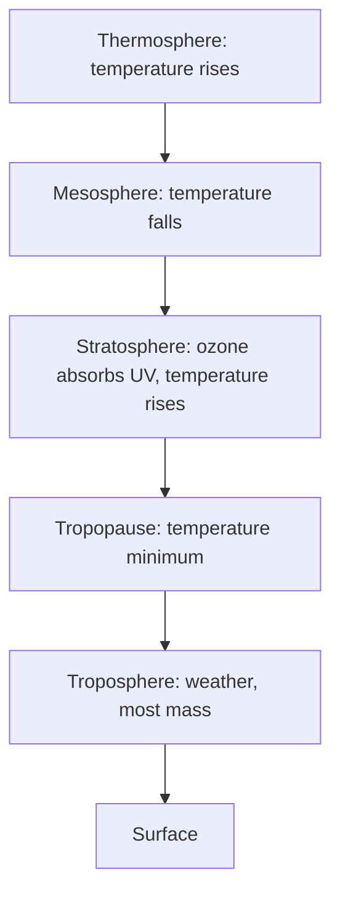
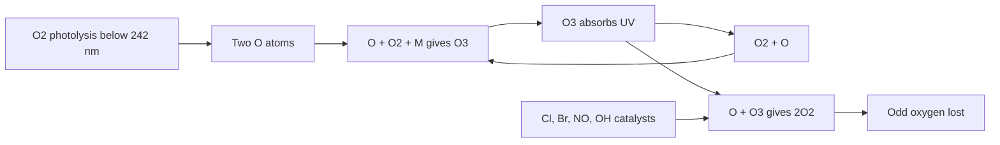
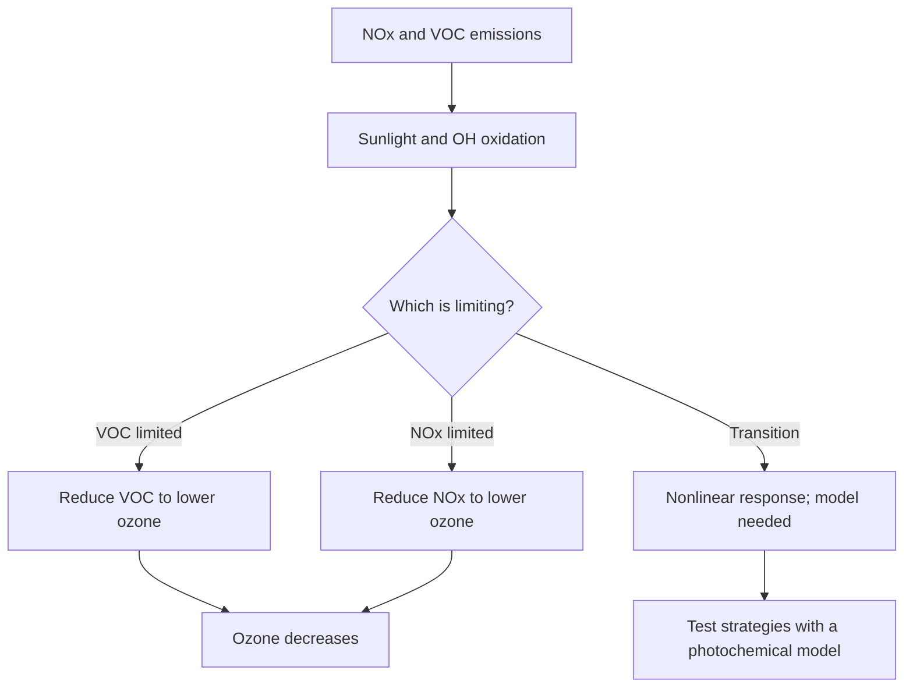

# Chapter 2 — Atmospheric Chemistry

> **Level:** Level 9 — Environmental Chemistry (advanced undergraduate / environmental)
> **Estimated study time:** 8 hours (reading) + 3 hours (exercises)
> **Prerequisites:** [Chemical Kinetics and Reaction Mechanisms](../04-advanced-chemistry/05-chemical-kinetics-and-reaction-mechanisms.md); [Photochemistry and Spectroscopy](../04-advanced-chemistry/10-advanced-spectroscopy.md); [Chemical Equilibrium and Le Chatelier's Principle](../03-intermediate-chemistry/10-chemical-equilibrium-and-le-chateliers-principle.md); [Gas Laws and the Ideal Gas Equation](../03-intermediate-chemistry/04-gas-laws-and-the-ideal-gas-equation.md)
> **Difficulty:** ★★★★★ (5/5)
> **Related chapters:** [Green and Sustainable Chemistry](01-green-and-sustainable-chemistry.md), [Water Chemistry and Water Pollution](03-water-chemistry-and-pollution.md), [Catalytic Industrial Processes and Petroleum Chemistry](../10-materials-and-industrial-chemistry/06-catalytic-industrial-processes-and-petroleum-chemistry.md)

---

## 1. Learning Objectives

After working through this chapter you will be able to:

- Describe the structure and composition of the atmosphere.
- Explain the Chapman mechanism and why it overpredicts stratospheric ozone.
- Write catalytic ozone-destruction cycles for ClOₓ, NOₓ and HOₓ.
- Explain the Antarctic ozone hole using polar stratospheric clouds and
  heterogeneous chemistry.
- Describe the Montreal Protocol and its amendments as a policy success with
  caveats.
- Analyse tropospheric ozone formation with the Leighton relationship.
- Distinguish VOC-limited from NOx-limited regimes.
- Explain the oxidation chemistry of SO₂ and NO₂ and the formation of acid
  deposition.
- Classify particulate matter and explain secondary organic aerosol formation.
- Describe the greenhouse effect and radiative forcing at a chemistry level.
- Interpret air quality indices and monitoring data.
- Assess indoor air hazards from radon, formaldehyde and combustion products.

---

## 2. Introduction

The atmosphere is a thin film of gas held by gravity. If it were compressed to
the density of water it would be about ten metres deep, and the ozone layer that
protects life from ultraviolet radiation would be a few millimetres. Yet this
thin film mediates the planet's energy balance, transports pollutants across
continents and determines the chemistry of every exposed surface.

Atmospheric chemistry is the study of reactions in a medium that is dilute,
oxidising and driven by sunlight. Concentrations are measured in parts per
billion or trillion, so a trace species can be both negligible in mass and decisive
in effect. The hydroxyl radical, present at about $10^{6}$ molecules per cm³, is
the main cleansing agent of the troposphere; without it, methane and carbon
monoxide would accumulate to far higher levels.

The chapter moves from the stratosphere down to the surface and indoors. It
treats ozone twice: as a shield in the stratosphere and as a pollutant in the
troposphere. It treats acid deposition, particulate matter and the greenhouse
effect as consequences of the same oxidation chemistry. Quantitative problems are
included because atmospheric science is quantitative: a residence time, a mixing
ratio and a photolysis rate decide whether a substance is local or global, and
whether it is a hazard indoors or outdoors.

---

## 3. Fundamental Concepts

### 3.1 Structure and composition

The atmosphere is divided by temperature profile. The **troposphere** extends from
the surface to about 8–18 km, decreasing in temperature with height; it contains
most of the mass and water vapour and is where weather occurs. The **stratosphere**
lies above it, with temperature increasing because ozone absorbs ultraviolet
radiation. The boundary is the **tropopause**, a temperature minimum that acts as
a partial lid on vertical mixing. Above the stratosphere are the mesosphere and
thermosphere.

| Component | Mixing ratio | Note |
|---|---|---|
| N₂ | 78.08 % | Chemically inert on human timescales |
| O₂ | 20.95 % | Required for respiration and combustion |
| Ar | 0.93 % | Inert |
| CO₂ | about 420 ppm | Rising; greenhouse gas |
| Ne, He, Kr | ppm to sub-ppm | Inert |
| CH₄ | about 1.9 ppm | Greenhouse gas; sink with OH |
| N₂O | about 0.33 ppm | Greenhouse gas; ozone-depleting precursor |
| CO | 50–200 ppb | Variable; sink with OH |
| O₃ | 20–100 ppb at surface | Pollutant; 2–10 ppm in stratosphere |
| Water vapour | 0–4 % | Highly variable; key greenhouse gas |

Pressure falls roughly exponentially with height, with a **scale height** of about
8 km. The total column of a trace gas is often expressed in **Dobson units** (DU):
1 DU is $2.69\times10^{16}$ molecules per cm², so a 300 DU ozone column contains
$8.1\times10^{18}$ molecules per cm².

### 3.2 The Chapman mechanism

In 1930, Sydney Chapman proposed that stratospheric ozone is produced and
destroyed by four reactions involving oxygen alone: photolysis of O₂ below
242 nm, combination of O with O₂ to give O₃, photolysis of O₃, and reaction of O
with O₃ to give 2O₂. The third reaction is the absorption that protects the
surface and warms the stratosphere.

The Chapman mechanism predicts a maximum ozone concentration in the stratosphere
and the correct order of magnitude, but it overpredicts the column by roughly a
factor of two. The missing loss is catalytic destruction by trace species, which
were not included in the original scheme. The discrepancy is a useful lesson:
a mechanism can be qualitatively right and quantitatively incomplete.

### 3.3 Catalytic ozone destruction

A catalyst destroys ozone without being consumed. The general cycle is
$\ce{X + O3 -> XO + O2}$ followed by $\ce{XO + O -> X + O2}$, with net
$\ce{O + O3 -> 2O2}$. X can be Cl, Br, NO or OH.

| Family | Cycle | Efficiency |
|---|---|---|
| ClOₓ | Cl + O₃ → ClO + O₂; ClO + O → Cl + O₂ | Very effective in the stratosphere |
| BrOₓ | Br + O₃ → BrO + O₂; BrO + O → Br + O₂ | More effective per atom than chlorine |
| NOₓ | NO + O₃ → NO₂ + O₂; NO₂ + O → NO + O₂ | Important in the middle stratosphere |
| HOₓ | OH + O₃ → HO₂ + O₂; HO₂ + O → OH + O₂ | Important in the lower stratosphere |

The rate of catalytic loss depends on the concentration of the catalyst and on
the rates of the two reactions. Chlorine is released from chlorofluorocarbons
(CFCs) by photolysis in the stratosphere; bromine comes from halons and
methyl bromide; nitrogen oxides come from nitrous oxide oxidation; HOₓ comes from
water vapour and methane oxidation.

Bromine is roughly fifty times more effective per atom than chlorine in the lower
stratosphere, but its atmospheric abundance is much lower. The ozone hole is
driven mainly by chlorine because CFC concentrations were high.

### 3.4 The Antarctic ozone hole

The Antarctic ozone hole is a springtime phenomenon, not a year-round one. Its
explanation requires the polar vortex, extremely cold temperatures and
heterogeneous chemistry on particle surfaces.

The **polar vortex** is a strong westerly circulation that isolates the Antarctic
stratosphere from mid-latitude air. Inside it, temperatures fall below about 195 K
in winter, and **polar stratospheric clouds** (PSCs) form. Type I PSCs consist of
nitric acid trihydrate; type II PSCs are water ice.

On PSC surfaces, otherwise slow reactions become fast:
$\ce{ClONO2 + HCl -> Cl2 + HNO3}$ and $\ce{ClONO2 + H2O -> HOCl + HNO3}$.
The products are photolysed in spring to release chlorine atoms.
The HNO₃ remains in the particles, which sediment and remove nitrogen from the
stratosphere (**denitrification**). Without NO₂, chlorine is not converted back to
the reservoir ClONO₂, so the catalytic cycle can run for weeks.

The result is a rapid loss of ozone in September and October, when sunlight
returns. Ozone concentrations can fall by more than 90 % at 15–20 km. The hole
closes when the vortex breaks down and ozone-rich air from lower latitudes mixes
in.

### 3.5 Tropospheric ozone and photochemical smog

In the troposphere, ozone is a pollutant. It forms by photolysis of NO₂ followed
by combination of O with O₂, and is consumed by NO. The three reactions reach a
**photostationary state** described by the **Leighton relationship**:

$$
\frac{[\ce{O3}][\ce{NO}]}{[\ce{NO2}]} = \frac{J_{\ce{NO2}}}{k},
$$

where $J$ is the photolysis rate of NO₂ and $k$ the rate constant for NO + O₃.
This relation sets the ozone concentration when only NOₓ is present.

Volatile organic compounds (VOCs) change the balance. Oxidation of a VOC by OH
produces peroxy radicals (RO₂, HO₂), which convert NO to NO₂ without consuming
ozone:

$$
\ce{RO2(g) + NO(g) -> RO(g) + NO2(g)}, \qquad
\ce{HO2(g) + NO(g) -> OH(g) + NO2(g)}.
$$

The NO₂ then photolyses and makes more ozone. The net effect is that VOCs allow
NOₓ to produce ozone beyond the Leighton limit. The system is **VOC-limited** when
reducing VOCs reduces ozone, and **NOx-limited** when reducing NOₓ is more
effective. In polluted cities, the regime can switch with time of day and
location, which is why ozone control is difficult.

**Photochemical smog** contains ozone, aldehydes, peroxyacetyl nitrate (PAN),
aerosols and nitrogen oxides. It forms in sunny, warm conditions with stagnant
air, and it is worse downwind of traffic because oxidation takes time.

### 3.6 Nitrogen oxides, sulfur dioxide and acid deposition

**Nitrogen oxides** from combustion are mainly NO. NO is oxidised to NO₂ by ozone
or peroxy radicals, and NO₂ becomes nitric acid through reaction with OH or
through N₂O₅ hydrolysis on aerosol surfaces at night. **Sulfur dioxide** is
oxidised by OH in the gas phase and by H₂O₂, O₃ or catalytic Fe/Mn in cloud
droplets; the aqueous pathway can dominate and produces sulfate aerosol.
**Acid deposition** is the combination of wet deposition (rain, snow, fog) and dry
deposition (gas and particles). Unpolluted rain has pH about
5.6 because of dissolved CO₂; polluted rain can fall below pH 4.

The environmental effects depend on the receiving ecosystem. Acidification of
lakes and soils mobilises aluminium, damages fish and forests, and leaches
nutrients. Sulfate and nitrate also act as fertilisers, so the damage is a
combination of acidification and eutrophication.

### 3.7 Particulate matter

**Particulate matter** (PM) is classified by aerodynamic diameter: PM10 is below
10 µm, PM2.5 below 2.5 µm, and ultrafine particles below 0.1 µm. The smaller the
particle, the deeper it penetrates the respiratory tract; PM2.5 reaches the
alveoli and can enter the bloodstream.

Particles are either **primary** (emitted directly) or **secondary** (formed in
the atmosphere). Secondary inorganic aerosol consists of sulfate, nitrate and
ammonium. **Secondary organic aerosol** (SOA) forms when VOCs are oxidised to
less volatile products that condense onto existing particles or nucleate new ones.
The chemistry is complex: hundreds of products, uncertain vapour pressures and
particle-phase reactions.

| Fraction | Typical composition | Main sources |
|---|---|---|
| PM10 | Crustal dust, sea salt, pollen | Mechanical processes |
| PM2.5 | Sulfate, nitrate, ammonium, organic carbon, elemental carbon, metals | Combustion, secondary formation |
| Ultrafine | Nucleation mode, organic and metal vapours | Traffic, combustion |

Health effects include cardiovascular and respiratory disease, and the World
Health Organization attributes millions of premature deaths per year to ambient
and household air pollution. The dose-response is approximately linear at low
concentrations, with no clearly safe threshold.

### 3.8 Carbon monoxide, greenhouse gases and indoor air

**Carbon monoxide** is produced by incomplete combustion. Its main sink is
reaction with OH:

$$
\ce{CO(g) + OH(g) -> CO2(g) + H(g)},
$$

which also affects the oxidising capacity of the atmosphere. CO is toxic because
it binds haemoglobin with an affinity about 200 times that of oxygen, forming
carboxyhaemoglobin and reducing oxygen delivery.

The **greenhouse effect** is the absorption and re-emission of infrared radiation
by gases with vibrational modes that change the dipole moment. CO₂ absorbs near
667 cm⁻¹ (bending) and 2349 cm⁻¹ (asymmetric stretch); the 8–12 µm atmospheric
window is partly closed by water vapour, CO₂, CH₄, N₂O and ozone. Adding a
greenhouse gas raises the effective radiating altitude and warms the surface.

**Radiative forcing** quantifies the change in energy balance at the top of the
atmosphere. For CO₂, a useful approximation is

$$
\Delta F = 5.35\ln\!\left(\frac{C}{C_0}\right)\ \text{W m}^{-2},
$$

where $C$ and $C_0$ are the new and reference concentrations. **Global warming
potential** compares the integrated forcing of a gas with CO₂ over a chosen
horizon, usually 100 years.

**Indoor air** is often more polluted than outdoor air. **Radon-222** is a
radioactive noble gas produced by uranium decay, with a half-life of 3.8 days; it
accumulates in basements and is a leading cause of lung cancer after smoking.
**Formaldehyde** is emitted by resins, furniture and combustion, is classified as
a human carcinogen, and is regulated in indoor air. Combustion appliances produce
CO, NO₂ and ultrafine particles, and ventilation is the main control.

---

## 4. Detailed Scientific Explanation

### 4.1 Stratospheric rates, reservoirs and the catalytic argument

The stratospheric ozone budget is a balance between production by O₂ photolysis
and loss by catalytic cycles. The production rate peaks where ultraviolet flux and
O₂ density are both adequate, around 30–40 km. The loss rate depends on the
concentration of catalysts and on the rate of the rate-limiting step in each
cycle.

The rate argument explains why the ozone layer is where it is. At high altitude,
O₂ is sparse and UV is intense; at low altitude, UV is attenuated and ozone
production is slow. The maximum concentration occurs where the product of O₂
density and UV actinic flux is largest, around 20–25 km.

**Reservoir species** store reactive chlorine and nitrogen in forms that do not
catalyse ozone loss. HCl, ClONO₂ and HNO₃ are reservoirs; their formation slows
the catalytic cycles. The ozone hole occurs when heterogeneous chemistry converts
reservoirs back into active chlorine on PSC surfaces faster than gas-phase
chemistry can sequester it.

The rate of the ClO + O reaction is slow in the lower stratosphere because atomic
oxygen is scarce. The dominant lower-stratospheric cycles therefore use ClO with
another ClO or with BrO:

$$
\ce{ClO(g) + ClO(g) + M -> Cl2O2(g) + M}, \qquad
\ce{Cl2O2(g) ->[h\nu] 2Cl(g) + O2(g)}.
$$

The net result is two ozone molecules destroyed per cycle, and the rate depends on
the square of the ClO concentration, which is why the hole accelerates as chlorine
loading rises.

### 4.2 The Montreal Protocol

The **Montreal Protocol** (1987) committed parties to phase out ozone-depleting
substances. It has been amended repeatedly: London (1990), Copenhagen (1992),
Montreal (1997), Beijing (1999) and Kigali (2016), which added a phase-down of
hydrofluorocarbons. The protocol is widely regarded as the most successful
environmental treaty: CFC production fell by more than 99 %, and stratospheric
chlorine is declining.

The chemistry made the policy tractable. CFCs had identifiable uses, available
substitutes and a clear causal link to a visible harm. The treaty included
financial and technical support for developing countries, which improved
compliance.

Caveats remain. **HCFCs** and **HFCs** replaced CFCs; HFCs are not ozone-depleting
but are potent greenhouse gases, which is why the Kigali Amendment matters.
Unexpected emissions of CFC-11 were detected in 2018 and traced to production in
east Asia; the emissions declined after enforcement. The ozone layer is recovering,
but full recovery is projected for the mid-to-late twenty-first century, and
climate change alters stratospheric temperatures and circulation.

### 4.3 Smog chemistry and control regimes

Ozone formation is a nonlinear function of NOₓ and VOC concentrations. The
**isopleth diagram** plots ozone as a function of both; the shape explains why
control strategies can backfire.

In the **VOC-limited** regime, reducing VOCs lowers ozone; reducing NOₓ can
increase it because NOₓ titration of ozone is reduced. In the **NOx-limited**
regime, reducing NOₓ lowers ozone. Urban cores are often VOC-limited, while
downwind areas are NOx-limited.

The **weekend effect** — higher ozone on weekends in some cities despite lower
traffic — is explained by the regime shift: NOₓ falls faster than VOCs, moving the
system toward NOx-limited conditions and allowing more ozone.

Control strategies therefore differ by location. Catalytic converters reduce NOₓ
and CO; VOC controls target solvents, fuels and industrial processes; NOₓ controls
target combustion. Electrification shifts emissions from the tailpipe to the power
sector, where they can be controlled more effectively.

### 4.4 Acid deposition chemistry and effects

Acid deposition begins with SO₂ and NOₓ oxidation to H₂SO₄ and HNO₃. The gases
and particles are removed by wet deposition (in precipitation) and dry deposition
(onto surfaces). The relative importance depends on climate, land use and
particle size.

The **critical load** is the deposition rate below which ecosystem damage does not
occur. It is estimated from soil buffering capacity, bedrock geology and
vegetation. Granite and soft-water lakes are sensitive; limestone and calcareous
soils are buffered.

Effects include lake acidification, aluminium mobilisation, forest decline and
damage to buildings and cultural heritage. Recovery is slow because sulfate
stored in soils can be released for decades after deposition falls. Regulation of
SO₂ and NOₓ has reduced deposition in Europe and North America, and some lakes have
recovered, but not all.

### 4.5 Particulate matter, secondary organic aerosol and health

PM2.5 is the air pollutant most strongly associated with premature mortality.
The mechanisms include oxidative stress, inflammation and translocation of
ultrafine particles into the circulation. Health effects are observed at
concentrations below current standards, which is why the WHO guidelines are
periodically tightened.

**Secondary organic aerosol** forms from the oxidation of VOCs. The pathway
involves OH, O₃ or NO₃ radicals, producing semivolatile products that partition
between gas and particle phases. Biogenic VOCs, especially terpenes from forests,
are a large global source; anthropogenic VOCs add to the burden in cities.

The chemistry is difficult because the products are numerous, their vapour
pressures are uncertain and the particle phase is not ideal. Chamber experiments
and field measurements are both necessary, and models still underestimate SOA in
many environments.

### 4.6 The greenhouse effect and radiative forcing

Greenhouse gases absorb infrared radiation because their vibrational modes change
the molecular dipole moment. Homonuclear molecules such as N₂ and O₂ have no
infrared-active vibrational mode and are not greenhouse gases. CO₂ has a bending
mode at 667 cm⁻¹ and an asymmetric stretch at 2349 cm⁻¹; CH₄ has four normal
modes, two of them infrared-active; N₂O and CFCs also absorb in the window.

The surface emits infrared radiation; greenhouse gases absorb part of it and
re-emit in all directions, including downward. The troposphere warms, and the
effective radiating level moves upward where the temperature is lower. The
surface must warm to restore the energy balance.

**Radiative forcing** is the change in net irradiance at the tropopause. Positive
forcing warms; negative forcing cools. Aerosols generally cool by scattering
sunlight and by changing cloud properties, which partly offsets greenhouse warming.
The uncertainty in aerosol forcing is one of the largest in climate science.

**Global warming potential** integrates the forcing of a pulse of gas over a
horizon relative to CO₂. GWP100 values are about 28 for CH₄ (fossil and biogenic
weighted), 273 for N₂O and thousands for some fluorinated gases. The choice of
horizon changes the ranking: CH₄ is more important over 20 years than over 100.

### 4.7 Air quality indices, monitoring and indoor air

Air quality indices convert pollutant concentrations into a single number and a
colour. They are communication tools, not physical quantities. The index is
defined by breakpoints that differ between countries, so the same concentration
can receive different labels.

Monitoring uses continuous analysers: chemiluminescence for NOₓ, ultraviolet
absorption for O₃, fluorescence for SO₂, nondispersive infrared or cavity ring-down
for CO, beta attenuation or tapered element oscillating microbalance for PM, and
filter sampling with gravimetry for reference methods. Remote sensing by lidar
and satellite provides spatial coverage but needs ground validation.

**Indoor air** chemistry differs from outdoor chemistry because of surfaces,
limited ventilation and indoor sources. Ozone reacts with terpenes and with
human skin oils to produce secondary products, including ultrafine particles and
formaldehyde. Cleaning products, cooking and smoking are major sources. Radon
enters through soil and cracks; mitigation is by sub-slab depressurisation and
ventilation.

---

## 5. Visual Diagrams

**Figure 2.1 — Vertical structure of the atmosphere.** The temperature profile is
caused by the absorption of radiation at different altitudes. Ozone absorption
heats the stratosphere and creates a stable layer that limits vertical mixing; the
troposphere is heated from below and is unstable enough to produce weather.

**Figure 2.2 — The ozone cycle and its catalytic loss.** Production and loss are
both driven by ultraviolet light. The catalytic cycles do not consume the catalyst;
they convert odd oxygen to O₂. The balance between production and catalytic loss
sets the column abundance.

**Figure 2.3 — Ozone control depends on the chemical regime.** The same emission
reduction can lower or raise ozone depending on whether the system is VOC-limited
or NOx-limited. This is why uniform national policies can fail in individual
cities and why air quality management requires local measurements and modelling.

---

## 6. Mathematical Formulas

Residence time, mixing ratio and photolysis rate are

$$
\tau = \frac{M}{F}, \qquad
\chi_i = \frac{n_i}{n_\text{air}}, \qquad
J = \int \sigma(\lambda)\,\phi(\lambda)\,I(\lambda)\,\mathrm{d}\lambda,
$$

where $M$ is the atmospheric burden, $F$ the source flux, $\sigma$ the absorption
cross-section, $\phi$ the quantum yield and $I(\lambda)$ the actinic flux.

The Leighton relationship, radiative forcing and scale height are

$$
\frac{[\ce{O3}][\ce{NO}]}{[\ce{NO2}]} = \frac{J_{\ce{NO2}}}{k}, \qquad
\Delta F = 5.35\ln\!\left(\frac{C}{C_0}\right), \qquad
H = \frac{RT}{M_\text{air}g}.
$$

| Symbol | Meaning | SI unit |
|---|---|---|
| $\tau$ | Residence time | s |
| $M$ | Atmospheric burden | kg |
| $F$ | Source flux | kg s⁻¹ |
| $\chi_i$ | Mole fraction of species $i$ | 1 |
| $J$ | Photolysis rate constant | s⁻¹ |
| $\sigma$ | Absorption cross-section | m² molecule⁻¹ |
| $\phi$ | Quantum yield | 1 |
| $I(\lambda)$ | Actinic flux | photons m⁻² s⁻¹ nm⁻¹ |
| $k$ | Rate constant for NO + O₃ | cm³ molecule⁻¹ s⁻¹ |
| $\Delta F$ | Radiative forcing | W m⁻² |
| $C$, $C_0$ | Concentration and reference concentration | mol m⁻³ |
| $H$ | Scale height | m |
| $R$ | Gas constant | J K⁻¹ mol⁻¹ |
| $T$ | Temperature | K |
| $M_\text{air}$ | Molar mass of air | kg mol⁻¹ |
| $g$ | Gravitational acceleration | m s⁻² |

The Leighton relation assumes a steady state with NO, NO₂ and O₃ only. It fails
when VOCs, halogen radicals or heterogeneous chemistry intervene, which is
precisely the interesting case.

---

## 7. Chemical Equations

Chapman production and loss:

$$
\ce{O2(g) ->[h\nu] 2O(g)}, \qquad
\ce{O(g) + O2(g) + M -> O3(g) + M}, \qquad
\ce{O3(g) ->[h\nu] O2(g) + O(g)}, \qquad
\ce{O(g) + O3(g) -> 2O2(g)}.
$$

Catalytic chlorine and bromine cycles:

$$
\ce{Cl(g) + O3(g) -> ClO(g) + O2(g)}, \qquad
\ce{ClO(g) + O(g) -> Cl(g) + O2(g)},
$$

$$
\ce{Br(g) + O3(g) -> BrO(g) + O2(g)}, \qquad
\ce{BrO(g) + O(g) -> Br(g) + O2(g)}.
$$

Heterogeneous reactions on polar stratospheric clouds:

$$
\ce{ClONO2(s) + HCl(s) -> Cl2(g) + HNO3(s)}, \qquad
\ce{ClONO2(s) + H2O(s) -> HOCl(g) + HNO3(s)}.
$$

Springtime release of chlorine:

$$
\ce{Cl2(g) ->[h\nu] 2Cl(g)}, \qquad
\ce{HOCl(g) ->[h\nu] OH(g) + Cl(g)}.
$$

Tropospheric ozone formation and titration:

$$
\ce{NO2(g) ->[h\nu] NO(g) + O(g)}, \qquad
\ce{O(g) + O2(g) + M -> O3(g) + M}, \qquad
\ce{NO(g) + O3(g) -> NO2(g) + O2(g)}.
$$

Acid formation and propagation:

$$
\ce{SO2(g) + OH(g) -> HSO3(g)}, \qquad
\ce{HSO3(g) + O2(g) -> SO3(g) + HO2(g)}, \qquad
\ce{SO3(g) + H2O(g) -> H2SO4(l)},
$$

$$
\ce{NO2(g) + OH(g) -> HNO3(g)}, \qquad
\ce{N2O5(g) + H2O(g) -> 2HNO3(g)}, \qquad
\ce{SO2(g) + H2O2(aq) -> H2SO4(aq)}.
$$

Carbon monoxide oxidation and radon decay:

$$
\ce{CO(g) + OH(g) -> CO2(g) + H(g)}, \qquad
\ce{^{222}Rn(g) -> ^{218}Po(s) + ^{4}He(g)}.
$$

The equations are balanced at the level of atoms and charge. Photolysis arrows
imply a photon, and the wavelength threshold matters: O₂ photolysis requires
$\lambda < 242$ nm, while O₃ photolysis occurs across the Hartley and Huggins bands.

---

## 8. Worked Examples

### Worked Example 8.1 — Atmospheric residence time

**Problem.** The atmospheric burden of methane is about 5000 Tg and the total
source is about 550 Tg yr⁻¹. Estimate the residence time. Repeat for CO₂ with a
burden of 870 000 Tg and a source of 10 000 Tg yr⁻¹, and comment.

**Strategy.** Use $\tau = M/F$ with consistent mass units.

**Solution.** Methane: $\tau = 5000/550 = 9.1$ years. CO₂:
$\tau = 870\,000/10\,000 = 87$ years.

**Check.** The methane lifetime is consistent with the OH sink and is short enough
that emission reductions affect concentration within a decade. The CO₂ "residence
time" is not a true lifetime: CO₂ exchanges rapidly with the ocean and biosphere,
and a fraction remains for millennia. A single box-model lifetime is misleading
for CO₂, which is why climate policy uses cumulative emissions rather than
annual flux.

### Worked Example 8.2 — Converting a mixing ratio to mass concentration

**Problem.** Convert 1.0 ppb of NO₂ to µg m⁻³ at 298 K and 1 atm. Repeat for
ozone.

**Strategy.** Use the ideal gas law:
$c = \chi P/(RT)$, then multiply by molar mass.

**Solution.** For NO₂ ($M = 46.01\ \text{g mol}^{-1}$):
$c = (1.0\times10^{-9})(101\,325)/(8.314 \times 298) = 4.09\times10^{-8}$ mol m⁻³;
mass $= 4.09\times10^{-8} \times 46.01 = 1.88\times10^{-6}$ kg m⁻³
$= 1.88\ \mu\text{g m}^{-3}$. For O₃ ($M = 48.00$), the result is
$1.96\ \mu\text{g m}^{-3}$.

**Check.** The conversion factor is about 1.88 for NO₂ and 1.96 for O₃ at 25 °C.
At 0 °C the factors are about 2.05 and 2.14, so temperature must be stated. Air
quality standards often use 20 °C or 25 °C reference conditions, and comparing
data at different temperatures introduces a few per cent error.

### Worked Example 8.3 — Photolysis lifetime

**Problem.** The photolysis rate of NO₂ at noon is $J = 8.0\times10^{-3}$ s⁻¹.
Calculate the photolysis lifetime and the steady-state ozone concentration if
$[\ce{NO2}]/[\ce{NO}] = 2.0$ and $k = 1.9\times10^{-14}$ cm³ molecule⁻¹ s⁻¹.

**Strategy.** $\tau = 1/J$; for ozone use the Leighton relation
$[\ce{O3}] = (J/k)([\ce{NO2}]/[\ce{NO}])$.

**Solution.** $\tau = 1/(8.0\times10^{-3}) = 125$ s. Then
$[\ce{O3}] = (8.0\times10^{-3}/1.9\times10^{-14})(2.0) = 8.4\times10^{11}$
molecules cm⁻³, which is about 34 ppb at 298 K.

**Check.** A photolysis lifetime of two minutes means NO₂ is rapidly cycling, so
ozone responds quickly to sunlight. The ozone value is typical of a moderately
polluted urban atmosphere. The calculation assumes no VOC input; VOCs would raise
ozone above the Leighton value.

### Worked Example 8.4 — pH of unpolluted rain

**Problem.** Calculate the pH of rainwater in equilibrium with atmospheric CO₂ at
a partial pressure of $4.2\times10^{-4}$ atm, given
$K_H = 3.4\times10^{-2}\ \text{mol L}^{-1}\text{atm}^{-1}$ and
$K_{a1} = 4.3\times10^{-7}$.

**Strategy.** For a dilute solution, $[\ce{H+}] \approx \sqrt{K_H K_{a1} p_{\ce{CO2}}}$.

**Solution.**
$[\ce{H+}] = \sqrt{(3.4\times10^{-2})(4.3\times10^{-7})(4.2\times10^{-4})}
= \sqrt{6.14\times10^{-12}} = 2.48\times10^{-6}$ mol L⁻¹, so pH = 5.61.

**Check.** The result is the familiar pH 5.6 of clean rain. Polluted rain at
pH 4.2 has about 25 times the hydrogen ion concentration, which requires strong
acids — sulfuric and nitric — not CO₂ alone.

### Worked Example 8.5 — Radiative forcing from a CO₂ increase

**Problem.** Calculate the radiative forcing from an increase of CO₂ from 280 to
420 ppm using $\Delta F = 5.35\ln(C/C_0)$.

**Strategy.** Insert the concentrations in ppm; the ratio is dimensionless.

**Solution.** $\Delta F = 5.35\ln(420/280) = 5.35\ln(1.5) = 5.35(0.405) = 2.17$
W m⁻².

**Check.** The value is close to the IPCC estimate for the CO₂ increase since the
pre-industrial period. It is a forcing, not a temperature: the transient climate
response converts forcing to warming with a factor of roughly 0.5–0.8 K per
W m⁻², modified by feedbacks and ocean uptake.

---

## 9. Real-World Applications

Air quality management uses monitoring networks, emission inventories and
photochemical models to test control strategies. The ozone hole is monitored by
satellites and ground-based Dobson spectrophotometers, and the Montreal Protocol
is enforced through production and consumption reporting.

Climate policy uses radiative forcing and GWP to compare gases, and inventory
methods to attribute emissions. Indoor air quality is managed through ventilation
standards, radon mapping and product emissions testing.

---

## 10. Common Mistakes

| Mistake | Why it happens | Correct approach |
|---|---|---|
| Treating ozone as only "good" or "bad" | It is protective in the stratosphere and harmful at the surface | Specify altitude and exposure context |
| Using the Leighton relation in polluted air | It assumes NOₓ-only chemistry | Include VOC and heterogeneous pathways |
| Converting ppb to µg m⁻³ without temperature | The factor depends on $T$ and $p$ | State reference conditions |
| Assuming CO₂ has a single lifetime | Multiple uptake timescales | Use cumulative emissions or impulse response |
| Confusing radiative forcing with temperature | Forcing is an energy flux | Apply climate sensitivity and feedbacks |
| Assuming PM2.5 is a single substance | It is a mixture with different sources | Report composition and source apportionment |
| Treating the ozone hole as global ozone depletion | It is a polar spring phenomenon | Distinguish column trends from the hole |
| Ignoring indoor sources | Outdoor monitors do not represent indoors | Measure indoors and control ventilation |

---

## 11. Chapter Summary

- The atmosphere is layered by temperature; ozone heating stabilises the stratosphere.
- Chapman chemistry explains ozone production but not its full loss.
- Catalytic cycles of Cl, Br, NO and OH destroy ozone; reservoirs modulate them.
- The Antarctic hole requires PSCs, heterogeneous chemistry and denitrification.
- The Montreal Protocol is a successful treaty with remaining challenges.
- Tropospheric ozone is nonlinear in NOₓ and VOC; control depends on regime.
- SO₂ and NOₓ oxidation produce acid deposition with ecosystem-dependent effects.
- PM2.5 and SOA dominate the health burden of air pollution.
- Greenhouse forcing is a radiative balance problem, not a simple "trapping" story.

---

## 12. Exercises

### 12.1 Conceptual questions

1. Why does the Chapman mechanism overpredict ozone?
2. Why is the ozone hole a spring phenomenon?
3. Why can reducing NOₓ increase ozone in a VOC-limited city?

### 12.2 Basic problems

4. A gas has a burden of 200 Tg and a source of 40 Tg yr⁻¹. Calculate its residence time.
5. Convert 20 ppb of O₃ to µg m⁻³ at 298 K.
6. A photolysis rate is $2.0\times10^{-4}$ s⁻¹. Calculate the lifetime.

### 12.3 Intermediate problems

7. Using Leighton with $J/k = 4\times10^{11}$ molecules cm⁻³ and
   $[\ce{NO2}]/[\ce{NO}] = 3$, calculate $[\ce{O3}]$ in ppb.
8. Calculate the radiative forcing for CH₄ rising from 0.7 to 1.9 ppm using the
   CO₂ formula as a rough analogue, and comment on the approximation.
9. Explain why nitrate aerosol formation is favoured at night.

### 12.4 Advanced problems

10. Estimate the mass of sulfur deposited per hectare per year from a deposition
    flux of 5 kg S ha⁻¹ yr⁻¹ and compare with a critical load of 10 kg S ha⁻¹ yr⁻¹.
11. Derive the steady-state ozone concentration for a simple NOₓ-only system and
    state the assumptions.
12. Propose a monitoring strategy to distinguish local from regional PM2.5.

### Answers

1. It omits catalytic loss by ClOₓ, NOₓ and HOₓ.
2. The vortex and PSCs form in winter; sunlight returns in spring and releases Cl.
3. NOₓ titrates ozone; reducing it can leave more ozone where VOCs are abundant.
4. $\tau = 200/40 = 5$ years.
5. $20 \times 1.96 = 39\ \mu\text{g m}^{-3}$.
6. $\tau = 1/(2.0\times10^{-4}) = 5000$ s, about 1.4 h.
7. $[\ce{O3}] = 1.2\times10^{12}$ molecules cm⁻³, about 49 ppb.
8. $\Delta F = 5.35\ln(1.9/0.7) = 5.35(0.999) = 5.3$ W m⁻²; the CO₂ formula
   overstates CH₄ forcing because the bands overlap and saturate.
9. NO is oxidised to NO₂, then to N₂O₅, which hydrolyses on particles when OH is low.
10. 5 kg S ha⁻¹ yr⁻¹ is below the 10 kg critical load, so no exceedance is expected
    on that basis.
11. Set production equal to loss for odd oxygen; ozone depends on $J_{\ce{NO2}}$,
    $k$, and the NO₂/NO ratio, assuming no transport or VOCs.
12. Combine a urban background site, a rural site and meteorology; use
    source apportionment and size-resolved composition.

---

## 13. Further Reading

- Seinfeld, J. H. and Pandis, S. N. *Atmospheric Chemistry and Physics: From Air
  Pollution to Climate Change*, 3rd ed., Wiley, 2016.
- Finlayson-Pitts, B. J. and Pitts, J. N. *Chemistry of the Upper and Lower
  Atmosphere*, Academic Press, 2000.
- Jacob, D. J. *Introduction to Atmospheric Chemistry*, Princeton University Press,
  1999.
- IPCC. *Climate Change 2021: The Physical Science Basis*.
  <https://www.ipcc.ch/>
- World Health Organization. *WHO Global Air Quality Guidelines*, 2021.
  <https://www.who.int/>
- UNEP. *Montreal Protocol on Substances that Deplete the Ozone Layer*.
  <https://ozone.unep.org/>

See [CURRICULUM.md](../CURRICULUM.md), [GLOSSARY.md](../GLOSSARY.md) and
[REFERENCES.md](../REFERENCES.md).

