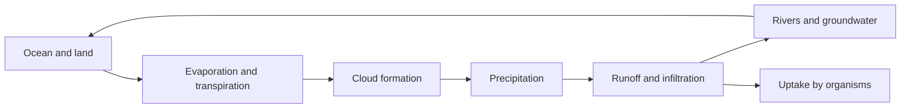
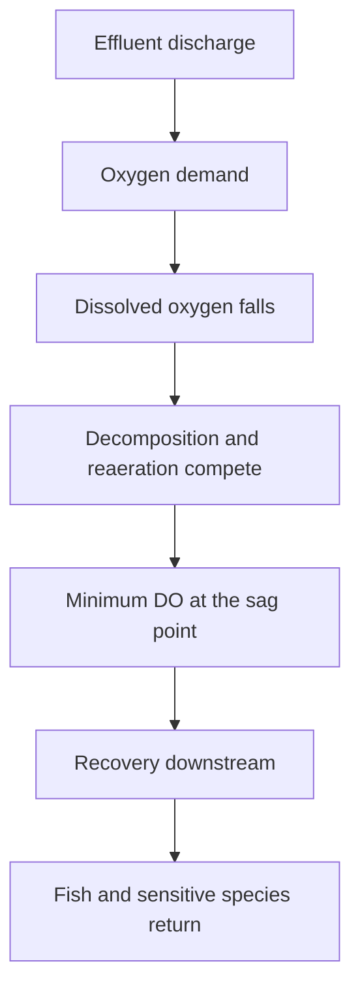

# Chapter 3 — Water Chemistry and Water Pollution

> **Level:** Level 9 — Environmental Chemistry (advanced undergraduate / environmental)
> **Estimated study time:** 8 hours (reading) + 3 hours (exercises)
> **Prerequisites:** [Acid–Base Chemistry and pH](../03-intermediate-chemistry/11-acid-base-chemistry-and-ph.md); [Advanced Equilibrium, Buffers and Solubility Product](../04-advanced-chemistry/07-advanced-equilibrium-buffers-and-solubility-product.md); [Redox Reactions and Electrochemistry Fundamentals](../03-intermediate-chemistry/12-redox-reactions-and-electrochemistry-fundamentals.md); [Solutions, Concentration and Dilution](../03-intermediate-chemistry/03-solutions-concentration-and-dilution.md)
> **Difficulty:** ★★★★☆ (4/5)
> **Related chapters:** [Atmospheric Chemistry](02-atmospheric-chemistry.md), [Waste Treatment and Circular Chemistry](04-waste-treatment.md), [Corrosion](../10-materials-and-industrial-chemistry/05-corrosion.md)

---

## 1. Learning Objectives

After working through this chapter you will be able to:

- Describe the water cycle and the composition of natural waters.
- Solve carbonate equilibria for open and closed systems.
- Define alkalinity and hardness and calculate them as CaCO₃ equivalents.
- Explain pH, pe and the interpretation of pe–pH diagrams.
- Calculate dissolved oxygen, BOD and the oxygen sag curve.
- Explain eutrophication and nutrient limitation.
- Describe heavy-metal speciation, adsorption and bioaccumulation.
- Classify organic pollutants and predict their environmental fate.
- Compare disinfection methods and their by-products.
- Describe drinking-water and wastewater treatment trains.
- Interpret water quality standards and monitoring data.

---

## 2. Introduction

Water is the most familiar solvent and the most complex. Its high dielectric
constant dissolves ions, its hydrogen bonding gives it a high boiling point and
heat capacity, and its amphoteric nature sets the pH of every natural water. The
same properties make it an excellent medium for life and an excellent medium for
pollution.

Natural water is never pure. Rain dissolves atmospheric gases and aerosols;
groundwater dissolves minerals; surface water carries organic matter and
microorganisms. The resulting composition determines whether the water is
suitable for drinking, irrigation, industry or aquatic life, and it determines
how a contaminant will move, react and accumulate.

This chapter treats water chemistry as equilibrium chemistry in a variable matrix.
It covers carbonate equilibria, alkalinity and hardness; oxygen demand and
eutrophication; the speciation and fate of metals and organic pollutants;
disinfection and its by-products; and the treatment trains that turn raw water
into drinking water or clean effluent. The calculations are the core of the
subject: a hardness number, a BOD value, a THM concentration and an adsorption
isotherm are how the chemistry becomes a decision.

---

## 3. Fundamental Concepts

### 3.1 The water cycle and natural water composition

Water evaporates from oceans and land, condenses in clouds, falls as precipitation
and returns through runoff, infiltration and groundwater flow. The cycle
redistributes heat, transports solutes and connects the atmosphere, lithosphere
and biosphere.

Rainwater is dilute and slightly acidic because of dissolved CO₂. River water
contains calcium, magnesium, sodium, bicarbonate, sulfate and chloride, plus
silica and dissolved organic matter. Groundwater is usually harder and more
mineralised because it has had longer contact with rock. Seawater contains about
3.5 % dissolved salts, dominated by sodium and chloride.

| Water type | TDS / mg L⁻¹ | Dominant ions | Typical pH |
|---|---|---|---|
| Rain | 5–50 | H⁺, NH₄⁺, SO₄²⁻, NO₃⁻ | 4.5–6.0 |
| River | 100–500 | Ca²⁺, HCO₃⁻, SO₄²⁻ | 6.5–8.5 |
| Groundwater | 200–2000 | Ca²⁺, Mg²⁺, HCO₃⁻, SO₄²⁻ | 6.5–8.5 |
| Seawater | about 35 000 | Na⁺, Cl⁻, Mg²⁺, SO₄²⁻ | 7.8–8.3 |

**Total dissolved solids** (TDS) is the mass of dissolved material, measured by
evaporation or conductivity. **Turbidity** measures light scattering by suspended
particles and is a surrogate for microbial risk. **Colour** comes from dissolved
organic matter, metals or industrial discharges.

### 3.2 Carbonate equilibria

The carbonate system controls the pH and buffering of most natural waters. Carbon
dioxide dissolves and hydrates:

$$
\ce{CO2(g) <=> CO2(aq)}, \qquad
\ce{CO2(aq) + H2O <=> H2CO3}.
$$

The combined species is written $\ce{H2CO3^*}$; its acidity constants are

$$
K_{a1} = \frac{[\ce{H+}][\ce{HCO3^-}]}{[\ce{H2CO3^*}]} \approx 4.3\times10^{-7},
\qquad
K_{a2} = \frac{[\ce{H+}][\ce{CO3^{2-}}]}{[\ce{HCO3^-}]} \approx 4.7\times10^{-11}.
$$

In a **closed system**, the total inorganic carbon $C_T$ is fixed and the pH is
found from the charge balance and the equilibrium expressions. In an **open
system**, the water exchanges CO₂ with the atmosphere at a fixed partial pressure;
the pH is then set by $p_{\ce{CO2}}$ and alkalinity. The distinction matters:
closed-system calculations apply to groundwater and to water in a sealed vessel;
open-system calculations apply to surface water in contact with air.

**Alkalinity** is the acid-neutralising capacity of water, dominated by bicarbonate
and carbonate:

$$
\mathrm{Alk} \approx [\ce{HCO3^-}] + 2[\ce{CO3^{2-}}] + [\ce{OH^-}] - [\ce{H+}].
$$

It is measured by titration to a fixed endpoint and is reported as mg L⁻¹ CaCO₃.
Alkalinity is not the same as pH: a water can be well buffered at pH 7 or poorly
buffered at pH 7.

**Hardness** is the sum of calcium and magnesium concentrations, expressed as
CaCO₃ equivalents:

$$
\mathrm{Hardness} = \left([\ce{Ca^{2+}}] + [\ce{Mg^{2+}}]\right) \times 100.09\ \text{mg mmol}^{-1}.
$$

Hard water forms scale in boilers and pipes and consumes soap; soft water is
corrosive to some metals. Hardness is classified as soft below 60 mg L⁻¹,
moderately hard at 60–120, hard at 120–180 and very hard above 180 mg L⁻¹ as
CaCO₃.

### 3.3 pH, pe and pe–pH diagrams

**pH** is defined as $-\log a_{\ce{H+}}$. In dilute waters, concentration and
activity are nearly equal; in brines, activity coefficients must be used.

**pe** is the negative logarithm of electron activity, analogous to pH:

$$
\mathrm{pe} = -\log a_{\ce{e^-}}.
$$

It is related to the redox potential by

$$
\mathrm{pe} = \frac{F}{2.303RT}E_\text{h}.
$$

At 25 °C, $\mathrm{pe} = E_\text{h}/0.0591$ with $E_\text{h}$ in volts. A high pe
means oxidising conditions; a low pe means reducing conditions. Natural waters
range from pe about +12 in oxygenated surface water to −4 or lower in anoxic
sediments.

A **pe–pH diagram** shows the stability fields of dissolved and solid species as
a function of both variables. For iron, oxidising conditions favour Fe(III) oxides,
while reducing conditions favour soluble Fe²⁺. For arsenic, reducing conditions
favour arsenite, which is more mobile and more toxic than arsenate. The diagrams
are thermodynamic; kinetics, complexation and adsorption shift the boundaries.

### 3.4 Dissolved oxygen, BOD and the oxygen sag

**Dissolved oxygen** (DO) is the concentration of O₂ in water, controlled by
solubility, temperature, photosynthesis, respiration and reaeration. Solubility
falls with temperature and salinity; at 20 °C and 1 atm, fresh water holds about
9.1 mg L⁻¹.

**Biochemical oxygen demand** (BOD) measures the oxygen consumed by microorganisms
decomposing organic matter. BOD₅ is the demand over five days at 20 °C in the dark.
**Chemical oxygen demand** (COD) measures the oxygen equivalent of all oxidisable
material, including non-biodegradable organics, using dichromate digestion.

The BOD test is conventionally run on a diluted sample with a seed:
$$
\mathrm{BOD}_5 = \frac{(D_1-D_2)-(B_1-B_2)f}{P},
$$
where $D_1$ and $D_2$ are the initial and final DO of the diluted sample, $B_1$
and $B_2$ the values for the seed blank, $f$ the seed correction factor and $P$
the volume fraction of sample.

When a pollutant load enters a river, oxygen is consumed faster than it is
replenished near the outfall, and the DO falls. Downstream, reaeration and
dilution restore it. The resulting **oxygen sag curve** is described by the
Streeter–Phelps model:

$$
D = \frac{k_1 L_0}{k_2-k_1}\left(e^{-k_1 t}-e^{-k_2 t}\right) + D_0e^{-k_2 t},
$$

where $D$ is the oxygen deficit, $L_0$ the initial BOD, $k_1$ the deoxygenation
rate, $k_2$ the reaeration rate and $D_0$ the initial deficit.

### 3.5 Eutrophication

**Eutrophication** is the enrichment of water with nutrients, usually nitrogen and
phosphorus, leading to excessive plant and algal growth. The consequences include
algal blooms, turbidity, oxygen depletion when the biomass decays, taste and odour
problems, and cyanotoxins.

Phosphorus is usually the limiting nutrient in freshwater; nitrogen is often
limiting in marine systems. The **Redfield ratio** of carbon, nitrogen and
phosphorus in marine organic matter is about 106:16:1, which is a useful guide to
stoichiometric limitation.

Phosphorus enters water from sewage, detergents, fertiliser runoff and erosion.
In lakes, phosphorus can be stored in sediments and released under anoxic
conditions (**internal loading**), which delays recovery even after external
loads are reduced. Nitrogen enters from fertiliser, sewage and atmospheric
deposition; nitrate is mobile in groundwater and causes methaemoglobinaemia in
infants.

### 3.6 Heavy metals: speciation, adsorption and bioaccumulation

Heavy metals are toxic at low concentrations because they bind to enzymes and
disrupt cellular function. Their environmental behaviour depends on speciation,
not only on total concentration.

**Speciation** includes free ions, hydrolysis products, complexes with chloride,
carbonate, sulfate and organic matter, and adsorption to particles. The free
metal ion is often the most bioavailable and toxic form, but not always: methylmercury
is more toxic and more bioaccumulative than inorganic mercury.

**Adsorption** to iron and manganese oxides, clays and organic matter removes
metals from solution. The distribution coefficient $K_d$ relates adsorbed and
dissolved concentrations:

$$
K_d = \frac{C_\text{solid}}{C_\text{water}}.
$$

Higher $K_d$ means stronger retention and lower mobility. Adsorption depends on pH,
because surface charge and metal hydrolysis change with pH.

**Bioaccumulation** is the uptake of a substance from water and food; the
**bioconcentration factor** (BCF) is the ratio of concentration in an organism to
that in water. **Biomagnification** is the increase in concentration up the food
chain. It requires a persistent, lipophilic substance that is not metabolised or
excreted; DDT, PCBs and methylmercury are the classic examples.

### 3.7 Organic pollutants and their fate

Organic pollutants include industrial chemicals, pesticides, pharmaceuticals and
consumer products. Their fate depends on volatility, solubility, sorption,
photolysis, hydrolysis and biodegradation.

- **PCBs** are persistent, lipophilic and bioaccumulative; they were banned under
  the Stockholm Convention.
- **PAHs** form during incomplete combustion and are carcinogenic; they sorb
  strongly to particles.
- **Pesticides** vary widely; organochlorines persist, while organophosphates and
  pyrethroids hydrolyse or biodegrade faster.
- **Pharmaceuticals** enter water through excretion and disposal; they are
  designed to be stable and biologically active, which makes them persistent.
- **PFAS** are per- and polyfluoroalkyl substances with extremely strong C–F
  bonds; they are surfactants, persistent and mobile, and some are toxic.
- **Microplastics** are particles below 5 mm; they sorb pollutants and are ingested
  by organisms.

**Partitioning** is described by the octanol–water coefficient $K_{ow}$: a high
$K_{ow}$ means lipophilic and bioaccumulative. **Sorption** to organic carbon is
often estimated from $K_{oc}$, the organic-carbon-normalised partition coefficient.

### 3.8 Disinfection and disinfection by-products

Disinfection inactivates pathogens, and it is the most important public health
intervention in water treatment. The main methods are chlorine, chloramine,
ozone, chlorine dioxide and ultraviolet radiation.

**Chlorine** hydrolyses to hypochlorous acid:

$$
\ce{Cl2(g) + H2O(l) <=> HOCl(aq) + H^+(aq) + Cl^-(aq)}, \qquad
\ce{HOCl(aq) <=> H^+(aq) + OCl^-(aq)}.
$$

HOCl is the more potent disinfectant; the pKa is about 7.5, so both species are
present at neutral pH. Chlorine is effective against bacteria and viruses but less
so against protozoa such as *Cryptosporidium*.

**Chloramine** is formed by adding ammonia to chlorine. It is more stable and
produces fewer regulated trihalomethanes, but it is a weaker disinfectant and can
form nitrosamines.

**Ozone** is a strong oxidant and disinfectant; it inactivates protozoa but leaves
no residual, so a secondary disinfectant is needed. **UV** at 254 nm damages
nucleic acids and is effective against protozoa, but it also leaves no residual
and requires low turbidity.

**Disinfection by-products** form when disinfectants react with natural organic
matter. Trihalomethanes (THMs), haloacetic acids, bromate and nitrosamines are
regulated. THM formation increases with chlorine dose, contact time, temperature,
pH and organic precursor concentration.

---

## 4. Detailed Scientific Explanation

### 4.1 Drinking-water treatment

A conventional surface-water treatment train has five stages: coagulation,
flocculation, sedimentation, filtration and disinfection.

**Coagulation** destabilises colloidal particles. Alum or ferric chloride
hydrolyses to positively charged hydroxide species that neutralise the negative
charge on clays and organic matter. The optimum dose is found by jar testing,
because overdosing can reverse the charge and restabilise the suspension.

**Flocculation** gently mixes the water so that destabilised particles collide and
form larger flocs. **Sedimentation** removes the flocs by gravity; lamella settlers
increase the settling area and reduce footprint. **Filtration** through sand,
anthracite or membranes removes remaining particles and some pathogens. **Activated
carbon** adsorbs organic micropollutants, while **ion exchange** removes nitrate,
hardness or perchlorate and **reverse osmosis** removes dissolved salts.

**Disinfection** is the final barrier. Chlorine is dosed to achieve a target
**CT value** — concentration multiplied by contact time — which depends on the
pathogen, temperature and pH. Groundwater with low turbidity may need only
disinfection; surface water with high turbidity needs the full train.

### 4.2 Wastewater treatment

Wastewater treatment is classified by the level of treatment.

**Primary treatment** removes solids by screening, grit removal and sedimentation.
It removes 50–70 % of suspended solids and 25–40 % of BOD but little dissolved
nutrient.

**Secondary treatment** uses microorganisms to oxidise dissolved organic matter.
**Activated sludge** is the most common process: wastewater is aerated with a
microbial floc, the mixture is settled, and sludge is returned to maintain the
population. **Trickling filters** and **moving-bed biofilm reactors** are
alternatives that support biofilms on a medium. Secondary treatment removes
85–95 % of BOD.

**Tertiary treatment** removes nutrients, pathogens or specific pollutants.
It may include filtration, nutrient removal, activated carbon, advanced oxidation
or membranes.

**Disinfection** of effluent reduces pathogen load before discharge or reuse.

### 4.3 Nutrient removal and sludge treatment

**Nitrification** converts ammonia to nitrate in aerobic conditions:

$$
\ce{NH4^+(aq) + 2O2(g) -> NO3^-(aq) + 2H^+(aq) + H2O(l)}.
$$

**Denitrification** converts nitrate to nitrogen gas in anoxic conditions using
organic carbon as the electron donor:

$$
\ce{2NO3^-(aq) + 10e^- + 12H^+(aq) -> N2(g) + 6H2O(l)}.
$$

The two processes are combined in a biological nutrient removal train with
alternating aerobic and anoxic zones. **Enhanced biological phosphorus removal**
uses polyphosphate-accumulating organisms that take up phosphorus under alternating
anaerobic and aerobic conditions; the phosphorus is removed in waste sludge.

**Sludge** from primary and secondary treatment is thickened, digested, dewatered
and disposed of or used as a soil conditioner. Anaerobic digestion produces
biogas (methane and carbon dioxide) and stabilises the sludge. Heavy metals,
pathogens and organic contaminants limit agricultural use.

### 4.4 Water quality standards and monitoring

Drinking-water standards are health-based limits for contaminants, plus aesthetic
and operational limits. The WHO Guidelines for Drinking-water Quality provide
international benchmarks; the EU Drinking Water Directive and the US Safe Drinking
Water Act set legally binding standards in their jurisdictions.

Monitoring uses grab samples, composite samples and continuous analysers.
Parameters include pH, turbidity, conductivity, DO, residual disinfectant,
microbiological indicators (E. coli, coliforms), nitrate, arsenic, lead, fluoride
and disinfection by-products. **Emerging contaminants** are unregulated or newly
regulated substances, such as pharmaceuticals, PFAS and microplastics.

Quality assurance is essential: blanks, duplicates, certified reference materials,
control charts and participation in proficiency testing. A result without a stated
uncertainty and method is not a regulatory measurement.

### 4.5 PFAS and other emerging contaminants

**PFAS** are fluorinated surfactants used in firefighting foams, textiles, food
packaging and coatings. Their C–F bonds resist hydrolysis, photolysis and
biodegradation, hence "forever chemicals"; PFOA and PFOS are the most studied and
are associated with immunotoxicity and thyroid effects. **Granular activated
carbon**, **ion exchange** and **reverse osmosis** transfer PFAS to a concentrate
rather than destroying them. Destruction needs high-energy processes —
incineration above about 1000 °C, supercritical water oxidation, plasma or
electrochemical oxidation — and incomplete destruction can produce volatile
fluorinated products.

**Pharmaceuticals** are designed to be biologically active and are only partly
removed by conventional treatment; advanced oxidation and carbon improve removal.
**Microplastics** are ubiquitous and difficult to quantify, and their ecological
effects are still being characterised.

### 4.6 Groundwater contamination

Groundwater moves slowly through porous media, so contaminants can persist for
decades. The **vadose zone** is the unsaturated region above the water table; the
**saturated zone** is below it. Contaminants migrate by advection, dispersion,
diffusion, sorption and degradation.

Dense non-aqueous phase liquids (DNAPLs) such as chlorinated solvents sink below
the water table and form pools that slowly dissolve, creating long-term plumes.
Light non-aqueous phase liquids (LNAPLs) such as petroleum fuels float on the water
table. Remediation options include pump-and-treat, air sparging, bioremediation,
permeable reactive barriers and thermal treatment.

**Arsenic** contamination is a global problem, notably in South Asia. Arsenic
occurs as arsenate under oxidising conditions and arsenite under reducing
conditions; arsenite is more mobile and more toxic. Treatment includes oxidation,
coagulation, adsorption and membrane processes.

### 4.7 Distribution systems and corrosion

Treated water can deteriorate in the network. **Biofilms** grow on pipe walls,
harbouring pathogens and causing taste and odour problems; a **disinfectant
residual** controls regrowth but produces by-products. **Lead** often comes from
service lines and solder rather than the source. Its solubility depends on pH,
alkalinity and corrosion control, and orthophosphate dosing forms a protective
lead phosphate film; the Flint crisis showed how changing source water without
adequate corrosion control can mobilise lead. Nitrifiers can deplete chloramine,
and nitrate can rise from agricultural loading, so monitoring at the tap is part
of the safety case.

---

## 5. Visual Diagrams

**Figure 3.1 — The water cycle as a transport network.** Water is neither created
nor destroyed in the cycle; it is redistributed, and solutes move with it. The
atmosphere is a fast pathway, groundwater a slow one, which is why groundwater
contamination persists long after the source is removed.

**Figure 3.2 — A conventional surface-water treatment train.** Each barrier removes
a different class of contaminant: coagulation and filtration remove particles and
some pathogens, carbon removes dissolved organics, and disinfection inactivates
the remainder. Groundwater may need only disinfection, but surface water with high
turbidity needs the full sequence.

**Figure 3.3 — The oxygen sag downstream of a discharge.** The deficit is largest
where deoxygenation outpaces reaeration, then recovers as the organic load is
consumed and the river reaerates. The distance to recovery depends on flow,
temperature, turbulence and the biodegradability of the load.

---

## 6. Mathematical Formulas

Hardness, alkalinity and BOD are

$$
\mathrm{Hardness} = ([\ce{Ca^{2+}}]+[\ce{Mg^{2+}}])\times100.09,
\qquad
\mathrm{Alk} \approx [\ce{HCO3^-}] + 2[\ce{CO3^{2-}}] + [\ce{OH^-}] - [\ce{H+}],
$$

$$
\mathrm{BOD}_5 = \frac{(D_1-D_2)-(B_1-B_2)f}{P}.
$$

The Streeter–Phelps deficit and the adsorption isotherms are

$$
D = \frac{k_1L_0}{k_2-k_1}\left(e^{-k_1t}-e^{-k_2t}\right)+D_0e^{-k_2t},
$$

$$
q = \frac{q_\text{max}K_L C}{1+K_LC} \quad \text{(Langmuir)}, \qquad
q = K_F C^{1/n} \quad \text{(Freundlich)}.
$$

| Symbol | Meaning | SI unit |
|---|---|---|
| $\mathrm{Hardness}$ | Hardness as CaCO₃ | mg L⁻¹ |
| $[\ce{Ca^{2+}}]$, $[\ce{Mg^{2+}}]$ | Molar concentrations | mmol L⁻¹ |
| $\mathrm{Alk}$ | Alkalinity | meq L⁻¹ |
| $D_1$, $D_2$ | Initial and final DO | mg L⁻¹ |
| $B_1$, $B_2$ | Seed blank DO | mg L⁻¹ |
| $f$ | Seed correction factor | 1 |
| $P$ | Sample volume fraction | 1 |
| $D$ | Oxygen deficit | mg L⁻¹ |
| $L_0$ | Initial BOD | mg L⁻¹ |
| $k_1$, $k_2$ | Deoxygenation and reaeration rates | d⁻¹ |
| $q$ | Adsorbed mass per adsorbent mass | mg g⁻¹ |
| $C$ | Equilibrium concentration | mg L⁻¹ |
| $q_\text{max}$ | Langmuir saturation capacity | mg g⁻¹ |
| $K_L$ | Langmuir affinity constant | L mg⁻¹ |
| $K_F$, $1/n$ | Freundlich constants | (mg g⁻¹)(L mg⁻¹)$^{1/n}$ |

The **CT value** for disinfection is

$$
\mathrm{CT} = C_\text{disinfectant}\,t,
$$

with $C$ in mg L⁻¹ and $t$ in minutes. Required CT values increase as temperature
falls and as the target pathogen becomes more resistant.

---

## 7. Chemical Equations

The carbonate system:

$$
\ce{CO2(g) + H2O(l) <=> H2CO3(aq)}, \qquad \ce{H2CO3(aq) <=> H^+(aq) + HCO3^-(aq)}, \qquad
\ce{HCO3^-(aq) <=> H^+(aq) + CO3^{2-}(aq)}.
$$

Limestone dissolution consumes carbon dioxide and adds bicarbonate:

$$
\ce{CaCO3(s) + CO2(g) + H2O(l) <=> Ca^{2+}(aq) + 2HCO3^-(aq)}
$$

Chlorine hydrolysis and hypochlorite speciation:

$$
\ce{Cl2(g) + H2O(l) <=> HOCl(aq) + H^+(aq) + Cl^-(aq)}, \qquad
\ce{HOCl(aq) <=> H^+(aq) + OCl^-(aq)}
$$

Chloramine formation:

$$
\ce{NH3(aq) + HOCl(aq) -> NH2Cl(aq) + H2O(l)}
$$

Nitrification and denitrification:

$$
\ce{NH4^+(aq) + 2O2(g) -> NO3^-(aq) + 2H^+(aq) + H2O(l)}
$$

$$
\ce{2NO3^-(aq) + 10e^- + 12H^+(aq) -> N2(g) + 6H2O(l)}
$$

Lime softening:

$$
\ce{Ca^{2+}(aq) + 2HCO3^-(aq) + Ca(OH)2(s) -> 2CaCO3(s) + 2H2O(l)}
$$

Pyrite oxidation, a source of acid mine drainage:

$$
\ce{4FeS2(s) + 15O2(g) + 14H2O(l) -> 4Fe(OH)3(s) + 8SO4^{2-}(aq) + 16H^+(aq)}
$$

The equations show why treatment is a sequence of coupled equilibria: removing
one species shifts the others. Lime softening removes calcium and alkalinity
together, while chlorination adds acid and lowers pH unless it is buffered.

---

## 8. Worked Examples

### Worked Example 8.1 — Hardness as CaCO₃

**Problem.** A water contains $1.20\ \text{mmol L}^{-1}$ Ca²⁺ and
$0.40\ \text{mmol L}^{-1}$ Mg²⁺. Calculate the hardness in mg L⁻¹ as CaCO₃ and in
German degrees ($1\ ^\circ\text{dH} = 17.85\ \text{mg L}^{-1}$ CaCO₃).

**Strategy.** Total divalent concentration multiplied by the molar mass of CaCO₃.

**Solution.** Total $= 1.60\ \text{mmol L}^{-1}$;
hardness $= 1.60 \times 100.09 = 160\ \text{mg L}^{-1}$ as CaCO₃.
In German degrees: $160/17.85 = 9.0\ ^\circ\text{dH}$.

**Check.** The water is "very hard" by the usual classification. The calculation
assumes that other divalent ions are negligible; in a brine, strontium and barium
would contribute. Hardness is not a health hazard but causes scaling and soap
consumption.

### Worked Example 8.2 — BOD₅ of a diluted, seeded sample

**Problem.** A sample is diluted to 2.0 % by volume. The initial DO of the diluted
sample is 8.6 mg L⁻¹ and the final DO is 3.4 mg L⁻¹. The seed blank falls from
8.4 to 7.9 mg L⁻¹, and the seed correction factor is 0.80. Calculate BOD₅.

**Strategy.** Apply
$\mathrm{BOD}_5 = [(D_1-D_2)-(B_1-B_2)f]/P$.

**Solution.**

$$
\mathrm{BOD}_5 = \frac{(8.6-3.4)-0.80(8.4-7.9)}{0.020}
= \frac{5.2-0.4}{0.020} = 240\ \text{mg L}^{-1}.
$$

**Check.** The depletion in the diluted sample is 5.2 mg L⁻¹, within the usual
2 mg L⁻¹ minimum and 6 mg L⁻¹ maximum for a valid test. A result of 240 mg L⁻¹
indicates a strong organic load, typical of untreated domestic wastewater.

### Worked Example 8.3 — Trihalomethane formation

**Problem.** A water has 3.0 mg L⁻¹ of dissolved organic carbon. Assume that
0.50 % of the organic carbon is converted to chloroform ($M = 119.38$,
12.01 g mol⁻¹ per carbon). Estimate the chloroform concentration in µg L⁻¹.

**Strategy.** Convert the carbon mass to moles, apply the conversion fraction,
then multiply by the molar mass of chloroform.

**Solution.** Carbon converted $= 3.0 \times 0.005 = 0.015$ mg C L⁻¹
$= 1.25\times10^{-6}$ mol C L⁻¹. Chloroform
$= 1.25\times10^{-6} \times 119.38 = 1.49\times10^{-4}$ g L⁻¹
$= 149\ \mu\text{g L}^{-1}$.

**Check.** The value exceeds the common 80 µg L⁻¹ limit for total THMs, so the
water would need precursor removal or a different disinfectant. The 0.5 %
conversion is an assumption; actual yields depend on the organic matter, chlorine
dose, pH, temperature and contact time.

### Worked Example 8.4 — Freundlich isotherm and PAC dose

**Problem.** Powdered activated carbon follows $q = 0.15C^{0.6}$ with $q$ in
mg g⁻¹ and $C$ in mg L⁻¹. A water contains 0.10 mg L⁻¹ of a contaminant, and the
target is 0.020 mg L⁻¹. Calculate the equilibrium capacity and the carbon dose
required in a single-stage batch.

**Strategy.** Calculate $q$ at the target concentration, then use the mass balance
$(C_0-C_e)/D = q$ to find the dose $D$ in g L⁻¹.

**Solution.** $q = 0.15(0.020)^{0.6} = 0.0143$ mg g⁻¹. Then
$D = (0.10-0.020)/0.0143 = 5.6$ g L⁻¹.

**Check.** A dose of 5.6 g L⁻¹ is high but plausible for a strongly adsorbing
trace contaminant. A real design would use a column with multiple stages and
account for competitive adsorption by natural organic matter, which reduces
capacity.

### Worked Example 8.5 — Langmuir capacity

**Problem.** A granular activated carbon has $q_\text{max} = 120\ \text{mg g}^{-1}$
and $K_L = 0.80\ \text{L mg}^{-1}$. Calculate the equilibrium capacity at
$C = 0.50\ \text{mg L}^{-1}$.

**Strategy.** Apply the Langmuir equation.

**Solution.**

$$
q = \frac{120 \times 0.80 \times 0.50}{1 + 0.80 \times 0.50} = \frac{48}{1.40}
= 34.3\ \text{mg g}^{-1}.
$$

**Check.** The capacity is about 29 % of saturation at this concentration, so the
isotherm is still rising. At $C = 5.0$ mg L⁻¹, $q$ would be 96 mg g⁻¹, close to
saturation. Langmuir assumes a homogeneous surface and monolayer adsorption;
real carbons have heterogeneous sites and competitive adsorbates.

---

## 9. Real-World Applications

Municipal drinking-water treatment supplies safe water to billions of people, and
the removal of pathogens is its most important function. Wastewater treatment
protects receiving waters from oxygen demand, nutrients and pathogens, and it is
the basis of water reuse in water-scarce regions.

Industry uses water for cooling, processing and cleaning; the resulting effluent
may contain metals, organics or salts that require pre-treatment before discharge
to a municipal plant. Agriculture is the largest water user and a major source of
nitrate and phosphorus; agricultural best management practices and buffer strips
reduce runoff.

Analytical monitoring underpins regulation. Routine parameters are measured
on-site or in accredited laboratories, and emerging contaminants require
increasingly sensitive methods such as LC-MS/MS.

---

## 10. Common Mistakes

| Mistake | Why it happens | Correct approach |
|---|---|---|
| Confusing hardness with alkalinity | Both are reported as CaCO₃ | Hardness is Ca + Mg; alkalinity is acid-neutralising capacity |
| Using pH as a measure of buffering | pH is intensity, not capacity | Report alkalinity and buffer intensity |
| Ignoring the seed correction in BOD | The blank consumes oxygen too | Subtract the seeded blank and state the dilution |
| Treating BOD as total organic carbon | BOD measures biodegradable demand | Pair with COD or TOC for the full picture |
| Assuming all metal is bioavailable | Speciation controls uptake | Measure or model dissolved species |
| Comparing THM values at different pH and temperature | Formation is strongly condition-dependent | State dose, contact time, pH and temperature |
| Assuming PFAS are destroyed by carbon adsorption | Adsorption transfers, it does not destroy | Specify the fate of the spent carbon or concentrate |
| Using a single Kd for all conditions | Kd varies with pH, redox and composition | Use a speciation model or site-specific isotherm |

---

## 11. Chapter Summary

- Natural water composition reflects its path through atmosphere, soil and rock.
- Carbonate equilibria control pH and buffering; open and closed systems differ.
- Alkalinity is acid-neutralising capacity; hardness is Ca and Mg as CaCO₃.
- BOD and the oxygen sag describe the impact of organic loads; eutrophication is
  nutrient enrichment, and metal toxicity depends on speciation.
- Disinfection saves lives but makes by-products; treatment trains add barriers.

---

## 12. Exercises

### 12.1 Conceptual questions

1. Why is alkalinity not the same as pH?
2. Why does the oxygen sag recover downstream?
3. Why is arsenite more mobile than arsenate?

### 12.2 Basic problems

4. A water has 2.0 mmol L⁻¹ Ca²⁺ and 0.5 mmol L⁻¹ Mg²⁺. Calculate hardness as
   CaCO₃.
5. A sample gives $D_1 = 8.2$, $D_2 = 4.0$ mg L⁻¹ at a dilution of 2.5 %. Calculate
   BOD₅ without seed correction.
6. A carbon has $K_F = 0.20$ and $1/n = 0.5$. Calculate $q$ at $C = 0.04$ mg L⁻¹.

### 12.3 Intermediate problems

7. Calculate the chloroform concentration if 0.3 % of 2.0 mg L⁻¹ TOC is converted.
8. A water has pH 7.5 and $[\ce{HOCl}] + [\ce{OCl^-}] = 1.0$ mg L⁻¹ as Cl₂.
   Estimate the fraction present as HOCl ($pK_a = 7.5$).
9. Why does lime softening remove both hardness and alkalinity?

### 12.4 Advanced problems

10. Derive the closed-system pH of pure water in equilibrium with 1.0 mmol L⁻¹
    total carbonate and no strong acid or base, stating assumptions.
11. A river receives an effluent with BOD 30 mg L⁻¹ at a flow one tenth of the
    river flow. Estimate the mixed BOD and comment on the oxygen sag.
12. Propose a treatment train for water containing 50 µg L⁻¹ PFAS and 5 mg L⁻¹
    TOC, and explain the fate of the PFAS.

### Answers

1. Alkalinity is capacity; pH is intensity, so high alkalinity can coexist with
   near-neutral pH.
2. Reaeration and dilution restore oxygen as the organic load is consumed.
3. Arsenite is neutral and less adsorbed; arsenate is an anion that binds oxides.
4. $(2.0+0.5)(100.09) = 250$ mg L⁻¹ as CaCO₃.
5. $4.2/0.025 = 168$ mg L⁻¹.
6. $q = 0.20(0.04)^{0.5} = 0.040$ mg g⁻¹.
7. $2.0 \times 0.003 \times 119.38/12.01 = 0.060$ mg L⁻¹ = 60 µg L⁻¹.
8. At pH = pKa, HOCl and OCl⁻ are equal, so the fraction is 0.50.
9. Lime raises pH and supplies Ca²⁺, precipitating CaCO₃ and Mg(OH)₂.
10. Charge balance with the carbonate equilibria gives a pH near 8.3.
11. Mixed BOD $= (30 + 20)/11 \approx 4.5$ mg L⁻¹.
12. Coagulation, filtration, then ion exchange or GAC, with reverse osmosis for
    very low targets; the concentrate must be destroyed or disposed of.

---

## 13. Further Reading

- Manahan, S. E. *Environmental Chemistry*, 11th ed., CRC Press, 2017.
- Stumm, W. and Morgan, J. J. *Aquatic Chemistry: Chemical Equilibria and Rates in
  Natural Waters*, 3rd ed., Wiley, 1996.
- Benjamin, M. M. *Water Chemistry*, 2nd ed., Waveland Press, 2015.
- WHO. *Guidelines for Drinking-water Quality*, 4th ed. plus updates.
  <https://www.who.int/>
- US EPA. *Drinking Water Standards and Health Advisories*.
  <https://www.epa.gov/>
- European Commission. *Drinking Water Directive*. <https://environment.ec.europa.eu/>
- IUPAC. *Compendium of Chemical Terminology* (Gold Book).
  <https://goldbook.iupac.org/>

See [CURRICULUM.md](../CURRICULUM.md), [GLOSSARY.md](../GLOSSARY.md) and
[REFERENCES.md](../REFERENCES.md).

