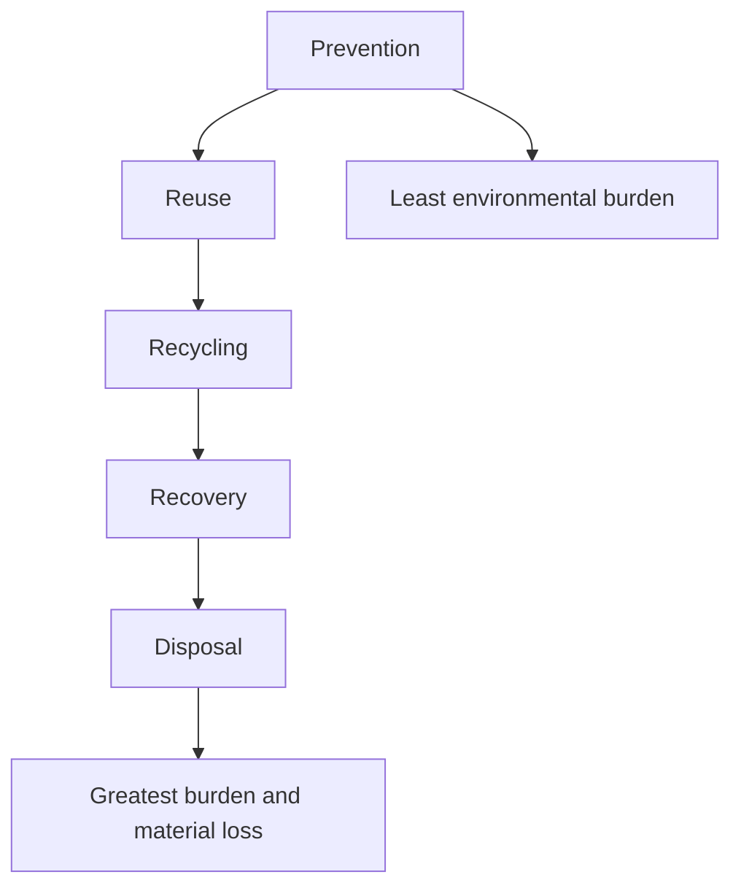
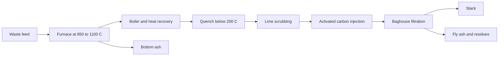
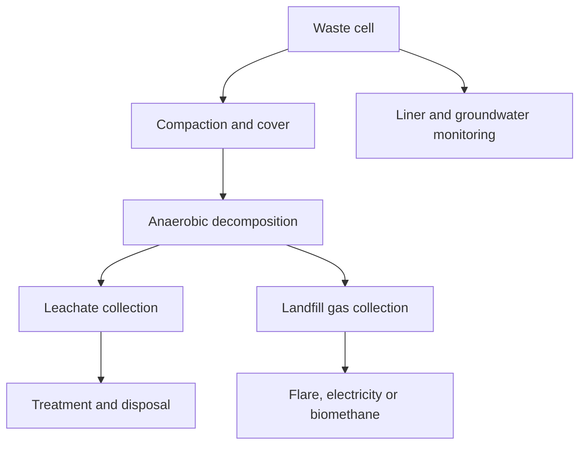

# Chapter 4 — Waste Treatment and Circular Chemistry

> **Level:** Level 9 — Environmental Chemistry (advanced undergraduate / waste-facing)
> **Estimated study time:** 6 hours (reading) + 2 hours (exercises)
> **Prerequisites:** [Thermochemistry and Enthalpy](../03-intermediate-chemistry/08-thermochemistry-and-enthalpy.md); [Chemical Equilibrium and Le Chatelier's Principle](../03-intermediate-chemistry/10-chemical-equilibrium-and-le-chateliers-principle.md); [Redox Reactions and Electrochemistry Fundamentals](../03-intermediate-chemistry/12-redox-reactions-and-electrochemistry-fundamentals.md); [Acid–Base Chemistry and pH](../03-intermediate-chemistry/11-acid-base-chemistry-and-ph.md)
> **Difficulty:** ★★★★☆ (4/5)
> **Related chapters:** [Green and Sustainable Chemistry](01-green-and-sustainable-chemistry.md), [Water Chemistry and Water Pollution](03-water-chemistry-and-pollution.md), [Corrosion](../10-materials-and-industrial-chemistry/05-corrosion.md)

---

## 1. Learning Objectives

After working through this chapter you will be able to:

- Classify waste by source, hazard and radioactivity.
- Apply the waste hierarchy and explain its limits.
- Calculate combustion stoichiometry, excess air and flue-gas composition.
- Explain dioxin formation and the engineering measures that suppress it.
- Describe leachate chemistry, landfill gas generation and methane capture.
- Compare composting and anaerobic digestion.
- Select chemical treatment methods for acids, oxidants, metals and cyanide.
- Explain chromium(VI) reduction and heavy-metal precipitation.
- Assess PFAS destruction options with honest uncertainty.
- Describe e-waste and precious-metal recovery.
- Classify radioactive waste and explain containment.
- Apply design-for-recycling and circular-economy principles.

---

## 2. Introduction

Waste is matter in the wrong place, at the wrong concentration, at the wrong
time. The chemistry of waste treatment is therefore the chemistry of separation,
destruction and stabilisation: separating valuable or hazardous components,
destroying harmful molecules, and stabilising residues so that they can be stored
safely.

The scale is enormous. Municipal solid waste generation is about two billion
tonnes per year globally, and construction, industrial and agricultural wastes
are larger still. Landfills and incinerators are the visible end of the system,
but the chemistry begins upstream: in product design, material choice and the
collection systems that determine whether a material can be recycled or must be
disposed of.

This chapter covers the main treatment routes and the chemistry behind them. It
treats incineration as a combustion problem with an air-pollution-control problem
attached, landfill as a biochemical reactor, and chemical treatment as a set of
selective reactions. It closes with the circular economy, because the most
effective waste treatment is a product that never becomes waste.

---

## 3. Fundamental Concepts

### 3.1 Waste classification

Waste is classified by source, composition and hazard.

| Class | Examples | Characteristic hazard |
|---|---|---|
| Municipal solid waste | Household refuse, packaging, food waste | Volume, leachate, methane |
| Industrial waste | Slags, sludges, spent catalysts, solvents | Metals, organics, acidity |
| Hazardous waste | Solvents, pesticides, cyanides, chromium(VI) | Toxicity, flammability, reactivity |
| Medical waste | Sharps, cultures, contaminated dressings | Pathogens, sharps |
| Radioactive waste | Reactor components, medical isotopes, mining residues | Ionising radiation |
| Electronic waste | Circuit boards, batteries, displays | Metals, flame retardants, batteries |

**Hazardous waste** is defined by characteristics: ignitability, corrosivity,
reactivity and toxicity. The definitions differ between jurisdictions, but the
underlying chemistry is the same: a waste is hazardous if it can cause harm
through a plausible exposure pathway.

### 3.2 The waste hierarchy

The **waste hierarchy** ranks options: prevention, reuse, recycling, recovery and
disposal. Prevention is best because it avoids the environmental burden entirely;
disposal is last because it loses material and energy value.

The hierarchy is a guide, not a law. Reuse may require transport that outweighs
the benefit; recycling may produce a lower-quality material; energy recovery may
be the best option for a contaminated mixed stream. The correct choice depends on
life-cycle assessment, not on the position in the hierarchy alone.

**Extended producer responsibility** makes manufacturers responsible for
end-of-life management, which creates an incentive for design for recycling.
**Pay-as-you-throw** schemes charge households by waste volume and increase
recycling rates.

### 3.3 Incineration chemistry

Incineration oxidises waste at high temperature, reducing volume by 80–90 % and
destroying organic contaminants. The stoichiometry is calculated from the ultimate
analysis: carbon, hydrogen, oxygen, sulfur, nitrogen, moisture and ash.

For complete combustion, the oxygen requirement per kilogram of waste is

$$
n_{\ce{O2}} = n_\ce{C} + \frac{n_\ce{H}}{4} + n_\ce{S} - \frac{n_\ce{O}}{2},
$$

where $n_i$ are molar amounts per kilogram. **Excess air** is supplied to ensure
complete combustion and mixing; typical values are 6–12 % for a well-designed
grate furnace.

The **three T's** of combustion are temperature, time and turbulence. Municipal
waste incinerators operate at 850–1100 °C with a gas residence time of at least
two seconds and good mixing. These conditions destroy most organic compounds but
do not guarantee destruction of every trace species.

### 3.4 Dioxins and air-pollution control

**Polychlorinated dibenzo-p-dioxins and dibenzofurans** (PCDD/F) are trace
by-products of combustion and of chlorine chemistry. They are persistent,
lipophilic and toxic, and they bioaccumulate. Toxicity is expressed as a **toxic
equivalent** (TEQ), using toxic equivalency factors relative to 2,3,7,8-TCDD.

Dioxins form by two routes. **Precursor route**: chlorinated aromatics such as
chlorophenols condense at 250–450 °C. **De novo synthesis**: carbon in fly ash
reacts with chlorine and oxygen over a copper or iron catalyst in the same
temperature window. The de novo route dominates in many incinerators.

Suppression measures include:

- **High-temperature combustion** with sufficient residence time.
- **Rapid quench** of flue gas through the 250–450 °C window.
- **Activated carbon injection** to adsorb dioxins and mercury.
- **Catalytic destruction** over SCR or dedicated oxidation catalysts.
- **Baghouse filtration** to remove fly ash before it can catalyse formation.
- **Feed control** to limit chlorine and copper.

Modern incinerators meet stringent dioxin limits, but the ash and filter residues
remain hazardous and require disposal.

### 3.5 Landfill chemistry

A landfill is a biochemical reactor. Waste is compacted and covered; moisture and
oxygen determine the rate and products of decomposition.

**Leachate** is the liquid that percolates through the waste. It contains dissolved
organic matter (high BOD and COD), ammonia, chloride, metals and trace organics.
Its composition changes over time: young leachate is acidic and high in volatile
fatty acids; mature leachate is neutral, high in ammonia and low in biodegradability.

**Landfill gas** is produced by anaerobic decomposition. It contains 50–60 %
methane, 35–40 % carbon dioxide and trace gases. Methane is a potent greenhouse
gas and a fire risk; it is collected, flared or used for energy. Capture efficiency
varies from 20 to 90 %, depending on cover, collection design and age.

The **methane generation potential** can be estimated from the biodegradable
carbon content using the Buswell equation for anaerobic conversion of organic
matter.

### 3.6 Composting and anaerobic digestion

**Composting** is aerobic decomposition of organic matter. Microorganisms consume
oxygen and release heat, water and CO₂. A well-run compost pile reaches 55–65 °C,
which sanitises pathogens and weed seeds. The key parameters are carbon-to-nitrogen
ratio (25–30:1), moisture (50–60 %), oxygen and particle size.

**Anaerobic digestion** decomposes organic matter in the absence of oxygen,
producing biogas (60–65 % methane, 35–40 % CO₂) and a digestate. It is used for
sewage sludge, food waste and manure. The process has four stages: hydrolysis,
acidogenesis, acetogenesis and methanogenesis. Methanogens are sensitive to pH,
temperature and ammonia; stable operation requires careful control.

Both processes divert organic waste from landfill, but they have different products
and different sensitivities. Composting is simple and low-cost; anaerobic digestion
captures energy and handles wetter feedstocks.

### 3.7 Chemical treatment methods

Chemical treatment converts hazardous waste into less hazardous or more stable
forms.

- **Neutralisation** adjusts pH with acid or base. It is used for acidic or
  alkaline waste streams and for leachate.
- **Oxidation** destroys organic matter and oxidises reduced species. Fenton's
  reagent (Fe²⁺ + H₂O₂) generates hydroxyl radicals; ozone, permanganate and
  hypochlorite are also used.
- **Precipitation** removes metals as hydroxides, sulfides or carbonates.
- **Reduction** converts toxic oxidised species to less mobile forms, notably
  Cr(VI) to Cr(III).
- **Encapsulation and stabilisation** immobilise contaminants in cement, glass or
  polymer matrices.
- **Supercritical water oxidation** destroys organics at above 374 °C and
  22.1 MPa, where water becomes a non-polar solvent and oxidant mixture.

### 3.8 Hazardous waste: metals, cyanide and PFAS

**Heavy metals** are removed by precipitation. Hydroxide precipitation is
pH-dependent: each metal has a minimum solubility at a characteristic pH, and
amphoteric metals such as zinc and lead redissolve at high pH. Sulfide
precipitation is more selective and produces very low residual concentrations.

**Cyanide** is treated by alkaline chlorination:

$$
\ce{CN^-(aq) + Cl2(aq) + 2OH^-(aq) -> CNO^-(aq) + 2Cl^-(aq) + H2O(l)},
$$

followed by hydrolysis of cyanate to ammonia and carbonate. Alternative methods
include ozonation and biological treatment.

**Chromium(VI)** is toxic and mobile; it is reduced to Cr(III), which precipitates
as hydroxide. Reducing agents include ferrous sulfate, sodium metabisulfite and
sulfur dioxide.

**PFAS** are resistant to all conventional treatment. Adsorption and ion exchange
transfer them to a concentrate; destruction requires high-energy processes, and
the performance of incineration is uncertain. This is a case where the honest
answer is that the waste problem is not fully solved.

---

## 4. Detailed Scientific Explanation

### 4.1 The incineration plant and its air-pollution-control train

A municipal waste incinerator has a receiving and feeding system, a grate or
fluidised-bed furnace, a boiler for heat recovery, and an air-pollution-control
(APC) train. The furnace operates at 850–1100 °C with preheated air and a residence
time of at least two seconds.

The APC train typically includes: a **quench** or economiser to cool the gas
rapidly; **dry or semi-dry scrubbing** with lime to neutralise acid gases; **activated
carbon injection** for dioxins, mercury and volatile metals; **baghouse filtration**
to remove fly ash and reacted sorbents; and sometimes a **wet scrubber** for
residual acid gases. **SCR** may be added for NOx and dioxin destruction.

**Bottom ash** is the material that falls from the grate; it is about 20–25 % of
the input mass and can be used as aggregate after treatment. **Fly ash** is the
fine particulate captured by the baghouse; it contains heavy metals, dioxins and
soluble salts and is classified as hazardous in many jurisdictions.

Energy recovery is significant: a modern plant exports electricity and district
heat, and the energy balance can be favourable if the waste has sufficient calorific
value. The **lower heating value** of municipal waste is typically 8–12 MJ kg⁻¹,
depending on moisture and plastics content.

### 4.2 Dioxin formation and suppression

Dioxin formation is a surface-catalysed reaction. Fly ash particles provide carbon,
chlorine, oxygen and catalytic metals (copper and iron), and the temperature window
of 250–450 °C is where the reaction is fastest. The **de novo** route is often
dominant in the cooler parts of the plant, especially in the boiler and the
dust-collection system.

The engineering response is to avoid the window or to remove the reactants. Rapid
quenching from above 450 °C to below 200 °C limits the residence time in the
window. Activated carbon injection adsorbs dioxins and mercury before the baghouse.
Catalytic oxidation over SCR destroys dioxins at 200–300 °C. Good combustion
reduces the carbon content of the fly ash, which reduces the precursor supply.

Dioxin emissions are expressed as **TEQ** using the 2005 WHO toxic equivalency
factors. 2,3,7,8-TCDD is assigned a TEF of 1; other congeners range from 0.0001
to 1. A TEQ is the sum of concentration times TEF, and it is the basis of
regulatory limits.

### 4.3 Landfill design, leachate and gas

A modern landfill is engineered with a **liner** (compacted clay and/or geomembrane),
a **leachate collection system**, a **gas collection system**, and a **cap** after
closure. The liner prevents groundwater contamination; the leachate system
removes liquid; the gas system captures methane.

Leachate treatment is difficult because the composition changes with age.
Biological treatment removes BOD but not ammonia or recalcitrant organics; reverse
osmosis concentrates the salts and requires concentrate management; advanced
oxidation can polish the effluent. Many landfills recirculate leachate to enhance
decomposition and reduce volume, but this can increase ammonia and salinity.

Landfill gas production follows four phases: aerobic decomposition, acidogenesis,
acetogenesis and methanogenesis. Methane generation begins after a few months and
peaks after several years; the total yield depends on the biodegradable carbon
content. Collection efficiency is limited by cover, gas permeability and the
network design; a significant fraction of methane can escape even from well-run
sites.

Methane capture is important because methane has a GWP100 about 28 times that of
CO₂. Flaring converts methane to CO₂ and reduces the climate impact, but it
wastes the energy; electricity generation or upgrading to biomethane captures more
value.

### 4.4 Advanced oxidation and supercritical water oxidation

**Advanced oxidation processes** generate hydroxyl radicals, which react rapidly
and non-selectively with organic compounds. Fenton's reagent, ozone/UV,
ozone/H₂O₂ and photocatalytic TiO₂ are common. They are used for recalcitrant
organics, pharmaceuticals and trace contaminants.

**Supercritical water oxidation** operates above the critical point of water
(374 °C, 22.1 MPa), where water has low polarity and high diffusivity. Organic
compounds and oxygen mix completely, and oxidation is fast and complete. The
process destroys PFAS and other recalcitrant organics, but it is capital-intensive,
corrosion is severe, and salts can precipitate and foul the reactor. The pressure
and temperature require engineered containment and trained operators; this is not
a laboratory procedure.

**Wet air oxidation** is a milder alternative at 150–320 °C and 2–20 MPa; it is
used for sludges and spent caustic. **Plasma** and **sonolysis** are emerging
options for PFAS, with high energy demand and limited scale.

### 4.5 Electronic waste and precious-metal recovery

Electronic waste contains valuable metals (copper, gold, silver, palladium, rare
earths) and hazardous substances (lead, mercury, cadmium, brominated flame
retardants, batteries). The concentration of gold in circuit boards can be higher
than in primary ore.

**Mechanical processing** shreds, screens and separates by density, magnetism and
electrostatics. **Pyrometallurgy** smelts the concentrate and recovers copper and
precious metals; plastics and flame retardants are burned or form slag.
**Hydrometallurgy** leaches with cyanide, aqua regia, thiosulfate or thiourea and
recovers metals by precipitation, solvent extraction or electrowinning.

Informal recycling uses open burning and acid leaching, releasing dioxins, lead
and acids. The environmental and health burden falls on the workers and
communities, which is why formal collection and certification matter.

### 4.6 Radioactive waste

Radioactive waste is classified by activity and half-life: exempt or very low
level, low level, intermediate level and high level. High-level waste includes
spent fuel and the vitrified product from reprocessing; it contains fission
products and actinides with half-lives from decades to millions of years.

**Containment** is multi-barrier: immobilise the waste in a stable matrix
(borosilicate glass for high-level waste, cement for intermediate-level waste),
encapsulate it in a corrosion-resistant canister, surround it with a buffer
(bentonite) and place it in a stable geological formation. The concept is to
isolate the waste from the biosphere for the time needed for radioactivity to
decay.

**Reprocessing** separates uranium and plutonium from fission products, reducing
the volume and toxicity of the waste but creating proliferation concerns.
**Partitioning and transmutation** aims to convert long-lived actinides into
shorter-lived isotopes, but it requires fast reactors and is not deployed at scale.

### 4.7 Circular economy and design for recycling

The circular economy is a design framework: keep materials in use, design out
waste and pollution, and regenerate natural systems. For chemistry, it means
designing products and processes so that materials can be recovered without
excessive energy or quality loss.

**Design for recycling** includes mono-material construction, reversible
fasteners, standard formats, labelling of polymers and additives, and avoidance
of hazardous substances. It also means designing for disassembly, because a
product that cannot be opened cannot be repaired or recycled economically.

**Chemical recycling** can handle mixed or contaminated streams that mechanical
recycling cannot, but it is energy-intensive and not universally applicable.
**Industrial symbiosis** exchanges materials and energy between firms, as in
Kalundborg.

The limits are thermodynamic and economic. Recycling always consumes energy, and
some materials are dissipated beyond recovery. The realistic goal is to maximise
the fraction of material that remains in useful circulation, not to achieve a
perfect loop.

### 4.8 Monitoring, standards and performance

Waste treatment is regulated through emission limits, effluent limits and
acceptance criteria. Incinerators monitor CO, NOx, SO₂, HCl, dust, dioxins and
heavy metals; landfills monitor leachate, groundwater and gas; hazardous-waste
facilities monitor influent and effluent concentrations.

**Performance testing** includes stack testing, continuous emission monitoring,
leachate toxicity tests and landfill gas yield. **Mass balances** are essential:
a treatment train that concentrates a contaminant in a residue has not destroyed
it, and the fate of that residue must be documented.

Standards include the EU Waste Framework Directive and Industrial Emissions
Directive, the US Resource Conservation and Recovery Act (RCRA), and the Basel
Convention on transboundary movements of hazardous waste. The details differ, but
the principles are common: prevent, control, monitor and account for residues.

---

## 5. Visual Diagrams

**Figure 4.1 — The waste hierarchy.** The order is a default, not an absolute rule.
Each option must be assessed on its life-cycle performance; reuse with long
transport or recycling with high energy can be worse than a well-controlled
recovery route.

**Figure 4.2 — Incineration and air-pollution control.** The order of the train
matters: quenching removes the dioxin-forming temperature window, lime neutralises
acid gases, carbon adsorbs trace organics and mercury, and the baghouse removes
the particles that carry metals and dioxins.

**Figure 4.3 — Landfill as a contained biochemical reactor.** The liner, leachate
collection and gas collection are the three engineered barriers. Their performance
determines whether the landfill is a controlled reactor or a long-term source of
groundwater contamination and methane emissions.

---

## 6. Mathematical Formulas

The stoichiometric oxygen demand per kilogram of waste is

$$
n_{\ce{O2}} = n_\ce{C} + \frac{n_\ce{H}}{4} + n_\ce{S} - \frac{n_\ce{O}}{2},
$$

and the excess air ratio is

$$
\lambda = \frac{\text{air supplied}}{\text{air stoichiometric}}.
$$

The toxic equivalent and the lime requirement are

$$
\mathrm{TEQ} = \sum_i c_i\,\mathrm{TEF}_i,
\qquad
m_{\ce{Ca(OH)2}} = \frac{n_{\ce{H+}}}{2}M_{\ce{Ca(OH)2}}.
$$

The Buswell equation for anaerobic conversion of an organic substrate
$\ce{C_aH_bO_c}$ is

$$
\ce{C_{a}H_{b}O_{c}} + \left(a-\frac{b}{4}-\frac{c}{2}\right)\ce{H2O}
-> \left(\frac{a}{2}+\frac{b}{8}-\frac{c}{4}\right)\ce{CH4}
+ \left(\frac{a}{2}-\frac{b}{8}+\frac{c}{4}\right)\ce{CO2}.
$$

| Symbol | Meaning | SI unit |
|---|---|---|
| $n_{\ce{O2}}$ | Oxygen demand per mass of waste | mol kg⁻¹ |
| $n_\ce{C}$, $n_\ce{H}$, $n_\ce{S}$, $n_\ce{O}$ | Molar amounts per mass | mol kg⁻¹ |
| $\lambda$ | Excess air ratio | 1 |
| $\mathrm{TEQ}$ | Toxic equivalent | ng g⁻¹ or pg g⁻¹ |
| $c_i$ | Concentration of congener $i$ | ng g⁻¹ |
| $\mathrm{TEF}_i$ | Toxic equivalency factor | 1 |
| $m_{\ce{Ca(OH)2}}$ | Lime mass | kg |
| $n_{\ce{H+}}$ | Acid equivalents | mol |
| $M_{\ce{Ca(OH)2}}$ | Molar mass of lime | kg mol⁻¹ |

The Buswell equation assumes complete anaerobic conversion and no nutrient
limitation. Real landfills and digesters produce less gas because some carbon is
incorporated into biomass and some remains recalcitrant.

---

## 7. Chemical Equations

Complete combustion of a model waste, illustrated with glucose:

$$
\ce{C6H12O6(s) + 6O2(g) -> 6CO2(g) + 6H2O(l)}
$$

For a general formula $\ce{C_{a}H_{b}O_{c}}$, the oxygen coefficient is
$a + b/4 - c/2$.

Sulfur and nitrogen oxidation:

$$
\ce{S(s) + O2(g) -> SO2(g)}, \qquad
\ce{N2(g) + O2(g) -> 2NO(g)}
$$

Lime scrubbing of acid gases:

$$
\ce{Ca(OH)2(s) + SO2(g) -> CaSO3(s) + H2O(l)}, \qquad
\ce{Ca(OH)2(s) + 2HCl(g) -> CaCl2(aq) + 2H2O(l)}
$$

Cyanide destruction by alkaline chlorination:

$$
\ce{CN^-(aq) + Cl2(aq) + 2OH^-(aq) -> CNO^-(aq) + 2Cl^-(aq) + H2O(l)}
$$

Chromium(VI) reduction with ferrous sulfate:

$$
\ce{Cr2O7^{2-}(aq) + 6Fe^{2+}(aq) + 14H^+(aq) -> 2Cr^{3+}(aq) + 6Fe^{3+}(aq) + 7H2O(l)}
$$

Precipitation of chromium(III) hydroxide:

$$
\ce{Cr^{3+}(aq) + 3OH^-(aq) -> Cr(OH)3(s)}
$$

Anaerobic digestion of glucose:

$$
\ce{C6H12O6(s) -> 3CH4(g) + 3CO2(g)}
$$

The equations show the stoichiometric basis of treatment. Real wastes are mixtures,
and side reactions, mass transfer and kinetics determine the actual performance.

---

## 8. Worked Examples

### Worked Example 8.1 — Incineration stoichiometry and flue gas

**Problem.** A waste has the ultimate analysis (as received) C 40 %, H 5 %,
O 20 %, S 1 %, N 1 %, ash 8 %, moisture 25 %. Calculate (a) the stoichiometric
oxygen demand per kg, (b) the air required at 8 % excess, and (c) the CO₂
concentration in the dry flue gas.

**Strategy.** Convert mass percentages to moles per 100 g, apply the oxygen
balance, then add excess air and compute the flue-gas composition.

**Solution.** Per 100 g: C 3.331 mol, H 4.960 mol, O 1.250 mol, S 0.0312 mol,
N 0.0714 mol, water 1.388 mol. Oxygen demand
$= 3.331 + 4.960/4 + 0.0312 - 1.250/2 = 3.977$ mol per 100 g, or
39.77 mol kg⁻¹. Air stoichiometric $= 39.77/0.21 = 189.4$ mol kg⁻¹
$= 5.49$ kg kg⁻¹; at 8 % excess, 5.92 kg kg⁻¹. The dry flue gas contains
CO₂ 33.30 mol, SO₂ 0.312 mol, N₂ 162.3 mol and excess O₂ 3.18 mol, total
199.1 mol, so CO₂ is 16.7 % by volume.

**Check.** The CO₂ concentration is typical of municipal waste incineration, and
the air requirement is about 6 kg per kg of waste. The calculation assumes complete
combustion; CO in the flue gas would indicate incomplete mixing or insufficient
residence time.

### Worked Example 8.2 — Lime requirement for leachate neutralisation

**Problem.** A leachate has a strong-acid content equivalent to
$0.050\ \text{mol L}^{-1}$ of H⁺. Calculate the mass of $\ce{Ca(OH)2}$ needed to
neutralise 200 m³, with 10 % excess.

**Strategy.** Calculate acid equivalents, divide by two (two H⁺ per Ca(OH)₂), and
multiply by the molar mass.

**Solution.** Acid equivalents $= 200 \times 10^{3} \times 0.050 = 10\,000$ mol.
Lime $= 10\,000/2 = 5000$ mol $\times 74.09\ \text{g mol}^{-1} = 370$ kg; with
10 % excess, 407 kg.

**Check.** The dose is about 2 g L⁻¹, plausible for an acidic leachate. Real
leachate contains weak acids and metals that consume lime, so the actual dose is
usually higher and is determined by titration to a target pH.

### Worked Example 8.3 — Methane potential of organic waste

**Problem.** Using the Buswell equation, calculate the methane yield from 1 kg of
cellulose ($\ce{C6H10O5}$, $M = 162.14\ \text{g mol}^{-1}$) at STP.

**Strategy.** Balance the reaction, find moles of CH₄ per mole of cellulose, then
convert to volume at 0 °C and 1 atm (22.414 L mol⁻¹).

**Solution.** For $\ce{C6H10O5}$: $a = 6$, $b = 10$, $c = 5$. Water term
$= 6 - 10/4 - 5/2 = 1.5$; CH₄ $= 3 + 10/8 - 5/4 = 3.25$; CO₂
$= 3 - 10/8 + 5/4 = 2.75$. Thus
$\ce{C6H10O5 + 1.5H2O -> 3.25CH4 + 2.75CO2}$. Moles of cellulose in 1 kg
$= 6.167$ mol, so CH₄ $= 20.04$ mol $= 0.449\ \text{m}^3$ at STP (449 L).

**Check.** The theoretical yield is about 0.45 m³ CH₄ per kg of dry cellulose.
Real landfill yields are lower, typically 0.1–0.2 m³ kg⁻¹ of wet waste, because
not all carbon is biodegradable and some is lost as leachate or biomass.

### Worked Example 8.4 — Chromium(VI) reduction

**Problem.** A waste stream contains 50 mg L⁻¹ of Cr(VI) in 1000 L. Calculate the
mass of $\ce{FeSO4.7H2O}$ needed for complete reduction, using the stoichiometry
of the dichromate reaction.

**Strategy.** Convert Cr(VI) to moles, use 3 mol Fe²⁺ per mol Cr(VI), then multiply
by the molar mass of the heptahydrate.

**Solution.** Cr(VI) mass $= 50\ \text{g}$; moles $= 50/52.00 = 0.962$ mol.
Fe²⁺ needed $= 3 \times 0.962 = 2.885$ mol. Mass of
$\ce{FeSO4.7H2O}$ ($M = 278.01$) $= 2.885 \times 278.01 = 802$ g.

**Check.** The dose is about 0.8 g L⁻¹, consistent with practice. The pH must be
kept acidic for the reduction and then raised to precipitate Cr(OH)₃; the sludge
is hazardous and must be disposed of properly.

### Worked Example 8.5 — Toxic equivalent of a dioxin mixture

**Problem.** A fly-ash extract contains 2.0 ng g⁻¹ of 2,3,7,8-TCDD (TEF 1.0),
5.0 ng g⁻¹ of 2,3,4,7,8-PeCDF (TEF 0.3), 10 ng g⁻¹ of 2,3,7,8-TCDF (TEF 0.1) and
8.0 ng g⁻¹ of 1,2,3,4,7,8-HxCDF (TEF 0.1). Calculate the TEQ.

**Strategy.** Sum concentration times TEF.

**Solution.** $2.0(1.0) + 5.0(0.3) + 10(0.1) + 8.0(0.1) = 2.0 + 1.5 + 1.0 + 0.8
= 5.3$ ng TEQ g⁻¹.

**Check.** The TEQ is dominated by the two most toxic congeners, even though the
TCDF is present at the highest concentration. This is why congener-specific
analysis is required; a total dioxin mass would give a misleading picture.

---

## 9. Real-World Applications

Municipal waste management combines collection, sorting, recycling, composting,
incineration and landfill. The mix varies widely: some countries landfill most of
their waste, while others recycle more than half and incinerate the remainder with
energy recovery.

Hazardous-waste facilities treat industrial solvents, plating sludges, contaminated
soil and obsolete chemicals. Medical waste is incinerated or autoclaved, and sharps
are segregated. Radioactive waste is stored or disposed of in engineered facilities,
with geological disposal for the most hazardous categories.

Electronic waste is a fast-growing stream. Formal recycling recovers copper, gold,
silver, palladium and aluminium; informal recycling causes severe local pollution.
The circular economy agenda is strongest where material value is high and
collection infrastructure exists.

---

## 10. Common Mistakes

| Mistake | Why it happens | Correct approach |
|---|---|---|
| Treating incineration as "destruction" of all hazards | Ash and flue gas transfer contaminants | Account for bottom ash, fly ash and APC residues |
| Ignoring excess air in stoichiometry | Complete combustion needs more than stoichiometric O₂ | State the excess air ratio and flue-gas O₂ |
| Assuming dioxins form only in the furnace | De novo synthesis occurs in the cooler train | Design the quench and APC to avoid the 250–450 °C window |
| Using total dioxin mass instead of TEQ | Congeners differ in toxicity by orders of magnitude | Report congener concentrations and TEQ |
| Treating leachate as constant | Composition changes with landfill age | Characterise and adapt treatment |
| Assuming landfill gas capture is complete | Collection efficiency is limited | Report capture efficiency and residual emissions |
| Calling adsorption "destruction" | Carbon and ion exchange transfer contaminants | Specify the fate of the loaded medium |
| Assuming all recycling is beneficial | Transport and processing have impacts | Use LCA and report product quality |

---

## 11. Chapter Summary

- Waste is classified by source, composition and hazard; the classification drives
  treatment and regulation.
- The waste hierarchy is a default, not a law; life-cycle assessment decides.
- Incineration requires stoichiometric oxygen, excess air, temperature, time and
  turbulence.
- Dioxins form by precursor and de novo routes; quench, carbon injection and
  filtration suppress them.
- Landfill is a biochemical reactor; leachate and methane must be managed.
- Composting and anaerobic digestion divert organics and produce soil amendment or
  biogas.
- Chemical treatment neutralises, oxidises, precipitates, reduces or encapsulates.
- PFAS are transferred, not destroyed, by conventional treatment.
- E-waste recovery is valuable but hazardous if informal.
- Radioactive waste requires multi-barrier containment.
- Circular design is the most effective waste treatment.

---

## 12. Exercises

### 12.1 Conceptual questions

1. Why is the waste hierarchy not an absolute ranking?
2. Why does dioxin formation peak at 250–450 °C?
3. Why is leachate composition age-dependent?

### 12.2 Basic problems

4. A waste contains 30 % C, 4 % H, 15 % O and 1 % S. Calculate the stoichiometric
   oxygen demand per 100 g.
5. A landfill gas contains 55 % CH₄ and 45 % CO₂. Calculate the methane mass
   fraction.
6. A leachate contains 0.020 mol L⁻¹ H⁺. Calculate the lime dose for 100 m³,
   ignoring excess.

### 12.3 Intermediate problems

7. Calculate the air required per kg of waste for Example 8.1 at 12 % excess.
8. A waste contains 200 mg L⁻¹ CN⁻ in 500 L. Calculate the chlorine demand for
   alkaline chlorination, assuming 1 mol Cl₂ per mol CN⁻.
9. Explain why chromium(VI) reduction requires acidic conditions followed by
   alkaline precipitation.

### 12.4 Advanced problems

10. Estimate the TEQ of a mixture with 1 ng g⁻¹ TCDD, 4 ng g⁻¹ PeCDF (TEF 0.3),
    20 ng g⁻¹ TCDF (TEF 0.1) and 10 ng g⁻¹ HxCDF (TEF 0.1).
11. A landfill receives 100 000 t yr⁻¹ of waste with 30 % biodegradable carbon.
    Estimate the maximum methane potential and discuss the recovery factor.
12. Propose a treatment train for a mixed stream of spent solvents, aqueous
    cyanide and chromium(VI) plating rinse, and justify the order of operations.

### Answers

1. Reuse, recycling and recovery have different costs and impacts; the best option
   depends on the specific material, distance and market.
2. It is the temperature window where carbon, chlorine, oxygen and catalytic metals
   react fastest on fly-ash surfaces; above it, destruction dominates.
3. Young leachate is acidic and high in volatile fatty acids; mature leachate is
   neutral, high in ammonia and low in biodegradable organics.
4. $n_\ce{C} = 2.50$, $n_\ce{H} = 3.97$, $n_\ce{O} = 0.938$, $n_\ce{S} = 0.031$;
   O₂ $= 2.50 + 0.992 + 0.031 - 0.469 = 3.05$ mol per 100 g.
5. Mass ratio $= 0.55(16.04)/[0.55(16.04)+0.45(44.01)] = 8.82/28.62 = 0.308$.
6. $0.020 \times 100\,000 = 2000$ mol H⁺; lime $= 1000$ mol $\times 74.09$ g
   $= 74.1$ kg.
7. $189.4 \times 1.12 = 212.1$ mol air per kg $= 6.15$ kg kg⁻¹.
8. CN⁻ $= 0.100$ mol; Cl₂ $= 0.100$ mol $= 7.09$ g.
9. Reduction is fast in acid; the subsequent pH rise precipitates Cr(OH)₃ and
   removes it from solution.
10. $1 + 1.2 + 2 + 1 = 5.2$ ng TEQ g⁻¹.
11. 30 000 t C; using cellulose stoichiometry, about $0.45\ \text{m}^3$ CH₄ per kg
    dry organic matter, so roughly $1.35\times10^{7}\ \text{m}^3$; recovery is
    typically 30–60 %.
12. Segregate the streams; oxidise cyanide under alkaline conditions; reduce Cr(VI)
    under acidic conditions; neutralise and precipitate metals; polish by carbon
    or advanced oxidation; dispose of sludge as hazardous waste.

---

## 13. Further Reading

- Manahan, S. E. *Environmental Chemistry*, 11th ed., CRC Press, 2017.
- Tchobanoglous, G., Theisen, H. and Vigil, S. A. *Integrated Solid Waste
  Management*, McGraw-Hill, 1993.
- European Commission. *Waste Framework Directive* and *Industrial Emissions
  Directive*. <https://environment.ec.europa.eu/>
- US EPA. *Resource Conservation and Recovery Act (RCRA)*.
  <https://www.epa.gov/rcra>
- Basel Convention. *Control of Transboundary Movements of Hazardous Wastes and
  their Disposal*. <https://www.basel.int/>
- IAEA. *Classification of Radioactive Waste*, IAEA Safety Standards Series.
  <https://www.iaea.org/>
- Ellen MacArthur Foundation. *Circular Economy* resources.
  <https://ellenmacarthurfoundation.org/>

See [CURRICULUM.md](../CURRICULUM.md), [GLOSSARY.md](../GLOSSARY.md) and
[REFERENCES.md](../REFERENCES.md).

