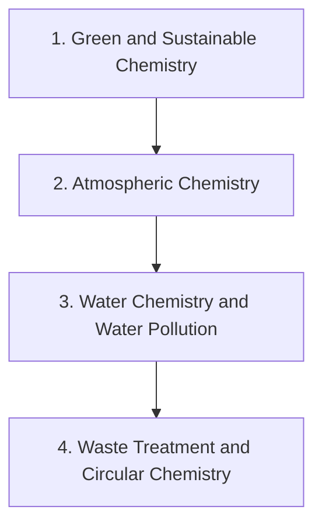

# Level 9b — Environmental Chemistry

> **Audience:** Applied / environmental chemistry  
> **Chapters:** 4  
> **Estimated study time:** ≈ 28 h  
> **Difficulty:** ★★★★☆ – ★★★★★

Green chemistry principles, atmospheric chemistry and air pollution, natural and contaminated waters, and waste treatment.

Environmental chemistry applies kinetics, thermodynamics and analysis to the atmosphere, natural waters and waste streams. It also introduces green chemistry — designing processes so that the waste problem never arises.

---

## Chapters

| # | Chapter | Difficulty | Hours | Prerequisites |
|---|---|---|---|---|
| 1 | [Green and Sustainable Chemistry](01-green-and-sustainable-chemistry.md) | ★★★★☆ | 6 | Level 4 Ch. 1–8 |
| 2 | [Atmospheric Chemistry](02-atmospheric-chemistry.md) | ★★★★★ | 8 | Level 6 Ch. 5, 7 |
| 3 | [Water Chemistry and Water Pollution](03-water-chemistry-and-pollution.md) | ★★★★☆ | 8 | Level 2 Ch. 11, 13; Level 7 Ch. 8 |
| 4 | [Waste Treatment and Circular Chemistry](04-waste-treatment.md) | ★★★★☆ | 6 | Ch. 1–3 |

---

## Knowledge map

The chain is the *recommended* order. Chapters that share prerequisites can be
read out of order; the table above tells you what each one actually needs.

---

## Study routine for this level

1. Read the chapter once without taking notes, to see the shape of the argument.
2. Re-read with the chapter's learning objectives in front of you and answer them in writing.
3. Reproduce every Mermaid diagram from memory, then check it.
4. Do the exercises **before** opening the solutions file.
5. Record every mistake in a log; re-test yourself on those specific items a week later.

---

## Practice

- Exercise set: [`exercises/level-9b-environmental-exercises.md`](exercises/level-9b-environmental-exercises.md)
- Worked solutions: [`solutions/level-9b-environmental-solutions.md`](solutions/level-9b-environmental-solutions.md)

---

## Navigation

- Level index: [CURRICULUM.md](../CURRICULUM.md)
- Study methods: [00-learning-guide](../00-learning-guide/learning-path.md)
- Terminology: [GLOSSARY.md](../GLOSSARY.md)
- Sources: [REFERENCES.md](../REFERENCES.md)
