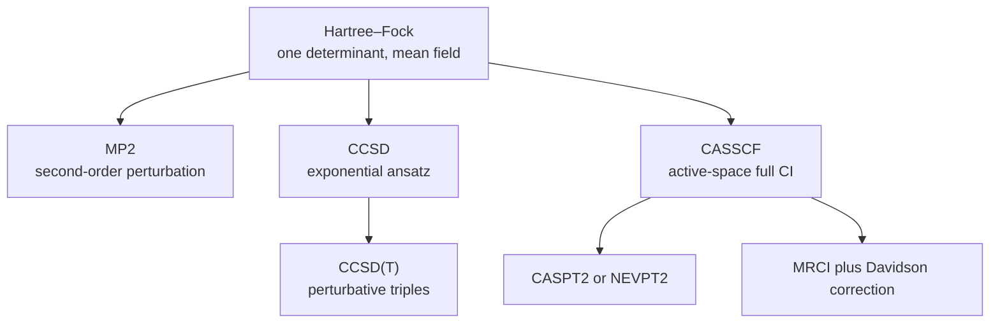
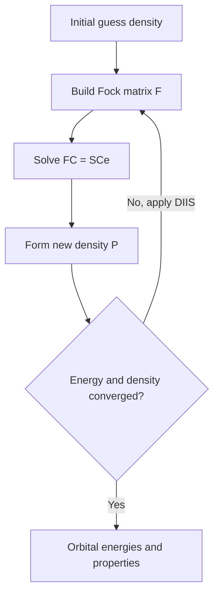
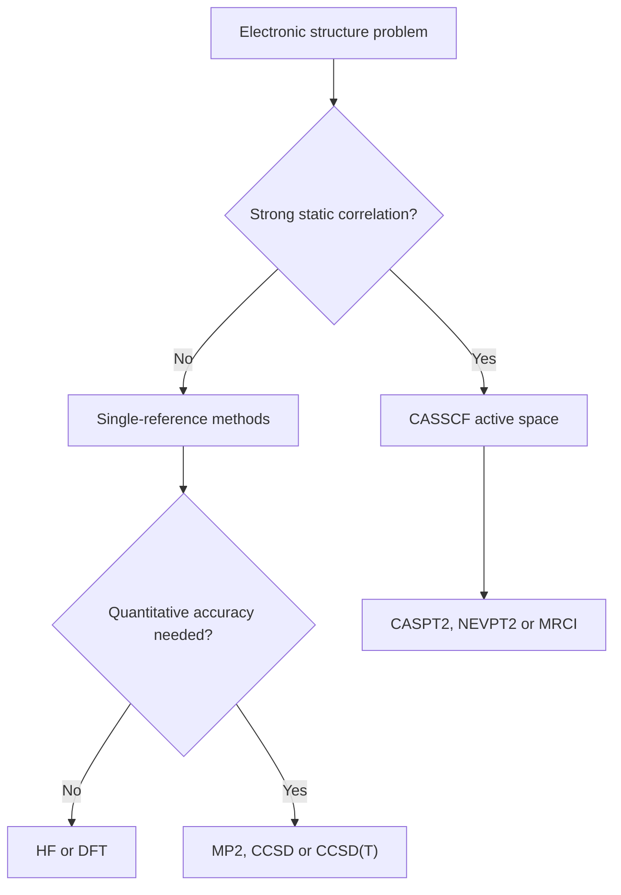

# Chapter 1 — Advanced Quantum Chemistry

> **Level:** Research (Level 10 — Postgraduate and research)
> **Estimated study time:** 12 hours (8 h reading + 4 h exercises)
> **Prerequisites:** [Quantum Mechanics Foundations](../04-advanced-chemistry/01-quantum-mechanics-foundations.md); [Atomic Orbitals and Quantum Numbers](../04-advanced-chemistry/02-atomic-orbitals-and-quantum-numbers.md); [Molecular Orbital Theory](../04-advanced-chemistry/03-molecular-orbital-theory.md); linear algebra
> **Related chapters:** [Computational Chemistry and Density Functional Theory](02-computational-chemistry-and-density-functional-theory.md), [Molecular Dynamics](03-molecular-dynamics.md), [Level 10 index](README.md)
> **Difficulty:** ★★★★★ (5/5)

---

## 1. Learning Objectives

After working through this chapter you will be able to:

- State the postulates of quantum mechanics in Dirac notation and identify which
  postulate underlies each step of a molecular calculation.
- Obtain the angular momentum spectrum algebraically from the commutators, and
  construct the ladder operators and their normalisation.
- Write and use the Pauli matrices, and explain why spin has no classical analogue.
- Couple two angular momenta, enumerate the allowed total-$J$ values, and apply
  Clebsch–Gordan coefficients to $p^{1}$ and to two spin-$\tfrac12$ particles.
- Build a Slater determinant, prove its antisymmetry, and evaluate Hamiltonian
  matrix elements with the Slater–Condon rules.
- Derive the Hartree–Fock energy expression and the Fock operator from the
  variational principle with orthonormality constraints.
- Write the Roothaan–Hall equations and classify basis sets by family and quality.
- Distinguish dynamic from static correlation, and choose between MP2, CCSD(T),
  CASSCF and MRCI for a stated problem.
- Quote the cost scaling of HF, MP2, CCSD, CCSD(T) and full CI, and use it to judge
  whether a proposed calculation is feasible.
- Describe relativistic effects, excited-state methods and solvation models well
  enough to read a computational paper critically.

---

## 2. Introduction

Almost every quantitative number in modern chemistry comes from an approximate
solution of the molecular Schrödinger equation. A barrier height, a computed NMR
shift, a predicted colour, a binding free energy or a catalytic cycle rests on such
a calculation, and the approximation determines whether the number is trustworthy
to $1\ \mathrm{kJ\,mol^{-1}}$ or only to $20\ \mathrm{kJ\,mol^{-1}}$.

The central derivation is the Hartree–Fock energy expression, the reference point
for everything that follows: correlation energy is defined relative to it, coupled
cluster is built on its orbitals, and density functional theory reproduces its
structure with an approximate exchange–correlation term. The derivation is given in
full because the step producing the Fock operator is the one most often memorised.

---

## 3. Fundamental Concepts

### 3.1 State vectors, Hilbert space and Dirac notation

A quantum state is a vector $|\psi\rangle$ in a complex vector space with an inner
product. Dirac notation writes the vector as a **ket** and the corresponding linear
functional as a **bra** $\langle\psi|$; their bracket $\langle\phi|\psi\rangle$ is a
complex number, while $|\psi\rangle\langle\phi|$ is an operator.

The space is a **Hilbert space**: a complete inner-product space, meaning every
Cauchy sequence converges to a vector inside it. Completeness guarantees that
spectral expansions converge and that eigenfunctions of a Hermitian operator form a
basis. For molecular electronic structure the space is the antisymmetric subspace of
$L^{2}(\mathbb{R}^{3N})\otimes\mathbb{C}^{2N}$.

Three operations recur. **Normalisation** sets $\langle\psi|\psi\rangle = 1$.
**Orthogonality** sets $\langle\phi|\psi\rangle = 0$ for distinguishable states.
**Completeness** of an orthonormal basis gives the resolution of the identity,
$$
\sum_n |n\rangle\langle n| = \hat{1},
$$
which is the standard route from abstract algebra to a matrix representation. A
state is defined only up to a phase, since $|\psi\rangle$ and $e^{i\theta}|\psi\rangle$
give identical probabilities; the physical object is therefore a *ray*.

### 3.2 The postulates

The postulates are axioms; they are not derived, and every later result is a
consequence of them.

**P1 (state).** An isolated system is described by a normalised vector
$|\psi\rangle \in \mathcal{H}$, and superpositions $c_1|\psi_1\rangle+c_2|\psi_2\rangle$
are also states.

**P2 (observables).** Every measurable quantity corresponds to a Hermitian operator
$\hat{A}$. Its eigenvalues are real, eigenvectors of distinct eigenvalues are
orthogonal, and its eigenvectors span $\mathcal{H}$.

**P3 (measurement).** The possible outcomes of measuring $A$ are the eigenvalues
$a_n$. For a non-degenerate eigenvalue the probability is
$P_n = |\langle a_n|\psi\rangle|^{2}$; in general $P_n = \langle\psi|\hat{P}_n|\psi\rangle$
with $\hat{P}_n$ the projector onto the eigenspace. Immediately after the
measurement the state is the projected state.

**P4 (dynamics).** Between measurements,
$$
i\hbar\frac{\partial}{\partial t}|\psi(t)\rangle = \hat{H}|\psi(t)\rangle,
\qquad |\psi(t)\rangle = e^{-i\hat{H}t/\hbar}|\psi(0)\rangle .
$$

**P5 (composite systems and statistics).** The space of a composite system is the
tensor product $\mathcal{H}_1\otimes\mathcal{H}_2$. Identical fermions require total
antisymmetry under exchange of any pair; identical bosons require symmetry.

**P6 (spin).** Particles carry intrinsic angular momentum fixed by species. For the
electron $s=\tfrac12$, and the state carries a two-dimensional spin factor.

Two clarifications prevent persistent confusion. First, P3 concerns the statistics
of repeated measurements on identically prepared systems; it asserts no mechanism of
collapse. Second, P5 is a symmetry constraint on admissible states, not a force. The
"exchange interaction" of Hartree–Fock is an energy consequence of antisymmetry, not
a new physical interaction.

### 3.3 Operators, commutators and uncertainty

An operator is a linear map on $\mathcal{H}$. Its adjoint satisfies
$\langle\phi|\hat{A}\psi\rangle = \langle\hat{A}^{\dagger}\phi|\psi\rangle$;
Hermitian operators have $\hat{A}^{\dagger}=\hat{A}$ and unitary operators have
$\hat{U}^{\dagger}\hat{U}=\hat{1}$.

The **commutator** is $[\hat{A},\hat{B}] = \hat{A}\hat{B}-\hat{B}\hat{A}$ and the
anticommutator is $\{\hat{A},\hat{B}\} = \hat{A}\hat{B}+\hat{B}\hat{A}$. Two
observables are simultaneously sharp exactly when their operators commute, because
they then share an eigenbasis. The general uncertainty relation follows from
Cauchy–Schwarz:
$$
\sigma_A^{2}\sigma_B^{2} \ge \left|\tfrac{1}{2i}\langle[\hat{A},\hat{B}]\rangle\right|^{2}.
$$
With $[\hat{x},\hat{p}_x] = i\hbar$ this gives $\sigma_x\sigma_p \ge \hbar/2$.

### 3.4 Angular momentum algebra and ladder operators

Orbital angular momentum is $\hat{\mathbf{L}} = \hat{\mathbf{r}}\times\hat{\mathbf{p}}$,
and its components obey
$$
[\hat{L}_i,\hat{L}_j] = i\hbar\,\varepsilon_{ijk}\hat{L}_k ,
$$
with $\varepsilon_{ijk}$ the Levi-Civita symbol. Any three Hermitian operators with
this algebra constitute an angular momentum, whether or not a spatial wavefunction
exists.

Because the components do not commute they cannot be diagonalised together, but
$\hat{L}^{2} = \hat{L}_x^{2}+\hat{L}_y^{2}+\hat{L}_z^{2}$ commutes with each of them.
The pair $(\hat{L}^{2},\hat{L}_z)$ therefore has simultaneous eigenstates
$|l,m\rangle$:
$$
\hat{L}^{2}|l,m\rangle = \hbar^{2}l(l+1)|l,m\rangle, \qquad
\hat{L}_z|l,m\rangle = \hbar m|l,m\rangle .
$$
Define the **ladder operators** $\hat{L}_{\pm} = \hat{L}_x \pm i\hat{L}_y$. The
commutators
$$
[\hat{L}_z,\hat{L}_{\pm}] = \pm\hbar\hat{L}_{\pm}, \qquad
[\hat{L}^{2},\hat{L}_{\pm}] = 0
$$
show that $\hat{L}_{\pm}|l,m\rangle$ is an eigenstate of $\hat{L}^{2}$ with the same
$l$ and of $\hat{L}_z$ with $m$ raised or lowered by one:
$$
\hat{L}_{\pm}|l,m\rangle = \hbar\sqrt{l(l+1)-m(m\pm1)}\,|l,m\pm1\rangle .
$$
The ladder must terminate at both ends, since
$\langle\hat{L}^{2}\rangle \ge \langle\hat{L}_z^{2}\rangle$ forces $|m|\le l$.
Termination forces $l$ to be a non-negative integer or half-integer and
$m = -l,\dots,+l$. Single-valuedness of a spatial wavefunction under $2\pi$ rotation
restricts orbital angular momentum to integer $l$; half-integer values occur only
for spin, which has no spatial wavefunction.

### 3.5 Spin and the Pauli matrices

Spin obeys the same algebra,
$[\hat{S}_i,\hat{S}_j] = i\hbar\varepsilon_{ijk}\hat{S}_k$, but on a
two-dimensional space. In the basis $\{|\uparrow\rangle,|\downarrow\rangle\}$,
$$
\hat{S}_i = \frac{\hbar}{2}\sigma_i, \qquad
\sigma_x = \begin{pmatrix}0&1\\1&0\end{pmatrix},\quad
\sigma_y = \begin{pmatrix}0&-i\\i&0\end{pmatrix},\quad
\sigma_z = \begin{pmatrix}1&0\\0&-1\end{pmatrix}.
$$
Direct multiplication gives $\sigma_i^{2}=\mathbb{1}$,
$\sigma_x\sigma_y = i\sigma_z$ and cyclic permutations, hence
$[\sigma_i,\sigma_j] = 2i\varepsilon_{ijk}\sigma_k$ and
$\{\sigma_i,\sigma_j\} = 2\delta_{ij}\mathbb{1}$. Each $\sigma_i$ has eigenvalues
$\pm1$, so any spin measurement yields $\pm\hbar/2$. For every spin-$\tfrac12$
state,
$$
\hat{\mathbf{S}}^{2} = \hbar^{2}s(s+1) = \tfrac34\hbar^{2}.
$$

### 3.6 Addition of angular momenta

Angular momenta acting on different degrees of freedom commute, so
$\hat{\mathbf{J}} = \hat{\mathbf{J}}_1+\hat{\mathbf{J}}_2$ is again an angular
momentum. The uncoupled basis $|j_1,m_1\rangle|j_2,m_2\rangle$ has dimension
$(2j_1+1)(2j_2+1)$; the coupled basis $|J,M\rangle$ diagonalises $\hat{J}^{2}$ and
$\hat{J}_z$, with
$$
J = j_1+j_2,\ j_1+j_2-1,\ \dots,\ |j_1-j_2|, \qquad M=-J,\dots,+J .
$$
The dimensions match:
$\sum_{J=|j_1-j_2|}^{j_1+j_2}(2J+1) = (2j_1+1)(2j_2+1)$.

The two bases are related by **Clebsch–Gordan coefficients**,
$$
|J,M\rangle = \sum_{m_1,m_2}\langle j_1m_1j_2m_2|JM\rangle\,|j_1,m_1\rangle|j_2,m_2\rangle,
$$
which vanish unless $m_1+m_2 = M$. For $l=1$ coupled to $s=\tfrac12$, the quartet
and doublet are
$$
\begin{aligned}
|3/2,3/2\rangle &= |1,1\rangle|\tfrac12,\tfrac12\rangle,\\
|3/2,1/2\rangle &= \sqrt{\tfrac23}\,|1,0\rangle|\tfrac12,\tfrac12\rangle
 + \sqrt{\tfrac13}\,|1,1\rangle|\tfrac12,-\tfrac12\rangle,\\
|1/2,1/2\rangle &= -\sqrt{\tfrac13}\,|1,0\rangle|\tfrac12,\tfrac12\rangle
 + \sqrt{\tfrac23}\,|1,1\rangle|\tfrac12,-\tfrac12\rangle,
\end{aligned}
$$
obtained by applying $\hat{J}_{-}=\hat{L}_{-}+\hat{S}_{-}$ to the stretched state and
imposing normalisation and orthogonality. For two spin-$\tfrac12$ particles the
singlet and triplet are
$$
|0,0\rangle = \frac{1}{\sqrt2}\left(|\uparrow\downarrow\rangle-|\downarrow\uparrow\rangle\right),
\qquad |1,1\rangle = |\uparrow\uparrow\rangle .
$$

### 3.7 Antisymmetry and the Slater determinant

Electrons are fermions, so the total wavefunction changes sign under exchange of any
two particles:
$$
\Psi(\dots,\mathbf{x}_i,\dots,\mathbf{x}_j,\dots) =
-\Psi(\dots,\mathbf{x}_j,\dots,\mathbf{x}_i,\dots),
$$
with $\mathbf{x}=(\mathbf{r},s)$. If two electrons occupy the same spin-orbital the
function equals its own negative, hence vanishes: this is the Pauli exclusion
principle.

The simplest antisymmetric function built from $N$ orthonormal spin-orbitals is the
**Slater determinant**
$$
\Psi(\mathbf{x}_1,\dots,\mathbf{x}_N) = \frac{1}{\sqrt{N!}}
\begin{vmatrix}
\chi_1(\mathbf{x}_1) & \chi_2(\mathbf{x}_1) & \cdots & \chi_N(\mathbf{x}_1)\\
\vdots & \vdots & \ddots & \vdots\\
\chi_1(\mathbf{x}_N) & \chi_2(\mathbf{x}_N) & \cdots & \chi_N(\mathbf{x}_N)
\end{vmatrix}.
$$
Swapping two electrons swaps two rows and changes the sign; two identical columns
give zero. Antisymmetry and exclusion are therefore automatic. Expanding the
determinant produces $N!$ signed terms, equivalent to applying the antisymmetriser
to a Hartree product.

A determinant is exact only for independent electrons. In general the true state is a
superposition of many determinants, and correlation methods compute the coefficients
of that superposition.

### 3.8 Basis sets and the Roothaan–Hall equations

Molecular orbitals are expanded in $K$ basis functions,
$$
\phi_i(\mathbf{r}) = \sum_{\mu=1}^{K}C_{\mu i}\chi_\mu(\mathbf{r}),
$$
and the variational principle is applied to the coefficients. Projecting the HF
equation onto each basis function gives the **Roothaan–Hall equations**
$$
\mathbf{F}\mathbf{C} = \mathbf{S}\mathbf{C}\boldsymbol{\varepsilon},
$$
with $\mathbf{F}$ the Fock matrix, $\mathbf{S}$ the overlap matrix,
$S_{\mu\nu}=\langle\chi_\mu|\chi_\nu\rangle$, $\mathbf{C}$ the coefficient matrix and
$\boldsymbol{\varepsilon}$ the diagonal orbital-energy matrix. When the basis is
orthonormal, $\mathbf{S}=\mathbb{1}$ and the problem is an ordinary eigenvalue
equation.

Most basis functions are **Gaussian-type orbitals** (GTOs),
$\chi \propto x^{a}y^{b}z^{c}e^{-\alpha r^{2}}$, because a product of two Gaussians on
different centres is a Gaussian on a third centre, which makes four-centre integrals
analytic. Slater-type orbitals have the correct nuclear cusp but expensive
multi-centre integrals.

| Family | Example | Construction | Typical use |
|---|---|---|---|
| Minimal | STO-3G | One function per occupied AO, each fitted by three Gaussians | Qualitative work only |
| Split valence | 6-31G | Two functions of different radial extent per valence AO | Fast pre-optimisation |
| Polarised | 6-31G(d), def2-SVP | Adds higher angular momentum ($d$ on C, $p$ on H) | Geometry, frequencies |
| Diffuse | 6-31+G(d), aug-cc-pVDZ | Adds spatially extended functions | Anions, lone pairs, dispersion |
| Correlation-consistent | cc-pVDZ, cc-pVTZ, cc-pVQZ | Systematically built to recover correlation, cardinal number $X$ | Benchmarking and extrapolation |
| Complete-basis limit | CBS | Extrapolated in $X$ | Best estimates |

Two rules follow. A basis set is not a property of a method: HF, MP2 and CCSD(T)
converge at different rates in the same basis. And a finite basis produces a
**basis-set superposition error** (BSSE), because in a dimer each monomer borrows
functions from its partner and is artificially stabilised. The counterpoise
correction of Boys and Bernardi evaluates each monomer in the full dimer basis; it
is essential for weak interactions and small for covalent bonds.

### 3.9 Dynamic and static correlation

**Electron correlation** is the energy missing from a single determinant,
$$
E_{\mathrm{corr}} = E_{\mathrm{exact}} - E_{\mathrm{HF}},
$$
evaluated in the same basis, geometry and non-relativistic Born–Oppenheimer
framework. It is negative because Hartree–Fock is variational. Typical values of
$0.1$–$0.5\ \mathrm{E_h}$ look small beside a total energy of tens of hartree, but
$0.1\ \mathrm{E_h} \approx 262\ \mathrm{kJ\,mol^{-1}}$, comparable to a chemical
bond.

**Dynamic correlation** is the short-range avoidance of electrons, represented by a
large sum of small contributions from many excited determinants. It is well treated
by MP2 and coupled cluster. **Static correlation** arises when a few determinants are
nearly degenerate, as in stretched $\ce{H2}$ where covalent and ionic configurations
become degenerate; it is a small sum of large contributions and requires a
multireference method. The weight of the leading determinant is the simplest
diagnostic: below about $0.9$ a single-reference treatment is suspect, and below
$0.5$ it is wrong.

### 3.10 The method hierarchy

The methods form a ladder. **Configuration interaction** expands in determinants and
diagonalises; truncated CI is variational but not size-consistent, and full CI is
exact within the basis but factorially expensive. **Møller–Plesset theory** treats
correlation as a perturbation on the Fock operator; MP2 is size-consistent,
non-variational and scales as $K^{5}$. **Coupled cluster** uses an exponential
ansatz, is size-consistent at every truncation, and scales as $K^{6}$ for CCSD and
$K^{7}$ for CCSD(T). **Multireference methods** (CASSCF, MRCI, CASPT2, NEVPT2) treat
a small active space exactly and the rest by perturbation or truncation; they are
required for bond breaking, biradicals, transition metals and many excited states.

---

## 4. Detailed Scientific Explanation

### 4.1 Derivation of the Hartree–Fock energy expression

Atomic units are used: $\hbar = m_e = e = 4\pi\varepsilon_0 = 1$, energies in
hartree ($1\ \mathrm{E_h} = 4.359\,744\times10^{-18}\ \mathrm{J}$), lengths in bohr
($1\ a_0 = 5.291\,772\times10^{-11}\ \mathrm{m}$). The electronic Hamiltonian for $N$
electrons in the field of clamped nuclei is
$$
\hat{H} = \sum_{i=1}^{N}\hat{h}(i) + \sum_{i<j}^{N}\frac{1}{r_{ij}},
\qquad
\hat{h}(i) = -\frac{1}{2}\nabla_i^{2} - \sum_{A}\frac{Z_A}{|\mathbf{r}_i-\mathbf{R}_A|},
$$
with the nuclear repulsion $V_{NN}=\sum_{A<B}Z_AZ_B/R_{AB}$ added at fixed geometry.

Let $\{\chi_i\}$ be orthonormal spin-orbitals and let $\Psi$ be their Slater
determinant. The expectation value of $\hat{H}$ is obtained from the
**Slater–Condon rules**:

1. a one-electron operator contributes the sum of diagonal elements $h_{ii}$;
2. a two-electron operator contributes, for each occupied pair, a direct Coulomb
   term minus an exchange term.

Expanding both $\Psi$ and $\Psi^{*}$ gives $(N!)^{2}$ terms. For a one-electron
operator only the $N!$ terms that match each electron to its own spin-orbital
survive, each contributing $h_{ii}$. For a two-electron operator two families
survive: pairs that keep their orbitals, giving $J_{ij}$, and pairs exchanged
between orbitals $i$ and $j$, giving $K_{ij}$ with a minus sign because the
permutation is odd. Define
$$
h_{ii} = \int\chi_i^{*}(\mathbf{x})\hat{h}\,\chi_i(\mathbf{x})\,\mathrm{d}\mathbf{x},
$$
$$
J_{ij} = \iint|\chi_i(\mathbf{x}_1)|^{2}\frac{1}{r_{12}}|\chi_j(\mathbf{x}_2)|^{2}
\,\mathrm{d}\mathbf{x}_1\mathrm{d}\mathbf{x}_2,
$$
$$
K_{ij} = \iint\chi_i^{*}(\mathbf{x}_1)\chi_j(\mathbf{x}_1)\frac{1}{r_{12}}
\chi_j^{*}(\mathbf{x}_2)\chi_i(\mathbf{x}_2)\,\mathrm{d}\mathbf{x}_1\mathrm{d}\mathbf{x}_2 .
$$
Both are symmetric, $J_{ij}=J_{ji}$ and $K_{ij}=K_{ji}$, and $K_{ii}=J_{ii}$.
Hence
$$
E = \sum_{i=1}^{N}h_{ii} + \frac{1}{2}\sum_{i=1}^{N}\sum_{j=1}^{N}\left(J_{ij}-K_{ij}\right).
$$
The factor $\tfrac12$ prevents double counting. The $i=j$ terms cancel because
$K_{ii}=J_{ii}$: an electron neither repels nor exchanges with itself. That
cancellation is exact in Hartree–Fock, and its absence in approximate density
functionals is the self-interaction error discussed in the next chapter.

To minimise $E$ subject to $\langle\chi_i|\chi_j\rangle=\delta_{ij}$, introduce
Lagrange multipliers $\varepsilon_{ij}$ and require stationarity of
$$
L = E - \sum_{ij}\varepsilon_{ij}\left(\langle\chi_i|\chi_j\rangle-\delta_{ij}\right).
$$
Varying $\chi_i^{*}$ gives
$$
\hat{h}\chi_i + \sum_j\left(\hat{J}_j-\hat{K}_j\right)\chi_i = \sum_j\varepsilon_{ij}\chi_j,
$$
with the Coulomb and exchange operators defined by
$$
\hat{J}_j(1)\chi_i(1) = \chi_i(1)\int|\chi_j(2)|^{2}r_{12}^{-1}\mathrm{d}2,
\qquad
\hat{K}_j(1)\chi_i(1) = \chi_j(1)\int\chi_j^{*}(2)\chi_i(2)r_{12}^{-1}\mathrm{d}2 .
$$
The bracketed operator is the **Fock operator** $\hat{F} = \hat{h} + \sum_j(\hat{J}_j-\hat{K}_j)$,
and the equations read $\hat{F}\chi_i = \sum_j\varepsilon_{ij}\chi_j$.

Because $\hat{F}$ is Hermitian, $\varepsilon_{ij}$ is Hermitian and can be
diagonalised by a unitary transformation among the occupied orbitals. That
transformation leaves the determinant unchanged up to a phase, so we may choose the
**canonical orbitals** obeying
$$
\hat{F}\chi_i = \varepsilon_i\chi_i .
$$
Multiplying by $\chi_i^{*}$ and integrating gives the orbital energy
$$
\varepsilon_i = h_{ii} + \sum_j\left(J_{ij}-K_{ij}\right).
$$
Summing over occupied orbitals,
$$
\sum_i\varepsilon_i = \sum_i h_{ii} + \sum_{ij}\left(J_{ij}-K_{ij}\right)
= E + \frac{1}{2}\sum_{ij}\left(J_{ij}-K_{ij}\right),
$$
and therefore
$$
E = \sum_i\varepsilon_i - \frac{1}{2}\sum_{ij}\left(J_{ij}-K_{ij}\right)
= \frac{1}{2}\sum_i\left(h_{ii}+\varepsilon_i\right).
$$
The last identity is the standard check: the total energy is not the sum of orbital
energies, because that sum double-counts electron–electron repulsion.

### 4.2 Orbital energies, Koopmans' theorem and Brillouin's theorem

Removing an electron from orbital $i$ without relaxation costs $-\varepsilon_i$, so
$\varepsilon_i \approx -\mathrm{IP}_i$ (**Koopmans' theorem**). The approximation
fails because the remaining orbitals should contract (which lowers the ionic energy
and reduces the predicted IP) and because the correlation energy of the ion differs
from that of the neutral (which usually raises it). Valence values are typically
within $0.5\ \mathrm{eV}$; core ionisation requires $\Delta$SCF or
equation-of-motion methods.

**Brillouin's theorem** states that no singly excited determinant couples to the
reference,
$$
\langle\Phi_0|\hat{H}|\Phi_i^{a}\rangle = 0 ,
$$
because a singly excited determinant is the direction in which the orbitals would
change and the energy has zero gradient along it. Hence singles do not improve the
ground state at first order (MP2 involves only doubles, and CIS cannot improve a
ground state), and the HF solution is stable against orbital rotations.

### 4.3 The self-consistent field procedure

The equations are solved iteratively: guess a density, build $\mathbf{F}$, solve
$\mathbf{FC}=\mathbf{SC}\boldsymbol{\varepsilon}$, form
$P_{\mu\nu}=2\sum_i^{\mathrm{occ}}C_{\mu i}C_{\nu i}$, and test convergence in energy
and density. **DIIS** extrapolation usually reduces the iteration count from hundreds
to tens. Convergence failure is diagnostic: it occurs in stretched bonds, open-shell
systems and near-degenerate states, and signals that a single determinant may be
inadequate.

### 4.4 Configuration interaction

The exact wavefunction within a basis is a combination of all determinants,
$$
|\Psi\rangle = c_0|\Phi_0\rangle + \sum_{ia}c_i^{a}|\Phi_i^{a}\rangle
+ \sum_{ijab}c_{ij}^{ab}|\Phi_{ij}^{ab}\rangle + \cdots .
$$
Full CI is exact within the basis and has dimension $\binom{2K}{N}$: water in
cc-pVDZ ($N=10$, $2K=48$) gives $\binom{48}{10}\approx6.5\times10^{9}$ determinants.
Truncated CI is variational but **not size-consistent**, because the quadruple
excitations that describe simultaneous doubles on two separated fragments are
absent; the error grows with system size and disqualifies CISD for reaction
energies. CI remains the natural language for excited states and supplies the
definition of static correlation as weight outside the leading determinant.

### 4.5 Møller–Plesset perturbation theory

With $\hat{H}=\hat{F}+\hat{V}$ and $\hat{V}=\hat{H}-\hat{F}$, the first-order
correction vanishes by Brillouin's theorem and the second-order energy is
$$
E^{(2)} = \sum_{i<j}^{\mathrm{occ}}\sum_{a<b}^{\mathrm{vir}}
\frac{\left|\langle ij||ab\rangle\right|^{2}}
{\varepsilon_i+\varepsilon_j-\varepsilon_a-\varepsilon_b},
\qquad
\langle ij||ab\rangle = \langle ij|ab\rangle-\langle ij|ba\rangle .
$$
The cost is $K^{5}$: $O(N^{2})$ occupied pairs times $O(N^{2})$ virtual pairs, each
requiring $O(K)$ work. MP2 recovers roughly 80–90 % of the correlation energy and is
size-consistent but non-variational. The denominators become small when the gap is
small, which is exactly the static-correlation regime, so MP2 must not be applied to
bond breaking, biradicals or many transition-metal systems without a multireference
check.

### 4.6 Coupled cluster

$$
|\Psi_{\mathrm{CC}}\rangle = e^{\hat{T}}|\Phi_0\rangle, \qquad
\hat{T} = \hat{T}_1+\hat{T}_2+\cdots+\hat{T}_N, \qquad
\hat{T}_2 = \frac14\sum_{ijab}t_{ij}^{ab}\hat{a}_a^{\dagger}\hat{a}_b^{\dagger}\hat{a}_j\hat{a}_i .
$$
The exponential generates products of excitations — $\tfrac12\hat{T}_2^{2}$ produces
quadruples, $\hat{T}_1\hat{T}_2$ produces triples — which is the essential difference
from CI, where truncation omits such products. Because the exponential factorises,
the energy of two non-interacting fragments is the sum of fragment energies: coupled
cluster is size-consistent at every truncation level.

CCSD truncates at doubles and solves
$\langle\Phi_{ij}^{ab}|e^{-\hat{T}}\hat{H}e^{\hat{T}}|\Phi_0\rangle=0$ together with
the singles and reference projections. The similarity-transformed Hamiltonian is
non-Hermitian but terminates after four $\hat{T}$ operators, and the cost is $K^{6}$.
**CCSD(T)** adds a non-iterative perturbative triples correction at a cost of one
$K^{7}$ step. It is the benchmark for thermochemistry and non-covalent interactions,
typically accurate to about $1\ \mathrm{kcal\,mol^{-1}}$ near equilibrium, but it fails
when static correlation is strong.

### 4.7 Multireference methods and diagnostics

**CASSCF** performs a full CI in an active space of $n$ electrons in $m$ orbitals,
denoted CAS($n$,$m$), while optimising the orbitals. CAS(2,2) suffices for a single
bond; ozone or a metal–oxo unit typically needs CAS(8,6) or larger. CASSCF captures
static correlation but omits dynamic correlation, which is added by **CASPT2** or
**NEVPT2** (perturbative, the latter free of intruder states) or by **MRCI**
(variational, optionally with the Davidson correction, accurate but expensive).

Multireference treatment is indicated for bond breaking, biradicals, near-degenerate
singlet–triplet pairs, transition metals and $f$ elements, and excited states with
charge-transfer or double-excitation character. Quantitative warnings are a T1
diagnostic above $0.02$ (main group) or $0.05$ (transition metals), a
leading-determinant weight below $0.9$, and a %TAE above a few per cent, meaning that
a large fraction of the atomisation energy comes from post-HF correlation.

### 4.8 Variational and perturbative strategies compared

Variational methods (HF, CI, CASSCF) minimise an expectation value, give an upper
bound, and improve systematically with the space, but truncated CI is not
size-consistent and the space grows factorially. Perturbative and coupled-cluster
methods are size-consistent and can be very accurate, but they are not variational,
they can diverge, and they degrade sharply when the reference is poor. Use a
variational method when the qualitative picture is uncertain and a size-consistent
method when it is secure; never compare energies from methods with different
size-consistency without checking the system-size dependence.

### 4.9 Relativity, quantum Monte Carlo, excited states and solvation

Relativistic corrections are comparable to chemical accuracy for heavy elements.
ECPs fold scalar effects into a fitted core potential and are the default for heavy
atoms; two-component methods (ZORA, DKH, X2C) retain spin–orbit coupling and are
required for heavy-atom NMR, phosphorescence and magnetic anisotropy;
four-component Dirac–Hartree–Fock is the small-molecule benchmark. Scalar effects
scale roughly as $(Z\alpha)^{2}$ and spin–orbit coupling as $Z^{4}$, so the
correction is negligible for carbon and dominant for gold, where it reaches order
$0.1$ hartree.

**Quantum Monte Carlo** samples rather than expands. Variational Monte Carlo
integrates $|\Psi_T|^{2}$ with a correlated trial function; diffusion Monte Carlo
projects onto the ground state in imaginary time. The fixed-node approximation
avoids the fermion sign problem and makes the energy variational with respect to the
nodes. QMC recovers most of the correlation energy, scales as $N^{3}$–$N^{4}$ and is
highly parallel, but its fixed-node error is not systematically controllable.

**Excited states** require balanced treatment of several states. $\Delta$SCF is
cheap but biased and prone to collapse; CIS overestimates by about $1\ \mathrm{eV}$;
**TD-DFT** in the Casida formulation works at roughly ground-state cost but local
functionals severely underestimate charge-transfer excitations because the
exchange–correlation potential lacks the correct $-1/r$ asymptotics, an error that
range-separated functionals largely repair; **EOM-CCSD** is size-consistent and
accurate to about $0.1$–$0.3\ \mathrm{eV}$ at $K^{6}$ cost. Strongly multireference
states require CASSCF/CASPT2 or MRCI.

**Solvation** is part of the model chemistry. Implicit models (PCM, CPCM, SMD) place
the solute in a cavity in a polarisable continuum and capture bulk polarity cheaply
but miss specific hydrogen bonds. Explicit models add solvent molecules at the cost
of sampling, and cluster–continuum models embed a quantum cluster in a continuum,
which is standard for accurate pKa and solvation free energies once the cluster size
is converged. QM/MM partitions a quantum active site from a classical environment.
A gas-phase barrier compared with a solution rate compares two different physical
situations.

---

## 5. Visual Diagrams

**Figure 1.1 — The single-reference and multireference families.** Every method
starts from the Hartree–Fock determinant. The left branch adds dynamic correlation
perturbatively or exponentially and remains single-reference; the right branch
replaces the determinant by an active-space expansion and then adds dynamic
correlation. The branches are not interchangeable: the right one is required when
static correlation is strong, and the left one is more accurate when it is not.

**Figure 1.2 — The self-consistent field cycle.** The Fock matrix is built from the
current density, the generalised eigenvalue problem is solved, and a new density is
formed. Convergence is tested in both energy and density, because an energy that
changes slowly can hide an oscillating density; DIIS accelerates the cycle by
extrapolating from previous Fock matrices.

**Figure 1.3 — Choosing a method.** The first question is qualitative: is a single
determinant defensible? If not, no amount of single-reference sophistication will
repair the answer. If it is, the second question is quantitative: what accuracy is
required, and what cost is available? The diagram encodes judgement, not a recipe.

---

## 6. Mathematical Formulas

### 6.1 Angular momentum and spin

$$
\hat{L}^{2}|l,m\rangle = \hbar^{2}l(l+1)|l,m\rangle, \qquad
\hat{L}_{z}|l,m\rangle = \hbar m|l,m\rangle, \qquad
\hat{L}_{\pm}|l,m\rangle = \hbar\sqrt{l(l+1)-m(m\pm1)}\,|l,m\pm1\rangle .
$$

| Symbol | Meaning | SI unit |
|---|---|---|
| $\hat{L}^{2}$ | square of the orbital angular momentum operator | $\mathrm{J^{2}\,s^{2}}$ |
| $l$ | orbital angular momentum quantum number | dimensionless |
| $m$ | magnetic quantum number, $-l\le m\le l$ | dimensionless |
| $\hbar$ | reduced Planck constant, $1.054\,572\times10^{-34}$ | $\mathrm{J\,s}$ |
| $\hat{L}_{\pm}$ | ladder operators $\hat{L}_{x}\pm i\hat{L}_{y}$ | $\mathrm{J\,s}$ |

Assumptions: isolated system, no external field, one-electron operator. The algebra
holds for any angular momentum, including spin with $s=\tfrac12$.

### 6.2 Hartree–Fock energy

$$
E_{\mathrm{HF}} = \sum_i h_{ii} + \tfrac12\sum_{ij}\left(J_{ij}-K_{ij}\right)
= \tfrac12\sum_i\left(h_{ii}+\varepsilon_i\right), \qquad
\hat{F}\chi_i = \varepsilon_i\chi_i .
$$

| Symbol | Meaning | SI unit |
|---|---|---|
| $h_{ii}$ | one-electron integral (kinetic plus nuclear attraction) | J |
| $J_{ij}$ | Coulomb integral | J |
| $K_{ij}$ | exchange integral | J |
| $\varepsilon_i$ | orbital energy | J |
| $\hat{F}$ | Fock operator | J |

Assumptions: non-relativistic, Born–Oppenheimer, single determinant, orthonormal
spin-orbitals, finite basis. In atomic units $1\ \mathrm{E_h} =
4.359\,744\times10^{-18}\ \mathrm{J} = 27.211\,386\ \mathrm{eV}$.

### 6.3 Correlation and cost scaling

$$
E^{(2)} = \sum_{i<j}\sum_{a<b}\frac{|\langle ij||ab\rangle|^{2}}
{\varepsilon_i+\varepsilon_j-\varepsilon_a-\varepsilon_b}, \qquad
|\Psi_{\mathrm{CC}}\rangle = e^{\hat{T}_1+\hat{T}_2+\cdots}|\Phi_0\rangle .
$$

| Method | Correlation recovered | Size-consistent | Formal scaling |
|---|---|---|---|
| HF | none | yes | $K^{4}$ |
| MP2 | most dynamic | yes | $K^{5}$ |
| CCSD | dynamic, iterative | yes | $K^{6}$ |
| CCSD(T) | dynamic plus triples | yes | $K^{7}$ |
| CISD | dynamic, truncated | no | $K^{6}$ |
| Full CI | exact in basis | yes | factorial |
| CASSCF | static in active space | yes | exponential in active space |

---

## 7. Chemical Equations

$$
\ce{H2(g) -> 2H(g)} \qquad D_0 = 432.0\ \mathrm{kJ\,mol^{-1}}
$$

Homolysis of dihydrogen. Near $r_e$ a single determinant suffices; beyond about twice
$r_e$ the covalent and ionic configurations become degenerate and a multireference
treatment is required. This is the smallest demonstration of static correlation.

$$
\ce{Li(g) -> Li+(g) + e-} \qquad \mathrm{IE} = 5.392\ \mathrm{eV}
$$

Ionisation of lithium. Koopmans' theorem approximates the ionisation energy by
$-\varepsilon_{\mathrm{HOMO}}$; the $\Delta$SCF value is closer because it allows
orbital relaxation.

$$
\ce{H2O(l) -> H2O(g)} \qquad \Delta_\mathrm{vap}G^\circ = 8.6\ \mathrm{kJ\,mol^{-1}}\ (298\ \mathrm{K})
$$

Vaporisation of water. The difference between a gas-phase calculation and a liquid
measurement is a property of the solvent model, not of the electronic structure
method.

Complete combustion of methane. Large reaction energies can be reproduced through
error cancellation even by methods with substantial per-bond errors, which is why
benchmark sets include both large and small reactions.

---

## 8. Worked Examples

### Worked Example 8.1 — A two-electron determinant

**Problem.** Two electrons occupy orthogonal spin-orbitals $\chi_1=\phi_1\alpha$ and
$\chi_2=\phi_2\beta$. Write the normalised determinant, prove its antisymmetry, and
evaluate $\langle\hat{H}\rangle$.

**Solution.** Expanding the $2\times2$ determinant,
$$
\Psi(1,2) = \frac{1}{\sqrt2}\left[\chi_1(1)\chi_2(2)-\chi_2(1)\chi_1(2)\right],
$$
and exchanging $1\leftrightarrow2$ gives $\Psi(2,1)=-\Psi(1,2)$. Normalisation
follows from orthonormality. The one-electron part is $h_{11}+h_{22}$. The
two-electron part is $J_{12}-K_{12}$, but the exchange integral contains
$\langle\alpha|\beta\rangle=0$, so $K_{12}=0$ and
$$
E = h_{11}+h_{22}+J_{12}.
$$

**Check.** If both electrons occupy the same spatial orbital with opposite spins,
$E=2h_{11}+J_{11}$: the Coulomb repulsion survives and exchange vanishes because the
spins differ. Exchange acts only between parallel spins.

### Worked Example 8.2 — Term symbols of carbon

**Problem.** Derive the term symbols of $2p^{2}$ and order them by Hund's rules.

**Solution.** Six spin-orbitals give $\binom{6}{2}=15$ determinants, and the terms
must account for all of them:
$$
{}^{3}P\ (9) + {}^{1}D\ (5) + {}^{1}S\ (1) = 15 .
$$
Hund's first rule maximises $S$, so ${}^{3}P$ is lowest; Hund's second rule maximises
$L$ within a multiplicity, so ${}^{1}D$ lies below ${}^{1}S$. The ordering is
${}^{3}P < {}^{1}D < {}^{1}S$.

### Worked Example 8.3 — Correlation energy

**Problem.** Suppose $E_{\mathrm{HF}} = -76.0578\ \mathrm{E_h}$ and
$E_{\mathrm{exact}} = -76.4389\ \mathrm{E_h}$ in the same basis. Compute the
correlation energy in $\mathrm{kJ\,mol^{-1}}$ and as a percentage of the total.
(The numbers are rounded illustrative magnitudes, not a benchmark.)

**Solution.**
$$
E_{\mathrm{corr}} = -76.4389+76.0578 = -0.3811\ \mathrm{E_h}
= -0.3811\times2625.5 = -1.0005\times10^{3}\ \mathrm{kJ\,mol^{-1}} .
$$
The fraction is $0.3811/76.4389 = 4.99\times10^{-3}$, or $0.50\,\%$.

**Check.** The correlation energy is about $1\ \mathrm{MJ\,mol^{-1}}$, several times
a typical bond enthalpy, yet half a per cent of the total. A quantity small in
relative terms is chemically decisive in absolute terms, which is why total energies
must never be compared across methods.

### Worked Example 8.4 — Basis extrapolation and cost

**Problem.** Correlation energies in cc-pVXZ for $X=2,3$ are $-0.300$ and
$-0.340\ \mathrm{E_h}$. Assuming $E_X=E_\infty+A(X+\tfrac12)^{-3}$, estimate
$E_\infty$ and $E_4$. By what factor does CCSD(T) cost rise if $K$ doubles?

**Solution.** With $(2.5)^{-3}=0.06400$ and $(3.5)^{-3}=0.02332$,
$$
-0.300 = E_\infty+0.06400A, \qquad -0.340 = E_\infty+0.02332A ,
$$
so $0.040=0.04068A$, $A=0.983\ \mathrm{E_h}$ and
$E_\infty=-0.300-0.0629=-0.3629\ \mathrm{E_h}$. For $X=4$,
$(4.5)^{-3}=0.01097$ and $E_4=-0.3629+0.0108=-0.3521\ \mathrm{E_h}$. Doubling $K$
multiplies CCSD(T) cost by $2^{7}=128$.

---

## 9. Real-World Applications

**Drug discovery.** QM/MM calculations of enzyme active sites combine a quantum
treatment of bond making with a classical protein environment; the choice of method
is a statement about which correlation effects matter at the active site.

---

## 10. Common Mistakes

| Mistake | Why it happens | Correct approach |
|---|---|---|
| Comparing total energies from different methods | All are reported in hartree, so they look comparable | Compare energy differences at a consistent level and state the model chemistry |
| Treating the HOMO–LUMO gap as an excitation energy | Orbitals are a convenient picture | Use TD-DFT, EOM-CCSD or $\Delta$SCF |
| Using MP2 for bond breaking or a biradical | MP2 is cheap and usually good for equilibria | Check the T1 diagnostic and use CASSCF/CASPT2 when static correlation is present |
| Treating $\sum_i\varepsilon_i$ as the total energy | Orbital energies are the visible output | Use $E=\tfrac12\sum_i(h_{ii}+\varepsilon_i)$ |
| Ignoring basis-set superposition error in a dimer | The uncorrected binding energy looks reasonable | Apply the counterpoise correction and report both values |
| Neglecting relativity for a heavy element | The non-relativistic calculation converges and returns a number | Use an ECP or a two-component Hamiltonian and test the effect |

---

## 11. Chapter Summary

- A state is a ray in Hilbert space; observables are Hermitian operators;
  probabilities are squared overlaps; dynamics is unitary.
- The commutator algebra alone quantises angular momentum and fixes
  $m=-l,\dots,+l$; spin is the same algebra with no spatial wavefunction.
- Fermionic antisymmetry forces the Slater determinant, and the Slater–Condon rules
  convert it into the Hartree–Fock energy.
- Constrained variation of the determinant gives the Fock operator; the total energy
  is not the sum of orbital energies.
- Dynamic correlation is treated by MP2 or coupled cluster; static correlation
  requires CASSCF with CASPT2, NEVPT2 or MRCI.
- Cost scales as $K^{4}$, $K^{5}$, $K^{6}$ and $K^{7}$ for HF, MP2, CCSD and CCSD(T).

---

## 12. Exercises

### 12.1 Conceptual questions

1. Why does a global phase change of a state vector have no physical consequence,
   while a relative phase does?
2. State Brillouin's theorem and explain its consequences for MP2 and for CIS.
3. Why is CISD not size-consistent? Use two separated helium atoms as the example.

### 12.2 Basic problems

4. Evaluate $[\hat{L}_z,\hat{L}_+]$ and show that $\hat{L}_+$ raises $m$ by one.
5. Show that $\sigma_x^{2}=\mathbb{1}$ and $\sigma_x\sigma_y=i\sigma_z$.
6. Write the Slater determinant for lithium in the configuration $1s^{2}2s^{1}$.

### 12.3 Intermediate problems

7. Couple $j_1=1$ with $j_2=1$: list the allowed $J$ values and verify the dimensions.
8. Show that $E=\tfrac12\sum_i(h_{ii}+\varepsilon_i)$ for a closed-shell system.
9. Estimate the CCSD(T) cost ratio between 200 and 400 basis functions.

### 12.4 Advanced problems

10. A CCSD calculation gives T1 $=0.045$ for a main-group molecule. What does this
    imply, and what would you do next?
11. Derive the counterpoise-corrected binding energy and explain each superscript in
    $E_{AB}^{AB}-E_{A}^{AB}-E_{B}^{AB}$.
12. Explain why local functionals underestimate charge-transfer excitation energies.

### 12.5 Calculation problems

### 12.6 Answers

1. A global phase cancels in $|\langle a|\psi\rangle|^{2}$; a relative phase changes
   interference and therefore expectation values of non-commuting observables.
2. $\langle\Phi_0|\hat{H}|\Phi_i^{a}\rangle=0$, so ground-state correlation begins at
   doubles and CIS cannot improve the ground state.
3. The simultaneous double excitation on both atoms is a quadruple excitation of the
   dimer, absent from CISD, so the dimer lies above the sum of fragment energies.
4. $[\hat{L}_z,\hat{L}_+]=\hbar\hat{L}_+$, so $\hat{L}_z\hat{L}_+|l,m\rangle =
   \hbar(m+1)\hat{L}_+|l,m\rangle$.
5. Direct multiplication gives $\sigma_x^{2}=\mathbb{1}$ and
   $\sigma_x\sigma_y=\mathrm{diag}(i,-i)=i\sigma_z$.
6. $\Psi=(1/\sqrt6)\det|\chi_{1s\alpha}\chi_{1s\beta}\chi_{2s\alpha}|$, with six
   signed terms.
7. $J=2,1,0$; dimensions $9=5+3+1$.
8. Sum the orbital energies, use $K_{ii}=J_{ii}$, and collect terms in
   $E=\sum_i h_{ii}+\tfrac12\sum_{ij}(J_{ij}-K_{ij})$.
9. $2^{7}=128$.
10. The reference is significantly multireference; re-optimise with CASSCF and add
    dynamic correlation by CASPT2 or NEVPT2, then compare energy differences.
11. $E_{\mathrm{bind}}^{\mathrm{CP}}=E_{AB}^{AB}-E_A^{AB}-E_B^{AB}$; the superscript
    is the basis used and the subscript the atoms present, so each monomer is
    evaluated in the dimer basis.
12. The exchange–correlation potential decays too fast, missing the $-1/r$ attraction
    between the separated electron and hole; range-separated functionals restore it.

---

## 13. Further Reading

- Jensen, F. *Introduction to Computational Chemistry*, 3rd ed., Wiley, 2017.
- Cramer, C. J. *Essentials of Computational Chemistry: Theories and Models*, 2nd
  ed., Wiley, 2004.
- Koch, W.; Holthausen, M. C. *A Chemist's Guide to Density Functional Theory*, 2nd
  ed., Wiley-VCH, 2001.
- Szabo, A.; Ostlund, N. S. *Modern Quantum Chemistry: Introduction to Advanced
  Electronic Structure Theory*, Dover, 1996.
- [CURRICULUM.md](../CURRICULUM.md) — where this chapter sits in the programme.
- [REFERENCES.md](../REFERENCES.md) — the repository's source list.
