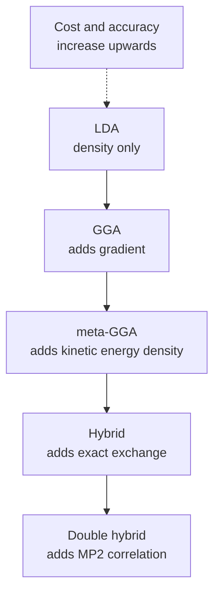
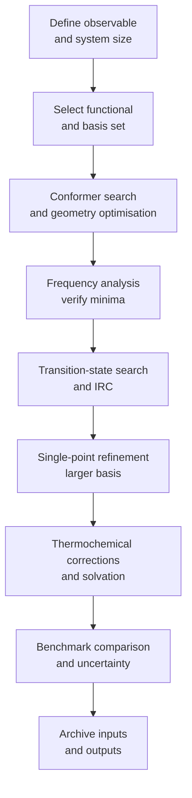
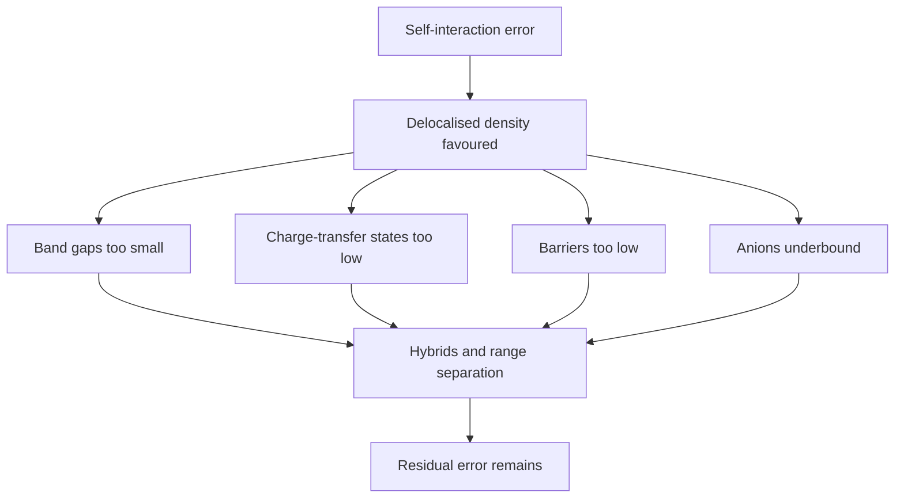

# Chapter 2 — Computational Chemistry and Density Functional Theory

> **Level:** Research (Level 10 — Postgraduate and research)
> **Estimated study time:** 11 hours (7 h reading + 4 h exercises)
> **Prerequisites:** [Advanced Quantum Chemistry](01-advanced-quantum-chemistry.md); [Classical Thermodynamics](../07-physical-chemistry/01-classical-thermodynamics.md) for thermochemical corrections
> **Related chapters:** [Molecular Dynamics](03-molecular-dynamics.md), [Advanced Reaction Mechanisms](05-advanced-reaction-mechanisms.md), [Level 10 index](README.md)
> **Difficulty:** ★★★★★ (5/5)

---

## 1. Learning Objectives

After working through this chapter you will be able to:

- Explain why Kohn–Sham density functional theory, rather than wavefunction
  theory, dominates applied computational chemistry.
- State the two Hohenberg–Kohn theorems, reproduce the reductio proof of the first,
  and explain the significance of the constrained-search formulation.
- Derive the Kohn–Sham equations and identify precisely what the
  exchange–correlation functional must contain.
- Place a functional on Jacob's ladder and explain what each rung adds.
- Write the composition of B3LYP, PBE0, a range-separated hybrid and a double
  hybrid, and predict how each behaves for a stated property.
- Explain the self-interaction error and diagnose its consequences for band gaps,
  charge-transfer excitations and barrier heights.
- Choose and justify a dispersion correction, and explain the difference between
  D3, D4 and non-local van der Waals functionals.
- Define basis-set superposition error and compute a counterpoise correction.
- Select a composite method for high-accuracy thermochemistry and state its
  expected accuracy.
- Perform a geometry optimisation, a transition-state search, an intrinsic reaction
  coordinate scan and a frequency analysis, and interpret the results.
- Convert electronic energies into standard free energies with the correct
  thermochemical conventions.
- Apply a defensible protocol for a publishable computational study, including
  benchmarking, error estimation and reproducibility.

---

## 2. Introduction

Density functional theory is the most used electronic structure method in chemistry,
and the margin is not small: the great majority of computational papers in catalysis,
materials, drug design and mechanistic organic chemistry report Kohn–Sham results.
The reason is economic rather than ideological. A Hartree–Fock calculation scales as
$K^{4}$ in the number of basis functions and a CCSD(T) calculation as $K^{7}$; a
Kohn–Sham calculation with a semi-local functional scales as $K^{3}$ and delivers
energies that are often better than MP2 for thermochemistry and comparable to
CCSD(T) for some properties at a tiny fraction of the cost. For a system of a hundred
atoms, that difference decides whether a calculation is possible at all.

The theory rests on a theorem that is both remarkable and unhelpful in equal measure.
Hohenberg and Kohn proved that the ground-state electron density determines the
external potential, and therefore the Hamiltonian and every property. That reduces a
$3N$-dimensional problem to three dimensions. But the theorem is an existence proof:
it establishes that a universal functional of the density exists without saying what
it is. Every practical functional is an approximation, and the accuracy of a
calculation is the accuracy of that approximation, not of the theorem.

This chapter therefore treats DFT as a family of approximate model chemistries rather
than as a single method. It develops the theorems and the Kohn–Sham construction,
then surveys the functional hierarchy and the systematic errors that run through it.
The self-interaction error receives particular attention because it explains most of
the qualitative failures that appear in the literature: underestimated band gaps,
spurious charge transfer, transition states that are too low and anions that are
unbound. Dispersion, basis-set effects, composite methods, thermochemistry,
solvation, diagnostics and benchmarking follow, and the chapter ends with the
practical protocol that separates a publishable study from a plausible-looking one.

The chapter assumes the preceding chapter's treatment of Hartree–Fock, basis sets
and correlation, and the thermodynamics needed for thermochemical corrections.

---

## 3. Fundamental Concepts

### 3.1 Why the density rather than the wavefunction

An $N$-electron wavefunction depends on $3N$ spatial coordinates; the electron
density depends on three. For $N=100$ that is $300$ coordinates against three, and
the difference is why density-based methods reach systems that wavefunction methods
cannot. The density,
$$
\rho(\mathbf{r}) = N\int|\Psi(\mathbf{r},\mathbf{r}_2,\dots,\mathbf{r}_N)|^{2}
\,\mathrm{d}\mathbf{r}_2\cdots\mathrm{d}\mathbf{r}_N,
$$
is measurable by X-ray diffraction, integrates to $N$, is non-negative and decays
exponentially. Those properties define the admissible densities, a set that the
theory must handle carefully.

### 3.2 The Hohenberg–Kohn theorems

**Theorem 1.** The ground-state density $\rho_0(\mathbf{r})$ determines the external
potential $v(\mathbf{r})$ up to an additive constant, and therefore the Hamiltonian
and every property.

The proof is a *reductio*. Suppose two potentials $v$ and $v'$, differing by more
than a constant, share the density $\rho_0$, with ground states $\Psi$ and $\Psi'$
and energies $E_0$, $E_0'$. The variational principle gives
$$
E_0 < \langle\Psi'|\hat{H}|\Psi'\rangle
= E_0' + \int [v(\mathbf{r})-v'(\mathbf{r})]\rho_0(\mathbf{r})\,\mathrm{d}\mathbf{r},
$$
and the reversed argument gives the opposite inequality; adding them produces a
contradiction. The map from $v$ to $\rho_0$ is therefore injective, and because $v$
fixes $\hat{H}$, the density fixes everything.

**Theorem 2.** For a trial density with $\tilde\rho\ge0$ and $\int\tilde\rho=N$,
$E[\tilde\rho]\ge E[\rho_0]=E_0$. The functional is minimised by the true density.

Both theorems are existence statements. They establish that a universal functional
exists, not what it is; every functional in use is an approximation to an unknown
object.

### 3.3 The constrained-search formulation

Levy and Lieb made the functional concrete by defining
$$
F[\rho] = \min_{\Psi\to\rho}\langle\Psi|\hat{T}+\hat{V}_{ee}|\Psi\rangle,
\qquad
E[\rho] = F[\rho] + \int v(\mathbf{r})\rho(\mathbf{r})\,\mathrm{d}\mathbf{r},
$$
where the minimum runs over antisymmetric wavefunctions yielding $\rho$. The
construction separates the universal part, which depends only on $N$, from the
system-specific potential, and it removes the awkward requirement that $\rho$ be
non-interacting $v$-representable. Modern statements of the theorem use this form.

### 3.4 The Kohn–Sham construction

Kohn and Sham introduced non-interacting electrons with the same density. Their
wavefunction is a single determinant, so
$\rho=\sum_i^{N}|\phi_i|^{2}$ and the kinetic energy $T_s$ is known from the
orbitals. The energy becomes
$$
E[\rho] = T_s[\rho] + \int v\rho\,\mathrm{d}\mathbf{r}
+ \frac12\iint\frac{\rho(\mathbf{r})\rho(\mathbf{r}')}{|\mathbf{r}-\mathbf{r}'|}
\,\mathrm{d}\mathbf{r}\,\mathrm{d}\mathbf{r}' + E_{xc}[\rho],
$$
with
$$
E_{xc}[\rho] = \left(T[\rho]-T_s[\rho]\right) + \left(V_{ee}[\rho]-J[\rho]\right).
$$
The first bracket is kinetic correlation, the second potential correlation plus
exchange. Minimising under $\int\rho=N$ gives the **Kohn–Sham equations**
$$
\left[-\tfrac12\nabla^{2}+v_{\mathrm{eff}}\right]\phi_i = \varepsilon_i\phi_i,
\qquad
v_{\mathrm{eff}} = v+v_H+v_{xc}, \qquad
v_{xc} = \frac{\delta E_{xc}}{\delta\rho}.
$$
They resemble the Hartree–Fock equations, but the local potential replaces the
non-local exchange operator, so an iteration costs $K^{3}$ rather than $K^{4}$.

The Kohn–Sham orbitals are mathematical objects: they reproduce the density but have
no direct physical meaning, and only the highest occupied orbital energy approximates
an ionisation energy. All the chemistry missing from the independent-particle picture
is compressed into $E_{xc}$, and every practical functional approximates it.

### 3.5 Jacob's ladder

| Rung | Name | Ingredients | Examples |
|---|---|---|---|
| 1 | LDA | $\rho$ | LDA, VWN |
| 2 | GGA | $\rho$, $\nabla\rho$ | PBE, BLYP, PW91 |
| 3 | meta-GGA | plus $\tau$ or $\nabla^{2}\rho$ | TPSS, M06-L, SCAN |
| 4 | hybrid | plus exact exchange | B3LYP, PBE0, HSE06 |
| 5 | double hybrid | plus MP2 correlation | B2PLYP, DSD-BLYP |

Climbing usually improves accuracy, but not monotonically and not for every
property. The ladder classifies ingredients, not performance.

### 3.6 LDA, GGA and meta-GGA

**LDA** evaluates
$E_{xc}^{\mathrm{LDA}}=\int\rho\,\varepsilon_{xc}(\rho)\,\mathrm{d}\mathbf{r}$ with
Dirac exchange and a correlation fitted to quantum Monte Carlo data for the uniform
electron gas. It is exact for the uniform gas and reasonable for solids near
equilibrium, but it overbinds molecules and underestimates atomisation energies by
roughly $1\ \mathrm{eV}$ per bond. **GGA** adds the reduced gradient and improves bond
energies substantially; **PBE** is the condensed-matter standard and **BLYP** the
molecular one. **meta-GGA** adds the kinetic energy density
$\tau=\tfrac12\sum_i|\nabla\phi_i|^{2}$: **TPSS** is constraint-based, **M06-L** is
empirically fitted and good for transition metals, and **SCAN** satisfies a larger
constraint set. Semi-local functionals remain the cheapest useful choice for large
periodic systems.

### 3.7 Hybrids, range separation and double hybrids

A **global hybrid** mixes exact exchange with a semi-local functional:
$$
E_{xc}^{\mathrm{hybrid}} = aE_x^{\mathrm{HF}}+(1-a)E_x^{\mathrm{DFT}}+E_c^{\mathrm{DFT}}.
$$
**B3LYP** uses
$$
E_{xc} = 0.20E_x^{\mathrm{HF}}+0.80E_x^{\mathrm{LDA}}+0.72E_x^{\mathrm{B88}}
+0.81E_c^{\mathrm{LYP}}+0.19E_c^{\mathrm{VWN}},
$$
and **PBE0** uses $a=0.25$ with PBE. Exact exchange reduces the self-interaction
error, improving barriers and atomisation energies; **HSE06** screens it to short
range and is the standard hybrid for solids.

**Range-separated** functionals split the Coulomb operator,
$$
\frac{1}{r_{12}}=\frac{1-\mathrm{erf}(\mu r_{12})}{r_{12}}
+\frac{\mathrm{erf}(\mu r_{12})}{r_{12}},
$$
and use different exchange fractions at short and long range. **CAM-B3LYP** uses
$0.19$ and $0.65$; **$\omega$B97X-D** adds long-range correction and dispersion.
They are designed for charge-transfer excitations and for the correct $-1/r$
asymptotic potential.

**Double hybrids** add MP2 correlation, for example
$E_{xc}^{\mathrm{B2PLYP}}=0.53E_x^{\mathrm{HF}}+0.47E_x^{\mathrm{B88}}
+0.73E_c^{\mathrm{LYP}}+0.27E_c^{\mathrm{MP2}}$. They are the most accurate widely
available functionals for thermochemistry and non-covalent interactions at $K^{5}$
cost, and they need large basis sets.

### 3.8 The self-interaction error

For one electron the Hartree energy must be exactly cancelled by exchange.
Hartree–Fock satisfies this because $K_{ii}=J_{ii}$; a semi-local functional cannot,
because it evaluates exchange from the density point by point. The residue is the
**self-interaction error** (SIE), also called the delocalisation error. It produces:

- **band gaps** that are too small, often by $30$–$50\,\%$, because the derivative
  discontinuity is missing;
- **charge-transfer excitations** that are too low, because the separated electron
  and hole do not feel the correct $-1/r$ attraction;
- **barriers** that are too low, because the transition state is more delocalised
  than the reactants;
- **anions** that are underbound or unbound, and radicals with spurious spin
  delocalisation;
- **spin-state gaps** in transition-metal complexes that depend strongly on the
  functional.

Hybrids, range separation, DFT+$U$ and self-interaction corrections mitigate the
error; none removes it.

### 3.9 Dispersion corrections

Semi-local functionals cannot describe the long-range correlation responsible for
London dispersion. Three remedies exist. **Empirical corrections** add a damped
pairwise term,
$$
E_{\mathrm{disp}} = -\sum_{A<B}\left[s_6\frac{C_6^{AB}}{R_{AB}^{6}}f_6(R_{AB})
+s_8\frac{C_8^{AB}}{R_{AB}^{8}}f_8(R_{AB})\right],
$$
with **D3** using geometry-dependent coefficients and **D4** adding charge dependence
and three-body terms. **Non-local functionals** (vdW-DF, VV10) add a density-dependent
integral term self-consistently. **Many-body dispersion** treats coupled oscillators
and captures screening in extended systems. Without a correction, a $\pi$-stacked
dimer binds far too weakly and a molecular crystal has the wrong lattice energy.

### 3.10 Basis sets, BSSE and counterpoise

DFT uses the same Gaussian basis sets as wavefunction methods, but hybrids and double
hybrids converge more slowly because exact exchange and MP2 need large basis sets;
diffuse functions are essential for anions, Rydberg states and dispersion. The
**basis-set superposition error** arises because each fragment borrows its partner's
functions and is better described in the dimer than alone. The counterpoise
correction of Boys and Bernardi evaluates each monomer in the dimer basis:
$$
\Delta E_{\mathrm{int}}^{\mathrm{CP}} = E_{AB}^{AB}-E_A^{AB}-E_B^{AB}.
$$
The superscript is the basis and the subscript the nuclei present. The correction is
largest for small bases and weak interactions, where it can rival the binding energy
itself; report both corrected and uncorrected values.

### 3.11 Composite methods

Composite methods combine a high-level calculation with additive corrections for
effects that converge at different rates. **Gaussian-$n$** (G3, G4) uses a sequence
of MP2 and MP4 calculations with corrections for basis-set incompleteness,
spin–orbit coupling and zero-point energy; G4 targets about
$1\ \mathrm{kcal\,mol^{-1}}$ mean absolute error on its validation sets. **CBS-QB3**
extrapolates MP2 correlation to the complete-basis limit and adds a fitted
higher-level correction. **W1 and W2** approach $0.1\ \mathrm{kcal\,mol^{-1}}$ for
small molecules. **Focal-point analysis** is the general strategy: converge each
contribution separately and extrapolate. Accuracy claims apply to the training and
validation sets, not to arbitrary molecules.

### 3.12 Potential energy surfaces

A **geometry optimisation** locates a stationary point using gradients and an
approximate Hessian; the Berny algorithm is standard. Convergence requires small
maximum and root-mean-square gradients and small displacements.

A **transition state** is a first-order saddle point: exactly one negative Hessian
eigenvalue. Searches use a good guess with a Hessian (Berny), interpolation between
reactant and product (QST2, QST3), or a dimer or nudged-elastic-band method. A
candidate is accepted only when a frequency calculation shows exactly one imaginary
frequency and an **intrinsic reaction coordinate** calculation connects the intended
reactant and product.

A **frequency calculation** supplies the zero-point energy, thermal corrections,
entropy and spectrum. One imaginary frequency means a transition state; several mean
a higher-order saddle point and a failed optimisation.

### 3.13 Thermochemical corrections and standard states

Electronic energies refer to clamped nuclei at $0\ \mathrm{K}$. The standard Gibbs
energy at $298.15\ \mathrm{K}$ is
$$
G = E_{\mathrm{elec}}+\mathrm{ZPE}+\Delta H_{\mathrm{thermal}}-T\Delta S
+\Delta G_{\mathrm{standard\ state}}.
$$
The rigid-rotor harmonic-oscillator approximation treats translations and rotations
classically and vibrations harmonically. It fails for low-frequency modes, which are
anharmonic and better described as hindered rotations; the entropy error can reach
$10\ \mathrm{J\,K^{-1}\,mol^{-1}}$ per mode, and quasi-RRHO treatments replace the
harmonic entropy by a free-rotor interpolation.

Standard states matter: most programs use $1\ \mathrm{atm}$ while tables use
$1\ \mathrm{bar}$, and the conversion is $+1.89\ \mathrm{kcal\,mol^{-1}}$ per unit
change in $\Delta n_{\mathrm{gas}}$ at $298.15\ \mathrm{K}$
($+7.9\ \mathrm{kJ\,mol^{-1}}$). For an association reaction this exceeds the
accuracy of the electronic energy.

### 3.14 Solvation models

**Implicit** models place the solute in a cavity in a continuum: PCM and IEFPCM solve
the electrostatic boundary problem, and **SMD** adds parametrised cavitation,
dispersion and repulsion. They capture bulk polarity cheaply but miss specific
hydrogen bonds and charge transfer to solvent. **Microsolvation** adds explicit
solvent molecules; cluster–continuum models combine a small cluster with a continuum
and are standard for accurate pKa values, provided the cluster size is converged.
**QM/MM** partitions a quantum active site from a classical environment, ideally with
electrostatic or polarisable embedding, and requires a tested treatment of the
covalent boundary.

### 3.15 Diagnostics, benchmarking and reproducibility

**Diagnostics.** The T1 diagnostic flags multireference character; %TAE measures the
fraction of the atomisation energy coming from post-HF correlation; $B_1$ and
$C_0^{2}$ test Kohn–Sham stability; fractional-charge and fractional-spin tests probe
delocalisation error directly.

**Benchmarking.** Compare against reference sets with known high-level values —
GMTKN55 for general thermochemistry and kinetics, S22 and S66 for non-covalent
interactions, and dedicated sets for transition metals, barriers and excited states.
Report mean absolute, root-mean-square and maximum errors, and state whether outliers
were removed.

**Reproducibility.** Archive the geometry, charge and multiplicity, functional and
version, basis set, integration grid, dispersion correction, solvent model, software
version, SCF settings and thermochemistry conventions. A result that cannot be
reproduced from the deposited data is not a scientific result.

---

## 4. Detailed Scientific Explanation

### 4.1 Why the Hohenberg–Kohn proof needs care

The original proof assumes that the ground state is non-degenerate and that the
density is $v$-representable, meaning it comes from some external potential. Neither
assumption is guaranteed. Degenerate ground states give densities that do not
uniquely determine the potential, and some reasonable densities are not
$v$-representable at all.

The constrained-search formulation repairs both problems. It defines $F[\rho]$ for
any density that comes from an antisymmetric wavefunction ($N$-representable), which
is a much larger set, and it does not require a non-degenerate ground state. The
variational principle then applies to all $N$-representable densities. This is why
modern treatments state the theorem in Levy's form rather than in the original
formulation.

A second subtlety concerns the **derivative discontinuity**. When the particle number
changes continuously, the exact energy is a series of straight-line segments between
integer electron numbers, with discontinuities in the slope at integers. The
discontinuity is the difference between the fundamental gap and the Kohn–Sham gap,
and it is entirely absent from semi-local functionals. This is the formal origin of
the band-gap problem discussed in Section 4.4.

### 4.2 The Kohn–Sham equations in practice

The procedure mirrors Hartree–Fock: build the effective potential from the current
density, solve for the orbitals, form a new density and iterate. In a basis the
equations become the generalised eigenvalue problem
$$
\mathbf{F}^{\mathrm{KS}}\mathbf{C} = \mathbf{S}\mathbf{C}\boldsymbol{\varepsilon},
\qquad
F_{\mu\nu}^{\mathrm{KS}} = h_{\mu\nu}+J_{\mu\nu}[\rho]+v_{xc,\mu\nu}[\rho],
$$
with the exchange–correlation matrix elements evaluated by numerical integration on
a grid. The grid is a convergence parameter: a coarse grid produces errors of several
$\mathrm{kJ\,mol^{-1}}$ in energies and erratic forces, so it must be reported. SCF
convergence is slower than in Hartree–Fock for small-gap systems, and level shifting,
damping or DIIS are routinely required.

### 4.3 What each functional family does well and badly

| Property | LDA | GGA | meta-GGA | Global hybrid | Range-separated | Double hybrid |
|---|---|---|---|---|---|---|
| Atomisation energies | poor | fair | good | good | good | excellent |
| Barrier heights | poor | fair | fair | good | good | excellent |
| Non-covalent interactions | poor | poor | fair | fair | fair with dispersion | good |
| Band gaps | very poor | poor | fair | fair | good for molecules | not applicable |
| Charge transfer | very poor | very poor | poor | fair | good | good |
| Transition metals | fair | fair | good | fair | fair | good |
| Cost | lowest | low | low | moderate | moderate | high |

The table is a summary of broad trends from benchmark studies, not a substitute for
a benchmark on the specific system. A functional that is excellent for
thermochemistry can be mediocre for spin-state gaps, and the correlation between
performance on different properties is weak.

### 4.4 The self-interaction error in detail

Consider the hydrogen atom. The exact energy is $-0.5\ \mathrm{E_h}$ and the density
is a single exponential. An approximate functional evaluates
$$
E = T_s + \int v\rho + \frac12\iint\frac{\rho\rho'}{|\mathbf{r}-\mathbf{r}'|}
+ E_{xc}[\rho],
$$
and for the one-electron case the Hartree term must be exactly cancelled by
exchange. In LDA the cancellation is incomplete, so the energy is too high and the
density is too diffuse. The error is the self-interaction error.

For many-electron systems the same error appears as a spurious repulsion between an
electron and its own density, which favours delocalised states. This is why:
- odd-electron systems often give symmetric, delocalised spin densities when the
  true state is localised;
- charge-transfer states are stabilised because the separated electron and hole do
  not feel the correct attraction;
- reaction barriers are lowered because the transition state is more delocalised
  than the reactant;
- band gaps are underestimated because the derivative discontinuity is missing;
- anions are underbound and sometimes unbound.

The **fractional-charge** test makes the error quantitative: for a system with
fractional electron number, the exact energy is linear between integers, while
semi-local functionals give a convex curve. The curvature is a direct measure of
delocalisation error. The **fractional-spin** test does the same for spin.

### 4.5 Dispersion: from correction to model

The $C_6/R^{6}$ term is the leading term of the long-range correlation energy
between two separated systems. Its coefficient is related to the frequency-dependent
polarisability by the Casimir–Polder relation, and it is not a property of the
functional but of the atoms.

D3 uses precomputed reference $C_6$ coefficients and scales them by the local
coordination number, which makes the correction geometry-dependent and transferable.
The damping function switches the correction off at short range, where it would
double-count correlation already described by the functional. Becke–Johnson damping
is preferred for molecular systems because it behaves better at intermediate
distances.

D4 improves on D3 by including charge-dependent coefficients from electronegativity
equilibration and by adding three-body terms. It is the current default in many
workflows. Non-local functionals and MBD are more physical but more expensive, and
they must be benchmarked against the same reference sets.

### 4.6 A protocol for a publishable computational study

1. **Define the question and the observable.** A reaction energy, a barrier, a
   spectroscopic parameter or a free energy of binding each demands a different
   protocol.
2. **Choose a model chemistry and justify it.** Functional, basis set, dispersion,
   solvent and thermochemistry must be stated together. Cite benchmarks for the
   property class.
3. **Assess the conformational space.** Search conformers with a cheap method,
   optimise the low-energy ones, and report Boltzmann populations.
4. **Optimise geometries and verify stationary points.** Frequency calculations for
   every minimum and transition state; one imaginary frequency for a transition
   state; IRC connection for every claimed mechanism.
5. **Refine single-point energies.** Use a larger basis and a higher-level method on
   the optimised geometries, and apply the thermochemical corrections consistently.
6. **Treat solvation explicitly.** Report the model and the standard state.
7. **Estimate the error.** Compare with benchmark data, propagate uncertainties, and
   state the expected accuracy in the units of the observable.
8. **Archive everything.** Geometries, inputs, outputs, software versions and the
   scripts that produced the tables.

The protocol is deliberately conservative. Its purpose is to make the result
reproducible by a reader who has none of the author's intuition.

### 4.7 Error cancellation and isodesmic reactions

DFT errors are systematic. Bond energies computed with a given functional are
usually too small by a similar amount for similar bonds, so a reaction that conserves
the number and type of bonds cancels much of the error. **Isodesmic** reactions
conserve the number of bonds of each type; **homodesmotic** reactions also conserve
the hybridisation of each carbon. Both are used to compute thermochemical quantities
that would be inaccurate if computed directly.

Error cancellation is a tool, not a justification. It works when the reference
reaction is well chosen and the errors really are systematic; it fails when the
reaction changes the bonding pattern or the spin state. A computed atomisation energy
benefits little from cancellation, while a computed substituent effect benefits a
great deal.

---

## 5. Visual Diagrams

**Figure 2.1 — Jacob's ladder of density functionals.** Each rung adds an ingredient
to the exchange–correlation functional. Accuracy generally improves upwards, but not
uniformly: a meta-GGA can beat a hybrid for a layered material, and a hybrid can beat
a double hybrid for a spin-state gap. The ladder classifies ingredients, not
performance.

**Figure 2.2 — A defensible computational protocol.** The order matters: a
single-point refinement on an unverified geometry propagates a structural error into
a high-level energy. Frequency analysis is placed early because it validates the
stationary point before expensive refinement. The final archive step is what makes
the study reproducible.

**Figure 2.3 — One error, many symptoms.** The self-interaction error is a single
defect of semi-local functionals, but it appears as four apparently unrelated
failures. Recognising the common origin is what allows a practitioner to predict
which calculations are at risk and to choose a remedy rather than adjusting
parameters until the answer looks reasonable.

---

## 6. Mathematical Formulas

### 6.1 The Kohn–Sham energy

$$
E[\rho] = T_s[\rho] + \int v\rho\,\mathrm{d}\mathbf{r}
+ \frac12\iint\frac{\rho(\mathbf{r})\rho(\mathbf{r}')}{|\mathbf{r}-\mathbf{r}'|}
\,\mathrm{d}\mathbf{r}\,\mathrm{d}\mathbf{r}' + E_{xc}[\rho],
\qquad
v_{xc} = \frac{\delta E_{xc}}{\delta\rho}.
$$

| Symbol | Meaning | SI unit |
|---|---|---|
| $\rho$ | electron density | $\mathrm{m^{-3}}$ |
| $T_s$ | non-interacting kinetic energy | J |
| $v$ | external (nuclear) potential | J |
| $E_{xc}$ | exchange–correlation energy | J |
| $v_{xc}$ | exchange–correlation potential | J |
| $\varepsilon_i$ | Kohn–Sham orbital energy | J |

Assumptions: Born–Oppenheimer, non-relativistic, a single determinant of
non-interacting orbitals, and an approximate $E_{xc}$. The theorem guarantees that
the exact functional exists; it does not guarantee that any practical one is close.

### 6.2 Dispersion and counterpoise

$$
E_{\mathrm{disp}} = -\sum_{A<B}\left[
s_6\frac{C_6^{AB}}{R_{AB}^{6}}f_6(R_{AB})
+ s_8\frac{C_8^{AB}}{R_{AB}^{8}}f_8(R_{AB})\right],
\qquad
\Delta E_{\mathrm{int}}^{\mathrm{CP}} = E_{AB}^{AB}-E_A^{AB}-E_B^{AB}.
$$

| Symbol | Meaning | SI unit |
|---|---|---|
| $C_6^{AB}$ | dipole–dipole dispersion coefficient | $\mathrm{J\,m^{6}}$ |
| $R_{AB}$ | interatomic distance | m |
| $s_6,s_8$ | functional-dependent scaling factors | dimensionless |
| $f_6,f_8$ | damping functions | dimensionless |
| $E_{AB}^{AB}$ | dimer energy in the dimer basis | J |

Assumptions: the dispersion term is additive and pairwise (D3) or includes
three-body terms (D4); the damping function is not universal. The counterpoise
correction assumes that the fragment deformation energy is negligible.

### 6.3 Thermochemical correction

$$
G = E_{\mathrm{elec}} + \mathrm{ZPE} + \Delta H_{\mathrm{thermal}} - T\Delta S
+ \Delta n_{\mathrm{gas}}RT\ln\frac{p^{\circ}}{p},
$$

| Symbol | Meaning | SI unit |
|---|---|---|
| $E_{\mathrm{elec}}$ | electronic energy at clamped nuclei | J |
| $\mathrm{ZPE}$ | zero-point vibrational energy | J |
| $\Delta H_{\mathrm{thermal}}$ | thermal enthalpy correction | J |
| $S$ | entropy (translational, rotational, vibrational) | $\mathrm{J\,K^{-1}}$ |
| $T$ | thermodynamic temperature | K |
| $p^{\circ}$ | standard pressure, $10^{5}$ Pa | Pa |

Assumptions: ideal gas, rigid rotor, harmonic oscillator, Boltzmann population of
electronic states, and a single conformer unless stated otherwise. The
$1\ \mathrm{atm}$ to $1\ \mathrm{bar}$ term is $+7.9\ \mathrm{kJ\,mol^{-1}}$ per unit
change in $\Delta n_{\mathrm{gas}}$ at $298.15\ \mathrm{K}$.

---

## 7. Chemical Equations

$$
\ce{N2(g) + 3H2(g) -> 2NH3(g)} \qquad \Delta_\mathrm{r}H^\circ = -92.4\ \mathrm{kJ\,mol^{-1}}
$$

Haber–Bosch ammonia synthesis. The reaction is a standard test of a functional's
ability to describe a bond-energy difference between a triple bond and six N–H
bonds; GGA functionals underestimate the exothermicity, and dispersion corrections
change the adsorption energies of the intermediates on the catalyst.

$$
\ce{CO(g) + 2H2(g) -> CH3OH(g)} \qquad \Delta_\mathrm{r}H^\circ = -90.6\ \mathrm{kJ\,mol^{-1}}
$$

Methanol synthesis from syngas. The barrier and the adsorption energies of CO and
H$_2$ on Cu/ZnO are computed with periodic DFT; the choice of functional shifts the
computed barrier by tens of $\mathrm{kJ\,mol^{-1}}$, which is why benchmarking
against experiment is essential.

$$
\ce{C4H6(g) + C2H4(g) -> C6H10(g)} \qquad \Delta_\mathrm{r}H^\circ = -165\ \mathrm{kJ\,mol^{-1}}
$$

The Diels–Alder reaction of butadiene and ethene. It is a synchronous concerted
cycloaddition, and the barrier computed with semi-local functionals is
systematically too low; hybrid functionals and CCSD(T) benchmarks are used to
calibrate the error.

$$
\ce{H2O(l) -> H2O(g)} \qquad \Delta_\mathrm{vap}G^\circ = 8.6\ \mathrm{kJ\,mol^{-1}}\ (298\ \mathrm{K})
$$

Vaporisation of water. The difference between a gas-phase calculation and a liquid
measurement is a property of the solvation model, and a computed hydration free
energy is only as good as that model.

---

## 8. Worked Examples

### Worked Example 8.1 — Matching functional to behaviour

**Problem.** A study must compute (a) the barrier of a concerted cycloaddition,
(b) the charge-transfer excitation energy of a donor–acceptor dye at $8\ \mathrm{\AA}$
separation, (c) the binding energy of a $\pi$-stacked dimer, and (d) the spin-state
gap of an iron(II) complex. Recommend a functional for each and justify the choice.

**Solution.** (a) A global hybrid such as PBE0 or B3LYP, because exact exchange
reduces the self-interaction error that lowers barriers; validate against a
coupled-cluster benchmark. (b) A range-separated functional such as CAM-B3LYP or
$\omega$B97X-D, because the long-range exchange must reproduce the $-1/r$ attraction
between the separated electron and hole. (c) A functional with dispersion: either a
hybrid plus D3/D4, or a non-local functional; without it the binding energy is far
too small. (d) A hybrid or double hybrid with a basis set that includes polarisation
and diffuse functions, and a multireference cross-check with CASSCF/CASPT2, because
spin-state gaps are sensitive to both static and dynamic correlation.

### Worked Example 8.2 — Counterpoise correction

**Problem.** A dimer calculation in a double-zeta basis gives
$E_{AB}^{AB} = -1000.0000\ \mathrm{E_h}$, $E_A^{AB} = -500.0000\ \mathrm{E_h}$,
$E_B^{AB} = -499.9900\ \mathrm{E_h}$, while the isolated monomers give
$E_A^{A} = -499.9950\ \mathrm{E_h}$ and $E_B^{B} = -499.9950\ \mathrm{E_h}$.
Compute the uncorrected and counterpoise-corrected binding energies and the BSSE.

**Solution.** The uncorrected binding energy uses each monomer in its own basis:
$$
\Delta E_{\mathrm{int}} = -1000.0000 - (-499.9950-499.9950) = -0.0100\ \mathrm{E_h}.
$$
The counterpoise value uses each monomer in the dimer basis:
$$
\Delta E_{\mathrm{int}}^{\mathrm{CP}} = -1000.0000 - (-500.0000-499.9900)
= -0.0100\ \mathrm{E_h}.
$$
Here the two agree, which happens only when the monomer energies are unaffected by
the partner basis; in general they differ. The BSSE is the difference between the
monomer energies in the two bases:
$$
E_{\mathrm{BSSE}} = (E_A^{AB}+E_B^{AB}) - (E_A^{A}+E_B^{B})
= (-999.9900) - (-999.9900) = 0.
$$

### Worked Example 8.3 — From frequencies to a reaction free energy

**Problem.** A bimolecular reaction $A+B\to C$ has $\Delta E_{\mathrm{elec}} =
-0.0300\ \mathrm{E_h}$ at $298.15\ \mathrm{K}$. The frequency calculation gives
$\mathrm{ZPE}=0.0100\ \mathrm{E_h}$, a thermal enthalpy correction of
$0.0080\ \mathrm{E_h}$ and $T\Delta S = 0.0120\ \mathrm{E_h}$ (both at $1\ \mathrm{atm}$).
Compute $\Delta G$ at $1\ \mathrm{bar}$.

**Solution.** The correction is
$$
\Delta G_{\mathrm{corr}} = 0.0100+0.0080-0.0120 = +0.0060\ \mathrm{E_h},
$$
so
$$
\Delta G = -0.0300+0.0060 = -0.0240\ \mathrm{E_h}
= -63.0\ \mathrm{kJ\,mol^{-1}}.
$$
The reaction consumes two gas molecules to make one, so $\Delta n_{\mathrm{gas}}=-1$
and the standard-state correction is $-1\times(+7.9\ \mathrm{kJ\,mol^{-1}})$, giving
$$
\Delta G(1\ \mathrm{bar}) = -63.0-7.9 = -70.9\ \mathrm{kJ\,mol^{-1}}.
$$

### Worked Example 8.4 — Estimating the uncertainty of a functional

**Problem.** Four benchmark reactions give errors of $+4$, $-6$, $+2$ and
$-8\ \mathrm{kJ\,mol^{-1}}$ for functional A, and $+1$, $+1$, $-2$ and $+2$ for
functional B. Compute the mean error, mean absolute error and root-mean-square error
for each, and comment on which functional is preferable.

**Solution.** For A the mean is $(4-6+2-8)/4 = -2.0$, the mean absolute error is
$(4+6+2+8)/4 = 5.0$, and the root-mean-square error is
$\sqrt{(16+36+4+64)/4} = \sqrt{30} = 5.5\ \mathrm{kJ\,mol^{-1}}$. For B the mean is
$+0.5$, the mean absolute error is $1.5$, and the root-mean-square error is
$\sqrt{(1+1+4+4)/4} = 1.6\ \mathrm{kJ\,mol^{-1}}$.

### Worked Example 8.5 — The band-gap error

**Problem.** A GGA calculation gives a band gap of $0.45\ \mathrm{eV}$ for a
semiconductor whose experimental gap is $1.10\ \mathrm{eV}$. A hybrid gives
$0.95\ \mathrm{eV}$. Interpret the two results and state which should be reported.

**Solution.** The GGA gap is too small by $0.65\ \mathrm{eV}$ ($59\,\%$), which is
typical: the missing derivative discontinuity and the self-interaction error both
reduce the gap. The hybrid gap is too small by $0.15\ \mathrm{eV}$ ($14\,\%$), a
substantial improvement but still not quantitative. Neither is the experimental gap,
because the experimental optical gap includes excitonic effects that the
independent-particle calculation does not describe.

---

## 9. Real-World Applications

**Catalysis.** Periodic DFT with dispersion and, where needed, hybrid functionals is
the standard tool for heterogeneous catalysis. Computed adsorption energies and
barriers guide catalyst screening, and the errors are calibrated against
microkinetic measurements rather than assumed.

**Materials design.** Band structures, defect formation energies and Li-ion migration
barriers are computed with DFT; the choice of functional and the treatment of
strongly correlated $d$ and $f$ states determine whether the prediction is useful.

**Spectroscopy.** Computed NMR shifts, IR intensities and UV–Vis spectra support
structure assignment. The functional and basis must be validated against reference
compounds, and solvation and relativistic effects included when relevant.

---

## 10. Common Mistakes

| Mistake | Why it happens | Correct approach |
|---|---|---|
| Reporting a Kohn–Sham gap as an experimental gap | The number is printed in the output | State the method and compare with the same quantity; optical gaps include excitonic effects |
| Using a GGA for a charge-transfer excitation | It is the default functional | Use a range-separated or long-range-corrected functional |
| Ignoring the 1 atm to 1 bar correction | The program reports 1 atm | Apply $\Delta n_{\mathrm{gas}}RT\ln(24.46)$ consistently |
| Omitting dispersion for a non-covalent complex | The geometry optimises without it | Add D3/D4 or a non-local functional and report it |
| Quoting a barrier without an IRC | A saddle point was found | Verify the imaginary mode connects the intended reactant and product |
| Treating one conformer as the molecule | The optimisation found one minimum | Search conformers and Boltzmann-average the observable |

---

## 11. Chapter Summary

- Hohenberg–Kohn theory reduces the ground-state problem to the density, but it
  provides no functional; every practical DFT calculation uses an approximation.
- The Kohn–Sham construction introduces non-interacting orbitals and confines all
  unknown physics to $E_{xc}$.
- Functionals are classified by Jacob's ladder: LDA, GGA, meta-GGA, hybrid, double
  hybrid, with range-separated variants for charge transfer.
- The self-interaction error explains band-gap underestimation, spurious charge
  transfer, low barriers and underbound anions.
- Dispersion must be added explicitly for non-covalent systems; D3/D4, non-local
  functionals and MBD are the main options.
- BSSE is removed by the counterpoise correction, which should be reported.
- Composite methods and double hybrids provide benchmark accuracy for small
  molecules at higher cost.
- Thermochemistry requires zero-point, thermal and standard-state corrections, and
  the conventions must be stated.
- Reproducibility requires archiving the geometry, functional, basis, grid,
  dispersion, solvent model and software version.

---

## 12. Exercises

### 12.1 Conceptual questions

1. Why does the Hohenberg–Kohn theorem not provide a usable functional?
2. Explain why the Kohn–Sham orbitals are not physical orbitals.
3. What is the derivative discontinuity, and why does its absence matter for band
   gaps?

### 12.2 Basic problems

4. Write the composition of B3LYP and identify the fraction of exact exchange.
5. Classify PBE, TPSS, PBE0 and B2PLYP on Jacob's ladder.
6. State the counterpoise-corrected binding energy formula and define each
   superscript.

### 12.3 Intermediate problems

7. A reaction has $\Delta n_{\mathrm{gas}}=-2$. Compute the standard-state
   correction at $298.15\ \mathrm{K}$ in $\mathrm{kJ\,mol^{-1}}$.
8. Explain why a GGA underestimates the barrier of a Diels–Alder reaction.
9. A dimer binds by $-8\ \mathrm{kJ\,mol^{-1}}$ before correction and
   $-3\ \mathrm{kJ\,mol^{-1}}$ after counterpoise. What is the BSSE?

### 12.4 Advanced problems

10. Design a benchmark protocol to choose a functional for a nickel-catalysed
    cross-coupling mechanism.
11. Explain how fractional-charge behaviour diagnoses delocalisation error.
### 12.5 Calculation problems

12. Convert $-0.0240\ \mathrm{E_h}$ to $\mathrm{kJ\,mol^{-1}}$.

### 12.6 Answers

1. The theorem is an existence proof; it establishes that a universal functional
   exists but gives no explicit form, and every practical functional is fitted or
   constructed approximately.
2. They are the orbitals of a fictitious non-interacting system chosen to reproduce
   the true density; only the density and the highest occupied eigenvalue have
   direct physical meaning.
3. The exact energy as a function of particle number has slope discontinuities at
   integers; semi-local functionals lack this discontinuity, so the Kohn–Sham gap
   misses it and comes out too small.
4. $0.20E_x^{\mathrm{HF}}+0.80E_x^{\mathrm{LDA}}+0.72E_x^{\mathrm{B88}}
   +0.81E_c^{\mathrm{LYP}}+0.19E_c^{\mathrm{VWN}}$; the exact-exchange fraction is
   $20\,\%$.
5. PBE is a GGA; TPSS is a meta-GGA; PBE0 is a global hybrid; B2PLYP is a double
   hybrid.
6. $\Delta E^{\mathrm{CP}}=E_{AB}^{AB}-E_A^{AB}-E_B^{AB}$; the superscript is the
   basis used and the subscript the nuclei present.
7. $-2\times7.9=-15.8\ \mathrm{kJ\,mol^{-1}}$.
8. The transition state is more delocalised than the reactants, so the
   self-interaction error stabilises it preferentially and lowers the barrier.
9. $\mathrm{BSSE}=|-8|-|-3|=5\ \mathrm{kJ\,mol^{-1}}$, assuming the corrected value
   is the true one.
10. Select a set of related reactions with coupled-cluster or experimental
    references, test several functionals and basis sets, include dispersion and
    solvation, compare mean absolute and maximum errors, and check spin states and
    multireference character before choosing.
11. The exact energy is linear in fractional electron number; a convex curvature
    indicates that the functional over-stabilises delocalised charge.
12. $-0.0240\times2625.5=-63.0\ \mathrm{kJ\,mol^{-1}}$.

---

## 13. Further Reading

- Koch, W.; Holthausen, M. C. *A Chemist's Guide to Density Functional Theory*, 2nd
  ed., Wiley-VCH, 2001.
- Jensen, F. *Introduction to Computational Chemistry*, 3rd ed., Wiley, 2017.
- Cramer, C. J. *Essentials of Computational Chemistry: Theories and Models*, 2nd
  ed., Wiley, 2004.
- National Academies of Sciences, Engineering, and Medicine. *Reproducibility and
  Replicability in Science*. The National Academies Press, 2019.
  <https://doi.org/10.17226/25303>
- [CURRICULUM.md](../CURRICULUM.md) — where this chapter sits in the programme.
- [REFERENCES.md](../REFERENCES.md) — the repository's source list.
