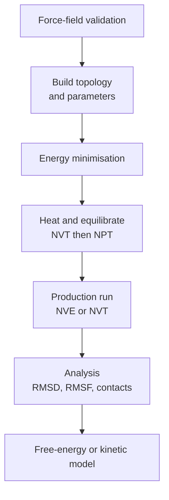
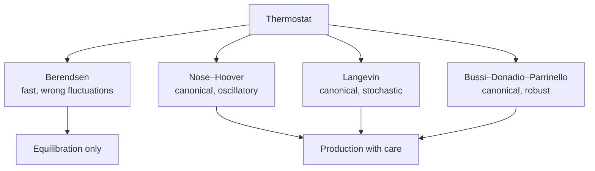
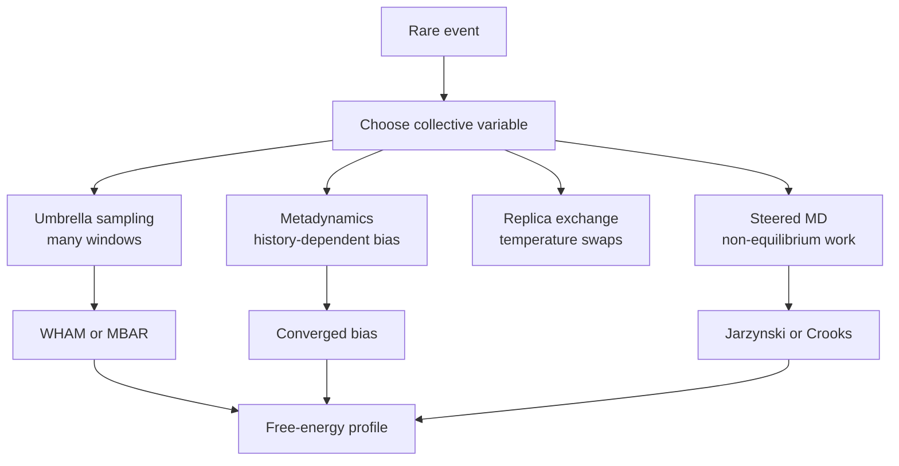

# Chapter 3 — Molecular Dynamics

> **Level:** Research (Level 10 — Postgraduate and research)
> **Estimated study time:** 9 hours (6 h reading + 3 h exercises)
> **Prerequisites:** [Advanced Quantum Chemistry](01-advanced-quantum-chemistry.md); [Computational Chemistry and Density Functional Theory](02-computational-chemistry-and-density-functional-theory.md); classical mechanics and statistical thermodynamics
> **Related chapters:** [Advanced Reaction Mechanisms](05-advanced-reaction-mechanisms.md), [Level 10 index](README.md)
> **Difficulty:** ★★★★★ (5/5)

---

## 1. Learning Objectives

After working through this chapter you will be able to:

- Explain what a classical molecular dynamics simulation computes and what
  approximations it makes.
- Write the bonded and non-bonded terms of a force field and identify the
  parameters each requires.
- Compare AMBER, CHARMM, OPLS, GROMOS, UFF and ReaxFF, and state what each cannot
  capture.
- Discuss parameterisation, transferability and the limits of fixed-charge models.
- Implement and analyse the Verlet, velocity-Verlet and leapfrog integrators, and
  derive their stability limit for a harmonic oscillator.
- Choose a timestep and justify the use of SHAKE, LINCS or SETTLE constraints.
- Apply periodic boundary conditions and the minimum-image convention, and explain
  how Ewald summation and particle-mesh Ewald handle long-range electrostatics.
- Distinguish the NVE, NVT and NPT ensembles and explain the artefacts of the
  Berendsen, Nosé–Hoover and Parrinello–Rahman algorithms.
- Diagnose the flying-ice-cube artefact and correct it.
- Design an enhanced-sampling calculation and reconstruct a free-energy profile
  with WHAM, MBAR or a metadynamics estimator.
- Analyse a trajectory with RMSD, RMSF, hydrogen-bond and clustering metrics, and
  estimate statistical error bars.
- Describe coarse-grained, ab initio and QM/MM dynamics, and introduce Markov state
  models.

---

## 2. Introduction

Molecular dynamics answers a question that electronic structure cannot: what does a
system do with its thermal energy over time? A single-point energy tells you where
the atoms would like to be; a simulation tells you how they move, how often they
cross a barrier, how a ligand escapes a binding pocket and how a membrane bends.
The method is conceptually simple — integrate Newton's equations for a set of
particles interacting through a potential — and computationally demanding, because
the interesting events are rare and the forces must be evaluated at every step.

The approximations are severe and must be understood. Most simulations use a
classical force field: nuclei are point particles, bonds are springs, electrostatics
is a sum of fixed point charges and quantum effects are absent. Bond breaking is
impossible unless the force field is reactive, proton transfer requires an explicit
quantum treatment, and polarisation is either ignored or modelled approximately.
These are not details. A simulation that reports a binding free energy with a
force field that misparameterises the ligand has measured the force field, not the
system.

This chapter builds the method from its foundations. It develops the force-field
energy expression and the integration algorithms, with the stability analysis that
determines the timestep. It treats periodic boundaries and long-range electrostatics,
because a simulation without them is a droplet in vacuum rather than a bulk phase.
It examines the ensembles and the thermostats and barostats that generate them,
including the artefacts they introduce — the flying-ice-cube effect is a case study
in how a plausible algorithm can produce a physically wrong answer. It then turns to
the central difficulty of the field: the timescales. Enhanced sampling, free-energy
reconstruction and Markov state models are the tools that make rare events
accessible, and the chapter explains what each assumes and where it fails.

The treatment assumes statistical mechanics at the level of the canonical ensemble
and ordinary differential equations. Every algorithm is given with its update
equations, every approximation is labelled, and every analysis method is paired with
the question it can and cannot answer.

---

## 3. Fundamental Concepts

### 3.1 What a classical MD simulation computes

A molecular dynamics simulation integrates Newton's equations of motion,
$$
m_i\frac{\mathrm{d}^{2}\mathbf{r}_i}{\mathrm{d}t^{2}} = \mathbf{F}_i
= -\nabla_{\mathbf{r}_i}U(\mathbf{r}_1,\dots,\mathbf{r}_N),
$$
for $N$ particles interacting through a potential energy function $U$. The
trajectory $\{\mathbf{r}_i(t)\}$ is a sequence of configurations; thermodynamic
averages are obtained as time averages,
$$
\langle A\rangle = \lim_{t\to\infty}\frac{1}{t}\int_0^{t}A(\mathbf{r}(t))\,\mathrm{d}t,
$$
and the ergodic hypothesis asserts that this equals the ensemble average. Ergodicity
is an assumption, not a theorem, and it fails on the timescales of many simulations:
a folded protein may never unfold, a crystal may never melt, and a ligand may never
leave its pocket. Recognising non-ergodicity is the first skill of a simulator.

The potential $U$ is the model. In classical MD it is a force field, an analytic
function with parameters fitted to experiment or to quantum calculations. In ab
initio MD it is computed on the fly by electronic structure theory. The choice
determines what the simulation can say: a fixed-charge force field cannot describe
bond breaking, and a semi-empirical Hamiltonian cannot deliver spectroscopic
accuracy.

### 3.2 Force fields: bonded terms

A force field writes the potential as a sum of bonded and non-bonded terms,
$$
U = U_{\mathrm{bond}} + U_{\mathrm{angle}} + U_{\mathrm{dihedral}}
+ U_{\mathrm{improper}} + U_{\mathrm{vdW}} + U_{\mathrm{Coulomb}}.
$$
The bonded terms are harmonic or periodic:

**Bonds.** $U_{\mathrm{bond}} = \sum_{\mathrm{bonds}}k_b(r-r_0)^{2}$, where $k_b$ is
a force constant and $r_0$ an equilibrium length. Some force fields add a cubic
anharmonicity.

**Angles.** $U_{\mathrm{angle}} = \sum_{\mathrm{angles}}k_\theta(\theta-\theta_0)^{2}$,
with the same structure. Angle bending is stiffer than bond stretching but softer
than it looks in a static picture.

**Proper dihedrals.** $U_{\mathrm{dihedral}} =
\sum_{\mathrm{dihedrals}}\frac{V_n}{2}\left[1+\cos(n\phi-\gamma)\right]$, where $n$
is the periodicity, $\gamma$ the phase and $V_n$ the barrier. A fourfold term
describes the torsion of a methyl group, a twofold term the planarity of an amide.

**Improper dihedrals.** A harmonic penalty on an out-of-plane angle maintains
chirality and planarity at $sp^{2}$ centres.

The parameters are not universal. AMBER, CHARMM, OPLS, GROMOS and the universal
force field UFF use different
functional forms, different atom types and different fitting strategies, and mixing
parameters from two families is a common and serious error.

### 3.3 Non-bonded terms and combining rules

The non-bonded energy is
$$
U_{\mathrm{nb}} = \sum_{i<j}\left[
4\varepsilon_{ij}\left(\frac{\sigma_{ij}^{12}}{r_{ij}^{12}}
-\frac{\sigma_{ij}^{6}}{r_{ij}^{6}}\right)
+\frac{q_iq_j}{4\pi\varepsilon_0r_{ij}}\right],
$$
a Lennard-Jones 12-6 term plus Coulomb interaction between fixed partial charges.
The $r^{-12}$ term is a computational convenience, not a physical potential: it
represents Pauli repulsion steeply and cheaply. The $r^{-6}$ term is the leading
dispersion attraction.

Parameters for unlike atoms are obtained by **combining rules**, most commonly
Lorentz–Berthelot:
$$
\sigma_{ij} = \frac{\sigma_i+\sigma_j}{2}, \qquad
\varepsilon_{ij} = \sqrt{\varepsilon_i\varepsilon_j}.
$$
Some force fields use geometric mixing for $\sigma$ or different exponents. The
choice affects the density and the mixing enthalpy of a mixture, so it is part of the
model.

Partial charges are usually fitted to the electrostatic potential of a quantum
calculation (RESP, CHELPG) or assigned by a bond-increment scheme. They are not
observables, and different fitting procedures give different charges for the same
molecule.

### 3.4 What force fields cannot capture

A fixed-charge, non-reactive force field cannot describe:

- **bond breaking and formation**, because the bonded topology is fixed;
- **proton transfer**, because it requires bond breaking and charge migration;
- **electronic polarisation**, because the charges do not respond to the
  environment; this matters for ions, interfaces and strong fields;
- **charge transfer and excited states**, which are quantum phenomena;
- **nuclear quantum effects**, such as proton tunnelling in enzymes;
- **spin states and reactivity**, which require electronic structure.

Several extensions address these limits. **Polarisable force fields** (Drude
oscillators, fluctuating charges, AMOEBA) allow induced dipoles. **Reactive force
fields** such as **ReaxFF** use bond orders computed from interatomic distances and
allow bonds to break and form; they can simulate combustion and catalysis at the
cost of parameterisation. **Machine-learned potentials** fitted to quantum data
approach quantum accuracy at classical cost, but their transferability is limited to
the training domain. **QM/MM** and **ab initio MD** treat the reactive region
quantum mechanically.

### 3.5 Parameterisation and transferability

A force field is only as good as its parameters. Parameterisation proceeds by
fitting to a combination of quantum energies and geometries, experimental
thermodynamic data (densities, heats of vaporisation, free energies of hydration)
and spectroscopic data.

**Transferability** is the assumption that a parameter derived for one molecule
applies to another. It holds for well-defined chemical groups and fails for strained
rings, unusual oxidation states, halogens and metals. The General AMBER Force Field
(GAFF) and the CHARMM General Force Field (CGenFF) are designed for transferability
across drug-like molecules; they are not accurate enough for a quantitative
prediction on a novel functional group without validation.

### 3.6 Integration algorithms and stability

The **Verlet algorithm** updates positions from the current and previous positions:
$$
\mathbf{r}(t+\Delta t) = 2\mathbf{r}(t)-\mathbf{r}(t-\Delta t)
+ \frac{\mathbf{F}(t)}{m}\Delta t^{2} + O(\Delta t^{4}).
$$
It requires no velocities, is time-reversible and symplectic, and conserves energy
well over long trajectories. Velocities are obtained by finite difference,
$\mathbf{v}(t) = [\mathbf{r}(t+\Delta t)-\mathbf{r}(t-\Delta t)]/(2\Delta t)$.

The **velocity-Verlet** algorithm stores positions and velocities:
$$
\begin{aligned}
\mathbf{r}(t+\Delta t) &= \mathbf{r}(t)+\mathbf{v}(t)\Delta t
+\frac{\mathbf{F}(t)}{2m}\Delta t^{2},\\
\mathbf{v}(t+\Delta t) &= \mathbf{v}(t)+\frac{\mathbf{F}(t)+\mathbf{F}(t+\Delta t)}{2m}\Delta t .
\end{aligned}
$$
It is algebraically equivalent to Verlet, numerically more stable, and is the
standard in modern codes.

The **leapfrog** algorithm stores velocities at half-steps:
$$
\mathbf{v}(t+\tfrac12\Delta t) = \mathbf{v}(t-\tfrac12\Delta t)
+\frac{\mathbf{F}(t)}{m}\Delta t, \qquad
\mathbf{r}(t+\Delta t) = \mathbf{r}(t)+\mathbf{v}(t+\tfrac12\Delta t)\Delta t .
$$
It is equivalent to Verlet with a shift of half a step.

For a harmonic oscillator of angular frequency $\omega$ the Verlet recursion has a
stability limit
$$
\Delta t < \frac{2}{\omega},
$$
and accuracy requires roughly ten to twenty steps per period. This single result
determines the timestep of every classical simulation: the fastest motion sets the
step, not the motion of interest.

### 3.7 Timesteps and constraints

A C–H bond vibrates at about $3000\ \mathrm{cm^{-1}}$, a period of $11\ \mathrm{fs}$.
A timestep of $1\ \mathrm{fs}$ gives eleven steps per period, which is marginal; a
timestep of $2\ \mathrm{fs}$ is unstable for an unconstrained C–H bond. Since bond
stretching is fast and chemically uninteresting in most simulations, it is removed
by **constraints**.

**SHAKE** (Ryckaert, Ciccotti and Berendsen) enforces bond-length constraints by
Lagrange multipliers iteratively after each step. **LINCS** (Hess) uses a
linearisation and is faster and more stable for large systems. **SETTLE** is an
analytic solution for rigid water molecules and is exact and cheap.

With hydrogen bonds constrained, the fastest remaining motions are heavy-atom
stretches and angle bends around $1000\ \mathrm{cm^{-1}}$, and a $2\ \mathrm{fs}$
timestep is standard. **Hydrogen mass repartitioning** transfers mass from hydrogen
to its bonded heavy atom, slowing the hydrogen motion and allowing $4\ \mathrm{fs}$
steps without constraints; it changes the dynamics of hydrogen transfer and must be
used with care when proton motion matters.

### 3.8 Periodic boundaries, cutoffs and long-range electrostatics

A finite simulation box has a surface, and a droplet has different thermodynamics
from a bulk phase. **Periodic boundary conditions** remove the surface by tiling
space with the box; a particle leaving one side enters the opposite side. The
**minimum-image convention** computes each interaction with the nearest image of the
partner, which is valid only when the cutoff is less than half the box length.

Non-bonded interactions are truncated at a cutoff, typically $1.0$–$1.2\ \mathrm{nm}$,
with a switching or shifting function to avoid energy discontinuities. Truncating
the Lennard-Jones term is a controlled approximation; truncating the Coulomb term is
not, because the $1/r$ interaction is long-ranged and the neglected tail changes the
dielectric properties and the structure of the liquid.

**Ewald summation** splits the Coulomb interaction into a short-range part evaluated
in real space and a long-range part evaluated in reciprocal space:
$$
\frac{1}{r} = \frac{\mathrm{erfc}(\alpha r)}{r}
+ \frac{\mathrm{erf}(\alpha r)}{r}.
$$
The first term is short-ranged and summed with a cutoff; the second is smooth and
summed over reciprocal lattice vectors. The splitting parameter $\alpha$ controls the
balance, and the cost of the reciprocal sum is reduced from $O(N^{2})$ to
$O(N\log N)$ by **particle-mesh Ewald** (PME), which interpolates charges onto a grid
and uses fast Fourier transforms.

### 3.9 Ensembles, thermostats and barostats

The **microcanonical** (NVE) ensemble has fixed particle number, volume and energy;
it is the natural output of Newtonian dynamics and the reference for energy
conservation.

The **canonical** (NVT) ensemble fixes temperature through a thermostat. Algorithms
differ in what they do to the dynamics:

- **Berendsen** scaling rescales velocities towards the target temperature with a
  time constant $\tau$. It is stable and reaches the target quickly, but it does not
  generate the canonical distribution: fluctuations are suppressed. It is suitable
  for equilibration, not for production.
- **Nosé–Hoover** couples the system to a thermostat with its own momentum, which
  generates the canonical distribution. It can be non-ergodic for stiff systems and
  produces oscillatory temperature traces when $\tau$ is too small.
- **Langevin** dynamics adds friction and random forces, which is physically
  appropriate for a system coupled to a solvent and robust in practice.
- **Bussi–Donadio–Parrinello** stochastic velocity rescaling generates the correct
  canonical distribution and is a common default.

The **isothermal–isobaric** (NPT) ensemble fixes pressure through a barostat.
**Berendsen** barostats suffer the same fluctuation problem as their thermostat
counterpart. **Parrinello–Rahman** couples the box to a piston with its own mass and
generates the correct ensemble. **Monte Carlo barostats** attempt volume moves with
a Metropolis criterion and are robust for anisotropic systems.

### 3.10 The flying-ice-cube artefact

A thermostat that rescales velocities indiscriminately can remove kinetic energy
from internal motion and deposit it into centre-of-mass translation. The whole system
then drifts, and the internal temperature falls while the thermostat reports the
target value. The name comes from the appearance of a simulated ice cube that
translates without melting.

The cause is a combination of momentum non-conservation and a thermostat that does
not distinguish rotational, translational and vibrational kinetic energy. Remedies
are to remove the centre-of-mass velocity periodically, to use a thermostat that
acts on peculiar velocities, and to check that the temperature computed from the
peculiar kinetic energy matches the target. The artefact is a warning: a thermostat
is an algorithm, not a physical bath, and its side effects must be monitored.

### 3.11 Enhanced sampling and free-energy reconstruction

Rare events are inaccessible to direct simulation because the waiting time exceeds
the affordable trajectory by orders of magnitude. Enhanced sampling adds a bias that
makes the event frequent, then removes the bias mathematically.

**Umbrella sampling** adds a harmonic bias along a reaction coordinate $\xi$,
$$
U_b(\xi) = \tfrac12 k(\xi-\xi_0)^{2},
$$
and runs a series of windows with different $\xi_0$. The unbiased free energy is
recovered by **WHAM** (weighted histogram analysis method) or **MBAR** (multistate
Bennett acceptance ratio), which solve for the window free energies and the density
of states self-consistently.

**Replica exchange** runs copies of the system at different temperatures and swaps
configurations with a Metropolis criterion, allowing high-temperature replicas to
cross barriers and low-temperature replicas to sample the correct ensemble.

**Steered MD** pulls the system along a coordinate and records the work. The
**Jarzynski equality**,
$$
e^{-\Delta F/k_\mathrm{B}T} = \left\langle e^{-W/k_\mathrm{B}T}\right\rangle,
$$
relates the exponential average of non-equilibrium work to the free-energy
difference; it converges poorly when the pulling is fast, and bidirectional
estimators (Crooks) are preferred.

### 3.12 Coarse-grained, ab initio and QM/MM dynamics

**Coarse-grained** models group atoms into beads. The Martini force field maps four
heavy atoms to one bead and reproduces partitioning and membrane properties at
millisecond timescales. Coarse-graining loses chemical detail and requires
re-parameterisation for each system class; its free energies are not transferable to
all-atom accuracy without correction.

**Ab initio molecular dynamics** computes forces from electronic structure at every
step, usually with density functional theory (Born–Oppenheimer MD) or with a
propagated wavefunction (Car–Parrinello MD). It captures bond breaking and
polarisation but is limited to hundreds of atoms and tens of picoseconds.

**QM/MM** treats a small reactive region quantum mechanically and the rest with a
force field. Electrostatic embedding lets the classical charges polarise the quantum
region; mechanical embedding does not. The boundary requires link atoms or frozen
orbitals, and the size of the quantum region must be converged.

### 3.13 Analysis, error bars and Markov state models

A trajectory is not a result until it is analysed. Standard metrics include the
**root-mean-square deviation** (RMSD) from a reference structure, the
**root-mean-square fluctuation** (RMSF) per residue, hydrogen-bond counts and
lifetimes, clustering by structural similarity, and **principal component analysis**
of the covariance matrix of atomic displacements.

Statistical error is estimated by **block averaging**: divide the trajectory into
blocks longer than the correlation time, compute the average of each block, and use
the standard error of the block means. A trajectory that is shorter than the
correlation time cannot give a meaningful error bar.

**Markov state models** discretise the conformational space into states and estimate
a transition matrix at a lag time $\tau$. The model is valid when the implied
timescales are independent of $\tau$ (a plateau) and when the Chapman–Kolmogorov
test is satisfied. MSMs turn many short trajectories into a long-timescale picture,
but they assume that the dynamics is Markovian at the chosen discretisation, and
that assumption must be tested rather than asserted.

---

## 4. Detailed Scientific Explanation

### 4.1 Why velocity Verlet conserves energy

The Verlet family is symplectic: it preserves the phase-space volume and a shadow
Hamiltonian close to the true one. The practical consequence is that energy error
oscillates rather than drifts, which is why a well-behaved NVE simulation shows a
constant total energy over millions of steps.

Substituting a harmonic force $F = -m\omega^{2}x$ into the Verlet recursion gives
$$
x_{n+1} = (2-\omega^{2}\Delta t^{2})x_n - x_{n-1}.
$$
Trying $x_n = A\lambda^{n}$ gives
$\lambda^{2} - (2-\omega^{2}\Delta t^{2})\lambda + 1 = 0$, whose roots have unit
modulus when $\omega\Delta t < 2$. Beyond that limit the roots become real and the
trajectory grows exponentially. The stability limit is therefore
$\Delta t < 2/\omega$, and the accuracy limit is stricter: at
$\omega\Delta t = 0.2$ the fractional energy error per period is already of order
$10^{-3}$.

For a C–H stretch at $3000\ \mathrm{cm^{-1}}$, $\omega = 5.65\times10^{14}\
\mathrm{s^{-1}}$ and $2/\omega = 3.5\ \mathrm{fs}$. A $1\ \mathrm{fs}$ step is stable
but only marginally accurate; a $2\ \mathrm{fs}$ step is unstable. Constraining the
bond removes the mode and permits $2\ \mathrm{fs}$.

### 4.2 Thermostats and the canonical distribution

A thermostat must generate the canonical distribution, not merely the correct mean
temperature. The distinction is measurable: the variance of the kinetic energy in
the canonical ensemble is
$$
\mathrm{var}(K) = \frac{3N}{2}k_\mathrm{B}^{2}T^{2},
$$
so a thermostat that suppresses fluctuations is detectable from the time series.

Berendsen scaling multiplies velocities by
$\lambda = [1+(\Delta t/\tau)(T_0/T-1)]^{1/2}$. It drives $T$ to $T_0$ exponentially
but does not include the random forces required by the fluctuation–dissipation
theorem, so the distribution is narrower than canonical. Nosé–Hoover introduces a
thermostat variable $\zeta$ with
$$
\dot{\mathbf{p}}_i = \mathbf{F}_i - \zeta\mathbf{p}_i, \qquad
\dot{\zeta} = \frac{1}{Q}\left(\sum_i\frac{\mathbf{p}_i^{2}}{m_i}-3Nk_\mathrm{B}T_0\right),
$$
which conserves a extended Hamiltonian and yields the canonical distribution for
ergodic systems. Langevin dynamics, with friction $\gamma$ and random force
$\mathbf{R}(t)$ satisfying
$\langle R_i(t)R_j(t')\rangle = 2\gamma m k_\mathrm{B}T\delta_{ij}\delta(t-t')$,
satisfies the fluctuation–dissipation theorem by construction.

### 4.3 Free energy from biased simulations

Umbrella sampling produces biased distributions $P_b(\xi)$ related to the unbiased
one by
$$
P_b(\xi) = \frac{P_0(\xi)\,e^{-\beta U_b(\xi)}}{\langle e^{-\beta U_b}\rangle}.
$$
The free energy follows as
$$
F(\xi) = -k_\mathrm{B}T\ln P_0(\xi) + \text{constant}
= -k_\mathrm{B}T\ln P_b(\xi) - U_b(\xi) + \text{constant}.
$$
Combining windows requires the constants, which WHAM determines by maximising the
likelihood of the overlapping histograms. MBAR generalises the same idea to samples
from many states without binning and gives the lowest-variance estimator when the
samples are independent.

Metadynamics replaces the umbrella windows with a single history-dependent bias,
$V(\xi,t) = \sum_{t'<t}W e^{-(\xi-\xi(t'))^{2}/2\sigma^{2}}$, and estimates the free
energy as the negative of the converged bias. Well-tempered metadynamics scales the
hill height by $e^{-V(\xi,t)/\Delta T}$, which converges to
$F(\xi) = -[\Delta T/(T+\Delta T)]V(\xi,t)$ rather than oscillating.

### 4.4 Force-field validation and honest error bars

The dominant error in a biomolecular free-energy calculation is usually the force
field, not the sampling. Three validation layers are standard.

First, **pure-liquid properties**: density, heat of vaporisation, isothermal
compressibility and dielectric constant. A force field that reproduces these for
small molecules is calibrated for the environment of interest.

Second, **solvation free energies**: compare with experiment for a set of
compounds spanning the chemical space of the ligand. The S66 and FreeSolv sets are
common references.

Third, **conformational and binding benchmarks**: for a protein–ligand complex,
compare computed and crystallographic poses, and where possible compare computed
binding free energies with isothermal titration calorimetry.

Error bars must include both statistical and systematic contributions. Statistical
error comes from correlation times and is estimated by block averaging or by
bootstrapping over independent replicas. Systematic error comes from the force
field, the finite size of the box, the cutoff and the enhanced-sampling bias. A
free-energy difference quoted to $0.1\ \mathrm{kJ\,mol^{-1}}$ without an error
analysis is not a result; a difference quoted to $2\ \mathrm{kJ\,mol^{-1}}$ with a
stated force-field uncertainty is.

---

## 5. Visual Diagrams

**Figure 3.1 — The molecular dynamics workflow.** Equilibration is not a formality:
the system must lose its memory of the arbitrary starting structure before production
sampling begins. Validation sits outside the main chain because it must be done
before the workflow is trusted, not after the result is obtained.

**Figure 3.2 — Choosing a thermostat.** The choice is between speed of equilibration
and correctness of the ensemble. Berendsen scaling is convenient precisely because it
suppresses fluctuations, which is also why it must not be used for production.
Langevin and stochastic rescaling generate the canonical distribution and are the
safe defaults.

**Figure 3.3 — Four routes to a free-energy profile.** All four bias the dynamics and
then remove the bias mathematically; they differ in how the bias is applied and what
must be converged. The choice of collective variable is common to all of them and is
usually the limiting assumption.

---

## 6. Mathematical Formulas

### 6.1 Integration and temperature

$$
\mathbf{r}(t+\Delta t) = 2\mathbf{r}(t)-\mathbf{r}(t-\Delta t)
+\frac{\mathbf{F}(t)}{m}\Delta t^{2}, \qquad
T = \frac{2K}{3Nk_\mathrm{B}}, \qquad
K = \frac12\sum_i m_i v_i^{2}.
$$

| Symbol | Meaning | SI unit |
|---|---|---|
| $\mathbf{r}$ | position | m |
| $\Delta t$ | timestep | s |
| $m$ | particle mass | kg |
| $\mathbf{F}$ | force | N |
| $K$ | total kinetic energy | J |
| $N$ | number of particles | dimensionless |
| $k_\mathrm{B}$ | Boltzmann constant, $1.380\,649\times10^{-23}$ | $\mathrm{J\,K^{-1}}$ |

Assumptions: classical nuclei, pairwise additive forces, no constraints. The
temperature formula counts $3N$ degrees of freedom; with constraints the count
becomes $3N-N_c$, and using the wrong count biases the temperature.

### 6.2 Pressure and the virial

$$
P = \frac{Nk_\mathrm{B}T}{V} + \frac{1}{3V}\left\langle\sum_{i<j}\mathbf{r}_{ij}\cdot\mathbf{F}_{ij}\right\rangle,
$$

| Symbol | Meaning | SI unit |
|---|---|---|
| $P$ | pressure | Pa |
| $V$ | volume | $\mathrm{m^{3}}$ |
| $\mathbf{r}_{ij}$ | separation vector | m |
| $\mathbf{F}_{ij}$ | force between $i$ and $j$ | N |

Assumptions: pairwise forces, periodic boundaries, no external field. Long-range
corrections to the virial are needed when the Lennard-Jones interaction is
truncated.

### 6.3 Free-energy estimators

$$
F(\xi) = -k_\mathrm{B}T\ln P_b(\xi)-U_b(\xi)+C, \qquad
e^{-\Delta F/k_\mathrm{B}T} = \left\langle e^{-W/k_\mathrm{B}T}\right\rangle .
$$

| Symbol | Meaning | SI unit |
|---|---|---|
| $\xi$ | collective variable | varies |
| $P_b$ | biased probability distribution | varies |
| $U_b$ | bias potential | J |
| $W$ | non-equilibrium work | J |
| $\Delta F$ | free-energy difference | J |

Assumptions: the biased distribution is sampled adequately, the collective variable
captures the slow mode, and the Jarzynski average is over many pulls with sufficient
overlap between work distributions.

---

## 7. Chemical Equations

$$
\ce{NaCl(s) -> Na+(aq) + Cl-(aq)} \qquad \Delta_\mathrm{sol}G^\circ = +8.6\ \mathrm{kJ\,mol^{-1}}
$$

Dissolution of sodium chloride. The free-energy change is small because the lattice
enthalpy and the hydration free energies nearly cancel; a simulation reproduces it
only if the ion–water interactions and the dielectric properties of water are
accurate. This is a standard test of a force field.

$$
\ce{H2CO3(aq) -> CO2(g) + H2O(l)} \qquad \text{carbonic anhydrase}
$$

Decomposition of carbonic acid catalysed by carbonic anhydrase. The proton transfer
and the C–O bond cleavage require a quantum treatment; the surrounding protein is
usually modelled by QM/MM, and the computed barrier is compared with kinetic data.

$$
\ce{CH4(g) + 2O2(g) -> CO2(g) + 2H2O(g)} \qquad \Delta_\mathrm{c}H^\circ = -802\ \mathrm{kJ\,mol^{-1}}
$$

Combustion of methane. A reactive force field such as ReaxFF can simulate bond
breaking in this system, but the reaction is fast and the mechanism is complex;
the simulation is used to study ignition and flame structure rather than to compute
a precise enthalpy.

$$
\ce{H2O(s) -> H2O(l)} \qquad \Delta_\mathrm{fus}H^\circ = +6.01\ \mathrm{kJ\,mol^{-1}}
$$

Melting of ice. The free-energy difference between two phases is obtained by
thermodynamic integration or by a free-energy perturbation along a coupling
parameter, and the result is sensitive to the water model. A model that reproduces
the density of liquid water can still miss the melting point by tens of kelvin.

---

## 8. Worked Examples

### Worked Example 8.1 — Timestep from a vibrational frequency

**Problem.** An O–H stretch has a wavenumber of $3600\ \mathrm{cm^{-1}}$. Compute
its period and the Verlet stability limit, and decide whether a $2\ \mathrm{fs}$
timestep is acceptable with and without a bond constraint.

**Solution.** The frequency is
$$
\nu = c\tilde\nu = 2.998\times10^{10}\times3600 = 1.08\times10^{14}\ \mathrm{s^{-1}},
\qquad
\omega = 2\pi\nu = 6.78\times10^{14}\ \mathrm{s^{-1}}.
$$
The period is $T = 1/\nu = 9.3\ \mathrm{fs}$, and the stability limit is
$\Delta t < 2/\omega = 2.95\ \mathrm{fs}$. A $2\ \mathrm{fs}$ step is therefore stable
but gives fewer than five steps per period, which is not accurate. Constraining the
O–H bond removes the mode; the fastest remaining motion is a heavy-atom stretch near
$1000\ \mathrm{cm^{-1}}$ with a period of $33\ \mathrm{fs}$, and $2\ \mathrm{fs}$
gives sixteen steps per period, which is adequate.

**Check.** A $1\ \mathrm{fs}$ step without constraints gives nine steps per period —
borderline, and the reason early simulations used $0.5$–$1\ \mathrm{fs}$.

### Worked Example 8.2 — Temperature from kinetic energy

**Problem.** A box of 216 water molecules (648 atoms) has a total kinetic energy of
$4.02\times10^{-18}\ \mathrm{J}$. Compute the instantaneous temperature and the
root-mean-square speed of a water molecule.

**Solution.** With $N=648$ and no constraints,
$$
T = \frac{2K}{3Nk_\mathrm{B}} = \frac{2\times4.02\times10^{-18}}
{3\times648\times1.381\times10^{-23}} = 299.5\ \mathrm{K}.
$$
The RMS speed follows from
$\tfrac12 m\langle v^{2}\rangle = \tfrac32 k_\mathrm{B}T$:
$$
v_{\mathrm{rms}} = \sqrt{\frac{3k_\mathrm{B}T}{m}}
= \sqrt{\frac{3\times1.381\times10^{-23}\times299.5}{18\times1.661\times10^{-27}}}
= 645\ \mathrm{m\,s^{-1}}.
$$

**Check.** The temperature is the target $300\ \mathrm{K}$, as it should be for an
equilibrated system. If constraints are used, the denominator becomes
$3N-N_c$ and neglecting this correction biases the reported temperature by a few
per cent.

### Worked Example 8.3 — Free energy from two umbrella windows

**Problem.** Two umbrella windows are centred at $0.50$ and $0.60\ \mathrm{nm}$ with
$k=1000\ \mathrm{kJ\,mol^{-1}\,nm^{-2}}$. At the overlap point $\xi=0.55\ \mathrm{nm}$
the biased probability in window 1 is twice that in window 2. Compute the free-energy
offset between the windows.

**Solution.** At $\xi=0.55\ \mathrm{nm}$ both biases equal
$U_b=\tfrac12\times1000\times(0.05)^{2}=1.25\ \mathrm{kJ\,mol^{-1}}$, so the bias
terms cancel and
$$
F_2-F_1 = -RT\ln\frac{P_2}{P_1} = -2.478\times\ln(0.5)
= +1.72\ \mathrm{kJ\,mol^{-1}}.
$$
The offset is added to window 2 before the profiles are spliced.

**Check.** A factor of two in probability corresponds to $1.7\ \mathrm{kJ\,mol^{-1}}$,
which is the scale of thermal energy at room temperature. Overlap factors between
$0.1$ and $10$ are acceptable; below $0.01$ the windows are effectively disconnected
and the estimate is unreliable.

### Worked Example 8.4 — Jarzynski estimate from steered MD

**Problem.** Three steered-MD pulls give work values of $10$, $12$ and
$14\ \mathrm{kJ\,mol^{-1}}$ at $298\ \mathrm{K}$. Estimate the free-energy
difference.

**Solution.** With $RT = 2.478\ \mathrm{kJ\,mol^{-1}}$,
$$
\left\langle e^{-W/RT}\right\rangle = \tfrac13\left(e^{-4.036}+e^{-4.843}
+e^{-5.650}\right) = \tfrac13(0.0177+0.00789+0.00352) = 0.00970,
$$
so
$$
\Delta F = -RT\ln(0.00970) = 2.478\times4.635 = 11.5\ \mathrm{kJ\,mol^{-1}}.
$$

### Worked Example 8.5 — Diffusion coefficient from the mean-square displacement

**Problem.** The mean-square displacement of water molecules is linear in time with
a slope of $14\ \mathrm{nm^{2}\,ns^{-1}}$. Compute the diffusion coefficient and
compare it with the experimental value of $2.3\times10^{-9}\ \mathrm{m^{2}\,s^{-1}}$.

**Solution.** In three dimensions $\mathrm{MSD}=6Dt$, so
$$
D = \frac{14}{6}\ \mathrm{nm^{2}\,ns^{-1}} = 2.33\ \mathrm{nm^{2}\,ns^{-1}}
= 2.33\times10^{-9}\ \mathrm{m^{2}\,s^{-1}}.
$$

---

## 9. Real-World Applications

**Drug discovery.** Molecular dynamics refines docking poses, estimates residence
times and computes relative binding free energies. The results are only as good as
the force field and the sampling, and both are usually the limiting factors.

**Biophysics.** Membrane proteins, ion channels and nucleic acids are simulated at
the microsecond scale to study gating, transport and folding. Coarse-grained models
extend the accessible timescale at the cost of chemical detail.

**Materials and catalysis.** MD computes thermal conductivity, diffusion, viscosity
and phase behaviour, and QM/MM or ab initio MD describes the reactive step in a
catalyst or a battery electrolyte.

---

## 10. Common Mistakes

| Mistake | Why it happens | Correct approach |
|---|---|---|
| Using a $2\ \mathrm{fs}$ step without constraints | The manual suggests it | Constrain hydrogen bonds or use hydrogen mass repartitioning |
| Reporting production data from a Berendsen thermostat | It equilibrates quickly and looks stable | Use it for equilibration only; production with a canonical thermostat |
| Ignoring the flying-ice-cube effect | The thermostat reports the target temperature | Remove centre-of-mass motion and check peculiar temperature |
| Truncating Coulomb interactions at the cutoff | It is faster | Use Ewald or PME and report the parameters |
| Using a box smaller than twice the cutoff | The minimum-image convention seems automatic | Enforce $L>2r_c$ and check the box size |
| Quoting a free energy without an error bar | The number is well defined | Block-average and include force-field uncertainty |
| Mixing parameters from two force fields | Both are published and look compatible | Use one consistent family and validate |
| Assuming a Markov state model is valid | The lag time was chosen arbitrarily | Check implied-timescale plateaus and Chapman–Kolmogorov |

---

## 11. Chapter Summary

- Classical MD integrates Newton's equations on a force-field potential and
  assumes ergodicity, which often fails on accessible timescales.
- Force fields combine harmonic bonded terms with Lennard-Jones and Coulomb
  non-bonded terms; fixed-charge models cannot break bonds or polarise.
- Verlet-type integrators are symplectic, with a stability limit
  $\Delta t<2/\omega$ and an accuracy limit of about ten steps per period.
- Constraints on hydrogen bonds permit $2\ \mathrm{fs}$ timesteps; hydrogen mass
  repartitioning permits $4\ \mathrm{fs}$.
- Periodic boundaries, the minimum-image convention and PME are required for bulk
  electrostatics.
- Thermostats and barostats differ in whether they generate the correct ensemble;
  Berendsen algorithms do not.
- Enhanced sampling and free-energy estimators convert rare events into computable
  quantities, at the cost of assumptions about the collective variable.
- Coarse-grained, ab initio and QM/MM methods extend the range of accessible
  systems and timescales.
- Error bars must combine statistical and systematic contributions, and a force
  field must be validated before production.

---

## 12. Exercises

### 12.1 Conceptual questions

1. Why does an NVE simulation conserve energy while an NVT simulation does not?
2. Explain why a Berendsen thermostat does not generate the canonical distribution.
3. What is the flying-ice-cube effect, and how is it detected?

### 12.2 Basic problems

4. Compute the period of a C–H stretch at $3000\ \mathrm{cm^{-1}}$ and the largest
   stable Verlet timestep.
5. A system of 1000 atoms has $K=6.2\times10^{-18}\ \mathrm{J}$. Compute $T$.
6. State the minimum-image condition for a cubic box of side $L$ and a cutoff $r_c$.

### 12.3 Intermediate problems

7. A free-energy profile has a barrier of $20\ \mathrm{kJ\,mol^{-1}}$. Estimate the
   ratio of forward to backward rates at $298\ \mathrm{K}$ if the prefactor is the
   same.
8. Explain why PME requires a neutral simulation cell.
9. A diffusion coefficient is computed as $2.0\times10^{-9}\ \mathrm{m^{2}\,s^{-1}}$
   in a box of $3\ \mathrm{nm}$. Why might it differ from experiment?

### 12.4 Advanced problems

10. Design a free-energy protocol to compute the relative binding free energy of two
    ligands to a kinase, stating the collective variable, the sampling method and
    the error analysis.
11. Explain how hydrogen mass repartitioning allows a $4\ \mathrm{fs}$ timestep and
    what physics it distorts.
### 12.5 Calculation problems

12. Convert $2.33\times10^{-9}\ \mathrm{m^{2}\,s^{-1}}$ to
    $\mathrm{nm^{2}\,ns^{-1}}$.

### 12.6 Answers

1. NVE has no thermostat or barostat, so the total energy is conserved up to
   integrator error; NVT exchanges energy with a bath by construction.
2. Berendsen scaling is deterministic and lacks the random force required by the
   fluctuation–dissipation theorem, so the kinetic-energy variance is too small.
3. Centre-of-mass kinetic energy grows at the expense of internal motion; the
   computed internal temperature falls while the thermostat reports the target.
   Detect it by monitoring the centre-of-mass velocity and the peculiar temperature.
4. $\nu=8.99\times10^{13}\ \mathrm{s^{-1}}$, period $11.1\ \mathrm{fs}$,
   $\Delta t_{\max}=2/\omega=3.5\ \mathrm{fs}$.
5. $T=2K/(3Nk_\mathrm{B})=2\times6.2\times10^{-18}/(3\times1000\times1.381\times10^{-23})
   =299\ \mathrm{K}$.
6. $r_c<L/2$ in each dimension.
7. $k_{\mathrm{f}}/k_{\mathrm{b}}=\exp(-\Delta G/RT)=\exp(-20/2.478)=3.1\times10^{-4}$.
8. A net charge would make the periodic electrostatic energy diverge; a neutralising
   background is added, which introduces its own artefact.
9. Finite-size effects, a truncated or PME-corrected electrostatics, the water model,
   and insufficient trajectory length all bias $D$; the Yeh–Hummer correction
   accounts for the hydrodynamic finite-size effect.
10. Use a thermodynamic-cycling or alchemical transformation, decouple the ligand
    in a series of windows, sample with Hamiltonian replica exchange, and analyse
    with MBAR; repeat with independent seeds and report the standard deviation
    across replicas plus the force-field uncertainty.
11. Moving mass from hydrogen to the bonded heavy atom lowers the hydrogen
    vibrational frequency, allowing a longer step; it distorts hydrogen dynamics,
    kinetic isotope effects and any process controlled by proton transfer.
12. $2.33\times10^{-9}\ \mathrm{m^{2}\,s^{-1}} = 2.33\ \mathrm{nm^{2}\,ns^{-1}}$.

---

## 13. Further Reading

- Frenkel, D.; Smit, B. *Understanding Molecular Simulation: From Algorithms to
  Applications*, 2nd ed., Academic Press, 2002.
- Allen, M. P.; Tildesley, D. J. *Computer Simulation of Liquids*, 2nd ed., Oxford
  University Press, 2017.
- Jensen, F. *Introduction to Computational Chemistry*, 3rd ed., Wiley, 2017.
- Cramer, C. J. *Essentials of Computational Chemistry: Theories and Models*, 2nd
  ed., Wiley, 2004.
- National Academies of Sciences, Engineering, and Medicine. *Reproducibility and
  Replicability in Science*. The National Academies Press, 2019.
  <https://doi.org/10.17226/25303>
- [CURRICULUM.md](../CURRICULUM.md) — where this chapter sits in the programme.
- [REFERENCES.md](../REFERENCES.md) — the repository's source list.
