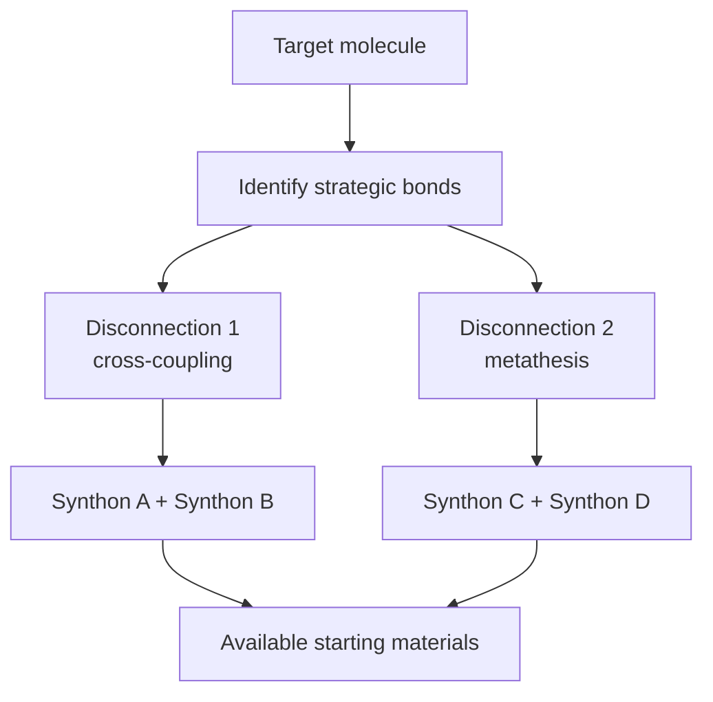
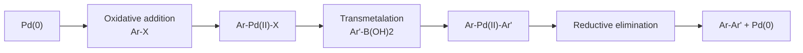
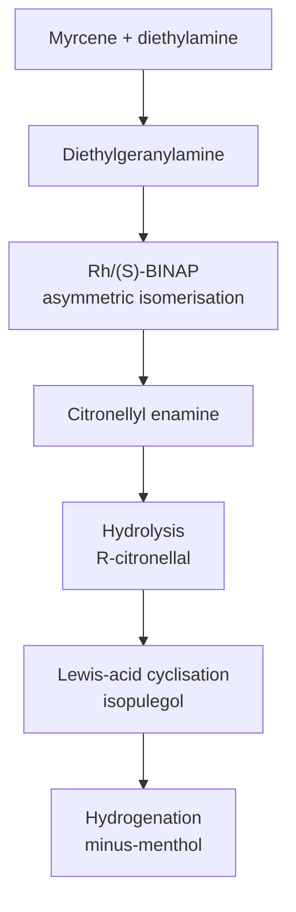

# Chapter 4 — Advanced Organic Synthesis

> **Level:** Research (Level 10 — Postgraduate and research)
> **Estimated study time:** 10 hours (7 h reading + 3 h exercises)
> **Prerequisites:** [Organic Chemistry](../05-organic-chemistry/README.md) in full, especially [Isomerism and Stereochemistry](../05-organic-chemistry/03-isomerism-and-stereochemistry.md) and [Carbonyl Chemistry](../05-organic-chemistry/10-aldehydes-ketones-and-carbonyl-chemistry.md); [Advanced Reaction Mechanisms](05-advanced-reaction-mechanisms.md) is a useful companion
> **Related chapters:** [Advanced Reaction Mechanisms](05-advanced-reaction-mechanisms.md), [Level 10 index](README.md)
> **Difficulty:** ★★★★★ (5/5)

---

## 1. Learning Objectives

After working through this chapter you will be able to:

- Perform a retrosynthetic analysis, identifying strategic bonds, disconnections,
  synthons and functional-group interconversions.
- Distinguish target-oriented from diversity-oriented synthesis, and linear from
  convergent routes, and quantify the consequences of each.
- Choose protecting groups on the basis of orthogonality and calculate the step and
  atom cost of protection.
- Apply the criteria that define a good route: yield, convergence, selectivity,
  safety, cost and green metrics.
- Explain the mechanisms and scope of Suzuki–Miyaura and Buchwald–Hartwig couplings,
  C–H activation, photoredox catalysis and nickel catalysis.
- Design an olefin metathesis strategy and predict ring-closing versus
  cross-metathesis outcomes.
- Select an asymmetric method — Sharpless, Noyori, List or enzymatic — for a given
  substrate and justify the stereochemical model.
- Explain how directed evolution produces enzymes for non-natural substrates.
- Evaluate flow chemistry, solid-phase synthesis and scale-up constraints.
- Describe landmark total syntheses from their published strategies without
  inventing details.
- Critique a proposed route for selectivity, safety, cost and step economy.
- Write a complete, reagent-level forward plan for a target molecule and defend it.

---

## 2. Introduction

Organic synthesis is the discipline of making molecules on purpose. Its intellectual
core is not the catalogue of named reactions — that catalogue is large, searchable
and increasingly automated — but the judgement that selects a small number of
transformations from it and arranges them in an order that works. A route is a plan
under constraints: every step must be chemoselective, stereoselective where
necessary, tolerant of the functional groups already present, safe at the scale
intended and affordable in materials and time.

The modern toolkit changed what is possible. Cross-coupling made aryl–aryl and
aryl–heteroatom bonds routine; metathesis made ring closure by C=C formation
routine; asymmetric catalysis made enantiopure targets accessible without
resolution; photoredox and nickel catalysis opened bond constructions that classical
polar logic cannot reach; directed evolution produced enzymes for reactions that no
natural enzyme performs. Flow chemistry and solid-phase methods changed the scale
and the automation horizon. A research-level synthesiser is expected to know what
each method does, what it cannot tolerate, and what it costs.

This chapter develops retrosynthetic thinking and then the methods that implement it.
It treats protecting groups as an economic decision, green metrics as a design tool
and catalysis as a mechanistic commitment rather than a label. It analyses landmark
total syntheses at the level of strategy, without inventing yields or conditions.
It closes with a complete retrosynthesis and forward plan for one target,
(−)-menthol, chosen because it is industrial, asymmetric and short enough to discuss
step by step.

The chapter assumes the stereochemistry, carbonyl chemistry and pericyclic reactions
of Level 4 and the mechanistic vocabulary of the accompanying mechanisms chapter.

---

## 3. Fundamental Concepts

### 3.1 Retrosynthetic analysis

A **retrosynthetic analysis** works backwards from the target to available starting
materials. Each step breaks a bond (a **disconnection**) and replaces it with
conceptual fragments called **synthons**, which correspond to real reagents.

The vocabulary is precise. A **retron** is the structural pattern that enables a
transform; a **synthon** is an idealised fragment, not a species; a **functional-group
interconversion** (FGI) changes a group without changing the carbon skeleton; a
**strategic bond** is one whose disconnection simplifies the target most.

Three rules guide the search. First, disconnect bonds that are formed reliably —
C–C bonds made by cross-coupling, C=C bonds made by metathesis, C–N bonds made by
reductive amination. Second, disconnect near the middle of the target, because a
central disconnection divides the problem into two smaller problems. Third, prefer
disconnections that preserve or create the required stereochemistry, because
stereocentres are easier to set early than to correct late.

The analysis is not unique. A target can usually be disconnected in several ways,
and the choice among them is the strategic judgement this chapter teaches.

### 3.2 Strategy: target-oriented, diversity-oriented, linear and convergent

**Target-oriented synthesis** (TOS) makes one molecule as efficiently as possible.
**Diversity-oriented synthesis** (DOS) makes a library of structurally diverse
compounds from a common intermediate, usually for biological screening. The two
optimise different objectives: TOS optimises yield and selectivity for one structure,
DOS optimises the number of distinct scaffolds per unit effort.

**Linear** routes add one fragment at a time; **convergent** routes build two or more
fragments separately and join them late. With step yields $y$ and $n$ linear steps,
the overall yield is $y^{n}$. A convergent route with two $n/2$-step fragments and a
coupling yield $y_c$ gives approximately $y^{n/2}\times y^{n/2}\times y_c$, which is
larger whenever $y<1$ and the coupling is efficient. This is the quantitative reason
convergent routes dominate complex-target synthesis.

**Step economy** counts the number of operations rather than the yield. **Redox
economy** counts oxidation-state adjustments, which are often the least efficient
steps. **Protecting-group-free** synthesis is the limiting case of step economy:
every protection–deprotection pair adds two steps and consumes reagents without
changing the target.

### 3.3 Protecting groups and their cost

A **protecting group** temporarily masks a reactive functional group. It is needed
when a reagent would attack a group that must survive, and it is removed when the
sequence reaches a point where the group is no longer at risk.

Orthogonality is the design principle: each protecting group must be removable under
conditions that leave the others intact. Common pairs are Fmoc (base-labile) with
Boc (acid-labile), and TBS (fluoride-labile) with benzyl (hydrogenolysis-labile).

The cost is real. Each protection and deprotection adds two steps, consumes reagents
and solvent, generates waste and reduces the overall yield by two factors of $y$.
For a seven-step route with a protection pair at $95\,\%$ each, the pair costs about
$10\,\%$ of the overall yield and a substantial fraction of the mass intensity. For
this reason, modern routes minimise protection: a disconnection that avoids a
protection is usually worth more than a marginally better yield elsewhere.

| Protecting group | Protects | Installed with | Removed with |
|---|---|---|---|
| Boc | amines | Boc$_2$O, base | TFA or HCl |
| Cbz | amines | CbzCl, base | H$_2$, Pd/C |
| Fmoc | amines | FmocCl, base | piperidine |
| Acetyl | alcohols, amines | Ac$_2$O, base | base or hydrazine |
| TBS | alcohols | TBSCl, imidazole | fluoride |
| PMB | alcohols | PMBCl, base | DDQ or hydrogenolysis |
| Acetonide | diols | acetone, acid | aqueous acid |
| Benzyl | alcohols, acids | BnBr, base | H$_2$, Pd/C |

### 3.4 Criteria for a good route and green metrics

A route is judged on several axes simultaneously.

- **Yield**, overall and per step. A ten-step route at $90\,\%$ per step gives
  $35\,\%$; at $80\,\%$ it gives $11\,\%$.
- **Selectivity**: chemoselectivity, regioselectivity, diastereoselectivity and
  enantioselectivity. An ee of $90\,\%$ at the final step limits the whole route
  unless the material is enriched later.
- **Convergence** and **step economy**, as above.
- **Safety**: energetic intermediates, toxic reagents, exotherms, pressure and
  scale-dependent hazards.
- **Cost**: reagents, catalysts, solvents and purification.
- **Green metrics**: atom economy, $E$-factor, process mass intensity and solvent
  intensity.

**Atom economy** (Trost) is the molar mass of the product divided by the molar mass
of all reactants, expressed as a percentage. It measures how much of the input ends
up in the product by construction and ignores yield and solvents. **$E$-factor**
(Sheldon) is the mass of waste per mass of product; it ranges from about $1$–$5$ in
bulk chemicals to $25$–$100$ in fine chemicals and higher in pharmaceuticals.
**Process mass intensity** (PMI) is total mass in divided by mass of product, and
**solvent intensity** counts only solvent. Atom economy can be excellent for an
addition and poor for a substitution; $E$-factor captures the solvent and workup that
atom economy ignores. A credible green assessment reports several metrics and the
boundaries of the calculation.

### 3.5 Carbon–carbon and carbon–heteroatom bond formation

**Suzuki–Miyaura coupling** joins an aryl or alkenyl halide with a boronic acid or
boronate ester under palladium catalysis and base. The catalytic cycle is oxidative
addition, transmetalation and reductive elimination; the base activates the boronate
and assists transmetalation. The reaction tolerates esters, ketones, nitriles and
heterocycles, works in aqueous dioxane or toluene at $80$–$100\ ^\circ\mathrm{C}$,
and is the default for biaryl construction.

**Buchwald–Hartwig amination** couples aryl halides with amines under palladium
catalysis with an electron-rich phosphine ligand (XPhos, SPhos, RuPhos) and a strong
base. It replaces the classical copper-mediated Ullmann coupling and works for
primary and secondary amines, including heteroaryl amines, at $80$–$110\
^\circ\mathrm{C}$ in dioxane or toluene.

**C–H activation** functionalises an unactivated C–H bond, usually with a directing
group that coordinates the metal and enforces regioselectivity. Palladium(II) with
a bidentate directing group proceeds by concerted metalation–deprotonation;
rhodium(III) and iridium(III) with Cp* ligands are used for oxidative C–H
functionalisation. The advantage is step economy; the limitation is that the
directing group must be installed and removed, and that the reactions are often
sensitive to sterics and to the strength of the C–H bond.

**Photoredox catalysis** uses a visible-light-absorbing complex (Ru(bpy)$_3^{2+}$,
Ir(ppy)$_3$, organic dyes) to generate open-shell intermediates by single-electron
transfer. The excited catalyst can be oxidising or reducing depending on the
substrate and the quencher, and the cycle can be closed by oxidative or reductive
quenching. A key diagnostic is the **quantum yield**: a value significantly above
one indicates a radical chain rather than a closed photocatalytic cycle.

**Nickel catalysis** complements palladium: nickel is more earth-abundant, more
willing to undergo single-electron chemistry, and capable of reductive
cross-coupling between two electrophiles without a preformed organometallic
nucleophile. The mechanistic picture is a Ni(I)/Ni(III) cycle rather than the
Pd(0)/Pd(II) cycle, and the ligand controls both reactivity and configuration at
the metal.

### 3.6 Olefin metathesis

Metathesis exchanges the substituents of two alkenes,
$\ce{2 RCH=CH2 -> RCH=CHR + H2C=CH2}$, through a metallacyclobutane intermediate
(the Chauvin mechanism). The catalyst is a metal alkylidene: Grubbs catalysts are
ruthenium carbenes, Schrock catalysts are molybdenum or tungsten alkylidenes.

Three variants matter. **Ring-closing metathesis** (RCM) forms a cyclic alkene from
a diene and is driven by the entropic gain of releasing ethene; it is the standard
way to close medium and large rings. **Cross-metathesis** (CM) joins two alkenes and
is limited by statistical mixtures unless one partner is used in excess or is
volatile. **Ring-opening metathesis polymerisation** (ROMP) converts a strained
cyclic alkene into a polymer and is used for functional materials.

Selectivity is governed by catalyst structure and by the substitution pattern of the
alkene. First-generation Grubbs catalysts tolerate many functional groups but are
slow for hindered alkenes; second-generation catalysts with an N-heterocyclic
carbene ligand are faster and more stable. Z-selective catalysts and stereoretentive
catalysts extend the method to defined alkene geometry.

### 3.7 Asymmetric catalysis

**Sharpless asymmetric epoxidation** converts an allylic alcohol to an epoxide using
titanium(IV) isopropoxide, a chiral diethyl tartrate and tert-butyl hydroperoxide at
low temperature. The catalyst is a titanium–tartrate dimer, and the face selectivity
follows a mnemonic that places the allylic alcohol in a defined orientation. The
substrate scope is limited to allylic alcohols, but within that scope the method is
extraordinarily reliable.

**Sharpless asymmetric dihydroxylation** converts an alkene to a cis-diol using
catalytic osmium tetroxide, a chiral cinchona alkaloid ligand and a stoichiometric
oxidant such as potassium ferricyanide. The ligand class (DHQD or DHQ) determines
the face, and the method works on unfunctionalised alkenes.

**Noyori asymmetric hydrogenation** reduces prochiral ketones or alkenes with
ruthenium–BINAP or rhodium–BINAP catalysts under hydrogen. The BINAP ligand is
atropisomeric, and its sense of chirality determines the product configuration;
the method is used industrially, including in the synthesis of menthol and
naproxen.

**Organocatalysis** uses small chiral molecules as catalysts. The List–Barbas
proline-catalysed aldol reaction proceeds through an enamine, and MacMillan's
iminium catalysis activates $\alpha,\beta$-unsaturated aldehydes for conjugate
addition. Hydrogen-bonding catalysts (thioureas, squaramides), chiral phosphoric
acids and N-heterocyclic carbenes extend the approach to a wide range of bond
constructions.

**Phase-transfer catalysis** uses a chiral ammonium salt to transport an anion into
an organic phase, where it reacts with an electrophile; Maruoka's catalysts are the
standard for asymmetric alkylation of glycine derivatives.

### 3.8 Biocatalysis and directed evolution

Enzymes catalyse reactions with high selectivity under mild conditions in water.
Their limitation is substrate scope: a natural enzyme is evolved for a natural
substrate, and a non-natural substrate may not bind or may react slowly.

**Directed evolution** addresses this by iterative rounds of mutation and selection.
A library of variants is generated by error-prone PCR or by recombination, screened
or selected for the desired activity, and the best variants are used as parents for
the next round. Frances Arnold's work established the method and won the 2018 Nobel
Prize in Chemistry; the same prize recognised Smith and Winter for phage display.

The practical enzymes for synthesis include **transaminases** for chiral amines,
**ketoreductases** for chiral alcohols, **ene reductases** for asymmetric
hydrogenation and engineered **cytochrome P450** variants for selective C–H
hydroxylation. The industrial synthesis of sitagliptin illustrates the transition:
a chemocatalytic asymmetric hydrogenation was replaced by a transaminase process
that operates at higher substrate concentration and avoids a metal catalyst.

### 3.9 Flow chemistry and scale-up

**Flow chemistry** performs reactions in narrow channels or packed beds with
continuous flow. The advantages are precise control of residence time and
temperature, efficient mixing, small inventory of hazardous intermediates, and easy
scale-up by **numbering up** (running many channels in parallel) rather than by
increasing vessel size.

Photochemical reactions benefit particularly: a narrow channel gives uniform
illumination, which is difficult in a large batch reactor where light penetration is
limited. Hazardous reagents such as azides, diazomethane, carbon monoxide and ozone
can be generated and consumed in situ, with a small inventory at any moment.

### 3.10 Solid-phase synthesis, peptides and oligonucleotides

**Solid-phase synthesis** attaches the growing molecule to an insoluble resin. Excess
reagents drive reactions to completion, and purification is a filtration and wash.
Merrifield introduced the approach for peptides in 1963; the solid support is now
standard for peptides and oligonucleotides.

**Peptide synthesis** uses Fmoc-protected amino acids activated with HATU or
DIC/HOBt, coupled to a resin-bound amine, with piperidine deprotection between
cycles and cleavage from the resin by trifluoroacetic acid with scavengers. Each
coupling must be quantitative, because incomplete coupling produces deletion
sequences that are difficult to separate.

**Oligonucleotide synthesis** uses phosphoramidite monomers. The cycle is
detritylation (DMT removed by acid), coupling (tetrazole-activated phosphoramidite),
oxidation (iodine/water to the phosphate), and capping (acetic anhydride to block
unreacted hydroxyls); the product is cleaved from the resin and deprotected with
aqueous ammonia. The chemistry is repeated dozens of times on automated synthesisers,
and the coupling efficiency per step determines the yield of the full-length
product.

### 3.11 Landmark total syntheses

Total synthesis provides the strategic lessons that no reaction catalogue contains.
Three cases illustrate different ideas.

**Robinson's tropinone synthesis (1917).** Tropinone was assembled in one pot from
succindialdehyde, methylamine and acetonedicarboxylic acid by a double Mannich
condensation. The strategy is biomimetic: the same intermediates that a plant might
use are generated in water at physiological pH, and the symmetry of the target is
exploited to form two rings in a single operation. The synthesis demonstrated that a
complex alkaloid could be built by a designed cascade rather than by degradation.

**Woodward's reserpine (1956).** Reserpine was the first complex indole alkaloid to
be synthesised, and the work established total synthesis as a test of structural
assignment. The strategy relied on a Diels–Alder cycloaddition to construct the
carbocyclic framework and on a sequence of functional-group manipulations to install
the indole and the ester side chain. Its significance is historical as much as
chemical: it showed that a structure of unprecedented complexity could be assembled
by deliberate disconnection.

**Nicolaou's taxol (1994).** The taxane framework carries a strained eight-membered
ring and eleven stereocentres. The successful strategies were convergent: two large
fragments were prepared separately and joined, with ring-closing metathesis forming
the eight-membered ring and a late-stage side-chain attachment completing the
molecule. The case illustrates the power of convergent planning and the role of
metathesis in constructing rings that classical methods cannot close.

Two further landmarks are worth naming without detail: Kishi's palytoxin (1994), a
convergent synthesis of a molecule with 64 stereocentres, and Baran's palau'amine
(2010), which demonstrated a redox-economic approach to a densely functionalised
alkaloid. In both cases the strategic lesson is the same: the route is designed
around a small number of reliable bond constructions, and the protecting-group
burden is minimised.

### 3.12 Evaluating a proposed route critically

A route is evaluated step by step and as a whole.

**Step by step**, ask: what is the yield, and is it based on recovered starting
material? What are the competing functional groups, and will they survive? Is the
stereochemistry set by the catalyst or by the substrate, and is the sense of
induction explained? Is the purification practical at the intended scale? Is the
reagent safe, available and affordable?

**As a whole**, ask: how many steps, and how many are protective? What is the
longest linear sequence? Where is the convergence point? What is the overall yield
and the $E$-factor? Which step is most likely to fail on scale, and what is the
fallback?

---

## 4. Detailed Scientific Explanation

### 4.1 Retrosynthetic logic in practice

Retrosynthesis is a search, and the search is guided by the bond-forming methods
that are reliable. A practical algorithm is:

1. Identify the carbon skeleton and the stereocentres.
2. Identify the functional groups and the protecting-group requirements.
3. Disconnect at bonds formed by reliable methods, starting from the middle.
4. Check that each synthon corresponds to a commercially available or easily made
   reagent.
5. Repeat on each fragment until the starting materials are trivial.
6. Reverse the sequence and check every step for chemoselectivity.

The algorithm is not mechanical. The same target admits many disconnections, and the
choice depends on which bonds the available methods can make with the required
stereochemistry.

### 4.2 Cross-coupling: mechanism and selectivity

The Suzuki–Miyaura cycle is:

1. **Oxidative addition** of Ar–X to Pd(0), giving an arylpalladium(II) halide.
   Aryl iodides and bromides react readily; chlorides require electron-rich ligands.
2. **Ligand exchange and transmetalation** with the boronate, assisted by base.
3. **Reductive elimination** to give the biaryl and regenerate Pd(0).

The rate-determining step depends on substrate and ligand. Electron-poor aryl
halides undergo oxidative addition faster; electron-rich boronic acids transmetalate
faster. The base is not a spectator: it forms a boronate complex that is the actual
nucleophile.

Chemoselectivity follows from the order of oxidative addition: ArI > ArBr > ArCl >
ArOTf, so a bromide can be coupled in the presence of a chloride. This is the basis
of iterative cross-coupling, in which differentially halogenated arenes are
functionalised in sequence.

The Buchwald–Hartwig cycle is analogous, with an amido or amido–palladium
intermediate in place of the transmetalation step. The strong base deprotonates the
amine, and the electron-rich ligand accelerates reductive elimination, which is
often rate-limiting. Catalyst loading can be reduced to parts per million with the
right ligand.

### 4.3 Metathesis: thermodynamics and ring size

Metathesis is reversible, and the outcome is governed by thermodynamics. RCM of a
diene is driven by the release of ethene (or another volatile alkene), which shifts
the equilibrium. For small rings the strain of the product can overcome the entropy
gain; for medium rings ($8$–$11$ members) the enthalpy penalty is largest, and RCM
is difficult without a conformational bias. For macrocycles the reaction is
entropically favourable relative to an intermolecular polymerisation, provided the
concentration is low enough to favour intramolecular closure.

The **ring-closing versus polymerisation** competition is controlled by dilution.
High dilution favours intramolecular reaction (first order in diene) over
intermolecular metathesis (second order). This is the practical reason macrocyclisation
is run at millimolar concentrations.

### 4.4 Asymmetric catalysis: models and their limits

An asymmetric catalyst creates a chiral environment that differentiates the two
faces or two enantiotopic groups of a prochiral substrate. The selectivity is
described by a model — a quadrant diagram for BINAP, a mnemonic for the Sharpless
epoxidation, a stereochemical model for an enamine — and the model is a hypothesis,
not a law.

The models fail when the substrate deviates from the assumptions used to derive
them: a substituent that was assumed to be small may bind to the catalyst, or the
conformation in solution may differ from the one drawn. For this reason, a
literature method is a starting point, and the sense of induction must be verified
experimentally for each new substrate.

### 4.5 Directed evolution in practice

A directed-evolution campaign has four components: a parent enzyme, a mutagenesis
method, an assay and a selection strategy.

The parent is chosen for stability and for a starting activity. Mutagenesis is
targeted (site-saturation at active-site residues) or random (error-prone PCR across
the whole gene); recombination of beneficial mutations accelerates the accumulation
of improvements. The assay must be sensitive, quantitative and cheap, because
thousands of variants are screened per round. Selection is preferable to screening
when a growth-coupled or display-based selection is available.

The outcome is a variant with several mutations, each of small effect, that together
deliver the required rate and selectivity. The mutations are often not in the active
site: distant mutations can alter dynamics and stability. This is why rational design
and directed evolution are complementary rather than opposed.

### 4.6 Scale-up, safety and process chemistry

A reaction that works in a $10\ \mathrm{mL}$ flask may fail in a $100\ \mathrm{L}$
reactor for reasons that have nothing to do with the chemistry: heat transfer,
mixing, gas–liquid mass transfer, and the accumulation of hazardous intermediates.

Heat removal is the first constraint. A highly exothermic reaction in a large reactor
can develop a thermal runaway if the heat of reaction exceeds the cooling capacity.
**Calorimetry** (reaction calorimetry, DSC) measures the heat release and the onset
temperature, and the process is designed with a margin below the decomposition
temperature.

The second constraint is the **accumulation** of reactive intermediates. A reagent
that is added slowly may accumulate if its consumption is slower than its addition,
and the accumulated material can react violently when conditions change. Flow
chemistry reduces accumulation by keeping the inventory small.

### 4.7 A complete plan: (−)-menthol

(−)-Menthol is produced industrially at thousands of tonnes per year. The Takasago
route, developed by Noyori and co-workers, is a landmark of asymmetric catalysis
because it uses a single chiral catalyst to set the configuration of the entire
molecule.

**Retrosynthesis.** Disconnect the isopropyl group and the methyl group from the
cyclohexane ring; disconnect the ring by a cyclisation of citronellal; disconnect
citronellal by an asymmetric isomerisation of an allylic amine; disconnect the amine
from myrcene and diethylamine. The retrosynthetic chain is:
menthol $\leftarrow$ isopulegol $\leftarrow$ citronellal $\leftarrow$
citronellyl enamine $\leftarrow$ geranylamine $\leftarrow$ myrcene + diethylamine.

**Forward plan.**

| Step | Transformation | Reagents and conditions | Selectivity rationale |
|---|---|---|---|
| 1 | Myrcene to diethylgeranylamine | Diethylamine, base, heat | Telomerisation gives the linear allylic amine; the branched isomer is separated |
| 2 | Asymmetric isomerisation | Rh/($S$)-BINAP, $\ce{H2}$ or thermal | BINAP creates a chiral pocket; the allylic amine rearranges to the enamine with high ee |
| 3 | Enamine hydrolysis | Aqueous acid | Releases ($R$)-citronellal without racemisation |
| 4 | Cyclisation to isopulegol | Lewis acid (e.g. $\ce{ZnBr2}$) | Carbonyl-ene cyclisation; the chair transition state sets the relative configuration |
| 5 | Hydrogenation | $\ce{H2}$, Ni catalyst | Reduces the alkene from the less hindered face, giving the all-equatorial menthol |

**Critical evaluation.** The route is short, highly convergent in the sense that the
chirality is set at step 2 and carried through, and it uses a single chiral catalyst
in catalytic amount. Its weaknesses are the reliance on a precious-metal catalyst,
the need to separate the linear from the branched amine in step 1, and the energy
cost of the low-temperature isomerisation. The industrial success shows that these
costs are acceptable at scale, and the route is a benchmark against which
biocatalytic menthol processes are compared.

---

## 5. Visual Diagrams

**Figure 4.1 — A retrosynthetic tree.** Each disconnection replaces the target by
simpler precursors, and the tree is searched until every leaf is a available
starting material. The tree is not the route: the forward plan must also specify
reagents, conditions and protecting groups, and many disconnections that look good
on paper fail in the forward direction.

**Figure 4.2 — The Suzuki–Miyaura catalytic cycle.** The three stages are oxidative
addition, transmetalation and reductive elimination. Chemoselectivity comes from the
order of oxidative addition (I > Br > Cl), which allows a bromide to react while a
chloride survives; the base is a reagent in the transmetalation step, not a
spectator.

**Figure 4.3 — The Takasago (−)-menthol route.** The chiral information is installed
at the isomerisation step and carried through cyclisation and hydrogenation. The
route is short and catalytic, and its strategic lesson is that a single
stereodefining step can control several subsequent stereocentres through substrate
control.

---

## 6. Mathematical Formulas

### 6.1 Yield and convergence

$$
Y_{\mathrm{overall}} = \prod_{i=1}^{n}y_i, \qquad
Y_{\mathrm{linear}} = y^{n}, \qquad
Y_{\mathrm{conv}} \approx y^{n/2}\times y^{n/2}\times y_c .
$$

| Symbol | Meaning | SI unit |
|---|---|---|
| $y_i$ | yield of step $i$ | dimensionless |
| $n$ | number of steps | dimensionless |
| $y_c$ | coupling yield | dimensionless |
| $Y$ | overall yield | dimensionless |

Assumptions: independent step yields, no recycling of recovered material, and a
convergent route built from two equal fragments. Recycling improves the practical
yield but not the material efficiency.

### 6.2 Green metrics

$$
\mathrm{AE} = \frac{M_{\mathrm{product}}}{\sum M_{\mathrm{reactants}}}\times100\,\%,
\qquad
E = \frac{m_{\mathrm{waste}}}{m_{\mathrm{product}}},
\qquad
\mathrm{PMI} = \frac{m_{\mathrm{total\ input}}}{m_{\mathrm{product}}}.
$$

| Symbol | Meaning | SI unit |
|---|---|---|
| $\mathrm{AE}$ | atom economy | % |
| $M$ | molar mass | $\mathrm{g\,mol^{-1}}$ |
| $E$ | $E$-factor | dimensionless |
| $\mathrm{PMI}$ | process mass intensity | dimensionless |
| $m$ | mass | kg |

Assumptions: atom economy counts only stoichiometric reactants and ignores solvents,
catalysts and yield; $E$-factor and PMI include everything within the declared
process boundary, so the boundary must be stated.

### 6.3 Enantiomeric excess

$$
\mathrm{ee} = \frac{|R-S|}{R+S}\times100\,\%,
\qquad
\mathrm{dr} = \frac{\text{major}}{\text{minor}} .
$$

| Symbol | Meaning | SI unit |
|---|---|---|
| $R,S$ | amounts of the two enantiomers | mol |
| $\mathrm{ee}$ | enantiomeric excess | % |
| $\mathrm{dr}$ | diastereomeric ratio | dimensionless |

Assumptions: the two enantiomers are the only chiral species present and the
analytical method resolves them. An ee of $90\,\%$ corresponds to a $95:5$ ratio;
$99\,\%$ corresponds to $99.5:0.5$.

---

## 7. Chemical Equations

$$
\ce{C6H5CH3(l) + HNO3(aq) -> C6H4(CH3)(NO2)(l) + H2O(l)}
$$

Nitration of toluene. The reaction is a classical electrophilic aromatic
substitution and illustrates the introduction of a functional group that can later
be reduced to an amine for cross-coupling. It is balanced in atoms and charge, and
the water is a stoichiometric product.

$$
\ce{CH3COOH(l) + C2H5OH(l) -> CH3COOC2H5(l) + H2O(l)}
$$

Esterification. The same condensation logic underlies amide bond formation in
peptide synthesis, where a coupling reagent activates the carboxylic acid because
the direct reaction is too slow at ambient temperature.

$$
\ce{C6H5CH=CH2(l) + H2(g) -> C6H5CH2CH3(l)}
$$

Hydrogenation of styrene. The reaction is the basis of asymmetric hydrogenation when
a prochiral alkene is used and a chiral catalyst is employed; the enantioselectivity
comes from the catalyst, not from the substrate.

$$
\ce{C7H7Br(l) + C6H5B(OH)2(s) -> C13H12(s) + BrB(OH)2(s)}
$$

A formal Suzuki–Miyaura coupling. The boron-containing by-product depends on the
conditions and is often a boronate ester or a borate salt rather than the free
boronic acid shown; the equation is balanced and is intended to show the atom
economy of the transformation.

$$
\ce{2 C6H5CH=CH2(l) -> C6H5CH=CHC6H5(s) + C2H4(g)}
$$

Cross-metathesis of styrene to stilbene. The equilibrium is driven by the removal of
ethene; in a ring-closing metathesis the same driving force closes the ring.

---

## 8. Worked Examples

### Worked Example 8.1 — Retrosynthesis of a diarylamine

**Problem.** Propose a synthesis of $N$-(4-methoxyphenyl)naphthalen-2-amine.

**Solution.** Disconnect the C–N bond to give 2-naphthylamine and 4-bromoanisole.
The forward step is a Buchwald–Hartwig coupling: $\ce{Pd2(dba)3}$ or
$\ce{Pd(OAc)2}$ with XPhos or RuPhos, sodium tert-butoxide or caesium carbonate, in
dioxane at $90$–$110\ ^\circ\mathrm{C}$. The methoxy group is electron-donating and
activates the aryl bromide towards oxidative addition only weakly, but the
electron-rich ligand compensates.

**Check.** A nucleophilic aromatic substitution on 4-bromoanisole is not viable: the
methoxy group is ortho/para-directing and does not stabilise a Meisenheimer complex
at the para position, and there is no strongly electron-withdrawing group. The
cross-coupling is therefore the method of choice, and it avoids the stoichiometric
copper and high temperatures of the classical Ullmann reaction.

### Worked Example 8.2 — Atom economy of two couplings

**Problem.** Compare the atom economy of (a) the Suzuki coupling of 4-bromotoluene
($M=171.03$) with phenylboronic acid ($M=121.93$) to 4-methylbiphenyl ($M=168.24$),
and (b) the Buchwald–Hartwig coupling of 4-bromotoluene with aniline ($M=93.13$) and
sodium tert-butoxide ($M=96.10$) to $N$-phenyl-4-methylaniline ($M=183.25$).

**Solution.** (a) The balanced equation has one product and one boron by-product:
$$
\mathrm{AE} = \frac{168.24}{171.03+121.93}\times100 = 57.4\,\%.
$$
(b) Including the base as a stoichiometric reactant,
$$
\mathrm{AE} = \frac{183.25}{171.03+93.13+96.10}\times100 = 50.9\,\%.
$$

**Check.** Both values are modest because both reactions are substitutions that
produce stoichiometric by-products. The comparison is only meaningful when the
equations are balanced with the same conventions; including or excluding the base
changes the number, which is why the convention must be stated.

### Worked Example 8.3 — Linear versus convergent

**Problem.** Compare an eight-step linear route with $85\,\%$ yield per step to a
convergent route built from two four-step fragments ($85\,\%$ per step) joined in
$90\,\%$ yield. Which is better?

**Solution.** Linear:
$$
Y = 0.85^{8} = 0.272 \quad (27.2\,\%).
$$
Convergent:
$$
Y = 0.85^{4}\times0.85^{4}\times0.90 = 0.522\times0.522\times0.90 = 0.245
\quad (24.5\,\%).
$$
The linear route has a slightly higher overall yield, but its longest linear
sequence is eight steps against six for the convergent route, so it takes longer and
consumes more time per batch.

### Worked Example 8.4 — Enantiomeric excess and its propagation

**Problem.** An asymmetric step gives a product of $95:5$ enantiomeric ratio.
Calculate the ee. If a later crystallisation removes half of the minor enantiomer,
what is the new ee?

**Solution.** The initial ee is
$$
\mathrm{ee} = \frac{95-5}{95+5}\times100 = 90\,\%.
$$
Removing half of the minor enantiomer leaves $95:2.5$, so
$$
\mathrm{ee} = \frac{95-2.5}{97.5}\times100 = 94.9\,\%.
$$

**Check.** A single crystallisation can raise the ee substantially, but it costs
material and may not scale. The alternative is to improve the asymmetric step: an
ee of $99\,\%$ requires a $99.5:0.5$ ratio, which is a much better use of effort
than repeated recrystallisation.

### Worked Example 8.5 — Critiquing a route

**Problem.** A seven-step route uses a Boc protection of an amine in step 2,
deprotects it in step 5, runs a Swern oxidation in step 3 at $-78\ ^\circ\mathrm{C}$,
purifies every intermediate by column chromatography, and uses sodium azide in
stoichiometric amount in step 6. Identify the weaknesses and propose improvements.

**Solution.** The Boc protection–deprotection pair adds two steps and reduces the
overall yield by two factors; if the amine is not reactive under the intervening
conditions, the pair can be removed. The Swern oxidation is cryogenic and generates
dimethyl sulfide; a catalytic oxidation or an alcohol dehydrogenase could replace
it. Chromatography on every step is impractical at scale; crystallisation or
distillation should be developed for at least the early steps. Stoichiometric sodium
azide is hazardous, especially on scale; a flow process or a catalytic azide
transfer would reduce the inventory.

---

## 9. Real-World Applications

**Pharmaceutical process chemistry.** Routes are designed for robustness, safety and
cost at kilogram scale, and green metrics are used to compare alternatives. The
choice between a chemocatalytic and a biocatalytic step is often decided by the
$E$-factor and the cost of the catalyst.

**Agrochemicals and flavours.** Industrial asymmetric hydrogenation produces
menthol, and related methods produce herbicide and fragrance intermediates at scale.

---

## 10. Common Mistakes

| Mistake | Why it happens | Correct approach |
|---|---|---|
| Disconnecting at a bond that no method makes reliably | The disconnection looks elegant | Choose bonds formed by cross-coupling, metathesis or reliable polar reactions |
| Adding protecting groups reflexively | It is the habit of textbook routes | Check whether the group is actually at risk under the conditions |
| Quoting ee without the analytical method | The number is reported by the instrument | State the chiral stationary phase or derivatisation used |
| Comparing atom economies computed with different conventions | Both are percentages | State whether the base and by-products are included |
| Scaling a flow reaction by increasing channel size | It looks like the same reactor | Number up and re-check heat and mass transfer |
| Using a literature asymmetric method without checking substrate scope | The model is persuasive | Verify the sense of induction on the actual substrate |

---

## 11. Chapter Summary

- Retrosynthesis replaces a target by precursors through disconnections at bonds
  that reliable methods can form.
- Convergence shortens the longest linear sequence; overall yield depends on the
  number and yields of all steps.
- Protecting groups cost two steps each and should be avoided where possible.
- Atom economy, $E$-factor and PMI measure different aspects of material
  efficiency and must be reported with their boundaries.
- Cross-coupling, C–H activation, photoredox and nickel catalysis provide the modern
  C–C and C–N bond-forming toolkit.
- Metathesis is thermodynamically controlled and is used for ring closure,
  cross-metathesis and polymerisation.
- Asymmetric catalysis delivers enantiopure targets, and its stereochemical model
  must be tested on each substrate.
- Directed evolution produces enzymes for non-natural substrates and is used in
  manufacturing; flow and solid-phase methods change the constraints of scale.
---

## 12. Exercises

### 12.1 Conceptual questions

1. Explain the difference between a synthon and a reagent, giving an example.
2. Why is a convergent route often preferred even when its overall yield is not
   higher?
3. What does an $E$-factor include that atom economy does not?

### 12.2 Basic problems

4. Calculate the overall yield of a six-step route with $90\,\%$ per step.
5. Convert a $97:3$ enantiomeric ratio to an ee.
6. Write a retrosynthesis of 4-methoxybiphenyl and identify the coupling partners.

### 12.3 Intermediate problems

7. A Suzuki coupling of an aryl bromide and an aryl chloride is required to be
   chemoselective. Which reacts first, and why?
8. Explain why RCM of a medium-sized ring is difficult and how dilution or a
   conformational bias helps.
9. Calculate the atom economy of the hydrogenation of styrene to ethylbenzene.

### 12.4 Advanced problems

10. Design a protecting-group strategy for a molecule containing an amine, a
    primary alcohol and a carboxylic acid, and justify the orthogonality.
11. A photoredox reaction has a quantum yield of $3.5$. What does this imply, and
    what experiment would confirm it?
### 12.5 Calculation problems

12. A route has a longest linear sequence of 12 steps and $80\,\%$ yield per step.
    Estimate the overall yield and the mass of starting material needed for
    $1\ \mathrm{kg}$ of product.

### 12.6 Answers

1. A synthon is an idealised fragment defined by a disconnection (for example an
   acyl anion); the reagent is the real species that delivers it (for example a
   cyanohydrin or a dithiane anion).
2. It shortens the longest linear sequence, allows fragments to be purified and
   characterised separately, and permits analogue synthesis; yield is not the only
   criterion.
3. Solvents, reagents, catalysts, workup materials and energy, within the declared
   process boundary.
4. $0.9^{6}=0.531$, or $53.1\,\%$.
5. $\mathrm{ee}=(97-3)/100\times100=94\,\%$.
6. Disconnect the biaryl bond to 4-bromoanisole and phenylboronic acid; couple under
   Suzuki conditions.
7. The bromide reacts first because oxidative addition is faster for the weaker C–X
   bond; the chloride survives and can be coupled in a second step.
8. The ring strain and the transannular interactions make the cyclic product higher
   in energy than the acyclic precursor; high dilution favours intramolecular
   closure, and a conformational bias (a rigidising substituent) reduces the
   entropic penalty.
9. $\mathrm{AE}=106.17/(104.15+2.02)\times100=99.9\,\%$, because hydrogenation is an
   addition with no by-product.
10. Protect the amine as Boc (acid-labile), the alcohol as TBS (fluoride-labile) and
    the acid as a methyl ester (base-labile); remove them in an order that does not
    expose a group to a reagent that would attack it, and check each deprotection
    against the remaining functionality.
11. A quantum yield above one indicates a radical chain: each photon initiates a
    chain that consumes many substrate molecules. Confirm by measuring the quantum
    yield at several light intensities, by on/off illumination experiments and by
    radical trapping.
12. $0.8^{12}=0.0687$, or $6.9\,\%$; $1\ \mathrm{kg}/0.0687=14.6\ \mathrm{kg}$ of
    starting material, ignoring molecular-weight changes.

---

## 13. Further Reading

- Carey, F. A.; Sundberg, R. J. *Advanced Organic Chemistry, Part B: Reactions and
  Synthesis*, 5th ed., Springer, 2007.
- Clayden, J.; Greeves, N.; Warren, S. *Organic Chemistry*, 2nd ed., Oxford
  University Press, 2012.
- Kurti, L.; Czako, B. *Strategic Applications of Named Reactions in Organic
  Synthesis*, Elsevier, 2005.
- Nicolaou, K. C.; Sorensen, E. J. *Classics in Total Synthesis*, VCH, 1996.
- Anslyn, E. V.; Dougherty, D. A. *Modern Physical Organic Chemistry*, University
  Science Books, 2006.
- Smith, M. B. *March's Advanced Organic Chemistry*, 7th ed., Wiley, 2013.
- [CURRICULUM.md](../CURRICULUM.md) — where this chapter sits in the programme.
- [REFERENCES.md](../REFERENCES.md) — the repository's source list.
