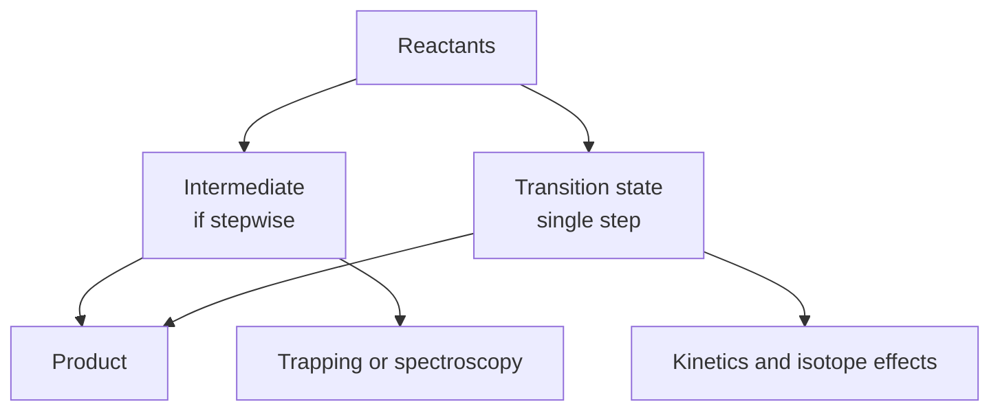
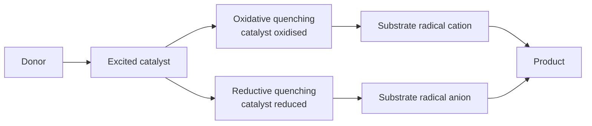
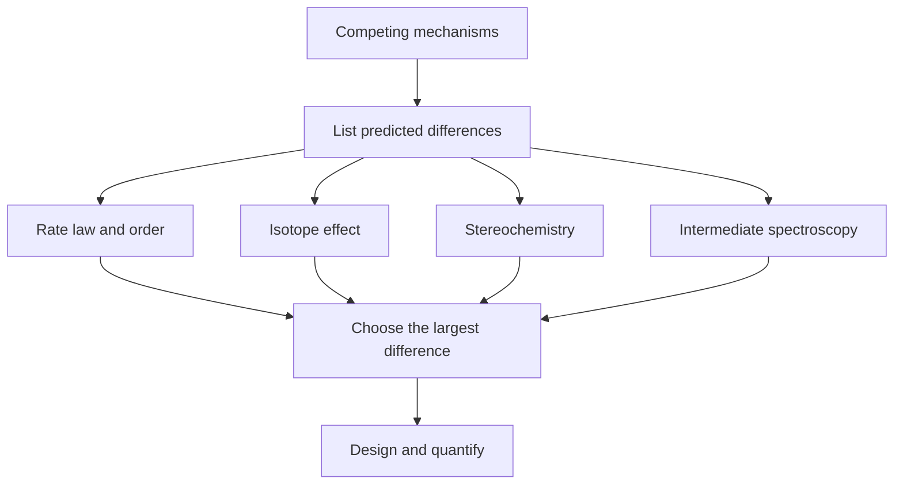

# Chapter 5 — Advanced Reaction Mechanisms

> **Level:** Research (Level 10 — Postgraduate and research)
> **Estimated study time:** 9 hours (6 h reading + 3 h exercises)
> **Prerequisites:** [Chemical Kinetics and Reaction Mechanisms](../04-advanced-chemistry/05-chemical-kinetics-and-reaction-mechanisms.md); [Organic Chemistry](../05-organic-chemistry/README.md); [Advanced Organic Synthesis](04-advanced-organic-synthesis.md) recommended
> **Related chapters:** [Advanced Quantum Chemistry](01-advanced-quantum-chemistry.md), [Computational Chemistry and Density Functional Theory](02-computational-chemistry-and-density-functional-theory.md), [Level 10 index](README.md)
> **Difficulty:** ★★★★★ (5/5)

---

## 1. Learning Objectives

After working through this chapter you will be able to:

- Distinguish a mechanism from a description, and state what counts as evidence for
  a proposed mechanism.
- Derive rate laws for simple mechanisms and interpret activation parameters.
- Measure and interpret primary, secondary and solvent kinetic isotope effects,
  including tunnelling.
- Apply the Hammett and Taft equations and interpret the sign and magnitude of $\rho$.
- Use Mayr nucleophilicity and electrophilicity parameters to predict rates.
- Describe the structure, lifetime and detection of carbocations, carbanions,
  radicals, carbenes, nitrenes and benzyne.
- Explain the non-classical carbocation controversy and the evidence that resolved
  it.
- Apply Marcus theory to electron-transfer reactions and identify the inverted
  region.
- Distinguish oxidative and reductive quenching in photoredox catalysis, and use
  quantum yields to detect radical chains.
- Describe the main organocatalytic activation modes.
- Select an experimental technique — stopped-flow, transient absorption, mass
  spectrometry, cryogenic trapping, isotopic labelling, crossover — for a specific
  mechanistic question.
- Design an experiment that discriminates between two competing mechanisms.
- Analyse at least three mechanistic puzzles from the literature at the level of
  principle.

---

## 2. Introduction

A mechanism is a claim about the sequence of elementary steps that converts
reactants into products, including the structures, energies and lifetimes of the
intermediates. It is not a description of the overall change, and it is not a
curly-arrow diagram: it is a hypothesis that makes predictions which can be tested.

The discipline is therefore evidential. A proposed intermediate must be shown to
exist, or at least to be consistent with every kinetic, spectroscopic and
stereochemical observation. A transition state cannot be observed directly; it is
inferred from kinetics, isotope effects and computations. The most persuasive
mechanistic work combines several independent lines of evidence, because a single
observation can usually be explained by more than one mechanism.

This chapter develops the evidence base. It begins with kinetics and activation
parameters, then isotope effects and linear free-energy relationships, which convert
small rate changes into information about charge, bonding and tunnelling. It treats
the classical intermediates — carbocations, carbanions, radicals, carbenes and
arynes — with the experiments that established their existence. It examines
electron transfer, photoredox catalysis and organocatalysis, where open-shell and
catalytic cycles complicate the picture. It then reviews the techniques that make
intermediates visible and the logic of designing an experiment that distinguishes
two mechanisms.

Four case studies anchor the treatment: benzyne, the 2-norbornyl cation, carbene
spin states and the cytochrome P450 rebound mechanism. Each is a case where a
plausible mechanism was challenged by evidence, and each illustrates a different
kind of argument.

The chapter assumes the kinetics of Level 3 and the organic reactivity of Level 4.
It does not attempt to survey every named mechanism; it teaches how mechanistic
claims are made and tested.

---

## 3. Fundamental Concepts

### 3.1 Mechanism, evidence and the burden of proof

A **mechanism** specifies the elementary steps, their rates, the intermediates and
the transition states. An **elementary step** is a single molecular event with a
single transition state; its rate law follows from its molecularity.

Evidence comes in several kinds, with different strengths.

- **Kinetic evidence**: rate laws, orders, activation parameters, isotope effects.
  It constrains stoichiometry of the rate-determining step but rarely identifies an
  intermediate uniquely.
- **Spectroscopic evidence**: direct observation of an intermediate by NMR, IR,
  UV–Vis, EPR or mass spectrometry. It is the strongest evidence when the species
  observed is the one on the reaction path.
- **Stereochemical evidence**: retention, inversion, racemisation, crossover. It
  constrains geometry and the fate of labelled atoms.
- **Labelling evidence**: isotopic substitution and crossover experiments establish
  which atoms move and whether bonds break intramolecularly.
- **Computational evidence**: calculated energies and trajectories consistent with
  experiment. It supports but does not replace experiment.

### 3.2 Kinetics and activation parameters

For a reaction with a single rate-determining step, the rate law gives the
composition of the transition state. A first-order dependence on both reactants
implies a bimolecular step; zeroth-order dependence on a reactant implies that it
reacts after the rate-determining step.

The temperature dependence gives the activation parameters through the **Eyring
equation**:
$$
k = \kappa\frac{k_\mathrm{B}T}{h}e^{-\Delta G^{\ddagger}/RT}
= \kappa\frac{k_\mathrm{B}T}{h}e^{\Delta S^{\ddagger}/R}e^{-\Delta H^{\ddagger}/RT},
$$
where $\kappa$ is the transmission coefficient. A plot of $\ln(k/T)$ against $1/T$
gives $-\Delta H^{\ddagger}/R$ as the slope and
$\ln(k_\mathrm{B}/h)+\Delta S^{\ddagger}/R$ as the intercept.

### 3.3 Kinetic isotope effects

A **kinetic isotope effect** is the ratio $k_\mathrm{H}/k_\mathrm{D}$ for the same
reaction with isotopic substitution.

**Primary isotope effects** arise when the isotopically substituted bond breaks in
the rate-determining step. The zero-point energy of a C–H bond is higher than that
of a C–D bond by
$$
\Delta\mathrm{ZPE} = \tfrac12 hc(\tilde\nu_\mathrm{H}-\tilde\nu_\mathrm{D})
\approx \tfrac12 hc\tilde\nu_\mathrm{H}\left(1-\frac{1}{\sqrt2}\right).
$$
For a C–H stretch near $2900\ \mathrm{cm^{-1}}$, this is about
$5\ \mathrm{kJ\,mol^{-1}}$, giving a maximum $k_\mathrm{H}/k_\mathrm{D}$ near $7$ at
$298\ \mathrm{K}$. Values substantially larger than $7$ indicate **tunnelling**, in
which the light atom passes through the barrier rather than over it. Tunnelling is
diagnostic of proton, hydride or hydrogen-atom transfer and is revealed by an
Arrhenius plot with an unusually small pre-exponential factor and a curved
temperature dependence.

**Secondary isotope effects** arise when the isotopic substitution is at a position
that does not break. An $\alpha$-secondary effect ($k_\mathrm{H}/k_\mathrm{D}$ around
$1.1$–$1.3$) reflects the change in hybridisation at the labelled carbon: conversion
of $sp^{3}$ to $sp^{2}$ tightens the remaining C–H bonds and favours the heavier
isotope less. A $\beta$-secondary effect is smaller and reports hyperconjugative
involvement.

**Solvent isotope effects** compare rates in $\ce{H2O}$ and $\ce{D2O}$. A value
near $1$ indicates no proton transfer in the rate-determining step; a value near
$2$–$3$ suggests general acid or base catalysis; a large value suggests proton
transfer in a pre-equilibrium.

### 3.4 Substituent effects: Hammett and Taft

The **Hammett equation** relates the rate or equilibrium constant of a
meta- or para-substituted benzene derivative to that of the parent:
$$
\log\frac{k}{k_0} = \rho\sigma, \qquad
\log\frac{K}{K_0} = \rho\sigma .
$$
The substituent constant $\sigma$ measures the electronic effect of the substituent
relative to hydrogen, and the reaction constant $\rho$ measures the sensitivity of
the reaction to that effect.

The sign of $\rho$ is the diagnostic. A negative $\rho$ means that electron-donating
substituents accelerate the reaction, which indicates that positive charge develops
at the reaction centre in the transition state. A positive $\rho$ indicates negative
charge development. The magnitude gives the extent of charge separation: values
around $-1$ are typical of solvolysis, values around $+2$ to $+3$ of nucleophilic
attack on a carbonyl.

Two variants are used when the standard $\sigma$ values fail. **$\sigma^{+}$** is
used when the substituent can stabilise a positive charge by resonance, as in
electrophilic aromatic substitution; **$\sigma^{-}$** is used when it can stabilise a
negative charge. The need for a variant is itself mechanistic information: it
indicates that resonance interaction with the reaction centre is important.

The **Taft equation** separates polar and steric effects in aliphatic systems:
$$
\log\frac{k}{k_0} = \rho^{*}\sigma^{*} + \delta E_s ,
$$
where $\sigma^{*}$ is a polar substituent constant and $E_s$ a steric constant. It is
used for ester hydrolysis and for reactions where the substituent is attached to an
$sp^{3}$ carbon.

### 3.5 Nucleophilicity and electrophilicity parameters

The **Mayr equation** describes the rate of a combination reaction between a
nucleophile and an electrophile:
$$
\log k = s(N+E),
$$
where $N$ is the nucleophilicity parameter of the nucleophile, $E$ the
electrophilicity parameter of the electrophile, and $s$ a nucleophile-specific
sensitivity factor, all defined at $20\ ^\circ\mathrm{C}$ in a specified solvent
(usually dichloromethane or acetonitrile). The equation is a linear free-energy
relationship with a remarkably wide scope: the same $N$ and $s$ values predict rates
for many electrophiles, and the same $E$ values predict reactivity towards many
nucleophiles.

### 3.6 Intermediates

**Carbocations** are electron-deficient carbon centres. Their stability order is
tertiary > secondary > primary > methyl, reflecting hyperconjugation and inductive
donation. Olah's work with superacid media in the 1960s made persistent carbocations
observable by NMR and established their structures; the tert-butyl cation, the
2-norbornyl cation and numerous arenium ions were characterised this way. Carbocations
are planar ($sp^{2}$) or non-classical (Section 3.7), and their reactions are
dominated by capture by nucleophiles or by elimination.

**Carbanions** are electron-rich carbon centres, stabilised by inductive withdrawal,
by resonance and by the $s$-character of the orbital (an $sp$ carbanion is more
stable than an $sp^{3}$ one). Their stability is reflected in the pKa of the
conjugate acid: an alkane C–H has pKa around $50$, an ester $\alpha$-C–H around
$25$, a ketone $\alpha$-C–H around $20$, and a nitroalkane around $10$.

**Radicals** are neutral species with an unpaired electron. They are stabilised by
delocalisation and by hyperconjugation; their reactions are dominated by
combination, disproportionation and abstraction. Radical chains are characterised by
an initiation, propagation and termination sequence, and their rate laws often show
half-order dependence on the initiator.

**Carbenes** are neutral divalent carbon species with two non-bonding electrons,
either paired (singlet) or unpaired (triplet). Singlet carbenes add to alkenes
stereospecifically and are electrophilic; triplet carbenes give mixtures of
stereoisomers and behave as diradicals. The spin state is controlled by substituents:
halogens and $\alpha$-donors stabilise the singlet, while bulky groups favour the
triplet.

**Nitrenes** are the nitrogen analogues of carbenes, with a divalent nitrogen and
four non-bonding electrons. They are implicated in C–H amination and in azide
decomposition, and their spin state determines whether they insert or abstract.

**Benzyne** is a benzene ring containing a strained triple bond. It is generated by
elimination from an aryl halide under strong base, or from an anthranilic acid
derivative by diazotisation, and it is trapped by nucleophiles, by dienes in
Diels–Alder reactions, and by itself in dimerisation.

### 3.7 Non-classical carbocations

The **2-norbornyl cation** is the classic case. Solvolysis of exo-2-norbornyl
brosylate is much faster than that of the endo isomer, and the product is almost
entirely the exo alcohol with retained configuration. Winstein explained this by a
**non-classical** bridged ion in which the C1–C6 bond participates in the
delocalisation of the positive charge, giving a three-centre two-electron bond.
Brown argued for a pair of rapidly equilibrating classical cations and attributed
the rate ratio to steric effects.

The evidence accumulated over decades. The rate ratio (exo much faster than endo)
and the retention of configuration favour a bridged species. NMR studies in
superacids showed a single averaged structure with delocalised charge. Computational
studies found a bridged minimum. The issue was settled, in the sense that the
bridged structure is accepted for the 2-norbornyl cation, but the broader question —
whether non-classical ions are important in other systems — remains a matter of
degree.

### 3.8 Electron transfer and Marcus theory

**Single-electron transfer** (SET) between a donor and an acceptor can occur in an
outer-sphere geometry, without bond formation. When the transfer is followed by
bond cleavage, the products are a radical ion pair held together by Coulomb
attraction; the pair may recombine, separate or react further. The rate is described by **Marcus
theory**:
$$
\Delta G^{\ddagger} = \frac{\lambda}{4}\left(1+\frac{\Delta G^{\circ}}{\lambda}\right)^{2},
\qquad
k = A\exp\left(-\frac{\Delta G^{\ddagger}}{RT}\right),
$$
where $\lambda$ is the reorganisation energy, the energy required to distort the
donor, acceptor and solvent to the transition-state geometry, and $\Delta G^{\circ}$
is the driving force.

The parabolic relation predicts a maximum rate at
$\Delta G^{\circ} = -\lambda$ and a decrease when the driving force exceeds $\lambda$:
the **inverted region**. The prediction was controversial when Marcus made it and
was confirmed experimentally in the 1980s with rigid donor–acceptor molecules. The
inverted region is now central to the design of photoinduced electron-transfer
systems and to the understanding of exergonic reactions that are surprisingly slow.

The driving force for photoinduced electron transfer is estimated by the
**Rehm–Weller** equation,
$$
\Delta G_{\mathrm{ET}} = E_{\mathrm{ox}}-E_{\mathrm{red}}-E_{00},
$$
where $E_\mathrm{ox}$ is the oxidation potential of the donor, $E_\mathrm{red}$ the
reduction potential of the acceptor and $E_{00}$ the excited-state energy.

### 3.9 Photoredox catalysis and radical chains

A photoredox catalyst absorbs visible light and uses the excited state to transfer an
electron. In **oxidative quenching**, the excited catalyst reduces the substrate and
is itself oxidised; in **reductive quenching**, the excited catalyst is reduced by a
sacrificial donor and then reduces the substrate. The two pathways give the same
overall transformation but different rate laws and different sensitivity to
additives.

The crucial mechanistic question is whether the reaction proceeds through a closed
catalytic cycle or through a **radical chain**. In a chain, the product radical
reduces the substrate or the catalyst, propagating the reaction without further
photons. The **quantum yield** (molecules converted per photon absorbed) discriminates:
values above one require a chain, because one photon cannot convert more than one
molecule in a closed cycle.

### 3.10 Organocatalytic cycles

Organocatalysis uses a substoichiometric organic molecule to accelerate a reaction.
The main activation modes are:

- **Enamine catalysis**: a carbonyl compound condenses with an amine catalyst to
  form an enamine, which is nucleophilic at the $\alpha$-carbon. The List–Barbas
  aldol is the canonical example.
- **Iminium catalysis**: an $\alpha,\beta$-unsaturated carbonyl forms an iminium
  ion, which is electrophilic at the $\beta$-carbon; the MacMillan conjugate
  addition is the canonical example.
- **Hydrogen-bonding catalysis**: thioureas and squaramides bind and polarise a
  substrate, lowering the LUMO; chiral phosphoric acids activate imines by
  protonation.
- **$N$-heterocyclic carbene catalysis**: the carbene adds to an aldehyde to form a
  Breslow intermediate, which is nucleophilic at the carbonyl carbon (umpolung).
- **Phase-transfer catalysis**: a chiral ammonium cation transports an anion into an
  organic phase, where it is not solvated and is therefore more reactive.

### 3.11 Techniques for observing intermediates

**Stopped-flow** mixing followed by UV–Vis or fluorescence detection resolves
reactions from milliseconds to seconds and gives rate laws and intermediate spectra.

**Transient absorption** spectroscopy with pulsed lasers resolves femtoseconds to
microseconds and detects radical ions, triplets and other short-lived species
directly.

**Electrospray ionisation mass spectrometry** (ESI-MS) can detect non-covalent
complexes and reactive intermediates when they are long-lived enough to reach the
detector; the caveat is that the ionisation process itself may generate or destroy
the species.

**Cryogenic trapping** and matrix isolation stabilise reactive intermediates at low
temperature for spectroscopic study.

**Isotopic labelling** identifies the origin of atoms in the product and detects
scrambling. **Crossover experiments** mix two substrates and ask whether products
arise from one molecule or from fragments exchanged between them; a crossover
product proves intermolecularity.

**Radical clocks** are substrates that rearrange at a known rate when a radical is
formed; the product distribution reports the lifetime of the intermediate.
**Spin trapping** with a nitrone or nitroso compound converts a transient radical
into a persistent radical that can be observed by EPR.

## 4. Detailed Scientific Explanation

### 4.1 Rate laws and the steady-state approximation

For a mechanism with an intermediate $I$,
$$
\ce{A + B ->[k_1] I ->[k_2] P},
$$
the steady-state approximation sets $\mathrm{d}[I]/\mathrm{d}t=0$, giving
$$
[I] = \frac{k_1[A][B]}{k_{-1}+k_2}, \qquad
\frac{\mathrm{d}[P]}{\mathrm{d}t} = \frac{k_1k_2[A][B]}{k_{-1}+k_2}.
$$
Two limits are diagnostic. If $k_2\gg k_{-1}$, the first step is rate-determining
and the reaction is second order. If $k_{-1}\gg k_2$, the intermediate is in
pre-equilibrium and the rate is $K_1k_2[A][B]$, with the same second-order form but
a different interpretation of the isotope effect and of substituent effects.

Saturation kinetics — a rate that becomes independent of one substrate at high
concentration — indicates a pre-equilibrium binding step followed by a unimolecular
chemical step, and is the signature of enzyme catalysis and of many catalytic
cycles.

### 4.2 Isotope effects in detail

The primary isotope effect follows from the difference in zero-point energy between
the C–H and C–D bonds. In the simplest model, the transition state has no bonding to
hydrogen, so the difference in activation energy equals the difference in zero-point
energy:
$$
\frac{k_\mathrm{H}}{k_\mathrm{D}} = \exp\left(\frac{\Delta\mathrm{ZPE}}{RT}\right).
$$
For a C–H stretch at $2900\ \mathrm{cm^{-1}}$ and a C–D stretch at
$2900/\sqrt2 = 2051\ \mathrm{cm^{-1}}$, the difference in zero-point energy is
$5.1\ \mathrm{kJ\,mol^{-1}}$, giving a ratio of $7.8$ at $298\ \mathrm{K}$.

Secondary isotope effects are smaller because the bond does not break, but they are
diagnostic of hybridisation change. An $\alpha$-secondary effect of $1.2$ is
consistent with $sp^{3}\to sp^{2}$ conversion at the labelled carbon; a value near
$1.0$ indicates no change.

### 4.3 Hammett analysis in practice

A Hammett plot is constructed by measuring rate constants for a series of
substituted substrates under identical conditions and plotting $\log(k/k_0)$ against
$\sigma$. A straight line supports a single mechanism across the series; curvature
indicates a change in rate-determining step or in mechanism.

The choice between $\sigma$, $\sigma^{+}$ and $\sigma^{-}$ is itself evidence. If the
correlation improves when $\sigma^{+}$ is used, the transition state has a positive
charge that is delocalised into the ring; this is characteristic of electrophilic
aromatic substitution and of solvolysis with a benzylic centre.

### 4.4 Marcus theory and its consequences

The Marcus parabola has three regimes. In the **normal region**
($|\Delta G^{\circ}|<\lambda$), increasing the driving force increases the rate. At
$\Delta G^{\circ}=-\lambda$ the rate is maximal. In the **inverted region**
($|\Delta G^{\circ}|>\lambda$), increasing the driving force decreases the rate,
because the reactant and product parabolas intersect on the wrong side and the
transition state requires a larger reorganisation.

The theory is used to design artificial photosynthetic systems, to interpret
electron transfer in proteins, and to understand why some highly exergonic reactions
are slow. It also explains why the rate of a photoinduced electron transfer can be
tuned by changing the driving force through substituents.

### 4.5 Case 1: benzyne and the limits of labelling

Roberts' experiment used chlorobenzene labelled with $^{14}$C at the carbon bearing
chlorine. If substitution occurred directly, the aniline would carry the label
exclusively at the ipso carbon. If a symmetrical intermediate intervened, the label
would appear at both ipso and ortho positions in equal amounts. The observed
distribution was approximately $1:1$, which requires the symmetrical intermediate
now called benzyne.

Benzyne is a case where the intermediate is too short-lived to observe directly in
the original experiment, and the evidence is indirect but decisive. Modern
experiments trap it with dienes and observe its Diels–Alder adducts, and
computations reproduce its strained geometry.

### 4.6 Case 2: the norbornyl cation

The solvolysis of exo-2-norbornyl derivatives is faster than that of the endo
isomers by a factor of order $10^{2}$–$10^{3}$, and the product is the exo alcohol
with retained configuration. A classical carbocation would be expected to give
racemisation or a mixture of exo and endo products, because the cation is planar and
can be captured from either face.

Winstein's non-classical structure places the C1–C6 sigma bond in a three-centre
two-electron interaction with the empty p orbital, giving a bridged ion that
delivers the nucleophile from the exo face and preserves configuration. Brown's
alternative invoked a pair of equilibrating classical ions and steric shielding of
the endo face.

The decisive evidence came from NMR in superacid solution, which showed a single
species with delocalised charge, and from computation, which found the bridged
structure to be a minimum. X-ray crystallographic characterisation of a
norbornyl cation in a crystal lattice later provided direct structural evidence.
The case illustrates that a mechanistic question may be settled only by a
convergence of methods, and that the answer can be quantitative — the ion is
partially bridged — rather than a choice between two extremes.

### 4.7 Case 3: carbene spin states and stereospecificity

A singlet carbene has its two non-bonding electrons paired in one orbital, leaving an
empty p orbital; it adds to an alkene in a single step with retention of alkene
geometry. A triplet carbene has two unpaired electrons and adds in a stepwise
manner through a diradical, allowing bond rotation before ring closure and giving a
mixture of stereoisomers.

Skell and Woodworth's experiments with bromodichloromethane and with diazomethane
showed exactly this pattern: conditions that favour the triplet gave mixtures, and
conditions that favour the singlet gave stereospecific addition. The spin state
depends on substituents and on the presence of heavy atoms (the heavy-atom effect
enhances intersystem crossing).

The case shows that a mechanistic claim must specify the electronic state of the
intermediate, not merely its composition, and that stereochemistry is a sensitive
probe of spin.

### 4.8 Case 4: the cytochrome P450 rebound

P450 enzymes contain a heme iron coordinated by a cysteine thiolate. The catalytic
cycle generates a high-valent iron(IV)–oxo porphyrin radical cation (compound I),
which abstracts a hydrogen atom from the substrate to give a carbon radical and an
iron(IV)–hydroxide (compound II). The radical and the hydroxide then recombine
within the solvent cage.

Evidence for the rebound includes: large primary kinetic isotope effects for
hydroxylation; radical clock substrates that rearrange before recombination, giving
ring-opened products; and the observation that hydroxylation at a stereocentre can
proceed with partial racemisation, consistent with a radical intermediate. The
alternative concerted mechanism predicts no radical rearrangement and a smaller
isotope effect.

### 4.9 Designing a discriminating experiment

A useful protocol is:

1. **State both mechanisms explicitly**, including the intermediates and the
   rate-determining step each predicts.
2. **List the observable differences**: rate law, isotope effect, substituent
   effect, stereochemistry, product distribution, intermediate spectrum.
3. **Choose the observable with the largest predicted difference** and the smallest
   experimental uncertainty.
4. **Check that the experiment does not change the mechanism**: a radical trap, for
   example, may perturb the system it is meant to probe.
5. **Perform the experiment under conditions where both mechanisms are plausible**,
   and vary the conditions to see whether the mechanism changes.
6. **Quantify**: a qualitative difference is weaker than a measured rate ratio or
   isotope effect that matches one prediction.

The logic is Popperian in spirit but not in practice: mechanisms are rarely falsified
by a single experiment. They are accepted when they survive many attempts at
falsification and when no competing mechanism explains the same body of evidence.

---

## 5. Visual Diagrams

**Figure 5.1 — Stepwise and concerted pathways.** A stepwise mechanism passes through
an intermediate that can, in principle, be trapped or observed; a concerted mechanism
has only a transition state. The two pathways can give the same product, which is why
product analysis alone cannot distinguish them.

**Figure 5.2 — Oxidative and reductive quenching in photoredox catalysis.** The two
cycles differ in which partner quenches the excited state and therefore in the
oxidation state of the catalyst during turnover. They predict different responses to
sacrificial donors and different rate laws, and both must be considered when a
mechanism is proposed.

**Figure 5.3 — Designing a discriminating experiment.** The experiment is chosen for
the size of the predicted difference and the precision of the measurement, not for
convenience. A quantitative prediction that matches one mechanism and excludes the
other is worth more than several qualitative observations that are consistent with
both.

---

## 6. Mathematical Formulas

### 6.1 Activation parameters and isotope effects

$$
k = \kappa\frac{k_\mathrm{B}T}{h}e^{-\Delta G^{\ddagger}/RT},
\qquad
\frac{k_\mathrm{H}}{k_\mathrm{D}} = \exp\left(\frac{\Delta\mathrm{ZPE}}{RT}\right),
\qquad
\Delta\mathrm{ZPE} = \tfrac12 hc(\tilde\nu_\mathrm{H}-\tilde\nu_\mathrm{D}).
$$

| Symbol | Meaning | SI unit |
|---|---|---|
| $k$ | rate constant | $\mathrm{s^{-1}}$ or $\mathrm{M^{-1}\,s^{-1}}$ |
| $\kappa$ | transmission coefficient | dimensionless |
| $\Delta G^{\ddagger}$ | activation Gibbs energy | $\mathrm{J\,mol^{-1}}$ |
| $\Delta H^{\ddagger}$ | activation enthalpy | $\mathrm{J\,mol^{-1}}$ |
| $\Delta S^{\ddagger}$ | activation entropy | $\mathrm{J\,K^{-1}\,mol^{-1}}$ |
| $\tilde\nu$ | wavenumber | $\mathrm{m^{-1}}$ |

Assumptions: a single rate-determining step, a well-defined transition state, and a
transmission coefficient near unity in the absence of tunnelling. The isotope-effect
expression assumes that the zero-point energy difference is the dominant contribution
and that the transition state has no isotope-sensitive bonding.

### 6.2 Linear free-energy relationships

$$
\log\frac{k}{k_0} = \rho\sigma, \qquad
\log k = s(N+E), \qquad
\log\frac{k}{k_0} = \rho^{*}\sigma^{*}+\delta E_s .
$$

| Symbol | Meaning | SI unit |
|---|---|---|
| $\sigma$ | Hammett substituent constant | dimensionless |
| $\rho$ | Hammett reaction constant | dimensionless |
| $N$ | Mayr nucleophilicity parameter | dimensionless |
| $E$ | Mayr electrophilicity parameter | dimensionless |
| $s$ | Mayr sensitivity factor | dimensionless |
| $E_s$ | Taft steric constant | dimensionless |

Assumptions: the substituent acts only through its electronic effect, the mechanism
is constant across the series, and the temperature and solvent are fixed. A curved
Hammett plot invalidates the single-mechanism assumption.

### 6.3 Marcus theory

$$
\Delta G^{\ddagger} = \frac{\lambda}{4}\left(1+\frac{\Delta G^{\circ}}{\lambda}\right)^{2},
\qquad
\Delta G_{\mathrm{ET}} = E_{\mathrm{ox}}-E_{\mathrm{red}}-E_{00}.
$$

| Symbol | Meaning | SI unit |
|---|---|---|
| $\lambda$ | reorganisation energy | $\mathrm{J\,mol^{-1}}$ |
| $\Delta G^{\circ}$ | driving force | $\mathrm{J\,mol^{-1}}$ |
| $E_{\mathrm{ox}}$ | oxidation potential of the donor | V |
| $E_{\mathrm{red}}$ | reduction potential of the acceptor | V |
| $E_{00}$ | excited-state energy | V or $\mathrm{J\,mol^{-1}}$ |

---

## 7. Chemical Equations

$$
\ce{(CH3)3CBr(l) + H2O(l) -> (CH3)3COH(l) + HBr(aq)}
$$

Solvolysis of tert-butyl bromide. The reaction is first order in the halide and
zeroth order in water, consistent with rate-limiting ionisation to a carbocation
followed by fast capture. The equation is balanced in atoms and charge; the
mechanistic information is in the rate law, not in the stoichiometry.

$$
\ce{C6H5Br(l) + NaNH2(s) -> C6H4(l) + NaBr(s) + NH3(g)}
$$

Formation of benzyne from bromobenzene and sodium amide. The aryne is a transient
intermediate, not an isolable product; the equation records the stoichiometry of
its generation, and the species is trapped by nucleophiles or dienes.

$$
\ce{RH(aq) + O2(g) + 2H+(aq) + 2e- -> ROH(aq) + H2O(l)}
$$

Hydroxylation catalysed by cytochrome P450. The equation is balanced in atoms and
charge: two electrons and two protons are consumed, and one oxygen atom enters the
substrate while the other becomes water. The mechanistic content — hydrogen
abstraction followed by radical recombination — is not visible in the stoichiometry.

$$
\ce{CH2N2(g) -> CH2(g) + N2(g)}
$$

Generation of methylene from diazomethane. The carbene is a transient species whose
spin state determines its reactions; the equation is balanced and the nitrogen is
the only stable by-product.

$$
\ce{CH2(g) + C2H4(g) -> C3H6(g)}
$$

Cyclopropanation of ethene by methylene. A singlet carbene adds in one step with
retention of alkene geometry; a triplet carbene adds stepwise and gives a mixture.
The same balanced equation describes both pathways, which is why stereochemistry is
required to distinguish them.

---

## 8. Worked Examples

### Worked Example 8.1 — Activation parameters from two rate constants

**Problem.** A solvolysis has $k=1.0\times10^{-4}\ \mathrm{s^{-1}}$ at $298\ \mathrm{K}$
and $5.0\times10^{-4}\ \mathrm{s^{-1}}$ at $308\ \mathrm{K}$. Estimate
$\Delta H^{\ddagger}$, $\Delta G^{\ddagger}$ and $\Delta S^{\ddagger}$ at
$298\ \mathrm{K}$.

**Solution.** From the Eyring equation,
$$
\ln\frac{k_2}{k_1} = -\frac{\Delta H^{\ddagger}}{R}
\left(\frac{1}{T_2}-\frac{1}{T_1}\right)+\ln\frac{T_2}{T_1}.
$$
With $\ln 5 = 1.609$, $\ln(308/298)=0.033$ and
$(1/308-1/298)=-1.089\times10^{-4}\ \mathrm{K^{-1}}$,
$$
\Delta H^{\ddagger} = \frac{(1.609-0.033)\times8.314}{1.089\times10^{-4}}
= 1.20\times10^{2}\ \mathrm{kJ\,mol^{-1}}.
$$
At $298\ \mathrm{K}$, $k_\mathrm{B}T/h = 6.21\times10^{12}\ \mathrm{s^{-1}}$, so
$$
\Delta G^{\ddagger} = -RT\ln\frac{kh}{k_\mathrm{B}T}
= -8.314\times298\times\ln(1.61\times10^{-17})
= 95.8\ \mathrm{kJ\,mol^{-1}}.
$$
Then
$\Delta S^{\ddagger} = (\Delta H^{\ddagger}-\Delta G^{\ddagger})/T
= +82\ \mathrm{J\,K^{-1}\,mol^{-1}}$.

### Worked Example 8.2 — Primary kinetic isotope effect

**Problem.** A C–H bond at $2900\ \mathrm{cm^{-1}}$ is broken in the rate-determining
step. Estimate $k_\mathrm{H}/k_\mathrm{D}$ at $298\ \mathrm{K}$, assuming the
transition state has no isotope-sensitive bonding.

**Solution.** The C–D wavenumber is $2900/\sqrt2 = 2051\ \mathrm{cm^{-1}}$. With
$hc = 0.011962\ \mathrm{kJ\,mol^{-1}}$ per $\mathrm{cm^{-1}}$,
$$
\Delta\mathrm{ZPE} = \tfrac12\times0.011962\times(2900-2051)
= 5.08\ \mathrm{kJ\,mol^{-1}}.
$$
Then
$$
\frac{k_\mathrm{H}}{k_\mathrm{D}} = \exp\left(\frac{5.08}{2.478}\right) = e^{2.05} = 7.8.
$$

### Worked Example 8.3 — Hammett reaction constant

**Problem.** For a reaction, a substituent with $\sigma=-0.27$ accelerates it by a
factor of $2.2$, and a substituent with $\sigma=+0.23$ slows it by a factor of
$2.0$. Compute $\rho$ and interpret it.

**Solution.** For the first substituent,
$\log(2.2) = 0.342 = \rho(-0.27)$, so $\rho = -1.27$. For the second,
$\log(0.5) = -0.301 = \rho(0.23)$, so $\rho = -1.31$. The average is
$\rho \approx -1.3$.

### Worked Example 8.4 — Predicting a rate with Mayr parameters

**Problem.** A nucleophile has $N=10.0$ and $s=1.0$; an electrophile has $E=-5.0$.
Predict $\log k$ and $k$ at $20\ ^\circ\mathrm{C}$.

**Solution.** From $\log k = s(N+E)$,
$$
\log k = 1.0\times(10.0-5.0) = 5.0, \qquad k = 1.0\times10^{5}\ \mathrm{M^{-1}\,s^{-1}}.
$$

**Check.** A change of one unit in $E$ changes the rate by a factor of ten at
$s=1$; the parameterisation is therefore a quantitative prediction, not a ranking.
The prediction assumes the same solvent and temperature at which $N$, $s$ and $E$
were defined.

### Worked Example 8.5 — Marcus barrier and the inverted region

**Problem.** An electron-transfer reaction has $\lambda=80\ \mathrm{kJ\,mol^{-1}}$.
Compute $\Delta G^{\ddagger}$ for $\Delta G^{\circ}=-20$, $-80$ and
$-160\ \mathrm{kJ\,mol^{-1}}$.

**Solution.** Using
$\Delta G^{\ddagger}=(\lambda/4)(1+\Delta G^{\circ}/\lambda)^{2}$:
$$
\begin{aligned}
\Delta G^{\circ}=-20 &: \quad \Delta G^{\ddagger}=20\,(1-0.25)^{2}=11.3\ \mathrm{kJ\,mol^{-1}},\\
\Delta G^{\circ}=-80 &: \quad \Delta G^{\ddagger}=20\,(1-1)^{2}=0,\\
\Delta G^{\circ}=-160 &: \quad \Delta G^{\ddagger}=20\,(1-2)^{2}=20\ \mathrm{kJ\,mol^{-1}}.
\end{aligned}
$$

**Check.** The barrier falls to zero at $\Delta G^{\circ}=-\lambda$ and then rises
again: the inverted region. The result is counter-intuitive but experimentally
confirmed, and it explains why some strongly exergonic electron transfers are slow.

---

## 9. Real-World Applications

**Drug metabolism.** Cytochrome P450 oxidation determines the half-life of many
drugs; mechanistic understanding guides the design of metabolically stable analogues
and predicts reactive metabolites.

**Catalysis.** Mechanistic analysis distinguishes a closed catalytic cycle from a
radical chain, which changes how a catalyst is optimised and how a reactor is
designed.

---

## 10. Common Mistakes

| Mistake | Why it happens | Correct approach |
|---|---|---|
| Proposing an intermediate without evidence | It makes the mechanism look complete | State the evidence and the alternative that was excluded |
| Interpreting a large isotope effect as proof of tunnelling | Large values are striking | Check the temperature dependence and the Arrhenius curvature |
| Using $\sigma$ when $\sigma^{+}$ is required | The standard table is convenient | Test both and report which correlation is linear |
| Comparing Hammett $\rho$ values across solvents | The values are numbers | Compare only at the same temperature and solvent |
| Treating a quantum yield of one as proof of a closed cycle | It is the naive expectation | Measure the quantum yield; values above one prove a chain, values near one are inconclusive |
| Assuming a radical trap does not perturb the system | Traps are added in excess | Run at several trap concentrations and check for saturation |

---

## 11. Chapter Summary

- A mechanism is an evidence-based claim about elementary steps, intermediates and
  transition states, not a curly-arrow diagram.
- Rate laws and activation parameters constrain the rate-determining step;
  $\Delta S^{\ddagger}$ distinguishes associative from dissociative pathways.
- Primary isotope effects report bond breaking, secondary effects report
  hybridisation change, and values above the semiclassical maximum indicate
  tunnelling.
- Hammett and Taft analyses convert substituent effects into charge and steric
  information; the sign of $\rho$ is diagnostic.
- Carbocations, carbanions, radicals, carbenes, nitrenes and benzyne have distinct
  stabilities, spin states and detection methods.
- The norbornyl cation was resolved by converging kinetic, spectroscopic,
  stereochemical and computational evidence.
- Marcus theory explains the normal, activationless and inverted regions of electron
  transfer.

---

## 12. Exercises

### 12.1 Conceptual questions

1. What is the difference between an intermediate and a transition state, and how is
   each detected?
2. Why does a negative Hammett $\rho$ indicate positive charge development?
3. Explain why a quantum yield above one rules out a closed photocatalytic cycle.

### 12.2 Basic problems

4. A reaction is first order in A and zero order in B. What does this imply about
   the rate-determining step?
5. Calculate $k_\mathrm{H}/k_\mathrm{D}$ at $298\ \mathrm{K}$ for a C–H bond at
   $3000\ \mathrm{cm^{-1}}$, assuming no tunnelling.
6. Convert an ee of $98\,\%$ to an enantiomeric ratio.

### 12.3 Intermediate problems

7. A Hammett plot is linear with $\rho=+2.1$. What does this indicate, and which
   step is likely to be rate-determining?
8. Explain how a radical clock can distinguish a radical intermediate from a
   concerted pathway.
9. Why does the rate of an electron transfer decrease when the driving force becomes
   very large?

### 12.4 Advanced problems

10. Design an experiment to distinguish an $S_\mathrm{N}1$ from an $S_\mathrm{N}2$
    mechanism for a secondary alkyl halide, stating the predicted outcome for each.
11. A photoredox reaction loses all activity when a radical trap is added, and its
    quantum yield is $0.9$. What can and cannot be concluded?

### 12.5 Calculation problems

12. A reaction has $\Delta H^{\ddagger}=80\ \mathrm{kJ\,mol^{-1}}$ and
    $\Delta S^{\ddagger}=-60\ \mathrm{J\,K^{-1}\,mol^{-1}}$. Compute
    $\Delta G^{\ddagger}$ at $298\ \mathrm{K}$.

### 12.6 Answers

1. An intermediate is a local minimum on the potential energy surface and can in
   principle be isolated or spectroscopically observed; a transition state is a
   saddle point with one negative Hessian eigenvalue and is inferred from kinetics.
2. Electron-donating substituents stabilise positive charge and accelerate the
   reaction, so the rate increases as $\sigma$ becomes more negative, which requires
   $\rho<0$.
3. A closed cycle consumes one photon per molecule converted; more than one molecule
   per photon requires a chain that propagates without light.
4. B reacts after the rate-determining step, so the transition state contains only A
   (and any species in pre-equilibrium with it).
5. $\Delta\mathrm{ZPE}=5.26\ \mathrm{kJ\,mol^{-1}}$, so
   $k_\mathrm{H}/k_\mathrm{D}=e^{2.12}=8.3$.
6. $99:1$.
7. Negative charge develops at the reaction centre; a nucleophilic addition to a
   carbonyl or a step in which an anion is formed is likely rate-determining.
8. The clock rearranges at a known rate if a radical is formed; a concerted pathway
   gives no rearranged product, while a radical pathway gives a characteristic
   ratio that reports the radical lifetime.
9. In the inverted region the reactant and product parabolas intersect on the
   steeply rising side, so the reorganisation required to reach the transition state
   increases with driving force.
10. $S_\mathrm{N}1$: rate depends only on the halide, racemisation, and a carbocation
    rearrangement product if the skeleton allows; $S_\mathrm{N}2$: rate depends on
    both halide and nucleophile, inversion of configuration, and no rearrangement.
11. The trap experiment is consistent with a radical intermediate but does not prove
    it, because the trap may quench the catalyst or scavenge a radical chain; the
    quantum yield of $0.9$ is consistent with a closed cycle and argues against an
    efficient chain.
12. $\Delta G^{\ddagger}=80-298\times0.060=62.1\ \mathrm{kJ\,mol^{-1}}$.

---

## 13. Further Reading

- Anslyn, E. V.; Dougherty, D. A. *Modern Physical Organic Chemistry*, University
  Science Books, 2006.
- Carey, F. A.; Sundberg, R. J. *Advanced Organic Chemistry, Part A: Structure and
  Mechanisms*, 5th ed., Springer, 2007.
- Clayden, J.; Greeves, N.; Warren, S. *Organic Chemistry*, 2nd ed., Oxford
  University Press, 2012.
- Maskill, H. *The Investigation of Organic Reactions and Their Mechanisms*,
  Blackwell, 2006.
- Hammett, L. P. *Physical Organic Chemistry*, 2nd ed., McGraw-Hill, 1970.
- [CURRICULUM.md](../CURRICULUM.md) — where this chapter sits in the programme.
- [REFERENCES.md](../REFERENCES.md) — the repository's source list.
