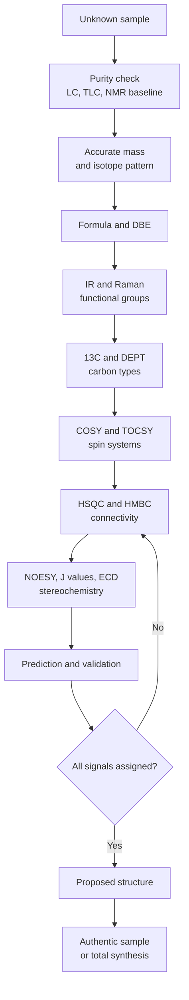
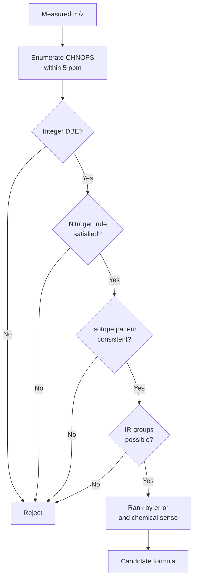
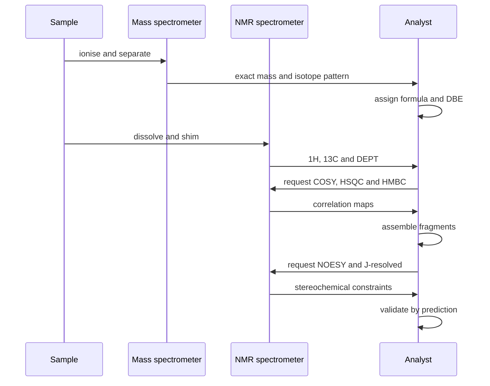
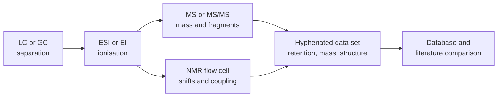

# Chapter 6 — Advanced Spectroscopy and Structure Elucidation

> **Level:** Research (Level 10 — University, Postgraduate and Research Chemistry)
> **Estimated study time:** 10 hours (7 h reading + 3 h exercises)
> **Prerequisites:** [Advanced Spectroscopy](../04-advanced-chemistry/10-advanced-spectroscopy.md); [Isomerism and Stereochemistry](../05-organic-chemistry/03-isomerism-and-stereochemistry.md); [Molecular Orbital Theory](../04-advanced-chemistry/03-molecular-orbital-theory.md)
> **Related chapters:** [Research Methodology and Experimental Design](07-research-methodology-and-experimental-design.md), [Scientific Data Analysis and Reproducibility](09-scientific-data-analysis-and-reproducibility.md), [Level 10 index](README.md)
> **Difficulty:** ★★★★★ (5/5)

---

## 1. Learning Objectives
After working through this chapter you will be able to:

- State the difference between nominal, monoisotopic and average mass, and convert an accurate mass into a ranked list of
  elemental compositions with justified exclusions.
- Calculate the double-bond equivalent (DBE, also called rings plus double bonds) from a molecular formula and use it as a
  hard constraint on candidate structures.
- Interpret isotope patterns for chlorine, bromine, sulfur and silicon, and apply the nitrogen rule to both molecular and
  fragment ions.
- Read a product-ion (MS/MS) spectrum as a sequence of mechanistically allowed neutral losses and charge-retaining cleavages.
- Assign a full set of one- and two-dimensional NMR experiments — DEPT, COSY, HSQC, HMBC, NOESY, TOCSY, J-resolved — to the
  specific structural question each one answers.
- Predict $^1$H and $^{13}$C chemical shifts with empirical increments and state the uncertainty of that prediction.
- Extract a dihedral angle from a vicinal coupling constant using the Karplus relation, and recognise when the extraction is
  unsafe.
- Distinguish chemical from magnetic equivalence and predict the appearance of second-order multiplets.
- Use variable-temperature NMR to measure an exchange barrier by the coalescence method.
- Appraise a crystallographic table (resolution, $R$ factors, Flack parameter, disorder model) and decide whether the reported
  structure supports the chemical claim.
- Integrate mass spectrometry, vibrational, electronic, chiroptical and diffraction data into a single, falsifiable
  elucidation argument.

---
## 2. Introduction
Structure elucidation is the branch of chemistry in which a set of independent measurements is forced to agree on one
molecular structure. No single technique does this. A mass spectrum gives composition and fragmentation, but not connectivity.
An infrared spectrum identifies functional groups, but not their arrangement. A one-dimensional proton NMR spectrum gives
integrals, shifts and multiplets, but a molecule with ten protons can produce an enormous number of arrangements consistent
with those three numbers. Crystallography gives the complete three-dimensional structure, but only if a single crystal of
adequate quality can be grown, and only for the solid state. The skill being taught here is not the operation of any one
instrument; it is the **logic of joint constraint** — the disciplined elimination of structures that any one piece of evidence
forbids.

The chapter is written for the situation that actually occurs in research: an unknown compound arrives as a few milligrams of
oil, or as a spot on a plate, or as a peak in a chromatogram, and a structure must be assigned, defended and published. It
assumes that you already know what a chemical shift is and can read a first-order multiplet (Level 3, Chapter 10). What it
adds is the professional apparatus: high-resolution mass spectrometry and the arithmetic of elemental composition; the
two-dimensional experiments that convert a list of shifts into a connectivity map; the prediction tools that let you test a
candidate before you propose it; the dynamic methods that reveal processes invisible to a static structure; and the
diffraction and chiroptical methods that settle stereochemistry.

Two themes run through every section. The first is **falsification**: a candidate structure is worth nothing until you have
stated which observation would destroy it, and then checked. The second is **error awareness**: every technique has
characteristic artefacts — solvent peaks, impurity signals, second-order effects, dynamical averaging, disorder — and the
difference between an expert and a beginner is largely that the expert knows where the artefacts live.

---

## 3. Fundamental Concepts
### 3.1 The elucidation problem stated precisely
Elucidation is an inverse problem: a finite set of observations $\mathcal{O}$ is given, and a structure $S$ must be found
whose forward model reproduces them, $F(S) \approx \mathcal{O}$, within the stated uncertainty of each measurement. The
problem is ill-posed, because many structures map to similar observations and because the forward models — empirical shift
prediction, fragmentation rules, the NOE–distance relationship — are approximate. Progress comes from adding *orthogonal*
constraints: independent observations shrink the candidate set multiplicatively, not additively.

Three consequences govern everything that follows. **Composition first**: a molecular formula eliminates more candidates than
any other single measurement, because it fixes the atom count, so an accurate mass is worth obtaining before anything else is
interpreted. **Every assignment must be local**: a shift belongs to a nucleus, a coupling to a pair of nuclei, an NOE to a
pair of protons within a stated distance bound. A global statement such as "consistent with a substituted indole" is a
hypothesis, not an assignment, and must be decomposed before it can be tested. **The structure is the simplest that
survives**: Occam's razor is not a proof, but a structure needing three improbable coincidences is almost always wrong, and
the measure of simplicity is the number of *ad hoc* assumptions required to reconcile prediction with observation.

### 3.2 High-resolution mass spectrometry
Mass spectrometry measures $m/z$ for gas-phase ions, and three mass scales must be kept apart. The **nominal mass** is the
integer mass of the most abundant isotope of each element; it is used for library searching and for the nitrogen rule. The
**monoisotopic mass** is the sum of exact isotope masses, and is the quantity compared with an accurate measurement. The
**average mass** is the abundance-weighted mean over all isotopes, and is the quantity used for stoichiometry.

| Isotope | Exact mass / u | Abundance / % | Isotope | Exact mass / u | Abundance / % |
|---|---|---|---|---|---|
| $^{1}\mathrm{H}$ | 1.007 825 | 99.985 | $^{16}\mathrm{O}$ | 15.994 915 | 99.76 |
| $^{12}\mathrm{C}$ | 12 (defined) | 98.93 | $^{32}\mathrm{S}$ | 31.972 071 | 94.99 |
| $^{13}\mathrm{C}$ | 13.003 355 | 1.07 | $^{35}\mathrm{Cl}$ | 34.968 853 | 75.76 |
| $^{14}\mathrm{N}$ | 14.003 074 | 99.64 | $^{79}\mathrm{Br}$ | 78.918 338 | 50.69 |

**Table 3.1 — Exact masses of the isotopes that dominate organic mass spectrometry.** Because $^{12}\mathrm{C}$ is exactly 12
u, every other isotope carries a mass defect: positive for hydrogen, negative for oxygen and sulfur. This is why $\ce{CO}$
(27.9949) and $\ce{C2H4}$ (28.0313) differ by 36 mDa at nominal mass 28, and why accurate mass separates compositions that a
unit-mass instrument cannot.

Resolving power is $R = m/\Delta m$ at full width at half maximum. A unit-mass quadrupole ($R \approx 1000$) cannot separate
$\ce{CO}$ from $\ce{N2}$; a time-of-flight instrument at $R = 30\,000$ separates them, and an Orbitrap or FT-ICR instrument at
$R > 200\,000$ resolves isotopic fine structure. Mass accuracy is quoted in parts per million of the calculated mass,

$$
\delta\ (\text{ppm}) = \frac{m_{\text{measured}} - m_{\text{calculated}}}{m_{\text{calculated}}} \times 10^{6},
$$

so 1 ppm at $m/z\ 500$ is 0.5 mDa. Modern instruments reach 1–3 ppm with external calibration and better with a lock mass,
which is why formula assignment normally uses a 5 ppm window below $m/z\ 500$.

Ionisation decides what the spectrum contains. **EI** at 70 eV is hard: it gives radical cations, extensive fragmentation and
highly reproducible spectra suitable for library matching, but needs a volatile analyte. **ESI** is soft and gives
even-electron ions — $\ce{[M+H]+}$, $\ce{[M+Na]+}$, $\ce{[M+NH4]+}$ in positive mode, $\ce{[M-H]-}$ and $\ce{[M+HCOO]-}$ in
negative mode — and is the default for polar, labile compounds. **APCI** and **APPI** extend the range to less polar
molecules, **MALDI** to large molecules, and ambient methods such as DART and ASAP ionise a surface with minimal preparation
at the cost of contamination.

### 3.3 Elemental composition, DBE and isotope patterns
Candidate formulas are enumerated within the error window and then filtered by chemically motivated rules. **Valence parity**
requires the double-bond equivalent

$$
\mathrm{DBE} = C - \frac{H}{2} + \frac{N}{2} + 1
$$

to be a non-negative integer for a neutral closed-shell molecule, with halogens counted as hydrogen; a half-integer value
indicates a radical or a wrong formula. The **nitrogen rule** states that a neutral molecule of even nominal mass contains an
even number of nitrogens, and one of odd nominal mass an odd number. Element ratios, heteroatom counts and, above all, the
isotope pattern provide further filters, and the formula must finally admit the functional groups demanded by the infrared
spectrum.

The isotope pattern is a direct read-out of composition, because it is a convolution of binomial distributions. For carbon,
the $M+1$ peak is about $1.1\,\%$ of $M$ per carbon. Chlorine gives $M:M+2 \approx 3:1$, bromine gives $1:1$, and two
chlorines give $100:64:10$. Sulfur contributes 4.4 % at $M+2$; silicon contributes 4.7 % at $M+1$ from $^{29}\mathrm{Si}$ and
3.1 % at $M+2$ from $^{30}\mathrm{Si}$; boron contributes 20 % at $M+1$ from $^{10}\mathrm{B}$. An $M+2$ peak too large for
the carbon count but too small for chlorine usually means sulfur or silicon, and a pattern that matches none of these usually
means an impurity or a background ion.

### 3.4 Tandem mass spectrometry and fragmentation logic
In MS/MS a precursor is selected, activated by collision (CID, HCD) or electron transfer (ETD), and the products recorded.
Four rules govern interpretation. **The even-electron rule**: an even-electron ion fragments to an even-electron ion plus a
neutral molecule, and cleavage to a radical is disfavoured unless no heterolytic pathway exists. Radical cations from EI
behave differently, fragmenting by homolysis or by rearrangement to an even-electron ion plus a radical.

**Neutral losses are diagnostic.** A loss of 18.0106 u implies water and therefore an alcohol or acid; 17.0265 u implies
ammonia and an amine or amide; 27.9949 u (CO) is characteristic of phenols and quinones; 43.9898 u ($\ce{CO2}$) indicates a
carboxylic acid, ester or anhydride; 35.9767 u (HCl) and 79.9262 u (HBr) identify halides; 90.05 u (trimethylsilanol)
identifies a silyl ether. **Charge is retained** on the fragment of lower ionisation energy, so the products reveal which end
of the molecule can carry charge; charge-remote fragmentation of long chains gives regular 14 u losses that locate
unsaturation.

**Signature rearrangements** carry structural information that no neutral-loss table captures. The McLafferty rearrangement
needs a $\gamma$-hydrogen, proceeds through a six-membered transition state, expels an alkene and leaves an enol radical
cation; it is the most reliable structure-specific fragmentation of carbonyl compounds. Retro-Diels–Alder cleavage is
characteristic of cyclohexenes, and $\alpha$-cleavage beside a carbonyl or an aromatic ring gives oxonium or benzylic ions of
predictable mass. The discipline is to write a mechanism for every peak above 5 % relative abundance: a peak with no mechanism
is probably not from the analyte.

### 3.5 The NMR experiment set
A modern elucidation uses a defined panel of experiments, each answering a different question.

| Experiment | Coherence pathway | Question answered |
|---|---|---|
| $^1$H and $^{13}$C 1D | Single quantum | How many environments; shifts; integrals |
| DEPT-135, DEPT-90, APT | Polarisation transfer, multiplicity editing | How many H on each carbon |
| COSY, DQF-COSY | $^3J_{\mathrm{HH}}$ | Which protons are 2–3 bonds apart |
| TOCSY | Relayed $J$ within a spin system | Which protons share a coupled network |
| HSQC, HMQC | $^1J_{\mathrm{CH}} \approx 145$ Hz | Which proton sits on which carbon |
| HMBC | $^2J_{\mathrm{CH}}, {}^3J_{\mathrm{CH}} \approx 8$ Hz | Which protons are 2–3 bonds from which carbons |
| NOESY, ROESY | Dipole–dipole cross-relaxation | Which protons are within about 5 Å in space |
| J-resolved | $J$ resolved from $\delta$ | Multiplicities in crowded regions |

**Table 3.2 — The standard experiment panel and the structural question each experiment answers.** The table is also a
decision list: if a quaternary carbon must be connected to a fragment, only HMBC can do it, and if a relative configuration
must be established, only NOE or $J$ values can do it.

**DEPT** edits the $^{13}$C spectrum by multiplicity: DEPT-135 gives positive signals for CH and $\ce{CH3}$, negative signals
for $\ce{CH2}$ and none for quaternary carbons; DEPT-90 gives CH only; APT gives the same information with different phase
conventions. The value is immediate — two signals near 60 ppm, one positive and one negative, are an $\ce{OCH2}$ and an
$\ce{OCH3}$, not two methoxy groups.

**HSQC and HMBC** are complementary. HSQC correlates a proton with the carbon to which it is directly bonded, so it assigns
every proton-bearing carbon; HMBC exploits the smaller two- and three-bond couplings, so it connects fragments across
quaternary centres and heteroatoms, which COSY and HSQC cannot do. **COSY** maps vicinal proton relationships; **TOCSY**
relays magnetisation through an entire coupled network, which is why it is indispensable for carbohydrates and peptides where
COSY correlations overlap. **NOESY and ROESY** measure cross-relaxation between nuclei close in space irrespective of bonding;
ROESY is preferred for intermediate-sized molecules where the NOE passes through zero. **J-resolved** spectroscopy spreads a
crowded multiplet along a second axis so that the coupling constant can be read from the tilt.

### 3.6 Chemical shift: origin, scales and prediction
The chemical shift is a local magnetic environment effect. Induced electron currents reduce the field at the nucleus to
$B_0(1-\sigma)$, and shifts are reported relative to a standard,

$$
\delta = \frac{\nu_{\text{sample}} - \nu_{\text{ref}}}{\nu_0} \times 10^{6},
$$

in parts per million, so the value is independent of the spectrometer field. Tetramethylsilane is the reference for $^1$H and
$^{13}$C in organic solvents, DSS in water, and 85 % phosphoric acid for $^{31}$P.

Three mechanisms dominate the proton scale. **Inductive deshielding** by electronegative substituents moves signals downfield.
**Anisotropy** of neighbouring $\pi$ systems deshields protons in the ring plane (7–8 ppm) and shields those above the face,
which is why toluene's methyl appears at 2.3 ppm while methane appears at 0.2 ppm, and why alkyne protons resonate near 2 ppm
despite sp hybridisation. **Hydrogen bonding** deshields acidic protons strongly and variably, so OH and NH shifts depend on
concentration and temperature and are never primary evidence for a functional group. For $^{13}$C the scale is far wider
(0–220 ppm) and dominated by hybridisation and attached heteroatoms: alkanes 0–50, ethers and amines 40–70, alkynes 65–90,
alkenes and aromatics 100–150, carbonyls 160–220 ppm.

**Prediction** is used as a falsification tool, never as an oracle. *Empirical increments* add tabulated substituent effects
to a base value — the Shoolery rules for alkenes, the Grant–Paul rules for alkanes, the Woodward–Fieser rules for dienes and
enones, which predict $\lambda_{\max}$ rather than a shift. *Increment software* (ChemDraw, ACD/Labs, Mnova) is a large
empirical system trained on experimental data and typically reproduces $^{13}$C shifts to 2–4 ppm and $^1$H shifts to 0.2–0.4
ppm. *Quantum-chemical prediction* (GIAO or CSGT with DFT) computes the shielding tensor and, after linear scaling against a
reference set, reaches 1–3 ppm for $^{13}$C and 0.1–0.3 ppm for $^1$H, provided the conformers are sampled and solvent is
included. A candidate that predicts a singlet where the spectrum shows a doublet is thereby wrong; a candidate whose
predictions merely agree is not thereby right.

### 3.7 Scalar coupling, magnetic equivalence and the Karplus relation
Scalar coupling is transmitted through bonding electrons and depends on the number of bonds, the hybridisation and the
dihedral angle. Geminal couplings ($^2J_{\mathrm{HH}}$) are usually negative, between $-12$ and $-15$ Hz. Vicinal couplings
($^3J_{\mathrm{HH}}$) are positive, range from about 0 to 18 Hz, and carry the conformational information that makes NMR a
stereochemical method. The Karplus relation parameterises the dependence,

$$
{}^3J = A\cos^{2}\varphi + B\cos\varphi + C,
$$

where $\varphi$ is the dihedral angle and $A$, $B$, $C$ are empirical constants; for H–C–C–H a widely used set is $A = 7$, $B
= -1$, $C = 5$ Hz. The curve has maxima at $0°$ and $180°$ (about 11 and 13 Hz), a minimum near $90°$ (about 5 Hz) and a value
near 6 Hz at $60°$. In cyclohexanes axial–axial couplings are 8–12 Hz, axial–equatorial 2–4 Hz and equatorial–equatorial 2–3
Hz; in alkenes the cis coupling is 6–12 Hz and the trans coupling 12–18 Hz, a difference large enough to assign geometry
without calculation. The relation is not a law: its constants depend on substituents, C–C–H angles, electronegativity and
solvent, and a single $J$ therefore gives a *set* of angles. Choosing among them requires NOE contacts, crystallographic data
or couplings averaged over a simulated ensemble.

**Chemical equivalence** means equal shifts; **magnetic equivalence** means equal shifts *and* equal couplings to every other
nucleus. Nuclei that are chemically but not magnetically equivalent — the two protons of a $\ce{CH2}$ adjacent to a
stereocentre, for example — couple to each other and give second-order patterns. The practical criterion is that $\Delta\nu/J
> 10$ gives approximately first-order multiplets; below that, the inner lines intensify and the outer lines weaken (the "roof"
effect), the $n+1$ rule fails, and either a higher field or a full spin simulation is required. **Virtual coupling** — extra
apparent splittings in a strongly coupled system — is the usual explanation when the observed multiplicity exceeds the number
of coupling partners.

### 3.8 Through-space effects, exchange and dynamic NMR
The **nuclear Overhauser effect** transfers magnetisation between spins coupled by dipole–dipole interaction, with a
steady-state enhancement

$$
\eta = \frac{I - I_0}{I_0} \propto \frac{1}{r^{6}}.
$$

The steep distance dependence makes NOE contacts strong evidence below about 3.5 Å and uninformative beyond about 5 Å, which
is why they are quoted as distance *bounds*. Spin diffusion — relayed transfer through intermediate protons — can create
apparent contacts between protons that are never close, especially at long mixing times, so a short mixing time or a build-up
series is mandatory before a contact is believed.

**Chemical exchange** converts the static picture into a dynamic one. A nucleus exchanging between two sites of different
shift broadens, coalesces and finally sharpens at the population-weighted mean as the rate increases. At the coalescence
temperature $T_c$ the free energy of activation is

$$
\Delta G^{\ddagger} = R T_c \left[ 22.96 + \ln\left(\frac{T_c}{\Delta\nu}\right) \right],
$$

with $\Delta\nu$ the slow-exchange separation in Hz; the expression assumes equally populated sites and negligible activation
entropy and is accurate to about $\pm 2\ \text{kJ mol}^{-1}$. That is enough to separate a hindered rotation (60–80 kJ
mol$^{-1}$) from a rapid conformational process (20–40 kJ mol$^{-1}$). Exchange also explains the broadening of OH and NH
signals, their disappearance on addition of $\ce{D2O}$, and the temperature-dependent doubling seen in hindered amides, esters
and biaryls. A doubled spectrum mistaken for two compounds is one of the commonest errors in elucidation.

### 3.9 Solid-state NMR
In a powder, chemical-shift anisotropy and direct dipolar coupling broaden lines over tens of kilohertz. Spinning the sample
about an axis at the magic angle $\theta_m = 54.736°$, where $3\cos^2\theta - 1 = 0$, averages both interactions:
**magic-angle spinning** at 10–20 kHz is routine with 3.2 mm rotors and exceeds 100 kHz with 0.7 mm rotors, and
**cross-polarisation** from abundant $^1$H to dilute $^{13}$C supplies sensitivity. The information differs from solution NMR:
the spectrum reports the *packing* environment, so polymorphs give distinct $^{13}$C spectra and amorphous and crystalline
forms differ in linewidth. Two-dimensional solid-state experiments give through-space contacts that define packing, and
dynamic nuclear polarisation raises sensitivity by two to three orders of magnitude. The method of choice for insoluble
catalysts, polymers, pharmaceutical polymorphs and battery materials, where diffraction gives either too many reflections or
none.

### 3.10 Vibrational spectroscopy: IR and Raman
Infrared absorption requires a change in dipole moment; Raman scattering requires a change in polarisability. The selection
rules are complementary, and for a centrosymmetric molecule mutually exclusive, so the symmetric $\ce{C=O}$ stretch of a
carboxylate dimer is strong in Raman and weak in IR, and centrosymmetric ethene has no IR-active $\ce{C=C}$ stretch.

Assignment proceeds hierarchically. The **functional-group region** (4000–1500 cm$^{-1}$) carries bands that are
characteristic and largely independent of the rest of the molecule: O–H 3600–3200 cm$^{-1}$ (broad when hydrogen-bonded), N–H
3400–3300 (sharper, often two bands for $\ce{NH2}$), C–H 3100–2800 with sp > sp$^2$ > sp$^3$ in wavenumber, $\ce{C#N}$
2260–2220, $\ce{C#C}$ 2260–2100, $\ce{C=O}$ 1750–1650, $\ce{C=C}$ 1680–1600, and $\ce{NO2}$ near 1550 and 1350 cm$^{-1}$. The
**fingerprint region** (1500–400 cm$^{-1}$) is dominated by coupled skeletal modes and is used for identity comparison rather
than group identification. The **pattern of bands** matters more than any single band: a ketone has one $\ce{C=O}$ near 1715
cm$^{-1}$, an ester has that band at 1735–1750 plus strong C–O bands near 1200 and 1050, and an anhydride has two carbonyl
bands near 1820 and 1760 cm$^{-1}$.

Three effects shift bands predictably. **Conjugation** lowers $\ce{C=O}$ by 20–30 cm$^{-1}$ by delocalising the $\pi$ system;
**hydrogen bonding** lowers and broadens O–H and N–H and lowers a carbonyl by 10–20 cm$^{-1}$; **ring strain** raises
$\ce{C=O}$, so cyclopentanone absorbs at 1745 and cyclohexanone at 1715 cm$^{-1}$. **Fermi resonance** — mixing of a
fundamental with an overtone of the same symmetry — produces the 2720 and 2820 cm$^{-1}$ aldehyde doublet and should be read
as a signature, not as two functional groups. Raman is preferable for symmetric vibrations and for aqueous samples, since
water scatters weakly but absorbs strongly in the IR; resonance Raman, with the laser tuned into an electronic transition,
enhances chromophore modes by orders of magnitude.

### 3.11 UV–Vis spectroscopy for conjugation
Electronic absorption reports the gap between occupied and unoccupied $\pi$ orbitals through $\lambda_{\max}$ and the molar
absorption coefficient $\varepsilon$. The Beer–Lambert law $A = \varepsilon c l$ is linear only over $A \approx 0.1$–$1.0$,
because aggregation, refractive-index changes and stray light distort the measurement outside that window.

Two rules organise interpretation. **Conjugation lowers the gap**: each additional conjugated double bond shifts
$\lambda_{\max}$ to the red by roughly 30–40 nm, so ethene absorbs at 165 nm, butadiene at 217 nm and $\beta$-carotene near
450 nm. **Substituents modulate position and intensity**: the Woodward–Fieser increments for an enone are 10 nm per $\alpha$
alkyl and 12 nm per $\beta$ alkyl, while auxochromes such as OH and $\ce{NH2}$ produce large red shifts by lone-pair donation.
Solvent shifts identify the transition type: a $\pi \to \pi^{*}$ band moves to the red in polar solvents because the excited
state is stabilised more than the ground state, whereas an $n \to \pi^{*}$ band moves to the blue because the lone pair is
hydrogen-bonded in the ground state.

### 3.12 X-ray crystallography
Diffraction obeys Bragg's law, $n\lambda = 2d\sin\theta$, so a reflection at angle $\theta$ samples lattice planes of spacing
$d$. The intensities are the Fourier transform of the electron density, but the phases are lost — the **phase problem** — and
are recovered by direct methods, charge flipping, Patterson methods or molecular replacement. Modern dual-source
diffractometers with area detectors solve most small-molecule structures automatically.

Refinement fits coordinates, anisotropic displacement parameters and (for macromolecules) restraints by least squares, and
reports

$$
R_1 = \frac{\sum \left| |F_o| - |F_c| \right|}{\sum |F_o|},
\qquad
wR_2 = \sqrt{\frac{\sum w\left(F_o^2 - F_c^2\right)^2}{\sum w\left(F_o^2\right)^2}},
$$

with goodness of fit $S = \left[\sum w(F_o^2 - F_c^2)^2/(n-p)\right]^{1/2}$. A well-ordered small molecule at atomic
resolution gives $R_1 = 0.03$–$0.06$ and $wR_2 < 0.15$; $R_1$ above 0.10 usually signals poor data, twinning, unmodelled
solvent or a wrong space group, and the residual density map should show no peaks above about 0.3–0.5 e Å$^{-3}$.

Three issues demand chemical judgement. **Resolution**: at 0.84 Å (Mo K$\alpha$) all non-hydrogen atoms are located, but
hydrogen atoms are visible only in difference maps at very high resolution and otherwise must be placed at constrained
positions. **Disorder**: a flexible chain or a solvent molecule may occupy two sites, and the model must assign partial
occupancies, otherwise displacement parameters inflate and residual density appears. **Absolute configuration**: the Flack
parameter from Bijvoet differences is near 0 for the correct hand and near 1 for the inverted one; $0.03(5)$ is convincing,
$0.4(3)$ proves nothing. The **Cambridge Structural Database** holds well over a million organic and metal–organic structures
and is the standard instrument for questions of typical geometry, packing and prior synthesis, with derived knowledge bases
(Mogul, IsoStar) formalising that experience.

### 3.13 Electron diffraction and cryo-EM
Electrons interact with matter $10^{3}$–$10^{4}$ times more strongly than X-rays, so a crystal a few tens of nanometres thick
suffices. **Three-dimensional electron diffraction (3D ED, MicroED)** collects a tilt series from a single nanocrystal and
solves the structure by direct methods; the kinematic approximation is poorer than in X-ray work, so dynamical refinement may
be needed for accurate intensities. It has become the method of choice for pharmaceutical nanocrystals, pigments and natural
products that resist recrystallisation. **Cryo-EM** reconstructs a three-dimensional density from hundreds of thousands of
single-particle images of frozen-hydrated assemblies, reaching 2–4 Å routinely for proteins and viruses. For molecules below
about 1 kDa, microcrystal electron diffraction is the appropriate variant, because a small molecule scatters too weakly to be
aligned and averaged.

### 3.14 Chiroptical methods
Optical rotation $[\alpha]_D$ is the oldest chiroptical measurement and remains a standard identity test. **ORD** is its
wavelength dependence: a plain curve indicates a chromophore far from the measurement window, while an anomalous curve with a
maximum and a minimum — a **Cotton effect** — indicates absorption nearby. **ECD** measures the differential absorption of
circularly polarised light, usually as $\Delta\varepsilon$; the sign and magnitude of the Cotton effect depend on absolute
configuration and conformation. Two empirical methods remain useful: the **octant rule** for ketones, which predicts the sign
of the $n \to \pi^{*}$ Cotton effect from substituent positions relative to the carbonyl nodal planes, and the **exciton
chirality method** for two coupled chromophores, in which the sign of the split Cotton effect gives the helicity of the
transition dipoles. TD-DFT comparison has largely replaced empirical rules for complex molecules, but the calculation must
sample conformers and must first reproduce the spectrum of a close analogue. **VCD** extends the approach to vibrational
transitions, reporting on the whole molecule rather than one chromophore, and is powerful for rigid molecules lacking a good
chromophore.

### 3.15 Hyphenated techniques
**GC-MS** with EI is the workhorse for volatiles: retention time adds a second dimension, and library matching is reliable
because the ionisation energy is fixed. **LC-MS** with ESI dominates for non-volatile and thermolabile compounds, and LC-MS/MS
has become the default quantitative method in bioanalysis, environmental analysis and metabolomics. **LC-NMR** couples a
separation to a high-field spectrometer through a cryogenic probe and flow cell, sometimes with cartridge trapping;
sensitivity is modest — a few micrograms — but nothing else identifies metabolites and impurities that cannot be isolated.
**LC-NMR-MS** adds a mass spectrometer to the same flow path so that one peak is characterised by retention time, exact mass
and full NMR data. **Ion-mobility spectrometry** adds a gas-phase shape dimension: ions are separated by collision
cross-section as well as $m/z$, resolving isomers that differ only in conformation.

---

## 4. Detailed Scientific Explanation
### 4.1 The deduction ladder
Experienced practitioners follow a fixed order because each step narrows the search space for the next. It runs from the most
constraining and least ambiguous measurement to the most interpretive.

1. **Purity.** A structure determined on a mixture is worthless. Check the chromatogram, the NMR baseline and the consistency
   of composition across techniques; impurity peaks are the commonest cause of an impossible structure.
2. **Formula.** Accurate mass, isotope pattern and adduct logic give the composition; compute DBE and check parity.
3. **Functional groups.** IR and Raman give the heteroatom inventory: carbonyl type, O–H, N–H, C–H hybridisation, nitrile,
   nitro, sulfate, phosphate.
4. **Carbon types.** $^{13}$C with DEPT or APT divides carbons into quaternary, CH, $\ce{CH2}$ and $\ce{CH3}$, and the shift
   ranges assign hybridisation.
5. **Spin systems.** COSY and TOCSY define fragments that are internally connected by coupling.
6. **Assembly.** HSQC attaches protons to carbons; HMBC connects fragments through two- and three-bond correlations, including
   across quaternary centres and heteroatoms.
7. **Stereochemistry.** NOESY for relative configuration and conformation, $J$ values for ring and alkene geometry, ECD or VCD
   for absolute configuration, crystallography when a crystal can be grown.
8. **Validation.** Predict the full spectra, check the fragmentation, confirm that every observed signal is assigned and no
   predicted signal is missing, then compare with an authentic sample.

### 4.2 Reading two-dimensional spectra: rules that hold
**HSQC peaks are one-bond.** A cross-peak at $(\delta_{\mathrm{H}}, \delta_{\mathrm{C}})$ means that proton is bonded to that
carbon; two protons on one carbon mean $\ce{CH2}$ and three mean $\ce{CH3}$. An HSQC cross-peak is never evidence for a
long-range relationship. **HMBC peaks are two or three bonds, occasionally four**, and must correspond to a bond path of that
length in the proposed structure; a "four-bond" correlation is usually a three-bond correlation along a different path or an
artefact. **COSY peaks are vicinal** and define adjacency, so no cross-peak appears across a heteroatom or a quaternary
carbon. **NOE peaks are through space** and are not constrained by bonding, so a contact between protons on opposite faces of
a ring is evidence for a folded conformation, not for a bond. **Absence of a cross-peak is weak evidence**: relaxation,
digital resolution, low concentration and unfavourable coupling all suppress peaks, so a structure may be rejected because a
predicted correlation is *forbidden*, never merely because it is missing.

### 4.3 Fragmentation as mechanism, not pattern matching
Beginners learn mass spectra as lists of losses; experts read them as gas-phase mechanisms at low pressure and without
solvent, governed by the same principles as solution chemistry: the most stable cation and the most stable neutral are formed,
the weakest bond breaks, and rearrangements that relieve strain or extend conjugation are favoured.

Ethyl butanoate illustrates the method. The molecular ion at $m/z$ 116 fragments by $\alpha$-cleavage to the acylium ion
$\ce{C3H7O2+}$ at $m/z$ 71, and by McLafferty rearrangement to the butanoic acid radical cation at $m/z$ 88 with loss of
ethene. The base peak at $m/z$ 88 therefore does not report a molecular mass of 88; it reports a favourable rearrangement. A
homologue lacking a $\gamma$-hydrogen, such as ethyl 2,2-dimethylpropanoate, cannot undergo the rearrangement and gives a
quite different spectrum, so the presence or absence of the peak is itself structural evidence. The same logic explains
benzylic and allylic cleavage, the tropylium ion at $m/z$ 91 for benzyl derivatives, retro-Diels–Alder cleavage of
cyclohexenes, and the $\ce{M-15}$, $\ce{M-29}$ and $\ce{M-43}$ losses that mark methyl, ethyl and propyl chains.

### 4.4 Prediction against observation: how much disagreement is allowed
An empirical prediction carries an uncertainty that must be declared before the comparison, otherwise every structure can be
pronounced consistent by widening the tolerance afterwards. Working tolerances are given in Table 4.1.

| Observable | Tolerance | Comment |
|---|---|---|
| $^1$H shift, empirical | $\pm 0.3$ ppm | $\pm 0.5$ ppm for exchangeable protons |
| $^{13}$C shift, empirical | $\pm 3$ ppm | $\pm 5$ ppm near carbonyls and heteroatoms |
| $^{13}$C shift, GIAO/DFT | $\pm 1.5$ ppm | After linear scaling; conformer-averaged |
| $^3J_{\mathrm{HH}}$ | $\pm 1$ Hz | Larger error with electronegative substituents |
| $\lambda_{\max}$ | $\pm 10$ nm | Woodward–Fieser |
| $\nu(\ce{C=O})$ | $\pm 15$ cm$^{-1}$ | Solid-state effects |

**Table 4.1 — Working tolerances for comparing predicted and observed data.** A structure is rejected only when a prediction
falls outside these windows, and the window must be chosen before the comparison is made.

When several stereoisomers must be ranked, the comparison should be statistical rather than visual: compute the
root-mean-square deviation between observed and predicted shifts for each candidate and convert the deviations, with their
uncertainties, into a posterior probability — the DP4 framework is the best-known implementation. This does not remove
judgement; it makes judgement explicit and reproducible.

### 4.5 Artefacts: solvent, impurities and second-order effects
A large proportion of "impossible" structures disappear once solvent and impurity signals are identified.

| Solvent | $^1$H shift / ppm | $^{13}$C shift / ppm |
|---|---|---|
| $\ce{CDCl3}$ | 7.26 | 77.16 (1:1:1) |
| $\ce{D2O}$ | 4.79 | — |
| $\ce{DMSO-d6}$ | 2.50 | 39.52 (1:1:1:1:1) |
| Acetone-$d_6$ | 2.05 | 29.84, 206.26 |
| $\ce{CD3OD}$ | 3.31 | 49.00 (1:1:1:1:1) |
| $\ce{CD3CN}$ | 1.94 | 1.32, 118.26 |
| $\ce{C6D6}$ | 7.16 | 128.06 (1:2:3:2:1) |
| THF-$d_8$ | 1.73, 3.58 | 25.37, 67.57 |

**Table 4.2 — Residual solvent signals in common NMR solvents.** Multiplicities in parentheses arise from coupling to
deuterium and are a useful confirmation that the signal is solvent rather than analyte.

Frequent impurities include water in $\ce{CDCl3}$ at 1.56 ppm, grease at 0.07–1.26 ppm, silicone near 0.1 ppm, dialkyl
phthalates at 7.5–7.8 ppm, ethyl acetate at 4.12, 2.05 and 1.26 ppm, dichloromethane at 5.30 ppm, acetone at 2.17 ppm and DMF
at 8.02, 2.96 and 2.88 ppm. Residual solvent is not merely a nuisance: it calibrates the shift axis and confirms that the
sample is what the label claims.

**Second-order effects** arise when $\Delta\nu$ approaches $J$. Below $\Delta\nu/J \approx 10$ the inner lines of an AB system
intensify and the outer lines weaken, the $n+1$ rule fails, and a higher field or a spin simulation is needed. **Virtual
coupling** produces extra apparent splittings and is the usual explanation when a cyclohexane multiplet shows more structure
than the coupling network allows. **Tautomerism** is a genuine chemical complication: acetylacetone in $\ce{CDCl3}$ is about
80 % enol, stabilised by an intramolecular hydrogen bond, and its spectrum therefore contains both sets of signals with the
enol OH near 15 ppm. Similar behaviour occurs in $\beta$-dicarbonyls, pyrazolones and many heterocycles; the compound should
be reported as the observed tautomer or as a tautomeric mixture, never as a single form chosen for convenience.

### 4.6 Limits of each method
- **Empirical shifts** assume resemblance to the training set and fail for strained rings, unusual heterocycles and strong
  intramolecular hydrogen bonds.
- **Karplus** assumes a fixed dihedral angle; in flexible molecules the observed $J$ is a Boltzmann-weighted average, and
  inverting it gives a meaningless "average angle".
- **NOE** assumes isolated spin pairs and a rigid molecule; spin diffusion and internal motion break both assumptions, so NOEs
  give upper bounds, not distances.
- **X-ray** describes one crystal, which may be a polymorph, hydrate or salt rather than the solution species, and hydrogen
  positions are calculated at ordinary resolution.
- **ECD and VCD** require a computational model, and a wrong conformer set gives a confident wrong answer.
- **MS/MS** depends on instrument, collision energy and ionisation mode; fragmentation rules are heuristics and a missing peak
  is not proof of absence.

---

## 5. Visual Diagrams

**Figure 6.1 — The elucidation ladder from sample to structure.** Each box consumes the output of the one before it, and the
failure arrow returns the analyst to connectivity rather than to the beginning.

**Figure 6.2 — A decision cascade for elemental composition.** The first filter is arithmetic; the second is parity; the last
two require chemical judgement, so a surviving formula is a hypothesis rather than a result.

**Figure 6.3 — The experiment sequence as an information exchange.** Each request follows interpretation of the previous
answer, which is why elucidation is iterative rather than a fixed menu.

**Figure 6.4 — What hyphenation adds.** Retention time is an independent physicochemical property, so combining it with mass
and NMR data gives three orthogonal constraints on one peak.

---

## 6. Mathematical Formulas
**Mass accuracy.**

$$
\delta\ (\text{ppm}) = \frac{m_{\text{measured}} - m_{\text{calculated}}}{m_{\text{calculated}}} \times 10^{6}
$$

The definition assumes that the calibrated mass scale is linear over the peak width and that the lock mass is measured under
the same conditions as the analyte.

**Double-bond equivalent.**

$$
\mathrm{DBE} = C - \frac{H}{2} + \frac{N}{2} + 1 = \frac{2C + 2 + N - H - X}{2}
$$

valid for a neutral, closed-shell molecule containing C, H, N and halogens X (counted as hydrogen); oxygen and sulfur do not
enter.

**Karplus relation.**

$$
{}^3J(\varphi) = A\cos^{2}\varphi + B\cos\varphi + C
$$

with $\varphi$ in degrees and $J$ in Hz; the constants are empirical and substituent-dependent.

**Coalescence energy barrier.**

$$
\Delta G^{\ddagger} = R T_c \left[ 22.96 + \ln\left(\frac{T_c}{\Delta\nu}\right) \right]
$$

for two equally populated sites, with $T_c$ in kelvin and $\Delta\nu$ in Hz.

**Bragg law and crystallographic residual.**

$$
n\lambda = 2d\sin\theta,
\qquad
R_1 = \frac{\sum \left| |F_o| - |F_c| \right|}{\sum |F_o|}
$$

The Bragg relation assumes elastic scattering from a periodic lattice; the residual compares observed and calculated
structure-factor amplitudes.

**Beer–Lambert law.**

$$
A = \varepsilon c l
$$

valid for dilute solutions of non-interacting chromophores at moderate absorbance.

| Symbol | Meaning | SI unit |
|---|---|---|
| $\mathrm{DBE}$ | Rings plus double bonds | dimensionless |
| $J$ | Scalar coupling constant | Hz |
| $\varphi$ | Dihedral angle | degree |
| $T_c$ | Coalescence temperature | K |
| $\Delta\nu$ | Slow-exchange shift difference | Hz |
| $\Delta G^{\ddagger}$ | Free energy of activation | kJ mol$^{-1}$ |
| $F_o, F_c$ | Observed, calculated structure factors | — |
| $A$, $\varepsilon$ | Absorbance; molar absorption coefficient | dimensionless; dm$^3$ mol$^{-1}$ cm$^{-1}$ |

**Table 6.1 — Symbols used in this chapter.** The angstrom is retained because it is the universal unit of crystallography;
$1\ \text{Å} = 10^{-10}\ \text{m}$.

---

## 7. Chemical Equations
Ionisation in positive-mode ESI is a proton-transfer equilibrium rather than a reaction with a stoichiometric reagent:

$$
\ce{M + H+ <=> [M+H]+}
$$

Fragmentation must balance both atoms and charge. The $\alpha$-cleavage of the ethyl butanoate radical cation is

$$
\ce{C6H12O2+ -> C3H7O2+ + C3H5}
$$

and the McLafferty rearrangement of the same ion is

$$
\ce{C6H12O2+ -> C4H8O2+ + C2H4}
$$

Both conserve atoms and electrons; the first moves the charge to the oxygen-stabilised acylium ion, the second retains it on
the enol radical cation. The unpaired electron is omitted: the molecular ion and both products are radicals, and only the
charge is shown.

Loss of hydrogen chloride from a chlorinated molecular ion illustrates a neutral-loss equation in which the charge stays on
the organic fragment:

$$
\ce{C6H11Cl+ -> C6H10+ + HCl}
$$

---

## 8. Worked Examples
### Worked Example 8.1 — Molecular formula from an accurate mass
**Problem.** Positive-mode ESI gives $\ce{[M+H]+}$ at $m/z$ 168.1019 with a 5 ppm tolerance. Determine the molecular formula.

**Strategy.** Enumerate CHNO compositions within the window, then apply valence parity and the nitrogen rule.

**Solution.** The two candidates inside 5 ppm are $\ce{C9H13NO2}$ (calculated 168.1025, $+3.3$ ppm) and $\ce{C6H15NO5}$
(calculated 168.0998, $-12.6$ ppm, outside the window and quoted only to show the filter at work). For $\ce{C9H13NO2}$,

$$
\mathrm{DBE} = 9 - \tfrac{13}{2} + \tfrac{1}{2} + 1 = 4,
$$

an integer, and the nominal mass 168 is even with one nitrogen, so the nitrogen rule is satisfied. The rejected composition
gives $\mathrm{DBE} = -0.5$, which is impossible. The formula is $\ce{C9H13NO2}$, with four degrees of unsaturation: an
aromatic ring plus one carbonyl, or a nitrile plus a ring, and the infrared spectrum decides between them.

**Check.** The $M+1$ intensity should be about $9 \times 1.1 = 10\,\%$ of $M$; a substantially larger value would indicate an
additional silicon or a sulfur-containing impurity.

### Worked Example 8.2 — Isotope pattern and halogen count
**Problem.** A molecular ion shows peaks at $m/z$ 146, 148 and 150 in the ratio $100:64:10$. What does this indicate?

**Solution.** One chlorine would give $100:32$, and two chlorines give $100:64:10$ because the pattern is the square of the
single-atom distribution $(0.7576 + 0.2424)^2$. The observed pattern therefore indicates two chlorine atoms. The remaining
mass, $146 - 2 \times 34.9689 = 76.06$, is consistent with $\ce{C6H4}$, so the formula is $\ce{C6H4Cl2}$ and $\mathrm{DBE} =
4$, as expected for a dichlorobenzene.

**Check.** A bromine-containing ion would give a 1:1 doublet separated by 2 u, and a sulfur-containing ion would give an $M+2$
of only 4.4 %, so neither alternative fits.

### Worked Example 8.3 — Dihedral angle from a vicinal coupling
**Problem.** The coupling between H-1 and H-2 of a rigid cyclohexane is 7.8 Hz. Estimate the dihedral angle.

**Strategy.** Invert the Karplus relation with $A = 7$, $B = -1$, $C = 5$ Hz, and remember that the cosine symmetry gives more
than one solution.

**Solution.** Solving $7\cos^2\varphi - \cos\varphi + 5 = 7.8$ gives $\cos\varphi = 0.707$, so $\varphi = 45°$ or $315°$. The
physically meaningful solutions for a ring are $45°$ and $315°$, equivalent to $\pm 45°$ from the syn-periplanar arrangement.
A purely axial–axial relationship would give 10–12 Hz and a purely equatorial–equatorial one 2–3 Hz, so 7.8 Hz indicates a
substantially twisted arrangement, consistent with a half-chair or with an averaged conformation.

**Check.** A $J$ of 7.8 Hz lies between the extreme values of the curve, so no single idealised geometry explains it; the
answer should be reported as a range, not as a precise angle.

### Worked Example 8.4 — An exchange barrier from coalescence
**Problem.** The two methyl signals of an $N,N$-dimethylamide, separated by 120 Hz at 400 MHz, coalesce at 240 K. Estimate
$\Delta G^{\ddagger}$ for rotation about the C–N bond.

**Solution.**

$$
\Delta G^{\ddagger} = 8.314 \times 240 \times \left[22.96 + \ln\left(\frac{240}{120}\right)\right]
= 1995 \times 23.65 = 47.2\ \text{kJ mol}^{-1}.
$$

**Check.** The result is in the range expected for a tertiary amide (60–80 kJ mol$^{-1}$ is typical for
$N,N$-dimethylformamide, but a less hindered amide can be lower), and it implies that the two methyls are equivalent on the
NMR timescale at room temperature, which is exactly what is observed.

### Worked Example 8.5 — Woodward–Fieser prediction for an enone
**Problem.** Predict $\lambda_{\max}$ for mesityl oxide, $\ce{(CH3)2C=CH-CO-CH3}$.

**Solution.** The parent enone absorbs at 215 nm. One $\alpha$ substituent adds 10 nm and two $\beta$ substituents add $2
\times 12 = 24$ nm, giving $215 + 10 + 24 = 249$ nm. The observed value is 243 nm.

**Check.** The 6 nm discrepancy is within the $\pm 10$ nm tolerance of the method and illustrates its character: the rules
place a chromophore in the right region, they do not replace measurement.

### Worked Example 8.6 — Complete elucidation of an unknown from combined data
**Problem.** An unknown oil (2.1 mg) gives the data below. Determine the structure. The data set is constructed for teaching,
but every value is internally consistent.

*HRMS (ESI+):* $m/z$ 197.0811 $\ce{[M+H]+}$; calculated for $\ce{C10H13O4+}$ 197.0814 ($-1.4$ ppm). *IR (ATR):* 3310 (br),
2978, 2938, 1674, 1602, 1585, 1512, 1275, 1215, 1028 cm$^{-1}$. *UV:* $\lambda_{\max}$ 259 nm ($\varepsilon$ 12 000), 291 nm
($\varepsilon$ 4 800).

| Position | $\delta_{\mathrm{C}}$ / ppm | $\delta_{\mathrm{H}}$ (multiplicity, $J$ / Hz) | HSQC | HMBC |
|---|---|---|---|---|
| C-1 | 124.4 | — | — | H-5 |
| C-2 | 114.6 | 7.55 (d, 1.9) | C-2 | C-1, C-3, C-4, C-7 |
| C-3 | 146.1 | — | — | $\ce{OCH3}$ |
| C-4 | 150.0 | — | — | H-2, H-6 |
| C-5 | 111.5 | 6.93 (d, 8.2) | C-5 | C-1, C-3 |
| C-6 | 122.6 | 7.63 (dd, 8.2, 1.9) | C-6 | C-4, C-7 |
| C-7 | 166.6 | — | — | $\ce{OCH2}$, H-2, H-6 |
| $\ce{OCH2}$ | 60.9 | 4.33 (q, 7.1) | $\ce{OCH2}$ | C-7 |
| $\ce{OCH3}$ | 56.0 | 3.95 (s) | $\ce{OCH3}$ | C-3 |
| $\ce{CH3}$ | 14.4 | 1.38 (t, 7.1) | $\ce{CH3}$ | $\ce{OCH2}$ |

DEPT-135: positive at 122.6, 114.6, 111.5, 56.0 and 14.4; negative at 60.9. A broad singlet at $\delta$ 5.98 disappears on
shaking with $\ce{D2O}$.

**Step 1 — Formula.** The accurate mass and the isotope pattern ($M+1$ about 11 %) give $\ce{C10H12O4}$; $\mathrm{DBE} = 10 -
6 + 1 = 5$.

**Step 2 — Functional groups.** The broad IR band at 3310 cm$^{-1}$ is an O–H stretch, and the carbonyl at 1674 cm$^{-1}$ is
lowered by conjugation and by hydrogen bonding; a saturated ester would appear at 1735–1750 cm$^{-1}$. The three aromatic
bands at 1602, 1585 and 1512 cm$^{-1}$, together with the UV maxima at 259 and 291 nm, indicate an aromatic ring conjugated to
the carbonyl. Five degrees of unsaturation are therefore one ring, three double bonds and one carbonyl.

**Step 3 — Carbon types.** Of the ten carbons, four are quaternary (166.6, 150.0, 146.1, 124.4), three are aromatic CH (122.6,
114.6, 111.5), and the remaining three are the ester $\ce{OCH2}$ (60.9, negative in DEPT-135) and two methyls (56.0, 14.4).
The positive signal at 56.0 and the negative signal at 60.9 distinguish $\ce{OCH3}$ from $\ce{OCH2}$ without ambiguity.

**Step 4 — Spin systems.** The quartet at 4.33 ppm and the triplet at 1.38 ppm ($J = 7.1$ Hz) form an ethyl group attached to
oxygen; the three aromatic signals form an ABX system with an ortho coupling of 8.2 Hz (H-5 to H-6) and a meta coupling of 1.9
Hz (H-2 to H-6), which fixes a 1,3,4-trisubstituted ring.

**Step 5 — Assembly.** HMBC from $\ce{OCH2}$ to C-7 (166.6) places the ethyl group on the ester carbonyl. HMBC from
$\ce{OCH3}$ to C-3 (146.1) and from H-2 to C-3 place the methoxy on the ring carbon adjacent to H-2. The O–H proton at 5.98
ppm is not observed in HSQC, as expected for an exchangeable proton, and C-4 at 150.0 ppm is the phenolic carbon bearing it.
HMBC from H-2 and H-6 to C-7 joins the ring to the carbonyl, completing ethyl 4-hydroxy-3-methoxybenzoate (ethyl vanillate).

**Step 6 — Validation.** The predicted shifts for this structure, from increment software, are within 2 ppm for every carbon
and 0.1 ppm for every proton. The fragmentation is consistent: loss of ethene from the ethyl ester gives the base peak at
$m/z$ 169, and loss of $\ce{CO2Et}$ gives the 4-hydroxy-3-methoxyphenyl cation at $m/z$ 151.

**Check.** Every observed signal is assigned: 10 carbons, 11 nonexchangeable protons and one OH. No predicted signal is
missing, and the DBE count is satisfied. The final answer is $\ce{C10H12O4}$, ethyl 4-hydroxy-3-methoxybenzoate.

---
## 9. Real-World Applications
**Pharmaceutical impurity identification.** A degradation product present at 0.1 % must be identified before a specification
can be set. LC-MS/MS gives the mass and the fragments, LC-NMR on a trapped peak gives the connectivity, and comparison with a
synthesised candidate confirms the assignment. The obligation is regulatory as well as scientific: the structure must be
defensible in a filing.

**Natural-product discovery.** A new metabolite from a marine actinomycete arrives as 1 mg of oil. Accurate mass establishes
the formula, the 2D NMR set establishes the skeleton, NOEs and $J$ values establish the relative configuration, and ECD
comparison with calculation establishes the absolute configuration. The published structure is then deposited, with its
spectra, in a public database.

**Metabolomics and forensic screening.** Untargeted LC-MS/MS detects thousands of features per sample, and only a small
fraction can be identified with authentic standards. Accurate mass, isotope pattern, fragmentation and retention-time
prediction are combined into a confidence hierarchy, and findings are reported with an explicit level of identification rather
than as certainties.

---

## 10. Common Mistakes
| Mistake | Why it happens | Correct approach |
|---|---|---|
| Treating a fragment peak as the molecular ion | The base peak is assumed to be $M$ | Identify $M$ from adducts, isotope spacing and soft ionisation |
| Assigning a formula from nominal mass | Unit-mass instruments report integers | Use accurate mass with a stated ppm window and isotope filtering |
| Quoting an NOE as a distance | The $r^{-6}$ relation looks quantitative | Report an upper bound and check for spin diffusion |
| Ignoring solvent and impurity peaks | Residual solvent is mistaken for analyte | Compare with the solvent table and run a blank |
| Inverting Karplus to a single angle | The equation looks invertible | Report the set of solutions or a range |
| Accepting a "consistent" structure without prediction | Agreement is judged after the fact | Predict shifts and $J$ values before comparing |
| Reporting an X-ray structure without checking the Flack parameter | Software outputs a number by default | Report Flack and its standard uncertainty, or state that configuration is undetermined |

---

## 11. Chapter Summary
- Elucidation is an inverse problem solved by adding orthogonal constraints; the molecular formula is the single most powerful
  constraint and should be obtained first.
- Accurate mass plus valence parity, the nitrogen rule and the isotope pattern usually determines the formula outright; 1 ppm
  at $m/z$ 500 is 0.5 mDa.
- MS/MS is read as gas-phase mechanism: neutral losses, the even-electron rule, charge retention and signature rearrangements.
- DEPT classifies carbons; HSQC attaches protons to carbons; HMBC joins fragments across quaternary centres; COSY and TOCSY
  define spin systems; NOESY and $J$ values define stereochemistry.
- Karplus gives a set of dihedral angles and NOE a distance bound; exchange broadening yields $\Delta G^{\ddagger}$ from the coalescence temperature to about 2 kJ mol$^{-1}$.
- IR and Raman are complementary through their selection rules; UV–Vis reports conjugation; ECD and VCD report absolute
  configuration.
- X-ray crystallography is definitive when the crystal is good and the model is checked — resolution, $R$ factors, disorder
  and the Flack parameter.
- Most "impossible" structures are artefacts of solvent, impurity, second-order coupling or tautomerism.

---
## 12. Exercises
### 12.1 Conceptual questions
1. Explain why an even-electron ion rarely fragments to a radical plus an even-electron ion.
2. Why is the $M+2$ peak of a brominated compound as intense as $M$, whereas that of a chlorinated compound is only about one
   third of $M$?
3. Distinguish chemical from magnetic equivalence, and give a $\ce{CH2}$ group that is chemically but not magnetically
   equivalent.

### 12.2 Basic problems
4. Calculate the DBE for $\ce{C8H9NO2}$, $\ce{C6H5Cl}$ and $\ce{C12H22O11}$.
5. A compound shows IR bands at 3300 (sharp), 2120 and 1715 cm$^{-1}$. Which functional groups are present, and which is
   excluded?
6. Predict the multiplicity of the $\ce{OCH2}$ signal in ethyl propanoate and explain the splitting.

### 12.3 Intermediate problems
7. An $\ce{[M+H]+}$ ion is observed at $m/z$ 285.1337. Calculate the mass error for $\ce{C17H17N2O2+}$ ($m/z$ 281.1285) and
   hence show that this formula is not the correct assignment.
8. A cyclohexane proton appears as a triplet with $J = 10.5$ Hz. What conformation and what stereochemical relationship does
   this imply?
9. Two methyl signals coalesce at 210 K with $\Delta\nu = 90$ Hz. Estimate $\Delta G^{\ddagger}$ and state whether the process
   is fast on the NMR timescale at 298 K.

### 12.4 Advanced problems
10. An unknown of formula $\ce{C9H10O2}$ shows a carbonyl at 1715 cm$^{-1}$, a monosubstituted aromatic ring and an ethyl
   group, but no O–H. Propose a structure and the HMBC correlations that would confirm it.
11. A crystal structure refines to $R_1 = 0.038$, $wR_2 = 0.096$ and Flack $= 0.42(30)$. What may and may not be concluded
   about the absolute configuration?

### 12.5 Calculation problems
12. A compound of formula $\ce{C10H12O4}$ gives an $\ce{[M+Na]+}$ ion. Calculate its $m/z$ and state the expected spacing
   between isotope peaks.

### 12.6 Answers
1. Because heterolysis of an even-electron ion conserves the closed-shell configuration in both products; homolysis would
   require an unpaired electron and is only favoured when no heterolytic pathway is available.
2. Bromine is almost an equal mixture of $^{79}\mathrm{Br}$ (50.69 %) and $^{81}\mathrm{Br}$ (49.31 %), whereas chlorine is
   75.76 % $^{35}\mathrm{Cl}$ and 24.24 % $^{37}\mathrm{Cl}$, giving a 3:1 ratio.
3. Chemical equivalence means equal shifts; magnetic equivalence also requires equal couplings to every other nucleus, which
   the diastereotopic $\ce{CH2}$ protons of $\ce{CH3CH2CH(Cl)CH3}$ do not have.
4. $\ce{C8H9NO2}$: 5; $\ce{C6H5Cl}$: 4; $\ce{C12H22O11}$: 2.
5. N–H or O–H at 3300, $\ce{C#C}$ or $\ce{C#N}$ at 2120, and a ketone carbonyl at 1715 cm$^{-1}$; a broad alcohol O–H and an
   ester carbonyl are excluded.
6. A quartet, from coupling to the three equivalent methyl protons ($n+1 = 4$) with $J \approx 7$ Hz.
7. $\delta = (285.1337 - 281.1285)/281.1285 \times 10^{6} = +1.4 \times 10^{4}$ ppm, far outside any tolerance; the assignment
   is impossible.
8. Coupling to two axial protons, so the proton is axial in a chair conformation.
9. $\Delta G^{\ddagger} = 8.314 \times 210 \times [22.96 + \ln(210/90)] = 45.6$ kJ mol$^{-1}$, so the process is fast at 298
   K.
10. Ethyl phenylacetate; HMBC from $\ce{OCH2}$ and from the benzylic $\ce{CH2}$ to the ester carbonyl would confirm it.
11. Only the connectivity; Flack $= 0.42(30)$ is too uncertain to establish absolute configuration.
12. $m/z = 196.0736 + 22.9892 = 219.0628$; isotope peaks are separated by 1 u because $z = 1$.

---

## 13. Further Reading
- Silverstein, R. M.; Webster, F. X.; Kiemle, D. J.; Bryce, D. L. *Spectrometric Identification of Organic Compounds*, 8th ed.
  Wiley, 2014.
- Pavia, D. L.; Lampman, G. M.; Kriz, G. S.; Vyvyan, J. R. *Introduction to Spectroscopy*, 5th ed. Cengage, 2015.
- Claridge, T. D. W. *High-Resolution NMR Techniques in Organic Chemistry*, 3rd ed. Elsevier, 2016.
- Keeler, J. *Understanding NMR Spectroscopy*, 2nd ed. Wiley, 2010.
- Breitmaier, E. *Structure Elucidation by NMR in Organic Chemistry: A Practical Guide*, 3rd ed. Wiley, 2002.
- Gross, J. H. *Mass Spectrometry: A Textbook*, 3rd ed. Springer, 2017.
- McLafferty, F. W.; Tureček, F. *Interpretation of Mass Spectra*, 4th ed. University Science Books, 1993.
- Clegg, W. *X-Ray Crystallography*, 2nd ed. Oxford University Press, 2015.
- Duer, M. J. *Introduction to Solid-State NMR Spectroscopy*. Blackwell, 2004.
- Berova, N.; Polavarapu, P. L.; Nakanishi, K.; Woody, R. W. (eds). *Comprehensive Chiroptical Spectroscopy*, Vols 1–2. Wiley,
  2012.
- IUPAC. *Compendium of Chemical Terminology* (the "Gold Book"). <https://goldbook.iupac.org/>
- Cambridge Crystallographic Data Centre. *Cambridge Structural Database*. <https://www.ccdc.cam.ac.uk/>
- IUPAC. Recommendations on NMR nomenclature and conventions, *Pure and Applied Chemistry*. <https://publications.iupac.org/>
