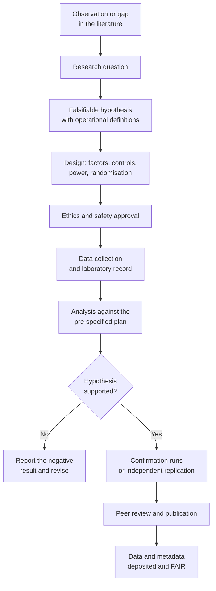
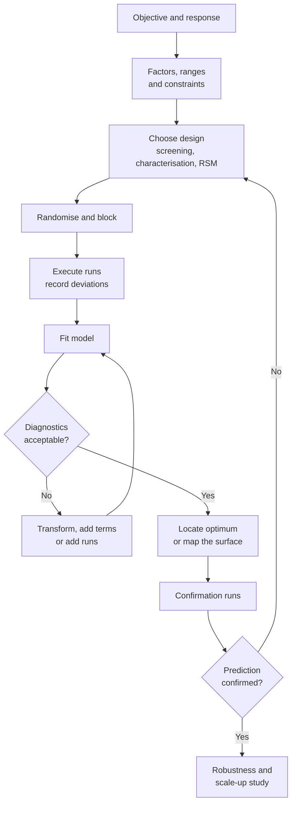
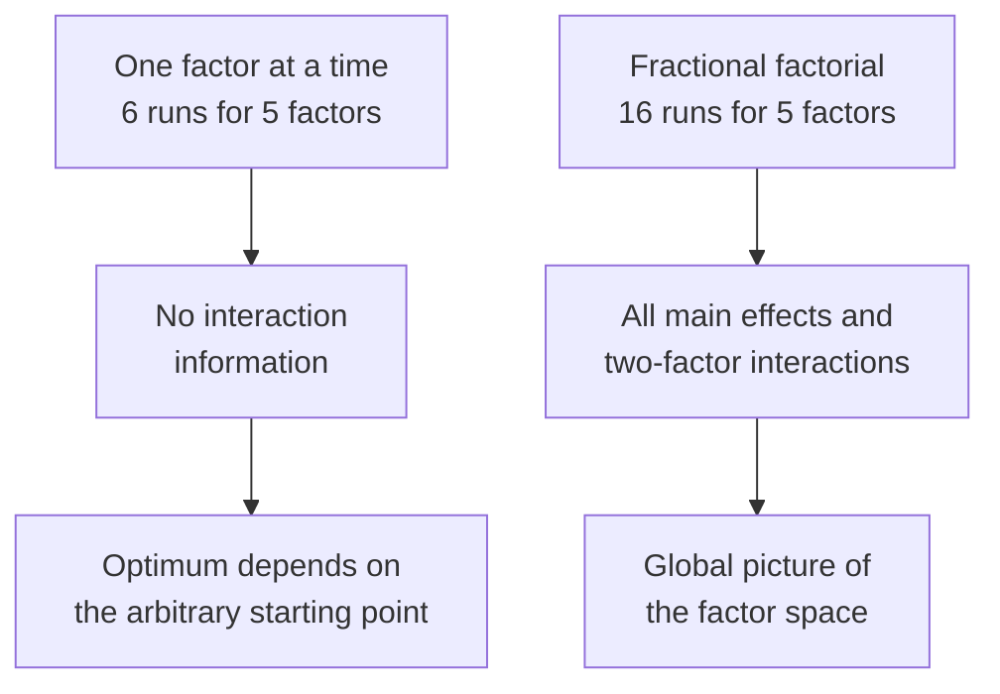
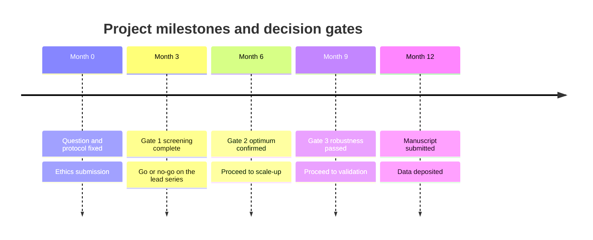

# Chapter 7 — Research Methodology and Experimental Design

> **Level:** Research (Level 10 — University, Postgraduate and Research Chemistry)
> **Estimated study time:** 8 hours (6 h reading + 2 h exercises)
> **Prerequisites:** [Reaction Rates](../03-intermediate-chemistry/09-reaction-rates.md); [Measurement, Units and Significant Figures](../01-foundations/09-measurement-units-and-significant-figures.md)
> **Related chapters:** [Scientific Data Analysis and Reproducibility](09-scientific-data-analysis-and-reproducibility.md), [Scientific Literature and Critical Evaluation](08-scientific-literature-and-critical-evaluation.md), [Research Ethics and Scientific Writing](10-research-ethics-and-scientific-writing.md)
> **Difficulty:** ★★★★☆ (4/5)

---

## 1. Learning Objectives
After working through this chapter you will be able to:

- Convert a research question into a falsifiable hypothesis with operational definitions for every term.
- Classify variables as independent, dependent, controlled or confounding, and identify the level of measurement of each.
- Distinguish internal from external validity, and construct, statistical conclusion and ecological validity, and say which threat
  each design choice addresses.
- Define reproducibility, replicability and repeatability precisely, and give an example of each.
- Name the principal sources of bias in laboratory research and the design features — randomisation, blinding, blocking,
  allocation concealment — that mitigate them.
- Perform a power calculation for a two-sample comparison, and justify the effect size used in it.
- Design and analyse a two-level factorial experiment, computing main effects and interactions from the treatment combinations.
- Explain aliasing in a fractional factorial design, state its resolution, and decide whether the design is adequate for the
  question.
- Fit and interpret a second-order response-surface model, locate its stationary point and classify it.
- Distinguish a robustness test from a ruggedness test and design a Youden–Steiner experiment for the latter.
- Decide between one-factor-at-a-time and sequential experimental strategies, and justify the choice quantitatively.
- Write a data management plan that satisfies the FAIR principles, and set milestones and decision gates for a research project.

---

## 2. Introduction
A research project fails more often from a badly posed question than from a badly executed experiment. The literature is full of
careful measurements that cannot answer the question they were meant to answer, because the question was never translated into a
measurable quantity, because a confounding variable was never controlled, or because the study was too small to detect the effect
it was looking for. Methodology is the discipline that prevents these failures, and it is a technical subject with quantitative
content, not a collection of platitudes about being careful.

The chapter moves from the logical structure of an investigation to its statistical design. It begins with the translation of a
research question into a testable hypothesis, because every later decision — which variable to manipulate, which control to
include, how many replicates to run — depends on that translation. It then treats validity, bias and randomisation, which together
determine whether a result means what it appears to mean. The central section is experimental design in the strict sense:
factorial and fractional factorial layouts, response surface methodology, and the sequential strategies used when each experiment
is expensive. These methods were developed for agriculture and industry, but they are the natural language of reaction
optimisation, formulation development and analytical method validation.

---

## 3. Fundamental Concepts
### 3.1 From question to hypothesis
A **research question** is an open interrogative: does this catalyst improve the enantioselectivity of the reaction? A
**hypothesis** is a declarative statement that could be false: replacing palladium on carbon with a bulky phosphine-ligated
palladium complex increases the enantiomeric excess of the product by at least 10 percentage points under otherwise identical
conditions. The difference matters because only the second can be tested.

Three requirements turn a question into a usable hypothesis. It must be **falsifiable**: there must be an observation that would
count as evidence against it. It must be **specific**: it must name the comparison, the direction of the expected effect and the
conditions. And its terms must be **operationalised**: every concept must be defined by the procedure that measures it. "Catalyst
quality" is not operational; "enantiomeric excess measured by chiral HPLC with a stated column, eluent and detection wavelength,
on a sample taken after 2 h at 25 °C" is.

| Concept | Operational definition | Measurement |
|---|---|---|
| Catalyst activity | Initial turnover frequency in the first 10 % conversion | mol product per mol catalyst per hour |
| Selectivity | Ratio of desired to undesired product at 95 % conversion | GC peak-area ratio, calibrated |
| Stability | Retained activity after 24 h under reaction conditions | Percentage of initial TOF |
| Purity | Mass fraction of the named component | Quantitative NMR with internal standard |

**Table 3.1 — Operational definitions for four commonly used but rarely defined terms.** The right-hand column is what makes a
hypothesis testable; without it, two laboratories can disagree about the result while agreeing about the data.

A useful discipline is to write the hypothesis, the prediction it makes, and the observation that would refute it, in three
consecutive sentences before any experiment is designed. If the third sentence cannot be written, the hypothesis is not
scientific.

### 3.2 Variables and levels of measurement
An **independent variable** (factor) is manipulated by the experimenter; a **dependent variable** (response) is measured. A
**controlled variable** is held constant; a **confounding variable** varies systematically with the factor of interest, so that
its effect cannot be separated from the factor's effect. Confounding is not the same as noise: noise adds variance and can be
averaged away, whereas confounding adds bias that no amount of replication removes.

Variables also have **levels of measurement**, which constrain the statistics that may be applied. Nominal variables are
categories without order (catalyst identity); ordinal variables have order but no fixed spacing (a four-point quality score);
interval variables have equal spacing but an arbitrary zero (temperature in °C); ratio variables have a true zero (temperature in
K, concentration, yield). Means and standard deviations are meaningful for interval and ratio data; for ordinal data, medians and
rank statistics are appropriate; for nominal data, only counts and proportions.

Two further distinctions recur. A **within-subject** (paired) design measures the same unit under several conditions, so that
unit-to-unit variation cancels; a **between-subject** (independent) design compares different units, so that variation between
units enters the error term. In chemistry the analogue is a paired measurement on the same batch versus an unpaired comparison of
two batches, and the paired design is almost always more powerful.

### 3.3 Controls
A control is a treatment that isolates one causal factor by holding everything else equal. Four kinds are standard.

- A **negative control** receives no active treatment and should give the null response. In an assay it is the vehicle-only
  sample; in a catalysis experiment it is the reaction without catalyst. A negative control that responds is evidence of
  contamination, background or a flaw in the assay.
- A **positive control** receives a treatment with a known effect and confirms that the system is capable of responding. An assay
  that fails to detect its positive control has failed, whatever the test samples show.
- A **vehicle control** receives the solvent or matrix in which the test substance is delivered, because the solvent itself may
  affect the response.
- A **blank** contains everything except the analyte and measures the contribution of reagents, containers and instrument
  background to the signal.

The distinction between a negative control and a blank is often blurred in practice but matters in validation: a blank quantifies
contamination of the *measurement*, whereas a negative control tests the *causal claim*. A reaction run without catalyst is a
negative control for catalysis; a cuvette filled with pure solvent is a blank for spectrophotometry.

### 3.4 Validity
**Internal validity** is the extent to which a causal conclusion is warranted within the study: did the manipulation of the
factor, rather than something else, produce the change in the response? It is threatened by confounding, selection, attrition,
instrumentation drift and maturation of the system.

**External validity** is the extent to which the conclusion generalises beyond the conditions studied — to other substrates,
scales, solvents, temperatures or laboratories. A yield optimised in a 5 mL vial at 0.1 M does not automatically transfer to a 100
L reactor, where mixing, heat transfer and residence-time distribution differ.

**Construct validity** is the extent to which the measured quantity represents the concept it is supposed to represent. Measuring
"catalyst stability" by the colour of the solution is a construct-validity failure unless colour has been shown to track activity.

**Statistical conclusion validity** is the extent to which the statistical inference is sound: adequate power, correct model, no
violation of assumptions, no selective reporting of the comparisons that happened to be significant.

### 3.5 Reproducibility, replicability and repeatability
These three words are often used interchangeably, and the resulting confusion has real consequences for how reproducibility crises
are described.

**Repeatability** is the closeness of agreement between independent results obtained with the same method on identical test
material, in the same laboratory, by the same operator, with the same equipment, over a short interval. It is the narrowest of the
three concepts and is quantified by the repeatability standard deviation $s_r$.

**Replicability** is the closeness of agreement between results of studies aimed at answering the same scientific question, where
each study has obtained its own data. A replication may differ in operator, apparatus, sample and laboratory; if it reaches the
same conclusion, the finding is replicable.

**Reproducibility** is used in two senses. In metrology, following ISO 5725, it is the closeness of agreement between results
obtained with the same method on identical test material in different laboratories, by different operators, with different
equipment: the reproducibility standard deviation $s_R$ is always larger than $s_r$. In the computational and policy literature,
following the National Academies report of 2019, it means **computational reproducibility**: obtaining the same results from the
same data and the same analysis code.

| Term | Same data? | Same method? | Same laboratory? | Typical threat |
|---|---|---|---|---|
| Repeatability | Yes | Yes | Yes | Instrument noise |
| Reproducibility (metrology) | Yes | Yes | No | Laboratory bias |
| Computational reproducibility | Yes | Yes (code) | Not applicable | Missing code, versions, seeds |
| Replicability | No | Yes | Usually no | Real effect absent or context-dependent |

**Table 3.2 — The reproducibility vocabulary.** The distinctions are not pedantry: a result can be repeatable but not replicable
(a systematic error reproduced faithfully), reproducible in the computational sense but wrong (the code implements the wrong
model), and replicable but not reproducible (the finding is robust but the original analysis cannot be reconstructed).

### 3.6 Bias and blinding
**Bias** is a systematic deviation of a result from the truth, in contrast to random error, which is unbiased but imprecise. The
principal sources in laboratory work are these.

- **Selection bias** arises when the units entering the comparison differ systematically — for example when the better-quality
  crystals are chosen for the treated group.
- **Measurement (information) bias** arises when the measurement process differs between groups, as when an analyst knows which
  samples are expected to perform well.
- **Confounding** arises when a third variable is associated with both the factor and the response.
- **Confirmation bias** is the tendency to seek, interpret and recall evidence that supports a prior belief.
- **Publication bias** is the tendency of studies with positive results to be published and cited more often, which distorts
  meta-analytic estimates.
**Blinding** removes the analyst's knowledge of treatment identity. In a single-blind design the person measuring is unaware of
the allocation; in a double-blind design the person administering the treatment is also unaware; in a triple-blind design the
analyst performing the statistical analysis is unaware as well. Blinding cannot remove selection bias on its own — that requires
randomisation with allocation concealment — but it removes the subtle influences of expectation on measurement, integration and
exclusion decisions.

### 3.7 Randomisation and blocking
**Randomisation** assigns units to treatments by a random process, which makes the treatment groups exchangeable in expectation
and converts systematic differences between units into random error. It is the only design feature that addresses confounding by
*unknown* variables. **Allocation concealment** protects the randomisation sequence from being subverted, for example by an
analyst who opens the next envelope and assigns the sample accordingly.

**Blocking** is the complementary technique: when a nuisance factor is known and measurable — batch of reagent, day of experiment,
plate position, instrument — the experiment is divided into homogeneous blocks, and the treatment comparison is made within
blocks. Blocking removes the nuisance variation from the error term and therefore increases power. Randomisation is applied
*within* blocks, never across them.

A chemical example makes the logic concrete. If four catalysts are to be compared and only one reaction station is available,
running them on four consecutive days confounds catalyst with day. Running all four each day, in a randomised order, with day
treated as a block, removes the day effect and also allows a check for drift.

### 3.8 Power and sample size
The **power** of a test is the probability of rejecting the null hypothesis when it is false, $1-\beta$. It depends on four
quantities: the size of the effect, the variability of the response, the significance level $\alpha$, and the number of
observations. Fixing any three determines the fourth, which is why a power calculation is the standard way to justify a sample
size.

For a two-sample comparison of means with equal variances, the number of observations per group required to achieve power
$1-\beta$ at two-sided significance $\alpha$ is

$$
n = \frac{2\left(z_{1-\alpha/2} + z_{1-\beta}\right)^{2}\sigma^{2}}{\delta^{2}},
$$

where $\delta$ is the difference worth detecting and $\sigma$ the standard deviation of a single observation. The standardised
effect size is Cohen's $d = \delta/\sigma$, and the formula is more transparently written $n =
2(z_{1-\alpha/2}+z_{1-\beta})^2/d^2$: the sample size depends on the effect only through $d$, and it scales as $1/d^2$.

The choice of $\delta$ is the scientifically important step, not the arithmetic. It should be the **smallest effect size of
interest** — the smallest difference that would change a decision — and it must be chosen before the data are seen. Choosing
$\delta$ after the fact to match the observed difference is a way of guaranteeing a significant result and is a form of circular
analysis.

### 3.9 Factorial designs
A **factorial experiment** varies all factors together, at each of a small number of levels, and runs every combination. A design
with $k$ factors at two levels each requires $2^{k}$ runs and is written $2^{k}$. Its decisive advantage over one-factor-at-a-time
experimentation is that it estimates **interactions**: the extent to which the effect of one factor depends on the level of
another.

The data are analysed by a linear model,

$$
y = \beta_0 + \sum_{i} \beta_i x_i + \sum_{i<j} \beta_{ij} x_i x_j + \varepsilon,
$$

where $x_i \in \{-1, +1\}$ are coded factor levels and $\varepsilon$ is the error. The **main effect** of factor $i$ is the
difference between the mean response at its high and low levels, averaged over the levels of all other factors; in a balanced
two-level design it equals $2\beta_i$. The **interaction** $\beta_{ij}$ measures the non-additivity: a positive interaction means
the two factors together give more than the sum of their separate effects.

Three design features are standard. **Replication** of the runs provides an independent estimate of error and therefore of
confidence intervals. **Centre points** — runs at the midpoint of every factor — test for curvature, which a two-level design
cannot otherwise detect. **Blocking**, as described above, removes nuisance variation.

### 3.10 Fractional factorial designs and resolution
When $k$ is large, the full factorial is uneconomical: $2^{6} = 64$ runs for six factors. A **fractional factorial** uses a subset
chosen so that some high-order interactions are deliberately confounded with other effects. The simplest construction takes a full
factorial in $k-1$ factors and generates the $k$th from their product, giving a $2^{k-1}$ design with defining relation $I = \pm
x_1x_2\cdots x_k$.

The price is **aliasing**: effects that cannot be separated are said to be aliased with one another. In a $2^{4-1}$ design with
defining relation $I = ABCD$, the alias set of $A$ is $\{A, BCD\}$, so the estimate of the main effect of $A$ is really the sum of
$A$ and the three-factor interaction $BCD$. The **resolution** of a design describes what is aliased with what:

| Resolution | Aliasing | Consequence |
|---|---|---|
| III | Main effects alias with two-factor interactions | Good for screening only; interactions cannot be interpreted |
| IV | Main effects clear of two-factor interactions; two-factor interactions alias with each other | Adequate when interactions are expected but sparse |
| V | Main effects and two-factor interactions clear of each other | Adequate for most optimisation studies |

**Table 3.3 — Resolution and what it permits.** A resolution III design answers "which factors matter?" but not "how do they
interact?"; a resolution IV design answers both questions but cannot separate individual two-factor interactions from one another;
a resolution V design can do both, at the cost of more runs.

### 3.11 Response-surface methodology
Once the important factors are known, the objective changes from screening to optimisation, and a linear model is no longer
adequate near an optimum, where the response surface curves. **Response-surface methodology (RSM)** fits a second-order model,

$$
y = \beta_0 + \sum_i \beta_i x_i + \sum_i \beta_{ii} x_i^{2} + \sum_{i<j} \beta_{ij} x_i x_j + \varepsilon,
$$

and uses it to locate the stationary point and to describe the shape of the surface around it. Two standard designs support the
quadratic model:

- The **central composite design (CCD)** combines a two-level factorial or fractional factorial, centre points, and **axial (star)
  points** at distance $\pm\alpha$ from the centre. With $\alpha = (2^{k})^{1/4}$ the design is rotatable, meaning that the
  precision of the predicted response depends only on distance from the centre, not on direction.
- The **Box–Behnken design** uses points at the midpoints of the edges of the cube and three centre points, never at the extreme
  corners. It requires fewer runs than a CCD for the same number of factors and is preferred when the corners of the region are
  impossible or dangerous to run.

Optimisation is then a matter of constrained calculus. Setting the gradient of the fitted quadratic to zero gives the stationary
point

$$
\mathbf{x}_s = -\tfrac{1}{2}\mathbf{B}^{-1}\mathbf{b},
$$

where $\mathbf{b}$ is the vector of linear coefficients and $\mathbf{B}$ the matrix of second-order coefficients. The eigenvalues
of $\mathbf{B}$ classify the point: all negative means a maximum, all positive a minimum, and mixed signs a saddle point, in which
case the optimum lies on the boundary of the region and the analysis must move to a ridge method or to constrained optimisation.

### 3.12 Sequential optimisation versus one factor at a time
**One-factor-at-a-time (OFAT)** experimentation varies one factor while holding the others fixed, then moves to the next. It is
intuitive, it is what most laboratories do by default, and it is inefficient in two specific ways: it requires $1+k(n-1)$ runs to
study $k$ factors at $n$ levels and therefore grows only linearly, and it cannot detect interactions, because the effect of each
factor is measured at a single setting of the others.

The comparison is starker than it looks. For five factors at two levels, OFAT needs six runs and a full factorial needs 32, so
OFAT appears cheaper — but the six OFAT runs estimate no interaction and are valid only at one point in the factor space, whereas
a $2^{5-1}$ resolution V design with 16 runs estimates all main effects and all two-factor interactions. When an interaction
exists, OFAT converges to a local optimum that depends on the arbitrary starting values of the other factors.

**Sequential strategies** accept that optimisation is iterative. The classical approach is the **method of steepest ascent**: fit
a first-order model, move along the gradient until the response stops improving, then fit a second-order model near the optimum.
**Simplex optimisation** moves a geometric figure through the factor space, reflecting the worst vertex through the centroid of
the others, and requires no model at all, which suits noisy, expensive responses. **Bayesian optimisation** places a
Gaussian-process prior over the response surface and chooses each new experiment to maximise expected improvement; it is the
method of choice when each run costs hours or milligrams of material.

### 3.13 Robustness and ruggedness
A method that works only under the exact conditions of its development is not a method. Two tests probe the sensitivity of a
result to small departures from the nominal procedure.

**Robustness** (in the pharmaceutical sense of ICH Q2) tests deliberate small variations in method parameters — pH, mobile-phase
composition, column temperature, flow rate, detection wavelength — and asks whether the result remains within acceptance criteria.
It is performed during method development and is a prerequisite for validation.

**Ruggedness** tests the reproducibility of a method across laboratories, analysts, instruments, days and reagent lots. The
classical design is the **Youden–Steiner** layout: seven or eight factors are assigned to eight runs in a balanced arrangement in
which each factor is at its high level in four runs and at its low level in four, and the effect of each factor is estimated as
the difference of the two half-sums divided by four. The design is saturated, so no independent error estimate exists; instead,
the effects of factors known to be irrelevant form an empirical null distribution, and any factor whose effect stands out from
that distribution is flagged.

### 3.14 Preregistration, data management and ethics
**Preregistration** is the deposit of the hypothesis, design, primary outcome and analysis plan in a public registry before data
collection. It converts a confirmation study into a test rather than an exploration and makes deviations visible. **Registered
reports** go further: the protocol is peer-reviewed and accepted in advance, so publication no longer depends on the result.

A **data management plan (DMP)** states what data will be produced, in what format, with what metadata, where it will be stored,
who may access it, how it will be backed up, how long it will be retained and how it will be shared. The **FAIR principles** —
Findable, Accessible, Interoperable, Reusable — are the standard vocabulary: persistent identifiers, rich metadata, an open
licence, and community formats such as mzML for mass spectra, JCAMP-DX for spectra, CIF for crystal structures and AnIML for
analytical data.

Laboratory records must be **contemporaneous, attributable, legible, original and accurate**, the so-called ALCOA criteria,
extended in regulated work to complete, consistent, enduring and available. An electronic laboratory notebook must therefore carry
an audit trail of every edit, must not permit silent deletion, and must record the instrument file name and the processing
parameters for every reported number.

Any work involving human participants, human tissue or animals requires **ethics approval** before it begins, from a committee
independent of the investigator. Work with genetically modified organisms, pathogens or hazardous chemicals requires a
**biosafety** or chemical-safety assessment that specifies containment, waste disposal and emergency procedures. Chapter
[10](10-research-ethics-and-scientific-writing.md) treats the ethical principles in detail; here the point is procedural: approval
is a design constraint, and a project planned without it will be redesigned at the worst possible moment.

### 3.15 Project planning: milestones, gates and risk
A research project is managed through **milestones** (verifiable achievements with dates) and **decision gates** (points at which
a project continues, changes direction or stops). A gate is not a progress review; it is a commitment decision with pre-agreed
criteria, for example "proceed to scale-up only if the yield exceeds 80 % and the ee exceeds 95 % in three consecutive runs".

Two further instruments are useful. The **critical path** is the longest chain of dependent tasks and therefore sets the minimum
duration of the project; shortening a task that is not on the critical path does not shorten the project. The **risk register**
lists each identified risk, its likelihood, its impact, the mitigation and the owner; risks that sit on the critical path are the
ones worth managing actively.

---

## 4. Detailed Scientific Explanation
### 4.1 Why randomisation works
Randomisation is often taught as a ritual, but its justification is precise. Consider two catalysts compared in a single reactor,
catalyst A on Monday and catalyst B on Tuesday. The observed difference in yield is the sum of the catalyst effect and the day
effect, and no analysis can separate them, because the design contains no information that distinguishes one from the other. The
two factors are **completely confounded**.

Randomisation solves this by making the allocation independent of every variable, observed or not. If the run order is random, the
day effect is equally likely to favour A or B, so it contributes to the variance of the estimated difference rather than to its
expectation. The estimate remains unbiased even though the nuisance factor still exists. This is the sense in which randomisation
addresses confounding by *unknown* variables: it does not remove their influence, it makes that influence random.

Blocking is the complementary strategy for *known* nuisance factors. If the day effect is real and large, randomising across days
leaves it in the error term and reduces power. Running both catalysts on every day, in randomised order within each day, removes
the day-to-day component from the comparison entirely. The general rule is: **randomise what you cannot control, block what you
can measure, and hold constant what you can neither randomise nor block**.

### 4.2 The algebra of a factorial experiment
In a balanced $2^{k}$ design the estimate of any effect is a contrast: a linear combination of the run means with coefficients
$+1$ and $-1$. For the main effect of factor $A$,

$$
\widehat{A} = \bar{y}_{A+} - \bar{y}_{A-} = \frac{2}{N}\sum_{r} x_{Ar} y_r,
$$

where $N = n2^{k}$ is the total number of runs, $n$ the number of replicates and $x_{Ar} \in \{-1,+1\}$ the coded level of $A$ in
run $r$. The same formula with $x_{Ar}$ replaced by the product $x_{Ar}x_{Br}$ estimates the $AB$ interaction, and so on for every
combination. This is why factorial effects can be computed by hand: each is a signed average.

The standard error of any effect follows from the variance of a difference of two means, each based on $N/2$ runs:

$$
\mathrm{SE}(\text{effect}) = \frac{2s}{\sqrt{N}},
$$

with $s$ the pooled within-treatment standard deviation. In an unreplicated $2^{3}$ design ($N = 8$) the standard error is
$0.707s$, so an effect must exceed roughly $2 \times 0.707s = 1.4s$ to reach significance at the 5 % level — a useful rule of
thumb for reading an effects table.

Replication serves three purposes: it estimates $s$, it increases precision as $1/\sqrt{n}$, and it detects **lack of fit** when
the replicate variance is compared with the residual variance of the model. **Centre points** add a fourth: they test for
curvature, because in a two-level design the average of the corner responses can be compared with the centre response, and a
significant difference means that a first-order model is inadequate.

### 4.3 Aliasing arithmetic
Fractional factorials are constructed and decoded with a simple algebra in which each factor is a word and multiplication is
performed modulo 2, so that $x_i^2 = I$. Starting from a full $2^{3}$ in $A$, $B$, $C$ and defining $D = ABC$, the **defining
relation** is $I = ABCD$. Multiplying any word by the defining relation gives its alias:

$$
A \cdot ABCD = BCD, \qquad AB \cdot ABCD = CD, \qquad ABC \cdot ABCD = D.
$$

The set $\{A, BCD\}$ is the alias set of $A$: the estimate usually labelled "main effect of $A$" is really $A + BCD$, and the two
cannot be separated from these data. The **resolution** of the design is the length of the shortest word in its defining relation,
so $I = ABCD$ gives resolution IV, and $I = ABCDE$ gives resolution V.

The practical consequences are summarised in Table 3.3. A resolution III design, such as a 12-run Plackett–Burman screen for
eleven factors, is excellent for deciding which factors matter and useless for deciding how they interact. A resolution IV design
separates main effects from two-factor interactions but aliases the interactions with each other, so it can say that *some*
interaction matters without saying which. A resolution V design resolves both, and the extra runs are the price of that
resolution.

### 4.4 Choosing the effect size, and what significance does not mean
The power calculation of Section 3.8 requires $\delta$, and the choice of $\delta$ is a scientific judgement that must be made
before the data are collected. Three considerations guide it. **Practical significance**: what is the smallest change that would
alter a decision — a 2 % yield improvement that saves a crystallisation step, or a 0.5 % improvement that does not? **Prior
knowledge**: an earlier study or a pilot experiment usually gives a plausible range for $\sigma$, and a pilot with 5–10
observations is adequate for that purpose even though it is inadequate for estimation. **Comparability**: if the literature
reports effects of a certain size, a study powered to detect much larger effects will fail to replicate them.

Two confusions are worth naming. First, **statistical significance is not practical significance**: with enough replicates, a 0.1
% difference becomes significant, and with few replicates a 20 % difference may not. Second, **absence of evidence is not evidence
of absence**: a non-significant result from an underpowered study is uninformative, and equivalence can be claimed only from a
study designed and analysed for equivalence, with a pre-specified margin.

### 4.5 Design of experiments applied to reaction optimisation
A reaction optimisation study follows a repeatable sequence, and most failures come from skipping one of its steps.

1. **Define the objective and the response.** The response must be measurable with an uncertainty much smaller than the effects
   sought; if the analytical method has 5 % relative standard deviation and the effects of interest are 3 %, the experiment cannot
   succeed. Mass balance and impurity profile are often better responses than isolated yield.
2. **Choose the factors and their ranges.** Ranges must be wide enough to produce an effect and narrow enough to remain safe and
   physically sensible. A range chosen too narrow produces a flat response and the false conclusion that the factor does not
   matter.
3. **Select the design.** Screening (fractional factorial, Plackett–Burman), characterisation (full factorial or resolution IV),
   or optimisation (CCD, Box–Behnken).
4. **Randomise and block.** Run order must be randomised within blocks; the person running the experiments should not know which
   condition is which where that is feasible.
5. **Run, record and verify.** Record every deviation. A failed run is data, not a deletion.
6. **Fit and check the model.** Residual analysis, lack-of-fit test, and a check that no observation is exerting undue influence.
7. **Confirm.** Run the predicted optimum, preferably in triplicate, and compare with the prediction. A model that has not been
   confirmed has not been validated.

Two chemical details deserve emphasis. **Temperature** is the factor most often poorly controlled: an exothermic reaction in a
vial on a heated block has an internal temperature that depends on stirring and on the fill level, so the nominal factor level may
not be the actual one. **Sampling** is the second: a yield measured by taking a 5 µL aliquot at a stated time includes the error
of the sampling and the error of the analysis, and both should be estimated before the design is sized.

### 4.6 Sequential and adaptive strategies
When each experiment is expensive, the design should learn as it goes. Three strategies dominate.

**Steepest ascent** fits a first-order model over a screening region and then moves along the gradient in steps until the response
stops increasing; a new first-order model is then fitted, and the process repeats until curvature appears, at which point a
second-order design is run around the apparent optimum. It is efficient when the initial region is far from the optimum.

**Simplex optimisation** maintains a geometric figure with $k+1$ vertices in a $k$-dimensional factor space. At each step the
worst vertex is reflected through the centroid of the others; if the reflection is better than the current best, the simplex
expands, and if it is worse, it contracts. No model is assumed, which makes the method robust to noise and to discontinuities, but
it converges to a local optimum and cannot report interactions.

**Bayesian optimisation** places a prior — usually a Gaussian process — over the unknown response surface, updates it with each
observation, and chooses the next experiment where an acquisition function such as expected improvement is maximal. It handles
noise, constraints and mixed continuous–categorical factors, and it is the standard method for closed-loop and self-driving
laboratories, where a robotic platform runs hundreds of reactions and the algorithm chooses each one.

### 4.7 Model diagnostics and the limits of the design region
A fitted model is a hypothesis about the surface, and it must be checked. The standard diagnostics are a plot of residuals against
fitted values (for non-constant variance and curvature), a normal probability plot of residuals (for non-normality), a plot of
residuals against run order (for drift), and a plot of residuals against each factor (for missed curvature). The **lack-of-fit**
test compares the residual variance of the model with the pure error variance from replicated runs; a significant ratio means the
model is too simple.

Two quantities are often misused. $R^{2}$ always increases when a term is added, so it cannot compare models of different
complexity; **adjusted $R^{2}$** and **predicted $R^{2}$** (from cross-validation) can. And a model is valid only **within the
design region**: extrapolating a quadratic fit beyond the factor ranges that were actually run produces predictions with no
empirical support, and the further the extrapolation, the more confident and more wrong the prediction becomes.

### 4.8 Threats to validity in the laboratory
Certain threats recur so often that they should be checked by default.

- **Batch effects.** A new lot of reagent, ligand or solvent changes the response. Record lot numbers and block by lot.
- **Instrument drift.** A detector response that falls by 2 % over a day will masquerade as an effect if samples are run in order.
  Block by time and randomise within blocks; run calibration standards at intervals.
- **Operator effects.** Two analysts pipetting the same protocol differ systematically. Blind the analyst to the treatment, or
  include analyst as a blocking factor.
- **Sampling error.** A heterogeneous reaction mixture sampled from the top of the flask is not representative.
- **Scale effects.** Mixing time, heat-transfer area per unit volume and residence-time distribution change with scale; a result
  at 5 mL is a hypothesis about a 5 L reactor, not a prediction.
- **Selective exclusion.** Removing "failed" runs after inspecting the data is a form of fabrication unless the exclusion
  criterion was pre-specified.

---

## 5. Visual Diagrams

**Figure 7.1 — From observation to publication.** The workflow is drawn as a sequence because each stage constrains the next: the
hypothesis fixes the design, the design fixes the analysis, and the analysis must be specified before the data exist. The negative
branch is not a failure of the process; it is one of its outcomes, and it is the branch most often suppressed.

**Figure 7.2 — The design-of-experiments cycle.** The two feedback loops are the point of the diagram: a model that fails its
diagnostics sends the analyst back to the model or to the design, and a confirmation run that misses its prediction sends the
analyst back to the design rather than to the discussion section.

**Figure 7.3 — Why the cheaper experiment is often the more expensive one.** OFAT uses fewer runs but purchases less information
per run; the factorial design spends ten extra runs and obtains the interaction structure that determines whether the optimum is a
plateau, a ridge or a peak.

**Figure 7.4 — A project plan expressed as milestones and gates.** Each gate carries a pre-agreed criterion, so the decision to
continue is made against evidence rather than against enthusiasm. The timeline is deliberately short: a plan whose gates are all
at the end has no gates at all.

---

## 6. Mathematical Formulas
**Sample size for a two-sample comparison.**

$$
n = \frac{2\left(z_{1-\alpha/2} + z_{1-\beta}\right)^{2}\sigma^{2}}{\delta^{2}}
= \frac{2\left(z_{1-\alpha/2} + z_{1-\beta}\right)^{2}}{d^{2}},
\qquad d = \frac{\delta}{\sigma}
$$

The expression assumes independent observations, equal variances, normality and a two-sided test; it gives the number per group,
which must be rounded up.

**Factorial model and effect estimate.**

$$
y = \beta_0 + \sum_i \beta_i x_i + \sum_{i<j}\beta_{ij}x_ix_j + \varepsilon,
\qquad
\widehat{\text{effect}} = \bar{y}_{+} - \bar{y}_{-},
\qquad
\mathrm{SE}(\text{effect}) = \frac{2s}{\sqrt{N}}
$$

The model assumes coded factors $x_i \in \{-1,+1\}$, independent errors of constant variance, and no higher-order terms beyond
those fitted.

**Alias relation.**

$$
I = x_1x_2\cdots x_k,
\qquad
\text{resolution} = \text{length of the shortest word in } I
$$

Multiplication is modulo 2, so $x_i^{2} = I$; the relation defines which effects are inseparable.

**Second-order response surface.**

$$
y = \beta_0 + \sum_i \beta_i x_i + \sum_i \beta_{ii}x_i^{2} + \sum_{i<j}\beta_{ij}x_ix_j + \varepsilon,
\qquad
\mathbf{x}_s = -\tfrac{1}{2}\mathbf{B}^{-1}\mathbf{b}
$$

The stationary point exists only if $\mathbf{B}$ is non-singular; its nature is given by the signs of the eigenvalues of
$\mathbf{B}$.

**Youden–Steiner effect.**

$$
E_f = \frac{\sum y_{\text{high}} - \sum y_{\text{low}}}{4}
$$

for eight runs with each factor at its high level four times; the divisor is half the number of runs.

| Symbol | Meaning | SI unit |
|---|---|---|
| $n$ | Replicates per group | dimensionless |
| $\delta$ | Difference worth detecting | same as response |
| $\sigma$ | Standard deviation of one observation | same as response |
| $d$ | Standardised effect size | dimensionless |
| $z_{1-\alpha/2}$, $z_{1-\beta}$ | Standard normal quantiles | dimensionless |
| $x_i$ | Coded factor level | dimensionless |
| $\beta_i$, $\beta_{ij}$ | Model coefficients | same as response |
| $N$ | Total number of runs | dimensionless |
| $s$ | Pooled standard deviation | same as response |
| $\mathbf{B}$, $\mathbf{b}$ | Second-order and linear coefficient matrices | same as response |

**Table 6.1 — Symbols used in this chapter.** Coded factor levels are dimensionless by construction, which is why effect sizes in
a factorial design are expressed in the units of the response rather than of the factor.

---

## 7. Chemical Equations
A design of experiments is always applied to a reaction, and the reaction must be written down with its stoichiometry before any
factor is varied. The Suzuki–Miyaura coupling used as the running example is

$$
\ce{C6H5B(OH)2 + BrC6H4OCH3 + H2O -> C6H5C6H4OCH3 + B(OH)3 + HBr}
$$

with a palladium catalyst and a base. The equation is balanced in carbon, hydrogen, oxygen, boron and bromine, and it shows why
the water content of the solvent is a factor: water is a reactant in the hydrolysis of the boronic acid and a product of the
transmetallation step, so changing the water content changes both the rate and the speciation of the boron reagent.

A second example, used for optimisation studies because it is fast and clean, is the Henry (nitroaldol) reaction:

$$
\ce{C6H5CHO + CH3NO2 ->[base] C6H5CH=CHNO2 + H2O}
$$

The reaction is balanced and is convenient for design work because the product is strongly absorbing, so the response can be
measured spectrophotometrically with a small error, and because the base, the temperature, the solvent and the
aldehyde-to-nitronate ratio are all genuine factors with plausible optima.

Catalyst performance is reported as turnover number and turnover frequency rather than as yield:

$$
\mathrm{TON} = \frac{n_{\text{product}}}{n_{\text{catalyst}}},
\qquad
\mathrm{TOF} = \frac{\mathrm{TON}}{t}.
$$

---

## 8. Worked Examples
### Worked Example 8.1 — Sample size for a yield comparison
**Problem.** A new ligand is expected to raise the yield of a coupling by 5 percentage points. The standard deviation between
replicate reactions is 4 percentage points. How many reactions per condition are needed for 80 % power at $\alpha = 0.05$?

**Strategy.** Apply the two-sample formula with $z_{0.975} = 1.960$ and $z_{0.80} = 0.842$.

**Solution.**

$$
n = \frac{2(1.960 + 0.842)^{2}(4)^{2}}{5^{2}} = \frac{2 \times 7.849 \times 16}{25} = 10.05,
$$

so 11 reactions per condition. The standardised effect is $d = 5/4 = 1.25$, and the achieved power at $n = 11$ is 0.83 rather than
exactly 0.80.

**Check.** Halving the difference worth detecting to 2.5 points quadruples the required sample to about 41 per group, because $n
\propto 1/\delta^{2}$; this is why small effects are expensive to establish.

### Worked Example 8.2 — A $2^{3}$ factorial in reaction optimisation
**Problem.** Temperature (A, 60 or 80 °C), time (B, 2 or 6 h) and catalyst loading (C, 1 or 3 mol %) were varied in a full
factorial with one replicate. The yields were 62.1, 66.3, 68.4, 73.2, 70.5, 76.8, 77.9 and 84.1 % in the standard order $(-,-,-)$
to $(+,+,+)$. Compute the effects and interpret.

**Strategy.** Each effect is the mean of the four runs at the high level minus the mean at the low level; each interaction uses
the product of the coded columns.

**Solution.**

| Term | Effect / % | Term | Effect / % |
|---|---|---|---|
| A | $+9.83$ | AB | $+0.37$ |
| B | $+6.98$ | AC | $+0.88$ |
| C | $+5.38$ | BC | $+0.12$ |
| mean | 72.41 | ABC | $-0.18$ |

All three main effects are large and positive, and every interaction is below 1 %, which is within the noise of a single-replicate
design. The model is therefore additive, and the predicted yield at the best corner is $72.41 + (9.83 + 6.98 + 5.38)/2 = 83.5$ %,
against an observed 84.1 %.

**Check.** The prediction is within 0.6 % of the observation, consistent with an additive model. Because no interaction is
detectable, raising all three factors together is justified; had $AC$ been large and negative, the best corner would not have been
the best operating point.

### Worked Example 8.3 — Aliasing in a $2^{4-1}$ design
**Problem.** A half-fraction of a four-factor design is generated by $D = ABC$. State the defining relation, the alias set of each
main effect, the resolution, and whether the design can detect a two-factor interaction.

**Strategy.** Multiply each word by the defining relation, using $x_i^{2} = I$.

**Solution.** The defining relation is $I = ABCD$, of length 4, so the design is resolution IV. The alias sets are $\{A, BCD\}$,
$\{B, ACD\}$, $\{C, ABD\}$, $\{D, ABC\}$ for the main effects, and $\{AB, CD\}$, $\{AC, BD\}$, $\{AD, BC\}$ for the two-factor
interactions. Each main effect is clear of all two-factor interactions, but the two-factor interactions are aliased in pairs.

**Check.** A significant $AB$ contrast could be $AB$ or $CD$; the design can establish that interaction matters but not which one.
Resolving them requires switching to the complementary fraction or adding runs, which is exactly the trade-off that resolution
describes.

### Worked Example 8.4 — Locating and classifying a response-surface optimum
**Problem.** A quadratic model fitted to coded factors is $y = 70 + 4x_1 + 3x_2 - 5x_1^{2} - 4x_2^{2} - 2x_1x_2$. Find the
stationary point and classify it.

**Strategy.** Set the partial derivatives to zero and examine the Hessian matrix.

**Solution.** The gradient conditions are $4 - 10x_1 - 2x_2 = 0$ and $3 - 8x_2 - 2x_1 = 0$, giving $x_1 = 0.342$ and $x_2 =
0.290$. Substituting gives $y = 71.12$. The Hessian is

$$
\mathbf{B} = \begin{pmatrix} -10 & -2 \\ -2 & -8 \end{pmatrix},
$$

with eigenvalues $-6.76$ and $-11.24$. Both are negative, so the stationary point is a maximum.

**Check.** The optimum lies inside the design region (both coded coordinates are between $-1$ and $+1$), so the quadratic model is
interpolating rather than extrapolating; had $|x|$ exceeded 1, the predicted optimum would have required a new design centred on
it.

### Worked Example 8.5 — Youden–Steiner ruggedness test
**Problem.** Seven factors — analyst (A), day (B), column lot (C), mobile-phase lot (D), instrument (E), temperature (F) and flow
rate (G) — were examined in eight runs with the responses 83.9, 76.0, 76.7, 80.2, 80.0, 83.1, 80.6 and 79.3 %. Compute the effects
and decide which factors threaten ruggedness.

**Strategy.** For each factor, subtract the sum of the four low-level responses from the sum of the four high-level responses and
divide by four.

**Solution.**

| Factor | A | B | C | D | E | F | G |
|---|---|---|---|---|---|---|---|
| Effect / % | $+3.95$ | $+0.30$ | $-0.10$ | $-3.20$ | $+0.45$ | $-0.30$ | $+0.25$ |

Five factors give effects between $-0.30$ and $+0.45$ %, which defines the empirical noise; analyst and mobile-phase lot give
effects an order of magnitude larger. The method is not rugged with respect to those two factors and must be controlled by
training and by lot qualification.

**Check.** The grand mean is 79.97 %, consistent with the individual responses. With a saturated design there is no independent
error estimate, so the conclusion rests on the separation between the two large effects and the cluster of small ones, not on a
formal test.

### Worked Example 8.6 — The cost of one factor at a time
**Problem.** Five factors are to be studied at two levels, and interactions are expected. Compare the number of runs required by
OFAT and by a resolution V fractional factorial.

**Strategy.** OFAT requires $1 + k$ runs at two levels; a resolution V $2^{5-1}$ design requires 16 runs. Count the information
obtained per run.

**Solution.** OFAT needs 6 runs and yields 5 main effects measured at one fixed setting of the other factors. The $2^{5-1}$ design
needs 16 runs and yields 5 main effects, 10 two-factor interactions and an estimate of error if centre points are added — 15
estimated quantities from 16 runs, against 5 from 6.

**Check.** Per run, the factorial design returns roughly three times as much information, and it is the only one of the two that
can detect the interactions the problem states are expected. The OFAT design is cheaper only if the interactions turn out to be
negligible, which cannot be known in advance.

---

## 9. Real-World Applications
**Pharmaceutical process development.** Quality by Design replaces fixed set points with a design space: a response-surface model
defines the combinations of temperature, pH, concentration and residence time within which the product meets its specification.
Regulators accept the design space as part of the filing, so the model becomes a regulatory document, and confirmation runs and
robustness studies become evidence rather than housekeeping.

**Analytical method validation.** Robustness testing is mandatory under ICH Q2, and ruggedness studies across laboratories
underpin the reproducibility claims of a standard method. A validated method is a designed experiment whose factors are the method
parameters and whose response is the measurement error.

**Catalysis and materials discovery.** High-throughput experimentation generates hundreds of reactions per day, and the bottleneck
has moved from running experiments to choosing them. Bayesian optimisation and design-of-experiments schedules decide which
composition to try next, and the same statistical machinery that optimises a 5 mL reaction schedules a 96-well plate.

---

## 10. Common Mistakes
| Mistake | Why it happens | Correct approach |
|---|---|---|
| Choosing the sample size after seeing the data | The calculation is treated as a formality | Fix $\delta$ from the smallest effect of interest before collecting data |
| Running conditions in a convenient order | Randomisation feels unnecessary for a careful worker | Randomise within blocks and record the run order |
| Treating a non-significant result as proof of no effect | Absence of evidence is confused with evidence of absence | Report the confidence interval and the power of the study |
| Using a resolution III design to study interactions | The design is cheap and the resolution is ignored | Match resolution to the question; use IV or V when interactions matter |
| Extrapolating the model outside the design region | The quadratic looks well behaved everywhere | Restrict predictions to the region actually studied |
| Optimising one factor at a time | It is intuitive and each step is interpretable | Screen with a factorial design, then optimise with RSM |
| Omitting centre points | Two-level designs seem sufficient | Add centre points to test curvature and to estimate pure error |
| Reporting yield without uncertainty | A single number looks like a result | Report replicates, standard deviation and the analytical uncertainty |

---

## 11. Chapter Summary
- A research question becomes usable only when it is turned into a falsifiable hypothesis with operational definitions.
- Internal validity concerns causation within the study; external validity concerns generalisation; construct and statistical
  conclusion validity are separate and independent.
- Repeatability, reproducibility and replicability are distinct concepts, and the distinctions determine what a failed replication
  actually shows.
- Randomisation addresses unknown confounders, blocking addresses known nuisance factors, and blinding addresses measurement bias.
- Power depends on effect size, variance, $\alpha$ and $n$; the sample size scales as $1/d^{2}$, and $\delta$ must be chosen
  before the data.
- Factorial designs estimate interactions, which OFAT cannot; fractional factorials buy economy at the cost of aliasing, and
  resolution describes what is lost.
- Response-surface methodology fits a quadratic model, locates the stationary point and classifies it by the eigenvalues of the
  Hessian.
- Sequential and Bayesian strategies are preferable when runs are expensive, and every model must be confirmed by independent
  runs.
---

## 12. Exercises
### 12.1 Conceptual questions
1. Explain why randomisation makes an estimate unbiased even when an unknown nuisance factor is present.
2. Distinguish reproducibility from replicability, and give a chemical example of each.
3. Why can a resolution III design not be used to interpret two-factor interactions?

### 12.2 Basic problems
4. A study has $\sigma = 6$ % and must detect a 4 % difference. Calculate $d$ and the required $n$ per group for 80 % power at
   $\alpha = 0.05$.
5. Sketch the eight runs of a $2^{3}$ design and label the treatment combinations in standard order.
6. What is the resolution of a design with defining relation $I = ABCDE$?

### 12.3 Intermediate problems
7. In a $2^{3}$ design the mean response is 50, the effects are $A = 8$, $B = -4$ and $AB = 6$, and all other terms are
   negligible. Predict the response at $(+,-,+)$.
8. A CCD for three factors has 8 factorial points, 6 axial points and 3 centre points. How many runs are required, and what is the
   purpose of each group?
9. A robustness study finds that a 2 °C change in column temperature alters the retention time by 0.05 min against an acceptance
   criterion of 0.10 min. Is the method robust with respect to temperature?

### 12.4 Advanced problems
10. A $2^{4-1}$ design with $I = ABCD$ gives a large contrast for $AB$. List the possible explanations and describe the additional
   runs that would distinguish them.
11. A quadratic model has Hessian eigenvalues $+3.1$ and $-0.8$. Describe the surface and explain why the stationary point is not
   the optimum.

### 12.5 Calculation problems
12. A reaction gives 78.4, 79.1 and 77.8 % yield in triplicate. Calculate the mean, the standard deviation and the standard error
   of the mean, and state how many runs would be needed to detect a 1 % difference at 80 % power if the standard deviation is
   representative.

### 12.6 Answers
1. Because allocation independent of every variable makes the nuisance factor equally likely to favour either group, so it
   contributes to variance but not to bias.
2. Reproducibility: the same mass spectra reanalysed with the deposited code give the same peak areas. Replicability: an
   independent laboratory repeats the synthesis with its own reagents and obtains the same yield.
3. Because in a resolution III design each main effect is aliased with a two-factor interaction, so a significant contrast cannot
   be attributed to either.
4. $d = 4/6 = 0.667$; $n = 2(1.960+0.842)^{2}/0.667^{2} = 35.3$, so 36 per group.
5. $(-,-,-)$, $(+,-,-)$, $(-,+,-)$, $(+,+,-)$, $(-,-,+)$, $(+,-,+)$, $(-,+,+)$, $(+,+,+)$.
6. Resolution V, because the shortest word has five letters.
7. $50 + (8 - 4 + 6)/2 = 55$.
8. 17 runs; the factorial points estimate the linear terms and interactions, the axial points estimate the quadratic terms, and
   the centre points estimate pure error and test for lack of fit.
9. Yes: the shift is half the acceptance criterion, so the method is robust to that variation.
10. The contrast is $AB + CD$; either $AB$, $CD$ or both are real. Running the complementary fraction resolves the pair, because
   in that fraction the alias structure is reversed.
11. A saddle point: increasing one factor raises the response while the other lowers it, so the optimum lies on the boundary of
   the region rather than at the stationary point.
12. Mean 78.43 %, $s = 0.651$ %, SEM $= 0.376$ %; with $d = 1/0.651 = 1.54$, $n = 2(2.802)^{2}/1.54^{2} = 6.6$, so 7 runs per
   condition.

---

## 13. Further Reading
- Box, G. E. P.; Hunter, J. S.; Hunter, W. G. *Statistics for Experimenters: Design, Innovation, and Discovery*, 2nd ed. Wiley,
  2005.
- Montgomery, D. C. *Design and Analysis of Experiments*, 10th ed. Wiley, 2019.
- Fisher, R. A. *The Design of Experiments*. Oliver and Boyd, 1935.
- Cochran, W. G.; Cox, G. M. *Experimental Designs*, 2nd ed. Wiley, 1957.
- Cohen, J. *Statistical Power Analysis for the Behavioral Sciences*, 2nd ed. Lawrence Erlbaum, 1988.
- Popper, K. R. *The Logic of Scientific Discovery*. Routledge, 1959 (English edition).
- National Academies of Sciences, Engineering, and Medicine. *Reproducibility and Replicability in Science*. The National
  Academies Press, 2019. <https://nap.nationalacademies.org/>
- Wilkinson, M. D. et al. "The FAIR Guiding Principles for scientific data management and stewardship." *Scientific Data* 3,
  160018 (2016).
- Eurachem. *Fitness for Purpose of Analytical Methods: A Laboratory Guide to Method Validation and Related Topics*, 2nd ed.,
  2014. <https://www.eurachem.org/>
- International Conference on Harmonisation. *ICH Q2(R2): Validation of Analytical Procedures*, 2023. <https://www.ich.org/>
- International Conference on Harmonisation. *ICH Q8(R2): Pharmaceutical Development*, 2009. <https://www.ich.org/>
