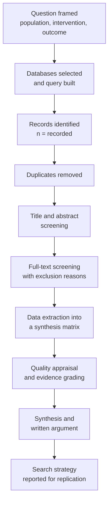
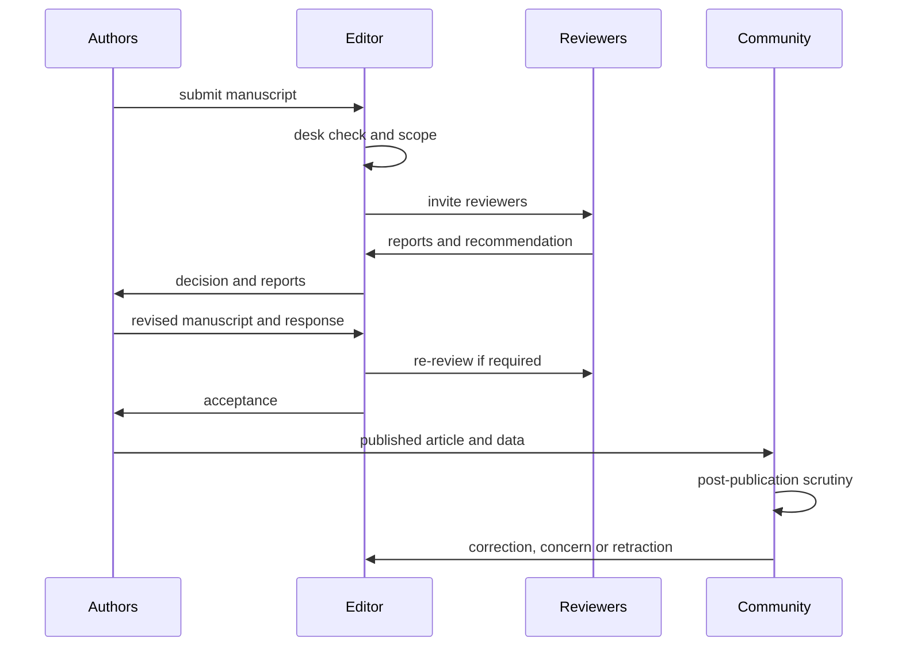
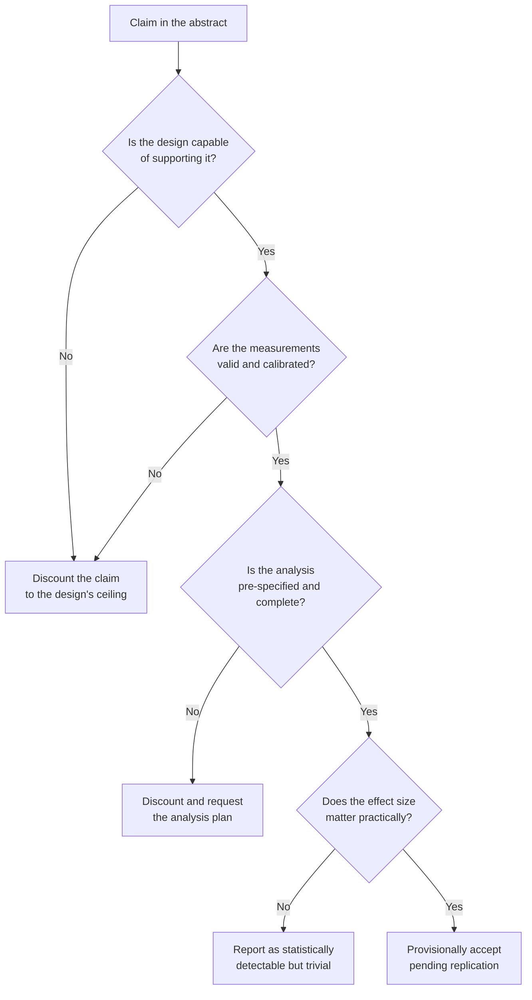
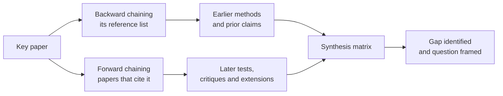

# Chapter 8 — Scientific Literature and Critical Evaluation

> **Level:** Research (Level 10 — University, Postgraduate and Research Chemistry)
> **Estimated study time:** 6 hours (4.5 h reading + 1.5 h exercises)
> **Prerequisites:** None beyond the ability to read a scientific paper and a basic statistics vocabulary
> **Related chapters:** [Research Methodology and Experimental Design](07-research-methodology-and-experimental-design.md), [Scientific Data Analysis and Reproducibility](09-scientific-data-analysis-and-reproducibility.md), [Research Ethics and Scientific Writing](10-research-ethics-and-scientific-writing.md)
> **Difficulty:** ★★★★☆ (4/5)

---

## 1. Learning Objectives

After working through this chapter you will be able to:

- Classify a source as primary, secondary or tertiary, and explain what each type can and cannot establish.
- Describe what peer review does and does not guarantee, and identify the failure modes that survive it.
- Construct a reproducible search strategy using Boolean operators, controlled vocabulary, field tags and citation
  chaining, and document it well enough for another person to repeat it.
- Read a research paper in a deliberate order and extract the claim, the evidence and the gap within twenty minutes.
- Audit a methods section against a checklist of sufficiency, and state exactly what is missing.
- Interpret effect sizes and confidence intervals, and explain why a p-value alone is insufficient evidence.
- Recognise p-hacking, HARKing, multiple-comparison inflation and selective reporting in published work.
- Explain the replication crisis in quantitative terms using the positive predictive value of a research finding.
- Identify predatory journals, retraction notices and expressions of concern, and respond appropriately to each.
- Manage references with a reference manager and a citation style, and export a BibTeX library.
- Build a synthesis matrix and write a critical appraisal that is specific, evidence-based and fair.
- Evaluate the output of AI-assisted literature tools and verify every citation they produce.

---

## 2. Introduction
Science is a cumulative enterprise, and the cumulative part happens in the literature. A result that is not
communicated, or communicated so poorly that it cannot be used, does not enter the record; a result that is
communicated but never evaluated enters the record as noise. The skills of finding, reading and judging published
work are therefore not ancillary to research — they are the mechanism by which research becomes knowledge.

The volume of the literature makes the skills mandatory. Chemical Abstracts registers more than a million new
substances a year, PubMed indexes millions of biomedical records, and a specialist in any field can expect several
thousand new papers a year in their own area. No one reads all of it. The competent researcher reads a small,
well-chosen fraction thoroughly, screens a larger fraction quickly, and delegates the rest to reviews, databases and
colleagues — and does so with enough methodological understanding to know which fraction deserves which treatment.

This chapter treats the literature as a data source with known biases and measurable reliability. It covers the
hierarchy of sources, the sociology of peer review and publishing, the mechanics of searching, the practice of reading
and appraising, and the statistical literacy needed to understand what a paper's numbers actually say. It closes with
the workflow for a literature review and with the limitations of automated and AI-assisted search.

The chapter is deliberately independent of the rest of the curriculum: a reader who has never run an experiment can
use it to evaluate one. Chapter [7](07-research-methodology-and-experimental-design.md) supplies the design knowledge
that makes a methods section judgeable, and Chapter [10](10-research-ethics-and-scientific-writing.md) covers the
author's side of the same transaction.

---

## 3. Fundamental Concepts

### 3.1 The hierarchy of sources
**Primary literature** reports original observations made by the authors: research articles, patents, conference
proceedings, theses, deposited datasets and, increasingly, preprints. A primary source is the only place where the
raw evidence exists, and it is therefore the only source that can be appraised in detail. Its weakness is that it is
written by interested parties and is often incomplete.

**Secondary literature** organises, summarises and evaluates primary sources: review articles, meta-analyses,
systematic reviews, abstracting and indexing services, and critical commentaries. A good review is invaluable for
orientation and for finding the primary sources, but it inherits and can amplify the errors of what it summarises.
A meta-analysis is a quantitative secondary study and should be appraised as a primary study in its own right, with
its own search strategy, inclusion criteria and model.

**Tertiary literature** compiles established knowledge: textbooks, encyclopaedias, handbooks, compilations and
databases of evaluated data. It is the right place to look up a physical constant or a standard method and the wrong
place to establish a research claim, because by the time knowledge reaches a textbook it has usually lost its
uncertainty.

| Type | Examples | Strength | Weakness |
|---|---|---|---|
| Primary | Research article, patent, thesis, dataset | Raw evidence, full methods | Incomplete, interested, unreviewed in parts |
| Secondary | Review, meta-analysis, indexing service | Orientation, synthesis, coverage | Inherits errors, selection of included work |
| Tertiary | Textbook, handbook, database | Evaluated, stable, accessible | Out of date, uncertainty stripped |

**Table 3.1 — The three levels of the literature.** The classification describes the *function* of a document, not its
quality: a poor primary paper is still primary, and an excellent review is still secondary.

### 3.2 Journals, metrics and open access
Journals differ in scope, selectivity and speed, and a hierarchy of prestige has grown up around them. The most
cited metric is the **Journal Impact Factor** (JIF), defined as the number of citations in a given year to items
published in the two preceding years, divided by the number of citable items published in those years. Its
limitations are severe and well documented: the distribution of citations is highly skewed, so a few papers determine
most of the value; the two-year window disadvantages slow-moving fields; the metric varies by an order of magnitude
between disciplines; it can be manipulated by editorial policy, by self-citation and by publishing review material
that is highly cited but not representative of research quality. The **h-index** aggregates an individual's output
and citations and inherits the same field and career-stage biases. **CiteScore**, **SJR** and **altmetrics** measure
different things and are not substitutes.

**Open access** changes the economics rather than the science. In the gold route the author pays an article processing
charge and the article is immediately free to read; in the green route a version is deposited in an institutional or
subject repository, often after an embargo; in the diamond route neither author nor reader pays. Open access increases
readership and citation, and it also creates an incentive for journals that collect fees without providing the
services — which is the subject of Section 3.10.

### 3.3 Peer review: what it does and does not guarantee
Peer review is the evaluation of a manuscript by independent experts before publication. It is a filter, not a
guarantee. A competent review asks whether the question is important, whether the methods are adequate, whether the
conclusions follow from the data, and whether the reporting is complete. What it does not do is equally important.

- It does not **reanalyse the data**. Reviewers see summary statistics and figures, not the raw measurements.
- It does not **detect fabrication**. Fabricated data that are internally consistent and plausible survive review,
  which is why most retractions are prompted by post-publication scrutiny rather than by referees.
- It does not **guarantee reproducibility**. A methods section can pass review while omitting the detail needed to
  repeat the work.
- It does not **eliminate bias**. Reviewers are subject to confirmation bias, to preference for familiar methods and
  to prestige effects; blinding reduces but does not remove these.
- It does not **prevent selective reporting**, because the analysis plan is usually not fixed in advance.

The process is also slow and unpaid, which is why preprints (Section 3.4) and post-publication review have grown.
A useful working rule is to treat a peer-reviewed paper as a *claim that has passed a plausibility check*, not as an
established fact.

### 3.4 Preprints
A **preprint** is a complete manuscript deposited in a public server — arXiv, ChemRxiv, bioRxiv, medRxiv, SSRN and
their equivalents — before or during peer review. Preprints accelerate dissemination, establish priority, allow
community comment and make negative or unfashionable results visible. They are not peer reviewed at the point of
deposit, so their claims carry no editorial endorsement, and the version on the server may differ from the eventual
journal article. The responsible practice is to cite the version actually read, to state that it is a preprint, and
to check whether a peer-reviewed version now exists. During public-health emergencies preprints became a primary
channel of communication, and the subsequent record showed both their value and the cost of circulating unvetted
claims.

### 3.5 Search strategy
A defensible search has four properties: it is **comprehensive** within its stated limits, it is **reproducible**, it
is **documented**, and it is **not arbitrarily selective**. The workflow is standard.

1. **Frame the question.** For a systematic review, the PICO structure — population, intervention, comparison,
   outcome — forces specificity. For a chemistry question, the analogous frame is substrate, transformation,
   conditions, and measured outcome.
2. **Choose the databases.** Web of Science and Scopus are broad and citation-rich; PubMed is the biomedical standard
   and uses MeSH controlled vocabulary; SciFinder-n and Reaxys are the chemical databases, supporting structure and
   reaction searches that no text search can replace; Google Scholar is broad but opaque and unreproducible;
   Dimensions, Lens and Crossref add patent and funder coverage.
3. **Build the query.** Boolean operators combine concepts: `AND` narrows, `OR` broadens, `NOT` excludes. Truncation
   (`cataly*`) and wildcards capture variants, proximity operators require terms to be close, field tags restrict the
   search to title, abstract or author, and controlled vocabulary captures synonyms that authors did not use.
   Chemical searches should include registry numbers and structure queries in addition to text.
4. **Chain citations.** **Backward chaining** follows the references of a key paper; **forward chaining** finds the
   papers that cite it. Citation chaining finds relevant work that keyword search misses because the vocabulary
   differs.
5. **Search the grey literature.** Theses, conference abstracts, patents, regulatory documents, technical reports and
   company data. Excluding grey literature systematically biases a review towards positive, published, English-language
   results.
6. **Record everything.** Databases, dates, exact queries, filters, and the number of records at each stage. A search
   that cannot be repeated is not a method.

Screening then proceeds in two stages: title and abstract, then full text, with reasons for exclusion recorded at the
second stage. The **PRISMA** statement provides the standard flow diagram and reporting checklist for this process,
and it is the reason systematic reviews are auditable.

### 3.6 Reading a paper efficiently
A research paper is not a novel and should not be read from the beginning. The efficient order is:

1. **Title and abstract** — what is claimed?
2. **Figures and tables** — what is actually shown? A figure is harder to misrepresent than a sentence.
3. **Methods** — could this be done, and was it done properly?
4. **Results** — do the numbers support the figures?
5. **Discussion and conclusion** — does the claim exceed the evidence?
6. **References** — what is the intellectual lineage, and is the key prior work cited?

Twenty minutes is enough to decide whether a paper deserves two hours. The decision should be recorded, because a
literature review is built from hundreds of such decisions, and the reason for exclusion is part of the method.

### 3.7 Evaluating a methods section
A methods section is sufficient when an independent expert could repeat the work and obtain comparable results. The
following checklist is a practical test; a paper that fails several items is not necessarily wrong, but its claims
cannot be verified from the paper alone.

- **Materials**: source, purity and grade of reagents; synthesis and characterisation of new compounds; for
  biomolecules, sequence, source and validation.
- **Conditions**: temperature, pressure, atmosphere, concentration, stoichiometry, addition rate, stirring, vessel
  and scale.
- **Instruments**: manufacturer, model, key settings; for NMR, field, solvent, reference; for MS, ionisation mode,
  resolution and calibration.
- **Replication**: how many independent runs, and what counts as an independent replicate.
- **Randomisation and blinding**: stated where relevant, absent where not.
- **Analysis**: how the raw data became the reported number, including baseline correction, integration limits and
  the statistical model.
- **Data availability**: a repository identifier or a statement of restriction.

### 3.8 Statistical literacy for readers
Four ideas carry most of the interpretive weight.

**Effect size versus significance.** A p-value answers a narrow question: how surprising would data at least this
extreme be if the null hypothesis were true? It does not measure the size or the importance of an effect. A
difference of 0.2 % can be highly significant with a million observations; a difference of 20 % can be
non-significant with ten. Report and read the effect size with its confidence interval.

**Confidence intervals.** A 95 % confidence interval is the range of values that would not be rejected at the 5 %
level; it combines the estimate and its precision and is more informative than a p-value. A wide interval that
includes both trivial and important effects means the study is uninformative, not that the effect is absent.

**Multiple comparisons.** Testing twenty independent hypotheses at $\alpha = 0.05$ produces about one false positive
by chance alone. The probability of at least one false positive among $k$ independent tests is
$1 - (1-\alpha)^{k}$, which is 64 % for twenty tests. Corrections exist — Bonferroni controls the family-wise error
rate, Holm improves its power, and Benjamini–Hochberg controls the false discovery rate — but the primary defence is
to specify in advance which comparisons are confirmatory.

**Selective analysis.** **p-hacking** is the iterative adjustment of analysis choices until a threshold is crossed:
dropping outliers, adding covariates, choosing one of several endpoints, or stopping when the result becomes
significant. **HARKing** (hypothesising after the results are known) presents an exploratory finding as a
confirmatory prediction. Both inflate the false positive rate without leaving a visible trace in the published
article, and both are detectable mainly through pre-registration and through comparison with the protocol.

### 3.9 The replication crisis
Between 2011 and 2016 a series of large-scale replication projects reported that a substantial fraction of
high-profile findings in psychology, cancer biology and economics could not be reproduced. The best-known estimate,
from the Open Science Collaboration's 2015 replication of 100 psychology studies, found that 36 % of replications
produced significant results, against 97 % in the originals, and that effect sizes in the replications were on
average about half those originally reported. Chemistry has been less systematically audited, but the same structural
incentives apply: publication depends on novelty and positivity, analyses are flexible, sample sizes are often small,
and the raw data are rarely shared.

The causes are structural rather than individual: **publication bias** against null results, **low power**,
**analytical flexibility**, **competition for scarce positions** and **metrics that reward publication volume**. The
remedies are correspondingly structural: pre-registration, registered reports, mandatory data and code deposition,
reporting guidelines such as CONSORT and ARRIVE, and a reward system that values replication.

### 3.10 Predatory journals
**Predatory journals** charge article processing fees without providing the services they advertise: no genuine peer
review, fabricated or meaningless editorial boards, invented impact factors, aggressive solicitation by email, and
promises of publication within days. Their existence is a direct consequence of the author-pays model and a direct
threat to the record, because articles published in them are indexed, cited and indistinguishable to a non-expert
reader.

The practical checks are simple. Is the journal listed in the **Directory of Open Access Journals**? Is the publisher
a member of the **Committee on Publication Ethics**? Does the journal have a verifiable editorial board with
institutional affiliations? Is the peer-review process described concretely? Is the fee disclosed before submission?
Does the solicitation come unsolicited and flatter the recipient? The **Think.Check.Submit** checklist formalises
these questions, and the absence of a single check is not proof of predation, but several together are a warning.

### 3.11 Corrections, expressions of concern and retractions
The literature has a graded response to error. A **correction** (erratum) fixes a mistake that does not affect the
conclusions. An **expression of concern** signals that a serious question has been raised while an investigation
proceeds. A **retraction** withdraws the paper: it remains in the record, marked as retracted, because deleting it
would erase the evidence of what was claimed and cited.

Retractions are issued for honest error as well as for misconduct; the distinction is important, because a retraction
is not by itself an accusation of fraud. The commonest causes are image duplication or manipulation, duplicated
publication, plagiarism, fabricated or falsified data, and irreproducible results that the authors cannot explain.
**COPE** publishes retraction guidelines, and **Retraction Watch** maintains a searchable database. A reader who
cites a retracted paper inherits its error, so the final check before submission should be a search of the DOI
against retraction databases.

### 3.12 Citing and reference management
A citation has three functions: it gives credit, it allows verification, and it locates the claim within a tradition.
Every factual claim that is not the author's own must be cited, and every citation must be to a source actually read
in the version cited. **Secondary citation** — citing a paper because another paper cited it — is acceptable only when
explicitly flagged, because it propagates errors.

**Reference managers** (Zotero, Mendeley, EndNote, Paperpile) store bibliographic records, attach PDFs, and generate
bibliographies in any of thousands of **Citation Style Language** styles. The practical discipline is to import the
record from the publisher or from a DOI resolver rather than typing it, to check the imported metadata, and to use a
citation key that is stable across the project. **BibTeX** and its successor BibLaTeX are the standard formats for
LaTeX workflows, and a `.bib` file with a consistent key scheme (`authorYEARkeyword`) is easier to maintain than a
folder of PDFs with descriptive filenames.

### 3.13 The literature review and the synthesis matrix
A literature review is an argument about the state of knowledge, not an annotated bibliography. Its structure is
thematic: each paragraph advances a claim about what is known, what is contested and what is missing, and each claim
is supported by the strongest available evidence.

The **synthesis matrix** is the working tool. Rows are studies; columns are the dimensions that matter — design,
sample, method, key result, effect size, limitation, relevance. Filling the matrix forces consistent extraction and
makes gaps visible: a column with few entries is a gap, and a row that disagrees with all others is either an outlier
or a discovery.

### 3.14 AI-assisted literature search and its limitations
Large language models can draft a search strategy, suggest synonyms, summarise an abstract and rewrite a paragraph.
They cannot be trusted as a source. A model asked for references will produce plausible-looking citations that do not
exist; a model asked for a fact will produce a fluent statement with no provenance; a model asked to summarise a paper
it has not been given will summarise its training data, which may include a different paper. The failure mode is
**confident fabrication**, and it is indistinguishable from competence in the absence of verification.

Legitimate uses are narrow and verifiable: generating search terms to be tested in a real database, screening titles
against explicit criteria with human checking, extracting structured fields that are then verified against the source,
and improving the clarity of text the author has written. Every citation must be resolved to a DOI and every
extracted number checked against the original. Disclosure of AI assistance is increasingly required by publishers,
and the author remains responsible for everything in the manuscript.

---

## 4. Detailed Scientific Explanation

### 4.1 The anatomy of a paper and what each part can tell you
The IMRaD structure — Introduction, Methods, Results, and Discussion — is a rhetorical form as well as a logical one,
and knowing its conventions tells the reader where to look for what.

The **title and abstract** are marketing as well as summary; they state the claim in its strongest form. The
**introduction** establishes the gap and ends with the aim, which is often narrower than the title. The **methods**
are the only part that can be audited, and they are usually compressed to the point where auditing requires the
supplementary information. The **results** are selected by the authors: what is shown is not the whole of what was
measured. The **discussion** moves from observation to interpretation, and the distance between the two is the measure
of the paper's ambition. The **limitations** paragraph, when present, is the author's own appraisal and is often the
most honest part of the paper.

### 4.2 Auditing a methods section
An audit asks four questions in order. **Was the design capable of answering the question?** A study with no control
cannot establish causation, however precise its measurements. **Were the measurements valid?** An assay that measures
a proxy is only as good as the proxy's validation. **Was the analysis pre-specified?** A methods section that
describes the statistical test but not how the sample size was chosen, or how outliers were handled, leaves the
analysis unfalsifiable. **Is the reporting complete?** Missing standard deviations, missing n values, missing
instrument settings and missing data-availability statements are all reporting failures, and the appropriate reader
response is to discount the claim rather than to assume the best.

### 4.3 Statistical fallacies that survive peer review
Several fallacies recur so reliably that they can be checked for explicitly.

- **The significance fallacy**: concluding that a non-significant result means no effect. With low power, the
  absence of significance is expected under a true effect.
- **The dichotomisation fallacy**: treating $p = 0.049$ as qualitatively different from $p = 0.051$. The p-value is
  a continuous measure of evidence, and the 0.05 threshold is a convention.
- **The subgroup fallacy**: reporting a significant effect in one subgroup and a non-significant effect in another
  and concluding that the two differ, when the interaction test is not significant.
- **The baseline fallacy**: comparing final values between groups that differed at baseline, instead of comparing
  changes or using analysis of covariance.
- **The regression-to-the-mean fallacy**: selecting extreme cases and attributing the subsequent movement to the
  intervention.
- **The multiplicity fallacy**: reporting the one comparison that reached significance without disclosing the others.

### 4.4 Weighing evidence
Not all evidence is equal, and the ranking is not a hierarchy of methods but a hierarchy of designs for a given
question. For a causal question about an intervention, a randomised trial outranks an observational study, which
outranks a case series, which outranks an anecdote. For a question about mechanism, a controlled mechanistic
experiment outranks a correlational observation. For a question about a physical constant, a metrological comparison
outranks everything else.

Three further criteria operate alongside the design. **Consistency**: does the finding hold across independent
studies, laboratories and methods? **Dose–response**: does the effect increase with the exposure? **Plausibility**:
is there a mechanism, and has it been demonstrated rather than assumed? Plausibility is the weakest of the three,
because it depends on the current state of theory, but it is not negligible: an implausible claim requires stronger
evidence than a plausible one.

### 4.5 Writing a critical appraisal
A critical appraisal is a structured argument, and the following template keeps it fair and specific.

1. **State the claim** in one sentence, in the authors' terms and in the reader's terms.
2. **Describe the design and the evidence** without evaluation: what was measured, in what, how many, and with what
   comparison.
3. **Assess internal validity**: confounding, selection, measurement, attrition, analysis.
4. **Assess reporting and reproducibility**: could the work be repeated from the paper?
5. **Assess the statistics**: effect size, precision, multiplicity, model assumptions.
6. **Assess the interpretation**: does the conclusion follow, and does it exceed the data?
7. **State what would change your mind**: the specific evidence that would overturn the appraisal.
8. **State the residual uncertainty** and its practical consequences.

The tone should be that of a colleague reviewing a grant application, not that of a prosecutor. The appraisal is
about the work, and every criticism should be tied to a specific passage or number.

---

## 5. Visual Diagrams

**Figure 8.1 — A reproducible literature search.** The two screening stages are separated because they answer different
questions: the first asks whether a record is plausibly relevant, the second whether it meets the inclusion criteria.
Recording the number of records at each arrow is what converts a search into a method.

**Figure 8.2 — The publication lifecycle.** The diagram makes visible the two stages that the phrase "peer reviewed"
conceals: the editorial desk decision, which rejects most submissions without review, and the post-publication stage,
which is where most serious errors are actually found.

**Figure 8.3 — A decision path for appraising a claim.** Each question is stricter than the one before, and each
"no" reduces the claim without requiring the reader to accuse the authors of anything. The final box is deliberately
provisional: a single study, however good, is one study.

**Figure 8.4 — Citation chaining in both directions.** Backward chaining recovers the intellectual ancestry of a claim,
forward chaining recovers its reception, including the papers that failed to replicate it. Keyword search finds neither
reliably, because the vocabulary of a field changes faster than its citation network.

---

## 6. Mathematical Formulas

**Standardised effect size for two means.**

$$
d = \frac{\bar{x}_1 - \bar{x}_2}{s_p},
\qquad
s_p = \sqrt{\frac{(n_1-1)s_1^{2} + (n_2-1)s_2^{2}}{n_1+n_2-2}}
$$

The denominator is the pooled standard deviation; $d = 0.2$, $0.5$ and $0.8$ are conventionally described as small,
medium and large, but the labels are field-dependent and should never replace a judgement about practical importance.

**Confidence interval for a difference of means.**

$$
(\bar{x}_1 - \bar{x}_2) \pm t_{1-\alpha/2,\,\nu}\, s_p\sqrt{\frac{1}{n_1}+\frac{1}{n_2}},
\qquad \nu = n_1+n_2-2
$$

The interval assumes normality, equal variances and independent observations; the Welch correction replaces
$s_p\sqrt{1/n_1+1/n_2}$ with $\sqrt{s_1^2/n_1+s_2^2/n_2}$ when variances differ.

**Family-wise error rate.**

$$
\alpha_{\text{FWER}} = 1 - (1-\alpha)^{k} \approx k\alpha \quad \text{for small } \alpha
$$

for $k$ independent tests; Bonferroni divides $\alpha$ by $k$, which controls the FWER at the cost of power.

**Benjamini–Hochberg false discovery rate.** Order the $m$ p-values so that $p_{(1)} \le \cdots \le p_{(m)}$ and
reject all hypotheses up to the largest $i$ for which

$$
p_{(i)} \le \frac{i}{m}q.
$$

The procedure controls the expected proportion of false discoveries at $q$ rather than the probability of any false
discovery, and is therefore more powerful than Bonferroni when many hypotheses are tested.

**Positive predictive value of a research finding.**

$$
\mathrm{PPV} = \frac{(1-\beta)R}{(1-\beta)R + \alpha},
$$

where $R$ is the pre-study odds that the hypothesis is true, $1-\beta$ the power and $\alpha$ the significance level.
The expression assumes that all hypotheses tested are equally likely to be true and that the tests are independent.

**Cohen's kappa for inter-rater agreement.**

$$
\kappa = \frac{P_o - P_e}{1 - P_e},
$$

with $P_o$ the observed agreement and $P_e$ the agreement expected by chance; $\kappa = 0$ is chance agreement and
$\kappa = 1$ perfect agreement.

| Symbol | Meaning | SI unit |
|---|---|---|
| $\bar{x}$ | Sample mean | same as response |
| $s$ | Sample standard deviation | same as response |
| $s_p$ | Pooled standard deviation | same as response |
| $d$ | Standardised mean difference | dimensionless |
| $t_{1-\alpha/2,\nu}$ | Student $t$ quantile | dimensionless |
| $\nu$ | Degrees of freedom | dimensionless |
| $k$, $m$ | Number of tests | dimensionless |
| $q$ | False discovery rate | dimensionless |
| $R$ | Pre-study odds | dimensionless |
| $\kappa$ | Cohen's kappa | dimensionless |

**Table 6.1 — Symbols used in this chapter.** Effect sizes are dimensionless by construction, which is what allows
them to be compared across studies that used different instruments and scales.

---

## 7. Chemical Equations

Reading the literature critically includes checking the chemistry. A published equation may be unbalanced, a yield
may be arithmetically impossible, and an atom-economy claim may be wrong. The following examples show the checks.

A frequently misquoted redox equation is the permanganate oxidation of hydrogen peroxide in acid:

$$
\ce{2KMnO4 + 5H2O2 + 3H2SO4 -> K2SO4 + 2MnSO4 + 5O2 + 8H2O}
$$

The balance can be checked atom by atom: K 2, Mn 2, S 3, H 16, O 30 on each side. An equation that fails this check
is not a minor typographical matter, because the stoichiometry is the basis of every yield and titre calculated from
it.

Atom economy compares the mass of the desired product with the mass of all reactants:

$$
\mathrm{AE} = \frac{M_{\text{product}}}{\sum M_{\text{reactants}}} \times 100\,\%.
$$

For the Fischer esterification

$$
\ce{CH3COOH + C2H5OH <=> CH3COOC2H5 + H2O}
$$

the atom economy is $88.11/(60.05 + 46.07) = 83.0\,\%$, because water is a by-product. A paper claiming "100 % atom
economy" for this transformation has confused atom economy with yield — a confusion that is common enough to be worth
checking in every sustainability claim.

Yield itself is auditable from the masses. If 1.00 g of a substrate of molar mass 164.20 g mol$^{-1}$ gives 1.24 g of
a product of molar mass 208.25 g mol$^{-1}$, the amount of substrate is 6.09 mmol, the theoretical mass of product is
$6.09 \times 10^{-3} \times 208.25 = 1.27$ g, and the yield is $1.24/1.27 = 97.7\,\%$. A reported mass of 1.35 g would
correspond to 106 %, which is not a yield but a certificate of residual solvent or of an impure product.

---

## 8. Worked Examples

### Worked Example 8.1 — Reading a difference that is not significant

**Problem.** A paper reports a new catalyst giving a mean yield of 12.4 % higher than the control: 12.4 % against
11.1 %, with standard deviations 3.2 and 3.5 and $n = 20$ per group. The authors state that the difference was not
statistically significant ($p = 0.22$) and conclude that the catalyst offers no advantage. Assess the conclusion.

**Strategy.** Compute the standardised effect size, the confidence interval and the power of the comparison before
accepting either the null or the alternative.

**Solution.** The pooled standard deviation is

$$
s_p = \sqrt{\frac{19(3.2)^2 + 19(3.5)^2}{38}} = 3.35,
$$

so $d = (12.4-11.1)/3.35 = 0.39$, a small-to-moderate effect, and the 95 % confidence interval for the difference is
$1.3 \pm 2.02 \times 3.35\sqrt{2/20} = 1.3 \pm 2.15$, that is $-0.85$ to $+3.45$ percentage points. The study had
about 23 % power to detect an effect of this size, so the non-significant result was the most likely outcome even if
the catalyst works.

**Check.** The conclusion "no advantage" is unsupported: the data are compatible with a 3.5-point disadvantage and a
3.5-point advantage. The correct report is the estimate with its interval, plus a statement that the study was
underpowered for an effect of this magnitude.

### Worked Example 8.2 — Twenty comparisons and two kinds of error control

**Problem.** A paper reports twenty independent comparisons between a new method and a standard, of which one has
$p = 0.03$. The authors highlight it as significant. Assess, and apply Benjamini–Hochberg to the sorted p-values
0.0001, 0.002, 0.008, 0.011, 0.02, 0.03, 0.041, 0.049, 0.06, 0.08 and fourteen larger values.

**Strategy.** Compute the family-wise error rate, then apply the step-up procedure at $q = 0.05$.

**Solution.** With 20 independent tests at $\alpha = 0.05$, the probability of at least one false positive is
$1 - 0.95^{20} = 0.64$, so a single $p = 0.03$ among twenty is unremarkable. Bonferroni would require
$p \le 0.0025$. The Benjamini–Hochberg thresholds are $i \times 0.05/20$, so the first two p-values (0.0001 and
0.002) fall below their thresholds (0.0025 and 0.005) and the third (0.008 against 0.0075) does not; the procedure
therefore declares two discoveries. The highlighted $p = 0.03$ is not among them.

**Check.** Under the null hypothesis of no effect anywhere, the expected number of p-values below 0.05 is one, which
is what a naive count would find; the point of the correction is to distinguish that from a real discovery.

### Worked Example 8.3 — The positive predictive value of a finding

**Problem.** A field tests many hypotheses, of which about one in ten is true, with 80 % power and $\alpha = 0.05$.
What fraction of the findings that reach significance are true?

**Strategy.** Apply the PPV expression with $R = 0.1$.

**Solution.**

$$
\mathrm{PPV} = \frac{0.8 \times 0.1}{0.8 \times 0.1 + 0.05} = \frac{0.08}{0.13} = 0.615.
$$

About 62 % of significant findings are true. If the pre-study odds rise to 1:1, as in a well-developed field with
strong prior evidence, the PPV rises to 0.89; if the odds fall to 1:20, it falls to 0.44.

**Check.** The calculation explains why exploratory fields with small effects and many tested hypotheses produce
more false positives than mature fields, without requiring anyone to behave dishonestly. It also shows why
pre-registration and replication raise the PPV: they raise $R$ and $1-\beta$ respectively.

### Worked Example 8.4 — Auditing a yield and an atom-economy claim

**Problem.** A paper reports 98 % yield for a reaction of 1.00 g of a substrate ($M = 164.20$ g mol$^{-1}$) giving
1.24 g of product ($M = 208.25$ g mol$^{-1}$), and claims an atom economy of 98 %. Check both claims.

**Strategy.** Convert masses to amounts, compute the theoretical mass, and compute the atom economy from the balanced
equation.

**Solution.** The substrate amount is $1.00/164.20 = 6.09$ mmol, so the theoretical product mass is
$6.09 \times 10^{-3} \times 208.25 = 1.27$ g and the yield is $1.24/1.27 = 97.7$ %, consistent with the claim. The
atom-economy claim is not: if the reaction is the esterification of Section 7, the by-product water makes the maximum
atom economy 83.0 %, and 98 % is impossible.

**Check.** The yield is internally consistent, so the error is in the sustainability claim rather than in the
experiment. This pattern — a correct measurement with an incorrect derived claim — is common, and it is why the
derived quantities should be recomputed rather than accepted.

### Worked Example 8.5 — A critical appraisal of a hypothetical paper

**Problem.** Appraise the following abstract. It is **hypothetical**: it has been constructed for teaching, it
describes no real study, and it cites no real publication.

> A solvent-free, green Suzuki–Miyaura coupling is reported. Under microwave irradiation at 120 °C for 5 min, with
> 10 mol % of a new palladium complex, 4-bromoanisole and phenylboronic acid gave the biphenyl product in 98 % yield
> on a 0.5 mmol scale. The catalyst was recycled five times without loss of activity. The method is scalable and
> environmentally benign, and is superior to conventional methods, which require 24 h at reflux.

**Strategy.** Follow the appraisal template of Section 4.5, separating claim, evidence, validity, reporting and
interpretation.

**Solution.**

*Claim.* Three claims are made: high yield under mild, fast conditions; catalyst recyclability; and environmental and
scalability superiority.

*Evidence.* One substrate pair, one scale (0.5 mmol), one catalyst loading (10 mol %), yield 98 % by an unstated
method, five recycle runs with no activity data shown.

*Internal validity.* There is no negative control without catalyst, so a background reaction cannot be excluded. The
comparison with "conventional methods" is not made under matched conditions and is not referenced to a specific
protocol, so it is not a comparison at all. "Solvent-free" is incompatible with the work-up and chromatography that a
98 % isolated yield on 0.5 mmol normally requires, unless the procedure is described in full.

*Reporting.* No characterisation data, no spectra, no melting point or HRMS, no statement of purity, no uncertainty on
the 98 %, no data-availability statement. The recycle claim needs mass balances and a leaching analysis (ICP-MS of the
filtrate) before it can be interpreted, because apparent recycling can reflect fresh catalysis by leached metal.

*Statistics.* Triplicate runs are implied but not stated, and no standard deviation is given, so the precision of the
98 % figure is unknown.

*Interpretation.* "Scalable" is unsupported at 0.5 mmol; scale-up changes mixing, microwave penetration and heat
transfer, and a 200-fold increase is the minimum test. "Green" requires metrics — E-factor, process mass intensity,
solvent recovery, energy per mole — none of which is reported. "Superior" requires a matched comparison with a
measurable criterion.

*What would change the appraisal.* Full characterisation and purity data, a catalyst-free control, a matched
comparison under the same conditions, recycle data with metal analysis, a 100 mmol demonstration with isolated yield,
and a calculated E-factor. With those, the claim would move from unsupported to provisionally supported.

**Check.** Every criticism above is tied to something absent from the abstract rather than to a suspicion about the
authors. That is the difference between an appraisal and an accusation.

### Worked Example 8.6 — Inter-rater agreement in screening

**Problem.** Two reviewers independently screened 100 records and agreed on 85; chance agreement, calculated from the
marginal totals, is 0.60. Compute kappa and interpret.

**Strategy.** Apply $\kappa = (P_o - P_e)/(1 - P_e)$.

**Solution.** $\kappa = (0.85 - 0.60)/(1 - 0.60) = 0.625$.

**Check.** By the conventional Landis–Koch descriptors, 0.61–0.80 is "substantial" agreement, adequate for screening
but not for the final inclusion decision, where a third reviewer should resolve disagreements.

---

## 9. Real-World Applications

**Drug-development due diligence.** A team evaluating a licensing candidate must decide whether the published
preclinical data support the claimed mechanism. The appraisal covers the design of each study, the correspondence
between the animal models and the human disease, the completeness of the methods, and the consistency of the effect
sizes across studies — not the journal in which the work appeared.

**Regulatory submissions.** A marketing application cites hundreds of references, and the regulator checks the
citation against the source. A misquoted endpoint or a citation to a retracted paper is a finding, and the systematic
verification of references is part of the quality system rather than an academic exercise.

**Environmental and toxicological policy.** Systematic reviews with pre-registered protocols are now the standard
basis for chemical risk assessment, because narrative reviews are vulnerable to selection of favourable studies. The
PRISMA workflow and the GRADE approach to certainty are the accepted instruments.

**Research group practice.** A journal club that appraises methods rather than results, a shared reference library
with verified metadata, and a retraction check before submission are three low-cost habits that measurably improve
the quality of a group's citations.

---

## 10. Common Mistakes

| Mistake | Why it happens | Correct approach |
|---|---|---|
| Treating a review as primary evidence | Reviews are easier to read and cite | Cite the primary study for the claim and the review for the context |
| Equating peer review with correctness | The label suggests validation | Treat publication as a plausibility check and appraise the methods |
| Citing an abstract only | Abstracts are freely available and short | Read the full text; abstracts routinely overstate |
| Reporting a p-value without an effect size | Software outputs p-values prominently | Report the estimate, its interval and the effect size |
| Ignoring multiplicity | Each comparison is analysed separately | Pre-specify confirmatory comparisons and correct the rest |
| Trusting a metric as a quality signal | Impact factor is easy to quote | Judge the work, not the journal |
| Using an AI tool to generate references | The output looks authoritative | Resolve every citation to a DOI and read the source |
| Missing a retraction | Retraction notices are not prominent | Check the DOI against a retraction database before citing |

---

## 11. Chapter Summary

- The literature is layered: primary sources hold the evidence, secondary sources organise it, tertiary sources
  stabilise it, and each layer has characteristic weaknesses.
- Peer review filters plausibility, not truth; it does not reanalyse data, detect fabrication or guarantee
  reproducibility.
- A reproducible search is documented query by query and database by database; citation chaining finds what keywords
  miss.
- A paper is read figures-first and methods-second, because figures are harder to misrepresent and methods are the only
  part that can be audited.
- Effect sizes and confidence intervals carry the scientific content; p-values answer a narrower question and are
  easily inflated by multiplicity and by flexible analysis.
- The positive predictive value of a finding depends on the pre-study odds, the power and the significance level, which
  is why the replication crisis is structural rather than personal.
- Predatory journals, retractions and corrections are features of the record that a competent reader checks rather than
  assumes away.
- A critical appraisal separates claim, evidence, validity, reporting and interpretation, and states what would change
  the appraiser's mind.

---

## 12. Exercises

### 12.1 Conceptual questions

1. Distinguish primary, secondary and tertiary sources, and state which one you would cite for a bond length and which
   for a mechanistic claim.
2. What does peer review guarantee, and what does it not?
3. Why does a preprint have no editorial endorsement, and how should it be cited?

### 12.2 Basic problems

4. Write a Boolean query for papers on the enantioselective hydrogenation of ketones catalysed by ruthenium complexes,
   using truncation and at least one field tag.
5. Convert the query into a citation-chaining strategy starting from one key paper.
6. A paper reports $p = 0.048$ for a difference of 0.3 % with $n = 50\,000$. Interpret.

### 12.3 Intermediate problems

7. Twenty independent tests are performed. Calculate the family-wise error rate at $\alpha = 0.05$ and the Bonferroni
   threshold.
8. A study has 30 % power and reports a non-significant result. What can be concluded?
9. Compute the PPV for $R = 0.25$, power 0.8 and $\alpha = 0.05$.

### 12.4 Advanced problems

10. A methods section reports a yield "determined by GC" without stating the internal standard, the calibration or the
    number of injections. List the specific problems this creates and what you would request.
11. Two reviewers agree on 90 of 120 records; chance agreement is 0.55. Compute kappa and state whether the screening
    is adequate for a systematic review.

### 12.5 Calculation problems

12. A reaction uses 0.500 g of a substrate of molar mass 180.20 g mol$^{-1}$ and gives 0.412 g of a product of molar
    mass 240.30 g mol$^{-1}$. Calculate the yield, and state whether a report of 92 % would be credible.

### 12.6 Answers

1. Primary: research article, patent, dataset. Secondary: review, meta-analysis. Tertiary: textbook, handbook,
   database. A bond length is cited to a tertiary or primary crystallographic source; a mechanistic claim to the
   primary studies that tested it.
2. It guarantees that independent experts judged the work plausibly publishable; it does not guarantee that the data
   are correct, complete or reproducible.
3. It has not been peer reviewed at the point of deposit, so it carries no editorial endorsement and must be cited as
   a preprint with its server and version, and checked for a later journal version.
4. `TS=(enantioselective AND hydrogenation AND ketone* AND ruthenium) AND PY=(2015-2025)` in Web of Science, refined by
   document type.
5. Backward chaining through its references for the ligand and method lineage, forward chaining through its citing
   papers for later tests, then screening both sets against the inclusion criteria.
6. Statistically detectable but practically trivial: with a very large sample, a 0.3 % difference is significant, and
   the interesting question is whether 0.3 % matters.
7. $1-0.95^{20} = 0.64$; Bonferroni threshold $0.05/20 = 0.0025$.
8. Nothing about the presence or absence of an effect; the study is uninformative at the effect sizes it could detect.
9. $\mathrm{PPV} = (0.8 \times 0.25)/(0.8 \times 0.25 + 0.05) = 0.80$.
10. The identity of the analyte peak is unconfirmed, the response may not be linear, the injection precision is unknown,
    and the yield may be a relative rather than an absolute figure. Request the calibration data, the internal standard,
    representative chromatograms and the raw integration.
11. $P_o = 0.75$, so $\kappa = (0.75-0.55)/0.45 = 0.44$, moderate agreement; a third reviewer and a clarified
    criterion are needed before the screening is adequate.
12. Amount $= 0.500/180.20 = 2.775$ mmol; theoretical mass $= 2.775 \times 10^{-3} \times 240.30 = 0.667$ g; yield
    $= 0.412/0.667 = 61.8$ %. A report of 92 % would be impossible for this mass and would indicate an impure product,
    an incorrect molar mass or a calculation error.

---

## 13. Further Reading

- Popper, K. R. *The Logic of Scientific Discovery*. Routledge, 1959 (English edition).
- Kuhn, T. S. *The Structure of Scientific Revolutions*. University of Chicago Press, 1962.
- Ioannidis, J. P. A. "Why Most Published Research Findings Are False." *PLoS Medicine* 2, e124 (2005).
- Open Science Collaboration. "Estimating the reproducibility of psychological science." *Science* 349, aac4716 (2015).
- National Academies of Sciences, Engineering, and Medicine. *Reproducibility and Replicability in Science*. The
  National Academies Press, 2019. <https://nap.nationalacademies.org/>
- Booth, A.; Sutton, A.; Clow, S.; Martyn-St James, M. *Systematic Approaches to a Successful Literature Review*, 3rd
  ed. Sage, 2022.
- Cochrane. *Cochrane Handbook for Systematic Reviews of Interventions*. <https://training.cochrane.org/handbook>
- PRISMA. *Preferred Reporting Items for Systematic Reviews and Meta-Analyses*.
  <https://www.prisma-statement.org/>
- Committee on Publication Ethics. *Guidelines and flowcharts*. <https://publicationethics.org/>
- International Committee of Medical Journal Editors. *Recommendations for the Conduct, Reporting, Editing and
  Publication of Scholarly Work in Medical Journals*. <https://www.icmje.org/recommendations/>
- Think.Check.Submit. *Choosing the right journal for your research*. <https://thinkchecksubmit.org/>
- Directory of Open Access Journals. <https://doaj.org/>
- Retraction Watch. *Retraction database*. <https://retractionwatch.com/>
- Zotero. *Reference management software*. <https://www.zotero.org/>
