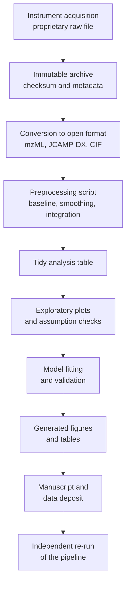
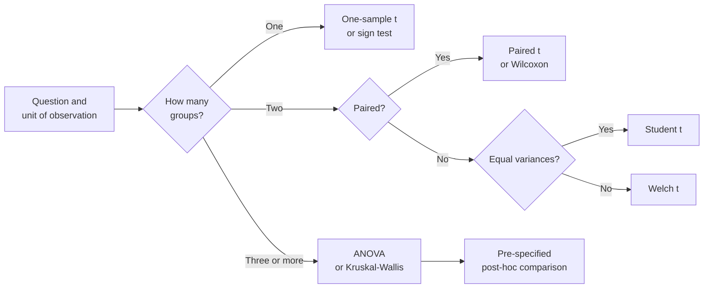
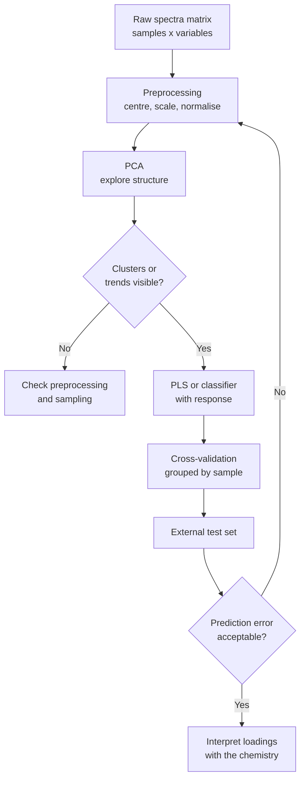
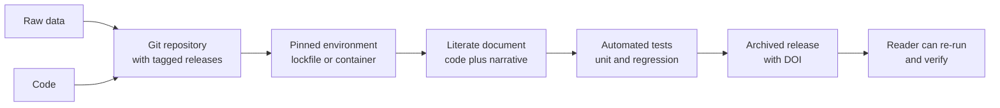

# Chapter 9 — Scientific Data Analysis and Reproducibility

> **Level:** Research (Level 10 — University, Postgraduate and Research Chemistry)
> **Estimated study time:** 8 hours (6 h reading + 2 h exercises)
> **Prerequisites:** [Research Methodology and Experimental Design](07-research-methodology-and-experimental-design.md); [Measurement, Units and Significant Figures](../01-foundations/09-measurement-units-and-significant-figures.md)
> **Related chapters:** [Advanced Spectroscopy and Structure Elucidation](06-advanced-spectroscopy-and-structure-elucidation.md), [Scientific Literature and Critical Evaluation](08-scientific-literature-and-critical-evaluation.md), [Research Ethics and Scientific Writing](10-research-ethics-and-scientific-writing.md)
> **Difficulty:** ★★★★★ (5/5)

---

## 1. Learning Objectives
After working through this chapter you will be able to:

- Describe the data lifecycle from acquisition to archiving, and identify the point at which each reproducibility
  failure typically enters.
- Restructure a laboratory dataset into tidy form and explain why the layout determines which analyses are possible.
- Choose an appropriate distributional model for a chemical measurement and justify a transformation.
- State the assumptions of a hypothesis test, test them, and select a defensible alternative when they fail.
- Fit and compare regression models using adjusted $R^{2}$, AIC, BIC and cross-validation, and explain why $R^{2}$
  alone cannot compare models of different complexity.
- Carry out a principal component analysis by hand on a small matrix, interpret scores and loadings, and state how
  much variance each component explains.
- Explain what partial least squares does that principal component regression does not, and validate a chemometric
  model honestly.
- Apply smoothing, baseline correction, peak fitting and Fourier transformation without destroying the signal, and
  recognise the artefacts each introduces.
- Construct an uncertainty budget by the GUM approach and propagate uncertainties through a calculation.
- Handle missing data and outliers by pre-specified rules rather than by inspection of the result.
- Use version control, environment pinning, literate programming and tests to make an analysis reproducible, and
  describe the metadata standards (mzML, JCAMP-DX, CIF, AnIML) relevant to chemical data.

---

## 2. Introduction
A modern chemistry experiment produces more data than the experimenter can inspect: a single LC-MS run yields tens of
thousands of features, a two-dimensional NMR spectrum a few million points, a diffraction dataset several thousand
reflections. Analysis is therefore not a final step performed after the science is done; it is part of the measurement,
and the choices made in it — which baseline algorithm, which smoothing window, which model, which outliers to keep —
determine what the data are said to show.

Reproducibility is the property that makes those choices auditable. It has a computational face and an experimental
face. The computational face is the one this chapter addresses: given the raw files, can an independent person
regenerate every number, table and figure in the paper? That requires the raw data, the code, the software environment,
the parameters and the random seeds — and it requires that the analysis be organised so that a reader can follow it.
The experimental face — design, replication, randomisation — was the subject of
[Chapter 7](07-research-methodology-and-experimental-design.md).

The chapter is organised as a pipeline. It begins with the shape of data (tidy structures, types, missingness), moves
through exploratory analysis and the assumptions behind inference, treats regression and multivariate modelling, and
then addresses the signal-processing operations that are specific to chemical instrumentation. It closes with
uncertainty, Bayesian reasoning, and the engineering practices — version control, environments, tests, metadata
standards — that convert a private analysis into a public one.

---

## 3. Fundamental Concepts

### 3.1 The data lifecycle
Data pass through six stages, and each has a characteristic failure.

1. **Acquisition.** The instrument writes a proprietary file. Failure: the file is overwritten, or the acquisition
   parameters are not recorded.
2. **Storage and backup.** Failure: a single copy on a laptop; no checksum; no off-site backup.
3. **Processing.** Conversion to an open format, baseline correction, integration. Failure: the processing parameters
   are not recorded and the raw file is discarded.
4. **Analysis.** Statistical or chemometric modelling. Failure: an interactive session with no script, so the analysis
   cannot be repeated.
5. **Reporting.** Tables and figures for the manuscript. Failure: the figure is edited by hand and no longer matches
   the data.
6. **Archiving and sharing.** Deposition in a repository with metadata. Failure: the deposit contains only the
   processed data, or the licence forbids reuse.

The **FAIR principles** — Findable, Accessible, Interoperable, Reusable — describe the target state of stage 6:
persistent identifiers, rich metadata, an open licence and community formats. They do not require that data be open;
they require that the conditions of access be stated.

### 3.2 Tidy data
**Tidy data** has one row per observation and one column per variable, with a single table for each type of
observational unit. The layout is not cosmetic: most analysis tools assume it, and a wide layout — one column per
sample, one row per wavelength — makes filtering, grouping and plotting unnecessarily difficult.

| Sample | Replicate | Temperature / °C | Yield / % | Catalyst |
|---|---|---|---|---|
| A | 1 | 60 | 62.1 | Pd/C |
| A | 2 | 60 | 61.4 | Pd/C |
| B | 1 | 80 | 78.9 | Pd/C |

**Table 3.1 — A tidy layout for a reaction dataset.** Each row is one run, each column one variable, and the replicate
index makes the nesting explicit. The same data in wide form would have one column per run and would require
reshaping before any grouped analysis.

Three further conventions repay the effort. **One table per unit type**: do not mix instrument runs and sample
metadata in one sheet. **No embedded calculation**: a column that contains a formula is a hidden analysis step.
**Stable identifiers**: a sample identifier that never changes is worth more than a descriptive name.

### 3.3 Exploratory analysis and visualisation
**Exploratory data analysis** precedes inference and has three purposes: to detect errors, to reveal structure and to
generate hypotheses. The standard first plots are the histogram or density of each variable, the scatterplot matrix,
the boxplot by group, and the time-ordered plot of each variable against acquisition order. The last of these is the
one most often omitted and the one that most often reveals drift.

Visualisation principles are few and well established. Show the data rather than only a summary; use position and
length for quantitative comparison rather than area or angle; keep the aspect ratio honest; label axes with quantity
and unit; avoid colour as the sole encoding; and show the uncertainty. A bar chart of means with no indication of
spread hides exactly the information a reader needs.

### 3.4 Distributions and transformations
Chemical measurements are not all normal. **Concentrations** near a detection limit are right-skewed and often better
described by a log-normal distribution, because errors are multiplicative. **Counts** — colonies, photons, ions — are
Poisson. **Proportions** are binomial. **Ratios** of two noisy quantities have heavy tails. **Rate constants** from
small numbers of kinetic runs may be closer to a $t$ distribution than to a normal one.

Transformations are used for three reasons: to stabilise variance, to linearise a relationship, and to make a
distribution symmetric. A **logarithm** handles multiplicative error and right skew; a **square root** stabilises the
variance of counts; a **logit** maps proportions to the whole real line; the **Box–Cox** family selects the
transformation by maximum likelihood. The transformation must be reported, because a mean of log-transformed data is
a geometric mean, and back-transforming a confidence interval requires care.

### 3.5 Hypothesis tests revisited
A hypothesis test compares an observed statistic with the distribution it would have under a null hypothesis. The
p-value is the probability, under the null, of a statistic at least as extreme as the one observed; it is not the
probability that the null is true, and it is not a measure of effect size.

The assumptions of the common tests are routinely stated and rarely checked.

- **Independence** of observations. Violated by repeated measurements on one sample, by batch structure, by paired
  designs analysed as unpaired.
- **Normality** of the residuals, not of the raw data. With $n > 30$ and moderate skew the central limit theorem
  usually suffices for the mean, but not for prediction intervals.
- **Homoscedasticity** — equal variances between groups. Violated in almost every comparison of a trace method with a
  major-component method.
- **Linearity**, for regression, and **no influential outliers**.

When an assumption fails, the options in order of preference are: change the model (Welch's $t$ for unequal
variances, a paired test for paired data, a mixed model for nested data), transform the response, or use a
distribution-free method. Deleting the observations that violate the assumption is not on the list unless the deletion
rule was pre-specified.

### 3.6 Non-parametric alternatives
**Non-parametric** methods replace assumptions about the distribution with assumptions about ranks or about
exchangeability.

| Parametric test | Non-parametric alternative | Assumption replaced |
|---|---|---|
| Two-sample $t$ | Mann–Whitney $U$ | Normality; compares distributions, not means |
| Paired $t$ | Wilcoxon signed-rank | Normality of differences |
| One-way ANOVA | Kruskal–Wallis | Normality, equal variances |
| Repeated-measures ANOVA | Friedman | Normality, sphericity |
| Pearson correlation | Spearman rank correlation | Linearity, normality |
| $t$ confidence interval | Bootstrap interval | Normality, and often the formula itself |

**Table 3.2 — Parametric tests and their distribution-free counterparts.** The non-parametric test is not a universal
substitute: it answers a slightly different question (a shift in distribution rather than a difference in means) and
loses power when the parametric assumptions hold.

The **bootstrap** deserves separate mention. Resampling the observed data with replacement many times and recomputing
the statistic gives an empirical distribution from which percentile confidence intervals can be read. It requires
only exchangeability, and it works for statistics with no closed-form standard error — a ratio of two fitted
parameters, a median, a chemometric model's prediction error.

### 3.7 Regression and model selection
**Ordinary least squares** minimises the sum of squared residuals and gives the best linear unbiased estimator when the
errors are independent, homoscedastic and uncorrelated with the predictors. Weighted least squares handles known
heteroscedasticity; a transformation handles multiplicative error.

Comparing models requires care, because $R^{2}$ cannot decrease when a term is added. Three instruments are available.

- **Adjusted $R^{2}$** penalises the number of parameters and is adequate for comparing models of the same family.
- **AIC** and **BIC** combine fit and complexity:
  $\mathrm{AIC} = n\ln(\mathrm{RSS}/n) + 2k$ and $\mathrm{BIC} = n\ln(\mathrm{RSS}/n) + k\ln n$. A difference in AIC
  below about 2 is weak evidence; above 10 is strong. BIC penalises complexity more heavily when $n > 8$.
- **Cross-validation** estimates predictive performance by fitting on a training subset and testing on held-out data.
  Leave-one-out is efficient for small datasets; $k$-fold (typically 5 or 10) is standard; repeated
  cross-validation reduces the variance of the estimate.

The last of these is the only one that directly answers the question a reader cares about: how well will the model
predict a new observation? A model selected by AIC can still overfit if the candidate set is large, and a model
selected by cross-validation can still fail if the held-out data are not independent of the training data — as when
replicates of the same sample appear in both folds.

### 3.8 Multivariate methods and chemometrics
Chemical data are usually multivariate: a spectrum is a vector of hundreds of intensities, a formulation a vector of
composition variables. **Chemometrics** is the application of multivariate statistics to such data.

**Principal component analysis (PCA)** finds orthogonal linear combinations of the variables — the principal
components — that successively maximise explained variance. Geometrically it rotates the coordinate system so that
the first axis points along the direction of greatest spread. The **scores** are the coordinates of the samples in
the new space; the **loadings** are the coefficients that define each component as a combination of the original
variables. A scree plot of explained variance decides how many components to retain, and a scores plot reveals
clusters, trends and outliers.

**Partial least squares (PLS)** regression relates a block of predictors $X$ to a response $Y$ by extracting latent
variables that maximise the covariance between the two blocks. It is preferred to principal component regression when
the variation in $X$ that matters for $Y$ is not the variation with the largest variance — which is the normal
situation in spectroscopy, where the analyte band may be small compared with the solvent background.

**Clustering** groups samples by similarity. k-means partitions into a pre-specified number of clusters by minimising
within-cluster variance; hierarchical clustering builds a dendrogram by successive merging; density-based methods such
as DBSCAN find arbitrarily shaped clusters and label the remainder as noise. The choice of distance metric — Euclidean
on standardised data, correlation, or a spectral metric such as cosine — changes the result and must be justified.

Validation is the weak point of applied chemometrics. A model that separates classes in the training set may be
separating batch, instrument or sample preparation. The defences are external validation on an independent set,
cross-validation with grouping by sample or batch, permutation testing of the labels, and a pre-registered endpoint.

### 3.9 Signal processing
Instrumental signals require operations that are easy to apply and hard to apply correctly.

**Smoothing** reduces high-frequency noise. A moving average is simple but distorts peak shape; **Savitzky–Golay**
smoothing fits a low-order polynomial over a moving window and preserves peak height and width better, at the cost of
a window-length choice that must be reported.

**Baseline correction** removes drift and background. Polynomial fitting, asymmetric least squares and morphological
"rolling ball" methods are common. The danger is over-correction: a baseline that follows the signal removes part of
the peak and changes the integrated area.

**Peak fitting** models overlapping bands as a sum of profiles — Gaussian for instrumental broadening, Lorentzian for
lifetime broadening, pseudo-Voigt for both. The fit returns positions, widths, amplitudes and their uncertainties, and
these are only meaningful if the model is adequate; a systematic residual pattern is evidence that it is not.

**Fourier transformation** converts a time-domain signal (an interferogram, a free-induction decay) into a spectrum.
Three parameters govern the result: the **apodisation** function, which trades resolution against signal-to-noise;
**zero filling**, which interpolates the spectrum without adding information; and the **acquisition time**, which sets
the digital resolution. The Nyquist theorem fixes the spectral width from the sampling interval, and violating it
folds peaks to the wrong frequency — the commonest artefact in poorly set-up NMR experiments.

**Denoising** by wavelets, by PCA or by binning can improve the appearance of a spectrum without improving the
information content. Any denoising step should be justified by a demonstrated improvement in a validation metric, not
by visual smoothness.

### 3.10 Uncertainty and error propagation
Every reported value should carry an uncertainty. The **GUM** framework distinguishes Type A evaluations, from
repeated observation, and Type B evaluations, from calibration certificates, manufacturer specifications and
experience. Each contribution is converted to a standard uncertainty, combined in quadrature when the inputs are
independent,

$$
u_c(y) = \sqrt{\sum_i \left(\frac{\partial f}{\partial x_i}\right)^{2} u^{2}(x_i)},
$$

and expanded with a coverage factor $k$ — usually $k = 2$ for approximately 95 % confidence — to give
$U = k u_c$.

For a product or quotient the relative uncertainties add in quadrature, which is why a 1 % uncertainty in a
concentration and a 1 % uncertainty in a path length give a 1.4 % uncertainty in the absorbance-derived result. The
budget should identify the dominant term, because improving anything else is wasted effort.

### 3.11 Missing data and outliers
**Missing data** are classified by mechanism. **MCAR** (missing completely at random) occurs when the probability of
missingness is independent of everything; **MAR** (missing at random) when it depends on observed variables; **MNAR**
(missing not at random) when it depends on the missing value itself — a result below the detection limit is the
classic chemical example. Complete-case analysis is unbiased only under MCAR and wastes data under MAR; mean
imputation shrinks variance and biases correlations; multiple imputation and maximum likelihood are the defensible
general methods, and for censored data a censored-likelihood model is the correct approach.

**Outliers** are observations that are unusual relative to the model. They may be errors, or they may be the
discovery, and the data alone cannot distinguish the two. The defensible procedure is to define the rule in advance
(grubbs, Dixon, or a robust $z$-score), to report every excluded observation with its reason, and never to exclude an
observation because it weakens the desired conclusion. Robust statistics — medians, trimmed means, MM-estimators —
reduce the influence of outliers without deleting them.

### 3.12 Bayesian thinking
Bayesian inference treats parameters as uncertain quantities with probability distributions. **Bayes' theorem**

$$
p(\theta \mid y) \propto p(y \mid \theta)\,p(\theta)
$$

combines a **prior** $p(\theta)$ with the **likelihood** $p(y\mid\theta)$ to give a **posterior** $p(\theta\mid y)$. The
result is a distribution, not a point estimate and a p-value, and the **credible interval** is the range that contains
95 % of the posterior probability — a statement about the parameter that the frequentist confidence interval does not
make.

Bayesian methods earn their place in three situations: when prior information is real and quantifiable, as in a
measurement of a standard reference material; when the model is hierarchical, as when samples are nested within
batches; and when the sample is small enough that asymptotic approximations fail. The cost is sensitivity to the
prior, which should be checked by a sensitivity analysis and reported.

### 3.13 Reproducible analysis
Reproducibility is an engineering property, and it is achieved with engineering tools.

- **Version control.** Every script, parameter file and manuscript in a Git repository, with meaningful commits. Data
  may be versioned with Git LFS or with a data repository.
- **Environment pinning.** Record exact versions of the language, libraries and system dependencies — a lockfile, a
  `renv.lock`, a `requirements.txt` with hashes, or a container image with a digest.
- **Literate programming.** Combine code and narrative so that the document that reports the result is generated from
  the code that computes it: Quarto, R Markdown, Jupyter with `nbconvert`, or a Makefile.
- **Testing.** Unit tests for the functions that implement the analysis, and regression tests that check a known
  result against a stored value.
- **Random seeds.** Every stochastic step — cross-validation folds, bootstrap resamples, initialisation of clustering
  — must have a recorded seed.
- **Code review.** A second person reads the analysis before it is published, in the same way that a second person
  reads the manuscript.

The **Ten Simple Rules** for reproducible computational research and the **FAIR** principles for data are the standard
checklists; a repository that satisfies them can be re-run by a stranger, which is the operational definition of
reproducibility.

| Item | Question to ask | Evidence in the repository |
|---|---|---|
| Raw data | Are the original files archived unmodified? | `raw/` with checksums and acquisition logs |
| Code | Is every analysis step in version control? | Git history with tagged releases |
| Environment | Are language and library versions pinned? | Lockfile or container digest |
| Parameters | Are all settings recorded outside the code? | Configuration file under version control |
| Seeds | Are random seeds fixed and recorded? | Seed values in the configuration |
| Entry point | Can every output be regenerated by one command? | Makefile, Quarto project or workflow script |
| Tests | Are key numbers checked automatically? | Unit and regression tests |
| Metadata | Is the data described to a community standard? | mzML, JCAMP-DX, CIF or AnIML plus a README |
| Archive | Is the release citable and permanent? | Repository DOI (Zenodo, figshare, institutional) |

**Table 3.3 — A reproducibility checklist for an analysis repository.** Each row is a question with a verifiable answer,
so the checklist can be audited by a reviewer rather than asserted by the author.

### 3.14 Metadata standards
A data file without metadata is a number without a unit. Community formats carry the metadata with the data:

| Format | Domain | What it encodes |
|---|---|---|
| mzML | Mass spectrometry | Spectra, chromatograms, instrument configuration, acquisition parameters |
| JCAMP-DX | IR, NMR, UV–Vis | Spectral data with header records and peak tables |
| CIF | Crystallography | Unit cell, symmetry, atomic coordinates, refinement statistics |
| AnIML | General analytical | Technique-independent result and metadata schema |
| NetCDF | Chromatography, environmental | Array data with self-describing attributes |
| ISA-Tab | Omics, general | Investigation, study, assay and sample annotation |

**Table 3.4 — Metadata standards relevant to chemical data.** The choice is dictated by the instrument and by the
repository, but the principle is universal: the raw file plus its metadata is the record, and the exported spreadsheet
is a derived product.

### 3.15 Electronic laboratory notebooks and negative results
An **electronic laboratory notebook (ELN)** records experiments with timestamps, authorship and an audit trail. The
essential properties are those of the ALCOA criteria: attributable, legible, contemporaneous, original, accurate. The
ELN should link each entry to the instrument files it describes, so that the chain from sample to reported number is
unbroken.

**Negative results** — experiments that did not work, conditions that gave no product, models that failed to predict —
are systematically under-reported, and the resulting **file-drawer problem** biases the literature. A laboratory that
keeps negative results in a searchable form makes them available for meta-analysis and prevents the repeated
rediscovery of dead ends. Deposit them in a repository, report them in the supporting information, and describe them
in review articles; the value is in the record, not in the drama.

---

## 4. Detailed Scientific Explanation

### 4.1 From measurement to tidy table
The transformation from instrument file to analysis table is where most irreproducibility enters. A defensible
pipeline has four properties: it is scripted, it is deterministic, it records the parameters, and it preserves the raw
file unmodified. The conventional structure is a directory per project with `raw/`, `processed/`, `code/`, `output/`
and `manuscript/`, a README that states the order of execution, and a single entry point that regenerates every
output from the raw data.

### 4.2 Choosing a test
The choice of test follows from three questions: what is the unit of observation, how many groups are compared, and
are the observations paired? A paired design on the same sample requires a paired test; independent groups require an
unpaired test; more than two groups require ANOVA or its non-parametric analogue, followed by a pre-specified
multiple-comparison procedure. If the response is a proportion, a count or a time-to-event, the corresponding
generalised linear model replaces the $t$-test.

### 4.3 When assumptions fail
The most common practical failure is heteroscedasticity in a comparison of methods with very different precision. The
Welch $t$-test is the default in modern software for good reason: it does not assume equal variances and loses almost
no power when they are equal. The second most common failure is non-independence: replicate wells, repeated spectra of
one sample and repeated measures on one subject all violate it, and the remedy is a mixed model with a random effect
for the grouping unit.

### 4.4 Model selection in practice
Model selection is a trade-off between bias and variance. A model that is too simple has systematic error; a model
that is too complex fits noise. The practical protocol is: fix the candidate set in advance, fit by maximum likelihood
or least squares, compare with AIC or cross-validation, check the residuals of the chosen model, and report the
selection procedure. Reporting only the final model, without the comparison, is a form of selective reporting.

### 4.5 The chemometric workflow
A defensible multivariate analysis follows six steps: **inspect** the raw data, **preprocess** (centre, scale,
normalise, derivative, baseline), **explore** with PCA, **model** with PLS or a classifier, **validate** by
cross-validation with grouping and by an external test set, and **interpret** the loadings or variable importance in
collaboration with the chemistry. Preprocessing choices must be fixed before validation, because choosing the
preprocessing that maximises the cross-validated score is a form of overfitting.

### 4.6 Signal-processing pitfalls
Three artefacts account for most of the damage. **Over-smoothing** removes noise and also removes resolution, so that
two peaks become one. **Baseline over-correction** subtracts part of the peak and biases the integral downward.
**Apodisation and zero filling** change the appearance of a spectrum without adding information, so a "higher
resolution" spectrum produced by zero filling has the same linewidth as the original. Each is detectable by
reprocessing a known standard and comparing the result with the accepted value.

### 4.7 Uncertainty budgets in practice
A calibration curve illustrates the method. The concentration is $c = (A - b)/m$, where $A$ is absorbance, $b$ the
intercept and $m$ the slope. The uncertainty in $c$ has contributions from the measurement of $A$, from the
uncertainty of the calibration (the standard error of the regression), from the purity of the standard and from
volumetric dilution. The largest term dominates the budget, and the first task of an uncertainty analysis is to
identify it rather than to refine the others.

### 4.8 Reproducibility as an engineering discipline
The engineering view is that an analysis is a program, and a program is reproducible when it is deterministic, its
dependencies are pinned, its inputs are identified by content hash, and its outputs are checked by tests. The social
view is that reproducibility is a norm, enforced by journals that require data and code, by reviewers who run the
code, and by a culture that treats an unshared analysis as an incomplete one.

### 4.9 Negative results and the record
The file-drawer problem is a sampling bias in the literature: if only positive results are published, any summary of
the literature overestimates the effect. The remedies are structural — registered reports, result-blind review,
repositories for negative results — and individual: report the experiments that failed, with the same care as those
that succeeded, and cite them when designing the next study.

---

## 5. Visual Diagrams

**Figure 9.1 — The data lifecycle as a reproducible pipeline.** The archive of the raw file is deliberately placed
before any processing, so that every later step can be repeated from the original. The final box is the test of the
whole system: an independent person can regenerate the outputs.

**Figure 9.2 — Choosing a test.** The decision path is short because most of the complexity lies in the first box: the
unit of observation determines independence, and independence determines which tests are legitimate. The post-hoc box
is the one most often skipped in practice.

**Figure 9.3 — The chemometric workflow.** The loop from the validation step back to preprocessing is the honest part
of the diagram: most failures of chemometric models are preprocessing or sampling failures, not modelling failures.

**Figure 9.4 — The reproducibility stack.** No single layer is sufficient: version control without a pinned
environment fails on a different machine, and a container without versioned code fails when the code changes. The DOI
at the end is what makes the release citable.

---

## 6. Mathematical Formulas

**Sample mean, standard deviation and standard error.**

$$
\bar{x} = \frac{1}{n}\sum_{i=1}^{n} x_i,
\qquad
s = \sqrt{\frac{1}{n-1}\sum_{i=1}^{n}(x_i-\bar{x})^{2}},
\qquad
\mathrm{SEM} = \frac{s}{\sqrt{n}}
$$

The $n-1$ denominator gives the unbiased estimate of the variance; the standard error describes the precision of the
mean, not the spread of the data.

**One-sample and two-sample $t$ statistics.**

$$
t = \frac{\bar{x}-\mu_0}{s/\sqrt{n}},
\qquad
t = \frac{\bar{x}_1-\bar{x}_2}{s_p\sqrt{1/n_1+1/n_2}}
$$

Both assume independent observations and normally distributed residuals; the second assumes equal variances.

**Ordinary least squares for a straight line.**

$$
\hat{b} = \frac{\sum (x_i-\bar{x})(y_i-\bar{y})}{\sum (x_i-\bar{x})^{2}},
\qquad
\hat{a} = \bar{y} - \hat{b}\bar{x},
\qquad
s_{y\cdot x} = \sqrt{\frac{\sum (y_i-\hat{a}-\hat{b}x_i)^{2}}{n-2}}
$$

The residual standard deviation $s_{y\cdot x}$ has $n-2$ degrees of freedom and is the basis of the standard error of
the slope and of the detection limit.

**Information criteria.**

$$
\mathrm{AIC} = n\ln\left(\frac{\mathrm{RSS}}{n}\right) + 2k,
\qquad
\mathrm{BIC} = n\ln\left(\frac{\mathrm{RSS}}{n}\right) + k\ln n
$$

Both assume that the candidate models are fitted to the same data with Gaussian errors; AIC targets predictive
performance, BIC targets the true model.

**Principal component analysis.**

$$
\mathbf{C} = \frac{1}{n-1}\mathbf{X}^{\mathsf{T}}\mathbf{X},
\qquad
\mathbf{C}\mathbf{v}_j = \lambda_j\mathbf{v}_j,
\qquad
\text{variance explained}_j = \frac{\lambda_j}{\sum_k \lambda_k}
$$

The matrix $\mathbf{X}$ must be centred, and scaled if the variables have different units; the eigenvectors
$\mathbf{v}_j$ are the loadings and the projections $\mathbf{X}\mathbf{v}_j$ are the scores.

**Propagation of uncertainty.**

$$
u_c^{2}(y) = \sum_i \left(\frac{\partial f}{\partial x_i}\right)^{2} u^{2}(x_i)
$$

valid for independent inputs; correlated inputs require the covariance terms
$2\sum_{i<j}\frac{\partial f}{\partial x_i}\frac{\partial f}{\partial x_j}\mathrm{cov}(x_i,x_j)$.

**Bayes' theorem.**

$$
p(\theta\mid y) = \frac{p(y\mid\theta)p(\theta)}{p(y)}
$$

with $p(y) = \int p(y\mid\theta)p(\theta)\,d\theta$ the marginal likelihood.

| Symbol | Meaning | SI unit |
|---|---|---|
| $\bar{x}$ | Sample mean | same as variable |
| $s$ | Sample standard deviation | same as variable |
| $\mathrm{SEM}$ | Standard error of the mean | same as variable |
| $t$ | Test statistic | dimensionless |
| $s_p$ | Pooled standard deviation | same as variable |
| $s_{y\cdot x}$ | Residual standard deviation | same as response |
| $\mathrm{RSS}$ | Residual sum of squares | squared response |
| $k$ | Number of fitted parameters | dimensionless |
| $\lambda_j$ | Eigenvalue | squared variable |
| $u_c$ | Combined standard uncertainty | same as measurand |

**Table 6.1 — Symbols used in this chapter.** The distinction between the standard deviation of the data and the
standard error of the mean is the most frequently confused pair in the table.

---

## 7. Chemical Equations

Quantitative analysis rests on reactions with known stoichiometry, and the calibration function is only as good as the
reaction it measures. The standardisation of sodium hydroxide against potassium hydrogen phthalate is the canonical
example:

$$
\ce{KHC8H4O4 + NaOH -> NaKC8H4O4 + H2O}
$$

One mole of phthalate neutralises one mole of hydroxide, so the concentration of the titrant follows directly from the
mass of the primary standard and the volume delivered. The reaction is chosen because the primary standard is
crystalline, stable and of high molar mass, which minimises the relative weighing error.

Iodometric titration illustrates a reaction with a defined electron stoichiometry:

$$
\ce{IO3- + 5I- + 6H+ -> 3I2 + 3H2O}
$$

followed by

$$
\ce{I2 + 2S2O3^{2-} -> 2I- + S4O6^{2-}}
$$

The six-electron reduction of iodate to iodide means that one mole of iodate liberates three moles of iodine, which
consume six moles of thiosulfate; every factor of the calculation is fixed by these two equations, and an error in
either propagates directly into the reported concentration.

Colorimetric assays require the same care. The Griess reaction used for nitrite determination proceeds through a
diazonium intermediate:

$$
\ce{NO2- + 2H+ + H2N-C6H4-SO2NH2 -> [N2+-C6H4-SO2NH2] + 2H2O}
$$

and the diazonium ion is coupled to a second aromatic amine to give the azo dye whose absorbance is measured. The
stoichiometry is one nitrite per dye molecule, and the calibration curve is linear only over the range in which the
reaction goes to completion and the dye remains in solution.

---

## 8. Worked Examples

### Worked Example 8.1 — Descriptive statistics and a one-sample test

**Problem.** Eight replicate determinations of a certified reference material, certified at 24.30 mg L$^{-1}$, gave
24.71, 24.55, 24.62, 24.38, 24.80, 24.44, 24.66 and 24.40 mg L$^{-1}$. Calculate the mean, standard deviation,
standard error and 95 % confidence interval, and test for bias.

**Strategy.** Compute the descriptive statistics, then a one-sample $t$-test against $\mu_0 = 24.30$.

**Solution.** The mean is 24.57 mg L$^{-1}$ and $s = 0.154$ mg L$^{-1}$, so the standard error is
$0.154/\sqrt{8} = 0.054$ mg L$^{-1}$. With $t_{0.975,7} = 2.365$ the 95 % confidence interval is
$24.57 \pm 0.13$, that is 24.44–24.70 mg L$^{-1}$. The test statistic is

$$
t = \frac{24.57 - 24.30}{0.054} = 5.0,
$$

which with 7 degrees of freedom gives $p = 0.002$.

**Check.** The certified value lies outside the confidence interval, so the method has a positive bias of about
0.27 mg L$^{-1}$ or 1.1 %. The result is statistically significant and practically small; whether it matters depends
on the specification, which is a separate question from the statistics.

### Worked Example 8.2 — Two methods compared

**Problem.** Method A gave 24.71, 24.55, 24.62, 24.38, 24.80 and 24.44 mg L$^{-1}$; method B gave 24.10, 24.35,
24.28, 24.02, 24.51 and 24.44 mg L$^{-1}$. Compare the methods.

**Strategy.** Compute means and standard deviations, then an unpaired $t$-test with a pooled standard deviation and a
confidence interval for the difference.

**Solution.** Method A: mean 24.58, $s = 0.160$. Method B: mean 24.28, $s = 0.192$. The pooled standard deviation is
0.176, the standard error of the difference is $0.176\sqrt{2/6} = 0.102$, and

$$
t = \frac{24.58-24.28}{0.102} = 2.95,
$$

with 10 degrees of freedom, $p = 0.015$. The 95 % confidence interval for the difference is
$0.30 \pm 2.228 \times 0.102 = 0.074$ to $0.526$ mg L$^{-1}$.

**Check.** The difference is statistically significant but its interval includes differences as small as 0.07 mg
L$^{-1}$ and as large as 0.53 mg L$^{-1}$, so the data are compatible with a negligible bias and with a
practically important one. The correct report is the interval, not the p-value.

### Worked Example 8.3 — A calibration curve

**Problem.** Six standards of a colorimetric assay gave absorbances 0.112, 0.208, 0.401, 0.598, 0.802 and 0.995 at
concentrations 0.50, 1.00, 2.00, 3.00, 4.00 and 5.00 mg L$^{-1}$. Fit the calibration, report the slope with its
confidence interval, and calculate the limit of detection.

**Strategy.** Fit by ordinary least squares, compute the residual standard deviation and the standard error of the
slope, then apply the 3.3 criterion for the detection limit.

**Solution.** The fit gives $\hat{a} = 0.0109$ and $\hat{b} = 0.1968$ AU L mg$^{-1}$, with
$R^{2} = 0.99992$ and $s_{y\cdot x} = 0.00338$ AU. The standard error of the slope is 0.00087, so the 95 %
confidence interval (4 degrees of freedom, $t = 2.776$) is $0.1968 \pm 0.0024$, that is 0.1944–0.1992. The detection
limit is

$$
\mathrm{LOD} = \frac{3.3\,s_{y\cdot x}}{\hat{b}} = \frac{3.3 \times 0.00338}{0.1968} = 0.057\ \text{mg L}^{-1}.
$$

**Check.** The residuals, in order of increasing concentration, are $+0.0027$, $+0.0003$, $-0.0035$, $-0.0033$,
$+0.0038$ and $0.0000$; their signs alternate without a trend, which supports the linear model. A curved residual
pattern would indicate that the absorbance had left the linear range.

### Worked Example 8.4 — Choosing between a linear and a quadratic model

**Problem.** For the calibration of Example 8.3, a quadratic fit gives coefficients 0.0146, 0.1926 and 0.00078 and a
residual sum of squares of $3.14 \times 10^{-5}$, against $4.57 \times 10^{-5}$ for the straight line. Which model
should be reported?

**Strategy.** Compute AIC and BIC for both models with $n = 6$, $k = 3$ for the line and $k = 4$ for the quadratic.

**Solution.**

$$
\mathrm{AIC}_{\text{linear}} = 6\ln\left(\frac{4.57\times10^{-5}}{6}\right) + 6 = -64.71,
\qquad
\mathrm{AIC}_{\text{quad}} = 6\ln\left(\frac{3.14\times10^{-5}}{6}\right) + 8 = -64.97.
$$

The difference is 0.26, far below the threshold of 2 that would indicate meaningful support. BIC gives $-65.33$ and
$-65.80$, a difference of 0.47 and the same conclusion.

**Check.** Neither criterion supports the extra parameter, and the quadratic coefficient corresponds to a curvature
that is negligible over the calibrated range. The linear model is reported, with a note that curvature was tested and
not found.

### Worked Example 8.5 — Principal component analysis by hand

**Problem.** Five samples measured on two variables gave (2.5, 2.4), (0.5, 0.7), (2.2, 2.9), (1.9, 2.2) and
(3.1, 3.0). Perform a PCA on the covariance matrix.

**Strategy.** Centre the data, compute the covariance matrix, diagonalise it, and project the samples onto the first
eigenvector.

**Solution.** The means are 2.04 and 2.24, and the covariance matrix is

$$
\mathbf{C} = \begin{pmatrix} 0.938 & 0.8405 \\ 0.8405 & 0.853 \end{pmatrix}.
$$

Its eigenvalues are $\lambda_1 = 1.737$ and $\lambda_2 = 0.0539$, so the first component explains
$1.737/(1.737+0.0539) = 97.0\,\%$ of the variance. The corresponding unit eigenvector is $(0.725, 0.689)$, almost
equally weighted on the two variables. The scores on the first component are 0.44, $-2.18$, 0.57, $-0.13$ and 1.29.

**Check.** The second sample is a clear outlier on the first component, and the first component is essentially an
average of the two variables — which is what a correlation of
$0.8405/\sqrt{0.938 \times 0.853} = 0.94$ predicts. With two variables, PCA adds little; with fifty wavelengths, the
same arithmetic is what makes the method valuable.

### Worked Example 8.6 — An uncertainty budget

**Problem.** A concentration is calculated from $c = A/(\varepsilon l)$ with $A = 0.412 \pm 0.004$,
$\varepsilon = 12\,500 \pm 150$ L mol$^{-1}$ cm$^{-1}$ and $l = 1.00 \pm 0.01$ cm. Compute the concentration, the
combined standard uncertainty and the expanded uncertainty.

**Strategy.** Use the relative-uncertainty form of the propagation law for a quotient.

**Solution.** The concentration is $c = 0.412/(12\,500 \times 1.00) = 3.30 \times 10^{-5}$ mol L$^{-1}$, or 32.96 µmol
L$^{-1}$. The relative contributions are 0.97 % from the absorbance, 1.20 % from the absorption coefficient and 1.00 %
from the path length, so

$$
\frac{u_c}{c} = \sqrt{0.0097^{2} + 0.0120^{2} + 0.0100^{2}} = 1.84\,\%,
$$

giving $u_c = 0.61$ µmol L$^{-1}$ and $U = 2u_c = 1.2$ µmol L$^{-1}$.

**Check.** The absorption coefficient dominates the budget, so improving the absorbance measurement would not improve
the result; the coefficient would have to be determined more precisely, or the calibration performed with a standard
of certified concentration.

---

## 9. Real-World Applications

**Pharmaceutical quality control.** Every batch release rests on a validated analytical method, a calibration curve
with a documented uncertainty budget, and a statistical comparison against specification. The data analysis is
regulated: the method, the acceptance criteria and the statistical treatment are fixed in advance and audited.

**Metabolomics and lipidomics.** Untargeted studies compare thousands of features across hundreds of samples, and the
analysis pipeline — peak picking, alignment, normalisation, imputation, PCA, PLS-DA — determines the result as much as
the chromatography does. Reproducible pipelines and deposited raw data are now a condition of publication in the field.

**Process analytical technology.** Spectroscopic probes in a reactor generate a spectrum every few seconds, and
chemometric models convert them into concentration estimates in real time. The models are validated against offline
reference methods and monitored for drift, because a model that silently degrades is worse than no model.

---

## 10. Common Mistakes

| Mistake | Why it happens | Correct approach |
|---|---|---|
| Reporting the standard deviation as the standard error | Both are printed by software | State which is reported and why; use SEM only for the precision of a mean |
| Using $R^{2}$ to compare models with different numbers of terms | It is the headline statistic in most software | Use adjusted $R^{2}$, AIC, BIC or cross-validation |
| Smoothing until the spectrum looks clean | Smoothing improves appearance | Choose the window by a validation criterion and report it |
| Integrating after baseline over-correction | The baseline is adjusted until the number looks right | Fix the baseline algorithm before integration and apply it to all samples |
| Mean imputation of missing values | It is the default in many tools | Use multiple imputation or a model-based method, and report the mechanism assumed |
| Deleting outliers without a pre-specified rule | The outlier spoils the result | Pre-specify the rule, report every exclusion, and show the analysis with and without |
| Validating a chemometric model on its training data | Cross-validation is misunderstood | Use grouped cross-validation and an external test set |
| Publishing figures edited by hand | Aesthetics are adjusted in a graphics editor | Generate figures from code so they match the data exactly |

---

## 11. Chapter Summary

- The data lifecycle runs from acquisition to archive, and reproducibility fails at the stage where a step is done
  interactively rather than in code.
- Tidy data — one row per observation, one column per variable — is a prerequisite for reliable analysis.
- Chemical measurements are often skewed, counted or bounded; the distributional model should be chosen deliberately
  and any transformation reported.
- Hypothesis tests rest on independence, residual normality, homoscedasticity and linearity; the Welch $t$-test,
  mixed models, transformation and rank methods are the standard remedies.
- Model comparison requires a penalty for complexity: adjusted $R^{2}$, AIC, BIC and cross-validation answer different
  questions and should be reported together.
- PCA describes variance; PLS relates it to a response; both require preprocessing choices to be fixed before
  validation and validated on data not used for fitting.
- Signal processing can destroy information as easily as it can reveal it; every operation must be justified by a
  validation metric.
- Uncertainty is quantified by a budget, not by counting decimal places, and the dominant term determines what is worth
  improving.
- Reproducibility is engineering: version control, pinned environments, literate documents, tests, seeds and metadata
  standards.

---

## 12. Exercises

### 12.1 Conceptual questions

1. Distinguish MCAR, MAR and MNAR, and give a chemical example of each.
2. Why is the standard error of the mean not a measure of the spread of the data?
3. Explain why zero filling in NMR improves the appearance of resolution without improving the true resolution.

### 12.2 Basic problems

4. A dataset has mean 5.20, standard deviation 0.40 and $n = 16$. Calculate the standard error and the 95 % confidence
   interval.
5. State three assumptions of ordinary least squares and give a diagnostic for each.
6. A PCA on ten variables gives eigenvalues 4.2, 2.1, 1.4, 0.9, 0.5, 0.4, 0.3, 0.1, 0.1 and 0.0. How many components
   would you retain by the Kaiser criterion and by the scree plot?

### 12.3 Intermediate problems

7. A calibration has slope $0.512 \pm 0.011$ and residual standard deviation $0.0084$. Calculate the limit of
   detection.
8. A model has AIC 120.4 and a rival has AIC 126.1. Which is preferred, and how strong is the evidence?
9. Explain why leave-one-out cross-validation can be optimistic for a dataset containing replicate spectra of the same
   sample.

### 12.4 Advanced problems

10. Design a preprocessing and validation scheme for a PLS model that predicts protein content from near-infrared
    spectra of 200 flour samples collected in three batches.
11. An analyst reports a mean of 12.4 with a standard deviation of 3.2 from five replicates, then removes the highest
    value as an outlier and reports 11.1 with a standard deviation of 1.9. Discuss.

### 12.5 Calculation problems

12. A result is $c = 0.250 \pm 0.005$ mol L$^{-1}$ diluted by a factor of $20 \pm 0.2$ into a final volume of
    $100.0 \pm 0.2$ mL from a pipetted $5.00 \pm 0.02$ mL. Calculate the diluted concentration and its combined
    standard uncertainty.

### 12.6 Answers

1. MCAR: a sample lost in transit, independent of its value. MAR: a value missing because the instrument was
   unavailable, which is recorded. MNAR: a concentration below the detection limit, so the missingness depends on the
   value itself.
2. Because it estimates the precision of the mean, which improves as $1/\sqrt{n}$; the spread of the data is the
   standard deviation and does not depend on $n$.
3. Zero filling interpolates the existing frequency-domain data, so it sharpens the digital representation of a peak but
   cannot narrow the underlying linewidth set by relaxation and apodisation.
4. $\mathrm{SEM} = 0.40/4 = 0.10$; with $t_{0.975,15} = 2.131$ the interval is $5.20 \pm 0.21$.
5. Independence (residuals against run order), homoscedasticity (residuals against fitted values) and normality
   (normal probability plot of residuals); linearity is checked by residuals against each predictor.
6. Kaiser retains eigenvalues above 1: three components. A scree plot with a break after the third component gives the
   same answer.
7. $\mathrm{LOD} = 3.3 \times 0.0084/0.512 = 0.054$ in the units of the response divided by the slope.
8. The first, by $\Delta\mathrm{AIC} = 5.7$; this is moderate evidence, not decisive.
9. Because replicate spectra of one sample are highly correlated, a held-out replicate is almost a copy of a training
   observation, so the error estimate is optimistically low; grouping by sample is required.
10. Preprocess by multiplicative scatter correction or standard normal variate plus centring, explore by PCA, fit PLS
    with the number of components chosen by grouped cross-validation, validate on a held-out batch, and test the
    final model on a fourth independent batch.
11. Removing an observation after seeing that it raises the mean is a post hoc exclusion that inflates the apparent
    precision; without a pre-specified rule the full dataset must be reported, with the outlier shown and a robust
    estimate given alongside.
12. $c = 0.250/20 = 0.0125$ mol L$^{-1}$; relative uncertainties are 2 % (concentration), 1 % (dilution factor) and
    0.4 % (pipette and flask combined), giving $u_c/c = \sqrt{0.02^2+0.01^2+0.004^2} = 2.3\,\%$ and
    $u_c = 2.8 \times 10^{-4}$ mol L$^{-1}$.

---

## 13. Further Reading

- Tukey, J. W. *Exploratory Data Analysis*. Addison-Wesley, 1977.
- Tufte, E. R. *The Visual Display of Quantitative Information*, 2nd ed. Graphics Press, 2001.
- Wilke, C. O. *Fundamentals of Data Visualization*. O'Reilly, 2019.
- Wickham, H.; Grolemund, G. *R for Data Science*. O'Reilly, 2017.
- Gelman, A.; Carlin, J. B.; Stern, H. S.; Dunson, D. B.; Vehtari, A.; Rubin, D. B. *Bayesian Data Analysis*, 3rd ed.
  CRC Press, 2013.
- McElreath, R. *Statistical Rethinking*, 2nd ed. CRC Press, 2020.
- Efron, B.; Tibshirani, R. J. *An Introduction to the Bootstrap*. Chapman and Hall, 1993.
- Wold, S.; Esbensen, K.; Geladi, P. "Principal component analysis." *Chemometrics and Intelligent Laboratory
  Systems* 2, 37–52 (1987).
- Geladi, P.; Kowalski, B. R. "Partial least-squares regression: a tutorial." *Analytica Chimica Acta* 185, 1–17
  (1986).
- Sandve, G. K.; Nekrutenko, A.; Taylor, J.; Hovig, E. "Ten Simple Rules for Reproducible Computational Research."
  *PLoS Computational Biology* 9, e1003285 (2013).
- Wilson, G. et al. "Best practices for scientific computing." *PLoS Biology* 12, e1001745 (2014).
- Wilkinson, M. D. et al. "The FAIR Guiding Principles for scientific data management and stewardship." *Scientific
  Data* 3, 160018 (2016).
- Eurachem. *Quantifying Uncertainty in Analytical Measurement*, 3rd ed., 2012. <https://www.eurachem.org/>
- Proteomics Standards Initiative. *mzML: Mass Spectrometry Data Format*. <https://www.psidev.info/mzml>
- IUPAC. *JCAMP-DX: A Standard Format for Exchange of Infrared and Related Spectra*.
  <https://jcamp-dx.org/>
