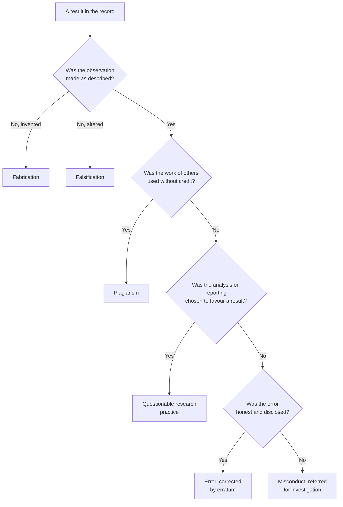
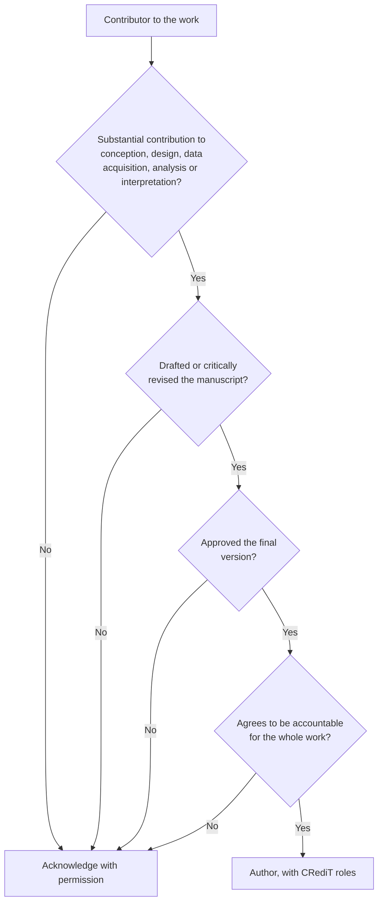
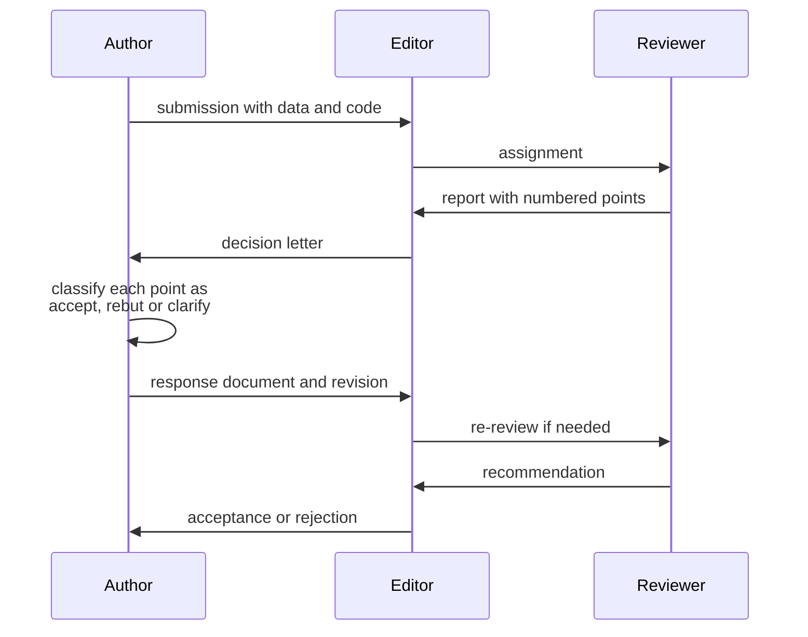
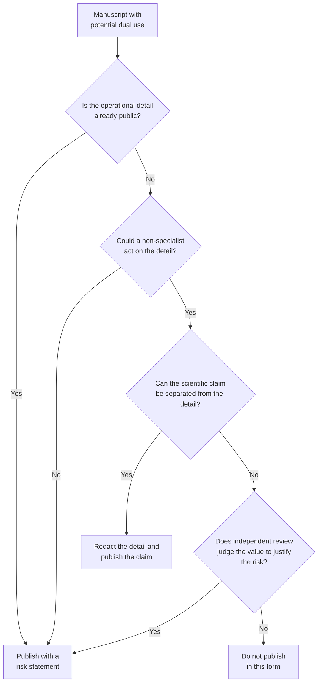

# Chapter 10 — Research Ethics and Scientific Writing

> **Level:** Research (Level 10 — University, Postgraduate and Research Chemistry)
> **Estimated study time:** 7 hours (5 h reading + 2 h exercises)
> **Prerequisites:** [Research Methodology and Experimental Design](07-research-methodology-and-experimental-design.md); [Scientific Data Analysis and Reproducibility](09-scientific-data-analysis-and-reproducibility.md)
> **Related chapters:** [Scientific Literature and Critical Evaluation](08-scientific-literature-and-critical-evaluation.md), [Advanced Spectroscopy and Structure Elucidation](06-advanced-spectroscopy-and-structure-elucidation.md), [Level 10 index](README.md)
> **Difficulty:** ★★★★☆ (4/5)

---

## 1. Learning Objectives
After working through this chapter you will be able to:

- Define fabrication, falsification and plagiarism, and distinguish each from honest error and from legitimate
  disagreement.
- Identify questionable research practices in a manuscript or a curriculum vitae, and explain why each damages the
  record even when no rule is broken.
- Apply the ICMJE authorship criteria to a concrete contribution list and justify the resulting byline.
- Assign CRediT roles to a multi-author paper and explain what contributorship adds to authorship.
- Declare and manage a conflict of interest, and distinguish financial from non-financial conflicts.
- State the retention, ownership and access obligations that apply to research data in your jurisdiction.
- Describe the approvals required for human and animal research and the principles behind them.
- Analyse a dual-use problem under the Chemical Weapons Convention and explain the limits of publication.
- Describe the protections available to a whistleblower and the routes for raising a concern.
- Structure a paper in IMRaD, write an abstract that states a claim supported by evidence, and write a discussion
  that is convincing without being dishonest.
- Design figures and tables that carry the argument rather than decorate it.
- Respond to reviewers professionally, present a poster and a talk, and explain a result to a public audience without
  distortion.

---

## 2. Introduction
Research ethics is not a list of prohibitions appended to scientific practice; it is the set of norms that make
scientific knowledge trustworthy. A result is credible because the person reporting it had no incentive to distort it,
because the method was open to scrutiny, because the data can be checked, and because the community that evaluated it
had no stake in the answer. Every ethical rule protects one of those conditions.

The stakes are concrete. A fabricated pharmacokinetic parameter can kill patients in a trial; a manipulated
micrograph can send a field chasing a mechanism that does not exist; a salami-sliced literature can make a weak
intervention look well evidenced; an undisclosed conflict can turn a review into an advertisement. Retractions have
grown because detection has improved, not only because misconduct has increased, and the cost falls
disproportionately on early-career researchers who build on the retracted work.

Writing is where ethics becomes visible. A paper is a claim about what was done and what it means, and every rhetorical
choice — which result leads, which limitation is mentioned, which comparison is omitted — is also an ethical choice.
The second half of this chapter is therefore a writing manual: the structure of a paper, the construction of an
abstract, the argument of a discussion, the design of figures, the response to reviewers, and the translation of
research for a public audience. The aim is prose that is persuasive because it is accurate, not persuasive in spite of
being inaccurate.

The chapter assumes that you have designed an experiment (Chapter
[7](07-research-methodology-and-experimental-design.md)), analysed the data (Chapter
[9](09-scientific-data-analysis-and-reproducibility.md)) and read the literature critically (Chapter
[8](08-scientific-literature-and-critical-evaluation.md)).

---

## 3. Fundamental Concepts

### 3.1 Research misconduct defined
**Research misconduct** is commonly defined, following the United States Office of Research Integrity and most national
frameworks, as **fabrication, falsification or plagiarism** (FFP) in proposing, performing, reviewing or reporting
research.

- **Fabrication** is making up data or results and recording or reporting them. It includes inventing a spectrum,
  filling a table with plausible numbers, and reporting an experiment that was not performed.
- **Falsification** is manipulating research materials, equipment or processes, or changing, omitting or suppressing
  data such that the research is not accurately represented in the record. It includes deleting inconvenient
  replicates, adjusting a baseline until the integral matches the expected value, and selecting the image that shows
  the effect.
- **Plagiarism** is the appropriation of another person's ideas, processes, results or words without giving
  appropriate credit. It includes copying text, reusing a figure, and presenting a co-worker's unpublished idea as
  one's own.

Three distinctions prevent the definition from swallowing everything. **Honest error** — a miscalculation, a
misidentified peak, a contaminated reagent — is not misconduct, provided it is corrected when discovered. **Differences
of opinion** about interpretation, method or significance are not misconduct. **Questionable research practices**
(Section 3.2) are practices that fall between the two: not fabrication, but not good science either.

The distinction matters legally and professionally. Misconduct requires intent, or at least reckless disregard, and
carries sanctions that range from a correction to dismissal and debarment. Honest error requires a correction and, if
serious, a retraction. Treating error as misconduct destroys careers and discourages the reporting on which
self-correction depends; treating misconduct as error destroys the record.

### 3.2 Questionable research practices
QRPs are legal, common and corrosive. They rarely appear in a single dramatic act; they accumulate.

| Practice | What it looks like | Why it matters |
|---|---|---|
| Selective reporting | Only the significant outcomes are reported | The literature overestimates effects |
| Outcome switching | The primary endpoint changes between protocol and paper | The reported p-value no longer means what it says |
| Salami slicing | One study split into the smallest publishable units | The literature is inflated and citation counts distorted |
| Gift authorship | A senior colleague added without contribution | Credit is misallocated and accountability diluted |
| Ghost authorship | A professional writer omitted | Readers cannot judge independence |
| Citation manipulation | Coercive citation, citation cartels, self-citation rings | Metrics become meaningless |
| Image beautification | Contrast or brightness adjusted per region | The figure no longer represents the data |
| Incomplete methods | A key step described as "as reported previously" | The work cannot be reproduced |

**Table 3.1 — Questionable research practices and their consequences.** None of these is fabrication; all of them
degrade the reliability of the record, and several are explicitly prohibited by journal policies even where the law is
silent.

### 3.3 Authorship
The **ICMJE criteria** are the most widely used standard. Authorship requires all four of the following:

1. Substantial contributions to the conception or design of the work, or to the acquisition, analysis or
   interpretation of data;
2. Drafting the work or reviewing it critically for important intellectual content;
3. Final approval of the version to be published;
4. Agreement to be accountable for all aspects of the work, including investigating and resolving questions about its
   accuracy and integrity.

All four must be satisfied. Acquisition of funding, provision of materials, general supervision of a group, and
membership of the department are insufficient on their own. Everyone who meets the criteria must be included;
everyone who does not must be acknowledged with their permission.

**Contributorship** models replace or supplement the byline with a statement of what each person did. The **CRediT**
(Contributor Roles Taxonomy) standard defines fourteen roles: conceptualisation, data curation, formal analysis,
funding acquisition, investigation, methodology, project administration, resources, software, supervision, validation,
visualisation, writing – original draft, and writing – review and editing. A CRediT statement makes gift authorship
visible, because a name with no role stands out, and it gives credit for contributions that the byline cannot express.

Author order conventions differ between fields: first author usually performed the work and wrote the draft, last
author usually supervised and funded it, and alphabetical order is used in some disciplines. Whatever the convention,
it should be agreed in writing before the work begins, revisited when contributions change, and never settled by
seniority alone.

### 3.4 Conflict of interest
A **conflict of interest** exists when a secondary interest — financial, personal, academic, political — has the
potential to influence a primary interest, such as the integrity of research or the welfare of patients. It is a
situation, not an accusation: the presence of a conflict does not imply misconduct, and its absence does not imply
virtue.

**Financial conflicts** include employment, consultancy, equity, patents, royalties, speaking fees and travel
sponsorship. **Non-financial conflicts** include competitive rivalry, a strong prior commitment to a theory, Editorial
board membership, personal relationships and institutional pressure. Non-financial conflicts are harder to declare and
often more influential.

Management follows a hierarchy: **declare** in the manuscript, on the presentation slide and in the funding statement;
**manage** by recusal from decisions, by independent monitoring, or by separation of roles; **prohibit** the most
dangerous arrangements, such as a sponsor drafting the conclusions of a trial. Declaration without management is
incomplete, and a generic statement ("the authors declare no conflict of interest") is credible only when the
relationships that could have existed have been considered.

### 3.5 Data retention, ownership and access
**Ownership** of research data usually rests with the employer or the institution, not the individual, under
intellectual-property law and the terms of employment; funders may impose additional conditions. **Retention** periods
are typically five to ten years from publication, and longer for clinical data. The obligation is to retain the raw
data, the metadata and the analysis code, in a form that remains readable after the software that produced it has
been superseded.

**Access** is governed by the same instruments: funder mandates for data management plans, journal data-availability
policies, and, for human data, consent and data-protection law. The default should be as open as possible and as
closed as necessary; "available on request" is the weakest form of availability, because the request can be refused.

### 3.6 Ethics approval for human and animal research
Research involving **human participants** requires approval from an independent ethics committee before any data are
collected. The governing principles, set out in the Declaration of Helsinki, are respect for persons (informed,
voluntary consent), beneficence and non-maleficence (favourable risk–benefit ratio), and justice (fair selection of
participants and fair distribution of benefits). Consent must be informed, specific, documented and revocable;
vulnerable populations require additional safeguards; personal data are governed by data-protection law, which imposes
lawful basis, minimisation, storage limitation and security.

Research involving **animals** requires approval from an animal ethics committee and adherence to the **3Rs**:
**replacement** of animals by non-animal methods wherever possible, **reduction** of the number used to the minimum
consistent with statistical validity, and **refinement** of procedures to minimise suffering. Humane endpoints must be
defined in advance. Reporting follows the **ARRIVE** guidelines, which specify the information a reader needs to
assess both the science and the welfare.

### 3.7 Dual use and the Chemical Weapons Convention
**Dual-use research** is research that can be applied for benign purposes and also misused to cause harm. Chemistry is
intrinsically dual-use: the same reactivity that makes a reagent useful in synthesis can make it dangerous, and the
same manufacturing knowledge that supports a pharmaceutical plant can support a prohibited programme.

The **Chemical Weapons Convention** (1993, in force 1997) prohibits the development, production, stockpiling, transfer
and use of chemical weapons, and establishes the **Organisation for the Prohibition of Chemical Weapons** to verify
compliance. It permits research for protection, for medicine and for peaceful purposes, and it places the obligation
on states parties to implement the prohibitions in national law. Individual researchers are bound by that law and by
their institution's policies.

The ethical obligation goes beyond legality. Publishing a detailed, reproducible procedure for a dangerous agent — a
synthesis, a stabilisation, a weaponisation step — creates information that cannot be withdrawn and that may be used
by someone with intent. The professional norm, reflected in the policies of most major journals, is therefore that
**the mechanism may be described while the enabling detail is withheld**: the scientific question can usually be
answered, reviewed and discussed without providing the operational recipe. Where the two cannot be separated, the
work should not be published in that form, and the decision should be taken with the institution's dual-use review
body rather than by the author alone.

A defensible dual-use review asks five questions. What is the plausible misuse? How feasible is it for a
non-specialist? Does the paper provide information that is not already public? Does the scientific value justify the
risk? Can the risky material be removed without destroying the scientific claim? The answers are recorded, and the
decision is documented.

### 3.8 Whistleblowing
**Whistleblowing** is the disclosure of wrongdoing within an organisation to someone who can act on it. It is the
mechanism by which most misconduct is discovered, and it is also the point at which the whistleblower becomes
vulnerable. Retaliation — dismissal, exclusion from projects, withdrawal of authorship, personal harassment — is
itself a form of misconduct, and many jurisdictions protect disclosures made in good faith.

The routes, in order of escalation, are: the supervisor or the head of the research group; the institution's research
integrity officer or designated contact; the funder; the journal editor, via COPE procedures; the national research
integrity body; and, where criminal activity is suspected, law enforcement. Good practice is to raise the concern in
writing, to keep the evidence, to be precise about what is alleged and what is known, and to distinguish suspicion
from proof. Anonymous reporting channels exist in many institutions and are appropriate when retaliation is likely.

### 3.9 The structure of a paper
The **IMRaD** structure — Introduction, Methods, Results, and Discussion — is an argument in the shape of an hourglass.
The introduction moves from the general field to the specific question; the methods and results are narrow and
concrete; the discussion widens again from the specific finding to its implications.

**Introduction** (roughly 15 % of the text). Four moves, in order: establish the field and its importance; state what
is known; identify the gap or conflict; state what this paper does about it. The last paragraph is the aim, and it
should be specific enough that the reader can tell whether the paper achieves it.

**Methods** (roughly 25 %). Enough detail for an independent expert to repeat the work. Past tense, passive or active
consistently, with instruments, reagents, conditions, replication and analysis. Anything that was pre-specified should
be identifiable as such.

**Results** (roughly 30 %). The findings, in the order that supports the argument, with the evidence for each. No
interpretation beyond the immediate meaning of a number; no discussion of literature. Every figure and table is
referred to in the text and carries a conclusion, not a description.

**Discussion** (roughly 25 %). Five moves: restate the principal finding in one sentence; compare with the
literature; explain the mechanism or interpretation; state the limitations honestly; state the implications and the
next question. The first and last sentences of the discussion are the most read in the paper.

**Conclusion** (roughly 5 %). One paragraph, no new data, no new citations, no claims that the results do not
support.

### 3.10 Writing an abstract
An abstract is a self-contained miniature of the paper, and it is the only part most readers will see. A structured
abstract of 150–250 words answers, in order: why the question matters (one sentence); what was done (one or two);
what was found, with numbers (two or three); what it means and what it does not (one or two).

Four rules improve almost every abstract. **Include numbers**: "significantly improved" is uninformative; "increased
the yield from 62 % to 84 %" is a result. **Do not cite**: an abstract should stand alone. **Do not overclaim**: the
abstract is where overclaiming is most damaging, because it is what gets quoted. **Respect the word limit**: the limit
is a test of whether you know what matters.

### 3.11 Writing a discussion that is convincing and honest
The discussion fails in two opposite ways. It is **timid** when it lists results without saying what they mean, and
**inflated** when it claims a general law from one experiment. The remedy is a claim–evidence–warrant structure:
state the claim, give the evidence, and state the reasoning that connects them. A reader who disagrees can then
attack a specific link rather than the whole paragraph.

Honesty is a rhetorical strategy as well as a virtue. A limitations paragraph that names the real limitation — the
single substrate, the unblinded analysis, the yield measured by NMR rather than isolation — increases the credibility
of everything else. Reviewers notice what is omitted, and a paper that pre-empts the obvious objection is harder to
reject.

### 3.12 Figures and tables that carry the argument
A figure should be designed to support one sentence of the paper, and that sentence should be its caption's first
line. Three rules follow. **Show the data**: plot individual points where possible, with the summary; a bar chart of
means hides distribution, outliers and sample size. **Show uncertainty**: error bars must be defined in the caption
(standard deviation, standard error, confidence interval) because the choice changes the visual message. **Do not
mislead with axes**: truncated axes exaggerate differences, dual axes invite spurious correlation, and 3-D effects
distort area.

Tables are for precise values, figures for patterns. A table with two rows belongs in the text; a figure with two
points belongs in a sentence. Every table needs units in the column headers, a caption that states what is shown and
how it was measured, and a footnote for every abbreviation.

### 3.13 Referencing styles and integrity
Reference styles are conventions: numeric (Vancouver), author–date (Harvard, APA), and note-based (Chicago). The
**Citation Style Language** implements thousands of variants, and a reference manager applies them automatically. What
matters is not the style but the accuracy: every reference must be complete, verifiable and actually consulted.

Three integrity failures recur. **Citation padding** adds references that were not read. **Citation distortion**
attributes a claim to a source that does not make it. **Self-citation inflation** raises a metric without adding
value. The test is simple: for every citation, could you state in one sentence what the cited work contributes to the
sentence in which it appears?

### 3.14 Responding to reviewers
Peer review is a negotiation in which the editor decides. The response document is therefore addressed to the editor
as much as to the reviewers, and it should be structured as a point-by-point reply.

For each comment: quote it (abbreviated), state what you did, and say where in the revised manuscript. If you
disagree, say so with evidence and with respect; reviewers are sometimes wrong, and editors know it. Never respond to
a comment you do not understand by making a cosmetic change; ask for clarification. Never agree to a change you
believe is scientifically wrong in order to secure acceptance — the published error will carry your name.

### 3.15 Posters, talks and public communication
A **poster** is a conversation starter, not a paper on a wall. The title states the finding, the layout reads in a
Z-pattern, the figures dominate, and the text is limited to what a reader can absorb in ninety seconds. A **talk** is
an argument delivered at a pace the audience can follow: one idea per slide, a narrative that survives without the
speaker, and rehearsal to time.

**Public communication** is a translation, not a dilution. The audience needs the question, the finding and its
significance, without the caveats that make a scientific claim precise but unintelligible. The ethical risks are
overclaiming and false balance: presenting a minority view as equal to a consensus, or a preliminary result as
established. The remedies are the same as in a paper — state what was measured, how confident you are, and what would
change your mind.

### 3.16 Preprints, open access, corrections and retractions
**Preprints** accelerate science and carry no editorial endorsement; cite the version read and check for a journal
version. **Open access** increases reach; the author-pays model creates incentives for predatory journals, which
Section 3.10 of [Chapter 8](08-scientific-literature-and-critical-evaluation.md) addresses.

**Corrections** fix errors that do not change conclusions. **Expressions of concern** flag a serious question while
it is investigated. **Retractions** withdraw the paper while leaving it in the record, because the record must show
what was claimed. A retraction is not always an accusation: honest error that cannot be corrected is also retracted.
The ethical obligation of an author who discovers an error is to report it promptly, to cooperate with the
correction, and not to wait for someone else to notice.

---

## 4. Detailed Scientific Explanation

### 4.1 Why IMRaD works
The structure separates three kinds of statement that are easily confused: what is known (introduction), what was
done and observed (methods and results), and what it means (discussion). That separation is what allows a reader to
disagree with the interpretation while accepting the data, which is the normal condition of science.

The hourglass shape encodes the relationship between generality and evidence. A paper that begins and ends at the
level of the specific measurement has no significance; a paper that begins and ends at the level of a general law has
no evidence. The narrow waist — one experiment, one system, one set of conditions — is what makes the claim testable.

### 4.2 Argument structure in the discussion
A discussion paragraph that works has four sentences: a claim, the evidence for it, a qualification, and a link to
the next paragraph. For example: "The increased yield with ligand L2 is consistent with a more electron-rich palladium
centre (claim). The same trend was observed across three substrates (evidence), although the effect was smaller for
the electron-poor aryl bromide (qualification). This suggests that the ligand acts primarily on the oxidative addition
step (link)."

The pattern is not a formula to be filled mechanically; it is a check that each paragraph does work. A paragraph with
no claim is a summary; a paragraph with no evidence is an assertion; a paragraph with no qualification is a
sales pitch.

### 4.3 Reporting guidelines
Reporting guidelines are checklists that specify the minimum information for a study type: **CONSORT** for randomised
trials, **STROBE** for observational studies, **PRISMA** for systematic reviews, **ARRIVE** for animal research,
**MIQE** for quantitative PCR, **COREQ** for qualitative research. Their value is that they convert implicit
expectations into explicit items, and journals increasingly require the completed checklist with the submission.

A checklist is not a guarantee of quality — a paper can tick every box and still be wrong — but a missing item is a
specific, checkable deficiency, which is more useful to a reader than a general impression.

### 4.4 Authorship disputes
Disputes are prevented by early agreement and resolved by evidence. Good practice is to agree the authorship order,
the criteria and the process for changes at the start of the project, to record contributions as they happen (a
shared document or a CRediT draft), and to revisit the agreement when the work changes shape. When a dispute arises,
the evidence is the contribution record, not memory or seniority, and the escalation route is the corresponding
author, then the head of department, then the institution's research integrity process.

### 4.5 Image integrity
Images are data, and the standards are those of data processing. **Acceptable**: adjusting the brightness, contrast or
colour balance of an entire image uniformly, provided the adjustment is applied to the whole image and disclosed;
cropping, provided the crop is disclosed and the full image is available; using the same lookup table for all
comparison images. **Unacceptable**: adjusting one region differently from another; erasing or duplicating objects;
splicing lanes; presenting images from different experiments as the same experiment; reusing an image for a different
condition.

The technical test is straightforward: a duplicated region retains a pixel-to-pixel correlation close to 1 even after
global brightness or contrast adjustment, because the Pearson correlation is invariant to affine intensity
transformations. Software that computes local correlations, or the absence of the expected noise texture, detects
duplication that the eye does not.

### 4.6 A dual-use decision framework
The framework in Section 3.7 can be applied as a sequence of gates. **Gate 1**: is the information already public in
equivalent detail? If so, the marginal risk of publication is low, and the scientific value dominates. **Gate 2**: does
the paper provide operational detail — quantities, conditions, equipment, purification — that a non-specialist could
use? If not, the risk is limited. **Gate 3**: is the scientific claim separable from the operational detail? If it is,
remove the detail and publish the claim. **Gate 4**: if it is not separable, does the scientific value justify the
risk, and has an independent review agreed? If not, do not publish in that form.

The framework is deliberately conservative at Gate 4, because the asymmetry is real: the scientific benefit of one
paper is incremental, while the harm of a published recipe can be irreversible.

### 4.7 Writing clearly
Clarity is a courtesy and a form of honesty. Four practices carry most of the improvement.

- **One idea per sentence.** If a sentence contains two "and"s and a "which", it contains at least two sentences.
- **Subject–verb–object.** "We measured the yield" is clearer than "measurements of the yield were undertaken".
- **Signposting.** The first sentence of a paragraph states its topic; the last states its consequence. A reader who
  reads only those two sentences should still follow the argument.
- **Precision instead of emphasis.** "Very", "significantly" and "dramatically" are usually doing the work that a
  number should do.

### 4.8 Responding to rejection
Rejection is the normal outcome, not an verdict on the work. The productive response is to extract the substance from
the reports, decide which criticisms are correct, revise accordingly, and resubmit elsewhere with a cover letter that
states what changed. The unproductive responses are to resubmit unchanged, to appeal on procedural grounds when the
science was criticised, and to take the decision personally.

---

## 5. Visual Diagrams

**Figure 10.1 — Classifying a problem in the record.** The tree separates acts from omissions and intent from error.
The distinction between the two right-hand branches is the one that protects honest scientists: a disclosed error is
corrected, whereas a concealed one becomes misconduct.

**Figure 10.2 — The ICMJE authorship test.** All four gates must be passed; failing one does not make a person
unimportant, it makes them an acknowledged contributor rather than an author. The diagram is useful precisely because
it can be applied to a list of names without a conversation about status.

**Figure 10.3 — The review–response loop.** The step that authors most often skip is the classification of each
comment: accepting, rebutting with evidence, or asking for clarification. A response that treats every comment as an
instruction to change produces a manuscript that no longer argues anything.

**Figure 10.4 — Dual-use decision gates.** The order matters: the cheapest and least restrictive outcome is tested
first, so that most manuscripts pass at the first or second gate. Only work that fails every earlier test reaches the
independent review, which is where the difficult judgements belong.

---

## 6. Mathematical Formulas

**Text overlap.** For an original passage containing $a$ content words of which $c$ appear in a later passage of
$b$ content words, two indices are commonly quoted:

$$
\text{overlap coefficient} = \frac{c}{\min(a,b)},
\qquad
\text{Jaccard index} = \frac{c}{a + b - c}.
$$

The overlap coefficient is the more useful for detecting plagiarism of a short passage inside a longer text, because
it is not diluted by the length of the later passage; the Jaccard index penalises the addition of unoriginal material.

**Image duplication by correlation.** The Pearson correlation between two image regions with intensities $I_1$ and
$I_2$ is

$$
r = \frac{\sum (I_1 - \bar{I}_1)(I_2 - \bar{I}_2)}
{\sqrt{\sum (I_1-\bar{I}_1)^{2}}\sqrt{\sum (I_2-\bar{I}_2)^{2}}}.
$$

Because $r$ is invariant to affine transformations $I \mapsto \alpha I + \beta$, a duplicated region retains
$r \approx 1$ after global brightness or contrast adjustment, which is why correlation detects duplication that visual
inspection misses.

**Word budget.** For a manuscript of $N$ words, the allocation by section is

$$
n_{\text{intro}} \approx 0.15N,\quad
n_{\text{methods}} \approx 0.25N,\quad
n_{\text{results}} \approx 0.30N,\quad
n_{\text{discussion}} \approx 0.25N,\quad
n_{\text{conclusion}} \approx 0.05N.
$$

The proportions are conventions, not laws, but a manuscript that deviates by a factor of two in one section is
usually arguing in the wrong place.

**Readability.** The Flesch reading ease score for a text is

$$
\mathrm{FRE} = 206.835 - 1.015\frac{W}{S} - 84.6\frac{Y}{W},
$$

with $W$ words, $S$ sentences and $Y$ syllables; higher scores indicate easier text. The formula is a rough guide for
public communication, not a target for a research paper.

| Symbol | Meaning | SI unit |
|---|---|---|
| $a$, $b$ | Content words in the two passages | dimensionless |
| $c$ | Words common to both passages | dimensionless |
| $I$ | Pixel intensity | arbitrary units |
| $r$ | Pearson correlation coefficient | dimensionless |
| $N$ | Total word count | dimensionless |
| $W$, $S$, $Y$ | Words, sentences, syllables | dimensionless |

**Table 6.1 — Symbols used in this chapter.** The image correlation is the only quantity here that is used as
evidence in a misconduct investigation, and it is interpreted alongside the raw files rather than on its own.

---

## 7. Chemical Equations

Ethical writing about chemistry begins with reporting the chemistry completely enough to be checked. For a benign
transformation, the full report includes the balanced equation, the conditions, the isolated yield and the purity:

$$
\ce{CH3COOH + C2H5OH <=> CH3COOC2H5 + H2O}
$$

with the atom economy defined as the molar mass of the product divided by the sum of the molar masses of the
reactants, 83.0 % for this esterification. Reporting a yield without the purity, or an atom economy without the
by-product, presents an incomplete picture that a reader cannot correct.

The same standard applies to the reporting of analytical data. A characterisation statement such as
"$\ce{C10H12O4}$: calculated C 61.22, H 6.17; found C 61.31, H 6.09" is verifiable; "satisfactory elemental analysis"
is not, because it does not state what was found.

Dual-use reporting uses the same chemistry but a different boundary. Consider a transformation whose mechanism is
scientifically interesting and whose operational details are sensitive. The publishable form states the transformation
and the mechanistic conclusion while generalising the conditions:

$$
\ce{A + B ->[condition] P}
$$

where the specific reagent identities, quantities and procedures that would enable misuse are held in a
controlled appendix available to reviewers and regulators rather than printed in the article. The scientific claim is
unchanged; the operational recipe is not disclosed. This is the concrete meaning of the norm stated in Section 3.7:
the mechanism may be described, the enabling detail may not.

---

## 8. Worked Examples

### Worked Example 8.1 — Classifying six incidents

**Problem.** Classify each incident as fabrication, falsification, plagiarism, a questionable research practice, or
honest error.

| Incident | Classification | Reason |
|---|---|---|
| A student reports a spectrum for a compound that was never made | Fabrication | The observation is invented |
| An analyst removes three replicates to improve the precision | Falsification | Data are suppressed so the record misrepresents the work |
| A paragraph from a review is reused with the citation moved to a different paper | Plagiarism | Words are used without appropriate credit |
| A paper reports only the significant subgroup analysis | QRP | The analysis is selective but the data are real |
| A calibration is recalculated after a unit conversion error is found, and the correction is published | Honest error | Disclosed and corrected |
| A figure is assembled from two experiments and presented as one | Falsification | The representation does not correspond to the experiment |

**Strategy.** Ask three questions in order: was the observation made? was it altered? was the work of others used
without credit? If none applies, ask whether the reporting was chosen to favour a result.

**Solution.** The classifications above follow directly. The fourth case is the hardest, because the data are genuine
and the practice is common; it is a QRP because the reader is shown a selected analysis without the pre-specified one.

**Check.** Two of the six involve no invented data at all, which is the point of the exercise: misconduct is not
limited to making things up.

### Worked Example 8.2 — Applying the ICMJE criteria

**Problem.** A paper has five contributors: the group leader obtained the funding and read the draft; a postdoc
designed the study and wrote the first draft; a PhD student performed all the experiments; a collaborator supplied a
ligand and discussed the results; a technician ran the NMR spectra. Who should be an author?

**Strategy.** Apply the four criteria to each person and record the result.

**Solution.** The postdoc (design, draft, approval, accountability) and the PhD student (acquisition, critical
revision, approval, accountability) are authors. The group leader meets the criteria only if they reviewed the draft
critically for important intellectual content and accept accountability; funding alone is insufficient. The
collaborator is an author if they contributed to interpretation and revised the manuscript, and an acknowledged
contributor if they only supplied material. The technician is acknowledged unless they also contributed to design or
interpretation.

**Check.** The answer depends on what people actually did, not on their seniority, and the CRediT statement would make
the pattern explicit: the postdoc and student would carry conceptualisation, investigation, formal analysis and
writing, and the group leader supervision, funding acquisition and writing – review and editing.

### Worked Example 8.3 — Quantifying text overlap

**Problem.** An original passage contains 60 content words. A later passage contains 120 content words, of which 45
appear in the original in the same form and order. Compute the overlap coefficient and the Jaccard index, and
interpret.

**Strategy.** Apply the definitions with $a = 60$, $b = 120$ and $c = 45$.

**Solution.** The overlap coefficient is $45/60 = 0.75$, and the Jaccard index is
$45/(60 + 120 - 45) = 45/135 = 0.33$.

**Check.** An overlap of 0.75 on a short passage is far above what independent writing produces, whereas the Jaccard
index alone would understate the problem because the later passage is twice as long. Both indices are reported, and
the decision is made by a human reading the two passages side by side, because no threshold distinguishes
paraphrase from plagiarism by itself.

### Worked Example 8.4 — Allocating a word budget

**Problem.** A journal allows 3000 words for the main text, excluding references and figure captions. Allocate the
budget and identify the section that is likely to be over length.

**Strategy.** Apply the conventional proportions and check them against the argument the paper needs to make.

**Solution.** Introduction 450 words, Methods 750, Results 900, Discussion 750, Conclusion 150. In practice, Methods
are usually compressed below 750 and the Introduction expands above 450, because authors find it easier to review the
literature than to describe the procedure precisely. The correction is to move detailed procedures to the supporting
information and to cut the introduction to the four moves of Section 3.9.

**Check.** The Results allocation is the largest because the evidence is the point of the paper; a manuscript in which
the Discussion is longer than the Results is usually arguing beyond its data.

### Worked Example 8.5 — Detecting a duplicated image region

**Problem.** Two regions of a figure, each 200 × 200 pixels and taken from different panels, have a Pearson
correlation of 0.98 after one has been brightened. What does this indicate?

**Strategy.** Consider the invariance of the correlation to affine intensity transformation and the correlation
expected between unrelated regions of similar texture.

**Solution.** A correlation of 0.98 between regions that have been independently acquired is essentially impossible:
unrelated regions of a micrograph typically correlate below 0.5, and often near zero. Because the Pearson coefficient
is invariant to a global change in brightness or contrast, the correlation survives exactly the adjustment that an
author would apply to disguise a duplicate.

**Check.** The finding is evidence, not proof: the original files must be examined, the acquisition metadata checked,
and the authors asked for an explanation. The investigation, not the correlation, establishes what happened.

### Worked Example 8.6 — Rewriting an abstract

**Problem.** Rewrite the following abstract so that it states a claim supported by evidence. The data are
hypothetical.

> A new and efficient method for the synthesis of substituted biphenyls has been developed. Various conditions were
> screened and the best conditions were identified. The method is green, scalable and gives excellent yields. This
> work will be of great interest to the synthetic community.

**Strategy.** Apply the four moves: why it matters, what was done, what was found with numbers, what it means and what
it does not.

**Solution.**

> Palladium-catalysed Suzuki–Miyaura coupling is the standard route to substituted biphenyls, but most protocols
> require high catalyst loadings and prolonged heating. We report that a bulky biaryl phosphine ligand allows the
> coupling of aryl bromides with arylboronic acids at 1 mol % palladium, 80 °C and 6 h in aqueous ethanol. Across
> twenty substrate pairs the isolated yield was 62–91 % (median 84 %), with the lowest yields for ortho-substituted
> aryl bromides. The method uses no chlorinated solvent and the catalyst can be recovered by filtration, although
> recycling was demonstrated for only three cycles. These results establish a practical alternative for
> electron-neutral and electron-rich aryl bromides; extension to aryl chlorides was not achieved.

**Check.** Every sentence now carries information: the gap, the conditions, the range with a median, the limitation
and the scope. The final sentence states what was not achieved, which is what makes the preceding claims credible.

---

## 9. Real-World Applications

**Clinical trials and regulatory submissions.** Good clinical practice requires documented consent, ethics approval,
auditable data and pre-registered endpoints. A sponsor that omits a trial from a registry, or that reports only the
favourable endpoint, faces regulatory action and, increasingly, criminal liability.

**Industrial research and trade secrets.** Companies must balance publication against commercial confidentiality.
The ethical standard is not "publish everything" but "do not misrepresent": a paper may withhold proprietary detail,
provided it does not claim a result that the withheld detail would contradict.

**Editorial and peer-review work.** Editors manage conflicts, select reviewers, handle appeals and decide on
retraction. COPE flowcharts provide the procedure for each case, and the editor's obligation is to the record rather
than to the author or the publisher.

**Public communication of chemistry.** A chemical incident, a new material or a drug approval becomes a public
argument within hours. The researcher who can state what is known, what is uncertain and what would change the
assessment contributes more than the one who provides a quotable certainty.

---

## 10. Common Mistakes

| Mistake | Why it happens | Correct approach |
|---|---|---|
| Adding a senior colleague as a gift author | It feels disrespectful to omit them | Apply the ICMJE criteria and acknowledge instead |
| Reporting "no conflict of interest" without checking | The phrase is copied from a template | List every relationship that could be relevant and declare it |
| Describing a method as "as previously reported" | It saves words | Give the reference and the key parameters; the reader may not have access |
| Treating a retraction as proof of fraud | Retractions also correct honest error | Read the notice and distinguish error from misconduct |
| Adjusting one region of an image | It makes the figure clearer | Adjust the whole image uniformly and disclose it |
| Responding to reviewers with cosmetic changes | It seems faster than arguing | Classify each point and respond with evidence |
| Overclaiming in the abstract | The abstract is written last and optimistically | Check every sentence against a figure or a table |
| Omitting the limitations paragraph | It invites criticism | State the real limitation first; it increases credibility |

---

## 11. Chapter Summary

- Misconduct is fabrication, falsification or plagiarism; honest error and disagreement are not misconduct, and
  conflating them damages the self-correction that science depends on.
- Questionable research practices are legal, common and corrosive, and they act mainly by selecting what enters the
  record.
- Authorship requires a substantial contribution, drafting or critical revision, approval of the final version and
  accountability; CRediT makes the contributions visible.
- Conflicts of interest are situations, not accusations; they must be declared and managed, and non-financial
  conflicts matter as much as financial ones.
- Data are usually owned by the institution, must be retained for years and should be as open as possible and as
  closed as necessary.
- Human and animal research requires independent approval, informed consent or the 3Rs, and reporting to CONSORT or
  ARRIVE respectively.
- Dual-use research under the Chemical Weapons Convention requires that the mechanism may be described while enabling
  detail is withheld.
- Whistleblowing is the main route by which misconduct is discovered and is protected when it is made in good faith.
- IMRaD separates what is known, what was done, what was found and what it means; the discussion is convincing when it
  is structured as claim, evidence, qualification and link.
- Figures carry the argument, abstracts carry the claim, and both must be checkable against the data.

---

## 12. Exercises

### 12.1 Conceptual questions

1. Distinguish fabrication, falsification and plagiarism, giving one example of each that involves no invented
   numbers.
2. Why is a retraction not necessarily an accusation of misconduct?
3. Explain the difference between a conflict of interest and misconduct.

### 12.2 Authorship and ethics problems

4. A head of department is added to every paper from the group because they provide the facilities. Apply the ICMJE
   criteria and state what should happen instead.
5. A reviewer asks you to cite five of their papers, none of which is relevant. Draft a response to the editor.
6. You discover that a figure in your own published paper contains a duplicated panel, from an error in assembly.
   State, in order, what you should do.

### 12.3 Writing exercises

7. Write a one-sentence aim for a study comparing two catalysts for the hydrogenation of a ketone, specifying the
   response and the comparison.
8. Rewrite this sentence in plain scientific English: "It was found that, under the conditions employed, a
   significantly enhanced yield was observed to be afforded by the use of the phosphine ligand."
9. Write a 100-word abstract for a study in which a new electrode detects lead at 0.5 µg L$^{-1}$ with a linear range
   to 100 µg L$^{-1}$ and a relative standard deviation of 4 % ($n = 6$), compared with a certified method on 20
   samples.
10. Write a limitations paragraph for a study that optimised a reaction on a single substrate at 0.5 mmol scale
    without replication of the optimum.

### 12.4 Quantitative problems

11. An original passage of 80 content words is reproduced with 30 words changed; the later passage contains 110
    content words. Compute the overlap coefficient and the Jaccard index.
12. A 4000-word manuscript allocates 1200 words to the introduction and 500 to the methods. State the allocation as
    percentages and identify the imbalance.

### 12.5 Answers

1. Fabrication: inventing a melting point. Falsification: reporting only the spectra that match the expected product.
   Plagiarism: reusing a paragraph of a thesis without attribution.
2. Because a retraction is also issued when an honest error cannot be corrected; the notice states the reason, and the
   reason may be error rather than misconduct.
3. A conflict is a situation that could bias judgement; misconduct is an act that violates integrity. A declared and
   managed conflict is not misconduct, and an undeclared conflict is a breach of policy even when the science is sound.
4. Providing facilities is not a contribution under the criteria; the head of department should be acknowledged, and
   authorship should be limited to those who designed, performed, wrote or revised the work and accept accountability.
5. Decline politely, state that the suggested citations are not relevant to the argument, and ask the editor to judge;
   coercive citation should be reported to the editor rather than complied with silently.
6. Notify the corresponding author and the journal immediately, supply the original data and the correct figure,
   cooperate with a correction, and state the cause; do not wait to see whether anyone notices.
7. "This study compares catalysts A and B for the hydrogenation of acetophenone, measuring isolated yield and
   enantiomeric excess at 25 °C and 10 bar hydrogen under otherwise identical conditions."
8. "The phosphine ligand increased the yield significantly under the conditions used."
9. A model answer: "Lead contamination of drinking water requires detection below the regulatory limit of
   10 µg L$^{-1}$. We report an electrode modified with a bismuth film that detects Pb(II) by anodic stripping
   voltammetry with a limit of detection of 0.5 µg L$^{-1}$ and a linear range from 1 to 100 µg L$^{-1}$. The relative
   standard deviation was 4 % across six replicate measurements. Results for twenty water samples agreed with a
   certified spectroscopic method within the combined uncertainty. The electrode is disposable and requires no
   mercury, although its stability beyond thirty measurements was not established."
10. A model answer: "The optimisation was performed on a single substrate at 0.5 mmol scale, and the predicted optimum
    was not replicated. The conclusions are therefore restricted to this substrate and scale; transfer to other
    substrates and to larger scale requires separate confirmation, and the reported yield should be regarded as an
    upper estimate until that confirmation is available."
11. Unchanged words $c = 50$; overlap coefficient $50/80 = 0.63$; Jaccard $50/(80+110-50) = 50/140 = 0.36$.
12. Introduction 30 %, Methods 12.5 %; the introduction is twice the conventional proportion and the methods less than
    half, which usually means the literature review has crowded out the procedure.

---

## 13. Further Reading

- Committee on Publication Ethics. *Core Practices and Guidelines*. <https://publicationethics.org/>
- International Committee of Medical Journal Editors. *Recommendations for the Conduct, Reporting, Editing and
  Publication of Scholarly Work in Medical Journals*. <https://www.icmje.org/recommendations/>
- National Academies of Sciences, Engineering, and Medicine. *On Being a Scientist: A Guide to Responsible Conduct in
  Research*, 3rd ed. The National Academies Press, 2009. <https://nap.nationalacademies.org/>
- National Academies of Sciences, Engineering, and Medicine. *Fostering Integrity in Research*. The National Academies
  Press, 2017. <https://nap.nationalacademies.org/>
- World Conferences on Research Integrity. *Singapore Statement on Research Integrity*, 2010.
  <https://wcrif.org/guidance/singapore-statement>
- ALLEA. *The European Code of Conduct for Research Integrity*, revised edition. <https://allea.org/>
- Organisation for the Prohibition of Chemical Weapons. *Chemical Weapons Convention and verification resources*.
  <https://www.opcw.org/>
- NISO. *CRediT Contributor Roles Taxonomy*. <https://credit.niso.org/>
- ORCID. *Open Researcher and Contributor Identifier*. <https://orcid.org/>
- Day, R. A.; Gastel, B. *How to Write and Publish a Scientific Paper*, 8th ed. Greenwood, 2016.
- Schimel, J. *Writing Science: How to Write Papers That Get Cited and Proposals That Get Funded*. Oxford University
  Press, 2012.
- Sword, H. *Stylish Academic Writing*. Harvard University Press, 2012.
- Retraction Watch. *Retraction database*. <https://retractionwatch.com/>
