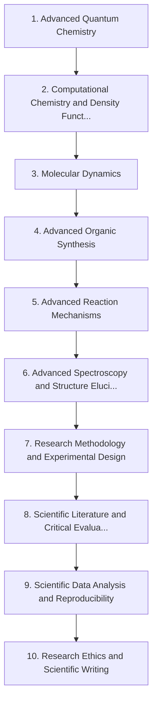

# Level 10 — University, Postgraduate and Research Chemistry

> **Audience:** Postgraduate / researcher  
> **Chapters:** 10  
> **Estimated study time:** ≈ 90 h  
> **Difficulty:** ★★★★☆ – ★★★★★

Research-grade theory and practice: advanced quantum chemistry, DFT, molecular dynamics, advanced synthesis and mechanisms, structure elucidation, research design, literature evaluation, reproducibility, ethics and scientific writing.

The final level is about doing chemistry, not just knowing it. It covers research-grade theory, modern computational methods, and the professional practices that make results credible: design, statistics, reproducibility, ethics and writing.

---

## Chapters

| # | Chapter | Difficulty | Hours | Prerequisites |
|---|---|---|---|---|
| 1 | [Advanced Quantum Chemistry](01-advanced-quantum-chemistry.md) | ★★★★★ | 12 | Level 6 Ch. 3 |
| 2 | [Computational Chemistry and Density Functional Theory](02-computational-chemistry-and-density-functional-theory.md) | ★★★★★ | 11 | Ch. 1 |
| 3 | [Molecular Dynamics](03-molecular-dynamics.md) | ★★★★★ | 9 | Ch. 1–2; Level 6 Ch. 2 |
| 4 | [Advanced Organic Synthesis](04-advanced-organic-synthesis.md) | ★★★★★ | 10 | Level 4 in full |
| 5 | [Advanced Reaction Mechanisms](05-advanced-reaction-mechanisms.md) | ★★★★★ | 9 | Level 4 Ch. 8–13 |
| 6 | [Advanced Spectroscopy and Structure Elucidation](06-advanced-spectroscopy-and-structure-elucidation.md) | ★★★★★ | 10 | Level 3 Ch. 10; Level 6 Ch. 4 |
| 7 | [Research Methodology and Experimental Design](07-research-methodology-and-experimental-design.md) | ★★★★☆ | 8 | Level 7 Ch. 3–4 |
| 8 | [Scientific Literature and Critical Evaluation](08-scientific-literature-and-critical-evaluation.md) | ★★★★☆ | 6 | None |
| 9 | [Scientific Data Analysis and Reproducibility](09-scientific-data-analysis-and-reproducibility.md) | ★★★★★ | 8 | Ch. 7 |
| 10 | [Research Ethics and Scientific Writing](10-research-ethics-and-scientific-writing.md) | ★★★★☆ | 7 | Ch. 7–9 |

---

## Knowledge map

The chain is the *recommended* order. Chapters that share prerequisites can be
read out of order; the table above tells you what each one actually needs.

---

## Study routine for this level

1. Read the chapter once without taking notes, to see the shape of the argument.
2. Re-read with the chapter's learning objectives in front of you and answer them in writing.
3. Reproduce every Mermaid diagram from memory, then check it.
4. Do the exercises **before** opening the solutions file.
5. Record every mistake in a log; re-test yourself on those specific items a week later.

---

## Practice

- Exercise set: [`exercises/level-10-exercises.md`](exercises/level-10-exercises.md)
- Worked solutions: [`solutions/level-10-solutions.md`](solutions/level-10-solutions.md)

---

## Navigation

- Level index: [CURRICULUM.md](../CURRICULUM.md)
- Study methods: [00-learning-guide](../00-learning-guide/learning-path.md)
- Terminology: [GLOSSARY.md](../GLOSSARY.md)
- Sources: [REFERENCES.md](../REFERENCES.md)
