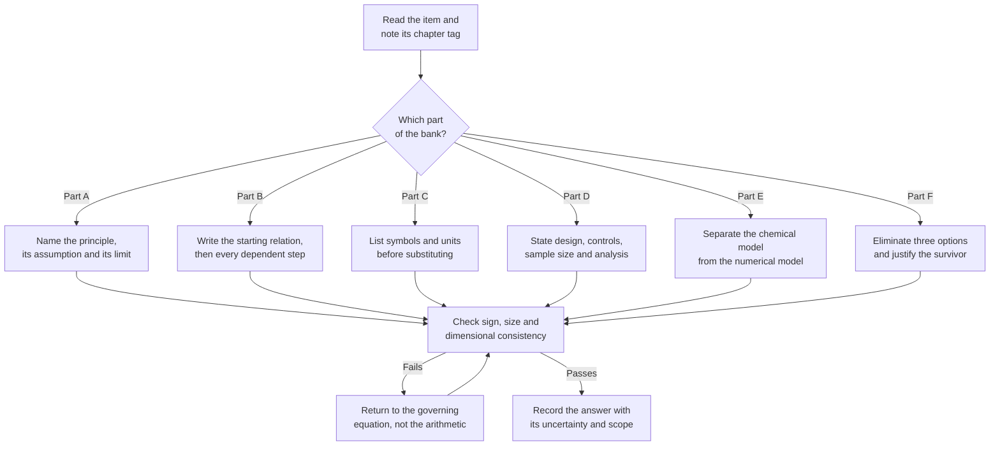

# Level 10 — Exercise Bank: Research and Postgraduate Chemistry

> **Level:** Research (Level 10 — University, Postgraduate and Research)
> **Estimated time:** 420 minutes
> **Items:** 51
> **Covers:** [Ch. 1](../01-advanced-quantum-chemistry.md), [Ch. 2](../02-computational-chemistry-and-density-functional-theory.md), [Ch. 3](../03-molecular-dynamics.md), [Ch. 4](../04-advanced-organic-synthesis.md), [Ch. 5](../05-advanced-reaction-mechanisms.md), [Ch. 6](../06-advanced-spectroscopy-and-structure-elucidation.md), [Ch. 7](../07-research-methodology-and-experimental-design.md), [Ch. 8](../08-scientific-literature-and-critical-evaluation.md), [Ch. 9](../09-scientific-data-analysis-and-reproducibility.md), [Ch. 10](../10-research-ethics-and-scientific-writing.md)
> **Solutions:** [`../solutions/level-10-solutions.md`](../solutions/level-10-solutions.md)

Every item names the chapter that supplies the method. Numerical answers should be
given to three significant figures unless the data justify fewer, with units carried
through the substitution. In Parts B and D, a result quoted without its assumptions
earns no credit. Part D answers must state the design, the controls, the sample-size
logic and the analysis plan.

**Figure 1 — Working order for this bank.** The loop is the part that earns marks: a
failed check sends you back to the equation, never to the calculator.

---

## Data sheet

| Constant or quantity | Value |
|---|---|
| Gas constant, $R$ | $8.314462618\ \mathrm{J\,mol^{-1}\,K^{-1}}$ |
| Faraday constant, $F$ | $96485.33212\ \mathrm{C\,mol^{-1}}$ |
| Avogadro constant, $N_\mathrm{A}$ | $6.02214076\times10^{23}\ \mathrm{mol^{-1}}$ |
| Planck constant, $h$ | $6.62607015\times10^{-34}\ \mathrm{J\,s}$ |
| Reduced Planck constant, $\hbar$ | $1.054571817\times10^{-34}\ \mathrm{J\,s}$ |
| Speed of light, $c$ | $2.99792458\times10^{8}\ \mathrm{m\,s^{-1}}$ |
| Boltzmann constant, $k_\mathrm{B}$ | $1.380649\times10^{-23}\ \mathrm{J\,K^{-1}}$ |
| Elementary charge, $e$ | $1.602176634\times10^{-19}\ \mathrm{C}$ |
| Atomic mass constant, $m_\mathrm{u}$ | $1.66053906660\times10^{-27}\ \mathrm{kg}$ |
| Hartree | $4.3597447222071\times10^{-18}\ \mathrm{J}$ |
| Hartree in $\mathrm{kJ\,mol^{-1}}$ | $2625.4996$ |
| $1\ \mathrm{kcal\,mol^{-1}}$ | $4.184\ \mathrm{kJ\,mol^{-1}}$ |
| $RT$ at $298.15\ \mathrm{K}$ | $2.478\ \mathrm{kJ\,mol^{-1}}$ |
| $k_\mathrm{B}T/h$ at $298.15\ \mathrm{K}$ | $6.209\times10^{12}\ \mathrm{s^{-1}}$ |
| $hc$ per $\mathrm{cm^{-1}}$ | $0.011962\ \mathrm{kJ\,mol^{-1}}$ |

---

## Part A — Conceptual questions (10 items)

1. **[Ch. 1]** The six postulates P1–P6 are stated in the chapter. For each of the
   following steps in a molecular calculation, name the postulate that licenses it and
   state what would fail without it: (a) writing the total wavefunction as an
   antisymmetrised product of spin-orbitals; (b) using $|\langle a_n|\psi\rangle|^{2}$
   as a measurement probability; (c) applying $e^{-i\hat{H}t/\hbar}$ between
   measurements; (d) forming a tensor product of electronic and spin spaces. Then
   explain why the language of "collapse" is not part of P3 as the chapter states it.

2. **[Ch. 1]** A student reports $E_{\mathrm{HF}} = \sum_i \varepsilon_i$ for a
   closed-shell molecule and is surprised that the value is too negative by the
   electron–electron repulsion. Derive the correct relation between $E$ and
   $\sum_i\varepsilon_i$ from the definitions of $h_{ii}$, $J_{ij}$, $K_{ij}$ and
   $\varepsilon_i$, and state the physical meaning of the correction term. Include the
   one-electron and two-electron cases as checks.

3. **[Ch. 1]** Classify each system as dominated by dynamic correlation or by static
   correlation (both are always present; name the dominant one), and name the cheapest
   method from the chapter that is defensible: (a) Ne at equilibrium;
   (b) $\ce{H2}$ at $3r_e$; (c) ozone at equilibrium; (d) ethene at equilibrium;
   (e) the transition state of a symmetry-forbidden cycloaddition with a small
   HOMO–LUMO gap. Justify each choice
   with a leading-determinant weight, a degeneracy argument or both.

4. **[Ch. 2]** State both Hohenberg–Kohn theorems precisely, including the domain of
   densities to which each applies. Explain (a) why the original proof needs a
   non-degenerate ground state and $v$-representability, (b) how the Levy constrained
   search repairs this, and (c) what the theorems do not guarantee about practical
   functionals.

5. **[Ch. 2]** One defect, five symptoms. Explain how the self-interaction error
   produces (a) underestimated band gaps, (b) underestimated charge-transfer excitation
   energies, (c) underestimated barriers, (d) underbound anions, and (e) spurious spin
   delocalisation. For each, state whether a global hybrid, a range-separated
   functional or a self-interaction correction is the most appropriate mitigation, and
   explain why none of them removes the error.

6. **[Ch. 2]** (a) Explain why a semilocal functional cannot describe the
   $C_6/R^{6}$ tail. (b) Distinguish the D3 correction, a non-local van der Waals
   functional and many-body dispersion in terms of what is added and what is computed
   self-consistently. (c) Explain why a damping function is mandatory, and why the
   counterpoise correction is a separate issue from dispersion.

7. **[Ch. 3]** A fixed-charge, non-reactive force field is proposed for (a) proton
   transfer in an enzyme, (b) a ligand binding to a metal site, (c) the density of
   liquid argon, and (d) the folding of a small peptide. For each, state whether the
   force field is adequate, and if not, name the extension or method from the chapter
   that is required and the additional parameterisation it demands.

8. **[Ch. 3]** Compare Berendsen, Nosé–Hoover, Langevin and Bussi–Donadio–Parrinello
   thermostats with respect to (a) whether they generate the canonical distribution,
   (b) the side effects they introduce, and (c) their appropriate use. Include the
   kinetic-energy variance criterion
   $\mathrm{var}(K) = (3N/2)k_\mathrm{B}^{2}T^{2}$ and explain the flying-ice-cube
   artefact.

9. **[Ch. 5]** Rank the following as evidence for a proposed mechanism, from strongest
   to weakest, and justify the ranking: (a) a rate law first order in substrate and
   zeroth order in nucleophile; (b) an intermediate observed by transient absorption at
   450 nm that decays on the same timescale as product formation; (c) a computed
   free-energy profile at a stated level of theory; (d) a crossover product in a
   labelling experiment. Then explain why a radical-trapping experiment can change the
   mechanism it is meant to probe.

10. **[Ch. 10]** A manuscript reports a new route to a compound that is also a
    scheduled precursor under the Chemical Weapons Convention. Apply the five-question
    dual-use review of the chapter, state what may be published and what should be
    withheld, and explain why "the mechanism may be described while the enabling detail
    is withheld" is a workable norm rather than censorship.

---

## Part B — Theory and derivations (10 items)

11. **[Ch. 1]** Derive the Hartree–Fock energy expression for a closed-shell
    determinant from the Slater–Condon rules. State every assumption. Show explicitly
    that the $i=j$ Coulomb and exchange terms cancel, and explain why the factor
    $\tfrac12$ is present.

12. **[Ch. 1]** Derive the Fock operator from the variational principle with the
    orthonormality constraint. Introduce the Lagrange multipliers, vary $\chi_i^{*}$,
    obtain $\hat{F}\chi_i = \sum_j\varepsilon_{ij}\chi_j$, justify the transformation
    to canonical orbitals, and prove
    $E = \tfrac12\sum_i(h_{ii}+\varepsilon_i)$. State where the derivation would fail
    for a multideterminant wavefunction.

13. **[Ch. 1]** Starting from $\hat{J}_- = \hat{L}_- + \hat{S}_-$, derive the coupled
    state $|3/2,1/2\rangle$ for $l=1$, $s=1/2$ from the stretched state
    $|1,1\rangle|\tfrac12,\tfrac12\rangle$. Then construct the orthogonal
    $|1/2,1/2\rangle$ state and verify both normalisations. State the
    Clebsch–Gordan phase convention used and the assumption that the two angular
    momenta act on different degrees of freedom.

14. **[Ch. 1]** Prove that truncated CI is not size-consistent, using two helium atoms
    separated by a large distance as the example, and prove that coupled cluster is
    size-consistent at every truncation level. Identify the term missing from CISD and
    the term that the exponential generates, and state the consequence for reaction
    energies computed with CISD.

15. **[Ch. 2]** Derive the Kohn–Sham equations from the energy functional
    $$E[\rho] = T_s[\rho] + \int v\rho\,\mathrm{d}\mathbf{r} + J[\rho] + E_{xc}[\rho]$$
    by variation under the constraint $\int\rho = N$, with
    $\rho = \sum_i|\phi_i|^{2}$. Define $v_{xc}$, state the assumption of
    non-interacting $v$-representability, and explain why the Kohn–Sham orbitals are
    not physical orbitals.

16. **[Ch. 2]** Derive the Boys–Bernardi counterpoise correction and show that
    $\Delta E_{\mathrm{int}}^{\mathrm{CP}} = \Delta E_{\mathrm{int}}^{\mathrm{uncorr}} - E_{\mathrm{BSSE}}$,
    with the sign convention of the chapter. State the assumption that the fragment
    deformation is negligible, and explain why the correction can overcorrect when the
    monomer geometry is allowed to relax in the dimer basis.

17. **[Ch. 3]** Derive the Verlet recursion from Taylor expansions of
    $\mathbf{r}(t\pm\Delta t)$, show that the local truncation error is
    $O(\Delta t^{4})$, and state the order of the global error. Derive the harmonic
    stability limit $\Delta t < 2/\omega$ from the characteristic equation. State the
    assumptions and explain why the stability limit is not an accuracy criterion.

18. **[Ch. 3]** Derive the relation between a biased and an unbiased distribution in
    umbrella sampling, and hence the expression for $F(\xi)$. Show how the window
    constants enter and why overlapping histograms are required. State the assumptions:
    ergodicity, adequate sampling, and a collective variable that captures the slow
    mode.

19. **[Ch. 5]** Derive the Eyring equation from transition-state theory, stating the
    quasi-equilibrium assumption, the transmission coefficient and the treatment of the
    reaction-coordinate partition function. Show that a plot of $\ln(k/T)$ against
    $1/T$ has slope $-\Delta H^{\ddagger}/R$ and intercept
    $\ln(k_\mathrm{B}/h)+\Delta S^{\ddagger}/R$.

20. **[Ch. 7]** Derive the sample-size formula
    $$n = \frac{2\left(z_{1-\alpha/2}+z_{1-\beta}\right)^{2}\sigma^{2}}{\delta^{2}}$$
    for a two-sample comparison of means. State the assumptions, define
    $d = \delta/\sigma$, and explain why the formula is a statement about the smallest
    effect of interest rather than about the observed effect.

---

## Part C — Computational and data problems (10 items)

21. **[Ch. 1]** A calculation in a fixed basis gives
    $E_{\mathrm{HF}} = -40.2187\ \mathrm{E_h}$ and
    $E_{\mathrm{exact}} = -40.4412\ \mathrm{E_h}$ for the same geometry. Compute the
    correlation energy in $\mathrm{E_h}$, in $\mathrm{kJ\,mol^{-1}}$ and as a
    percentage of the total energy. State what fraction of a typical C–C bond enthalpy
    this represents, using $350\ \mathrm{kJ\,mol^{-1}}$ as the comparison value.

22. **[Ch. 1]** Correlation energies in cc-pVXZ are
    $E_2 = -0.4120\ \mathrm{E_h}$ and $E_3 = -0.4475\ \mathrm{E_h}$. Assuming
    $E_X = E_\infty + A(X+\tfrac12)^{-3}$, estimate $E_\infty$ and $E_4$. Then compute
    the cost factor for CCSD(T) when the number of basis functions is doubled and when
    it is tripled. If the $X=3$ calculation took $12\ \mathrm{h}$ and $K$ doubles
    between $X=3$ and $X=4$, estimate the time for $X=4$ and comment on its
    affordability.

23. **[Ch. 2]** A dimer calculation gives
    $E_{AB}^{AB} = -1532.4412$, $E_A^{AB} = -766.2080$,
    $E_B^{AB} = -766.2210$, $E_A^{A} = -766.2050$ and
    $E_B^{B} = -766.2190\ \mathrm{E_h}$. Compute the uncorrected binding energy, the
    counterpoise-corrected binding energy and the BSSE, all in $\mathrm{E_h}$ and
    $\mathrm{kJ\,mol^{-1}}$. State whether the correction weakens or strengthens the
    binding and why.

24. **[Ch. 2]** A bimolecular reaction $A+B\to C$ has
    $\Delta E_{\mathrm{elec}} = -0.0450\ \mathrm{E_h}$. The frequency calculation gives
    $\mathrm{ZPE} = 0.0120\ \mathrm{E_h}$, a thermal enthalpy correction of
    $0.0075\ \mathrm{E_h}$ and $T\Delta S = 0.0150\ \mathrm{E_h}$ at
    $298.15\ \mathrm{K}$. Compute $\Delta G$ at the 1 atm gas-phase standard state and
    then at the $1\ \mathrm{mol\,dm^{-3}}$ standard state, taking the correction as
    $+7.9\ \mathrm{kJ\,mol^{-1}}$ per unit increase in $\Delta n_{\mathrm{gas}}$ and
    noting $\Delta n_{\mathrm{gas}}=-1$. Explain the sign.

25. **[Ch. 3]** A C–H stretch is at $3000\ \mathrm{cm^{-1}}$. Compute its frequency
    in Hz, its period in fs, the Verlet stability limit $2/\omega$, and the number of
    steps per period at $\Delta t = 1$ and $2\ \mathrm{fs}$. State whether a $2\ \mathrm{fs}$
    step is acceptable without a bond constraint, and what changes if the C–H bonds are
    constrained.

26. **[Ch. 3]** (a) A simulation of 432 atoms has kinetic energy
    $2.68\times10^{-18}\ \mathrm{J}$. Compute the instantaneous temperature.
    (b) The mean-square displacement of water is linear with slope
    $12.0\ \mathrm{nm^{2}\,ns^{-1}}$; compute $D$ in $\mathrm{m^{2}\,s^{-1}}$.
    (c) Compute the RMS speed of a water molecule at the temperature of part (a) and
    compare it with the length scale implied by $D \approx \tfrac13 v\lambda$; state
    why the comparison is only order-of-magnitude.

27. **[Ch. 4]** For the esterification
    $$\ce{CH3COOH(l) + C2H5OH(l) -> CH3COOC2H5(l) + H2O(l)}$$
    compute the atom economy using $M = 60.052$, $46.069$, $88.106$ and
    $18.015\ \mathrm{g\,mol^{-1}}$. Then compute the E-factor and PMI for a process
    that consumes $120\ \mathrm{kg}$ of total input to produce $10.0\ \mathrm{kg}$ of
    ethyl acetate. Finally, compare an eight-step linear route at $88\%$ per step with
    a convergent route of two four-step fragments at $88\%$ joined in $92\%$ yield;
    state which has the higher overall yield and which has the shorter longest linear
    sequence.

28. **[Ch. 4]** An asymmetric step gives an enantiomeric ratio of $97:3$. Compute the
    ee. A crystallisation removes half of the minor enantiomer; compute the new ratio
    and the new ee. Then compute the dr and de for a $9:1$ mixture, and state the ee
    that corresponds to a $99.5:0.5$ ratio.

29. **[Ch. 5]** A reaction has $k = 2.0\times10^{-4}\ \mathrm{s^{-1}}$ at
    $298\ \mathrm{K}$ and $8.0\times10^{-4}\ \mathrm{s^{-1}}$ at $308\ \mathrm{K}$.
    Using the Eyring equation, compute $\Delta H^{\ddagger}$, $\Delta G^{\ddagger}$ at
    $298\ \mathrm{K}$ and $\Delta S^{\ddagger}$. State whether the sign of
    $\Delta S^{\ddagger}$ is consistent with a unimolecular ionisation or with an
    associative bimolecular step, and why.

30. **[Ch. 9]** Five samples measured on two variables give $(1,2)$, $(2,5)$, $(3,4)$,
    $(4,7)$ and $(5,6)$. (a) Centre the data and compute the covariance matrix.
    (b) Compute the eigenvalues, the percentage of variance explained by each component
    and the unit eigenvector of the first component. (c) Compute the scores on the first
    component and identify the sample that deviates most from the trend. (d) State one
    reason why PCA on unscaled variables can be misleading when the two variables have
    different units.

---

## Part D — Research-design problems (8 items)

31. **[Ch. 7]** Design a study to test whether a new ligand raises the isolated yield of
    a Suzuki–Miyaura coupling by 6 percentage points. Historical replicate standard
    deviation is 4.5 percentage points. Specify (a) the sample size per condition at
    $\alpha = 0.05$ two-sided and $80\%$ power, using $z_{0.975} = 1.960$ and
    $z_{0.80} = 0.842$; (b) the randomisation and blocking scheme; (c) the negative and
    positive controls; (d) the analysis plan, including the effect size and confidence
    interval; and (e) one threat to internal validity and one threat to external
    validity.

32. **[Ch. 7]** A reaction is to be optimised over five factors: temperature, time,
    catalyst loading, base equivalents and solvent fraction. (a) Specify a resolution V
    half-fraction, give its defining relation, its run count and its alias structure.
    (b) Explain why a resolution III design is inadequate if interactions are expected.
    (c) After screening, describe a response-surface follow-up for the three most
    important factors, including the design, the number of runs and the model. (d) State
    the sample-size logic for the follow-up and the analysis plan for locating and
    classifying the stationary point.

33. **[Ch. 6]** Two candidates are proposed for an unknown: methyl 4-hydroxybenzoate and
    methyl 2-hydroxybenzoate. Design an elucidation sequence that distinguishes them
    unambiguously. For each candidate, predict the number of $^{13}$C signals, the
    $^{1}$H aromatic multiplicity pattern and the diagnostic IR difference. Specify
    which single experiment is decisive and what result would overturn your assignment.

34. **[Ch. 8]** Appraise the following hypothetical abstract. It describes no real study
    and cites no real publication. Identify five specific weaknesses, state the evidence
    that would resolve each, and give a corrected one-sentence claim.

    > "A green, solvent-free Suzuki–Miyaura coupling is reported. At $120\ ^\circ\mathrm{C}$
    > for $5\ \mathrm{min}$ under microwave irradiation, 4-bromoanisole and
    > phenylboronic acid gave 4-methoxybiphenyl in $98\%$ yield on a $0.5\ \mathrm{mmol}$
    > scale with $10\ \mathrm{mol\%}$ of a new palladium complex. The catalyst was
    > recycled five times without loss of activity. The method is scalable and
    > environmentally benign and is superior to conventional protocols that require
    > $24\ \mathrm{h}$ at reflux."

35. **[Ch. 9]** Design a reproducible computational workflow for a published
    reaction-energy study. Specify (a) what must be archived for the geometry, method,
    basis, integration grid, dispersion, solvation and thermochemistry; (b) how version
    control, environment pinning, seeds and regression tests are used; (c) the FAIR
    deposit; and (d) one failure mode that would make the result irreproducible even if
    all files were present.

36. **[Ch. 10]** A manuscript has six contributors: the group leader obtained funding and
    commented on the draft; a postdoc designed the study and wrote the first draft; a PhD
    student performed the experiments; a collaborator supplied a ligand and discussed the
    results; a technician ran the NMR spectra; and an industrial partner provided a
    compound under a confidentiality agreement. Apply the ICMJE criteria to each, propose
    a CRediT statement, identify any gift or ghost authorship risk, and state how the
    industrial partner's conflict of interest should be declared and managed. During
    preparation, the group leader proposes adding the department head, who provided no
    contribution, and the industrial partner asks to remove a data point that weakens a
    patent claim. Classify each proposal and state the correct response.

37. **[Ch. 3]** Design a protein–ligand binding free-energy study for a series of ten
    analogues. Specify (a) the force-field validation layers; (b) the ligand
    parameterisation and charge model; (c) the box, cutoffs, timestep and constraints;
    (d) the enhanced-sampling protocol and the number of replicates; (e) the positive and
    negative controls; (f) the error analysis, including block averaging and the
    separation of statistical from systematic error; and (g) the decision rule for
    claiming that an analogue is more potent.

38. **[Ch. 5]** Two mechanisms are proposed for a photoredox reaction: a closed
    photocatalytic cycle and a radical chain. Design a discriminating experimental
    programme. State the predicted difference in (a) quantum yield, (b) rate law and
    dependence on catalyst loading, (c) response to a radical trap, (d) light on/off
    behaviour, and (e) the effect of an electron-transfer quencher. Give the decision
    rule and one way the experiment could change the mechanism it is meant to probe.

---

## Part E — Advanced problems (8 items)

39. **[Ch. 1]** A CCSD calculation on a main-group molecule gives a T1 diagnostic of
    $0.045$, a leading-determinant weight of $0.82$ and a %TAE of $8\%$.
    (a) Interpret each number against the chapter's thresholds. (b) Decide whether a
    single-reference treatment is defensible. (c) If not, propose a CASSCF active space
    and the subsequent dynamic-correlation treatment, justifying the choice of electrons
    and orbitals. (d) State two ways the calculation could still fail after the active
    space is chosen.

40. **[Ch. 1, Ch. 2]** A hypothetical functional has systematic errors of
    $+40\ \mathrm{kJ\,mol^{-1}}$ for each C–C bond broken,
    $-15\ \mathrm{kJ\,mol^{-1}}$ for each C–H bond formed and
    $+10\ \mathrm{kJ\,mol^{-1}}$ for each H–H bond broken; all other errors are zero, and
    the error for forming a bond is the negative of the error for breaking it.
    (a) Compute the error in the direct reaction
    $$\ce{C6H5CH3 + H2 -> C6H6 + CH4}.$$
    (b) Show that the isodesmic reaction
    $$\ce{C6H5CH3 + CH4 -> C6H6 + C2H6}$$
    cancels the error exactly under the model.
    (c) Explain why the cancellation is incomplete in practice, and state the diagnostic
    that would reveal incomplete cancellation. (d) State what a homodesmotic reaction
    conserves that an isodesmic reaction does not, and why that matters for a substituted
    benzene.

41. **[Ch. 2]** Three functionals are benchmarked on eight reactions. The errors are
    hypothetical and test the reasoning, not the ranking of real functionals; they are
    in $\mathrm{kJ\,mol^{-1}}$:
    A: $+4, -6, +2, -8, +5, -3, +7, -1$;
    B: $+1, +1, -2, +2, 0, -1, +2, +9$;
    C: $-10, +3, -4, +12, -6, +2, -8, +5$.
    (a) Compute the mean signed error, mean absolute error, root-mean-square error and
    maximum absolute error for each. (b) Which functional is preferable for a study that
    reports a single reaction energy, and which for a study that reports a set of similar
    reactions? (c) Explain why the maximum error changes the recommendation and what
    additional information you would request.

42. **[Ch. 3]** Three steered-MD pulls give work values of $18$, $20$ and
    $23\ \mathrm{kJ\,mol^{-1}}$ at $298\ \mathrm{K}$. (a) Compute $\langle W\rangle$ and
    the Jarzynski estimate of $\Delta F$ using
    $RT = 2.478\ \mathrm{kJ\,mol^{-1}}$. (b) Add a fourth pull of
    $30\ \mathrm{kJ\,mol^{-1}}$ and recompute; comment on the convergence and the
    direction of the finite-sample bias. (c) State the conditions under which the
    estimator is reliable and why bidirectional estimators are preferred.

43. **[Ch. 4]** A target biaryl is to be made by either a Suzuki–Miyaura coupling of
    4-bromoanisole ($M=187.04$) with phenylboronic acid ($M=121.93$) to
    4-methoxybiphenyl ($M=184.24$), or a Buchwald–Hartwig coupling of 4-bromoanisole with
    aniline ($M=93.13$) and sodium tert-butoxide ($M=96.10$) to
    $N$-(4-methoxyphenyl)aniline ($M=199.25$).
    (a) Propose the retrosynthetic disconnection for each and identify the strategic bond.
    (b) Compute the atom economy of each, stating the convention for the base.
    (c) Compute the PMI and E-factor of the Suzuki route if $12.0\ \mathrm{kg}$ of product
    is obtained from $150\ \mathrm{kg}$ of total input.
    (d) Recommend one route for a medicinal-chemistry campaign and one for a process
    campaign, justifying each with the metrics and with selectivity or safety
    considerations.

44. **[Ch. 5]** For a series of para-substituted benzyl derivatives, a substituent with
    $\sigma=-0.27$ reacts $3.2$ times faster than the parent, and one with
    $\sigma=+0.23$ reacts $0.35$ times as fast. (a) Compute $\rho$ from each point and
    the mean $\rho$. (b) Interpret the sign and magnitude of $\rho$, naming the charge
    development and the likely rate-determining step. (c) A kinetic isotope effect of
    $1.08$ is measured at $298\ \mathrm{K}$ for the same reaction with a C–H/C–D
    substitution at the benzylic position; compute $\Delta\Delta G^{\ddagger}$ and decide
    whether C–H cleavage is rate-limiting. (d) Compute the KIE expected for a primary
    C–H cleavage with a stretch at $2900\ \mathrm{cm^{-1}}$ and explain why the observed
    value rules out a primary effect.

45. **[Ch. 6]** An unknown gives the following data. The data are constructed for
    teaching and are internally consistent. HRMS (ESI+): $m/z$ 153.0549 for
    $\ce{[M+H]+}$. IR (ATR): 3310 (broad), 1680, 1605, 1510, 1250, 1100
    $\mathrm{cm^{-1}}$. $^{1}$H NMR (400 MHz, $\ce{CDCl3}$): $\delta$ 7.96 (d,
    $J=8.8\ \mathrm{Hz}$, 2H), 6.91 (d, $J=8.8\ \mathrm{Hz}$, 2H), 5.85 (br s, 1H),
    3.90 (s, 3H), 2.17 (s, 0.3H), 7.26 (s, residual). $^{13}$C NMR: $\delta$ 167.2,
    160.1, 132.0 (2C), 121.7, 115.4 (2C), 52.0. DEPT-135: positive at 132.0, 115.4 and
    52.0; no negative signals. Determine the structure, assigning every signal and
    identifying which signals are not from the analyte. Show that the 2- and 3-hydroxy
    isomers are excluded.

46. **[Ch. 8, Ch. 9]** A paper reports 20 independent comparisons between a new method
    and a standard. The sorted p-values are 0.0002, 0.001, 0.004, 0.009, 0.012, 0.018,
    0.025, 0.031, 0.039, 0.048 and ten larger values. (a) Compute the family-wise error
    rate at $\alpha=0.05$ and the Bonferroni threshold. (b) Apply Benjamini–Hochberg at
    $q=0.05$ and state how many discoveries are declared. (c) Compute the positive
    predictive value for $R=0.2$, power $0.8$ and $\alpha=0.05$. (d) State what the
    authors should report and what design change would make the conclusions robust.

---

## Part F — Multiple-choice self-check (5 items)

47. **[Ch. 1]** Which statement about CCSD(T) is correct?

    - A. It is size-consistent and non-variational, and its formal cost scales as $K^{7}$.
    - B. It is variational and therefore gives an upper bound to the exact energy.
    - C. It includes all triple excitations iteratively and scales as $K^{6}$.
    - D. It is exact within the basis set for a single-reference ground state.

48. **[Ch. 2]** A donor–acceptor dye has a charge-transfer excitation at about
    $8\ \mathrm{\AA}$ separation. Which functional is most appropriate, and why?

    - A. LDA, because it is exact for the uniform electron gas.
    - B. PBE, because the GGA gradient correction fixes the asymptotic potential.
    - C. CAM-B3LYP, because range separation restores the correct $-1/r$ long-range
      exchange.
    - D. B3LYP with D3, because dispersion is the dominant effect at $8\ \mathrm{\AA}$.

49. **[Ch. 3]** Which statement about the Berendsen thermostat is correct?

    - A. It generates the canonical distribution exactly and is therefore preferred for
      production.
    - B. It is a barostat and should not be used to control temperature.
    - C. It conserves total energy exactly in the NVE ensemble.
    - D. It drives the mean temperature to the target but suppresses fluctuations, so it
      is suitable for equilibration only.

50. **[Ch. 5]** A kinetic isotope effect of $7.8$ at $298\ \mathrm{K}$ for a C–H/C–D
    substitution is observed. Which interpretation is best?

    - A. It proves that tunnelling dominates the reaction.
    - B. It is impossible for a primary effect and indicates a secondary effect.
    - C. It is close to the semiclassical maximum for a C–H stretch near
      $2900\ \mathrm{cm^{-1}}$, so it supports rate-limiting C–H cleavage without
      requiring tunnelling.
    - D. It shows that the C–H bond is not broken in the rate-determining step.

51. **[Ch. 10]** Which incident is fabrication rather than falsification?

    - A. Three inconvenient replicates are deleted to improve the precision.
    - B. A paragraph from a review is reused with the citation moved to another paper.
    - C. A baseline is adjusted until the integral matches the expected value.
    - D. A spectrum is reported for a compound that was never synthesised.

---

## Marks

| Part | Type | Items | Marks per item | Total |
|---|---|---|---|---|
| A | Conceptual | 10 | 2 | 20 |
| B | Theory and derivation | 10 | 6 | 60 |
| C | Computational and data | 10 | 5 | 50 |
| D | Research design | 8 | 10 | 80 |
| E | Advanced problems | 8 | 14 | 112 |
| F | Multiple-choice | 5 | 2 | 10 |
| **Total** | | **51** | | **332** |

**Total marks: 332**

**Solutions:** [`../solutions/level-10-solutions.md`](../solutions/level-10-solutions.md)
