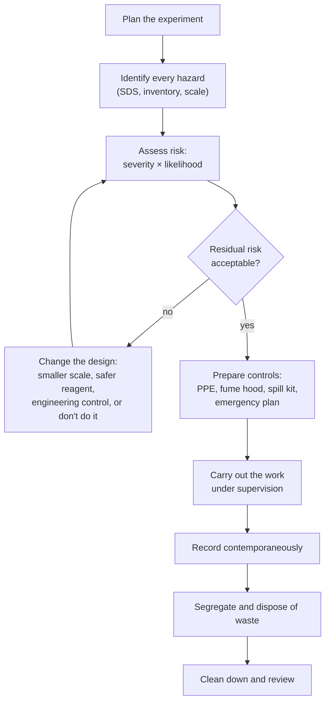
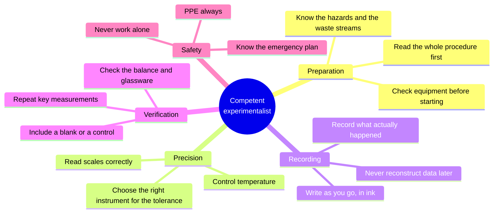

# Laboratory

> **Chemistry is an experimental science.** Everything in the textbook was discovered
> by someone measuring something. This section teaches the practical side: how to work
> safely, how to use equipment correctly, how to measure with justified confidence, and
> how to record what you did so that someone else could repeat it.

---

## ⚠️ Read this first

**Nothing in this section is a procedure you may carry out unsupervised.**

Every practical activity described here assumes:

- a trained supervisor or demonstrator is present;
- a written risk assessment has been completed and approved for your institution;
- you have read the safety data sheet (SDS) for every substance you will touch;
- you know the location of the eyewash, safety shower, fire extinguisher, fire
  blanket, spill kit and first-aid kit;
- you know how chemical waste is segregated and collected at your site.

If any of those is missing, stop. This repository explains the *science and the safety
principles*; it does not provide instructions for unsupervised or home experimentation,
and it deliberately omits procedures whose main value would be to someone trying to
reproduce hazardous chemistry without training.

**Figure 1 — The risk-management loop.** Note that the loop can send you back to
redesign, and that "do not do it" is a legitimate outcome of a risk assessment. The
order matters: hazards are identified *before* controls are chosen.

---

## Contents

| Page | What it covers |
|---|---|
| [Safety](safety/laboratory-safety.md) | Hazard classes, GHS, PPE, engineering controls, emergencies, waste |
| [Equipment](equipment/laboratory-equipment.md) | Glassware, balances, heating, measurement devices, care and calibration |
| [Techniques](techniques/laboratory-techniques.md) | Weighing, pipetting, titration, filtration, recrystallisation, distillation, extraction, drying |
| [Calculations](calculations/laboratory-calculations.md) | Preparing solutions, dilutions, yields, uncertainty propagation, reporting |
| [Documentation](documentation/laboratory-documentation.md) | Notebook practice, records, reports, data integrity, reproducibility |

---

## 1. Why practical work cannot be replaced by reading

Three things are learned only by doing.

**Technique.** Reading that a volumetric flask must be read at the bottom of the
meniscus, with the eye level with the mark, at 20 °C, does not stop you from
misreading it. Only practice, with feedback, does.

**Uncertainty intuition.** Textbooks state that a 25.00 cm³ pipette delivers
$25.00 \pm 0.03\ \mathrm{cm^3}$. Only experience teaches you that a hasty pipetting
adds an error ten times larger than the manufacturer's tolerance, and that this
dominates your final result.

**Judgement.** Real samples are dirty, colours are ambiguous, endpoints are fuzzy, and
the honest question "is this result good enough for the purpose?" has no formula.

---

## 2. The five habits of a competent experimentalist

**Figure 2 — The habits that separate a reliable measurement from a plausible one.**
Preparation and recording are habits, not talents; they can be trained.

---

## 3. Data integrity, in one paragraph

Record what happened, not what should have happened. If you dropped a sample, write
it down. If the balance drifted, write it down. If you ran out of time and used a
shorter heating period, write it down. Fabricating or "tidying" data is research
misconduct, and it destroys the only thing an experiment produces that has lasting
value: a trustworthy record. See [Level 10 chapter 10](../12-research-and-postgraduate-chemistry/10-research-ethics-and-scientific-writing.md).

---

## 4. How laboratory work connects to the curriculum

| Laboratory topic | Theory chapter |
|---|---|
| Weighing, significant figures | [Level 0 Ch. 9](../01-foundations/09-measurement-units-and-significant-figures.md) |
| Preparing a standard solution | [Level 2 Ch. 3](../03-intermediate-chemistry/03-solutions-concentration-and-dilution.md) |
| Acid–base titration | [Level 2 Ch. 11](../03-intermediate-chemistry/11-acid-base-chemistry-and-ph.md) · [Level 7 Ch. 6](../08-analytical-chemistry/06-titrations.md) |
| Redox titration | [Level 2 Ch. 12](../03-intermediate-chemistry/12-redox-reactions-and-electrochemistry-fundamentals.md) |
| Gravimetric analysis | [Level 7 Ch. 5](../08-analytical-chemistry/05-gravimetric-and-volumetric-analysis.md) |
| Chromatography | [Level 7 Ch. 7](../08-analytical-chemistry/07-chromatography.md) |
| Spectroscopy | [Level 3 Ch. 10](../04-advanced-chemistry/10-advanced-spectroscopy.md) |
| Electrochemistry | [Level 3 Ch. 8](../04-advanced-chemistry/08-electrochemical-cells-nernst-equation-and-electrolysis.md) |
| Uncertainty and statistics | [Level 7 Ch. 3](../08-analytical-chemistry/03-errors-uncertainty-and-statistical-data-treatment.md) |

---

## 5. A note for teachers and demonstrators

The laboratory pages are written to be projected or printed as pre-lab briefing
material. They state principles and failure modes rather than recipes, so that your
own institution's approved procedures remain the single source of instructions. The
checklists in [Documentation](documentation/laboratory-documentation.md) can be used
directly as pre-lab sign-off forms.
