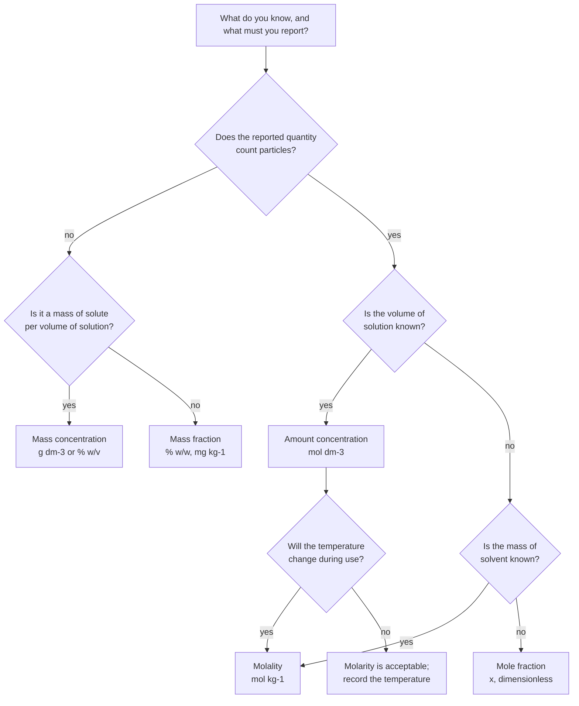
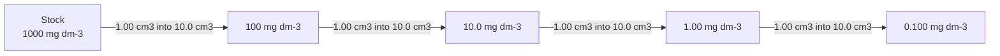
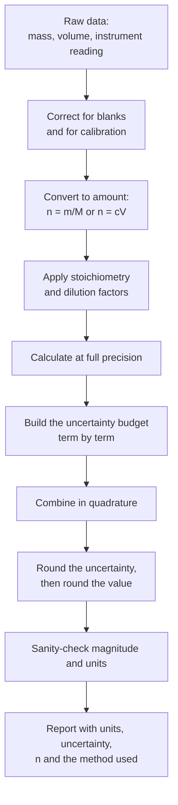

# Laboratory Calculations

> **Level:** Intermediate → University
> **Estimated study time:** 5 hours (reading) + 4 hours (exercises)
> **Prerequisites:** [Equipment](../equipment/laboratory-equipment.md) · [Techniques](../techniques/laboratory-techniques.md); Level 0 Ch. 9 (measurement, units and significant figures); Level 2 Ch. 3 (solutions, concentration and dilution)
> **Related chapters:** [Documentation](../documentation/laboratory-documentation.md)
> **Difficulty:** ★★★☆☆

> **Supervision and approval.** The calculations here support supervised practical work. They do not authorise the preparation of any solution or the handling of any reagent without a risk assessment, a trained supervisor and your institution's approval; several of the reagents used as examples are corrosive or toxic.

---

## 1. Learning objectives

After working through this chapter you will be able to:

- Prepare a solution from a solid or from a stock, and calculate the concentration actually obtained from the mass actually weighed.
- Convert between molarity, molality, mole fraction, mass fraction and mass concentration using density.
- Calculate theoretical and percentage yield, atom economy and the limiting reagent.
- Carry out direct, back- and blank-corrected titrations, and gravimetric factor calculations.
- Propagate uncertainty through addition, multiplication, powers and logarithms.
- Report a result with the correct number of significant figures and a defensible uncertainty.
- Apply the mean, standard deviation, confidence interval, Grubbs test and least-squares calibration, including LOD and LOQ.
- Calculate buffer composition for a target pH.

---

## 2. Introduction

Every number in a laboratory report is the end of a chain: a mass, a volume, a stoichiometric ratio, a molar mass, an instrument response. Each link carries an uncertainty, and the chain is only as strong as its weakest link. Calculation is therefore not bookkeeping that happens after the experiment; it is the part of the experiment where you discover whether the design can answer the question at all.

Three habits prevent most errors. **Carry units through every step** — an answer with the wrong units is a wrong answer, and dimensional analysis catches mistakes that arithmetic hides. **Keep full precision until the end**, then round once to the number of figures the uncertainty justifies. **Sanity-check the magnitude** before believing the result: a 0.1 mol dm⁻³ solution cannot weigh 250 g per litre unless the solute is heavy, and a yield of 340% means a wet product or a stoichiometry error, not a triumph.

| Symbol | Meaning | SI unit |
|---|---|---|
| $n$ | Amount of substance | mol |
| $m$ | Mass | kg (practical: g) |
| $M$ | Molar mass | kg mol⁻¹ (practical: g mol⁻¹) |
| $V$ | Volume | m³ (practical: dm³ = 10⁻³ m³) |
| $c$ | Amount concentration | mol m⁻³ (practical: mol dm⁻³) |
| $b$ | Molality | mol kg⁻¹ |
| $x$ | Mole fraction | dimensionless |
| $w$ | Mass fraction | dimensionless |
| $\rho$ | Density | kg m⁻³ (practical: g cm⁻³) |
| $u$ | Standard uncertainty | unit of the quantity |
| $s$ | Sample standard deviation | unit of the quantity |
| $t$ | Coverage factor from Student's $t$ | dimensionless |

---

## 3. Concentration and its several meanings

### 3.1 The three families

| Quantity | Definition | Typical unit | Depends on temperature? |
|---|---|---|---|
| **Amount concentration** (molarity) | $c = n/V_{\text{solution}}$ | mol dm⁻³ | Yes — the solution expands |
| **Molality** | $b = n/m_{\text{solvent}}$ | mol kg⁻¹ | No — masses do not change |
| **Mole fraction** | $x_i = n_i/\sum n$ | dimensionless | No |
| **Mass concentration** | $\rho_i = m_i/V_{\text{solution}}$ | g dm⁻³ | Yes |
| **Mass fraction** | $w_i = m_i/m_{\text{total}}$ | % w/w, mg kg⁻¹ | No |
| **Volume fraction** | $\phi_i = V_i/V_{\text{total}}$ | % v/v | Yes, and volumes are not additive |

Molarity is convenient and therefore dangerous: a 1.000 mol dm⁻³ solution prepared at 20 °C is about 0.998 mol dm⁻³ at 25 °C, because water expands by 2.1 × 10⁻⁴ K⁻¹. Molality, mole fraction and mass fraction do not have this problem, which is why they are preferred in physical chemistry and in work at controlled or varying temperature.

### 3.2 Conversions

From mass fraction and density to molarity:

$$
c = \frac{1000\,\rho\,w}{M}
$$

with $\rho$ in g cm⁻³, $w$ as a decimal mass fraction, $M$ in g mol⁻¹ and $c$ in mol dm⁻³.

From molality to molarity, for a solution containing 1 kg of solvent:

$$
c = \frac{b\,\rho}{1 + bM/1000}
$$

where $\rho$ is in g cm⁻³ and $M$ in g mol⁻¹; the denominator converts the solution mass to volume.

**Worked Example 3.1 — Molality to molarity.** A 0.500 mol kg⁻¹ sodium chloride solution has a density of 1.018 g cm⁻³. One kilogram of water contains 0.500 mol of $\ce{NaCl}$ (29.22 g), so the solution mass is 1029.22 g and its volume is $1029.22/1.018 = 1011.0$ cm³. Hence $c = 0.500/1.0110 = 0.4946$ mol dm⁻³. The 1% difference is large enough to matter in any equilibrium calculation.

**Worked Example 3.2 — Mole fraction.** A solution contains 0.500 mol of $\ce{NaCl}$ in 1.000 kg of water. Water is $1000/18.015 = 55.51$ mol, so the total is 56.01 mol and $x(\ce{NaCl}) = 0.500/56.01 = 8.93 \times 10^{-3}$. **Check:** the mole fraction of the solute equals its molality divided by 55.51 plus the molality, to within rounding, because 1 kg of water is always 55.51 mol.

**Figure 1 — Which concentration unit do I need?** The first branch separates counting quantities from mass quantities, and the temperature branch at the bottom is the one most often skipped: a molarity quoted without a temperature is an incomplete specification, while a molality or mass fraction is not. In routine analytical work the answer is usually molarity; in physical chemistry, electrochemistry and anything thermostatted, it is usually molality or mole fraction.

---

## 4. Preparing solutions from a solid

| Step | Calculation | Practical check |
|---|---|---|
| Target amount | $n = cV$ | Check the volume is the flask's nominal volume, not the volume of solvent added |
| Target mass | $m = nM$ | Use four-figure molar masses from IUPAC data |
| Actual mass | Weigh by difference | The result is the mass transferred, not the mass intended |
| Actual concentration | $c = m/(MV)$ | Report this value, not the nominal one |

**Worked Example 4.1 — Mass for a target molarity.** Prepare 250.0 cm³ of 0.1000 mol dm⁻³ $\ce{Na2CO3}$ ($M = 105.99$ g mol⁻¹). $n = 0.1000 \times 0.2500 = 0.02500$ mol, so $m = 0.02500 \times 105.99 = 2.6497$ g. Weighing 2.6512 g by difference gives $c = 2.6512/(105.99 \times 0.2500) = 0.10006$ mol dm⁻³. **Check:** 0.1% of 2.65 g is 2.6 mg, so the fourth decimal of the mass is already beyond the balance's reach.

**Worked Example 4.2 — Molarity from a weighed mass.** 1.2345 g of dried $\ce{K2Cr2O7}$ ($M = 294.18$ g mol⁻¹) is dissolved and made to 500.0 cm³. $n = 1.2345/294.18 = 4.1964 \times 10^{-3}$ mol, so $c = 4.1964 \times 10^{-3}/0.5000 = 8.393 \times 10^{-3}$ mol dm⁻³. **Check:** the mass has five significant figures and the volume four, so four are justified.

**Worked Example 4.3 — Mass concentration to molarity.** 5.00 g of glucose ($M = 180.16$ g mol⁻¹) made to 250.0 cm³ gives $\rho = 20.0$ g dm⁻³ and $c = 20.0/180.16 = 0.111$ mol dm⁻³. **Check:** a 0.111 mol dm⁻³ solution of a 180 g mol⁻¹ solute should contain about 20 g dm⁻³; the arithmetic is consistent.

---

## 5. Preparing solutions from a stock

The governing relation for dilution is conservation of amount:

$$
c_1 V_1 = c_2 V_2
$$

| Symbol | Meaning | Unit |
|---|---|---|
| $c_1$, $V_1$ | Concentration and volume of the stock taken | mol dm⁻³, dm³ |
| $c_2$, $V_2$ | Concentration and volume of the final solution | mol dm⁻³, dm³ |

*Assumption:* the volumes are additive and no reaction consumes the solute. Both fail for concentrated solutions — mixing 50 cm³ of ethanol with 50 cm³ of water gives about 96 cm³ — so volumetric work is always done by making *to the mark*, never by adding a calculated volume of solvent.

**Worked Example 5.1 — From a concentrated acid.** Hydrochloric acid is 37.0% w/w with $\rho = 1.19$ g cm⁻³ and $M = 36.46$ g mol⁻¹. Then $c = 1000 \times 1.19 \times 0.370/36.46 = 12.08$ mol dm⁻³. To prepare 1.000 dm³ of 1.000 mol dm⁻³, $V_1 = 1.000 \times 1.000/12.08 = 82.8$ cm³. **Check:** 82.8 cm³ of a 12 M acid diluted tenfold gives 1 M, as expected. Add the acid to water, never water to acid, and cool before making to the mark.

**Worked Example 5.2 — Diluting a standard.** 25.00 cm³ of 0.1000 mol dm⁻³ solution is made to 250.0 cm³. $c_2 = 0.1000 \times 25.00/250.0 = 0.01000$ mol dm⁻³. **Check:** a tenfold dilution must give a tenfold lower concentration, and it does.

**Worked Example 5.3 — A working standard in mg dm⁻³.** A certified stock contains 1000 mg dm⁻³ of lead. To prepare 100.0 cm³ of a 10.0 mg dm⁻³ working standard, $V_1 = 100.0 \times 10.0/1000 = 1.00$ cm³. **Check:** a 100-fold dilution of 1000 mg dm⁻³ gives 10 mg dm⁻³. Use a graduated pipette or a micropipette for the 1.00 cm³, not a Pasteur pipette.

---

## 6. Dilution and serial dilution

A single dilution multiplies the concentration by the ratio $V_1/V_2$. A **serial dilution** repeats that operation, and the errors multiply too: three successive 1-in-10 dilutions made with a 1% volumetric error each give a combined error of about 1.7%, not 1%.

**Figure 2 — A four-step serial dilution.** Each arrow is an independent dilution with its own uncertainty, and the cumulative dilution factor is the product of the individual factors — here $10^4$. Serial dilution conserves stock and covers a wide range, but it also multiplies volumetric errors and any contamination introduced at an early step is carried, diluted, into every later standard. Prepare the highest standard independently from the stock whenever the method allows it.

**Worked Example 6.1 — Cumulative factor.** Taking 1.00 cm³ into 10.0 cm³ four times multiplies the concentration by $(1.00/10.0)^4 = 1.0 \times 10^{-4}$. If the first transfer is 1.00 ± 0.02 cm³ and the flask is 10.0 ± 0.04 cm³, the first step alone has a relative uncertainty of 2.0%, and the final standard carries at least that, whatever the later steps do.

---

## 7. Density, specific gravity and temperature

**Density** is mass per volume, in g cm⁻³ or kg m⁻³. **Specific gravity** (relative density) is the ratio of a substance's density to that of water at 4 °C, and is numerically almost identical to density in g cm⁻³. **API gravity** and **Baumé** scales are industry conventions, not SI.

**Worked Example 7.1 — Concentrated ammonia.** Aqueous ammonia is 28.0% w/w with a specific gravity of 0.900. Then $c = 1000 \times 0.900 \times 0.280/17.03 = 14.8$ mol dm⁻³. **Check:** ammonia is lighter than water (0.900), so a litre weighs 900 g, of which 252 g is $\ce{NH3}$; dividing by 17.03 g mol⁻¹ gives about 14.8 mol. The arithmetic and the physical picture agree.

**Worked Example 7.2 — Temperature correction of a volume.** A 500.0 cm³ aqueous solution prepared at 15 °C is used at 25 °C. The water expansion term is about $2.1 \times 10^{-4} \times 10 = 2.1 \times 10^{-3}$, so the volume becomes about 501.1 cm³ and the concentration falls by 0.21%. **Check:** this is why molarity is quoted at a stated temperature, and why a 0.1% target cannot be met without temperature control.

---

## 8. Mass balance, yield and atom economy

### 8.1 Theoretical and percentage yield

$$
n_{\text{product}} = n_{\text{limiting reagent}} \times \frac{\text{stoichiometric coefficient of product}}{\text{stoichiometric coefficient of limiting reagent}}
$$

$$
\text{percentage yield} = \frac{m_{\text{actual}}}{m_{\text{theoretical}}} \times 100\%
$$

**Worked Example 8.1 — Aspirin.** Salicylic acid (5.00 g, $M = 138.12$ g mol⁻¹) is acetylated with excess acetic anhydride to aspirin ($M = 180.16$ g mol⁻¹). $n = 5.00/138.12 = 0.03620$ mol, so $m_{\text{theoretical}} = 0.03620 \times 180.16 = 6.522$ g. An actual yield of 5.42 g gives $5.42/6.522 = 83.1\%$. **Check:** a yield above 100% would indicate residual solvent or acetic acid, and the product should be dried and reweighed.

### 8.2 Atom economy

$$
\text{atom economy} = \frac{M_{\text{desired product}}}{\sum M_{\text{all products}}} \times 100\%
$$

**Worked Example 8.2 — Aspirin, atom economy.** The reaction is

$$
\ce{C7H6O3 + C4H6O3 -> C9H8O4 + C2H4O2}
$$

so the atom economy is $180.16/(180.16 + 60.05) = 75.0\%$. **Check:** 25% of the product mass is lost as acetic acid by design; a catalytic acylation or an acid chloride with base would change that figure, which is why atom economy is a greener-chemistry metric rather than a laboratory convenience.

### 8.3 Limiting reagent in practice

**Worked Example 8.3 — Zinc and acid.** 5.00 g of zinc ($M = 65.38$ g mol⁻¹) is added to 100.0 cm³ of 1.00 mol dm⁻³ $\ce{HCl}$:

$$
\ce{Zn(s) + 2HCl(aq) -> ZnCl2(aq) + H2(g)}
$$

$n(\ce{Zn}) = 5.00/65.38 = 0.0765$ mol requires 0.153 mol of acid, but only 0.100 mol is present, so $\ce{HCl}$ is limiting. Hydrogen: $n = 0.100/2 = 0.0500$ mol, $m = 0.0500 \times 2.016 = 0.101$ g, and at 298 K and 100 kPa, $V = nRT/p = 1.24$ dm³. **Check:** 0.05 mol of gas at about 24 dm³ mol⁻¹ is 1.2 dm³, consistent.

### 8.4 Mass balance

The mass balance is the accountant's check on a reaction: total mass in equals total mass out, including solvent, filter aids and waste. A work-up that appears to gain 20 g has either absorbed water, retained solvent, or lost track of a stream. Record the mass of every stream in the notebook, and reconcile them before the material is discarded.

---

## 9. Titration calculations

For a reaction $a\,\mathrm{A} + b\,\mathrm{B} \rightarrow$ products, with A the titrant:

$$
c_{\mathrm{B}} = \frac{a}{b} \cdot \frac{c_{\mathrm{A}} V_{\mathrm{A}}}{V_{\mathrm{B}}}
$$

**Worked Example 9.1 — Direct titration.** 25.00 cm³ of sodium hydroxide solution is titrated with hydrochloric acid, mean titre 24.35 cm³ (blank 0.05 cm³, corrected 24.30 cm³), $c(\ce{HCl}) = 0.1000$ mol dm⁻³. Since the stoichiometry is 1:1, $c(\ce{NaOH}) = 0.1000 \times 24.30/25.00 = 0.09720$ mol dm⁻³. **Check:** the titre is slightly less than the aliquot, so the base must be slightly weaker than the acid; 0.0972 is consistent.

**Worked Example 9.2 — Back-titration.** The calcium carbonate in a 1.500 g tablet is dissolved in 50.00 cm³ of 0.5000 mol dm⁻³ $\ce{HCl}$ (25.00 mmol) and the excess acid is back-titrated with 12.40 cm³ of 0.2500 mol dm⁻³ $\ce{NaOH}$ (3.100 mmol). Acid consumed by the carbonate: $25.00 - 3.10 = 21.90$ mmol. From $\ce{CaCO3 + 2HCl -> CaCl2 + CO2 + H2O}$, $n(\ce{CaCO3}) = 21.90/2 = 10.95$ mmol, $m = 10.95 \times 100.09 = 1.096$ g, so the tablet is $1.096/1.500 = 73.1\%$ calcium carbonate. **Check:** the back-titration consumes less than a quarter of the acid, so the excess was adequate and the endpoint is well defined.

**Worked Example 9.3 — Titration with a dilution factor.** A 2.500 g sample is dissolved and made to 250.0 cm³; 25.00 cm³ of that solution is titrated and requires 18.42 cm³ of 0.05000 mol dm⁻³ $\ce{AgNO3}$ for a 1:1 reaction. The aliquot contains $0.05000 \times 0.01842 = 9.210 \times 10^{-4}$ mol of analyte, so the flask contains $9.210 \times 10^{-4} \times 10 = 9.210 \times 10^{-3}$ mol. For $M = 58.44$ g mol⁻¹ that is 0.5382 g, or 21.5% of the sample. **Check:** the dilution factor of 10 is applied once, to the aliquot, not to the titre; applying it to the concentration instead would give the same answer, but applying it twice is the commonest error in this calculation.

---

## 10. Gravimetric calculations

A gravimetric factor converts the mass of a weighed precipitate into the mass of the analyte it contains:

$$
\text{GF} = \frac{a\,M_{\text{analyte}}}{M_{\text{precipitate}}}
$$

where $a$ is the number of analyte atoms in one formula unit of the precipitate.

**Worked Example 10.1 — Sulfur as barium sulfate.** A 1.0000 g sample gives 0.5421 g of $\ce{BaSO4}$ ($M = 233.39$ g mol⁻¹); sulfur has $M = 32.06$ g mol⁻¹ and $a = 1$. Then $\mathrm{GF} = 32.06/233.39 = 0.1374$, $m(\ce{S}) = 0.5421 \times 0.1374 = 0.07447$ g, and the sample contains 7.447% sulfur. **Check:** sulfate is 13.7% sulfur by mass, and 0.54 g of precipitate should contain about 74 mg of sulfur — consistent.

---

## 11. Calorimetry and heat-loss correction

For a bomb calorimeter of energy equivalent $C$:

$$
q = C\,\Delta T_{\text{corrected}} - e_1 - e_2
$$

| Symbol | Meaning | Unit |
|---|---|---|
| $q$ | Heat released by the sample | J |
| $C$ | Energy equivalent of the calorimeter | J K⁻¹ |
| $\Delta T_{\text{corrected}}$ | Temperature rise after correction for heat loss | K |
| $e_1$, $e_2$ | Corrections for the fuse wire and for nitric acid formation | J |

The correction for heat exchange with the surroundings is made graphically. Plot temperature against time, fit the pre-reaction and post-reaction cooling lines, and draw a vertical line at the time corresponding to the midpoint of the temperature rise; the corrected $\Delta T$ is the distance between the two fitted lines at that time. This is the **Regnault–Pfaundler** method, and it assumes a constant cooling coefficient over the small temperature interval involved.

**Worked Example 11.1 — Calibration and sample.** Burning 0.5000 g of benzoic acid (26.454 kJ g⁻¹) gives $\Delta T = 1.268$ K with corrections of 0.012 kJ (fuse) and 0.008 kJ ($\ce{HNO3}$). Then $q = 13.227 - 0.012 - 0.008 = 13.207$ kJ and $C = 13.207/1.268 = 10.416$ kJ K⁻¹. A 0.7500 g sample gives $\Delta T = 1.745$ K with a correction of 0.020 kJ, so $q = 10.416 \times 1.745 - 0.020 = 18.155$ kJ and the heat of combustion is $18.155/0.7500 = 24.21$ kJ g⁻¹. **Check:** the sample releases slightly less energy per gram than benzoic acid, which is typical for a carbohydrate-rich solid.

---

## 12. Uncertainty propagation

### 12.1 Rules

| Operation | Relation | Combined standard uncertainty |
|---|---|---|
| Sum or difference | $y = a \pm b$ | $u_y = \sqrt{u_a^2 + u_b^2}$ |
| Product or quotient | $y = ab$ or $a/b$ | $u_y/y = \sqrt{(u_a/a)^2 + (u_b/b)^2}$ |
| Power | $y = a^n$ | $u_y/y = \lvert n \rvert\,u_a/a$ |
| Logarithm (base 10) | $y = \log_{10} a$ | $u_y = 0.434\,u_a/a$ |
| Antilogarithm | $y = 10^{a}$ | $u_y/y = 2.303\,u_a$ |
| Multiplication by a constant | $y = ka$ | $u_y = k\,u_a$ |
| Mean of $n$ measurements | $y = \bar{a}$ | $u_y = s/\sqrt{n}$ |

These are first-order (linear) approximations valid when the relative uncertainties are small, below about 10%. Correlated errors — a shared balance, a shared volumetric flask, a calibration slope — must not be combined as if independent; where correlation exists, the covariance term is required.

### 12.2 Worked examples for each operation

**Worked Example 12.1 — Addition.** $(25.00 \pm 0.03) + (10.00 \pm 0.02) = 35.00 \pm \sqrt{0.03^2 + 0.02^2} = 35.00 \pm 0.04$ cm³. **Check:** the combined uncertainty is always larger than either component but smaller than their sum.

**Worked Example 12.2 — Multiplication and division.** A standard contains $2.500 \pm 0.002$ mmol in $250.0 \pm 0.15$ cm³. Then $c = 2.500 \times 10^{-3}/0.2500 = 0.01000$ mol dm⁻³, and $u_{\mathrm{r}} = \sqrt{(0.002/2.500)^2 + (0.15/250.0)^2} = \sqrt{8.0 \times 10^{-7} + 3.6 \times 10^{-7}} = 1.08 \times 10^{-3}$, so $u = 1.1 \times 10^{-5}$ mol dm⁻³ and $c = 0.01000 \pm 0.00001$ mol dm⁻³. **Check:** 0.1% of 0.01 is 0.00001, consistent.

**Worked Example 12.3 — Power.** The volume of a sphere is $V = \frac{4}{3}\pi r^3$ with $r = 2.50 \pm 0.05$ cm. Then $u_{\mathrm{r}}(V) = 3 \times 0.05/2.50 = 0.060$, $V = 65.4$ cm³ and $u = 3.9$ cm³, so $V = 65.4 \pm 3.9$ cm³. **Check:** a 2% radius error becomes a 6% volume error, exactly as the cube-law exponent requires.

**Worked Example 12.4 — Logarithm.** A hydrogen ion activity of $(1.00 \pm 0.02) \times 10^{-7}$ gives $\mathrm{pH} = 7.00$ and $u(\mathrm{pH}) = 0.434 \times 0.02 = 0.009$. **Check:** a 2% error in activity is almost invisible on the pH scale, which is why pH is quoted to 0.01 but rarely to 0.001.

**Worked Example 12.5 — A titration budget.** Titre $24.35 \pm 0.05$ cm³, aliquot $25.00 \pm 0.03$ cm³, titrant $0.1000 \pm 0.0002$ mol dm⁻³. Then $c = 0.1000 \times 24.35/25.00 = 0.09740$ mol dm⁻³ and $u_{\mathrm{r}} = \sqrt{(0.05/24.35)^2 + (0.03/25.00)^2 + (0.0002/0.1000)^2} = 0.31\%$, so $c = 0.0974 \pm 0.0003$ mol dm⁻³. **Check:** the burette term dominates, as the equipment chapter predicts.

### 12.3 Significant figures in reported results

1. Round the uncertainty to one or two significant figures — one is enough unless the first digit is 1 or 2.
2. Round the value to the same decimal place as the uncertainty.
3. Keep full precision in intermediate calculations; round only at the end.
4. In addition and subtraction, the result has the decimal place of the least precise term; in multiplication and division, the number of significant figures of the least precise factor.
5. A logarithm has as many decimal places as the original number had significant figures: $\log_{10}(2.46 \times 10^{-5}) = -4.609$.
6. Counted numbers and defined constants are exact and do not limit the result.
7. Do not over-report: 0.09742 ± 0.0003 should be written 0.0974 ± 0.0003, or (9.74 ± 0.03) × 10⁻².

**Figure 3 — From raw data to a reported result.** The two steps most often skipped are the blank correction and the uncertainty budget: without them a result looks precise and is not. Note that rounding happens last, after the uncertainty has been calculated, so that the reported value and its uncertainty are expressed to the same decimal place.

---

## 13. Statistical treatment

### 13.1 Mean, standard deviation and confidence interval

$$
\bar{x} = \frac{\sum x_i}{n} \qquad s = \sqrt{\frac{\sum (x_i - \bar{x})^2}{n-1}} \qquad \text{CI} = \bar{x} \pm \frac{t s}{\sqrt{n}}
$$

**Worked Example 13.1 — Iron in an ore.** Six determinations give 10.12, 10.15, 10.09, 10.14, 10.11 and 10.13% Fe. Then $\bar{x} = 10.123\%$, $s = 0.0216\%$, and with $t = 2.571$ for five degrees of freedom at 95% confidence, $\text{CI} = 10.123 \pm 2.571 \times 0.0216/\sqrt{6} = 10.123 \pm 0.023\%$. **Check:** the confidence interval is about twice the standard deviation of a single measurement divided by √6, as expected for $n = 6$.

### 13.2 Rejection of outliers: the Grubbs test

$$
G = \frac{|x_{\text{suspect}} - \bar{x}|}{s}
$$

Compare $G$ with the critical value for the sample size and confidence level; for $n = 7$ at 95% confidence (two-sided) the critical value is 2.020.

**Worked Example 13.2 — A borderline outlier.** Adding 10.02% to the data above gives $n = 7$, $\bar{x} = 10.109\%$ and $s = 0.0438\%$, so $G = |10.02 - 10.109|/0.0438 = 2.02$. This just exceeds the critical value of 2.020. **Check:** the test is marginal, and a result that sits exactly on the critical value should be investigated, not deleted. A statistical test is never a licence to remove inconvenient data; it flags a point for examination.

### 13.3 Least-squares calibration, $r^2$, LOD and LOQ

For $n$ standards with responses $y_i$ at concentrations $x_i$:

$$
m = \frac{n\sum x_i y_i - \sum x_i \sum y_i}{n\sum x_i^2 - (\sum x_i)^2} \qquad b = \bar{y} - m\bar{x} \qquad r^2 = 1 - \frac{\sum (y_i - \hat{y}_i)^2}{\sum (y_i - \bar{y})^2}
$$

| Quantity | Definition | Use |
|---|---|---|
| $s_{y/x}$ | Standard deviation of the residuals about the fitted line | Estimate of the measurement noise |
| $r^2$ | Fraction of the variance in $y$ explained by the line | A fit diagnostic, not a proof of linearity |
| **LOD** | $3.3\,s_{y/x}/m$, or $3s_{\text{blank}}/m$ | Concentration giving a signal distinguishable from the blank |
| **LOQ** | $10\,s_{y/x}/m$, or $10s_{\text{blank}}/m$ | Concentration that can be quantified with acceptable precision |

**Worked Example 13.3 — A spectrophotometric calibration.** Standards at 0, 2, 4, 6, 8 and 10 mg dm⁻³ give absorbances 0.040, 0.220, 0.408, 0.590, 0.779 and 0.965. Least squares gives $A = 0.09263c + 0.03719$, $r^2 = 0.99996$ and $s_{y/x} = 0.00253$. Then $\mathrm{LOD} = 3.3 \times 0.00253/0.09263 = 0.090$ mg dm⁻³ and $\mathrm{LOQ} = 10 \times 0.00253/0.09263 = 0.27$ mg dm⁻³. **Check:** a sample reading 0.500 corresponds to $c = (0.500 - 0.037)/0.0926 = 5.00$ mg dm⁻³, comfortably between LOQ and the top standard.

### 13.4 Comparing two means

When two methods or two analysts are compared, the pooled standard deviation and the $t$ statistic answer the question "is the difference larger than the scatter?":

$$
s_{\text{pooled}} = \sqrt{\frac{(n_1-1)s_1^2 + (n_2-1)s_2^2}{n_1+n_2-2}} \qquad t = \frac{|\bar{x}_1 - \bar{x}_2|}{s_{\text{pooled}}\sqrt{1/n_1 + 1/n_2}}
$$

Compare $t$ with the critical value for $n_1 + n_2 - 2$ degrees of freedom. A calculated $t$ below the critical value means the difference is not significant at the chosen confidence level — which is not the same as proving the methods identical, only that the data do not distinguish them.

| Test | Question it answers | Assumption |
|---|---|---|
| **Grubbs** | Is one point inconsistent with the rest? | Approximately normal data |
| **Paired $t$** | Do two methods differ on the same samples? | Paired differences approximately normal |
| **Unpaired $t$** | Do two methods differ on average? | Independent data, similar variances |
| **$F$ test** | Are two variances different? | Normal data |
| **Least squares** | Does the response vary linearly with concentration? | Constant variance, independent errors |

---

## 14. Buffers and pH adjustment

For a weak acid and its conjugate base:

$$
\mathrm{pH} = \mathrm{p}K_{\mathrm{a}} + \log_{10}\frac{[\ce{A-}]}{[\ce{HA}]}
$$

**Worked Example 14.1 — A phosphate buffer at pH 7.40.** With $\mathrm{p}K_{\mathrm{a}2} = 7.20$ for dihydrogen phosphate, the required ratio is $10^{7.40-7.20} = 1.585$. For a total phosphate concentration of 0.0500 mol dm⁻³ in 250.0 cm³, $[\ce{HPO4^2-}] = 0.0500 \times 1.585/2.585 = 0.0307$ mol dm⁻³ and $[\ce{H2PO4-}] = 0.0193$ mol dm⁻³. The masses are $0.0307 \times 0.2500 \times 141.96 = 1.088$ g of $\ce{Na2HPO4}$ and $0.0193 \times 0.2500 \times 119.98 = 0.580$ g of $\ce{NaH2PO4}$. **Check:** the ratio 0.0307/0.0193 = 1.59 matches the target, and the buffer is most effective within about one pH unit of its $\mathrm{p}K_{\mathrm{a}}$, which this is.

Adjustment in practice: a buffer is made by dissolving the calculated masses in about 80% of the final volume, checking the pH, adjusting with concentrated acid or base, and then making to the mark. Adding strong acid converts $\ce{A-}$ to $\ce{HA}$ stoichiometrically, so the composition after adjustment is calculated, not guessed. Report the measured pH and the temperature, because $\mathrm{p}K_{\mathrm{a}}$ is temperature-dependent.

---

## 15. Unit conversion table

| From | To | Multiply by |
|---|---|---|
| cm³ | dm³ | 1 × 10⁻³ |
| dm³ (litre) | m³ | 1 × 10⁻³ |
| cm³ | m³ | 1 × 10⁻⁶ |
| mol dm⁻³ | mol m⁻³ | 1 × 10³ |
| mol dm⁻³ | mmol cm⁻³ | 1 |
| g cm⁻³ | kg m⁻³ | 1 × 10³ |
| mg dm⁻³ | g m⁻³ | 1 |
| mg dm⁻³ | ppm (dilute aqueous) | 1 |
| µg cm⁻³ | mg dm⁻³ | 1 |
| ppb | ppm | 1 × 10⁻³ |
| ppm | % | 1 × 10⁻⁴ |
| % w/w | g kg⁻¹ | 10 |
| mmHg | Pa | 133.322 |
| atm | Pa | 101 325 |
| bar | Pa | 1 × 10⁵ |
| psi | Pa | 6894.76 |
| cal | J | 4.184 |
| kcal | kJ | 4.184 |
| eV | J | 1.602 176 634 × 10⁻¹⁹ |
| Å | nm | 0.1 |
| degree | radian | π/180 |
| °C | K | add 273.15 |

---

## 16. Common mistakes

| Mistake | Why it happens | Correct approach |
|---|---|---|
| Using the volume of solvent added rather than the final volume | "I added 250 cm³" | Make to the mark in a volumetric flask; the volume is the flask's |
| Forgetting the molar mass of a hydrate | The formula is written without water | $\ce{CuSO4.5H2O}$ is 249.68, not 159.61 g mol⁻¹ |
| Treating a nominal concentration as exact | The label says 0.1000 | Report the concentration from the mass actually weighed |
| Ignoring density when converting % w/w to molarity | The percentage looks like a concentration | $c = 1000\rho w/M$ |
| Adding volumes of ethanol and water as if additive | Volumes contract on mixing | Make to the mark; never add a calculated solvent volume |
| A yield above 100% reported as excellent | Enthusiasm | The product is wet or impure; dry and reweigh |
| Propagating uncertainty by adding absolute values | It seems conservative | Combine in quadrature; correlated terms need covariance |
| Reporting 0.097423 ± 0.0003 | Calculator output copied without thought | Round to the uncertainty: 0.0974 ± 0.0003 |
| Deleting an outlier because the average "looks better" | Pressure to agree | Investigate, then apply a stated test such as Grubbs |
| Using $r^2 = 0.999$ as proof of linearity | It is the number the software shows | Plot residuals; check the working range |

---

## 17. Summary

- Concentration is a family of quantities; molarity depends on temperature, molality and mass fraction do not.
- $c = 1000\rho w/M$ converts a mass fraction and a density into a molarity.
- Prepare solutions to the mark; report the concentration from the mass actually transferred.
- Serial dilution multiplies both the dilution factor and the relative volumetric error.
- Yield, atom economy and the limiting reagent answer different questions and are not interchangeable.
- A back-titration measures what the analyte consumed, not what was added.
- A gravimetric factor converts precipitate mass into analyte mass through molar masses and stoichiometry.
- Calorimetry needs a calibration with a certified standard and a correction for heat exchange.
- Uncertainties combine in quadrature for sums and products, as powers for powers, and through the 0.434 factor for logarithms.
- Report results with the uncertainty first, then the value to the same decimal place.
- Statistics describes variability; it does not excuse deleting data.
- Buffers are designed from the Henderson–Hasselbalch relation and confirmed by measurement.

---

## 18. Exercises

1. Calculate the mass of $\ce{KMnO4}$ ($M = 158.03$ g mol⁻¹) needed for 500.0 cm³ of 0.02000 mol dm⁻³ solution.
2. A solution contains 12.0 g dm⁻³ of $\ce{NaOH}$ ($M = 40.00$ g mol⁻¹). What is its molarity?
3. Concentrated sulfuric acid is 98.0% w/w with $\rho = 1.84$ g cm⁻³. Calculate its molarity and the volume needed for 500.0 cm³ of 0.500 mol dm⁻³.
4. 2.500 g of an impure sample yields 1.850 g of product of $M = 150.0$ g mol⁻¹ from a reaction with a 1:1 stoichiometry and a limiting reagent of $M = 100.0$ g mol⁻¹ present as 80.0% w/w. Calculate the theoretical yield and the percentage yield.
5. 20.00 cm³ of 0.05000 mol dm⁻³ $\ce{Fe^2+}$ is titrated with 0.02000 mol dm⁻³ $\ce{KMnO4}$ in acid. Given the stoichiometry $\ce{MnO4- + 5Fe^2+ + 8H+ -> Mn^2+ + 5Fe^3+ + 4H2O}$, calculate the expected titre.
6. Calculate the combined standard uncertainty of $c = m/(MV)$ for $m = 0.2500 \pm 0.0002$ g, $M = 100.00$ g mol⁻¹ (exact to five figures) and $V = 100.0 \pm 0.10$ cm³.
7. Four measurements of a concentration are 0.512, 0.518, 0.509 and 0.515 mol dm⁻³. Calculate the mean, the standard deviation and the 95% confidence interval ($t = 3.182$).
8. A calibration gives $A = 0.0450c + 0.010$ with $s_{y/x} = 0.0030$. Calculate LOD and LOQ, and state whether a sample reading $A = 0.150$ is above the LOQ.

---

## 19. Answers

1. $n = 0.02000 \times 0.5000 = 0.01000$ mol; $m = 0.01000 \times 158.03 = 1.580$ g.
2. $c = 12.0/40.00 = 0.300$ mol dm⁻³.
3. $c = 1000 \times 1.84 \times 0.980/98.08 = 18.4$ mol dm⁻³; $V_1 = 0.500 \times 0.5000/18.4 = 0.0136$ dm³, that is 13.6 cm³.
4. Limiting reagent: $2.500 \times 0.800 = 2.000$ g, $n = 2.000/100.0 = 0.02000$ mol. Theoretical product $= 0.02000 \times 150.0 = 3.000$ g. Yield $= 1.850/3.000 = 61.7\%$.
5. $n(\ce{Fe^2+}) = 0.02000 \times 0.05000 = 1.000$ mmol; $n(\ce{MnO4-}) = 1.000/5 = 0.2000$ mmol; $V = 0.2000/0.02000 = 10.00$ cm³.
6. $c = 0.2500/(100.00 \times 0.1000) = 0.02500$ mol dm⁻³; $u_{\mathrm{r}} = \sqrt{(0.0002/0.2500)^2 + (0.10/100.0)^2} = \sqrt{6.4 \times 10^{-7} + 1.0 \times 10^{-6}} = 1.28 \times 10^{-3}$; $u = 3.2 \times 10^{-5}$ mol dm⁻³, so $c = 0.02500 \pm 0.00003$ mol dm⁻³.
7. $\bar{x} = 0.5135$ mol dm⁻³; $s = 0.00387$ mol dm⁻³; CI $= 0.5135 \pm 3.182 \times 0.00387/2 = 0.5135 \pm 0.0062$ mol dm⁻³.
8. $\mathrm{LOD} = 3.3 \times 0.0030/0.0450 = 0.22$; $\mathrm{LOQ} = 10 \times 0.0030/0.0450 = 0.67$. A reading of 0.150 corresponds to $c = (0.150 - 0.010)/0.0450 = 3.1$, which is above the LOQ.

---

## 20. Further reading

- Harris, D. C. and Lucy, C. A. *Quantitative Chemical Analysis*, 10th ed. W. H. Freeman, 2019 — the standard treatment of calculations, error and statistics.
- Skoog, D. A., West, D. M., Holler, F. J. and Crouch, S. R. *Fundamentals of Analytical Chemistry*, 9th ed. Cengage, 2013.
- Eurachem. *Quantifying Uncertainty in Analytical Measurement* (QUAM), 3rd ed., 2012. <https://www.eurachem.org/>
- Eurachem. *The Fitness for Purpose of Analytical Methods: A Laboratory Guide to Method Validation and Related Topics*, 2nd ed., 2014. <https://www.eurachem.org/>
- International Organization for Standardization. *ISO/IEC Guide 98-3: Uncertainty of measurement — Part 3: Guide to the expression of uncertainty in measurement (GUM:1995)*.
- International Organization for Standardization. *ISO 5725: Accuracy (trueness and precision) of measurement methods and results*.
- NIST. *CODATA Internationally Recommended Values of the Fundamental Physical Constants*. <https://physics.nist.gov/cuu/Constants/>
- IUPAC. *Quantities, Units and Symbols in Physical Chemistry* (the "Green Book"), 3rd ed. Royal Society of Chemistry, 2007.
