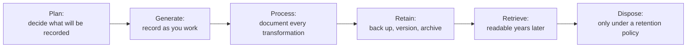
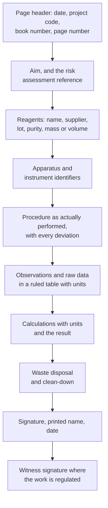
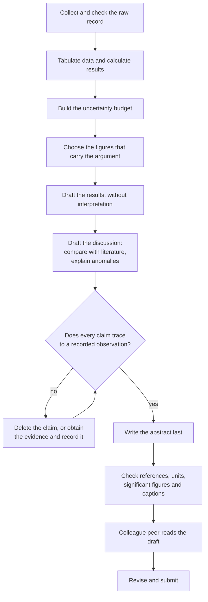

# Laboratory Documentation

> **Level:** Beginner → University
> **Estimated study time:** 3 hours (reading) + 2 hours (exercises)
> **Prerequisites:** [Laboratory Safety](../safety/laboratory-safety.md) · [Techniques](../techniques/laboratory-techniques.md)
> **Related chapters:** [Equipment](../equipment/laboratory-equipment.md) · [Calculations](../calculations/laboratory-calculations.md)
> **Difficulty:** ★★☆☆☆

> **Scope.** This chapter describes how records are made and kept. It does not replace your institution's data-integrity policy, its records-retention schedule or its code of research conduct, all of which take precedence over anything written here.

---

## 1. Learning objectives

After working through this chapter you will be able to:

- Explain why a laboratory record is simultaneously a scientific instrument, a legal document and an ethical statement.
- Keep a bound notebook to the standard expected in regulated and patent work.
- Write an entry that another competent person could repeat without asking you a question.
- Apply the ALCOA+ principles to paper and electronic records.
- Structure a laboratory report and judge it against a marking rubric.
- Present figures and tables with units, error bars, captions and appropriate significant figures.
- Cite sources honestly, state data availability, and record deviations without concealing them.

---

## 2. Introduction

An experiment that is not recorded did not happen. It may have produced a beautiful number, but the number cannot be checked, reproduced, defended or used, and in a regulated environment it does not exist. Documentation is therefore not administration that follows the science; it is the part of the science that makes the rest of it durable.

Three interests meet in a laboratory record, and a good record satisfies all three at once:

- **Scientific.** Another competent person must be able to repeat the work, including its flaws, and obtain a result they can interpret.
- **Legal and regulatory.** Records support patent priority, regulatory submissions, forensic evidence and occupational-health investigations. Regulated laboratories work under written data-integrity requirements, and the record may be audited years after the experiment.
- **Ethical.** Honest recording is the foundation of research integrity. Fabrication, falsification and selective reporting all begin with a record that was quietly tidied.

**Figure 1 — The record lifecycle.** Each stage constrains the next: a decision made at the planning stage about what to record determines what can be processed later, and a processing step that is not documented cannot be reconstructed at the retrieval stage. Notice that disposal is a policy decision at the end, not an accident at the beginning.

---

## 3. Why records matter

| Purpose | Who uses the record | Consequence of a poor record |
|---|---|---|
| **Reproducibility** | Another researcher, a reviewer, your future self | The work cannot be repeated or defended |
| **Verification** | Supervisor, auditor, regulator | The result is treated as unsupported |
| **Traceability** | Quality assurance, supplier investigation | A faulty lot or instrument cannot be identified |
| **Legal priority** | Patent office, court | Loss of a claim that the work was done when stated |
| **Safety** | Occupational health, incident investigation | Exposure history cannot be reconstructed |
| **Teaching and assessment** | Demonstrator, examiner | Technique cannot be distinguished from luck |

The strongest argument is the simplest: **you will not remember**. Six months after an experiment, the difference between "the solution turned yellow after 5 min" and "the solution turned yellow after 30 min" is invisible in memory and decisive in interpretation. The notebook is written for the person you will be when you have forgotten.

---

## 4. The bound notebook

A bound notebook with numbered, non-removable pages is the default record for bench work. Loose sheets, notebooks with perforated pages and personal phones are not acceptable substitutes in any setting where the record may be audited.

| Rule | What it means in practice | Why |
|---|---|---|
| **Indelible ink** | Blue or black ballpoint or pigment pen; never pencil, never erasable ink | Pencil can be altered without trace |
| **Sequential pages** | Every page numbered; no pages removed, even spoiled ones | Gaps invite suspicion and destroy continuity |
| **No erasure** | No correction fluid, no overwriting, no tearing out | The history of the record is part of the record |
| **Single-line strike-through** | One line through the error, then the correction, initials and date | Shows what was changed, by whom and when |
| **Dated and signed** | Date and signature at the start or end of every working session | Establishes when the work was done |
| **Witnessed where required** | A second person signs for regulated, patent or high-value work | Corroborates the record independently |
| **Contemporaneous** | Written as the work proceeds, not reconstructed afterwards | Memory is not evidence |
| **Blank space struck out** | A diagonal line through unused space, initialled | Prevents later additions |
| **Units everywhere** | Every number carries its unit; every table names its columns | A bare number is uninterpretable |
| **Cross-references** | Instrument printouts, photographs and spectra are labelled and pasted or filed with a reference | The record must be self-contained |

**Procedure 4.1 — correcting an error in a bound notebook.**

1. Draw a single horizontal line through the incorrect text so that it remains legible.
2. Write the correct entry beside or below it, in the same ink.
3. Add your initials and the date next to the correction.
4. If the correction changes a calculated result, recalculate in the notebook showing the new working, and mark the superseded result as superseded, not as deleted.
5. If the error affects a result already reported, record the correction and inform the supervisor; a silent correction is a data-integrity failure.

**Figure 2 — Anatomy of a notebook page.** The order is the order of the work, not the order of the report: observations precede calculations, and the deviations sit beside the step they modified rather than in a separate section. The witness signature at the end is not decoration — it is the only independent evidence that the page was complete when it was signed.

---

## 5. What a complete entry contains

| Element | Minimum content | Typical failure |
|---|---|---|
| **Aim** | One or two sentences stating what is being measured and why | A copy of the method title |
| **Risk assessment reference** | Document number and date, plus any local amendments | "See folder" |
| **Reagents** | Name, supplier, grade, lot number, purity, mass or volume, and the balance used | "NaOH, some" |
| **Apparatus** | Equipment identifiers, glassware class, instrument serial numbers | "the UV machine" |
| **Procedure** | What was actually done, in the order done, with times and temperatures | A photocopy of the manual with no annotations |
| **Observations** | Colour, odour, gas evolution, precipitate, temperature, anomalies | Only the numbers that "worked" |
| **Raw data** | Every reading, in a ruled table, with units and the number of replicates | Averages only, with the individual readings lost |
| **Calculations** | The equation, the substituted values, the result with units | A result with no working |
| **Deviations** | What departed from the plan and why | Silence |
| **Waste** | Stream, container label and fate | "Put in the waste" |
| **Signature and date** | Name, signature, date, and time where relevant | Initials only |

**Worked Example 5.1 — A model notebook entry.** The following entry is complete enough for another analyst to repeat the determination.

> **2026-03-11, page 42. Project: acidity of retail vinegar (batch V-07). RA-2026-018 rev. 2.**
> **Aim.** Determine the acetic acid content of three retail vinegars by titration with standardised sodium hydroxide, to compare with the declared label value.
> **Reagents.** Vinegar samples V-07a, V-07b, V-07c (opened 2026-03-11, stored at 4 °C); $\ce{NaOH}$ 0.1002 mol dm⁻³ (lot 24F-118, standardised 2026-03-04 against potassium hydrogen phthalate, mean of three: 0.10024 mol dm⁻³); phenolphthalein 0.1% in ethanol (lot 24A-002).
> **Apparatus.** Class A 25.00 cm³ pipette (cert. 24-1187); Class A 50 cm³ burette (cert. 24-2044); balance AB-3, daily check passed 08:42.
> **Procedure.** 25.00 cm³ of each sample pipetted into a 250 cm³ conical flask, diluted to 100 cm³, 3 drops of indicator added, titrated to the first permanent pink (30 s). Blank of 100 cm³ distilled water plus indicator: 0.04 cm³.
> **Observations.** V-07a and V-07b colourless; V-07c pale amber, endpoint harder to judge (noted). Ambient 21.5 °C. No bubbles in the burette tip after refilling.
> **Raw data.** V-07a: 17.42, 17.40, 17.44 cm³; V-07b: 16.88, 16.90, 16.86 cm³; V-07c: 18.10, 18.16, 18.09 cm³.
> **Calculation.** The reaction is
>
> $$ \ce{CH3COOH(aq) + NaOH(aq) -> CH3COONa(aq) + H2O(l)} $$
>
> so the stoichiometry is 1:1. Mean corrected titre V-07a = 17.42 − 0.04 = 17.38 cm³; $c = 0.1002 \times 17.38/25.00 = 0.06967$ mol dm⁻³; as acetic acid ($M = 60.05$ g mol⁻¹) this is 4.18 g per 100 cm³, labelled 4.2%.
> **Deviation.** V-07c required a second aliquot because the first was over-titrated (recorded and discarded, page 42).
> **Waste.** Combined titrates neutralised to pH 6–9 with dilute acid and poured to the aqueous waste container A-2; labelled 2026-03-11.
> **Signed.** A. Nowak, 2026-03-11, 15:20. **Witnessed.** M. Petrović, 2026-03-11.

---

## 6. Raw data tables

Raw data are the readings, not the averages. Record them in a ruled table, in the notebook, at the time of measurement.

| Rule | Good practice |
|---|---|
| One table per measurement type | Titres, masses and absorbances in separate tables |
| Columns named with quantity and unit | "Titre / cm³", not "volume" |
| Replicates as rows, not as a summary | Every reading visible, including the bad ones |
| Uncertainties stated | Reading uncertainty, or the standard deviation of replicates |
| Conditions recorded | Temperature, pressure, humidity, instrument settings |
| Corrections shown | Blank, buoyancy, drift and calibration corrections in a separate column |
| No post-hoc deletion | A rejected value is marked and explained, not erased |

A table is a claim about what was measured. If a reader cannot tell whether a number is a mass, a volume or an absorbance without asking, the table has failed.

**Procedure 6.1 — recording raw data during a titration.** Open the table before the first reading. Number the rows 1–n. Write the initial burette reading, then the final reading, then the difference, in separate columns, so that an arithmetic slip is visible. Record the indicator volume, the flask number, and any observation that might explain an outlier, at the moment it happens. Never transfer readings to a "clean" table later; if a fair copy is required for a report, the raw table remains the primary record and the fair copy is labelled as derived.

---

## 7. Electronic notebooks and data integrity

Electronic laboratory notebooks (ELNs) replace the bound book in many institutions, and bring their own rules: individual accounts, audit trails, electronic signatures, controlled templates, and a validated system. The principles do not change with the medium.

**ALCOA+** is the standard summary of those principles:

| Principle | Meaning | Test question |
|---|---|---|
| **Attributable** | The record identifies who did what and when | Whose reading is this, and when was it taken? |
| **Legible** | Permanently readable, in a human- or machine-readable form | Will this still be readable in ten years? |
| **Contemporaneous** | Recorded at the time of the activity | Was it written afterwards? |
| **Original** | The first recording, or a verified true copy | Is this the original or a transcription? |
| **Accurate** | Truthful, complete and free from error | Does it match what actually happened? |
| **Complete** | All data, including repeats, failures and deviations | Where are the runs that did not work? |
| **Consistent** | Consistent units, formats, dates and sequences | Do the timestamps make sense? |
| **Enduring** | Retained on durable media for the required period | Is the storage medium still supported? |
| **Available** | Retrievable when needed for review or audit | Can we find it in five years? |

An audit trail that can be switched off is not an audit trail. A spreadsheet in which a cell can be overwritten without a record is not a compliant record. If your institution provides an ELN, use it as intended: do not export to a personal spreadsheet to "make it easier", because that copy becomes an uncontrolled record.

---

## 8. Photographs and instrument outputs

Images and instrument files are data, and they need metadata:

- **Label at capture.** Photograph the sample label, the balance display and any scale bar in the same frame.
- **Record the settings.** Camera model, magnification, lighting, exposure and any image processing, which must be applied to the whole image and documented, never selectively.
- **Keep the original.** Do not crop, annotate or compress the only copy; work on a duplicate.
- **Instrument outputs** (chromatograms, spectra, thermograms) are exported with the run date, method file, operator and instrument identifier, and filed with the notebook reference.
- **Quantitative imaging** requires an internal standard or calibration scale in the same field of view.

A picture without a date, a scale or a label is an illustration, not evidence.

---

## 9. Version control for digital data

| Practice | Implementation | Reason |
|---|---|---|
| **Version names** | `2026-03-11_iron-calibration_v03.xlsx` | Chronological, sortable, unambiguous |
| **One change per version** | Note the change in a version log | Makes comparison meaningful |
| **Never overwrite raw files** | Keep the raw export read-only, process a copy | The original must survive processing |
| **Checksums** | Record SHA-256 for critical data sets | Detects silent corruption or alteration |
| **Backup** | 3 copies, 2 media, 1 off-site, tested restore | Ransomware and hardware failure are ordinary |
| **Archiving** | Repository with a DOI for published data | Persistent access after the project ends |
| **Naming conventions** | Documented in the group handbook | Shared expectations |

Version control for data is the same idea as version control for code: the history is part of the asset. Git, or an institutional data repository, gives that history; a folder of files named `final_final2` does not.

---

## 10. The laboratory report

A report is an argument, not a diary. It states a question, describes what was done, presents the evidence, and draws a conclusion that the evidence supports — in that order, and with nothing extraneous.

| Section | Content | Common failure |
|---|---|---|
| **Title** | What was measured, in what, by what method | A vague title that could describe any experiment |
| **Abstract** | Aim, method in one sentence, key result with uncertainty, conclusion; 150–250 words | Results without numbers, or conclusions not in the data |
| **Introduction** | Context, the chemical principle, the question and the hypothesis | A textbook essay with no link to the experiment |
| **Theory** | Equations used, with symbol definitions, units and assumptions | Equations quoted without defining the symbols |
| **Method** | What was done, in the past passive or impersonal past tense, reproducibly | A copy of the manual, including steps not performed |
| **Results** | Data in tables and figures, with uncertainty, and no interpretation | Interpretation smuggled into the results |
| **Discussion** | What the results mean, comparison with literature, sources of error, limitations | Speculation presented as conclusion |
| **Uncertainty** | The budget, the combined uncertainty and its dominant term | A single "human error" sentence |
| **Conclusion** | Answer to the question, with the number and its uncertainty | A summary of the method instead of an answer |
| **References** | Every source cited, in one consistent style | Citations to sources not read |
| **Appendices** | Derivations, raw data, spectra, code | Critical data hidden in an appendix |

### 10.1 Marking rubric

| Criterion | Weight | Excellent | Adequate | Weak |
|---|---|---|---|---|
| Aim and context | 10% | Question stated precisely and motivated | Question stated | Aim missing or trivial |
| Method and reproducibility | 15% | Another analyst could repeat it exactly | Mostly repeatable | Steps missing or copied verbatim |
| Data quality and presentation | 20% | Complete, replicated, correctly tabulated with units | Minor gaps | Averages only, units inconsistent |
| Calculations | 15% | Correct, shown, with units and uncertainty | Minor arithmetic slips | Result with no working |
| Uncertainty and statistics | 15% | Budget with dominant term identified and discussed | Basic statistics applied | Absent, or "human error" |
| Discussion and critical evaluation | 15% | Compares with literature, explains anomalies | Describes results | Repeats results as prose |
| Presentation, references, figures | 10% | Professional, consistent, correctly cited | Minor formatting issues | Uncited sources, unlabelled axes |

The rubric is a description of what a report is for. A report that scores well on data but has no uncertainty section is not a good report; it is a good data set with an unfinished argument.

---

## 11. Reporting a number

A reported result is a value, an uncertainty and a statement of what the uncertainty means:

$$
y = \bar{x} \pm U \quad (k = 2,\ \text{approximately 95\% confidence})
$$

| Symbol | Meaning | SI unit |
|---|---|---|
| $y$ | Reported value of the measurand | unit of the quantity |
| $\bar{x}$ | Mean of the replicate determinations | unit of the quantity |
| $s$ | Sample standard deviation of the replicates | unit of the quantity |
| $n$ | Number of replicates | dimensionless |
| $U$ | Expanded uncertainty, $U = k\,u_{\mathrm{c}}$ | unit of the quantity |
| $u_{\mathrm{c}}$ | Combined standard uncertainty | unit of the quantity |
| $k$ | Coverage factor | dimensionless |

Three sentences must accompany the number: what was measured, how many replicates it rests on, and what the uncertainty includes. "4.18 ± 0.05 g per 100 cm³ ($n = 3$, $k = 2$, including the calibration of the titrant but not the sampling of the batch)" is a reportable result. "4.18%" is a rumour with a decimal point.

---

## 12. Figures and tables

| Element | Specification | Example |
|---|---|---|
| **Axis label** | Quantity, then a slash or brackets, then the unit | "Absorbance at 510 nm" or "Concentration / mg dm⁻³" |
| **Axis scale** | Linear unless stated; no 3D, no unnecessary grid | Log scale labelled "log (concentration / mol dm⁻³)" |
| **Tick labels** | Consistent number of decimals | 0.0, 0.2, 0.4, not 0, 0.2, 0.40 |
| **Error bars** | Defined in the caption: SD, SEM or 95% CI, and $n$ | "Error bars show ±1 SD, $n = 3$" |
| **Fitted line** | Equation and $r^2$ shown, with the fitting range | "$A = 0.0926c + 0.037$, $r^2 = 0.99996$" |
| **Caption position** | Figures: below. Tables: above | Consistent throughout |
| **Caption content** | What is shown, the conditions, $n$, and what the reader should notice | Self-contained; readable without the text |
| **Significant figures** | Consistent with the measurement uncertainty | 10.12, not 10.1234 |
| **Colour** | Distinguishable in greyscale; colour-blind safe palette | Symbols as well as colours |

**Worked Example 12.1 — A caption that does its job.** A caption from a student report reads: "**Figure S2.** Absorbance at 510 nm of the iron(II)–1,10-phenanthroline complex as a function of iron concentration in 0.1 mol dm⁻³ acetate buffer at pH 4.5. Each point is the mean of three determinations; error bars show ±1 SD and are smaller than the markers. The line is the least-squares fit $A = (0.0926 \pm 0.0008)c + (0.037 \pm 0.004)$ over 0–10 mg dm⁻³, $r^2 = 0.99996$." The caption states what was measured, under what conditions, with what replication, what the error bars are, and what the line is — so the figure can be read without the surrounding text.

---

## 13. Citing and referencing

- **Cite the primary source.** A statement attributed to a review should be traced to the original paper, or cited as "reviewed in".
- **Cite what you read.** Never cite a paper you have not seen because someone else cited it.
- **Use one style consistently.** Numeric (Vancouver) or author–date (Harvard), decided before writing, not retrofitted.
- **Include identifiers.** Authors, title, journal, year, volume and pages, or a DOI or stable URL. Never invent a DOI, a page number or an edition.
- **Cite data, software and databases** as well as papers: instrument software, reference databases and repositories all have preferred citations.
- **Reference list entries must be verifiable.** If you cannot verify an entry, do not include it.

**Worked Example 13.1 — Two consistent entries.** Numeric style: "Harris, D. C.; Lucy, C. A. *Quantitative Chemical Analysis*, 10th ed.; W. H. Freeman: New York, 2019." Author–date style: "Harris and Lucy (2019) *Quantitative Chemical Analysis*, 10th ed. (New York: W. H. Freeman)." Either is acceptable; mixing them in one report is not.

---

## 14. Supplementary information and data availability

Supporting material belongs in supplementary information when it is necessary for verification but interrupts the argument: full spectra, chromatograms, raw data tables, derivations, code, and extended methods. Label supplementary items S1, S2, … and cite each one in the main text at the point where it supports a claim.

A **data availability statement** tells a reader where the underlying data are, and under what conditions:

| Situation | Statement pattern |
|---|---|
| Public repository | "Data are available at [repository] under DOI [identifier]." |
| Institutional repository | "Data are archived at [institution] under [accession]; requests to [contact]." |
| Restricted (personal, commercial, security) | "Data are available from the corresponding author on reasonable request, subject to [condition]." |
| Not applicable | "All data are presented in the article and its supplementary information." |

A statement that says only "data available on request" without a reason is increasingly treated as no statement at all. Where a repository exists, deposit the data and cite the DOI.

---

## 15. Reproducibility checklist

Before a piece of work leaves your hands, confirm each item:

- [ ] Every raw reading is recorded, including replicates that were rejected and why.
- [ ] Every reagent has a lot number, a grade and a mass or volume.
- [ ] Every instrument has an identifier and a calibration status.
- [ ] Temperature, pressure and humidity are recorded where they affect the result.
- [ ] The procedure is described as performed, with deviations and their times.
- [ ] Calculations are shown with units, and intermediate values are kept.
- [ ] The uncertainty budget is written down and its dominant term identified.
- [ ] Every figure has labelled axes, units and a self-contained caption.
- [ ] Every table has a header row with units, and the replicates are visible.
- [ ] Every source is cited, verified and formatted consistently.
- [ ] The data availability statement is accurate.
- [ ] A colleague has read the draft and can state what was done and why.

---

## 16. Writing the report

**Figure 3 — The report-writing process.** The loop on the left is the honesty check: a claim that cannot be traced to a recorded observation is removed rather than softened. Writing the abstract last is not a stylistic preference — an abstract written first tends to describe the report the author intended to write.

---

## 17. Common mistakes

| Mistake | Why it happens | Correct approach |
|---|---|---|
| Writing the notebook up after the session | Time pressure | Write contemporaneously; the notebook is not a fair copy |
| Using pencil or erasable ink | It is what is on the bench | Indelible ink only; strike through and initial errors |
| Recording only the good replicates | Wanting a clean data set | Record all, mark and justify rejections |
| Writing "human error" as the uncertainty | It sounds honest | Quantify the budget; name the dominant term |
| Units missing from tables and axes | Familiarity | Quantity and unit in every header and axis label |
| Reporting 10.1234% when the method supports 10.1% | Calculator output | Round to the uncertainty, then round the value |
| Copying the method from a manual | It is accurate | Describe what was done, including deviations |
| Citing a review instead of the primary paper | Convenience | Cite the source of the claim |
| Cropping an image without a scale or a record | It looks better | Keep the original; label at capture; document processing |
| Storing the only copy on a laptop | It is convenient | 3-2-1 backup, with a tested restore |
| Reporting a result already known to be wrong | Embarrassment | Record the deviation, investigate, report honestly |

---

## 18. Summary

- A record that cannot be repeated from, audited or trusted is not a record.
- Contemporaneous, indelibly written, sequentially paginated notes are the default for bench work.
- Errors are struck through with a single line, initialled and dated — never erased.
- A complete entry covers aim, risk assessment, reagents with lots, apparatus, the procedure as performed, observations, raw data with units, calculations, deviations, waste disposition and signature.
- Raw data are the readings, not the averages.
- ALCOA+ applies to paper and to electronic records alike; an audit trail that can be disabled is not an audit trail.
- Images and instrument outputs are data and need metadata, originals and documented processing.
- Digital data need version control, checksums, tested backups and a repository with a persistent identifier.
- A report is an argument: question, method, evidence, uncertainty, conclusion.
- Figures and tables are self-contained: labelled axes, units, defined error bars, informative captions.
- Cite primary, verified sources in one consistent style.
- State data availability accurately, and record deviations honestly — every time.

---

## 19. Exercises

1. State five rules for keeping a bound laboratory notebook and give the reason for each.
2. An analyst realises that a recorded mass is wrong by 10 mg. Describe exactly how the correction should be made, and what must not happen.
3. Why is "the average of three titres" an inadequate raw-data record? What should replace it?
4. A student writes "some sodium hydroxide" and "the UV machine" in a notebook. Rewrite both entries as they should appear.
5. Give the meaning of each letter in ALCOA+ and one audit question that tests each principle.
6. A figure shows absorbance against concentration with no axis units and no error bars. List five changes you would require before accepting it.
7. Distinguish "data available on request" from a data availability statement that names a repository and a DOI, and explain why the second is preferred.
8. A colleague's draft states that the method "gave excellent agreement with the literature" but cites no source. What should happen before the report is submitted?

---

## 20. Answers

1. Indelible ink (pencil can be altered without trace); numbered sequential pages (gaps destroy continuity); no erasure (the history is part of the record); single-line strike-through with initials and date (shows what changed and who changed it); contemporaneous entry (memory is not evidence).
2. Draw one line through the incorrect figure so that it stays legible, write the corrected mass beside it, and add initials and the date; recalculate any dependent result in the notebook and mark the superseded value as superseded. Nothing may be erased, overwritten with correction fluid, or replaced by a new page.
3. It hides the individual readings, so scatter, drift and outliers cannot be assessed, and the mean cannot be checked. Replace it with a table of every reading, the mean, the standard deviation and the number of replicates.
4. "Sodium hydroxide, pellets, ≥98%, lot 24F-118, supplier Sigma-Aldrich, 2.0143 g weighed on balance AB-3" and "Shimadzu UV-1800 spectrophotometer, serial A1140-023, 1 cm quartz cuvette, blank 0.1 mol dm⁻³ HCl".
5. Attributable — who recorded this and when? Legible — will it be readable in ten years? Contemporaneous — was it written at the time? Original — is this the first record or a transcription? Accurate — does it match what happened? Complete, consistent, enduring and available — are the failed runs included, are the formats coherent, is the medium durable, and can it be retrieved?
6. Axis labels with quantities and units; error bars with a defined meaning and $n$; a caption stating conditions and replication; consistent significant figures for the plotted values; a fitted line with its equation and $r^2$ and the fitting range.
7. "On request" gives no location, no permanence and no guarantee of access; a named repository with a DOI gives a persistent, citable object that survives personnel changes. The second is verifiable and therefore supports reproducibility.
8. The claim must be supported by a verified source and a quantitative comparison, or removed. Agreement must be defined — by how much, on what basis, with what uncertainty — and the source must be cited in full.

---

## 21. Further reading

- Harris, D. C. and Lucy, C. A. *Quantitative Chemical Analysis*, 10th ed. W. H. Freeman, 2019 — reporting results and treating data.
- Skoog, D. A., West, D. M., Holler, F. J. and Crouch, S. R. *Fundamentals of Analytical Chemistry*, 9th ed. Cengage, 2013.
- International Organization for Standardization. *ISO/IEC 17025: General requirements for the competence of testing and calibration laboratories* — records, traceability and reporting.
- Organisation for Economic Co-operation and Development. *OECD Principles of Good Laboratory Practice*. <https://www.oecd.org/chemicalsafety/testing/good-laboratory-practice.htm>
- Medicines and Healthcare products Regulatory Agency. *GXP Data Integrity Guidance and Definitions*, 2018. <https://www.gov.uk/government/publications>
- Pharmaceutical Inspection Co-operation Scheme. *PI 041: Good Practices for Data Management and Integrity in Regulated GMP/GDP Environments*.
- U.S. Food and Drug Administration. *21 CFR Part 11: Electronic Records; Electronic Signatures*.
- Committee on Publication Ethics. *Core Practices*. <https://publicationethics.org/core-practices>
- Eurachem. *Quantifying Uncertainty in Analytical Measurement* (QUAM), 3rd ed., 2012. <https://www.eurachem.org/>
