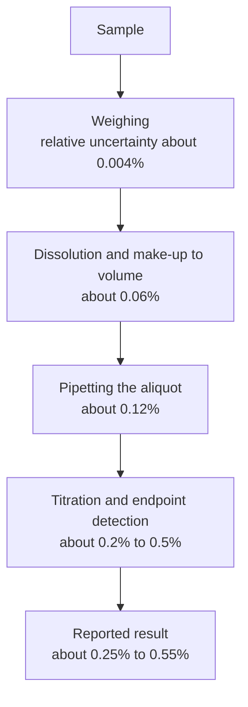
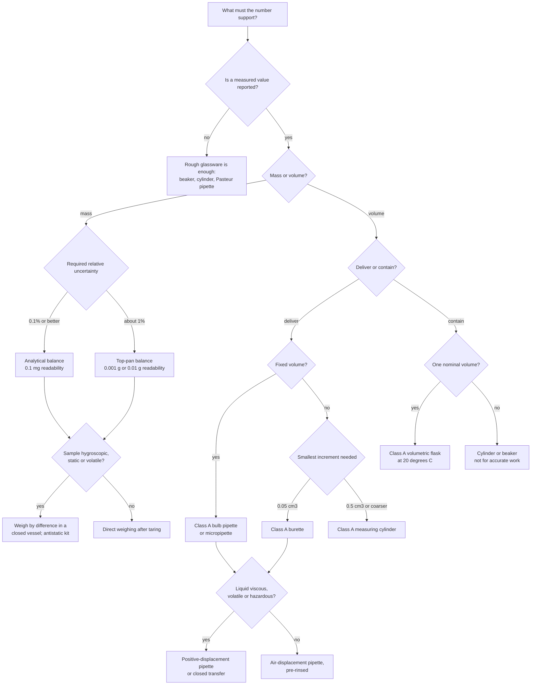

# Laboratory Equipment

> **Level:** Beginner → University
> **Estimated study time:** 2.5 hours (reading) + 2 hours (exercises)
> **Prerequisites:** [Laboratory Safety](../safety/laboratory-safety.md); Level 0 Ch. 9 (measurement, units and significant figures)
> **Related chapters:** [Techniques](../techniques/laboratory-techniques.md) · [Calculations](../calculations/laboratory-calculations.md) · [Documentation](../documentation/laboratory-documentation.md)
> **Difficulty:** ★★☆☆☆

> **Supervision required.** Nothing here is an instruction to use equipment unsupervised. Every instrument described must be operated under the supervision of a trained demonstrator, within an approved risk assessment, and in accordance with your institution's rules and the manufacturer's manual.

---

## 1. Learning objectives

After working through this chapter you will be able to:

- Match glassware to the accuracy a task requires, and justify the choice numerically.
- Quote the tolerance of a 25 cm³ pipette, a 250 cm³ flask and a 50 cm³ burette, and convert each to a relative uncertainty.
- Distinguish readability, repeatability, tolerance and accuracy for a balance, and state what a minimum sample weight means.
- Select heating, stirring, separation and measurement equipment for a stated purpose and name its principal limitation.
- Explain what a fume-hood class means, and when a glovebox is the correct answer instead.
- State calibration intervals and acceptance criteria for the common instruments in a teaching laboratory.

---

## 2. Introduction — the tolerance principle

**A measurement is only as good as the instrument's tolerance permits.** No amount of care makes a 250 cm³ beaker deliver 250.0 cm³, because the beaker was never made to hold that volume to better than a few per cent. A Class A flask holds 250.00 ± 0.15 cm³ — 0.06% — and that limit, not the analyst's skill, sets the best uncertainty the experiment can reach. Better equipment therefore helps only until the next-largest error dominates: an experiment whose titration step contributes 0.3% cannot be rescued by weighing the sample on a microbalance. Uncertainty budgets, not catalogues, decide where to spend attention.

**Figure 1 — A tolerance cascade for a classical volumetric determination.** Relative uncertainties combine in quadrature, so the largest term dominates: replacing a 0.1 mg balance with a 0.01 mg balance would change nothing here, whereas halving the endpoint uncertainty would improve the result at once. Draw this cascade for your own method before choosing equipment.

Four numbers describe every instrument, and confusing them is the commonest source of over-claimed precision:

| Quantity | Meaning | Example |
|---|---|---|
| **Readability** | Smallest displayed increment | 0.0001 g on an analytical balance |
| **Repeatability** | Standard deviation of repeated weighings of one object | 0.0001 g |
| **Tolerance** (maximum permissible error) | Legally permitted deviation from nominal, set by the standard | ±0.03 cm³ for a 25 cm³ Class A pipette |
| **Accuracy** | Closeness of the mean to the true value, established by calibration | ±0.02 cm³ after calibration |

| Symbol | Meaning | SI unit |
|---|---|---|
| $V$ | Nominal volume of a volumetric item | m³ (practical: cm³ = 10⁻⁶ m³) |
| $T$ | Tolerance, maximum permissible error | m³ or cm³ |
| $u_{\mathrm{r}}$ | Relative standard uncertainty, $u/x$ | dimensionless |
| $m$ | Mass | kg (practical: g, mg) |
| $n$ | Rotational speed | s⁻¹ (practical: min⁻¹, rpm) |
| $r$ | Radius from rotation axis to tube tip | m |
| $a_{\mathrm{RCF}}$ | Relative centrifugal acceleration | m s⁻², reported as a multiple of $g$ |

---

## 3. Glassware

### 3.1 Materials

**Borosilicate 3.3** (≈81% $\ce{SiO2}$, 13% $\ce{B2O3}$, 4% $\ce{Na2O}$) expands by 3.3 × 10⁻⁶ K⁻¹, tolerates thermal shock, resists water and acids, but is attacked by hot concentrated alkali and by $\ce{HF}$ and serves only to about 500 °C. **Soda-lime glass** is cheap and adequate for bottles, but leaches alkali and cracks under thermal shock. **Fused silica** transmits to 200 nm and survives rapid heating, at a price. **Polypropylene and PMP** are unbreakable and resist $\ce{HF}$, but creep, scratch and cannot define an accurate volume. Volumetric ware is therefore borosilicate or neutral glass, because the expansion coefficient fixes how much the calibrated volume changes between 20 °C and the working temperature.

### 3.2 Reaction vessels

| Vessel | Volume | Use | Never do this |
|---|---|---|---|
| **Round-bottom flask, single or multi-neck** | 5–5000 cm³ | Heating, reflux, distillation, rotary evaporation | Heat on a bare hotplate without a bath or mantle |
| **Pear-shaped flask** | 10–250 cm³ | Small-scale distillation, rotary evaporation | Use for solids that must be scraped out |
| **Erlenmeyer (conical) flask** | 25–2000 cm³ | Titrations, recrystallisation, swirling | Measure an accurate volume in a graduated one |
| **Beaker** | 5–5000 cm³ | Dissolving, heating, temporary holding | Measure accurate volumes |
| **Schlenk flask** | 10–500 cm³ | Air- and moisture-sensitive work | Use without a manifold and inert-gas supply |
| **Separatory funnel** | 50–2000 cm³ | Liquid–liquid extraction | Store alkaline solutions in it for long periods |
| **Filter flask (thick-walled)** | 100–2000 cm³ | Vacuum filtration | Use an ordinary flask under vacuum |

**Any vessel that is heated or evacuated must be free of cracks, star fractures and rim chips.** An imploding flask projects glass at high speed; inspect before use, and never use a vessel that has suffered thermal shock.

### 3.3 Volumetric ware: classes, marks and thermal history

Volumetric glassware is made to two tolerances defined by the International Organization for Standardization. **Class A** is calibrated to about half the tolerance of Class B, is individually tested and comes with a certificate stating the volume at 20 °C; use it whenever a volume enters a reported result. **Class B** is general-purpose ware at twice the tolerance, acceptable for wash solutions, mobile phases and qualitative reagents.

The calibration mark also states *how* the volume is defined, and the conventions are not interchangeable. **TC / In** ("to contain") means the vessel holds the stated volume at the mark; volumetric flasks are TC. **TD / Ex** ("to deliver") means it delivers that volume when drained under specified conditions; pipettes and burettes are TD.

Thermal history matters because water expands about 2.1 × 10⁻⁴ K⁻¹ near room temperature, an order of magnitude more than borosilicate glass (about 1 × 10⁻⁵ K⁻¹). Over 5 K the water term alone is 0.1%. Make solutions to the mark *after* they return to room temperature, and mix after dilution, since concentrated solutions change volume on dilution.

### 3.4 Measuring cylinders, beakers and conical flasks

These are **not** accurate volumetric instruments. Beaker graduations aid pouring, not measurement: the meniscus is wide, wall thickness varies, and the marked volume is uncertain by several per cent. A cylinder suits mobile phases and wash volumes; it does not suit any volume multiplied into a reported concentration. Use a cylinder when 1% is acceptable, a burette when 0.1% is needed, and a Class A pipette or flask when 0.05–0.1% is needed.

### 3.5 Pipettes

| Type | Range | Use | Tolerance |
|---|---|---|---|
| **Volumetric (bulb) pipette** | 1–100 cm³ | One fixed volume, accurately | Class A ±0.03 cm³ at 25 cm³ |
| **Graduated (Mohr) pipette** | 1–25 cm³ | Variable volume to about 0.05 cm³ | Class A ±0.05 cm³ at 10 cm³ |
| **Serological pipette** | 1–50 cm³ | Variable delivery; often TC and TD | As graduated |
| **Pasteur pipette** | 1–3 cm³ | Transferring liquid; never measuring | Not calibrated |
| **Air-displacement micropipette (Gilson type)** | 0.1–1000 mm³ | Microlitre work | ±0.6% at 1000 mm³; ±1.2% at 20 mm³ (typical) |
| **Positive-displacement micropipette** | 1–1000 mm³ | Viscous, volatile or foaming liquids | Similar accuracy; no aerosol enters the barrel |
| **Repeating pipette** | 1–50 cm³ | Many identical aliquots | ≈±1% |

A volumetric pipette drains for a specified time (commonly 15 s for water at 20 °C) with its tip touching the receiving wall. The residual drop is part of the calibration: **do not blow it out** unless the pipette is marked "blow-out" or TD with an etched ring. Micropipettes are calibrated gravimetrically per ISO 8655 and checked at nominal and at 10% of nominal volume.

### 3.6 Burettes

A 50 cm³ Class A burette is graduated in 0.1 cm³ divisions and read by interpolation to 0.05 cm³, which is why readings are recorded to two decimals. Automatic-zero and digital burettes improve convenience without improving the tolerance of the glass; read their accuracy from the certificate.

**Procedure 3.1 — burette pre-use check.**

1. Close the stopcock and fill with distilled water; invert and check for leaks at the key and tip. Acceptance: no drop forms in 30 s.
2. Drain, then rinse three times with about 5 cm³ of the titrant, discarding each portion.
3. Fill above the zero mark, open the stopcock fully for one second to expel air from the tip, then set the meniscus near 0.00 cm³.
4. Inspect the tip: a clean drop must form and fall without hanging. Reject a chipped or partially blocked tip.
5. Read the initial volume at eye level to 0.05 cm³ and record it before starting the titration.

A burette that fails step 1 or step 4 is not a measuring instrument, and the titre will be wrong in a way no calculation can repair.

### 3.7 Funnels, condensers and adapters

| Item | Function | Practical note |
|---|---|---|
| **Conical funnel** | Gravity filtration with fluted paper | Stem should be full of liquid for maximum rate |
| **Büchner funnel** | Vacuum filtration of crystals | Perforated plate plus paper; coarse frits filter fastest |
| **Hirsch funnel** | Vacuum filtration on a small scale | Narrower than Büchner; less holdup |
| **Sintered-glass (frit) funnel or crucible** | Filtration without paper; ignition of precipitates | Porosity 1–4; blinds with gelatinous solids; attacked by $\ce{HF}$ |
| **Liebig condenser** | Straight-tube distillation | Efficient for distillation, poor for reflux |
| **West / Allihn condenser** | Double surface; bulbed inner tube | General reflux and distillation |
| **Graham / Dimroth condenser** | Coiled inner tube; coil in a jacket | Low-boiling solvents; the Dimroth is standard on rotary evaporators |
| **Cold finger** | Local cold surface | Sublimation and small-scale condensation |
| **Claisen adapter** | Distillation head with a side neck | Keeps the thermometer in the vapour path |
| **Vacuum adapter** | Connects receiver to vacuum | Support it; never use rubber tubing under vacuum |

Cooling water enters at the lower connection and leaves at the upper, so the jacket stays full; the outlet must discharge visibly to a drain, never through a sealed connection that could pressurise the jacket.

### 3.8 Ground-glass joints and greases

Standard-taper joints are conical with a 1:10 taper, designated by maximum diameter and length (14/23, 19/26, 24/29, 29/32, 34/35, 45/40). Ball-and-socket joints tolerate slight misalignment; conical joints seal better. Clean joints seat properly, whereas a speck of solid makes them leak and then seize. Grease is needed for vacuum work and for hot alkaline aqueous systems, where glass-to-glass contact can fuse: apply a thin, even film, because excess grease contaminates products and creeps into condensers. Hydrocarbon and silicone greases dissolve in non-polar and chlorinated solvents, so use **PTFE sleeves or tape** there — inert and dry-sealing, at the cost of a slightly poorer vacuum. Never grease a joint that will run above the grease's drop point, and clip every joint, because a joint that separates under vacuum releases glass and boiling liquid together.

### 3.9 Desiccators, crucibles, watch glasses and Petri dishes

| Item | Use | Care |
|---|---|---|
| **Desiccator** | Cooling and storing dried samples without reabsorbing water | Fresh colour-indicating silica gel or anhydrous $\ce{CaCl2}$; open slowly under vacuum; never store wet glassware in it |
| **Vacuum desiccator** | Drying under reduced pressure | Inspect for cracks; equalise pressure before opening |
| **Porcelain crucible** | Ignition and ashing to about 1200 °C | Thermal shock cracks it; not for $\ce{HF}$ or hot alkali |
| **Quartz / alumina crucible** | Ignition to 1200–1700 °C | Alumina is attacked by $\ce{HF}$ and reduced by carbon at high temperature |
| **Platinum crucible** | Carbonate and pyrosulfate fusion; accurate gravimetry | Attacked by aqua regia, halogens and reduced metals; extremely expensive |
| **Nickel crucible** | Fusion with $\ce{Na2O2}$ and $\ce{NaOH}$ | Not for acids |
| **Watch glass** | Covering beakers; evaporating small volumes | Does not seal; not a weighing vessel for accurate work |
| **Petri dish** | Sample storage, crystal growth, microbiology | Not sterile unless specified; not volumetric |

A crucible used for gravimetry must reach **constant mass**: heat, cool **in a desiccator**, weigh, and repeat until successive masses differ by less than the required tolerance (commonly 0.3 mg). Cooling on the bench lets the porous crucible absorb moisture and the mass drifts.

---

## 4. Volumetric accuracy and calibration

### 4.1 Tolerance table

Values below are typical maximum permissible errors for Class A borosilicate ware at 20 °C, consistent with ISO 648 (pipettes), ISO 1042 (flasks), ISO 385 (burettes) and ISO 4788 (cylinders). Class B is approximately double. **Always report the certificate value for the individual item**, not this table.

| Item | Nominal / cm³ | Class A / ±cm³ | Relative / % | Class B / ±cm³ | Use |
|---|---|---|---|---|---|
| Bulb pipette | 5 | 0.015 | 0.30 | 0.030 | Small aliquots |
| Bulb pipette | 10 | 0.020 | 0.20 | 0.040 | Titration aliquots |
| Bulb pipette | 20 | 0.030 | 0.15 | 0.060 | Titration aliquots |
| Bulb pipette | 25 | 0.030 | 0.12 | 0.060 | Standard aliquot |
| Bulb pipette | 50 | 0.050 | 0.10 | 0.100 | Large aliquots |
| Graduated pipette | 10 | 0.05 | 0.50 | 0.10 | Variable delivery |
| Volumetric flask | 50 | 0.06 | 0.12 | 0.12 | Standards |
| Volumetric flask | 100 | 0.10 | 0.10 | 0.20 | Standards |
| Volumetric flask | 250 | 0.15 | 0.06 | 0.30 | Standard solutions |
| Volumetric flask | 500 | 0.25 | 0.05 | 0.50 | Standard solutions |
| Volumetric flask | 1000 | 0.40 | 0.04 | 0.80 | Stock solutions |
| Burette | 10 | 0.02 | 0.20 | 0.04 | Micro-titration |
| Burette | 25 | 0.03 | 0.12 | 0.06 | Titration |
| Burette | 50 | 0.05 | 0.10 | 0.10 | Titration |
| Measuring cylinder | 10 | 0.10 | 1.0 | 0.20 | Approximate volumes |
| Measuring cylinder | 100 | 0.50 | 0.5 | 1.00 | Mobile phases |
| Measuring cylinder | 1000 | 5.0 | 0.5 | 10.0 | Bulk volumes |
| Beaker, any size | — | no tolerance | ≈5 | — | Never for accurate volume |

Two subtleties decide whether a titre is trustworthy. First, **a burette's tolerance applies to the delivered volume, not to a single reading**: reading uncertainty is about ±0.02 cm³ per reading (half the 0.05 cm³ interpolation), so a titre from two readings carries roughly ±0.03 cm³, comparable with the tolerance. Record both readings. Second, **a flask's tolerance holds at 20 °C for aqueous solutions**; filling with ethanol changes the delivered amount by 0.2–0.3%, so non-aqueous work is calibrated with the solvent actually used.

### 4.2 Worked Example 4.1 — Which item limits a 0.1% determination?

**Problem.** A method pipettes 25.00 cm³ of sample, titrates with a 50 cm³ burette (titre about 20 cm³), and prepares the titrant in a 1000 cm³ flask from $m \approx 4.0$ g of primary standard weighed to 0.1 mg. Can the method reach 0.1%?

**Solution.** From the table:

- Pipette: $u_{\mathrm{r}} = 0.030/25.00 = 1.2 \times 10^{-3}$, that is 0.12%.
- Burette: $0.05/20.00 = 2.5 \times 10^{-3}$, that is 0.25%.
- Flask: $0.40/1000 = 4.0 \times 10^{-4}$, that is 0.04%.
- Weighing: $0.0001/4.0 = 2.5 \times 10^{-5}$, that is 0.0025%.

Combined in quadrature, $u_{\mathrm{r}} = \sqrt{0.12^2 + 0.25^2 + 0.04^2 + 0.003^2}\ \% = 0.28\%$.

**Check.** The burette dominates and 0.1% is unreachable with this glassware. Use a 25 cm³ burette (0.03/20 = 0.15%), increase the titre to 40 cm³ (0.05/40 = 0.125%), or accept 0.3%. The method must be redesigned; the analyst cannot be admonished into a better tolerance.

---

## 5. Balances

### 5.1 Classes

| Class | Readability | Repeatability (typical) | Capacity | Use |
|---|---|---|---|---|
| **Microbalance** | 0.0001 mg (0.1 µg) | 0.0005 mg | 2–6 g | Trace standards; filter deposits |
| **Semi-micro** | 0.01 mg | 0.02 mg | 40–100 g | Small samples; precious standards |
| **Analytical** | 0.1 mg | 0.1 mg | 100–220 g | Routine quantitative weighing |
| **Top-pan (precision)** | 1 mg or 10 mg | 1–10 mg | 200 g – 5 kg | Reagents; bulk make-up |

The **minimum sample weight** is the smallest mass that keeps relative uncertainty at the required level. It is determined experimentally (USP general chapter ⟨41⟩ describes the procedure) and is typically 10–20 mg on a 0.1 mg analytical balance. Weighing 2 mg of a standard on such a balance is not a measurement at 0.1%; it is a measurement at 5%.

### 5.2 Installation and environment

| Factor | Requirement | Symptom if ignored |
|---|---|---|
| Vibration | Rigid bench away from centrifuges and pumps | Digits never settle |
| Draught | Closed shield; away from doors and air conditioning | Reading falls when a door opens |
| Temperature | Stable 15–30 °C; no sunlight; not near a hotplate | Slow drift; hysteresis |
| Humidity | 45–60% relative | Static when dry; condensation when damp |
| Levelling | Bubble centred using the feet | Corner-load error |

### 5.3 Calibration and checking

Three activities are distinct and all three are needed. **Internal calibration** adjusts the balance against a motorised internal weight; it corrects drift but cannot detect a faulty internal weight. **External calibration** with certified OIML E2 weights (F1 for a top-pan) establishes traceability; weights are handled with tweezers or gloved fingers, kept in their case, and recertified every 1–5 years. **Routine checking** — daily or before each session — weighs one or two certified weights at about 5% and 100% of the working range, and the values are recorded against acceptance limits. A failed check is a stop-work condition, not a note. A full calibration also tests **eccentricity** (a weight at the centre, front-left and rear-right must agree within tolerance) and **linearity** (indicated minus true mass across the range, commonly within 0.1% or the SOP's limit).

### 5.4 Static, buoyancy, hygroscopic samples and evaporation

**Static** matters because dry air, plastic boats, glass and PTFE accumulate charge, which exerts a force on the pan and makes the reading drift for minutes; use an aluminium dish, an ionising blower or an antistatic kit, and ground the balance. **Buoyancy** makes a balance calibrated with steel weights over-read low-density samples by about 0.1% for water and up to 0.4% for a light organic solid — negligible in routine work, decisive when calibrating by weighing water. **Hygroscopic and volatile solids** must be weighed by difference from a closed, stoppered vessel, quickly, and never left on the pan, because sodium hydroxide pellets, calcium chloride and many hydrates gain or lose mass continuously. **Evaporation** from a warm volatile solvent in an open vessel changes the mass while it is being weighed, so cool the vessel to room temperature and cap it first.

### 5.5 Worked Example 5.1 — Choosing a balance for a 250 mg standard

**Problem.** A standard must be weighed to 0.1% relative. What readability is needed for a 250 mg sample, and for a 2 mg sample?

**Solution.** The permitted absolute uncertainty is $0.001 \times 250\ \mathrm{mg} = 0.25$ mg, so a 0.1 mg balance (two readings in a by-difference weighing contribute about ±0.14 mg) is adequate. For 2 mg the budget is 0.002 mg, which requires a semi-micro balance at 0.01 mg readability and a well-controlled environment — and even then the relative uncertainty is about 1%.

**Check.** Never accept a four-decimal display as evidence of four-decimal accuracy; the minimum sample weight is the deciding number.

### 5.6 Fully specified procedure — daily check of an analytical balance

1. Confirm the balance is level, the pan and shield are clean, and the doors close.
2. Switch on and allow the specified warm-up time (often 30 min, or leave it powered continuously).
3. Run the internal calibration if provided, and record the result.
4. With tweezers, place the certified 100 g weight at the centre of the pan; record the indicated mass to 0.1 mg.
5. Repeat at front-left and rear-right to test eccentricity, and record both values.
6. Repeat the centre weighing three times, compute the range, and compare it with the SOP's repeatability limit.
7. Enter date, time, temperature, humidity, weights used, all values and your initials in the balance log.
8. If any value is outside the limits, label the balance "out of service", inform the supervisor and record the action taken.

---

## 6. Heating and stirring

### 6.1 Devices

| Device | Range | Advantages | Limitations |
|---|---|---|---|
| **Bunsen burner** | flame to ≈1500 °C | Simple; high temperature | No flammable liquids; no volumetric ware; no controlled ramp |
| **Hotplate, ceramic or metal** | ambient–350 °C | Flat base for beakers; stirrer option | Hot surface invisible; spills bake on; poor contact with round flasks |
| **Heating mantle** | ambient–450 °C | Uniform contact with round flasks; no flame | Must match flask size; solvent soaking into the mantle is a fire risk |
| **Water bath** | 25–95 °C | Uniform, gentle | Limited temperature; evaporation |
| **Oil bath** | 25–250 °C | Uniform, large thermal mass | Smoke and fire above the oil rating |
| **Sand bath** | 100–400 °C | High temperature, no fluid | Slow, uneven, hot spots |
| **Microwave digestion system** | 100–250 °C, 20–80 bar | Rapid closed-vessel digestion | Purpose-built vessels only; specialist operation |
| **Muffle furnace** | 550–1200 °C (to 1700 °C) | Ashing, ignition, fusion | Slow; thermal shock; fire risk with organics |

A Bunsen flame on a good air supply is blue and non-luminous; a yellow flame is cooler, sootier and deposits carbon. Use a wire gauze with a tripod, never point a flame at a joint or at a nearly empty flask, and remember that an oil bath heated above its rating produces acrid smoke and eventually ignites. A bath is carried cold, never hot, and never left unattended during a ramp.

### 6.2 Microwave digestion and the muffle furnace

Closed-vessel microwave digestion dissolves biological, environmental and geological matrices in nitric acid at 200 °C and 30–60 bar. The vessel is the critical component: only pressure-rated vessels, matched by mass and correctly sealed, may be used; they must cool before opening; hydrofluoric acid needs dedicated PTFE vessels and a separate workflow. A muffle furnace brings a crucible to constant mass or burns off organic matter:

$$
\ce{CaCO3(s) -> CaO(s) + CO2(g)} \qquad \text{above } 900\ ^\circ\text{C}
$$

Ramp slowly (5–10 K min⁻¹), never load a wet or solvent-laden crucible, open the door only at low temperature, and handle crucibles with long tongs and heat-resistant gloves, cooling them on a firebrick before a desiccator — never quenching in water.

### 6.3 Stirring and mixing

| Device | Use | Key point |
|---|---|---|
| **Magnetic stirrer** | Small-scale mixing | Largest bar that fits, on a flat base; viscous liquids need a bigger bar, not more speed |
| **Hotplate stirrer** | Heating and mixing together | The surface stays hot after switch-off |
| **Overhead stirrer** | Viscous mixtures, suspensions, litre scale | Clamp the motor; the shaft seal is the usual failure point |
| **Vortex mixer** | Resuspending pellets | Short bursts; cap the tube; aerosols form easily |
| **Ultrasonic bath** | Dissolving, degassing, cleaning | Cavitation erodes glass and heats the bath; no open flammable solvents |

A magnetic stirrer is not a homogeniser. Two-phase systems, gas–liquid reactions and viscous polymers need an overhead stirrer with a correctly sized impeller that does not touch the wall.

---

## 7. Separation equipment

Each device exploits one physical difference: density, volatility, particle size or
solubility. Match the device to the property, and match its scale to the sample.

### 7.1 Centrifuges

$$
a_{\mathrm{RCF}} = 1.118 \times 10^{-5}\, r\, n^2
$$

| Symbol | Meaning | Unit |
|---|---|---|
| $a_{\mathrm{RCF}}$ | Relative centrifugal acceleration | dimensionless multiple of $g$ |
| $r$ | Radius from the rotation axis to the tube tip | cm |
| $n$ | Rotational speed | min⁻¹ (rpm) |

*Assumptions:* rigid rotor, tubes aligned with the field, wall effects ignored; the constant assumes $r$ in cm and $n$ in rpm. Speed without radius is meaningless: 10 000 rpm at 5 cm is 5590 × g, while the same speed at 15 cm is 16 800 × g.

Balance tubes to within the rotor's tolerance (typically 0.1 g), never exceed the rotor's rated speed or cycle count, use aerosol-tight lids for hazardous samples, and keep the lid closed until the rotor has stopped.

### 7.2 Rotary evaporators

Rotation spreads the liquid as a thin film, reduced pressure lowers the boiling point, and the bath supplies latent heat. Fill the flask to no more than half its volume, start rotation before applying vacuum, set the bath 10–20 °C above the boiling point at the working pressure, and place a cold trap between evaporator and pump. Bumping is prevented by a slower pressure ramp, not a hotter bath.

### 7.3 Filtration apparatus

| Apparatus | Best for | Limitation |
|---|---|---|
| **Gravity, fluted paper** | Removing a little solid from a hot or cold solution | Slow; hot solutions crystallise in the funnel |
| **Büchner funnel with vacuum** | Recovering a crystalline product quickly | Fine solids pass through; filtrate may boil |
| **Sintered-glass crucible** | Gravimetric precipitates to be ignited | Blinds permanently; not for $\ce{HF}$ |
| **Membrane filter, 0.45 µm** | Clarifying liquids for analysis | Low flow; collapse if over-pressured |
| **Syringe filter, 0.22 µm** | Small volumes before HPLC or GC | Single use; check solvent compatibility |

Vacuum filtration needs a thick-walled filter flask and a trap between flask and pump. Never filter a boiling solution under vacuum: the filtrate boils and the flask can implode.

### 7.4 Separatory funnels and Soxhlet extractors

Choose a separatory funnel no more than two-thirds full, check the stopcock before filling, **vent** frequently with the stem pointed away from people, establish which layer is which by density before drawing anything off, and never discard a layer until both are in labelled vessels. Treat emulsions by gentle swirling, adding brine, filtering or centrifuging — not by vigorous shaking.

A Soxhlet extractor cycles condensed solvent through a thimble of solid, siphoning back to the boiling flask each time the side arm fills. It serves fat determination, additive extraction from polymers and leaching of natural products; typical runs are 4–24 h, and the solvent is chosen for boiling point, safety and selectivity.

---

## 8. Measurement instruments

Every instrument below converts a physical property into a number, and every one of them can be trusted only within its calibration. The sections that follow state the calibration check and the dominant limitation for each.

### 8.1 pH meters and electrodes

$$
E = E^{\circ} - \frac{2.303RT}{F}\,\mathrm{pH}
$$

| Symbol | Meaning | Unit |
|---|---|---|
| $E$ | Cell potential | V |
| $E^{\circ}$ | Standard potential of the cell | V |
| $R$ | Gas constant | J K⁻¹ mol⁻¹ |
| $T$ | Thermodynamic temperature | K |
| $F$ | Faraday constant | C mol⁻¹ |

At 25 °C the slope is 59.16 mV per pH unit. Calibrate with two buffers bracketing the expected value — 4.01 (phthalate), 7.00 (phosphate), 10.01 (borate) — and accept the calibration only if the slope is 95–105% of theoretical and the intercept is within the SOP limit. Store the bulb in 3 mol dm⁻³ $\ce{KCl}$, never in distilled water or air; do not wipe it; keep the reference junction wet and the electrolyte topped up; stir gently at a constant rate.

### 8.2 Spectrophotometers, polarimeters, refractometers and conductivity

$$
A = \varepsilon\, c\, l \qquad [\alpha]_{D}^{20} = \frac{\alpha}{c\,l}
$$

| Symbol | Meaning | Unit |
|---|---|---|
| $A$ | Absorbance, $-\log_{10}(I/I_0)$ | dimensionless |
| $\varepsilon$ | Molar absorption coefficient | m² mol⁻¹ (practical: dm³ mol⁻¹ cm⁻¹) |
| $c$ | Concentration | mol m⁻³ (practical: mol dm⁻³) |
| $l$ | Path length | m (practical: cm) |
| $\alpha$ | Observed rotation | degree |
| $[\alpha]_{D}^{20}$ | Specific rotation at the sodium D line, 20 °C | degree dm⁻¹ cm³ g⁻¹ |

Use quartz cuvettes below about 340 nm and plastic above it, match cuvettes in pairs, always run a blank, and keep absorbance between 0.1 and 1.0: below 0.1 the relative noise is large, above 1.0 stray light and multiplicative error dominate. A polarimeter needs temperature control because rotation drifts with temperature, and a refractometer is calibrated with water ($n_D^{20} = 1.3330$) on a clean, dry prism. A conductivity meter measures the conductance of a cell of known constant, calibrated with 0.01 mol dm⁻³ $\ce{KCl}$ (1413 µS cm⁻¹ at 25 °C) and compensated to 25 °C, since conductivity changes by about 2% per kelvin.

### 8.3 Melting point and bomb calorimetry

A melting-point tube is heated at about 1 K min⁻¹ near the transition; faster ramps give a falsely high, widened range. Report the observed range (for example 121.5–122.5 °C) and calibrate with certified standards such as vanillin, benzoic acid or caffeine. A mixed melting point with an authentic sample that is undepressed is stronger evidence of identity than a single value.

A bomb calorimeter burns a weighed sample in oxygen at 25–30 bar inside a steel bomb in a known mass of water. The energy equivalent is found by burning certified benzoic acid (26.454 MJ kg⁻¹, NIST SRM 39i), with corrections for the fuse wire, for nitric acid from atmospheric nitrogen, and for sulfur. The result is $q_V = \Delta U$; converting to $\Delta H$ requires the $p\Delta V$ term and is not optional.

---

## 9. Safety equipment

| Type | Principle | Protects | Use |
|---|---|---|---|
| **Class I fume hood** | Open front, air drawn away through filter or duct | Operator and environment | Powders, general chemistry, odorous work |
| **Class II Type A2** | HEPA downflow plus inflow; 70% recirculated | Operator, sample, environment | Biological work; not volatile chemicals or perchloric acid |
| **Class II Type B2** | 100% exhausted, hard-ducted | Operator, sample, environment | Volatile chemicals, perchloric acid |
| **Class III** | Gas-tight glovebox isolator | Highest containment | Hazardous biological agents, highly toxic chemicals |
| **Ducted canopy** | Local exhaust, no sash | Operator, partly | Large apparatus, ovens, stills |

Face velocity is typically 0.4–0.6 m s⁻¹ at the working sash height, verified annually by a competent person. Work at least 15 cm inside the hood, keep the sash low, do not store chemicals in it, and do not block the rear baffle. **A hood is a control device, not a cupboard.** An inert-atmosphere glovebox holds oxygen and water below 1 ppm with a circulating purifier and is required when a reagent reacts with air faster than a Schlenk line can protect it; materials pass through an evacuated antechamber, gloves are inspected each session, and the atmosphere is monitored continuously.

| Item | Standard or criterion | Check |
|---|---|---|
| **Eyewash** | ANSI/ISEA Z358.1; within 10 s travel; 15 min flushing | Weekly activation |
| **Safety shower** | ANSI/ISEA Z358.1; tepid water, about 75.7 L min⁻¹ | Weekly activation |
| **Extinguisher, class A** | Paper, wood, textiles | Water or dry powder |
| **Class B** | Flammable liquids | Foam, $\ce{CO2}$, dry powder |
| **Class C** | Flammable gases | Dry powder |
| **Class D** | Combustible metals | Special dry powder; never water |
| **Class F (K)** | Cooking oils and fats | Wet chemical |
| **Electrical** | Energised equipment | $\ce{CO2}$ after isolating the supply |
| **Spill kit** | Universal, solvent, acid, caustic, mercury | Monthly inventory check |

Water on a Class D metal fire generates hydrogen and can explode; a $\ce{CO2}$ extinguisher on clothing causes cold burns and does not cool the fuel, so use the shower or a fire blanket.

---

## 10. Choosing the right instrument

**Figure 2 — Choosing an instrument from the required uncertainty.** Start from the question the number must answer, not from what is on the shelf. The lower branches encode the point that sample and liquid impose their own constraints: a perfect balance cannot weigh a deliquescent solid in an open boat, and a perfect pipette cannot deliver a volatile solvent without evaporation loss.

---

## 11. Maintenance and calibration schedule

| Item | Interval | Check | Acceptance criterion |
|---|---|---|---|
| Analytical balance | Each session | Level, cleanliness, zero, internal calibration | Zero stable; calibration passes |
| Analytical balance | Daily or weekly | Certified weight at 5% and 100% of range | Within SOP limit, commonly 0.1% |
| Analytical balance | Annually, after movement | Full calibration by an accredited provider | Certificate traceable to ISO/IEC 17025 |
| Volumetric glassware | Every 5 years, or after attack | Gravimetric recheck | Within Class A tolerance |
| Micropipettes | Every 3–12 months, after autoclaving | Gravimetric check at nominal and 10% | Within ISO 8655 limits |
| Burette | Each use | Stopcock leak, tip, air bubble | No leak; clean drop |
| pH meter | Each session | Two- or three-point calibration | Slope 95–105% |
| pH electrode | Weekly | Junction, electrolyte level, bulb | Junction flowing; electrolyte above minimum |
| Conductivity cell | Monthly | Cell constant with 0.01 mol dm⁻³ $\ce{KCl}$ | Within 2% of certificate |
| Spectrophotometer | Monthly and annually | Wavelength and photometric accuracy filters | Within manufacturer's limits |
| Fume hood | Weekly, plus annually | Sash, airflow indicator, face velocity | 0.4–0.6 m s⁻¹ at working height |
| Centrifuge | Annually | Rotor inspection, speed, log | No cracks; speed within 5% |
| Fire extinguisher | Monthly, plus annually | Gauge, seal, service tag | In date and pressurised |
| Eyewash and shower | Weekly | Flow, temperature, access | Unobstructed; tepid water |
| Spill kit | Monthly | Inventory and condition | Complete and in date |

Every check belongs in the instrument log with date, operator, values and action taken. An instrument without a log has no history, and a result produced on it cannot be defended.

---

## 12. Common mistakes

| Mistake | Why it happens | Correct approach |
|---|---|---|
| Using a beaker or cylinder for a volume that enters a calculation | It is already on the bench and looks graduated | Decide the required tolerance, then choose the Class A item |
| Recording a pipette volume as 25 cm³ rather than 25.00 cm³ | Confusing nominal value with uncertainty | The tolerance is ±0.03 cm³, so the volume is meaningful to 0.01 cm³ |
| Reading a burette to 0.01 cm³ | Over-estimating what a 0.1 cm³ graduation supports | Read to 0.05 cm³; record initial and final readings |
| Weighing a hygroscopic solid in an open boat | Convenience | Weigh by difference from a closed vessel, quickly, and record the time |
| Ignoring the minimum sample weight | Four decimals are displayed, so every mass looks precise | Check the limit; use a semi-micro balance for small samples |
| Cooling a hot crucible on the bench | Habit | Cool on a firebrick, then in a desiccator, and weigh to constant mass |
| Storing chemicals in a fume hood | Space and convenience | Hoods are for work; storage belongs in a ventilated cabinet |
| Using a Type A2 cabinet for volatile solvents | It looks like a fume hood | Check the class; use a ducted hood or a B2 cabinet |
| Balancing centrifuge tubes by eye | "Close enough" | Balance to the rotor's tolerance, usually 0.1 g |
| Calibrating a pH meter in one buffer only | Saves a minute | Two buffers bracketing the expected value, ideally three |

---

## 13. Summary

- Tolerance, not care alone, sets achievable uncertainty, and the largest term dominates the budget.
- Class A volumetric ware carries about half the tolerance of Class B; TC ("to contain") is not TD ("to deliver").
- A 25 cm³ Class A pipette is ±0.03 cm³ (0.12%), a 250 cm³ flask ±0.15 cm³ (0.06%), a 50 cm³ burette ±0.05 cm³ (0.10%).
- Beakers and cylinders are for approximate volumes; their marks are not measurements.
- Readability, repeatability, tolerance and minimum sample weight are different properties of a balance.
- Static, buoyancy, humidity and evaporation are real weighing errors, not theoretical ones.
- Heating devices differ in controllability and in the hazards they create; flames and flammable vapour never mix.
- Separation equipment is selected by scale and by the property exploited; each measurement instrument needs a calibration routine that is followed and recorded.
- A fume hood has a class, a face velocity and a test date; a glovebox is the answer when the atmosphere itself is the hazard.

---

## 14. Exercises

1. Why can a 250 cm³ beaker never be used to prepare a standard solution, even when it carries a 250 cm³ mark?
2. Why is a balance's minimum sample weight not simply ten times its readability?
3. A 10 cm³ Class A pipette has a tolerance of ±0.02 cm³. Express this as a relative uncertainty.
4. A 100 cm³ Class A flask has a tolerance of ±0.10 cm³. What relative uncertainty does it contribute?
5. A method needs a concentration known to 0.2%. The standard is weighed on a 0.1 mg balance (mass 0.5000 g) and made up in a 500 cm³ Class A flask (±0.25 cm³). Is the target achievable from these steps alone?
6. A rotor of radius 12 cm runs at 4000 rpm. Calculate the relative centrifugal acceleration and compare it with 2000 rpm at the same radius.
7. A titration uses 25.00 cm³ of sample from a Class A pipette (±0.03 cm³), a titre of 18.40 cm³ from a Class A 50 cm³ burette (±0.05 cm³) and a titrant of 0.1000 ± 0.0002 mol dm⁻³. Estimate the combined relative uncertainty of the sample concentration.
8. Design a weighing strategy for 5 mg of a hygroscopic primary standard on a 0.1 mg balance, and state the relative uncertainty you would report.

---

## 15. Answers

1. Its graduations are approximate to several per cent, the meniscus is wide and its shape is not designed for a defined volume; a standard solution needs a calibrated flask.
2. Because minimum weight is set by repeatability, linearity, eccentricity and environment together and is measured experimentally; it is typically 10–20 mg on a 0.1 mg balance, far above 10 × readability.
3. $0.02/10 = 0.20\%$.
4. $0.10/100 = 0.10\%$.
5. Weighing 0.02%, flask 0.05%; quadrature gives 0.054%, inside 0.2%. The target is achievable provided the remaining steps contribute less than about 0.19%.
6. $a_{\mathrm{RCF}} = 1.118 \times 10^{-5} \times 12 \times 4000^2 = 2147$; at 2000 rpm it is 537, four times lower, because acceleration scales with the square of speed.
7. Pipette 0.12%, burette 0.27%, titrant 0.20%; quadrature gives 0.36%.
8. Weigh by difference: tare a closed vessel, add about 5 mg, reweigh, and take the difference. Two readings at 0.1 mg give about ±0.14 mg, or 2.8% relative — too poor for a primary standard. Use a semi-micro balance (0.01 mg) or prepare a larger mass and dilute.

---

## 16. Further reading

- Harris, D. C. and Lucy, C. A. *Quantitative Chemical Analysis*, 10th ed. W. H. Freeman, 2019 — measurement, tools and volumetric glassware.
- Skoog, D. A., West, D. M., Holler, F. J. and Crouch, S. R. *Fundamentals of Analytical Chemistry*, 9th ed. Cengage, 2013.
- Skoog, D. A., Holler, F. J. and Crouch, S. R. *Principles of Instrumental Analysis*, 7th ed. Cengage, 2017.
- International Organization for Standardization. *ISO 648* (single-volume pipettes), *ISO 1042* (one-mark volumetric flasks), *ISO 385* (burettes), *ISO 4788* (graduated measuring cylinders), *ISO 8655* (piston-operated volumetric apparatus).
- Eurachem. *Quantifying Uncertainty in Analytical Measurement* (QUAM), 3rd ed., 2012. <https://www.eurachem.org/>
- International Organization for Standardization. *ISO/IEC 17025: General requirements for the competence of testing and calibration laboratories*.
- NIST. *Standard Reference Materials* catalogue and certificates, including SRM 39i benzoic acid. <https://www.nist.gov/srm>
- ANSI/ISEA. *Z358.1: Emergency Eyewash and Shower Equipment*; EN 14175 series, *Fume cupboards*.
- National Research Council. *Prudent Practices in the Laboratory*, National Academies Press, 2011 — equipment and facilities.
