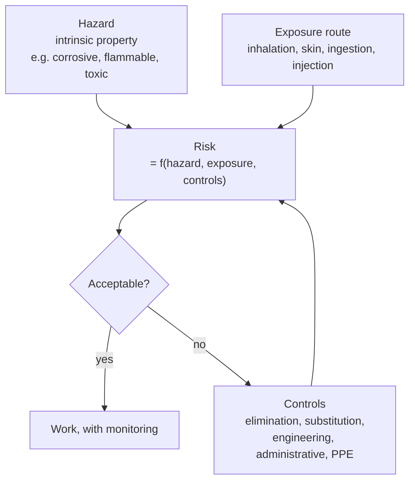
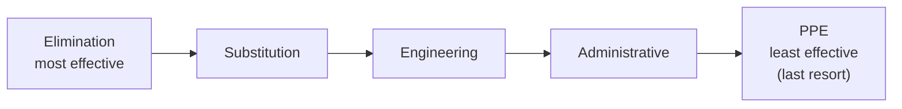
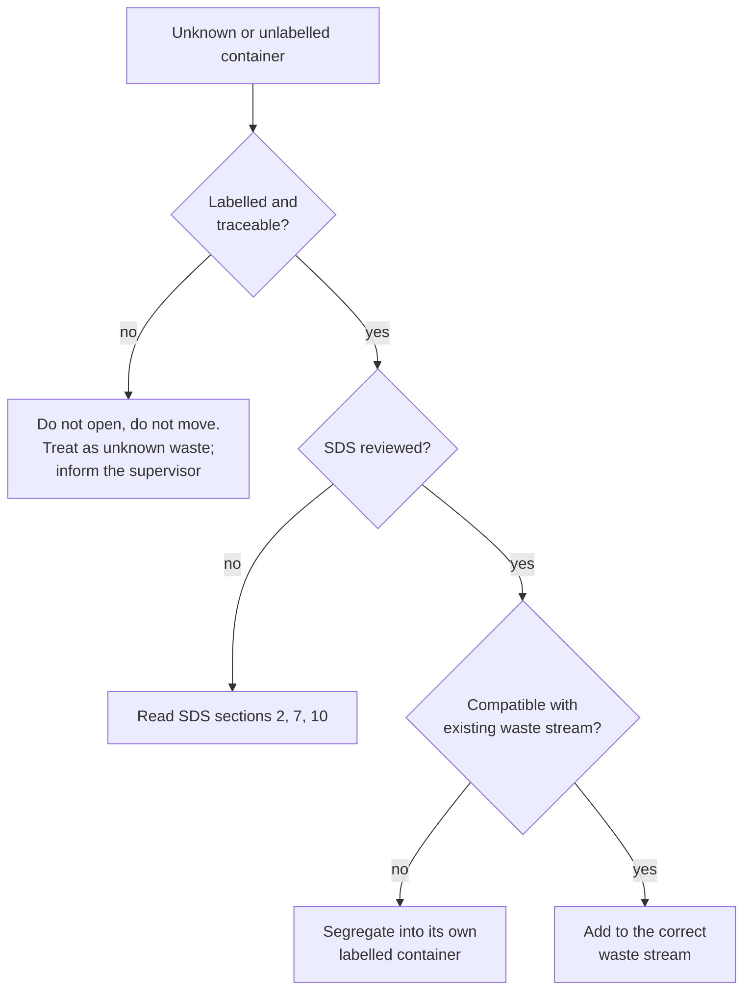
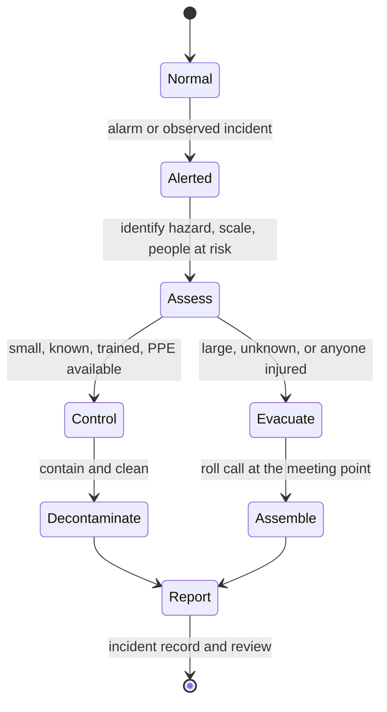
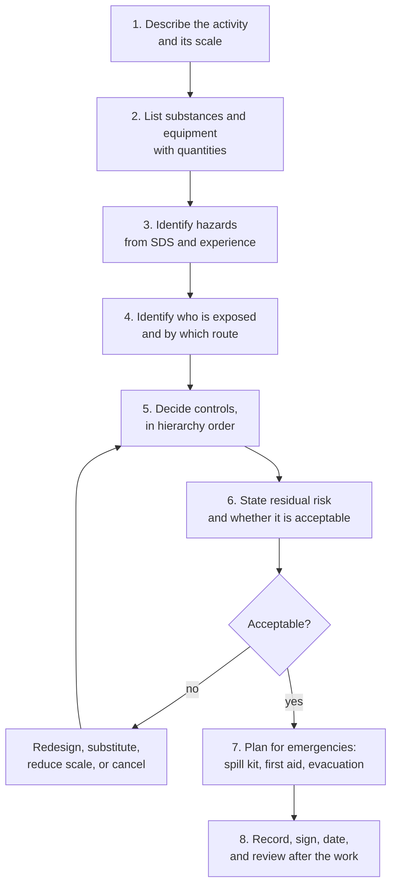

# Laboratory Safety

> **Status:** reference material for readers working in a supervised, properly
> equipped laboratory. Nothing here authorises unsupervised work, and nothing here
> overrides your institution's chemical hygiene plan, your local regulations, or the
> instructions of your supervisor.
> **Reading time:** 40 minutes. Return to it before every new practical course.

---

## 1. The one rule

**A hazard is a property of a substance or a situation; a risk is the chance that the
hazard causes harm, given the controls in place.** Safety is the management of risk,
not the avoidance of chemicals. A laboratory that handles sodium azide daily under
proper controls is safer than a kitchen in which someone mixes bleach and ammonia
once.

**Figure 1 — The risk equation.** Controls act on exposure, not on the hazard: you
cannot make concentrated sulfuric acid non-corrosive, but you can prevent contact
with it. Note the hierarchy in the next section: PPE is the *last* line of defence,
not the first.

---

## 2. The hierarchy of controls

Controls are ranked by effectiveness. Always prefer the highest practicable level.

| Level | Control | Example |
|---|---|---|
| 1 | **Elimination** | Do not run the experiment; use a simulation or literature data |
| 2 | **Substitution** | Replace benzene with toluene; replace a chlorinated solvent with a greener one; use a less concentrated reagent |
| 3 | **Engineering** | Fume hood, glovebox, local exhaust ventilation, blast shield, interlocks, closed transfer systems |
| 4 | **Administrative** | Standard operating procedures, training, signage, access control, supervision, working alone prohibitions |
| 5 | **PPE** | Goggles, gloves, lab coat, respirator — protects only the wearer, only if correctly worn |

**Figure 2 — The hierarchy of controls.** A laboratory that relies on gloves to
handle a volatile carcinogen on an open bench has inverted the hierarchy and is
therefore unsafe, however good the gloves are.

---

## 3. Hazard classes and GHS pictograms

The Globally Harmonised System (GHS) standardises hazard communication. Under GHS,
a supplier must provide a **safety data sheet (SDS)** in 16 sections and label the
container with the relevant pictograms, signal word and hazard statements.

| Pictogram | Name | Typical hazard | Example substance |
|---|---|---|---|
| Flame | Flammable | Catches fire readily | Ethanol, diethyl ether, hydrogen |
| Flame over circle | Oxidising | Provides oxygen, intensifies fire | Potassium permanganate, hydrogen peroxide (concentrated) |
| Gas cylinder | Gases under pressure | Rupture, asphyxiation, cold burns | Nitrogen, oxygen, propane |
| Corrosion | Corrosive | Destroys skin, eyes, metals | Hydrochloric acid, sodium hydroxide |
| Skull and crossbones | Acute toxicity | Fatal or toxic if inhaled, swallowed or on skin | Potassium cyanide, methanol |
| Exclamation mark | Irritant, harmful | Skin/eye irritation, respiratory irritation, narcotic effects | Acetone, ethanol (dilute) |
| Health hazard | Chronic health hazard | Carcinogen, mutagen, reproductive toxin, respiratory sensitiser | Benzene, formaldehyde, chromium(VI) compounds |
| Environment | Hazardous to the aquatic environment | Acute or chronic aquatic toxicity | Many organochlorines, tributyltin compounds |
| Exploding bomb | Explosive | Explosive; self-reactive; organic peroxide | Picric acid (dry), peroxides |

### Reading an SDS in two minutes

You do not need all sixteen sections before you start; you need these six.

| Section | What to look for |
|---|---|
| 2 — Hazards identification | Pictograms, signal word, H-statements |
| 3 — Composition | Concentration, impurities, stabilisers |
| 4 — First aid | What to do for eye, skin, inhalation, ingestion |
| 5–6 — Firefighting and spillage | Extinguishing medium; spill containment method |
| 7–8 — Handling and exposure controls | Ventilation requirement; occupational exposure limit (OEL) |
| 10, 13 — Stability and disposal | Incompatibilities; waste classification |

---

## 4. Routes of exposure

| Route | How it happens | Principal controls |
|---|---|---|
| **Inhalation** | Vapours, dusts, aerosols, gases | Fume hood, local exhaust, closed systems, low-boiling work in a hood |
| **Skin absorption** | Contact, splashes, contaminated gloves | Correct glove material, immediate change, no gloves outside the lab |
| **Ingestion** | Hand-to-mouth, contaminated food, pipetting by mouth | Handwashing, no food or drink, never mouth-pipette |
| **Injection** | Needles, broken glass, cuts | Sharps disposal, no recapping, glass handling policy |
| **Eye contact** | Splashes, aerosols, dust | Goggles (not safety glasses) whenever splash risk exists |

**Glove selection is not "wear gloves".** Nitrile resists aqueous solutions but is
attacked by many chlorinated solvents and by concentrated acids; butyl resists
ketones; laminated film resists mixtures. Check the manufacturer's permeation data —
including the **breakthrough time**, which may be minutes. Remove contaminated gloves
immediately, wash hands, and never touch a door handle, a keyboard or your face with
a gloved hand.

---

## 5. Incompatible materials

Most serious laboratory incidents are not caused by a single hazardous substance but
by an unplanned mixture. The table below is a starting point, not a substitute for
SDS review.

| Substance class | Must be segregated from |
|---|---|
| Strong oxidisers (nitrates, permanganates, chromates, peroxides, hypochlorites) | Organic solvents, reducing agents, metals, paper |
| Strong acids | Strong bases, cyanides, sulfides, hypochlorites (chlorine gas), carbonates |
| Strong bases | Acids, aluminium, zinc, halogenated solvents |
| Alkali metals (Na, K, Li) | Water, alcohols, halogens, chlorinated solvents |
| Water-reactive (metal hydrides, Grignard reagents, calcium carbide) | Any moisture, alcohols, acids |
| Peroxide-formers (diethyl ether, THF, isopropyl ether, 1,4-dioxane) | Air and light over time — date and test before use |
| Cyanides, sulfides | Acids (HCN and H2S evolve) |
| Picric acid (dry) | Metals, shock, friction — a dry stock bottle of picric acid is an explosive hazard |
| Concentrated hydrogen peroxide | Organic material, metals, reducers (violent decomposition) |

**Figure 3 — Handling an unidentified or questionable container.** An unlabelled
container is a hazard, not a puzzle. Guessing costs nothing until it costs everything.

---

## 6. Personal protective equipment

| Item | Correct use | Common failure |
|---|---|---|
| **Splash goggles** | Whenever a liquid is handled, heated, or pressurised | Wearing safety spectacles instead of sealed goggles |
| **Face shield** | Over goggles, for large volumes or vacuum work | Using alone, without goggles |
| **Lab coat** | Fastened, sleeves down, removed before leaving | Carrying contamination into corridors and offices |
| **Gloves** | Correct material, correct size, changed on contamination | Wearing the same pair for the whole session |
| **Closed shoes** | Fully enclosed, flat, non-slip | Open shoes or sandals under a lab coat |
| **Respirator** | Only with fit testing and training | Assuming a surgical mask is respiratory protection |
| **Hair and loose clothing** | Tied back, no dangling sleeves or jewellery | Working over a flame with loose hair |

PPE is the last line of defence. It fails silently: a pinhole in a glove, a splash that
goes over the top of a goggle, a respirator worn over a beard, are all invisible until
exposure has occurred.

---

## 7. Common laboratory hazard types

### 7.1 Fire and flammability

- Flash point, autoignition temperature and flammable limits matter more than "is it
  flammable".
- Vapours of diethyl ether ($\text{b.p. } 34.6\ ^\circ\mathrm{C}$) travel along bench
  surfaces; ignition sources include hotplates, sparks and static.
- **Never** heat a flammable solvent with a Bunsen burner; use a heating mantle or a
  water bath.
- Correct extinguisher choice matters: water on a solvent fire spreads it; $\ce{CO2}$
  or dry powder is used for small solvent fires; a fire blanket is for a person, not
  a bench.

### 7.2 Chemical burns and corrosives

- Alkali burns are often painless at first and then deeply destructive; irrigate
  copiously and for longer than feels necessary.
- **Dilute acid into water, never water into acid** — the dilution is strongly
  exothermic, and adding water to concentrated acid can boil and spatter.
- Solid $\ce{NaOH}$ and $\ce{KOH}$ are hygroscopic and generate heat on dissolution.

### 7.3 Toxic exposure

- Chronic exposure usually has no immediate symptoms; controls are based on the
  substance's occupational exposure limit, not on how it feels that day.
- Sensitisers (isocyanates, formaldehyde, some nickel salts) can produce a lifelong
  allergy after a single overexposure.

### 7.4 Cryogenics and compressed gases

- Liquid nitrogen is odourless and boils at 77 K; it can rapidly displace oxygen in a
  confined space, and causes cold burns and embrittlement of many materials.
- A cylinder is a pressure vessel: secure it upright with a chain or collar, keep the
  cap on when not in use, never lubricate a regulator, and never use a regulator with
  the wrong gas.
- **Never** trap a cryogenic liquid in a closed, unvented container.

### 7.5 Electrical, vacuum and mechanical

- Inspect plugs and leads; keep water away from electrical equipment.
- Glassware under vacuum should be shielded; round-bottom flasks, not Erlenmeyers,
  are rated for vacuum.
- Rotavap condensers, centrifuges and pumps require balancing and interlocks.

### 7.6 Glassware and sharps

- Chipped or star-cracked glass is a hazard at any pressure difference or temperature
  change; discard it.
- Never pick up broken glass with hands; use a brush and dustpan and dispose in the
  designated sharps/glass bin.
- Pasteur pipettes and needles are frequently contaminated; treat them as sharps.

### 7.7 Lasers, radiation and high magnetic fields

- Laser safety glasses must match the wavelength *and* the optical density of the
  beam; ordinary dark glasses are not laser protection.
- NMR and EPR instruments produce strong, always-on magnetic fields that attract
  ferromagnetic objects and are hazardous to anyone with an implanted device.

---

## 8. Emergencies

### 8.1 Before anything goes wrong

- Know the location of: eyewash, safety shower, fire extinguisher, fire blanket,
  first-aid kit, spill kit, emergency stop for gas and electricity, telephone, and
  the exit route.
- Know the emergency number for your site.
- Know whether you are permitted to attempt to control a small spill. If in doubt,
  evacuate, warn others, and call for help.

### 8.2 Response principles

| Situation | First actions |
|---|---|
| **Chemical in the eye** | Immediately to the eyewash, hold the lids open, irrigate with low-pressure water for at least 15 minutes, remove contact lenses if easy, summon help, seek medical assessment. |
| **Chemical on the skin** | Remove contaminated clothing, brush off dry solids before wetting, irrigate with copious water, seek medical assessment. |
| **Inhalation** | Move to fresh air, summon help, do not re-enter the area. |
| **Ingestion** | Rinse the mouth, do not induce vomiting unless instructed by a medical professional, seek immediate medical advice with the SDS. |
| **Small spill** | Alert others, isolate, ventilate, use the spill kit with appropriate PPE, contain from the outside in, dispose as chemical waste. |
| **Large or unknown spill** | Evacuate, close doors, raise the alarm, do not attempt clean-up. |
| **Fire** | Raise the alarm, evacuate, use the correct extinguisher only on a small incipient fire and only if trained and safe to do so. |
| **Clothing fire** | Stop, drop and roll; use the safety shower or fire blanket; do not run. |
| **Broken mercury thermometer** | Ventilate, do not vacuum, use a mercury spill kit with sulfur or zinc powder, treat as hazardous waste. |

**Figure 4 — Incident response as a state machine.** The critical transition is
`Assess → Evacuate`: it is taken whenever the hazard is unknown, the scale is large,
or a person is injured. Deciding to evacuate is never the wrong decision.

---

## 9. Waste management

Chemical waste is not rubbish. It must be characterised, segregated, labelled,
stored and consigned to a licensed route.

| Stream | Examples | Note |
|---|---|---|
| Halogenated organic | Dichloromethane, chloroform | Kept separate from non-halogenated |
| Non-halogenated organic | Hexane, ethyl acetate, acetone | Often recoverable by distillation |
| Aqueous acidic | Dilute HCl, H2SO4 rinsings | Neutralise only under supervision, then check pH |
| Aqueous basic | Dilute NaOH rinsings | Separate from acids |
| Heavy metals | Lead, mercury, cadmium salts | Never to drain; separate container |
| Oxidisers | Permanganate, dichromate | Separate from organics and reducers |
| Cyanide / sulfide | KCN, Na2S | Never with acid; alkaline storage |
| Sharps / broken glass | Needles, pipettes, broken glassware | Rigid, puncture-resistant container |
| Biological | Cell cultures, DNA/RNA waste | Autoclave or incineration per local rules |

Rules that are universal:

- **Never** put a chemical down a sink unless your institution has explicitly
  authorised that specific chemical and concentration.
- **Never** mix waste streams to "save space".
- Label every container with contents, concentration, date and initials **before**
  filling it.
- Keep waste containers closed when not in use, and inspect them for corrosion.
- A waste container that cannot be identified must be treated as hazardous and
  characterised before disposal.

---

## 10. Working alone and after hours

Working alone with hazardous chemicals is the single largest avoidable risk factor in
academic laboratories. Most institutions therefore restrict it. The principles:

- Hazardous work requires a second person within calling distance.
- Late-night and weekend work requires a risk assessment and often a buddy.
- No one works with a chemical for the first time without supervision.
- If you must work alone, the procedure must be one you have done before, at small
  scale, with the hazards understood.

---

## 11. Risk assessment template

Every practical should have one of these, completed **before** any reagent is
weighed out.

**Figure 5 — The risk-assessment loop.** Step 6 is a decision, not a formality. A
residual risk that is not acceptable means the experiment does not run as designed.

| Field | Example entry |
|---|---|
| Activity | Precipitation of silver chloride on a 1 g scale, in a fume hood |
| Substances | $\ce{AgNO3}$ (2.0 g, corrosive, oxidising, environmental hazard), $\ce{NaCl}$ (1.0 g), water |
| Hazards | Skin/eye damage; stains skin; toxic to aquatic life; light-sensitive |
| Who is exposed | Operator only, in a hood |
| Controls | Engineering: fume hood. Administrative: SOP, trained operator. PPE: goggles, nitrile gloves, coat. Waste: halogen-free heavy-metal aqueous stream |
| Residual risk | Low, provided gloves are changed and waste is segregated |
| Emergencies | Heavy-metal spill kit; irrigate skin 15 min; silver stains treated as cosmetic |
| Review | After the session: any deviation recorded |

---

## 12. Safety culture

The strongest predictor of laboratory safety is not equipment but behaviour:

- **Speak up.** Anyone may stop work if they believe it is unsafe, including the most
  junior person in the room.
- **Report near-misses.** A spill that no one was hurt by is free information.
- **Do not normalise deviations.** "We always do it this way" is not a risk assessment.
- **Never work with a chemical you cannot name.** Unknowns are handled only by people
  trained for them.
- **Respect scale.** Most severe incidents begin with a scale-up that was not
  reassessed.
- **Treat every container as labelled correctly until proved otherwise**, and never
  assume a wash bottle contains water.

---

## 13. Legal and institutional framework (orientation only)

| Jurisdiction | Instrument | What it requires |
|---|---|---|
| United States | OSHA Laboratory Standard, 29 CFR 1910.1450 | Chemical hygiene plan, exposure monitoring, training, medical surveillance |
| United States | OSHA Hazard Communication, 29 CFR 1910.1200 | SDS, labels, training |
| United Kingdom | COSHH Regulations 2002 | Assessment of risk, control, monitoring, health surveillance |
| European Union | REACH and CLP Regulations | Registration, authorisation, classification and labelling |
| Australia | WHS Regulations, hazardous chemicals codes | Registers, manifests, training |
| International | GHS (UN) | Harmonised classification, labelling and SDS |

This table is orientation, not legal advice. Your institution's chemical hygiene
plan is the operative document.

---

## 14. Ten questions to ask before you start

1. What are the substances, and where is each SDS?
2. What is the largest quantity I will handle, and can I use less?
3. What are the incompatibilities?
4. Which engineering controls apply, and are they working?
5. Which PPE, and does it match the substance?
6. What are the exposure limits, and is monitoring needed?
7. What happens if I spill it, drop it, or break it?
8. Where is the nearest eyewash, shower, extinguisher and exit?
9. Who is supervising, and who else is in the building?
10. How will the waste be disposed of, and have I labelled the container?

If any answer is "I don't know", stop and find out. That is the whole of laboratory
safety in one sentence.

---

## 15. Further reading

- OSHA. *Laboratory Safety Guidance* (OSHA 3404). <https://www.osha.gov/sites/default/files/publications/OSHA3404laboratory-safety-guidance.pdf>
- National Research Council. *Prudent Practices in the Laboratory: Handling and
  Management of Chemical Hazards*, updated edition. National Academies Press, 2011.
- OSHA Laboratory Standard, 29 CFR 1910.1450.
- United Kingdom Health and Safety Executive. *COSHH Essentials*.
  <https://www.hse.gov.uk/coshh/>
- UNECE. *Globally Harmonized System of Classification and Labelling of Chemicals
  (GHS)*, current revision revision. <https://unece.org/ghs-rev9>
- Your own institution's Chemical Hygiene Plan and waste disposal policy — the
  documents that actually govern your work.
