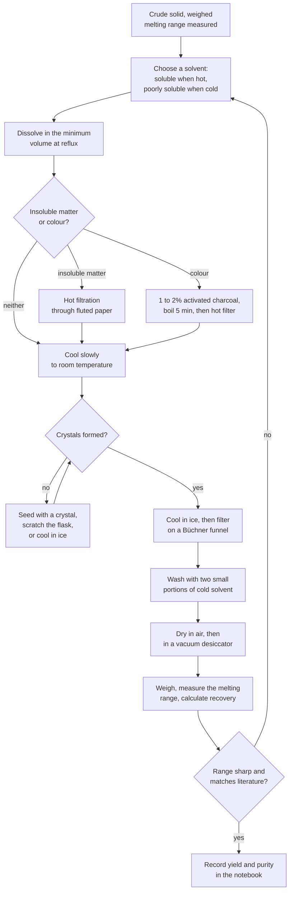
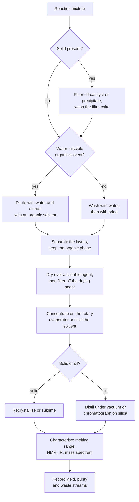

# Laboratory Techniques

> **Level:** Beginner → University
> **Estimated study time:** 4 hours (reading) + 3 hours (exercises)
> **Prerequisites:** [Laboratory Safety](../safety/laboratory-safety.md) · [Equipment](../equipment/laboratory-equipment.md)
> **Related chapters:** [Calculations](../calculations/laboratory-calculations.md) · [Documentation](../documentation/laboratory-documentation.md)
> **Difficulty:** ★★★☆☆

> **Supervision required.** Every technique below is described as a principle and, where useful, as a specification — not as permission to work unsupervised. Carry out practical work only under a trained supervisor, within an approved risk assessment, with the safety data sheet read, the waste route agreed and the emergency equipment located.

---

## 1. Learning objectives

After working through this chapter you will be able to:

- Weigh by difference and explain why it beats direct weighing for hygroscopic solids.
- Fill a volumetric flask to the mark correctly and state the meniscus rule.
- Pipette and titrate to the precision the glassware allows, including a dropwise endpoint and a blank.
- Choose between gravity, vacuum, hot, membrane and syringe filtration for a stated purpose.
- Plan a recrystallisation from solvent selection to a melting-range purity check.
- Select a distillation mode from the boiling-point difference, pressure and azeotrope behaviour.
- Calculate the efficiency of an extraction and choose a drying agent.
- Describe the principles that keep air- and moisture-sensitive work safe.

---

## 2. Introduction

A technique is a procedure plus the judgement to know when it has failed. Two students can follow the same sheet and obtain results differing by 5%, because one reads the meniscus at eye level, drains the pipette for the stated time and swirls the flask at the endpoint, and the other does not. The difference is not knowledge; it is trained motor habit plus the discipline to check.

Three ideas run through this chapter. **Quantitative transfer** means that nothing is lost between the vessel where a substance is weighed and the vessel where it is measured. **Control of the environment** means temperature, moisture, light and air are managed deliberately rather than inherited from the room. **Observation before inference** means the notebook records what happened — the colour, the odour, the temperature, the time — before anyone decides what it means.

| Symbol | Meaning | SI unit |
|---|---|---|
| $m$ | Mass | kg (practical: g, mg) |
| $V$ | Volume | m³ (practical: cm³ = 10⁻⁶ m³) |
| $c$ | Amount concentration | mol m⁻³ (practical: mol dm⁻³) |
| $n$ | Amount of substance | mol |
| $R_{\mathrm{f}}$ | Retention factor in planar chromatography | dimensionless |
| $K_{\mathrm{D}}$ | Distribution (partition) coefficient | dimensionless |
| $\alpha$ | Relative volatility of two components | dimensionless |
| $T$ | Thermodynamic temperature | K |
| $p$ | Pressure | Pa |
| $a_{\mathrm{RCF}}$ | Relative centrifugal acceleration | dimensionless multiple of $g$ |

---

## 3. Weighing

### 3.1 Tare and weighing by difference

**Taring** sets the balance to zero with an empty container on the pan, so the display shows the mass of contents alone. It is convenient and acceptable for stable, non-hygroscopic solids that will be used entirely.

**Weighing by difference** is the reference method. The container is weighed before and after the transfer, and the mass of the sample is the difference. It is slower by one reading but immune to most of the errors that plague taring:

- the container's mass does not need to be stable, only its change to be measured over minutes;
- material that clings to the boat or spatula is automatically accounted for;
- the sample never has to be transferred completely, only reproducibly;
- hygroscopic solids can be kept stoppered between the two readings.

$$
m_{\text{sample}} = m_{\text{container + sample}} - m_{\text{container}}
$$

| Symbol | Meaning | Unit |
|---|---|---|
| $m_{\text{sample}}$ | Mass transferred | g |
| $m_{\text{container + sample}}$ | Reading after transfer | g |
| $m_{\text{container}}$ | Reading before transfer | g |

The uncertainty is the quadrature sum of two reading uncertainties, so a by-difference weighing on a 0.1 mg balance carries about ±0.14 mg.

### 3.2 Hygroscopic, volatile and static-prone solids

| Problem | Behaviour | Control |
|---|---|---|
| **Hygroscopic** ($\ce{NaOH}$, $\ce{CaCl2}$, many hydrates) | Mass rises continuously in humid air | Keep stoppered; weigh quickly; dry the sample beforehand per the method; use a glove bag for extreme cases |
| **Efflorescent** ($\ce{Na2CO3.10H2O}$) | Loses water to dry air | Store in a sealed vessel; do not dry in an oven |
| **Volatile** (iodine, camphor, menthol) | Mass falls while being weighed | Cool before weighing; cap the vessel; work quickly |
| **Static-prone** (fine powders, plastics) | Reading drifts; powder jumps to the glass | Aluminium dish, ionising blower, antistatic kit, grounded balance, 45–60% relative humidity |
| **Warm from drying** | Convection currents inside the shield | Cool in a desiccator to room temperature before weighing |

### 3.3 Fully specified procedure — weighing a primary standard by difference

1. Dry the standard as the method specifies (for example sodium carbonate at 260–270 °C for 1 h) and cool it in a desiccator.
2. Switch on the balance, allow warm-up, and confirm the daily check has been passed.
3. Place a clean, dry, labelled weighing bottle on the pan and tare, or record its mass to 0.1 mg.
4. Use a clean spatula to transfer slightly more than the calculated mass into a tared beaker; do not weigh into the volumetric flask.
5. Re-weigh the bottle and compute the mass transferred by difference; record both readings, not only the difference.
6. Dissolve the solid completely in the beaker with about half the final volume of solvent, then transfer quantitatively (Section 5).
7. Record the actual mass, the balance identifier, and the time.

**Worked Example 3.1 — Mass needed for a standard.** To prepare 250.0 cm³ of 0.1000 mol dm⁻³ sodium carbonate, $n = 0.1000 \times 0.2500 = 0.02500$ mol and $m = n M = 0.02500 \times 105.99 = 2.650$ g. Weighing 2.6497 g by difference gives $c = 2.6497/(105.99 \times 0.2500) = 0.10000$ mol dm⁻³; weighing 2.6512 g gives 0.10006 mol dm⁻³, so the fourth figure is already uncertain and the result is reported to four significant figures.

---

## 4. Volumetric transfer and the meniscus rule

Water wets glass, so the surface in a narrow tube curves downward. **The volume is read at the bottom of the meniscus**, with the eye level with the mark and a dark card behind the neck to sharpen the contrast. For mercury, which does not wet glass, the top of the meniscus is read; that exception matters in barometry and in mercury thermometers, not in aqueous volumetric work.

The rules that make the difference between 0.05% and 0.5%:

- Read at eye level. A parallax error of 1 mm on a 250 cm³ flask neck is about 0.1 cm³.
- Fill until the bottom of the meniscus sits on the graduation line, then add the last drops from a dropping pipette held above the neck.
- Wet the neck above the mark? Never blot it dry — the paper wicks liquid out of the flask. Refill and start again, or record the deviation.
- Mix after making to the mark: stopper and invert at least ten times, or invert and swirl in a consistent rhythm. A dilute solution is denser than water and sits at the bottom if you do not mix.
- Wait for the flask to reach 20 °C before the final adjustment, and note the temperature if it does not.
- Never heat a volumetric flask, never store solutions in one for long periods (the glass slowly leaches alkali and the stopper may freeze), and never use one as a reaction vessel.

**Quantitative transfer** is the other half of the technique. After dissolving in a beaker, pour the solution down a glass rod into the flask, then rinse the beaker, rod and any watch glass with three small portions of solvent, adding each rinse to the flask. The final rinse should be visibly clear; if it is not, the transfer is incomplete.

---

## 5. Preparing a standard solution

A **primary standard** is a substance pure enough, stable enough and heavy enough per mole to be weighed directly: potassium hydrogen phthalate, sodium carbonate, potassium dichromate, oxalic acid dihydrate, sodium chloride, silver nitrate (dried), sulfamic acid and tromethamine are common choices. A **secondary standard** is standardised against a primary standard, as sodium hydroxide and hydrochloric acid must be.

| Requirement of a primary standard | Why it matters |
|---|---|
| Purity ≥ 99.9% and known | The mass must represent moles exactly |
| Stable in air, non-hygroscopic | Weighing cannot change the amount |
| High molar mass | A small relative weighing error gives a large mass |
| Readily soluble | Quantitative transfer without heating |
| Non-toxic and cheap enough to discard | Practical reality |

**Procedure 5.1 — preparing 250.0 cm³ of 0.1000 mol dm⁻³ sodium carbonate.**

1. Dry $\ce{Na2CO3}$ at 260–270 °C for 1 h, cool in a desiccator, and store stoppered.
2. Calculate the mass (2.650 g), then weigh 2.64–2.66 g by difference into a clean 250 cm³ beaker.
3. Add about 100 cm³ of distilled water and stir until fully dissolved; warming to 40 °C is acceptable if the method allows it.
4. Transfer quantitatively through a glass rod into a 250.0 cm³ Class A flask, rinsing the beaker and rod three times with about 10 cm³ of water.
5. Add water to about 2 cm below the mark, swirl, and allow the flask to stand until it is at room temperature.
6. Fill to the mark with a dropping pipette, bottom of the meniscus on the line, eye level.
7. Stopper and invert at least ten times; invert with a 180° turn each time so the bubble travels the full length.
8. Transfer to a labelled reagent bottle: name, concentration, date, analyst, and the balance used. Do not store the solution in the volumetric flask.

---

## 6. Pipetting

| Step | Correct action | Why |
|---|---|---|
| Inspect | Check the tip for chips and the bulb for cracks | A chipped tip delivers an unknown volume |
| Rinse | Rinse three times with the solution to be pipetted | Residual water dilutes the aliquot |
| Fill | Draw liquid above the mark with a bulb or pump | Mouth pipetting is prohibited |
| Adjust | Meniscus to the mark, eye level, tip touching the wall | Parallax and hanging drops bias the volume |
| Deliver | Hold vertically, tip against the receiving wall at about 45°, allow free drainage | The calibration assumes a defined drainage |
| Drain time | Typically 15 s for water at 20 °C; then touch off the residual drop | Blowing out adds a volume that was never calibrated |
| Clean | Rinse with water, then distilled water, and store upright | Detergent residues change the drainage film |

**Common pipetting errors and their signs.** A drop left hanging on the tip means the delivery was short by 0.02–0.05 cm³. Pipetting a cold solution into a warm flask changes the delivered volume by the liquid's expansion, about 0.02% per kelvin. Pipetting a volatile solvent without pre-wetting the vapour space causes evaporation inside the pipette and a short delivery that grows with delay. Pipetting a viscous liquid with an air-displacement micropipette gives a systematic under-delivery: use positive displacement, or a "reverse pipetting" technique, and calibrate with the actual liquid.

For micropipettes, the standard check is gravimetric: dispense distilled water at a known temperature onto a balance, convert mass to volume with the density at that temperature, and compare with the nominal volume at nominal and at 10% of nominal, per ISO 8655.

---

## 7. Burette use and reading

A burette is read to 0.05 cm³ by interpolation between 0.1 cm³ graduations. Record both the initial and the final reading, to two decimal places, and never record only the difference.

- Mount the burette vertically in a stand, with the tip about 2 cm inside the mouth of the receiving flask.
- Rinse with titrant, fill, and purge the tip; a bubble in the tip or below the stopcock will be delivered as a volume jump.
- Set the initial reading near 0.00 cm³ so that the titre is a single long reading plus a short one.
- Read at eye level, with a white card behind the meniscus and a black card behind the upper part of the column to define the curve; the bottom of the meniscus is the reading.
- Deliver at about 10 cm³ min⁻¹ with continuous swirling, then dropwise as the indicator colour begins to change, and finally in half-drops washed in with distilled water from a wash bottle.
- Stop at the first permanent colour change that survives 30 s of swirling (for permanganate, 30 s of pink).
- Finish with the tip touching the flask wall, and read again.

---

## 8. Titration technique

The **endpoint** is what you observe; the **equivalence point** is what stoichiometry defines. Technique exists to bring them together, and the **indicator blank** measures the difference between them for a given indicator volume and solvent.

| Element | Specification | Consequence if neglected |
|---|---|---|
| **Rinse** | Burette and pipette rinsed with their own solutions | Dilution or contamination biases every titre |
| **Aliquot** | Delivered by Class A pipette, with drainage time | A beaker-measured aliquot destroys the precision |
| **Dilution** | Flask contents diluted to about 100 cm³ before titrating | Poor mixing near the endpoint, local colour flashes |
| **Indicator** | 2–3 drops of a 0.1% solution, added with a dropper | Excess indicator shifts the endpoint |
| **Swirl** | Continuous, gentle, keeping the tip clear | Titrant pools and reacts late |
| **Dropwise approach** | Last 1 cm³ added in 0.05 cm³ increments | Overshoot of 0.1 cm³ is 0.5% on a 20 cm³ titre |
| **Blank** | Same volume, same indicator, same final volume, no analyte | The blank is subtracted, not ignored |
| **Repeat** | At least two concordant titres within 0.10 cm³ | A single titre cannot reveal a systematic error |

### 8.1 Indicator selection

| Indicator | pH range | Acid colour | Base colour | Typical use |
|---|---|---|---|---|
| **Methyl orange** | 3.1–4.4 | Red | Yellow | Strong acid with weak base; strong acid with carbonate |
| **Bromocresol green** | 3.8–5.4 | Yellow | Blue | Weak base titrations |
| **Methyl red** | 4.4–6.2 | Red | Yellow | Strong acid with weak base |
| **Bromothymol blue** | 6.0–7.6 | Yellow | Blue | Neutralisation of strong acid and strong base |
| **Phenol red** | 6.8–8.4 | Yellow | Red | Biological and neutral solutions |
| **Phenolphthalein** | 8.3–10.0 | Colourless | Pink | Weak acid with strong base; strong base with strong acid |
| **Thymol blue** | 8.0–9.6 | Yellow | Blue | Strong base titrations |

Choose the indicator whose transition range brackets the pH at the equivalence point, which for a weak acid titrated with a strong base lies above 7 and for a weak base with a strong acid below 7. A one-colour indicator such as phenolphthalein is easier to judge than a two-colour one, which is why it dominates teaching laboratories. Indicator concentration matters: excess indicator consumes titrant and shifts the endpoint, so 2–3 drops of a 0.1% solution is a specification, not a suggestion.

**Procedure 8.2 — acid–base titration with a blank.**

1. Pipette 25.00 cm³ of the analyte into a 250 cm³ conical flask and dilute to about 100 cm³.
2. Add 3 drops of the indicator the method specifies (Table in Section 8.1) and swirl.
3. Fill and zero the burette with the titrant, and record the initial reading.
4. Titrate with swirling until a faint colour persists for 30 s, approaching the endpoint dropwise.
5. Record the final reading, refill, and repeat until two titres agree within 0.10 cm³.
6. Run a blank: 100 cm³ of distilled water with the same indicator, titrated to the same colour; subtract the blank volume from the mean titre.

**Worked Example 8.1 — Blank correction.** Titres of 24.36, 24.34 and 24.38 cm³ give a mean of 24.36 cm³. The blank is 0.06 cm³, so the corrected titre is 24.30 cm³. For 25.00 cm³ of 0.1000 mol dm⁻³ sodium hydroxide titrated with hydrochloric acid, $c(\ce{HCl}) = 0.1000 \times 25.00/24.30 = 0.1029$ mol dm⁻³. Using the uncorrected mean would give 0.1027 mol dm⁻³ — a 0.2% bias, larger than the reading uncertainty, and entirely avoidable.

---

## 9. Filtration

| Mode | When to use it | Practical specification |
|---|---|---|
| **Gravity, fluted paper** | Removing a little insoluble material; hot solutions | Flute the paper, wet it, run the stem full; keep the cone covered with a watch glass |
| **Gravity, hot filtration** | Removing charcoal or insoluble matter from a hot solution | Preheat the funnel and use a short-stem funnel; work quickly; keep the filtrate hot |
| **Büchner, vacuum** | Recovering a crystalline product | Wet the paper with solvent, pour, wash the cake with cold solvent, suck dry |
| **Hirsch, vacuum** | Small volumes, less holdup | Same technique, narrower funnel |
| **Sintered glass** | Precipitates that will be ignited | Match porosity to particle size; never use with $\ce{HF}$ |
| **Membrane, 0.45 µm** | Clarifying a liquid before analysis | One-way filtration; do not let the membrane run dry |
| **Syringe filter, 0.22 µm** | Small volumes before HPLC or GC | Discard the first drops; check solvent compatibility |

Two rules prevent most failures. First, **never let a hot saturated solution cool in a funnel**: crystals block the paper and the filtrate is lost. Second, **never apply full vacuum to a boiling filtrate**: the solvent boils, the filtrate foams over, and the filter flask can implode. Use a thick-walled flask, a trap and a controlled vacuum.

**Washing a filter cake** is a balance: too little leaves mother liquor (and its impurities) in the product, too much dissolves the product. The efficient method is two or three small portions of cold solvent, each drawn through before the next is added, rather than one large portion.

---

## 10. Recrystallisation

Recrystallisation purifies by dissolving a solid in a hot solvent and recovering it slowly on cooling, leaving impurities in the mother liquor or on the filter. It works because the crystal lattice excludes most impurities, and it fails when the impurity is isomorphous, present at high concentration, or when the product oils out instead of crystallising.

**Choosing the solvent.** Target a solvent in which the solid is soluble at the boiling point but poorly soluble at room temperature, typically a solubility ratio above 10, with no reaction with the solute, a boiling point between 50 and 100 °C, low toxicity and easy removal. Common pairs are ethanol–water for polar organics, hexane–ethyl acetate for non-polar organics, and water for salts and sugars.

**Figure 1 — The recrystallisation cycle.** The loop back from the purity check to solvent selection is the point of the diagram: a widened melting range is evidence that the first solvent choice failed, not an inconvenience to be reported and forgotten. Note also that cooling is slow at first and fast at the end — slow cooling grows larger, purer crystals, while rapid cooling traps mother liquor in the lattice.

**Procedure 10.1 — recrystallisation on a 5 g scale.**

1. Weigh the crude solid and measure its melting range so that purification can be demonstrated, not assumed.
2. Place the solid in a round-bottom flask with a stirrer bar and a reflux condenser, and add the chosen solvent in 5 cm³ portions, heating to reflux between additions, until the solid just dissolves.
3. Add about 10% more solvent than the minimum, so that saturation is not reached at the boiling point.
4. If insoluble material remains, filter hot through a preheated fluted funnel or a hot sinter, keeping the filtrate hot.
5. If the solution is coloured, cool it slightly below reflux, add 1–2% w/w activated charcoal, boil for 5 min, and filter hot through a pad of Celite. Charcoal adsorbs product as well as colour, so it is used sparingly and never with easily oxidised compounds.
6. Allow the filtrate to cool slowly to room temperature, undisturbed, then cool in an ice bath for at least 30 min.
7. Collect the crystals on a Büchner funnel, press dry, and wash with two small portions of ice-cold solvent.
8. Dry in air, then in a vacuum desiccator or oven at a temperature below the melting point.
9. Weigh, calculate the recovery, and measure the melting range alongside the crude material.

**Worked Example 10.1 — Recovery and the meaning of a melting range.** Crude benzoic acid (5.00 g) with a melting range of 118–124 °C was recrystallised from water to give 4.82 g of colourless plates, melting range 121.5–122.5 °C (literature 122.4 °C). Recovery $= 4.82/5.00 = 96.4\%$. The narrowed range is the evidence of purity: an impurity lowers the melting point and broadens the range, because the mixture melts over the interval between its solidus and liquidus. A recovery above 100% means the product is wet or contains solvent; a recovery far below 80% usually means too much solvent was used or the product was washed too generously.

**Melting-range test.** Heat at about 1 K min⁻¹ near the transition, report the range as observed, and confirm identity with a mixed melting point against an authentic sample: if the range is undepressed and undivided, the two are the same substance. A depressed and widened range indicates a different compound.

---

## 11. Distillation

Distillation separates by volatility. Which mode you choose depends on the boiling-point difference, the thermal stability of the material, and whether the components form an azeotrope.

| Mode | When | Key setup | Limitation |
|---|---|---|---|
| **Simple** | $\Delta T_{\mathrm{b}} > 25$ °C, or removing a volatile solvent | Still head, thermometer in the vapour path, receiver | Poor separation for close boiling points |
| **Fractional** | $\Delta T_{\mathrm{b}} < 25$ °C | Column with packing or a Vigreux indentations | Holdup, pressure drop, longer time |
| **Vacuum** | Boiling point above about 150 °C at atmospheric pressure, or thermally unstable material | Claisen head, capillary bleed or magnetic stirring, trap, manometer | Bumping; superheating; the boiling point must be quoted with its pressure |
| **Steam** | Immiscible, steam-volatile organic compounds | Steam inlet, condenser, receiver | Only for water-insoluble, steam-stable compounds |
| **Kugelrohr (bulb-to-bulb)** | Small samples, high boiling point | Short path under high vacuum | Crude fractionation |

**Fractional distillation theory.** In an ideal binary mixture the vapour is richer in the more volatile component:

$$
y = \frac{\alpha x}{1 + (\alpha - 1)x} \qquad \alpha = \frac{p_{\mathrm{A}}^{\circ}}{p_{\mathrm{B}}^{\circ}}
$$

| Symbol | Meaning | Unit |
|---|---|---|
| $x$ | Mole fraction of the more volatile component in the liquid | dimensionless |
| $y$ | Mole fraction in the vapour in equilibrium with it | dimensionless |
| $\alpha$ | Relative volatility | dimensionless |
| $p^{\circ}$ | Saturated vapour pressure of a pure component | Pa |

*Assumptions:* ideal solution, ideal gas, Raoult's law and Dalton's law. Real mixtures deviate, sometimes strongly, and that deviation is the origin of azeotropes.

Column performance is described by the number of theoretical plates $N$ and the height equivalent to a theoretical plate, $\mathrm{HETP} = L/N$, with $L$ the packed length. A Vigreux column of 20 cm may give 5–10 plates; a well-packed column gives far more. Vacuum distillation lowers the boiling point substantially — consult a pressure–temperature nomograph rather than extrapolating a rule of thumb.

**Azeotropes.** A minimum-boiling azeotrope cannot be separated by distillation alone: ethanol–water boils at 78.2 °C at 95.6% w/w ethanol, and further distillation gives the same composition. Toluene–water and butan-1-ol–water are further examples. Maximum-boiling azeotropes (for example nitric acid–water at about 68% acid) behave in the opposite sense. Breaking an azeotrope requires a change of pressure, an entrainer, or a different separation method such as drying or adsorption.

**Worked Example 11.1 — Vapour composition on a column.** For an ideal binary mixture with $\alpha = 2.5$ and a liquid mole fraction $x = 0.30$, the equilibrium vapour is $y = (2.5 \times 0.30)/(1 + 1.5 \times 0.30) = 0.75/1.45 = 0.517$. One theoretical plate therefore raises the mole fraction from 0.30 to 0.52; five such plates, applied successively, approach the pure component. This is why a fractionating column earns its length: the separation is multiplicative in the number of equilibrations, not additive.

---

## 12. Rotary evaporation

Rotary evaporation is distillation under reduced pressure with the flask rotating in a warm bath. The rotation creates a thin film, the vacuum lowers the boiling point and the condenser recovers the solvent.

- Fill the flask to no more than half its volume; foaming mixtures to less.
- Start rotation before vacuum, and apply vacuum slowly through a controller.
- Set the bath 10–20 °C above the boiling point at the working pressure; hotter baths cause bumping, not speed.
- Cool the condenser (tap water for high-boiling solvents, a dry-ice trap for low-boiling ones) and always place a cold trap before the pump.
- Do not evaporate to dryness if the residue is thermally unstable, prone to peroxidation, or likely to foam; stop while the flask still has liquid.
- Vent the system before switching off the rotation, and never lift the flask while it is under vacuum.

---

## 13. Liquid–liquid extraction and the partition coefficient

Two immiscible solvents distribute a solute according to its **distribution coefficient**:

$$
K_{\mathrm{D}} = \frac{[\mathrm{solute}]_{\text{organic}}}{[\mathrm{solute}]_{\text{aqueous}}}
$$

For a fixed total volume of extracting solvent, several small portions extract more than one large portion. After $n$ extractions with organic volume $V_{\mathrm{o}}$ from aqueous volume $V_{\mathrm{aq}}$, the fraction remaining in the aqueous phase is

$$
f_{\text{remaining}} = \left(\frac{V_{\mathrm{aq}}}{V_{\mathrm{aq}} + K_{\mathrm{D}} V_{\mathrm{o}}}\right)^{n}
$$

| Symbol | Meaning | Unit |
|---|---|---|
| $K_{\mathrm{D}}$ | Distribution coefficient at the working temperature | dimensionless |
| $V_{\mathrm{aq}}$, $V_{\mathrm{o}}$ | Volumes of the two phases in each extraction | m³ (practical: cm³) |
| $n$ | Number of successive extractions | dimensionless |
| $f_{\text{remaining}}$ | Fraction of solute left in the aqueous phase | dimensionless |

*Assumptions:* the two phases are immiscible, the solute does not associate or dissociate, equilibrium is reached each time, and volumes are additive.

**Worked Example 13.1 — One portion or two?** A solute with $K_{\mathrm{D}} = 8.0$ is dissolved in 100 cm³ of water. Extracting once with 100 cm³ of ether leaves $f = 100/(100 + 8.0 \times 100) = 0.111$, so 88.9% is recovered. Extracting twice with 50 cm³ leaves $f = [100/(100 + 8.0 \times 50)]^2 = (0.200)^2 = 0.040$, so 96.0% is recovered. Same solvent volume, 7 percentage points more product — the reason the technique is always taught in portions.

**Technique.** Use a funnel no more than two-thirds full, vent after every shake with the stem pointed away from people, and let the layers settle completely before separating. Know the densities: dichloromethane (1.33 g cm⁻³) sinks, diethyl ether (0.71 g cm⁻³) floats. Back-extract when the product is in the wrong phase, and wash with brine to break emulsions and remove residual water. **Never discard a layer until the other has been secured.**

---

## 14. Drying agents

| Agent | Strength | Best for | Avoid with |
|---|---|---|---|
| **Anhydrous $\ce{MgSO4}$** | Moderate, fast | Most organic extracts | Very acid-sensitive material (slightly acidic) |
| **Anhydrous $\ce{Na2SO4}$** | Moderate, slow, high capacity | Large volumes, acid-sensitive compounds | Time-critical work |
| **$\ce{CaSO4}$ (Drierite)** | Moderate | Solvents, gases | Compounds that bind sulfate |
| **$\ce{CaCl2}$** | Fast | Hydrocarbons, ethers | Alcohols, amines, acids (forms complexes) |
| **$\ce{K2CO3}$** | Mild, basic | Alcohols, amines, acid-sensitive extracts | Acids |
| **Molecular sieves 3A/4A** | Very strong | Solvents for moisture-sensitive reactions | Large or branched molecules that enter the pores |
| **$\ce{P2O5}$** | Very strong | Gases, rigorous drying | Acid-sensitive, easily dehydrated material |
| **Sodium metal / $\ce{CaH2}$** | Extreme | Ethers and THF before distillation | Anything reactive; specialist supervision only |

Add enough agent to swirl freely (roughly 1 g per 10 cm³), swirl, and allow 10–15 min. Cloudiness that persists after adding fresh agent means the drying is incomplete or an emulsion is present. Filter the agent off before concentrating; never leave a dried solution standing on a strong agent for days.

---

## 15. Sublimation

Sublimation purifies a solid that passes directly to vapour and back, leaving non-volatile impurities behind. It suits camphor, naphthalene, iodine, ferrocene and many small, volatile organics. A cold finger is suspended above the heated solid under vacuum; the pure material condenses on the finger and is scraped off. The method gives high purity with minimal solvent, but it is slow, limited to volatile solids, and unsuitable when the compound decomposes near its sublimation temperature.

---

## 16. Chromatography as a preparative technique

### 16.1 Thin-layer chromatography

TLC is the analytical scout for a column. A plate is spotted with the mixture and an authentic reference, developed in a sealed tank with a shallow pool of eluent, dried, and visualised.

$$
R_{\mathrm{f}} = \frac{\text{distance travelled by the spot}}{\text{distance travelled by the solvent front}}
$$

Report $R_{\mathrm{f}}$ with the eluent composition and the stationary phase, because it is not a constant of the compound: it depends on both. A spot at $R_{\mathrm{f}} = 0.3$–0.4 is the useful target, since it is far enough from the origin to be resolved and far enough from the front to be retained.

| Visualisation | Detects | Note |
|---|---|---|
| **UV 254 nm with fluorescent indicator** | Aromatic and conjugated compounds | Quenches the green background; wear UV goggles |
| **Iodine vapour** | Most organics, reversible | Fades; mark the plate in pencil first |
| **Ninhydrin** | Amino acids and amines | Heat to develop the purple colour |
| **Potassium permanganate** | Oxidisable compounds | Heat; destructive |
| **Phosphomolybdic acid** | Many organics | Heat; broad response |
| **Vanillin–sulfuric acid** | Terpenes, alcohols, steroids | Heat; destructive |

### 16.2 Column chromatography

Silica gel (40–63 µm) with a hexane–ethyl acetate gradient is the default for small organic molecules; alumina is used for amines and acid-sensitive compounds. Load the sample as a concentrated solution adsorbed on a small amount of silica, or as a dry pre-adsorbed plug, at 1:20 to 1:100 of sample to sorbent by mass. Choose the eluent so that the target has $R_{\mathrm{f}} \approx 0.3$ on TLC, then collect fractions and monitor them by TLC. Never let the column run dry, and never apply pressure to a column that is not rated for it.

**Worked Example 16.1 — From $R_{\mathrm{f}}$ to a column.** A spot travels 1.4 cm while the solvent front travels 4.0 cm, so $R_{\mathrm{f}} = 0.35$. Transferring the same system to a column, the compound is retained for roughly three to four column volumes of eluent, and the fraction containing it will be broader than the spot. If $R_{\mathrm{f}}$ were 0.85, the compound would elute with the solvent front and resolution would be lost; if 0.05, it would not move. The TLC is therefore a design tool, not just a purity check.

---

## 17. Centrifuging

Centrifugation separates by density without filtration, and it is the method of choice for small volumes, for gelatinous precipitates that blind a filter, and for biological samples.

- Balance opposite tubes by mass to the rotor's tolerance, usually 0.1 g.
- Use tubes rated for the applied RCF, filled to the level the manufacturer specifies.
- Cap aerosol-tight for hazardous or infectious material, and open in a fume hood or cabinet.
- Never exceed the rotor's rated speed or its rated number of cycles, and log every run.
- Do not open the lid until the rotor has stopped; do not use the brake on density gradients unless the protocol allows it.
- After the run, allow pellets to drain before resuspending, and do not disturb the pellet when removing supernatant.

---

## 18. Handling air- and moisture-sensitive reagents

Two techniques cover almost all of this work: the **Schlenk line** and the **glovebox**.

A Schlenk line is a dual manifold — vacuum on one side, purified inert gas on the other — connected through a rotary valve to the glassware. The principle is to evacuate and refill the apparatus several times so that air is diluted below the level at which it matters, then to keep a slight positive pressure of inert gas during the experiment. Standard operations are:

- **Evacuate–refill cycles** (three or more) on an empty apparatus before introducing reagents.
- **Cannula transfer** driven by the pressure difference between two flasks, never by mouth.
- **Freeze–pump–thaw** degassing of liquids: freeze in liquid nitrogen, evacuate, thaw, refill with inert gas, repeated three times.
- **Liquid handling** with gas-tight syringes through septa, and **solids** added in a glovebox or through a solids-addition flask against a counter-flow of inert gas.
- A **bubbler** or oil trap to monitor the positive pressure, and a **cold trap** to protect the pump from solvent.

A **glovebox** is used when the reagent is pyrophoric, when oxygen must stay below 1 ppm, or when a Schlenk line cannot keep up with the sensitivity of the material. Materials enter through an antechamber that is evacuated and refilled several times; the atmosphere is circulated through a regenerable catalyst that removes oxygen and moisture; gloves are inspected before each session, and sharp objects are handled with care because a pinhole admits air directly to the sample.

**Never** attempt this work alone or without specific training: pyrophoric reagents ignite on contact with air, and a vacuum manifold that is mis-assembled can implode or admit air to a reactive mixture.

---

## 19. Scale and hazard note

| Technique | Typical scale | Principal hazard | Key control |
|---|---|---|---|
| Weighing | 1 mg – 100 g | Dust inhalation; static; spillage | Balance enclosure; local exhaust for powders; antistatic kit |
| Volumetric transfer | 1 – 1000 cm³ | Broken glass; chemical splash | Goggles; inspect glassware; no mouth pipetting |
| Titration | 10 – 100 cm³ | Corrosive titrants; indicator stains | Burette stand; secondary containment; neutralise waste |
| Gravity filtration | 10 – 500 cm³ | Hot solvent burns; vapour | Fume hood; heat-resistant gloves; watch glass cover |
| Vacuum filtration | 10 – 500 cm³ | Implosion; boiling filtrate | Thick-walled flask; trap; controlled vacuum |
| Recrystallisation | 1 – 100 g | Flammable vapour; hot oil or water bath | Reflux condenser; hotplate, not flame; bath secured |
| Distillation | 10 – 1000 cm³ | Flammable vapour; overpressure; implosion | Closed system vented to a trap; blast shield; no naked flame |
| Rotary evaporation | 50 – 1000 cm³ | Bumping; implosion; vapour release | Cold trap; pressure controller; contained and vented |
| Liquid–liquid extraction | 50 – 1000 cm³ | Pressure in the funnel; emulsion; toxic solvent | Vent frequently; goggles; gloves; fume hood |
| Column chromatography | 0.1 – 100 g | Silica dust; large solvent volumes | Fume hood; dust mask when weighing silica; solvent recovery |
| TLC | µg – mg | Solvent vapour; UV exposure | Develop in a hood; UV goggles; pencil, not pen, for marking |
| Centrifugation | 0.2 – 50 cm³ | Aerosol release; rotor failure | Balanced, capped tubes; rated rotor; log book |
| Schlenk or glovebox work | mg – 10 g | Pyrophoric reagents; inert-gas asphyxiation | Trained supervision only; leak test; oxygen monitor |

---

## 20. A general work-up

**Figure 2 — A general work-up.** The decision points are the ones that most often go wrong: whether a solid should be filtered before or after dilution, whether the product is in the organic or the aqueous layer, and whether the residue is a solid worth recrystallising or an oil needing distillation or chromatography. Write the work-up plan before you start the reaction, and annotate it with what actually happened.

---

## 21. Common mistakes

| Mistake | Why it happens | Correct approach |
|---|---|---|
| Weighing directly into a volumetric flask | It fits on the balance and saves a transfer | Weigh into a beaker, dissolve, then transfer quantitatively |
| Filling a flask to the mark before the solid has dissolved | The volume looks right immediately | Dissolve first, then make to the mark |
| Not mixing after making to the mark | The meniscus is correct, so the job seems done | Stopper and invert at least ten times |
| Blowing out a volumetric pipette | "It leaves liquid behind" | The residual drop is calibrated; blow out only if marked |
| Titrating past the endpoint and "correcting" | The colour overshoots | Approach dropwise from 1 cm³ away; repeat instead |
| Omitting the indicator blank | It seems like a formality | Run a blank with the same volumes and subtract it |
| Cooling a hot solution quickly | Impatience | Cool slowly at first; ice only at the end |
| Using too much charcoal | "More will make it purer" | 1–2% w/w; charcoal adsorbs product too |
| Washing a filter cake with a large volume of solvent | It looks thorough | Several small portions of ice-cold solvent |
| Distilling to dryness under vacuum | Convenience | Leave liquid in the flask; decomposed residues are a hazard |
| Drying an extract and leaving it on the agent for days | It is forgotten | Filter the agent off once drying is complete |
| Venting a separatory funnel towards a neighbour | Habit | Point the stem away from people and into the hood |

---

## 22. Summary

- Weighing by difference is the reference method because it is immune to container drift and sample holdup.
- Hygroscopic, volatile and static-prone solids each need a specific control, not more care in general.
- Read the bottom of the meniscus at eye level, and mix after making to the mark.
- Quantitative transfer means rinsing every vessel that held the sample into the volumetric flask.
- A primary standard is weighed; a secondary standard is standardised against one.
- A pipette drains for a defined time and must not be blown out; a burette is read to 0.05 cm³ and both readings recorded.
- The endpoint is observed, the equivalence point is calculated, and the blank measures the difference.
- Filtration mode follows from the purpose: recovery, clarification or ignition.
- Recrystallisation succeeds through solvent choice, slow cooling and a purity check by melting range.
- Distillation mode follows from the boiling-point difference, the pressure and the presence of an azeotrope.
- Several small extractions beat one large one, because the fraction remaining falls exponentially with the number of extractions.
- Drying agents differ in strength and in what they destroy; charcoal, silica and molecular sieves all adsorb more than you expect.
- Schlenk and glovebox technique is a discipline of excluding air, not a set of gestures.

---

## 23. Exercises

1. Explain why weighing by difference gives a more reliable mass than taring for a hygroscopic solid.
2. State the meniscus rule for water and for mercury, and explain the physical reason for the difference.
3. Why must a volumetric flask be at room temperature before the final adjustment to the mark?
4. A pipette is blown out after delivery. In which direction is the delivered volume biased, and by roughly how much for a 25 cm³ pipette?
5. A titration gives titres of 23.85, 23.90 and 24.30 cm³. What should you do, and why is the third value not simply averaged?
6. A recrystallisation gives 4.10 g from 5.00 g of crude material. Calculate the recovery and state two plausible reasons for the loss.
7. An extraction uses 50 cm³ of water and 50 cm³ of ether with $K_{\mathrm{D}} = 6.0$. Calculate the fraction remaining after one extraction and after two extractions with 25 cm³ each.
8. A TLC spot travels 2.1 cm and the solvent front 6.0 cm. Calculate $R_{\mathrm{f}}$ and state what you would change to bring it to 0.3.

---

## 24. Answers

1. Because the container's mass need not be stable, only its change over a few minutes; material left in the boat is accounted for, and the sample can stay stoppered between readings. Taring measures the contents directly and is vulnerable to both drift and incomplete transfer.
2. Water wets glass and forms a concave meniscus, so the bottom is read; mercury does not wet glass and forms a convex meniscus, so the top is read. The difference is surface tension and contact angle, not convention.
3. Water expands about 2.1 × 10⁻⁴ K⁻¹, so filling warm and cooling to 20 °C would leave the flask below the mark; a 5 K difference is about 0.1% in volume.
4. The volume is biased high, because the drop that was retained in the tip is added; for a 25 cm³ pipette the residual is typically 0.02–0.05 cm³, or 0.1–0.2%.
5. The third titre is 0.4 cm³ above the others, far outside the 0.10 cm³ concordance limit. Do not average it: inspect the burette for a bubble or a leak, check for an indicator error, and repeat. A single discordant result is evidence of a fault, not a data point to be trimmed.
6. Recovery $= 4.10/5.00 = 82.0\%$. Losses arise from solubility in the mother liquor, from washing with too much solvent, from product left on the filter or glassware, and from an oil that did not crystallise.
7. One extraction: $f = 50/(50 + 6.0 \times 50) = 0.143$, so 85.7% extracted. Two extractions with 25 cm³: $f = [50/(50 + 6.0 \times 25)]^2 = (0.250)^2 = 0.0625$, so 93.8% extracted.
8. $R_{\mathrm{f}} = 2.1/6.0 = 0.35$, already close to the target. To lower a high $R_{\mathrm{f}}$, use a less polar eluent; to raise a low one, use a more polar eluent.

---

## 25. Further reading

- Harris, D. C. and Lucy, C. A. *Quantitative Chemical Analysis*, 10th ed. W. H. Freeman, 2019 — volumetric technique, titrations and gravimetry.
- Skoog, D. A., West, D. M., Holler, F. J. and Crouch, S. R. *Fundamentals of Analytical Chemistry*, 9th ed. Cengage, 2013.
- Vogel, A. I. *Vogel's Textbook of Practical Organic Chemistry*, 5th ed., revised by Furniss, B. S. et al. Longman, 1989 — distillation, recrystallisation and work-up.
- Leonard, J., Lygo, B. and Procter, G. *Advanced Practical Organic Chemistry*, 3rd ed. CRC Press, 2013 — air-sensitive technique.
- Shriver, D. F. and Drezdzon, M. A. *The Manipulation of Air-Sensitive Compounds*, 2nd ed. Wiley, 1986.
- Eurachem. *Quantifying Uncertainty in Analytical Measurement* (QUAM), 3rd ed., 2012. <https://www.eurachem.org/>
- International Organization for Standardization. *ISO 8655: Piston-operated volumetric apparatus*; *ISO 648* and *ISO 1042* for volumetric glassware.
- Royal Society of Chemistry. *Practical Laboratory Skills* resources. <https://edu.rsc.org/>
