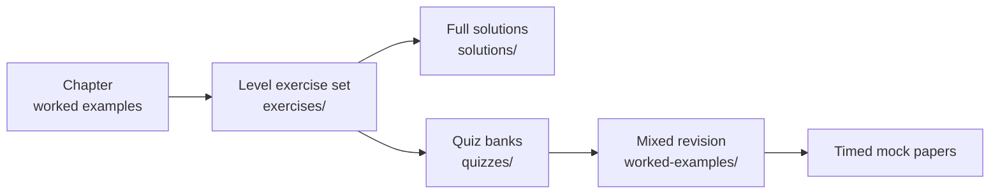
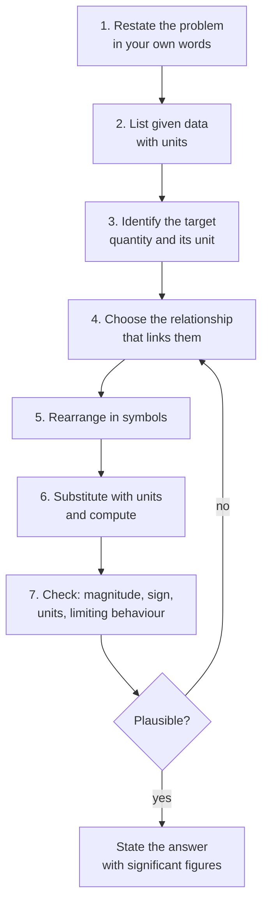

# Problem Solving

> **Chemistry is learned by solving problems, not by reading solutions.** This
> section collects worked examples, graded exercise banks, self-check quizzes and
> full solutions for every level.

---

## 1. How this section is organised

| Folder | Contents |
|---|---|
| [`worked-examples/`](worked-examples/problem-solving-strategies.md) | Cross-topic worked problems and the strategy behind each one |
| [`exercises/`](exercises/README.md) | Index of the per-level exercise banks (the banks themselves live inside each level folder) |
| [`quizzes/`](quizzes/README.md) | Short, self-marking multiple-choice and short-answer checks |
| [`solutions/`](solutions/README.md) | Index of the full solution sets |

---

## 2. The universal problem-solving protocol

Every quantitative problem in this repository can be attacked with the same seven
steps. They are repeated here because repetition is the point.

### Why step 4 is the hard one

Almost all chemistry problems reduce to one of eight relationships:

| Relationship | Used for |
|---|---|
| $n = m/M$ | converting mass to amount |
| $c = n/V$ | solutions |
| $pV = nRT$ | gases |
| Stoichiometric ratio from a balanced equation | all reaction calculations |
| $q = mc\Delta T$ and $q = n\Delta H$ | calorimetry |
| $\Delta G = \Delta H - T\Delta S$ | spontaneity |
| $K$ expressions and the reaction quotient $Q$ | equilibrium |
| $E = E^\circ - (RT/nF)\ln Q$ | electrochemistry |

If a problem seems to need something else, it is usually two of these chained
together. Chaining is the single most examined skill in chemistry.

---

## 3. Six habits that separate strong solvers

1. **Write the balanced equation first.** Always. Even when it "seems unnecessary".
2. **Carry units through every line.** Units catch errors that arithmetic hides.
3. **Estimate before computing.** Two significant figures of mental arithmetic
   catches most order-of-magnitude mistakes.
4. **Name the unknown.** Writing "let $x$ be the amount of $\ce{NaOH}$ in mol" turns
   a word problem into an equation.
5. **Draw it.** A diagram, a table of species, or an ICE table is worth a page of
   prose.
6. **Check the limiting case.** If concentration goes to zero, does the formula
   still give a sensible answer?

---

## 4. Where to start if you are stuck

| Difficulty | First move |
|---|---|
| "I don't know where to begin" | Write down every quantity with units; the relationship usually becomes obvious |
| "I have too many unknowns" | Look for a conservation law: mass, charge, electrons, atoms |
| "The algebra is messy" | Rearrange in symbols before substituting; never substitute early |
| "My answer is wrong but the method seems right" | Check units, then check stoichiometry, then check significant figures |
| "I don't understand the question" | Underline the verb: *calculate*, *explain*, *predict*, *justify* |

---

## 5. Index of problem sets

Each level has a complete exercise bank and solution set:

| Level | Exercises | Solutions |
|---|---|---|
| 0 — Foundations | [level-0-exercises](../01-foundations/exercises/level-0-exercises.md) | [level-0-solutions](../01-foundations/solutions/level-0-solutions.md) |
| 1 — Elementary | [level-1-exercises](../02-elementary-chemistry/exercises/level-1-exercises.md) | [level-1-solutions](../02-elementary-chemistry/solutions/level-1-solutions.md) |
| 2 — Intermediate | [level-2-exercises](../03-intermediate-chemistry/exercises/level-2-exercises.md) | [level-2-solutions](../03-intermediate-chemistry/solutions/level-2-solutions.md) |
| 3 — Advanced | [level-3-exercises](../04-advanced-chemistry/exercises/level-3-exercises.md) | [level-3-solutions](../04-advanced-chemistry/solutions/level-3-solutions.md) |
| 4 — Organic | [level-4-exercises](../05-organic-chemistry/exercises/level-4-exercises.md) | [level-4-solutions](../05-organic-chemistry/solutions/level-4-solutions.md) |
| 5 — Inorganic | [level-5-exercises](../06-inorganic-chemistry/exercises/level-5-exercises.md) | [level-5-solutions](../06-inorganic-chemistry/solutions/level-5-solutions.md) |
| 6 — Physical | [level-6-exercises](../07-physical-chemistry/exercises/level-6-exercises.md) | [level-6-solutions](../07-physical-chemistry/solutions/level-6-solutions.md) |
| 7 — Analytical | [level-7-exercises](../08-analytical-chemistry/exercises/level-7-exercises.md) | [level-7-solutions](../08-analytical-chemistry/solutions/level-7-solutions.md) |
| 8 — Biochemistry | [level-8-exercises](../09-biochemistry/exercises/level-8-exercises.md) | [level-8-solutions](../09-biochemistry/solutions/level-8-solutions.md) |
| 9a — Materials | [level-9a-exercises](../10-materials-and-industrial-chemistry/exercises/level-9a-materials-exercises.md) | [level-9a-solutions](../10-materials-and-industrial-chemistry/solutions/level-9a-materials-solutions.md) |
| 9b — Environmental | [level-9b-exercises](../11-environmental-chemistry/exercises/level-9b-environmental-exercises.md) | [level-9b-solutions](../11-environmental-chemistry/solutions/level-9b-environmental-solutions.md) |
| 10 — Research | [level-10-exercises](../12-research-and-postgraduate-chemistry/exercises/level-10-exercises.md) | [level-10-solutions](../12-research-and-postgraduate-chemistry/solutions/level-10-solutions.md) |

---

## 6. Marking your own work

See [assessment-guide.md §2.3](../00-learning-guide/assessment-guide.md#23-marking-your-own-work)
for the mark allocation used throughout. The short version: method earns 75 % of the
marks, so a wrong final number with a correct method is a pass, and a right number
with no method is not.
