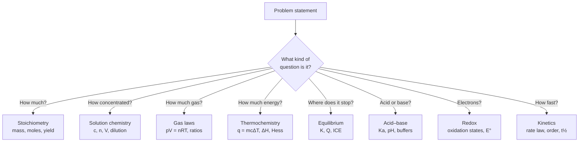
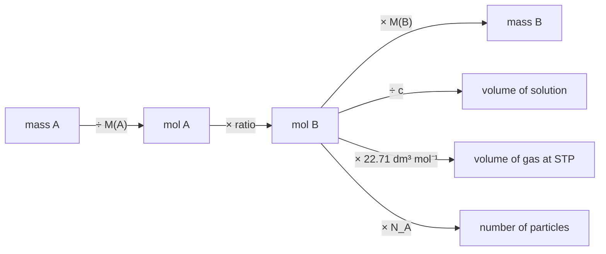
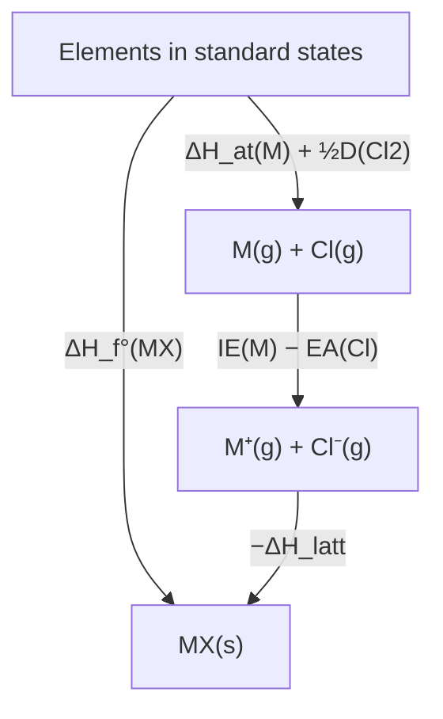

# Problem-Solving Strategies

This page collects the transferable strategies behind the worked examples in every
chapter. Read it once when you start Level 2, and return to it whenever a problem
feels unfamiliar.

---

## 1. The eight recurring problem types

Almost every quantitative problem in the curriculum is one of these, or a chain of
two of them.

**Figure 1 — Classification tree for quantitative problems.** Naming the type
immediately narrows the relationship you need in step 4 of the protocol.

---

## 2. Stoichiometry: the ratio is the whole idea

A balanced equation gives **mole ratios**, never mass ratios. The universal roadmap:

**Figure 2 — The stoichiometric roadmap.** Every arrow is a conversion factor with a
unit; if an arrow has no unit, it is not a conversion.

### Worked example — limiting reactant

> 5.00 g of $\ce{Al}$ reacts with 20.0 g of $\ce{Cl2}$.
> $\ce{2Al + 3Cl2 -> 2AlCl3}$. What mass of $\ce{AlCl3}$ forms?

1. $n(\ce{Al}) = 5.00/26.98 = 0.1853$ mol; $n(\ce{Cl2}) = 20.0/70.90 = 0.2821$ mol.
2. Divide each by its coefficient: $0.1853/2 = 0.09265$; $0.2821/3 = 0.09403$.
3. The smaller quotient identifies the limiting reactant: **Al**.
4. $n(\ce{AlCl3}) = n(\ce{Al}) = 0.1853$ mol.
5. $m = 0.1853 \times 133.34 = 24.7$ g.

**Sanity check:** the chlorine is in slight excess, so the product is capped by the
aluminium. A mass of 24.7 g is less than the 25.0 g of combined reactants, as
conservation of mass requires (the equation conserves mass exactly, since chlorine
is only in 3 % excess).

---

## 3. Equilibrium: always build an ICE table

| | $\ce{A}$ | $\ce{B}$ | $\ce{C}$ |
|---|---|---|---|
| **I**nitial | 1.00 | 1.00 | 0 |
| **C**hange | $-x$ | $-x$ | $+2x$ |
| **E**quilibrium | $1.00 - x$ | $1.00 - x$ | $2x$ |

Then substitute into $K$. The two classic traps:

- Forgetting that $x$ can be large (the small-$x$ approximation fails when
  $x > 5\%$ of the initial concentration).
- Using initial rather than equilibrium concentrations in $K$.

---

## 4. Thermodynamics: draw the cycle

Hess's law problems are graph problems. Draw the species as nodes and the enthalpy
changes as edges; any two routes between the same two nodes sum to the same value.
The Born–Haber cycle is the canonical example (see [Level 3 Ch. 9](../../04-advanced-chemistry/09-coordination-chemistry-and-crystal-field-theory.md)
and [Level 5 Ch. 1](../../06-inorganic-chemistry/01-periodic-chemistry-and-main-group-elements.md)).

**Figure 3 — A Born–Haber cycle.** Sum the clockwise route and equate it to the
direct route: $\Delta H_\mathrm{f}^\circ = \Delta H_\mathrm{at} + \tfrac12 D + \mathrm{IE} - \mathrm{EA} - \Delta H_\mathrm{latt}$.

---

## 5. Acid–base: decide the regime first

| Regime | Condition | Method |
|---|---|---|
| Strong acid | Complete dissociation | $[\ce{H+}] = c$ directly |
| Weak acid | $K_a$ small | ICE table + $K_a$; check $x \ll c$ |
| Buffer | Both HA and A⁻ present | Henderson–Hasselbalch |
| Amphiprotic | e.g. $\ce{HCO3^-}$ | $[\ce{H+}] = \sqrt{K_{a1}K_{a2}}$ |
| Titration, pre-equivalence | Excess acid | stoichiometry, then weak-acid treatment |
| Titration, equivalence | Only conjugate base | hydrolysis |
| Titration, post-equivalence | Excess base | strong base dominates |

Choosing the wrong regime is the single most common source of wrong pH answers.

---

## 6. Kinetics: separate order from stoichiometry

Rate order is **experimental**. Do not read it from the balanced equation unless the
reaction is known to be elementary. Determine order by the method of initial rates,
the integrated rate law, or half-lives.

| Order | Integrated law | Half-life |
|---|---|---|
| 0 | $[A] = [A]_0 - kt$ | $t_{1/2} = [A]_0/2k$ |
| 1 | $\ln[A] = \ln[A]_0 - kt$ | $t_{1/2} = \ln 2/k$ |
| 2 | $1/[A] = 1/[A]_0 + kt$ | $t_{1/2} = 1/(k[A]_0)$ |

Only the first-order half-life is independent of concentration; that independence is
the diagnostic for first order.

---

## 7. Electrochemistry: half-cells, then electrons

1. Write both half-reactions and balance each for atoms and charge.
2. Multiply to equalise the number of electrons transferred ($z$).
3. Add, cancelling electrons.
4. $E^\circ_\text{cell} = E^\circ_\text{cathode} - E^\circ_\text{anode}$, using
   reduction potentials for both.
5. For non-standard conditions, apply the Nernst equation.
6. For electrolysis, convert charge to amount: $n = Q/(zF)$.

---

## 8. Organic synthesis: work backwards

Retrosynthetic analysis (§[Level 4 Ch. 14](../../05-organic-chemistry/14-retrosynthetic-analysis-and-synthesis-strategy.md))
is the same algorithm every time:

1. Identify the target and the bonds you need to make.
2. Disconnect one bond to give plausible precursors ("disconnections").
3. Check that the forward reaction is feasible: does the synthon exist, and is the
   reagent selective?
4. Repeat until you reach a commercially available starting material.
5. Count steps and refine toward a convergent route.

---

## 9. Analytical problems: the uncertainty decides

An analytical result without an uncertainty is not a result. Always finish by
propagating the dominant uncertainty and comparing it with the required tolerance.

| Operation | Uncertainty rule |
|---|---|
| Addition / subtraction | add absolute uncertainties |
| Multiplication / division | add relative uncertainties |
| Power $x^n$ | multiply relative uncertainty by $\lvert n\rvert$ |
| Logarithm | $\Delta(\log x) = \Delta x / (x \ln 10)$ |

---

## 10. Ten questions to ask any unfamiliar problem

1. What are the species present, at the start and at the end?
2. Which quantities are given, and in which units?
3. What is conserved? (mass, atoms, charge, electrons, energy)
4. Which regime applies? (ideal or real, strong or weak, equilibrium or kinetic)
5. Is there an approximation I am entitled to make? Have I checked it?
6. What would the answer look like dimensionally?
7. What is the order of magnitude?
8. What happens at the limits (concentration → 0, $T$ → 0, $x$ → 0)?
9. Which of my intermediate values is the least precise, and does it control the
   final answer?
10. Can I explain the answer in one sentence without symbols?
