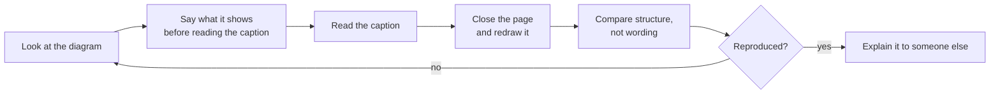
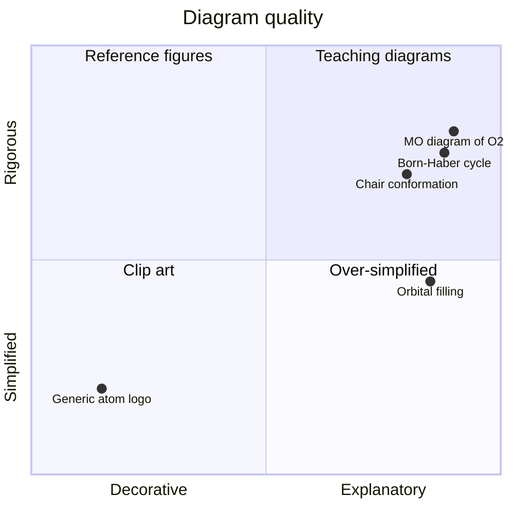

# Visual Learning

> **Purpose:** diagram-first treatment of the topics that resist prose. Each gallery
> collects the diagrams for one theme in one place, with a short explanation of what
> each diagram encodes and how to reconstruct it from memory.

Chemistry is spatial. A student who cannot picture an orbital, a chair conformation or
an electron-transfer chain will struggle long after they have memorised the words.
These galleries exist so that the pictures can be studied on their own, separately
from the chapters that introduce them.

---

## 1. How to use a gallery

**Figure 1 — The diagram drill.** Reproduction from memory is the whole method; the
caption is only a check.

---

## 2. Galleries

| Gallery | Themes | First introduced in |
|---|---|---|
| [Atomic structure](atomic-structure/README.md) | Subatomic particles, shells, orbitals, radial distributions, energy levels | [Level 1 Ch. 1](../02-elementary-chemistry/01-atomic-structure.md), [Level 3 Ch. 2](../04-advanced-chemistry/02-atomic-orbitals-and-quantum-numbers.md) |
| [Chemical bonding](chemical-bonding/README.md) | Ionic vs covalent vs metallic, Lewis structures, MO diagrams, bond polarity | [Level 1 Ch. 5](../02-elementary-chemistry/05-chemical-bonding.md), [Level 3 Ch. 3](../04-advanced-chemistry/03-molecular-orbital-theory.md) |
| [Reaction mechanisms](reaction-mechanisms/README.md) | Curly arrows, energy profiles, intermediates, catalytic cycles | [Level 3 Ch. 5](../04-advanced-chemistry/05-chemical-kinetics-and-reaction-mechanisms.md), [Level 4 Ch. 8](../05-organic-chemistry/08-haloalkanes-substitution-and-elimination.md) |
| [Thermodynamics](thermodynamics/README.md) | Enthalpy–entropy–Gibbs relationships, Born–Haber cycles, phase diagrams | [Level 3 Ch. 4](../04-advanced-chemistry/04-chemical-thermodynamics.md) |
| [Electrochemistry](electrochemistry/README.md) | Galvanic cells, electron and ion flow, electrolysis, Pourbaix-style maps | [Level 3 Ch. 8](../04-advanced-chemistry/08-electrochemical-cells-nernst-equation-and-electrolysis.md) |
| [Organic chemistry](organic-chemistry/README.md) | Functional-group maps, stereochemistry, conformational analysis, retrosynthesis trees | [Level 4](../05-organic-chemistry/README.md) |
| [Biochemistry](biochemistry/README.md) | Metabolic pathways, enzyme kinetics, DNA and protein architecture | [Level 8](../09-biochemistry/README.md) |

---

## 3. Diagram types and what they are good for

Mermaid offers more diagram types than most readers realise. Choosing the right type
is part of the explanation.

| Type | Best for | Chemistry example |
|---|---|---|
| `flowchart TD` / `LR` | processes, decision trees, hierarchies | separating a mixture; orbital filling order |
| `mindmap` | branching taxonomies | classification of matter; functional groups |
| `timeline` | historical development, sequences | the development of atomic models |
| `stateDiagram-v2` | states and transitions | phase changes; enzyme cycle |
| `sequenceDiagram` | ordered interactions between species | a titration; a catalytic cycle |
| `classDiagram` | typed relationships | families of compounds and their attributes |
| `quadrantChart` | two-axis trade-offs | bond polarity vs bond strength; technique selection |
| `pie` | composition | elemental abundance; atmospheric composition |
| `xychart-beta` | numerical trends | rate vs concentration; absorbance vs concentration |

### What Mermaid cannot do

Mermaid cannot draw a chemically accurate structure, an orbital surface, or a
stereochemically correct chair. Where such a figure is needed, the repository uses:

- a **balanced equation** (`\ce{}` LaTeX) instead of a pictorial scheme;
- an **ASCII or Unicode structure** in a fenced code block;
- a table of bond lengths, angles or energies;
- an SVG in [`assets/structures/`](../assets/structures/).

Using a flowchart to pretend to draw a molecule is worse than using no diagram at
all. The rule is: **a diagram must not assert something false.**

---

## 4. Reading a diagram critically

Every figure in this repository is followed by an explanatory paragraph. When you
meet a diagram elsewhere, ask these five questions.

1. **What is the axis, the scale, and the unit?** A log axis changes the story.
2. **What is held constant?** Most chemistry diagrams are slices through a
   multi-variable space.
3. **What is the baseline?** A "trend" depends entirely on the reference state.
4. **What is omitted?** Schematics routinely drop counter-ions, solvent and hydrogens.
5. **What would falsify the claim the diagram makes?** If nothing would, it is
   decoration.

**Figure 2 — A quality map for chemistry diagrams.** The upper-right quadrant is the
target: explanatory *and* rigorous. Decorative clip art teaches nothing.

---

## 5. Contributing a diagram

Diagrams are the most valuable contribution you can make. Follow the rules in
[CONTRIBUTING.md §3.3](../CONTRIBUTING.md#33-diagrams), run
`python3 scripts/validate_mermaid.py`, and always include the explanatory paragraph.
A diagram without an explanation is not finished.
