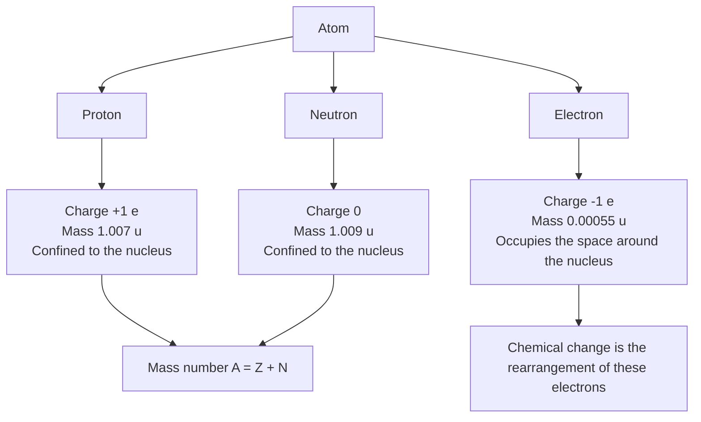
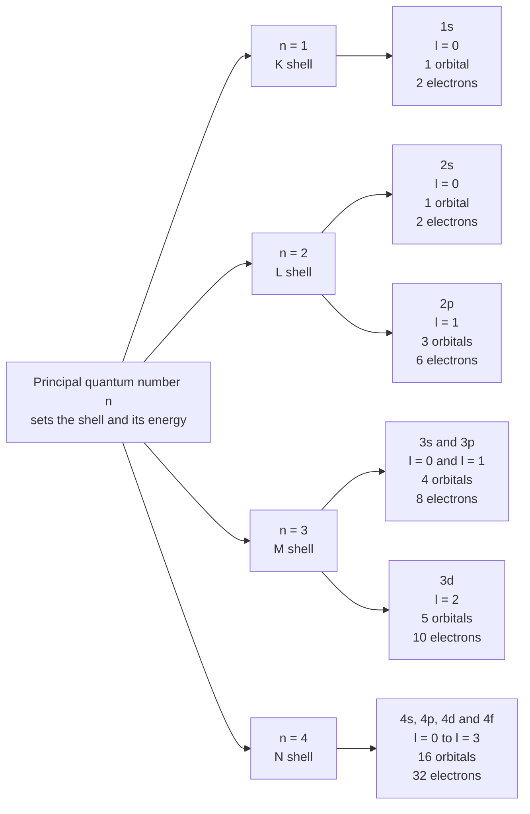
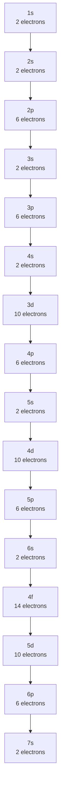
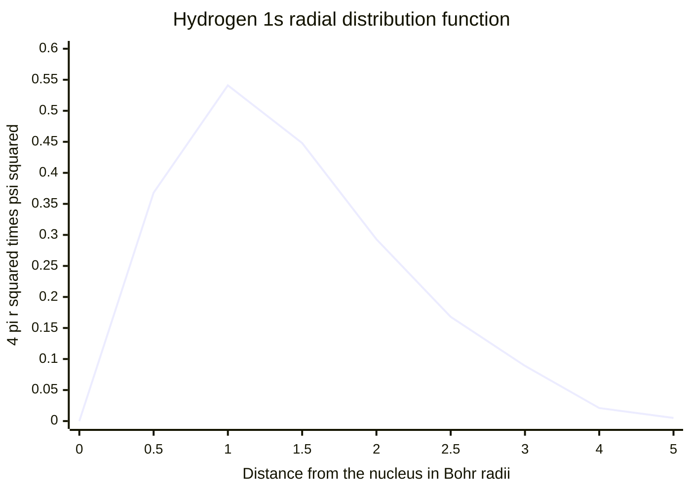
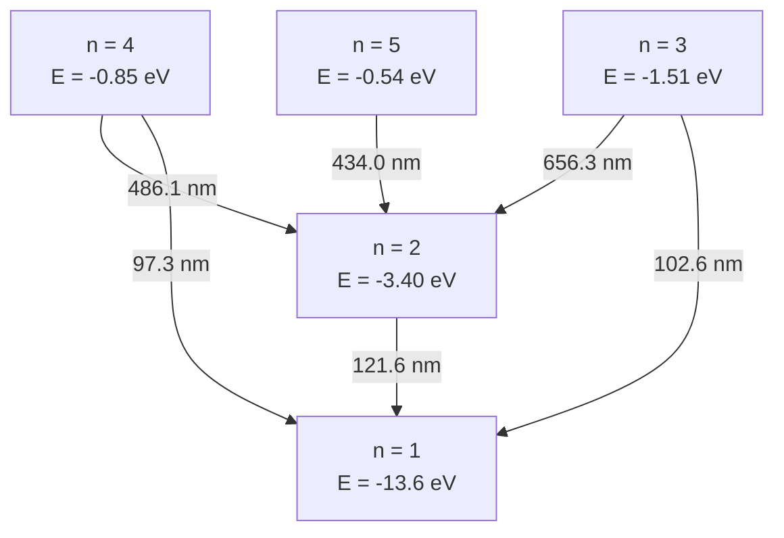
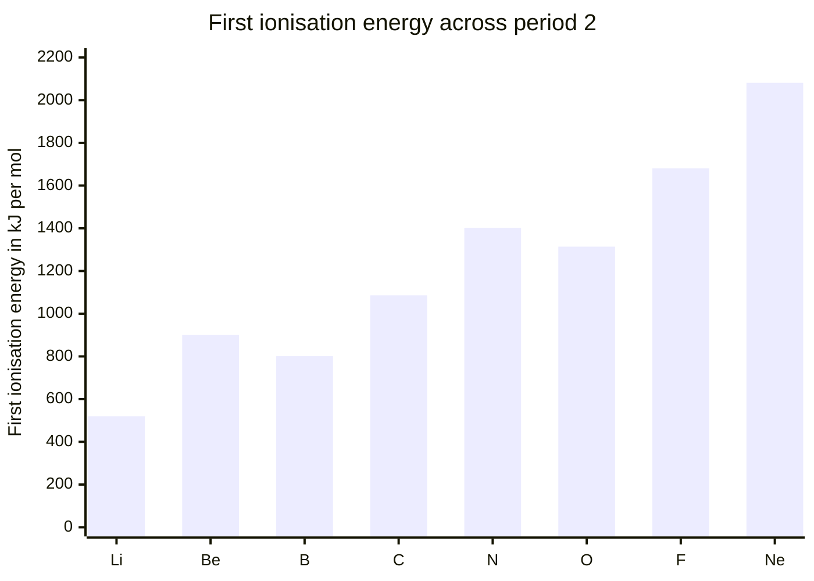

# Atomic Structure — Visual Gallery

> **Level:** 1 and 3 · **Figures:** 6 · **Study time:** 30 minutes
> **Supports:** [Level 1, Chapter 1 — Atomic Structure](../../02-elementary-chemistry/01-atomic-structure.md) and [Level 0, Chapter 7 — Introduction to the Periodic Table](../../01-foundations/07-introduction-to-the-periodic-table.md).
> **Companion galleries:** [Chemical bonding](../chemical-bonding/README.md) · [Thermodynamics](../thermodynamics/README.md)

Atomic structure is the one topic where the model you draw and the thing you are
modelling differ most sharply. An orbital is not a shape drawn with a line; a shell is
not a ring; an electron does not travel along a path. Every figure below is therefore a
**compression**, and the point of the gallery is to make the compression visible: what
each diagram shows, what it has quietly thrown away, and which question it should let
you answer without looking anything up.

Read the diagrams in order. Figures 1 to 3 are bookkeeping — the particles, the
address system, the filling sequence. Figures 4 to 6 are the three places where the
bookkeeping stops being enough: the radial distribution, the hydrogen spectrum, and the
periodic trend in ionisation energy.

---

## 1. Three particles, three jobs

**Figure 1 — Three particles, three jobs.** The diagram encodes the division of labour
that the whole of chemistry rests on: the nucleus carries essentially all the mass and
all the positive charge but does not participate directly in bond formation, whereas the
electron carries almost none of the mass and all of the chemistry. It deliberately omits
the internal structure of the proton and neutron (quarks, binding energy), the mass
defect that makes a nucleus lighter than its separated nucleons, and the fact that the
mass values are averages over isotopes. It also omits the strong nuclear force, which is
what keeps mutually repelling protons together. **Question it should answer:** why does
adding a neutron change the mass of an atom but not its chemical identity, while adding
a proton changes both?

The numbers repay attention. A proton is about 1836 times heavier than an electron, so
the electron cloud contributes roughly 0.05 per cent of the mass of a hydrogen atom yet
occupies essentially all of its volume. That asymmetry is why the nuclear model was so
shocking: nearly all of the atom is empty, and the part that does chemistry is almost
weightless.

---

## 2. Shell, subshell, orbital

**Figure 2 — The address system of an electron.** The diagram encodes three nested
levels of description and the counting rule that connects them: a subshell of angular
momentum quantum number $l$ contains $2l+1$ orbitals, and each orbital holds two
electrons, so a shell of principal quantum number $n$ holds $2n^2$ electrons. It
deliberately omits the shapes of the orbitals, the fact that subshells within one shell
have different energies once $n > 1$, and the magnetic quantum number $m_l$ and spin
$m_s$ that complete the label set. **Question it should answer:** why does the third
shell hold 18 electrons rather than 8, and why are those 18 not all at the same energy?

Notice what the hierarchy is *not*. It is not a set of physical containers arranged like
the layers of an onion. "Shell" is a bookkeeping term for all orbitals sharing $n$; a
2s electron spends part of its time closer to the nucleus than a 1s electron does,
which is exactly why the shell picture breaks down when you push it.

---

## 3. The order in which orbitals fill

**Figure 3 — The Madelung filling sequence.** The diagram encodes the operational rule
students actually use: fill in order of increasing $n + l$, and for equal $n + l$ fill the
lower $n$ first. It deliberately omits the reason the rule works (the competition between
nuclear attraction and electron–electron repulsion, which shifts the 4s orbital below
3d in the first place), the anomalies at chromium and copper, and the fact that the rule
is a guide to the *ground-state configuration of neutral atoms*, not a law of nature.
**Question it should answer:** why is the configuration of potassium
$[\ce{Ar}]\,4s^1$ rather than $[\ce{Ar}]\,3d^1$, even though the 3d subshell is nominally
in the lower shell?

The sequence is also the single most examined diagram in elementary chemistry and the
most frequently misremembered. The reliable way to reconstruct it is to write the
subshells in columns by $n$ and then read along the diagonals of $n + l$; the answer
should always satisfy the check that 4s is filled before 3d and 5s before 4d.

---

## 4. Where the electron actually is

**Figure 4 — Radial distribution function of the hydrogen 1s orbital.** The curve is
plotted from the exact expression $4\pi r^2|\psi_{1s}|^2 = 4(r/a_0)^2 e^{-2r/a_0}$,
using the Bohr radius $a_0$ as the unit, so the y-axis is in units of $a_0^{-1}$ and the
peak sits exactly at $r = a_0$. It encodes the difference between *probability density*
(which is largest at the nucleus) and *probability per shell* (which peaks at one Bohr
radius). It deliberately omits the angular part of the wavefunction, the nodes of the 2s
and 2p functions, and the fact that the vertical axis is a density, not a probability.
**Question it should answer:** why is the most probable distance of a 1s electron from
the nucleus not zero, even though the probability density is a maximum at the nucleus?

This is the figure that corrects the planetary picture. The electron has no radius and
no trajectory; what the curve reports is the probability of finding it in a thin shell
between $r$ and $r + dr$. Multiplying the density by $4\pi r^2$ is what makes the region
near the nucleus lose out: there is simply very little volume there.

---

## 5. Energy levels and the hydrogen spectrum

**Figure 5 — Emission transitions in hydrogen.** The diagram encodes the Rydberg
pattern $1/\lambda = R_H\left(1/n_1^2 - 1/n_2^2\right)$ as a set of labelled arrows, and
with it the reason a hydrogen discharge shows sharp lines rather than a continuum:
only differences between allowed levels are available. It deliberately omits the
continuum above the ionisation limit, the fine structure that splits each line into
closely spaced components, and the selection rule $\Delta l = \pm 1$ that decides which
transitions are actually allowed. **Question it should answer:** why does the Balmer
series (all transitions ending at $n = 2$) fall in the visible range while the Lyman
series (ending at $n = 1$) does not?

The figure is drawn as a flow, not as a to-scale energy-level diagram: the vertical
spacing between $n = 1$ and $n = 2$ is 10.2 eV, whereas between $n = 2$ and $n = 3$ it
is only 1.89 eV, and the drawing cannot show that ratio and the labels at the same time.
Read the arrows for their wavelengths, never for their lengths.

---

## 6. The ionisation-energy zigzag

**Figure 6 — First ionisation energy across period 2.** The diagram encodes the two
competing trends that produce the shape: the general rise from left to right caused by
increasing effective nuclear charge at constant shielding, and the two dips at boron and
oxygen. It deliberately omits the values for the $d$-block, the second and higher
ionisation energies, and the temperature dependence of the measurement; strictly, these
are enthalpies of ionisation at 298 K, not energies of an isolated atom at rest.
**Question it should answer:** why is the first ionisation energy of oxygen (1314
$\mathrm{kJ\ mol^{-1}}$) lower than that of nitrogen (1402 $\mathrm{kJ\ mol^{-1}}$),
despite oxygen having the larger nuclear charge?

The two dips are the whole value of the diagram, and each has a different cause. Boron
loses a $2p$ electron that is shielded by the filled 2s subshell and is higher in energy
than beryllium's $2s$ electron. Oxygen loses one of a pair of electrons that occupy the
same $2p$ orbital, and the repulsion between them partly offsets the extra nuclear
charge. Any explanation that invokes a single trend cannot reproduce either dip.

---

## Reconstruct from memory

Cover the page and redraw each item on blank paper. A drawing counts as reproduced only
if every label is present and the arrows point the right way.

1. **The three particles.** Three boxes with charge, approximate mass, and location. Add
   the two arithmetic relations that link them: $A = Z + N$ and
   $n_{\mathrm{e^-}} = Z - q$.
2. **The address system.** Four principal shells, their subshells, the orbital count of
   each subshell, and the electron capacity of each shell. Check that the totals are
   2, 8, 18 and 32.
3. **The filling sequence.** Write the sequence from 1s to 4p from memory, then extend
   to 6p. Verify against the $n + l$ rule.
4. **The radial distribution.** Sketch the curve, mark the peak at $a_0$, and label both
   axes with their units. State in one sentence why the curve is zero at $r = 0$.
5. **The hydrogen spectrum.** Draw the levels $n = 1$ to $n = 4$, then add the four
   arrows you are most confident about and label each with its series name.
6. **The period-2 trend.** Plot the eight bars on a sketched axis and mark the two dips
   with their electronic explanations.

If a redraw fails, do not reread the whole page. Find the single figure that failed and
redraw only that one after a delay of ten minutes.

---

## Where the diagram lies

| Figure | Careless reading | What the diagram actually says |
|---|---|---|
| 1 | "The electron orbits the nucleus like a planet." | It gives a location only as "outside the nucleus"; the shape of that region is a probability distribution, not a path. |
| 2 | "A shell is a physical layer, and 3d is farther out than 4s." | Shells are energy bookkeeping. Radial extent overlaps, and 4s is occupied before 3d in the ground state. |
| 3 | "This is the order in which electrons are added to every atom." | It is a guide for neutral ground-state atoms; ions, excited states and the $d$-block anomalies all depart from it. |
| 4 | "The electron is most likely to be found at the nucleus, because the curve starts high." | The plotted quantity is probability per shell, which is zero at the nucleus; the density, not the distribution, is maximal there. |
| 5 | "The arrows are drawn to scale, so 656 nm is a longer arrow than 486 nm." | The arrows encode connectivity and wavelength, not length; level spacings contract as $n$ rises. |
| 6 | "Ionisation energy increases monotonically across a period, so any dip means the data are wrong." | The dips at B and O are real and are produced by subshell structure and pairing repulsion, not by experimental error. |

The general lesson is the one stated in the gallery index: a schematic is a claim about
*structure*, not about *magnitude*. The moment you read a length, an area or a vertical
gap as quantitative, you are reading something the author did not draw.

---

## Notation used in this gallery

| Symbol | Meaning | Note |
|---|---|---|
| $Z$ | Atomic number | Number of protons; fixes the element |
| $N$ | Neutron number | $N = A - Z$ |
| $A$ | Mass number | Nucleon count, not a mass in units of grams |
| $n$ | Principal quantum number | Positive integer; sets the shell |
| $l$ | Angular momentum quantum number | $0 \le l \le n - 1$ |
| $m_l$ | Magnetic quantum number | $-l \le m_l \le +l$ |
| $a_0$ | Bohr radius | $5.29177 \times 10^{-11}$ m |
| $R_H$ | Rydberg constant | $1.09678 \times 10^7$ m$^{-1}$ |

One warning about the last two rows: $a_0$ and $R_H$ are exact in the Bohr model of
hydrogen and only approximate in many-electron atoms, where electron–electron repulsion
changes every orbital energy. Do not carry hydrogen's numbers across to helium without
saying so.

---

## Links back to the chapters

- The nuclear model and the evidence for it: [Level 1, Chapter 1 — Atomic Structure](../../02-elementary-chemistry/01-atomic-structure.md).
- Shells, subshells and configurations, the material behind Figures 2 and 3: [Level 1, Chapter 3 — Electron Shells, Orbitals and Configurations](../../02-elementary-chemistry/03-electron-shells-and-electron-configurations.md).
- The periodic trends plotted in Figure 6: [Level 1, Chapter 4 — Periodic Table Organization and Periodic Trends](../../02-elementary-chemistry/04-periodic-table-organization-and-periodic-trends.md).
- Quantum numbers and orbital shapes at degree level: [Level 3, Chapter 2 — Atomic Orbitals, Quantum Numbers and Advanced Configurations](../../04-advanced-chemistry/02-atomic-orbitals-and-quantum-numbers.md).
- The periodic-table vocabulary assumed here: [Level 0, Chapter 7 — Introduction to the Periodic Table](../../01-foundations/07-introduction-to-the-periodic-table.md).

The next gallery, [Chemical bonding](../chemical-bonding/README.md), takes the orbital picture built here and uses it to explain why atoms join.
